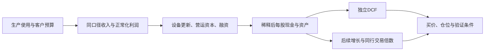

# AMZN亚马逊：综合投资评估、上游复核与跨公司比较报告

## 0. 执行摘要：值得分批参与，核心仓要靠现金兑现升级

**AMZN具备独立投资价值。以254.76美元为参考价，稳健基准标准下归为“优选参与（稳健建仓）”，适合先投入计划仓位的约三分之一；当前尚未达到足额核心首选的价格与现金证据要求。偏高风险高收益标准下，归为“值得小仓位参与的高赔率标的”，但AI基础设施进攻资金的配置顺位低于NVDA、AVGO。** 其独特性是AWS、自研计算、交易广告和履约网络共同形成的复利，避免只押单一芯片路线；优势成立的同时，新增资本的全周期回报仍待兑现。这里的“稳健建仓”指采用小额、分批和风险预算，并不表示股价回撤很小。

近端1—2个财报期，AWS放量有事实支持，但公开全年收入、营业利润预期已经接近本次基准，**没有足够证据把10月29日财报当成高把握的超预期交易**。可先参与长期逻辑；扩大仓位应等待AWS付费放量、剔一次性收益的利润与现金预算共同确认，或价格降至220—240美元。中远期以2029年末观察，基准交易价340—390美元，对应不含股息年化约9.4%—14.2%；乐观500—565美元、突破720—800美元具有商业机制，但突破证据仍弱，不能按其价值配核心重仓。悲观135—165美元意味着约35%—47%的目标日损失，期间回撤可能更深。

**最优载体裁决：成熟综合平台配置中AMZN与MSFT位于同一优先组；相对GOOGL、META、WMT及高溢价防守股，现价综合赔率更有吸引力。若只表达AI硬件利润捕获，NVDA优先；若主要表达定制ASIC与网络，AVGO优先；接受台湾集中风险且追求跨架构制造收费，可以选TSM。没有一家对手在业务组合、近端兑现、基准回报、右尾和尾部风险上同时全面压制AMZN。** CRWV的巨大条件右尾伴随原普通股接近归零的路径，不能据累计涨幅直接取代AMZN。

核心证伪红线有三条：AWS出现持续、可核验的需求/份额与正常化利润率双重失速；新增AI资产经过爬坡后仍无法覆盖更新资本、却继续形成不可逆资金缺口；广告监管或商家经济损伤使广告和成熟消费业务的利润中枢永久下降。量化触发和对应退出动作见第五章，单季税款或设备付款时点不单独充当证伪。

**研究与价格口径。** 研究日2026-10-16；信息截止 **2026-10-16T03:55:37-07:00（America/Los_Angeles，PDT；10:55:37 UTC）**。统一参考价为 **2026-10-15 16:00 EDT／13:00 PDT常规收盘254.76 USD**；这是一项最新完整交易日参考买价，后续实际成交须重算。证券为Amazon.com, Inc. Nasdaq普通股，交易/财报币种均USD，非ADR，ADR比例不适用。最新财报为截至2026-06-30的Q2/H1，业绩7月30日公布、10-Q列示备案日7月31日。主要目标日 **2029-12-31**，距报价日约3.21年；Q3实际结果尚未披露。[Amazon财报及指引][P01] [Q3官方日程][P03]

**股本和资产桥。** 6月末普通股10.783十亿股；Q2加权稀释10.903十亿股，本次将后者作为当前估值代理，未将其冒称研究日精确完全稀释股数。基本市值约2.75万亿美元；按10.903计算的稀释市值约2.778万亿美元。当前净金融负担70、非经营投资净值150均为上游的研究桥接，单位十亿美元，非即时可变现报价。上游2029年股数为11.368／11.237／11.209／11.186十亿，已包含持续SBC及条件收购发股。报告金额除股价、每股数和明确标注外均为 **USD bn，1bn=10亿美元**；公司回报均不含现金股息，股息差异另作机会成本检查。[公司报告][L-AMZN-C]、[情景报告][L-AMZN-S]

### 0.1 目标公司与14家对手的比较及配置取舍

统一价格基准日为 **2026-10-15正常交易收盘**，全部价格为USD／当前普通股或ADR，市值用全部经济股类的基本市值。`N`统一指**已扣持续SBC、正常化税后的营业利润NOPAT**；经营租金已留作费用，不无条件把经营租赁再资本化。分母期间逐行注明，TTM、已实现财年与研究E值不能互相冒充；跨公司增长用各自财年模型，并以年化消除观察日差异。CRWV、NET分母不适用及保险例外如实保留，不拿P/S与P/E比便宜。各项基准倍数、纯业务价的起点转换和统一2029年末等价回报见附录A—C。

四情景回报依序为**悲／基／乐／突**，均先列不含股息累计价格变化，再列CAGR；目标日写在公司栏。纯业务价是冻结经营比较锚的诊断，含净资产与股本变化，**不代表DCF或该倍数应当持续**。

| 公司、原目标日 | 比较关系 | 当前价格／基本市值／基准估值 | 壁垒、增长与主要短板 | 基准纯业务参考价及回报 | 四情景价格回报及年化 | 近期催化与预期差 | 基准／乐观支撑 | 与AMZN直接胜负及取舍 |
|---|---|---|---|---|---|---|---|---|
| **AMZN Amazon 亚马逊** 2029-12-31（3.21年） | 本研究对象 | $254.76／$2.75T 35.4× N，TTM；现金CNO为28.23× | AWS生产系统＋交易闭环；AI资本更新、广告商家回报为约束 | $476；+86.8%；年化+21.5% | 悲观：-47.0%～-35.2%；年化-17.9%～-12.7% 基准：+33.5%～+53.1%；年化+9.4%～+14.2% 乐观：+96.3%～+121.8%；年化+23.4%～+28.1% 突破：+182.6%～+214.0%；年化+38.2%～+42.8% | 10/29验证AWS 46—48.5；集团预期差小，现金兑现决定上修 | 中／中 | 平台配置第一组、与MSFT相当；AI进攻配置次于NVDA/AVGO；无全面压制它的单一替代者 |
| **MSFT Microsoft 微软** 2029-06-30（2.71年） | 直接竞争 | $539.44／$4.01T 32.4× N，FY26 | 办公/身份/开发分销更强；租赁及AI资产回报拖现金 | $869；+61.1%；年化+19.3% | 悲观：-42.0%～-29.2%；年化-18.2%～-12.0% 基准：+24.4%～+44.2%；年化+8.4%～+14.5% 乐观：+67.4%～+91.3%；年化+21.0%～+27.1% 突破：+118.4%～+147.5%；年化+33.4%～+39.7% | FY27Q1验证Azure交付及Copilot续费；新功能不等于增收 | 中／中 | 大致相当：AMZN上行略强，MSFT企业收费更确定；核心平台可互补 |
| **GOOGL Alphabet 谷歌** 2029-12-31（3.21年） | 直接竞争 | $349.22／$4.27T 33.5× N，TTM；26E约29.3× | 搜索/模型/TPU全栈；搜索迁移、硬件毛额与信用支持风险 | $504；+44.3%；年化+12.1% | 悲观：-58.2%～-47.0%；年化-23.8%～-17.9% 基准：+25.1%～+44.3%；年化+7.2%～+12.1% 乐观：+90.1%～+115.3%；年化+22.2%～+27.0% 突破：+148.3%～+179.5%；年化+32.7%～+37.7% | Cloud服务与TPU交付、搜索点击和资本预算；含投资收益EPS失真 | 中／中 | 特定维度AMZN优先：回报与业务组合更均衡；模型/TPU能力谷歌胜 |
| **ORCL Oracle 甲骨文** 2030-05-31（3.62年） | 直接竞争 | $134.47／$407.65B N未知；SBC前FY27指引P/E 16.6×仅辅助 | 数据库/OCI交付；预付款融资、长租与股权稀释更重 | $172.1；+28.0%；年化+7.0% | 悲观：-78.0%～-75.8%；年化-34.2%～-32.4% 基准：+44.7%～+68.8%；年化+10.7%～+15.5% 乐观：+169.2%～+219.7%；年化+31.4%～+37.8% 突破：+251.1%～+329.6%；年化+41.4%～+49.5% | FY27Q2核查交付、剔融资性预付的现金及新融资 | 中／弱 | 特定维度AMZN优先：存续与现金来源分散；ORCL仅右尾弹性更大 |
| **META Meta Platforms** 2029-12-31（3.21年） | 直接竞争 | $736.72／$1.88T 24.6× N，TTM | 推荐/社交广告高效率；算力、人才、法律和RL吸收现金 | $975；+32.3%；年化+9.1% | 悲观：-56.6%～-46.7%；年化-22.9%～-17.8% 基准：-8.6%～+7.5%；年化-2.8%～+2.3% 乐观：+37.9%～+66.5%；年化+10.5%～+17.2% 突破：+86.5%～+121.7%；年化+21.4%～+28.1% | Q3广告量价与2027投入框架；广告强不等于股东现金强 | 中／中 | 特定维度AMZN优先：基准赔率明显更高；纯广告分发META更强 |
| **WMT Walmart 沃尔玛** 2030-01-31（3.30年） | 直接竞争 | $117.87／$935.15B 42.1× N，FY26正常化 | 门店密度/必需消费防守；平台化溢价高、迁移成本仍在 | $167.2；+41.9%；年化+11.2% | 悲观：-51.6%～-41.9%；年化-19.7%～-15.2% 基准：-18.1%～-4.5%；年化-5.9%～-1.4% 乐观：+6.5%～+22.8%；年化+1.9%～+6.4% 突破：+36.1%～+55.5%；年化+9.8%～+14.3% | FY27Q3看剔关税退款后利润、配送单位贡献和假日指引 | 中／中 | 特定维度AMZN优先：长期资金买AMZN；WMT只在防守任务另议 |
| **CRWV CoreWeave** 2029-12-31（3.21年） | 直接竞争 | $69.69／$38.44B N不适用（经济利润薄/负）；TTM P/S 5.06× | 专用GPU调度/交付弹性；融资、设备更新及原股残值风险 | $211.93；+204.1%；年化+41.4% | 悲观：-100.0%～-98.9%；年化-100.0%～-75.1% 基准：+164.3%～+276.7%；年化+35.3%～+51.1% 乐观：+607.6%～+831.6%；年化+83.9%～+100.4% 突破：+886.7%～+1163.4%；年化+104.0%～+120.3% | Q3计费容量、融资净到款、客户预付及ATM；非仅看RPO | 中／中 | 条件胜负：AMZN保全/核心胜；CRWV融资成功时右尾大幅胜；非同风险替代 |
| **NET Cloudflare** 2029-12-31（3.21年） | 替代路线 | $316.32／$112.64B N不适用（含SBC仍亏）；TTM P/S 44.83× | 边缘执行/状态/安全入口；高稀释、付费规模与价格门槛 | $205.9；-34.9%；年化-12.5% | 悲观：-92.4%～-89.5%；年化-55.1%～-50.4% 基准：-62.6%～-51.5%；年化-26.4%～-20.2% 乐观：-29.8%～-7.6%；年化-10.4%～-2.4% 突破：+53.5%～+102.5%；年化+14.3%～+24.6% | 11/5检验cRPO、120%净留存和毛利；基准兑现仍难消化价格 | 中／弱 | 现价赔率AMZN明显占优；NET路线独特，但需突破而非正常兑现才能获利 |
| **NVDA NVIDIA 英伟达** 2030-01-31（3.30年） | 上下游 | $217.23／$5.25T 约31.6× N，TTM；非含投资收益P/E | CUDA/系统与互联截留利润；采购/信用支持和ASIC替代 | $390；+79.5%；年化+19.4% | 悲观：-58.6%～-47.1%；年化-23.5%～-17.5% 基准：+46.4%～+84.6%；年化+12.3%～+20.4% 乐观：+150.0%～+207.0%；年化+32.0%～+40.5% 突破：+242.0%～+312.5%；年化+45.2%～+53.7% | FY27Q3看毛利/DSO/现金；本次基准已按新公司报告下修 | 中／中 | 进攻配置NVDA优先；AMZN在收入分散与非GPU路线中占优，并非被全面压制 |
| **AVGO Broadcom 博通** 2028-10-29（2.04年） | 上下游 | $344.33／$1.64T 约33.5× N，FY26E扣SBC | ASIC实现/SerDes/网络＋软件；客户集中、采购与backstop | $670；+94.6%；年化+38.6% | 悲观：-64.5%～-53.9%；年化-39.8%～-31.6% 基准：+33.6%～+52.5%；年化+15.3%～+23.0% 乐观：+99.9%～+135.6%；年化+40.4%～+52.2% 突破：+177.5%～+211.7%；年化+64.9%～+74.6% | FY26Q4核查34.8收入指引与AI交付；本次基准下修 | 中／中 | ASIC主线AVGO优先；平台终端与分散性AMZN胜，保留双向议价判断 |
| **TSM TSMC 台积电** 2029-12-31（3.21年） | 上下游 | $422.25／$2.19T 25.14× N，26E；1ADR=5股 | 先进制造跨架构收费；资本密度与台湾地缘集中 | $782；+85.2%；年化+21.2% | 悲观：-51.9%～-42.7%；年化-20.4%～-15.9% 基准：+28.6%～+56.5%；年化+8.1%～+15.0% 乐观：+107.0%～+144.2%；年化+25.4%～+32.0% 突破：+156.7%～+201.2%；年化+34.1%～+41.0% | Q3已于10/15披露；Q4指引52.3—54.3，不能再赌Q3未知 | 中／中 | 条件胜负：TSM现金与架构中性胜；AMZN地区/终端组合胜 |
| **COST Costco 好市多** 2029-10-11（2.99年） | 机会成本 | $978.01／$433.38B 49.2× N，FY26正常化 | 会员/采购/店龄复利；高质量溢价、增长较线性 | $1,287；+31.6%；年化+9.6% | 悲观：-42.7%～-32.8%；年化-17.0%～-12.5% 基准：+2.7%～+15.6%；年化+0.9%～+5.0% 乐观：+31.3%～+49.0%；年化+9.5%～+14.3% 突破：+62.6%～+83.1%；年化+17.7%～+22.4% | 月度可比销售与会员续费；业绩强未必回报强 | 强／中 | 特定维度AMZN优先：赔率与右尾胜；会员经营证据COST胜 |
| **LIN Linde 林德** 2029-12-31（3.21年） | 机会成本 | $493.22／$227.36B 约30.6× N，26E调整后 | 现场供气/管网长约；电子增量有限、氢项目占款 | $626；+26.9%；年化+7.7% | 悲观：-45.1%～-31.5%；年化-17.0%～-11.1% 基准：+5.4%～+19.2%；年化+1.7%～+5.6% 乐观：+31.4%～+47.2%；年化+8.9%～+12.8% 突破：+56.5%～+74.0%；年化+15.0%～+18.8% | 10/29看电子增速、医疗效率及现金；新项目不等于订单净增 | 中／中 | 特定维度AMZN优先：增长与回报胜；低波动长约LIN胜 |
| **WM Waste Management** 2029-12-31（3.21年） | 机会成本 | $224.19／$89.61B 约29.0× N，26E；D&A研究代理 | 路线密度/处置许可；量偏弱、医疗整合与资源化再投资 | $294；+31.1%；年化+8.8% | 悲观：-45.6%～-37.1%；年化-17.3%～-13.4% 基准：-11.2%～+22.7%；年化-3.6%～+6.6% 乐观：+10.6%～+47.6%；年化+3.2%～+12.9% 突破：+30.2%～+69.1%；年化+8.6%～+17.8% | 10/27看价格减成本、量、医疗现金；不外推FCF高增速 | 中／中 | 特定维度AMZN优先：复利与赔率胜；本地需求韧性WM胜 |
| **PGR Progressive 前进保险** 2029-12-31（3.21年） | 机会成本 | $213.75／$124.06B 约13.8× 正常化2027E P/E；保险不套EV/NOPAT | 风险定价/分发/理赔；利润正常化、新客/灾损与资本留存 | $257；+20.2%；年化+5.9% | 悲观：-45.3%～-35.0%；年化-17.1%～-12.5% 基准：+11.8%～+28.7%；年化+3.5%～+8.2% 乐观：+64.2%～+87.6%；年化+16.7%～+21.6% 突破：+94.2%～+120.8%；年化+22.9%～+28.0% | Q3经营已知；11月完整附注、月报验证获客和CR | 中／中 | 条件胜负：AMZN增长弹性胜；PGR含息回报与AI分散价值使其不可忽视 |

注意：NVDA、AVGO基准已在本次按较新公司报告校准；其余对手四情景保留最新正式经营条件、统一换到10/15买价。14家不是同一联合情景，不能将每家的突破同时当作世界基准。ORCL的当前经济NOPAT无法由所取公开材料可靠重建同期间年度值，因此明确未知，16.6倍SBC前指引P/E不能用于胜负排序。

### 0.2 AMZN上游四情景复核与校准结果

研究日2026-10-16；参考股价254.76 USD、报价2026-10-15 16:00 EDT；交易与财报币种一致、非ADR；当前10.903十亿股为披露期间稀释代理。共同目标日2029-12-31，持有期3.2115年。**四情景经营预测及交易区间均采用**：独立复核未发现足以改写AMZN中心路径的新增原始证据。调整集中在横评时剔投资重估、统一SBC经济成本和比较日，而不为了显示“校准”人为改目标价。表内纯业务价冻结上游现金收益CNO倍数28.2277；其与统一NOPAT口径的转换在第一章列出。

| 经营情景 | 上游纯业务参考价／相对现价 | 上游预计交易价／相对现价 | 本次裁决及决定性原因 | 复核后纯业务参考价 | 复核后目标日交易价 | 复核后价格回报／CAGR | 支撑度 |
|---|---|---|---|---|---|---|---|
| 悲观／受损 | $274／+7.6% | $135—165／−47.0%～−35.2% | **采用**；保留云净价、广告及低ROIC损伤，也保留削减可选建设和新业务止损 | $274／+7.6% | $135—165 | −47.0%～−35.2%；−17.9%～−12.7% | 中 |
| 基准／正常兑现 | $476／+86.8% | $340—390／+33.5%～+53.1% | **采用**；Q2运行速率与2026起点闭合；346的AWS收入并未要求无条件抢占全球份额；维持更新资本和稀释 | $476／+86.8% | $340—390 | +33.5%～+53.1%；+9.4%～+14.2% | 中 |
| 乐观／超预期 | $630／+147.3% | $500—565／+96.3%～+121.8% | **采用**；成本留存/利用率与软件附着有机制，且较强增长同步承担320的2029现金CapEx | $630／+147.3% | $500—565 | +96.3%～+121.8%；+23.4%～+28.1% | 中 |
| 突破／非线性 | $796／+212.5% | $720—800／+182.6%～+214.0% | **采用为条件分支**；独立应用、平均约10GW可服务容量和客户预算必须共同兑现，不把芯片/AI两项运行率重复相加 | $796／+212.5% | $720—800 | +182.6%～+214.0%；+38.2%～+42.8% | 弱 |

纯业务价是固定估值锚的反事实诊断。基准476美元并不表示该价格有现金折现支持：相同模型当前基准DCF约240美元、目标日剩余DCF约317美元；未来交易区间含有限的市场溢价。上游悲观纯业务仍微增、交易价却显著下跌，主要来自经营质量下降对应的倍数收缩，不能把两列混成同一种“业务回报”。

### 0.3 六个正交角度的独立评估

| 投资审视角度 | 独立结论 | 支持证据与优势 | 主要限制 |
|---|---|---|---|
| 近期兑现与预期修正：1—2季 | **利弊并存：云强，明确超预期差不足** | AWS已加速；Q3官方指引与容量交付可验证；10/29是确定检查点 | 公开年度预期接近基准；Prime Day错期、折旧及CapEx容易影响读数；IV已包含财报风险 |
| 中远期复利：2—4年及以后 | **有利：强壁垒平台成长** | 数据/身份/生产系统、购买意图、履约密度；2029基准NOPAT157.8、稀释EPS13.34 | 新AI资产的ROIC低于既有云并非小风险；多云、低价及外部应用分走价值 |
| 基准价格赔率 | **利弊并存：合理偏积极，非深折价** | 交易价基准年化9.4%—14.2%，无需突破或倍数扩张 | 现价高于当前基准DCF约6%；目标区间上沿高于同期DCF约23%；长债5.10%提高机会成本 |
| 乐观/突破非线性 | **有利：右尾好，未达进攻首选** | 500—565／720—800，主要由经营与平台收费放大；不靠倍数翻倍 | 需付费任务、资源齐套及预算过关；2029突破FCFF只87.5，不能把利润增长全部当现金 |
| 下行保全与外生韧性 | **利弊并存：存续较强，价格底线较弱** | 多利润池、经营现金和融资能力；可停可选建设、缩探索投入 | FCF承压、租约与采购刚性；悲观目标下行35%—47%，当前悲观DCF约98；非净现金硬底 |
| 相对吸引力与机会成本 | **利弊并存：平台优选，进攻有更优载体** | 多数同行及高溢价防守标的前有赔率优势，与MSFT可互补 | NVDA/AVGO更适合捕获AI供应链利润；TSM、PGR有AMZN不能提供的分散特征 |

## 第一章：上游经营与四情景模型的穿透复核

### 1.1 先锁定资料边界与证据性质

公司索引是研究池入口，选取14家对手后逐一调阅其最新正式公司报告和最新正式情景报告。AMZN两份均为10/16；部分同行情景报告为10/2，而公司报告已经更新至10/14—16，这些日期差成为本次冲突复核的对象。行业及背景仅使用与AMZN的云、广告、零售、芯片、电力和建设相关的正式结果。唯一使用的本地金融资料是10/15有日期快照；目录规则只决定文件放置，不作为经济证据。没有使用既有公司对比、排序、情绪、技术面、历史备份或其他金融资料子目录的结论。

本文标记：**F**为已核实披露；**M**为管理层/合作方目标；**C**为直接计算；**I**为研究推断或条件模型；**S**为公开一致预期；**U**为未知。上游预测并不会因为已经正式归档就变成F。支撑度不等于概率，四情景也不是穷尽所有混合状态的概率分布。所有价格判断从当前买价、可承载利润、资本需求和分母推出，没有将过去数月的涨跌用作便宜或透支的证据。

### 1.2 会计利润、证券和企业价值桥

本次采用上游下列桥接，同时用原始申报/公告定位关键差异。单位为十亿美元、股数为十亿。

| 项目 | 复核采用值与算法 | 裁决及投资含义 |
|---|---|---|
| Q2集团／AWS收入 | 200.606／42.232；AWS营业利润16.621 | F；广告19.809已在北美/国际内，不能加在集团分部合计上 |
| Q2营业利润 | GAAP27.461；剔关税退款0.640与能源重估0.551后26.270 | C；经营改善成立，单独清除收益而不否定主业增长 |
| Q2净利润 | 62.647；非经营其他收益53.415，主要来自投资重估 | F；快照TTM EPS12.21、P/E20.86不能直接成为经营估值锚 |
| 正常化TTM EBIT | 93.712＋4.300＋2.440−1.191−1.500=97.761 | I/C；后一个1.500是持续法律/重组成本准备，不把大型公司所有费用永久清零 |
| 税后营业利润／现金收益 | NOPAT=97.761×78%=76.254；CNO=76.254＋19.314 SBC=95.568 | C；统一横评的N含SBC费用；CNO用于股本承担SBC的现金模型，二者不能同名比较 |
| 估值分子 | 254.76×10.903＋70−150=经营EV约2,697.7 | I/C；70为净金融负担工作估计；150含税/流动性折价，不是现金 |
| 当前倍数 | EV/NOPAT约35.38；EV/CNO约28.23 | C；不能把AMZN28.23倍CNO与微软32.4倍NOPAT直接比贵贱 |
| 股本 | 10.783时点普通股、10.903季度加权稀释代理；2029基准11.237 | F/I；SBC留在经济账内，未来股数约较代理起点增加3.1% |

上述财务起点见[AMZN公司财务基线][L-AMZN-C]、[情景报告§1、4、5][L-AMZN-S]。本次原始10-Q复核同时确认：H1没有普通股回购，剩余61亿美元授权不等于已经减少分母；普通股加未归属奖励约110亿股是另一种“全部奖励”口径，也不等于当期稀释EPS分母。[SEC Q2 10-Q，Note 6][P02]

SBC有两种可闭合的处理：费用保留、用真实现金抵销未来发行；或现金加回、持续增加股数。上游选择后者，不能再在同一DCF扣一次等额SBC。为做同行倍数比较，本次将目标CNO倍数**等价翻译**为已扣SBC的NOPAT倍数，而不改变现金流和目标股权价值：

| 情景 | 2029 NOPAT／CNO | 原CNO交易倍数 | 等价EV/NOPAT | 稀释股数 | 正常化EPS／FCFF每股 |
|---|---|---|---|---|---|
| 悲观 | 81.6／105.6 | 14—17 | 18.1—22.0 | 11.368 | $6.52／$3.98 |
| 基准 | 157.8／185.8 | 20—23 | 23.5—27.1 | 11.237 | $13.34／$6.95 |
| 乐观 | 212.9／246.9 | 22—25 | 25.5—29.0 | 11.209 | $18.27／$7.68 |
| 突破 | 271.5／313.5 | 25—28 | 28.9—32.3 | 11.186 | $23.51／$7.82 |

公式是`等价N倍数=CNO倍数×CNO/NOPAT`。它是同一情景的代数换元，不是以DCF倒推交易倍数。当前35.38倍N高于基准2029的23.5—27.1倍，明确承担约23%—34%的经营倍数收缩；股票仍有正回报，来源是每股经营增长。固定CNO所得476美元与严格固定当前N所得约506美元，是两种诊断定义；**正文最终纯业务价格保留上游CNO定义476，506只用于说明SBC占比变化的口径影响**，不另造一套投资目标。

AMZN不属于ADR，也没有Up-C、少数上市子公司经济权益未穿透的主要问题。被投资企业的可转工具是资产，不是AMZN自身股权融资。已开始经营租赁的租金在成本中保留；融资租赁进入金融负担。未开始租约137.214、采购义务130.065是未来分期责任，不能在费用、CapEx、债务之外再次整包减值，也不能当成不存在。当前资产负债表缺少9/30完整更新，因此70的净负担只保留为估计；偏差10约影响每股0.92美元，远小于资本回报假设的影响。[4.3][L-AMZN-S]

### 1.3 近期运行速率与2026年度起点闭合

上游不是用旧的AWS低增速起点外推：2026年AWS180包含Q1/Q2实际与下半年加速。Q1/Q2集团实际合计382.125，Q3中心201、Q4中心247合计后约830.125，和年度830的取整工作点相容。AWS上半年约79.8，加Q3 46—48.5、Q4 50—54得到175.8—182.3，年度180处于其中。集团正常化营业利润111.3也落在最近已实现基础加两季预测的可解释范围内。[公司报告][L-AMZN-C]、[情景报告][L-AMZN-S]

**裁决采用：没有“高频已跃升而年度停留旧基数”的明显脱节。** 公司对Q3的官方指引为收入197—202、营业利润22.5—26.5，并解释Prime Day错期及汇率拖累。本次上游Q3收入198—204、正常化利润24—28.5略偏指引上沿，已经包含一定好于官方中枢的预期，不能随后再把它当作“完全未计入云加速”的保守起点。Q4尚无官方指引；242—252及31—36的收入/正常化利润是I。[Q2官方指引][P01]

全年现金CapEx220为管理层更新的工作锚，H1已支付96.310，则H2尚需约123.690。Q3的58—66、Q4的58—69应按相容组合使用，不能把最高利润、最高收款和最低投资分别拼起来。2026模型FCFF约−41.6、公司定义FCF约−42，这不是未来资不抵债的证明，却否定了“短期净利润激增即可支付全部建设”的说法。

### 1.4 可加子池：先把云服务、硬件、软件和最终付款分开

本次将能够近似对齐的综合云基础设施标为T1，将专业GPU云的一次销售标为T2-C。T1供应商可能采购T2-C，T2-C又采购机房和芯片，因此它们是**不同收入层**，不可与芯片/机房收入共同当作最终客户预算。行业报告明确把AWS/Azure/GCP/OCI置于X相邻层，没有给出“全部综合云的全球精确上限”。不能拿专业云2028基准101.47，去判定AWS346必然超过行业总池。[L-I-CLOUD]

独立市场调查给出2026Q2全球云基础设施143.4、TTM500，Amazon/Microsoft/Google份额约28%/20%/15%。该调查的IaaS/PaaS/托管私有云范围，与AWS全分部、Google含Workspace和外售TPU、Azure/开发工具均有差别；AWS42.232直接除143.4约29.5%，已提示边界差异。[Synergy原始调查，7/30][P09]

为检验量级，使用2026Q2年化573.6作为运行速率参照，按20%—25%的年增速推到2029年末附近，得到约1.09—1.25万亿美元的T1条件窗口。这个窗口是I，不是Synergy的远期预测；它包含增长放缓，也没有把本季43%的增速长期锁定。并列上游基准，作如下口径调整：

| 2029附近收入 | 上游模型值 | 本次T1可比处理 | 对子池的含义 |
|---|---:|---|---|
| AMZN AWS | 346 | 假设90%—95%接近T1边界，即311—329；比例为条件范围 | 约占上述T1窗口25%—30%，不需要全球份额无条件大幅提高 |
| MSFT Azure/开发平台 | FY29 239.7，FY30 287.6 | 自然年2029近似半个FY29＋半个FY30，约263.7；开发工具仍需剔边界 | 为同日比较修正财政期；不能用FY29六月数字直接当12月 |
| GOOGL Cloud | 276.9 | 先剔外售TPU系统45.5，再对Workspace等留18—30的条件扣除，约201—213 | 82%的最新增速不全部是持续租云；谷歌份额扩大与Amazon基本稳定可以共存 |
| ORCL OCI | FY29约95.4、FY30 116.6 | 按自然年2029五个月FY29、七个月FY30近似，约107.8 | 包含客户供卡与自有硬件，不用同一种净收入/MW解释全部 |
| CRWV | 64.58 | 对专业云本身保留；合计T1时必须剔被大云转售的同源部分 | 不能将CRWV收入与客户大云的转售收入无损相加 |

上述五家未经转售消除的量级约0.95—0.98万亿美元；若仅作20—35的重复层收入诊断扣除，留下约0.91—0.96万亿美元，T1窗口尚有约0.13—0.34万亿美元留给其他供应商。重复额、Workspace比例和未来总池未被完整公开，**这只能通过量级相容性检查，不能宣称全行业份额已审计闭合**。核心裁决是采用AMZN基准346；现有证据没有证明它单独要求不可能的份额。

在T2-C内，行业2028基准范围72.84—135.90、代表101.47，CRWV情景报告2028基准46.63，对应代表点约46%，同日公司报告工作点38则约37%。前者要求CRWV继续占很高份额，但还留空间给Nebius、IREN及私营供应商；远期收入的直接证据弱于合同存量。**本次采用完整融资联立情景46.63作为条件横评基准，38保留为较低交付分支，不简单平均；融资与客户付款未获完整锁定，因此不将高条件回报升级为稳健胜出。** 若所有专业云都取各自乐观/突破，可能超出同一产业基准池；应升级总需求条件或下调某些份额，不能把各公司高增长相互当成独立验证。

AMZN突破AWS530、谷歌Cloud486.8及其他平台突破同时成立，会显著提高总预算要求；这些是**可替代、有关联的条件分支**。本次保留AMZN突破，不赋予与同行突破同时实现的隐含高概率，也不因共同约束就把所有远期业务机械归零。

### 1.5 物理供给、客户预算与上下游双向口供

AMZN基准直接AI收入115，可以由平均6GW可服务IT容量×22百万美元/MW年×72%付费等效利用率≈95，再加20独立应用解释；突破250需要10GW×25×80%=200，再加50应用。GW、收费密度和利用率是I，不是已披露的逐址合同。通用AWS231与直接AI115可加；“AI运行率超过25”和“Chips运行率超过25”互有重叠，不能再各加一份。

| 约束 | 支持事实/条件 | 反证与裁决 |
|---|---|---|
| 客户生产使用 | Anthropic已使用Trainium，合作上限5GW、未来十年采购超100；OpenAI另有多年Trainium安排；Snowflake提供独立企业采购 | 合同总额不是年度收入，模型客户同时接受Amazon资本；客户终端回款与信用有关联。采用需求方向，保留回款未知 |
| 资本投入 | 2026—29基准现金CapEx合计975，假设70%—80%服务云，则按25—35/GW可覆盖较大新增容量量级 | 还要承担通用云、更新、建设等待和内存涨价；美元增加不等于MW增加。不能凭预算单独确认6GW平均计费 |
| 制造链 | TSM最新Q3已披露46.72收入、66.4%毛利；N2/封装和HBM路径有真实进展 | 制造交付、电网接入、机架验收、付费使用是串行条件；高制造利润不证明云业主ROIC合格 |
| 电力/机房 | Talen、Cipher等对家披露部分供电和交付；行业台账区分请求、可用送电与实际负荷 | 园区总电力含PUE，年底容量不是年度平均；部分先收租，AWS仍可能尚未收费。采用已交付事实，不提前确认全部项目 |
| 终端预算 | Token背景2028最终AI服务付款基准535、乐观1,300；代码与工作流为主增量 | AWS直接AI82的2028基准约为535的15%，仅作预算压力尺度；云采购与最终服务付款层级不同，不能当精确份额或加总 |

客户合作和生产使用本次分别追到[Anthropic原始合作公告][P10]及Amazon业务说明；同一合同在多篇媒体出现仅算一个根事件。TSM Q3是10/15的新财报，已在10/16公司/情景正式报告中体现，不再算成第二份独立证据。[TSMC Q3原始结果][P08] 电力与建设量级来自[电力台账][L-B-POWER]、[建设规模][L-B-BUILD]、[瓶颈报告][L-B-BOTTLENECK]，其估计本身保留未知。

供应商预算还暴露了同行报告的冲突。NVDA较新公司报告FY28收入633.4、FY29 778.5，低于10/2情景报告692、866；其公司报告已经指出需要1.2—1.4万亿美元客户年度建设/更新预算，高于背景2027基准992.6且接近宽范围上沿。AVGO新公司报告FY28 AI176、集团231，低于旧情景AI198、集团254.5，差异来自交付分期、归属与融资。**本次采用较新的经营约束下调两家的横评基准，仍保留有机制的上行分支；计算见附录A。** 不把同一约束再作为AMZN现金流、折现率和倍数的额外统一扣分。

### 1.6 广告与零售必须共享同一个客户利润池

AMZN2028广告117.5是全球、跨形式收入；行业2028美国商业媒体97.28属于重叠视图，不能直接相除，也不能加在搜索/展示/视频四形式合计413.12之外。本次作边界算例：假设AMZN广告的60%—70%来自美国，其中70%—85%落入商业媒体，得到49—70，约占美国商业媒体51%—72%。比例未知，数字只说明需要继续保持领先及合格站外采用，并未单独超过总池。Walmart、其他零售媒体及品牌自建还会争夺剩余预算，不能把所有平台的提价都当成无成本的增量。[L-I-ADS]

FTC的广告起诉与Amazon的否认同时保留。诉讼指控不等于已判赔；它揭示商家增量回报与平台收费之间的真实边界。上游商家算例中30美元商品贡献3.5，再多收1就减少约29%商家利润，是I而非平均商家统计。2029基准广告40%利润率没有继续无限抬升，悲观32%对应具体经营损伤；不再用同一未决诉讼把基准广告收入、利润、DCF和市场倍数各砍一次。[FTC原始诉状/公告][P11] [Amazon回应][P12]

美国Q2电商季调销售340.2、同比12.2%，占零售17.1%，说明总体线上需求仍扩张；这是名义行业销售，不是AMZN份额统计。AMZN自营按毛额、第三方按服务净额，Walmart与Costco又有不同商品/会费组合，集团收入大小不能代表交易份额。[美国人口普查局Q2报告][P13]

AMZNQ2付费件数+17%，运输加履约费用合计+约16.5%，粗略每件成本仅改善约0.4%。机器人、地域化和密度已产生方向性效果，全网再投资、快速小单和工资仍会消耗节省。基准成熟消费服务2029利润率4.5%，对比2026 3.5%，属于渐进改善；没有将某站点25%的降本目标套全网，也没有把机器人内部应用再变成一份外售收入。[公司报告][L-AMZN-C]、[情景报告][L-AMZN-S]

会员零售和仓储自动化行业的正式研究进一步支持这一约束：终端消费内部份额迁移不能全部记作行业新增需求，自动化设备投入与完整履约回收不同。边缘云行业也指出执行应靠近数据/状态而非只靠近用户，因此NET的机会与AWS存量数据优势可以同时存在。卫星行业2028/2030基准连接服务池约31.79/47.63；AMZN 2029基准Leo约5已经需要有意义的份额、终端/企业付费和忙时容量，不能因“已制造卫星”就另加大额价值。其Zoox基准约0.5、仍需地方许可与每车净收益，突破放大也须承担新授权和投入。[会员零售][L-I-RETAIL] [仓储自动化][L-I-WARE] [边缘云][L-I-EDGE] [卫星行业][L-I-SAT]

### 1.7 风险去重、DCF与交易倍数的独立裁决

本次沿“行业预算→公司量价→资本/股本→每股现金→定价”检查同一风险。基准AWS营业利润率从Q2剔能源收益约38.1%转到2029约35.3%，原因是直接AI较低利润率组合，不是某一年凭空断崖。基准仍给出通用云40%、直接AI26%，没有在经营上假定全部竞争失利；现金CapEx250、硬件/设施分寿命、融资和11.237股本承担另一类真实资本后果。DCF四情景统一WACC9%，没有给悲观再叠加一套高折现率。

目标交易倍数来自目标日之后的增长、ROIC、资本强度和同行经营锚。换成统一N，AMZN基准23.5—27.1倍，接近微软目标25—29倍、谷歌26—30倍，明显高于周期/受损路径；AMZN混合零售、资本更新和较低边际回报，支持对纯企业软件略折价。当前约35.4倍N向该区间收敛，不是无证据腰斩。长期利率约5.10%也支持给出相应资本补偿，但不能单凭利率为所有股票统一指定倍数。

DCF先由现金流计算，再比较交易区间：当前四条件价值98／240／367／546；2029剩余129／317／485／721。基准340—390高于2029 DCF约7%—23%，这个差额属于市场愿付溢价；上沿不被当成“保守内在价值”。终值仍贡献约56%—62%经营价值，延长模型至2040不自动消除远期未知。**裁决：经营及四情景价格采用，倍数逻辑成立但证据仅中；安全边际放在买价与仓位，而不塞回基准经营预测。**[第5章及附录D/E][L-AMZN-S]

## 第二章：互联网与市场交易层独立取证

### 2.1 增量台账：新闻日期与本次新增认识分开

AMZN上游已经更新到本日02:50 PDT。本次冻结为03:55:37 PDT；**未核到这一小时内足以改写经营中心的重大新申报或正式财报**。因此独立增量主要是公开预期结构、监管原文、内部人和期权的口径校验，以及同行模型冲突的裁决。近期公告被本次再次核实，不会自动获得“截止后新事件”身份。

| 根事件／原始资料 | 经济/披露时间与级别 | 净影响及模型处理 |
|---|---|---|
| Q3财报电话会通知 | 10/15公告，10/29 14:00 PT，F | 建立明确近端验证日；结果尚未知，不借“即将财报”证明会超预期 |
| TSM Q3与Q4指引 | 10/15，F/M | 支持制造与AI交付仍强；亦提示供应商截留利润，不能把代工收入当AWS现金 |
| Wiwynn美国服务器机架生产扩张 | 截止时官方页面可见；正文未给精确首发时间，F/M | 支持供应链本地化；2027就业/产能计划不是当前合格机架交付量，不单独上调收入或归类为截止后事件 |
| Anthropic/AWS采购与资本合作 | 4/20及后续正式披露，F/M，已在上游 | 采用与资金支持同时存在；十年合同、5GW上限和Amazon投资不算三份独立终端需求 |
| FTC广告收费案与Amazon回应 | 8/31起诉，后续诉状更新，F但实体责任未决 | 保留经营/制度风险分支；不确认未知罚款，也不因再次转载重复提高风险概率 |

资料分别见[P03、P08、P10—P12、P14]。所谓Decart等潜在交易若仅有谈判报道、缺少正式完成和可核实条款，本次不赋值。招聘、开发活跃与开源使用没有经过公司范围/时间一致的量化，不编造一套“高频景气指数”。

### 2.2 一致预期：当前差异远小于叙事差异

以下为冻结时公开页面可见信息，均为S，动态网页没有逐分析师时间戳。Stock Analysis标注EPS为non-GAAP调整口径；其净利润行和EPS行口径不同，不能用两者相除恢复精确股本。MarketBeat页面的季度EPS也未提供足够调整桥，因此只记录，不直接与本研究正常化EPS比“超额”。[年度预期页面，10/16更新][P04] [季度公开预期][P05]

| 项目 | 公开预期/官方值 | 本研究复核路径 | 判断 |
|---|---:|---:|---|
| 2026Q3收入 | MarketBeat打开页约202.08；官方197—202 | 198—204，中心201 | 中心比公开均值低约0.5%；到204也仅高约1%，不存在已证实的大幅正预期差 |
| 2026Q3 EPS | 页面约1.96，调整桥未充分说明 | 不报伪精确可比GAAP EPS点值；正常化营业利润24—28.5 | 投资重估/税款会主导GAAP差异，用AWS与营业利润验收 |
| 2026全年收入 | 828.56 | 830 | 本研究约高0.17%，接近共识 |
| 2026营业利润 | 110.11，页面经营项 | 正常化111.3 | 约高1.1%；双方正常化细节不全，差异不足以构成大额alpha |
| 2026毛利率 | 页面51.45% | 全年同口径独立点值U；Q3 53%—55.5%、Q4 51.5%—54%为季度路径 | 年度与季度、商品与服务组合不同，不据此计算伪精确毛利率预期差 |
| 2026公司FCF | −33.94 | 约−42 | 本研究约低8.1，主要需验证现金税、CapEx与付款，方向更谨慎 |
| 2027全年收入 | 页面概要949.30 | 基准955.2；乐观990 | 基准约高0.6%；乐观约高4.3%，须经营超预期才获得该差异 |
| 2026/2027 EPS | 调整后8.31／10.45 | 不把它们当作含SBC正常化EPS；也不用GAAP净利140.32倒推 | 未披露可靠SBC/投资调整明细，EPS预期差为U |
| AWS、广告利润率及2028细分共识 | 公开页缺乏可靠同口径值 | 使用上游经营范围＋现价反推 | U；不给未核实的券商分部数字制造精确预期差 |

检索摘要曾显示另一公开渠道Q3收入约206.155，但正文403、样本与更新时间无法核验；MarketBeat搜索摘要也与打开页有数千万美元差异。采用可打开的202.08并保留不确定性，206.155只作为冲突记录，不纳入模型或宣称平均市场共识。若真实可比预期接近206，本研究Q3中心反而偏低。**近期核心分歧是现金效率和AWS后续斜率，不是总收入预测显著领先市场。**

### 2.3 现价究竟计入了多少成功

采用上游相同经营模型，254.76比当前基准DCF240高约6.2%。维持全部经营/资本假设时，约8.71%的WACC即可支持现价；若坚持9%，一变量等值解是AWS 2027年以后营业利润率整体提高约3.5个百分点、2029约38.8%而非35.3%。这是I/C的局部反推，不能说“市场唯一押注利润率38.8%”。更强广告、低一点更新资本或较低资本要求也能组合达成。

这说明现价尚未要求突破530的AWS收入，但也没有提供足够现金折价：按10%WACC、g3.5%，当前基准DCF约198；按8%，约299。每年2030起额外25的永久维护资本、无补偿增长，可降低当前价值约26.9美元，远大于一次小幅季度收入超预期。未来验证要能分清“更多收入”与“更多可分配现金”。[附录E][L-AMZN-S]

### 2.4 内部人、回购与筹码：没有逼空或主动增持的强信号

本次核查两份可打开的SEC Form 4：Bezos于8/3卖出1,209,649股、加权均价286.4083，8/5签署；文件说明属于2025-11-14采用的10b5-1计划。绝对金额约3.46亿美元，但相对披露直接持股约8.8亿股只是约0.14%。Herrington于10/1卖出1,000股、251.50美元，10/5文件说明属于2025-11-10计划。两者都不能作为新增经营坏消息；也不是二级市场主动增持。[Bezos原始Form 4][P06] [Herrington原始Form 4][P07]

检索范围内未取得足以确认“异常集中套现”或“管理层主动大额买入”的完整证据。这个结论的边界是上述样本及所取得申报，不能外推为全部高管没有任何其他交易。H1回购零与持续SBC更直接相关：授权余额不会自动提供股价支持。最近完整机构持仓截至6月底的披露、10月实时持仓和衍生品净敞口之间有时滞，未取得可审计的机构集中/拥挤序列，故“多头高度拥挤”保留为U。

9/30结算空头约86.66百万股，公开来源约占流通0.88%—0.89%，回补约2.3—2.4天；来源对float和均量窗口略有差异。这更接近广泛关注、空头占比低的大盘股，而非依靠空头被迫平仓的标的；低空头比例同样不能证明多头没有拥挤。[空头结算资料][P15] 本次不把每日卖空成交量当成未平仓空头。

### 2.5 期权：可计算同合约差值，无法由此确认右尾错价

10/15本地快照采集于13:32:12 PDT：AMZN **2026-11-13、K=255** 的Call IV41.6%、Put IV38.5%；距报价日29个日历日，距研究日28天。合约到期与行权价一致，按指定定义`Put IV−Call IV=−3.1个百分点`。这只是该近ATM合约的两种源字段差值，**不是25-delta尾部偏度**。

同一执行价的看涨/看跌受到平价关系、American行权、利率、买卖价差与报价异步影响。快照没有bid/ask、成交时间、持仓和同一底层价格的完整校验，所以不能将负3.1点直接解释成“聪明资金大举买上行”。按41.6%与29/365的简单平方根换算，期限波动尺度约11.7%、约30美元；Put值对应约10.9%。这是风险尺度，非概率保证，也不是已经剥离正常波动后的财报单事件隐含涨跌。

期权已覆盖10/29财报，长期正期望并不自动意味着短期买Call划算。现有证据不足以证明波动率便宜；本次以普通股分批承担长期经营风险，不把购买短期期权列为默认执行方式。[L-Q，AMZN合约明细]

相对同日、同11/13到期附近ATM的Call源字段，MSFT约33.7%、GOOGL38.7%、META44.9%，AMZN41.6%属于这组大型平台的中高波动区间。行权价相对现价距离、买卖价差与报价时点不同，这个横截面只用于风险尺度；缺乏同口径历史分位和实现波动序列，无法确认它相对自身历史昂贵或便宜。

### 2.6 利率、贸易、电力与监管的具体传导

10/15美国财政部名义曲线10年约 **5.10%**。这是国债指示收益率，不是现金账户收益保证；它使基准年化9.4%下沿只比长债名义收益高约4.3个百分点，必须用增长机会补偿权益波动。AMZN当前盈利与信用渠道比CRWV/ORCL更能承担再投资，但2026负FCF、7月/9月发债和新项目仍使边际利率进入真实现金账。[财政部原始曲线][P16]

| 敞口 | 经营/资本传导 | 对情景的处理 |
|---|---|---|
| 利率/融资 | 新借款、融资租赁及客户融资提高成本；模型客户预算可能同时收紧 | 9%WACC作中心并列8%—10%敏感性；融资费用已计入，不将发行票据当经营现金 |
| 商品关税 | 商家成本、售价、消费需求和进口组合；关税退款不能年化 | Q2明确收益清除；没有假定所有关税都能无损转嫁，也没有凭假想税率统一砍零售 |
| 芯片出口/地缘 | 全球客户交付和地区资格、台海制造集中、HBM与封装可用性 | 不把国内机架制造理解为先进逻辑全链条已本地化；缺乏AMZN逐国受限金额，保留未知 |
| 电网/环保/项目许可 | 申请、变电站、可服务机房与收费分阶段；电价与审批改变项目ROIC | 投用延期、资本滞后及退出义务分情景承担；不能将申请GW全额计收入 |
| 云互操作/反垄断 | 转出费用降低与多云更易使用削弱部分锁定；广告定价规则影响商家净回报 | CMA3/31采取互操作/费用行动并继续复核；AMZN不是已被判定拆分；诉讼与已确认损失区分 |

英国CMA原文支持降低转出成本和互操作行动，同时宣布调查微软软件生态；没有据此确认AMZN未来利润必然下降固定比例。[CMA原始公告][P17] 贸易政策本次未取得足以量化AMZN全集团净影响的最新统一税率表，因此没有虚构一个精确“关税敏感度”。
## 第三章：逐家公司比较与最优载体检验

### 3.0 选样理由与可比性底稿

索引将AMZN归于云算力/IDC/边缘云，但其收益包含零售、广告、自动化及卫星。只选云同行会漏掉商家利润池与机会成本。因此直接竞争选MSFT、GOOGL、ORCL、META、WMT、CRWV；NET检验边缘执行与状态服务替代路线；NVDA、AVGO、TSM检验供应链利润分配；COST、LIN、WM、PGR分别检验会员消费、长约工业、许可网络和金融承保复利。四家跨行业标杆不是“行业相似”，而是资金可选择的不同收益机制。所有对象均在245家公司索引内且两类正式报告齐备。

下表把基准经营与股东分母并列，防止只看价格区间。现金列保留来源的明确经济定义，**没有把含SBC加回的公司FCF、未加杠杆FCFF和可分配FCFE混成同一收益率**。统一估值检查使用已扣SBC的NOPAT；保险采用归属普通股正常化盈利与监管资本。ROIC对预收、商誉、租赁和新建资产的定义不同，缺少相同分母时保留机制比较，不编造精确全表排名。

| 公司／原基准窗口 | 经营底座及资本责任 | 股本/现金转换与质量检查 |
|---|---|---|
| AMZN／2029末 | NOPAT157.8；现金CapEx250；FCFF78.1采用SBC稀释法 | 股数11.237；FCFF/股6.95、正常化EPS13.34；更多利润仍在建设中 |
| MSFT／FY29 | NOPAT197.8；现金CapEx175＋新增融资租赁20 | 股数7.397；经济FCFF85.2；软件入口好，云资本后现金明显低于利润 |
| GOOGL／2029末 | NOPAT211.9；CapEx285；Cloud276.9中含外售系统45.5 | 股数12.71；公司FCF代理69.6含股权薪酬加回，EPS代理16.22；不得直接和净SBC现金比较 |
| ORCL／FY30 | SBC前正常化EBIT56.36；CapEx65、净预付款增加3 | 股数3.265；SBC前EPS10.79、含成本对照9.01；净银行/租赁负担146.7 |
| META／2029末 | NOPAT106.1；经济FCFF32.1 | 股数2.658；正常化EPS38.53；广告增长约束在人才、算力、RL和法律成本之后 |
| WMT／FY30 | NOPAT34.52；经济FCFE22.5 | 股数7.747；正常化定价EPS4.02；回购已付现金，少数子公司权益已扣 |
| CRWV／2029末 | 经济NOPAT9.71；现金FCF8.33、债务53.70 | 股数随转债约680—699百万；五年经济更新与下一轮融资仍是条件 |
| NET／2029末 | 含SBC EBIT0.9975；现金FCFF1.273，若全现金SBC则0.338 | 股数402百万；两种现金路径只能选一条计价，不能免费保留高SBC加回 |
| NVDA／FY30—31 | 本次校准FY30 EBIT约563.6；前瞻FY31现金FCF*475.3 | 目标股数22.948；现金桥较旧模型少130.4；保留回购需真有资金 |
| AVGO／FY28 | 校准SBC前NOPAT112.7；扣SBC后经营NOPAT约104.1 | 股数约4.998；新公司报告经营FCF90.4尚未扣新增信用支持，不能等同零风险分配 |
| TSM／2029末 | 归属NOPAT152.2；gross CapEx96；归属FCFF99.1 | 5.1864十亿ADR等价；NOPAT/ADR29.35；无假设新股融资 |
| COST／FY29 | EBIT15.04；NOPAT约11.28；CapEx8.5 | 股数444.427百万；经济股权FCF8.10，回购不助推本模型；会员证据强 |
| LIN／2029末 | 正常化OP13.45；CapEx6.5；普通股经济FCF7.09 | 期末股数444.5百万；EPS22.60；电子/氢投资回收慢于新增账面资本 |
| WM／2029末 | EBITDA9.81减完整D&A/accretion得NOPAT4.909；CapEx3.2 | 股数387.64百万、净债务21.087；FCFE/股8.71；关闭责任仍在现金账 |
| PGR／2029末 | 正常化净利10.45；CR92.5%；可分配FCFE6.07 | 股数569.3百万；EPS18.36；保险浮存资产不能作为多余净现金加回 |

### 3.1 AMZN vs MSFT：企业入口的确定性与平台组合的弹性

微软的胜出点是办公、身份、权限、开发工具和采购合同共同形成的分销权。FY26收入331.839、营业利润155.237；Copilot付费席位超过30百万是实质采用。AMZN拥有成熟生产系统和交易意图，但缺少同等广泛的员工工作入口，Bedrock/AgentCore必须通过开发团队、数据和任务回报取得预算。若核心判断是“办公代理成为新的持续收费单元”，MSFT是更直接载体。[公司报告][L-MSFT-C]、[情景报告][L-MSFT-S]

资本账使两家重新接近：MSFT FY26现金FCF66.987仍为正，但同比下降，现金固定资产115.948及融资租赁说明软件历史利润率不能直接套给Azure。2029基准NOPAT197.8、经济FCFF85.2也尚未成为过去那样的轻资产复利。AMZN的2029基准CNO增长更快，广告与零售提供不同于企业IT的现金来源；相应代价是履约、商品与商家制度风险。两家公司新增资产批次ROIC都缺少完整可公开队列。

同价日539.44下，MSFT原2029-06末671—778的CAGR与AMZN340—390的年化大体重叠。它早半年到目标，不能仅看累计涨幅称AMZN更强；统一年化后优势很有限。微软的突破还要求平均175百万付费办公AI席位与40增量代理用量，并非30百万期末席位已证明该规模。

**裁决：大致相当。** 稳健企业软件/身份预算选择MSFT，偏好交易广告加云及自研计算组合选择AMZN；二者适合互补，没有证据把一方判为另一方的全面替代。

### 3.2 AMZN vs GOOGL：谷歌技术栈更全，Amazon的当前赔率与风险组合较好

Google同时有搜索分发、基础模型、TPU、数据平台和消费入口，全栈技术能力优于Amazon依赖外部模型的路径。Q2 Search & other63.271、点击+13%及CPC+3%仍支持商业搜索扩张，不能将AI入口迁移等同于搜索已经崩溃。Google Cloud24.768、82%的增长也已经产生真实经营成果。[公司报告][L-GOOGL-C]、[情景报告][L-GOOGL-S]

但Cloud含Workspace和首次外售TPU系统，RPO统计范围自2026Q1扩展，增长与合同额都要拆边界。2029基准Cloud276.9中45.5是硬件系统，不具备持续云消费的同一收入质量；全集团还承担搜索训练、推理、Waymo和信用支持。上游基准2028可能需要普通股融资，股数到2029约12.71，不能沿用“巨大现金余额会不断净回购”的旧印象。

两家表观TTM P/E都被投资收益影响。本次统一N后AMZN35.4与GOOGL33.5较接近，远小于直接看20.86和17.84产生的便宜错觉。谷歌2029基准437—504的年化低于AMZN，且当日基准DCF271相对349.22的折价缺口更大；该DCF不能跨模型资本成本直接排序，但揭示同一家公司的市场溢价要求。Amazon也会受购物代理侵蚀广告，并非完全没有入口风险。

**裁决：AMZN在现价配置赔率与风险组合上优先，谷歌在模型/TPU技术栈上占优。** 若Google证明更低资本成本的系统外售、搜索净商业化与回款同步改善，才足以改变顺位；当前不因谷歌的低表观P/E直接替代AMZN。

### 3.3 AMZN vs ORCL：更大右尾不能抵消融资与期限错配

Oracle数据库、Java、企业应用和多云数据库具备真实切换成本；OCI Q1收入7.388、同比121%，850MW及GPU交付说明增长已经进入收入阶段。其FY30基准OCI116.6、集团174.8仍有商业依据，不能用“都是订单”否定。[公司报告][L-ORCL-C]、[情景报告][L-ORCL-S]

现金来源更脆弱：Q1 CFO23.103包含11.363重大融资性客户预付，诊断扣除后为11.740、减现金CapEx28.499后−16.759。公司报告部分文字采用11.4的取整值，产生约0.037差异；本次采用情景报告对应申报现金流的11.363，不将其写成额外经营流入。未开始长租288、典型15—19年，超过GPU经济更新周期；融资、客户预付和新普通股共同影响原股东权益。

所以现价134.47的FY27 SBC前指引P/E约16.6不足以证明比AMZN便宜。正常化EPS10.79与含SBC/其他成本对照9.01之间有显著差别，财务负担也远高。受损29.55—32.51意味着原股东面临严重稀释，而非仅一轮估值波动；更高右尾361.93—429.86及472.13—577.68需要融资和工程共同成功。

**裁决：成熟云配置AMZN优先，ORCL保留高风险特定机会。** 对只追求右尾、可持续核验项目融资的预算，Oracle可能更有弹性；它不是同风险条件下全面更优的云平台。

### 3.4 AMZN vs META：更低的当前倍数，未必有更高每股复利

Meta的推荐、素材和分发反馈很强，Q2广告59.363、展示+14%与平均价格+12%支持真实客户付款。其纯广告分发与全球用户覆盖优于Amazon；Amazon则控制更接近交易的购买意图与履约，广告之外还有AWS。两家必须用广告主增量利润而非归因销售来验收。[公司报告][L-META-C]、[情景报告][L-META-S]

Meta Q2剔法律/遣散后的营业利润约22.355、利润率36.8%，仍低于上一年43%的法定水平；H1公司FCF13.170与SBC13.690并列，说明新增算力、人才和RL并未免费。当前统一N约24.6，低于AMZN35.4，但到2029基准NOPAT只从约76.0增至106.1，增长约40%；AMZN从76.3至157.8约翻倍。增长、资本和分母解释了倍数差，而非Meta天然更便宜。

Meta基准673—792在736.72买价附近，必须接近乐观才能取得较好回报；其突破1,374—1,633仍有平台机制，需任务收费、API与眼镜共同验证。AMZN基准已提供正年化，乐观/突破更大且不需要把社交平台改造成新收费模式才成立。

**裁决：AMZN现价优先，属于价格与复利维度胜出。** Meta依然是纯广告AI效率的更直接表达；若资本支出收敛且付费贡献显著超预期，可重估其基准，不能靠“AI投入迟早回报”自动升级。

### 3.5 AMZN vs WMT：都在做密度，沃尔玛已为平台化收取较高估值

Walmart拥有门店、食品、低价和近场履约优势，在必需消费和短半径订单上更稳。AMZN的品类、第三方商家、履约网络与广告更成熟，又有AWS形成不同利润池。双方配送的核心不是线上收入增速，而是新增订单是否覆盖对原到店订单迁移造成的新增成本。[公司报告][L-WMT-C]、[情景报告][L-WMT-S]

FY27Q2公布的利润改善含关税退款与价格投入净收益约7.5个百分点；采用净收益桥，不能扣全部退款却保留降价成本。H1 FCF5.529低于分红与回购9.049，回购并非无现金代价的EPS增长。2029/30广告、会费和商家服务提高利润结构有依据，但每项收入不能再被当成“纯软件”给一轮额外估值。

当前117.87下，WMT基准96.5—112.6的价格回报为负；即使乐观125.5—144.8，年化仍明显低于AMZN乐观。持有WMT可以更防守，但高价可能把经营稳定性变成较差的本金保护。其正常化N约42.1，也未支持“零售股便宜”的直觉。

**裁决：AMZN长期成长资金优先，WMT只在必需消费防守任务下另行比较。** 这不是否定沃尔玛业务，而是其当前价格要求远高于正常兑现路径能留下的回报。

### 3.6 AMZN vs CRWV：基准涨幅巨大，同时必须承担融资反身性

CoreWeave的专用GPU交付、调度及早期大集群经验，在稀缺代际和交付窗口可以胜过综合云。Q2收入2.575、98%来自承诺型合同，生产采用已成立；调整后EBITDA1.510与GAAP经营亏损0.049、净利息0.640并列，又说明GPU云不能按软件利润率估值。[公司报告][L-CRWV-C]、[情景报告][L-CRWV-S]

H1 CFO3.663减现金PPE14.117为−10.454；6月债务本金35.551、非受限现金/可交易证券5.539，9月可转债虽缓冲流动性，扣费用及capped call后可用款低于本金。7月A+B共551.537百万股，快照458.87百万只近似A股；市场基本市值38.44与全股类相容，经济稀释代理约610.54百万股又高于基本股数。不能拿单类别分母做便宜度判断。

184.16—262.55的基准与远大于此的乐观/突破，已经在固定20倍经济NOPAT下扣未来债务和发行，仍是融资路径成立时的条件结果。统一69.69买价会提高回报数字，也可能降低未来发行价格：例如同一50亿美元净股权资金，不计费用时按69.69比按82.08多发约10.8百万股，约为基准目标股数的1.6%。这是敏感性算例，未冒称已宣布融资；主表沿用原未来融资价格路径，若融资实际下移必须重算，不能只更新买价。

**裁决：条件胜负。** 核心/普通成长配置选AMZN；只有能承受原股接近全部损失、且项目融资按期净到款时，才用小额进攻预算选CRWV。两者左尾性质不同，CRWV的高CAGR不构成全面压制AMZN的证据。

### 3.7 AMZN vs NET：边缘路线有独特性，价格要求已经很高

Cloudflare把入口、安全、边缘执行、状态和存储放在同一网络，开发者可绕开部分中心云复杂度。对轻量执行、低延迟状态及跨云安全，它有Amazon未必能捆绑取代的场景。Workers采用、4,698家大客户、120%净留存和cRPO增长35%都是真实商业基础。[公司报告][L-NET-C]、[情景报告][L-NET-S]

但Q2毛利率71.8%低于上年74.9%，GPU/第三方服务、网络和折旧使更多AI用量并非纯软件复制。2029基准收入6.234、含SBC EBIT0.998已经很强；现金FCFF1.273若按全现金薪酬对照只0.338，股本约402百万。2029突破收入12.37、现金FCFF2.15也仍需相当的投入与稀释承担。

本次将上游322.57盘前参考统一改为316.32的10/15收盘，只重算回报，不借盘前混用改善赔率。基准118.4—153.4、乐观222.1—292.3均低于当前价，只有突破485.6—640.6形成较好正回报。AMZN的基准已能赚钱，右尾兑现门槛也较低。

**裁决：现价配置赔率AMZN明显占优。** NET的技术路线不能归零，投资吸引力需要更好价格或生产平台净收费超出当前基准；“开发者数量增加”本身不足以跨过价格门槛。

### 3.8 AMZN vs NVDA：供应商先截留利润，AMZN拥有终端与架构反制

NVIDIA的CUDA、模型兼容、系统与互联协同，使客户为更快上线和更低合格任务成本付费。FY27Q2收入96.221、营业利润63.734，设备交付利润远比云客户新增资产现金回收更早出现。Amazon采用Trainium同时继续采购GPU，证明路线竞争是按任务分化，而非二选一全替代。[公司报告][L-NVDA-C]、[情景报告][L-NVDA-S]

这也让NVDA在AI进攻主线有更高资本效率：制造、土地和许多最终资产由外部承担。但7月供应/产能承诺279、容量采购安排及担保把客户信用重新带回自身；Q2 CFO24.077明显低于经营利润，应收上升不能被投资重估净利掩盖。当前正常化N约31.6与AMZN35.4接近；高毛利平台与集中周期风险并存。

较新公司报告下修了FY28/FY29中心经营规模。本次将FY29 EBIT从548.4改为492.1，把同一相对水平差带到FY30/31，保留旧框架的更新、周转、回购及支持成本，重算后基准约318—401、纯业务约390。详见附录A；这既采纳更近证据，也没有把相同预算约束再重复砍倍数。乐观543—667和突破743—896保留为更强资源/预算分支。

**裁决：以AI基础设施利润为目标的进攻配置，NVDA优先；AMZN在客户/收入分散及自研架构反制上胜出。** 即使修正NVDA基准，年化与乐观回报仍更高；其更大周期、信用支持和ASIC替代风险使它不能全面替代Amazon的综合平台仓位。

### 3.9 AMZN vs AVGO：自研胜利的利润未必都留给云业主

Broadcom的优势是定制实现、SerDes、封装组织和网络，多个客户的芯片路线都可能为其贡献净收入。Amazon降低GPU成本可以改善AWS竞争力，同时仍需付出设计、制造、内存和网络成本；“AWS自研成功”与“上游合作方赚取高额利润”可以同时成立。[公司报告][L-AVGO-C]、[情景报告][L-AVGO-S]

FY26Q3 AI16.7、集团29.591证明规模化；半导体分部毛利约66.9%，内存/封装内容扩大使收入增长与利润率下降并行。软件8.752的29%增长中，预先确认许可证增量1.549约占收入增量79%，不能当作全部由订阅自然增长产生。前三季采购承诺126.821、XPV/backstop等说明直接PPE CapEx很低也会有重经济资本。

新公司报告FY28集团231、SBC前经营利润137.4低于旧情景254.5/154.6。本次按18%税率得到112.7的现金口径NOPAT、扣SBC后约104.1；用更新后的现金桥得到460—525的基准，低于旧517.54—593.62。仍高于AMZN的基准年化，且只需约两年兑现；乐观/突破仍取更强客户交付分支，不能与旧基准混淆。

**裁决：定制ASIC/网络主线AVGO优先，Amazon整体平台AMZN不可被完全替代。** 若模型客户延长账期、信用支持损失实质化，AVGO配置优势会减弱；反过来，供给瓶颈缓解而云端净价下降时，上游已交付利润可能比云业主更早兑现。

### 3.10 AMZN vs TSM：跨架构收费更中性，地域尾部无法靠估值消除

TSMC同时服务GPU、TPU、Trainium及其他客户，从高质量制造和封装收取费用。AWS赢或输某个训练任务，先进制造工作量仍可能增长；这使TSM是比单一云或芯片更中性的AI载体。Q3已经公布，Q4 52.3—54.3的收入指引是下一次检查点；不把已知Q3重新包装成待兑现催化。[公司报告][L-TSM-C]、[情景报告][L-TSM-S]、[TSM原始结果][P08]

2029基准归属NOPAT152.2、FCFF99.1，和AMZN157.8/78.1的量级相近；TSM现金定义保留SBC成本且不需要额外新股融资，资本效率与净现金证据更直接。相应gross CapEx96、先进节点与海外厂持续投入仍不可免除。ROIC不能以高利用率年份永久化；海外毛利稀释和N2爬坡也会影响后续净回报。

统一422.25 USD/ADR，1ADR=5普通股，2029基准543—661、乐观874—1,031具有吸引力。快照P/S0.49因USD市值与TWD收入未换币被标坏，本次剔除；不以该字段证明便宜。台海封锁或主要厂区毁损不属于普通周期悲观203—242能覆盖的完整极端尾部，不能把该下沿当最大损失。

**裁决：条件胜负。** 接受台湾集中风险、希望跨架构收费时优先TSM；不愿承担该地缘尾部、或更看重全球终端平台时选择AMZN。TSM在制造现金与架构中性上胜出，AMZN在地区/业务组合上有独立价值。

### 3.11 AMZN vs COST：最强会员证据，并不保证最好的买入回报

Costco将采购效率与低价回馈给会员，门店、品牌和Executive会员共同提高复购，模式比AMZN当前AI资本周期更易验证。FY26调整后可比销售增长6.6%、付费会员84.1百万、美加续约92.3%，基准经营证据可评强。新店首年销售仍低于成熟店，会员指标有观察时滞，不能同时用成熟店销售乘所有新店。[公司报告][L-COST-C]、[情景报告][L-COST-S]

正常化FY26 EBIT11.596、NOPAT8.697；现价对应约49.2倍N，远高于AMZN35.4，2029基准NOPAT约11.28只增长约30%。FY26 FCF9.382包含2.320经营资产负债净流入，下一年CapEx升至7.5附近，不能把这一现金增幅长期外推。

1004—1131的基准在978.01买价下只能给出较低年化，目标日DCF约600提示市场溢价依赖。Costco的高证据是会员经营，不是千美元以上交易倍数的高确定性。AMZN需承担更多执行风险，也提供显著更大的基准/乐观回报。

**裁决：当前成长资金AMZN优先；经营确定性COST胜。** 只有质量溢价明显回落或出现被验证的更强单位经济，Costco才可能成为同样资金的优先选择。

### 3.12 AMZN vs LIN：真实长约的韧性胜过订单标题，收益斜率仍有限

Linde以现场资产、管网、安全和可靠供气形成客户依赖，长约与能源转嫁机制让现金对短期科技预算更有韧性。电子气体受益于先进制造，其经济收益不需押注GPU或ASIC中的特定架构。它对Amazon的价值是组合分散，而非业务完全相似。[公司报告][L-LIN-C]、[情景报告][L-LIN-S]

但SOG backlog8.1是投资项目额，不是收入；Beaumont、Woodside和Dow的项目时点变化会占用资本。管理层调整后ROC23.5%剔除大量并购商誉/无形资产，而报表口径约12.2%，不能直接拿23.5%与AWS项目资本回报比优。新气体站点税后初始回报约9%的条件算例，也说明成熟管网高回报不能自动赋给所有新项目。

2029基准EPS22.60、经济FCF7.09、净债务25.26，在493.22买价下520—588的年化较低；未来股息能增加收益，但不足以抹平相对AMZN的增长差。其长期经营韧性更好，当前价格却已经要求更好资本回报或较低资本成本。

**裁决：成长配置AMZN优先，长约防守LIN更合适。** 不把工业龙头名称当成高收益，也不把AI增长当成无风险；各自承担的组合任务不同。

### 3.13 AMZN vs WM：本地许可与密度可靠，现金改善要剥离少投钱

Waste Management拥有收运路线、转运与许可处置网络，现金与本地需求、合同续价相关，受AI硬件代际的直接影响很小。其壁垒在区域密度和许可，不是全国无条件短缺。Q2核心yield增长3.6%、剔事件量仍约−0.4%，说明价格/效率强于物理扩张。[公司报告][L-WM-C]、[情景报告][L-WM-S]

H1严格FCF1.947较上年增加0.757，其中0.283来自资本开支减少；同一营运资金改善又已包含在CFO，不能再加一次。Stericycle协同可提高EBITDA，但取得利润不证明收购全部资本已经得到合格ROIC。accretion重分类提高EBITDA口径，关闭责任并未消失；本次用扣完整D&A/accretion的N旁证。

2029基准EPS10.67、FCFE/股8.71、股数387.64百万、净债务21.087，给出199—275的大区间。224.19下基准年化低于AMZN；乐观和突破上行也更线性。股息改善总回报，但期望成为高成长替代仍缺依据。

**裁决：成长资金AMZN优先；WM在本地必需服务和科技周期分散上胜。** 若只为减少AI集中暴露，WM可以保留独立配置，不应被AMZN的高右尾机械淘汰。

### 3.14 AMZN vs PGR：把股息与正常化承保利润放回机会成本

Progressive的数据定价、渠道和理赔组织，可以在风险价格合适时扩大保单。其9月/Q3核心经营数据10/14已公布，Q3 CR88.7%与保单规模是已知；11月完整10-Q用于核查准备金、细分和资本。不能将已经披露的季度利润当成未来超预期催化。[公司报告][L-PGR-C]、[情景报告][L-PGR-S]

本次不使用EV/NOPAT：保险投资资产大部分服务保户和监管资本，不能把99.197投资资产当多余现金加回。正常化2027 EPS约15.5对应当前约13.8倍，2029基准EPS18.36与CR92.5%共同表达“规模增长、利润率正常化”，没有机械延续2026高承保利润。新申请、留存、损失成本和灾损要对称核查，不因单月PIF小降直接认定护城河崩塌。

PGR基准239—275的价格CAGR低于AMZN，但上游基准未来现金股息29.62加回后，含息年化约7.4%—11.7%，已接近AMZN9.4%—14.2%。分红需要资本与董事会批准，不能等同保证；保险增长也会占用资本。这是四家机会成本中对AMZN稳健配置最有实质挑战的对象。

**裁决：条件胜负。** 平台增长与右尾优先AMZN；希望分散AI资本周期、重视正常化承保和现金分配时，可以优先PGR。它没有与AMZN完全相同的收益源，适合补充，而非宣布一方全市场全面获胜。

## 第四章：六个正交投资角度的专项裁决

### 4.1 近期兑现：方向好于预期差的把握

近端要判断的是“买入后未来两季是否有可定位的正修正”，不是公司是否优秀。AWS供给投用、生产采用与42.232的Q2收入支持Q3继续加速；集团Q3收入中心201却接近公开202.08预期，因此不能把高增速本身等同于超预期。Q3官方利润上沿26.5与本研究正常化区间24—28.5之间已有一定乐观成分。若AWS收入和利润强、现金支出上调更多，股票反应未必好。

**专项结论：利弊并存，适合承担一小部分财报风险，无足够证据重仓押注财报。** 10/29最有意义的是AWS、去除重估的利润、2027投入框架和现金一起读；单独GAAP EPS高于1.96不构成胜出。

### 4.2 长期复利：生产系统与交易闭环强，新增资本效率有待验证

AWS的数据、身份、数据库和可靠运行产生真实转换成本；广告又受益于交易结果，履约网络将密度反馈给选择与交付。这些机制具有跨代际复用性，Amazon不必拥有每一代最强模型也能收费。更低任务成本能够扩大使用，但其中多少留下为股东利润，取决于净价、应用附着和更新资本。

基准每股CNO约从8.77增至16.53，正常化NOPAT/股从约6.99增至14.04，显著超过股本约3%的累计扩张；长期经营复利成立。2029 FCFF/股6.95却远低于CNO/股，体现建设与更新尚在吸收现金。**专项结论：有利，强壁垒平台成长；尚不能归为无需持续资本的顶级垄断现金复利。**

### 4.3 基准赔率：中等正回报，安全边际需要分批获得

稳健基准下340—390的交易区间允许约9.4%—14.2%年化；当前价格无需突破才能有意义。最保守的一端仅比5.10%长债名义收益高约4.3个百分点，又要承担大幅股价波动，不能称为深折价。当前DCF约240、目标余值317进一步说明，基准上沿390依赖市场对后续增长保留溢价。

将目标低端340锁定，要求12%年化的买价约236.3、15%约217.0；用目标高端390计算则分别约271.0、249.0。**专项结论：利弊并存，现价允许小额建仓，更稳健核心资金以低端目标校准买价。** 不能用上沿收益给所有新增仓位统一作承诺。

### 4.4 右尾：有真实平台机制，利润跳升不等于现金同步数倍

乐观的主要增量是Trainium适配后成本部分留存、更多独立企业任务付费、广告与零售效率改善；突破进一步要求AWS应用/代理收费与约10GW平均可服务容量同时成立。Leo、Zoox保留机会和投入，集团突破没有依赖给它们拍一个巨额外加估值。

从基准至突破，NOPAT157.8增至271.5、CNO185.8增至313.5，2029现金CapEx也从250增至400，FCFF只从78.1增至87.5。因此720—800的价值更依赖2030以后较高资本回报与平台收费持续，不能说2029已有数倍现金回报。**专项结论：有利，适合小额持有真实经营期权；未达进攻首选。** NVDA、AVGO在相同产业主线下先截留部分利润，是明确机会成本。

### 4.5 下行保全：公司存续与股票价格必须分开

Amazon拥有多利润池、经营现金来源、投资资产和信用市场通道，普通经营逆风下可减少回购、放缓可选项目、收缩新业务；模型不需要低价普通股救助。它比CRWV和高融资依赖OCI更有韧性。债务加租赁、采购与战略投入也是真实责任，非流动投资不能立刻支付员工与设备款。

悲观135—165是目标日条件市场价，非回撤上限；当下同情景DCF约98提示更深压力有经济路径。**专项结论：利弊并存，存续与永久稀释风险相对可控，股价资本保全不强。** 波动能够恢复的前提是客户支付与新资产回报仍在，不能把所有价格损失都称为暂时。

### 4.6 相对吸引力：综合平台优选，组合角色决定买谁

AMZN在当日价格下胜过多个“高质量但溢价过高”的标的，也比融资型云载体更适合长期底仓。但跨公司评估没有支持“全市场所有资金都应该先买AMZN”。MSFT有同等竞争力的企业入口，TSM提供架构中性制造收费，PGR在计入分红后有接近的稳健回报并分散AI周期，NVDA/AVGO更适合进攻。

**专项结论：利弊并存，平台优先组、进攻第二组。** AMZN的绝对价值为正；相对顺位随投资任务改变。没有证据支持被某一家全面替代，也没有依据授予其所有维度的唯一首选地位。

## 第五章：综合投资决策、组合执行与验证路标

### 5.1 按风险标准和时间窗口采取动作

| 配置任务 | 明确裁决 | 当前与后续动作 |
|---|---|---|
| 稳健基准配置 | **优选参与（稳健建仓），当前不一次配足核心** | 254.76附近先投入拟定目标仓位约1/3；已有适度仓位持有。更大配置等待220—240或现金验证，不能由单一EPS超预期触发 |
| 偏高风险高收益 | **值得小仓位参与的高赔率标的** | 持有AWS平台/自研成本和应用收费右尾；若主要目标是AI供应链利润，配置顺位让位NVDA/AVGO |
| 近端1—6个月 | **小额参与，财报后有条件加仓** | 10/29及Q4/全年检查收入、利润、现金；没有高把握短期定价缺口，主力预算保留 |
| 中远期2—4年 | **有条件长期持有** | 以2029基准340—390和现金路径为锚，持续检查2027—28资产批次回报，满足条件再升级核心 |
| 相对配置 | **成熟平台与MSFT同一组；AI进攻低于NVDA/AVGO** | 可补充单一GPU/ASIC持仓；不拿AMZN替代PGR等所有非AI分散资产 |

仓位角色为**可升级的长期平台底仓**。执行比例用“该股已计划风险预算”表示：首批约三分之一、价格/经营确认再投入三分之一、现金回报和股本验证后投入余下部分。若仅给分散组合一个示意，可将计划3%的单股仓位分成约1%三批；这不是对用户现有资产或持仓的假定。用悲观约47%目标日损失衡量，3%股票仓位对应组合约1.4%损失，期间尾部可能更大，故仓位上限应另留缓冲。

### 5.2 建仓、加减仓与等待的代价

| 价格/事件触发 | 对应赔率与执行 | 必须同时满足的条件 |
|---|---|---|
| 当前约255 | 首批约1/3；基准年化9.4%—14.2% | 接受建设期负FCF与季度波动；无硬性证伪 |
| 240附近 | 基准340—390约11.5%—16.3%年化，可再投入一批 | AWS需求与净价未因降价而受损；低价原因需核实 |
| 220附近 | 同基准约14.5%—19.5%年化，可提高核心配置 | 未来现金缺口、合同信用和不可取消投入仍受控 |
| Q3/Q4双重验证后且价格≤270 | 可以在首批基础上加一批；原基准剩余年化约7%—12% | AWS达到基准以上、剔重估利润率保持、资本预算与有效交付相符；若价格更高须先更新经营基准 |
| 300以上而经营未上修 | 暂停新增，保留已有适度仓位 | 从300到340—390累计仅约13%—30%；不以“刚突破价格”作新的价值依据 |
| 近期350—390、经营仍仅基准 | 对超出计划的仓位分批兑现 | 已提前支付2029基准交易范围，时间价值与后续风险回报下降 |
| 乐观/突破已被价格充分反映 | 以500—565／720—800检查，随经营更新减超额仓位 | 先看届时利润与资本，不能只因碰到旧数字无条件卖空 |

上表240/220年化按剩余3.2115年及未改目标计算，属于I/C。等待存在踏空：若未来半年两季确认后涨至300，剩余约2.71年到340—390的年化约4.7%—10.2%，低于现价先参与；若同时经营升级至乐观，应更新基准，而不是拿旧340—390限制新价值。这是先小后大的理由。完全等回调会损失一部分可验证增长，立即配足则承担尚未被证明的资本回报风险。

### 5.3 三条核心证伪红线

以下阈值是本次研究的投资纪律I，不是公司指引或统计失败概率。**一旦满足并经公告/申报确认，退出本研究对应的长期核心逻辑仓位，重新研究后才能再进入。** 常规回撤及孤立一季税款/设备付款不等于硬性证伪。

1. **生产云优势结构性失效：** 连续两季AWS同比增长低于20%、剔能源/其他明确重估的营业利润率低于28%，且有主要客户迁移、合同取消或同质量净价永久下降的直接证据。量价与利润同时受损并经客户验证，足以推翻346的基准；只出现一种暂时扰动先重估，不自动满足此线。
2. **资本配置转为救助式稀释：** 正式披露的新AI项目/主要模型客户信用损失导致重大不可回收投入，同时为维持已签义务被迫折价融资、潜在新增普通股超过现有权益10%，或披露实质无法履约/持续经营问题。它把“成熟平台支持再投资”改成“原股东救助项目”；不得用更低股价机械摊低成本。
3. **交易广告利润池永久受损：** 已生效裁决、强制规则或可核实客户行为，使广告加成熟消费服务的正常年度营业利润相对基准永久减少至少15，且按新证据重建2029 NOPAT低于125、缺少其他已验证补偿。该阈值约等于原基准NOPAT下修20%以上，说明复利机制受损而非一次性罚款。单纯起诉、法定最高罚款或媒体转述不满足此线。

另设**暂停加仓而非直接退出**的现金预警：到2028年末仍无法接近上游预期的FCFF转正、2029前瞻现金CapEx继续上修但有效收费容量没有对应增加，或低波动可用流动资产向40靠近。应先更新资产批次和融资模型；若进一步满足上述硬线，则执行退出。

### 5.4 未来两次财报的五项验收

Q3将于10/29披露，Q4/全年预计次年2月上旬，后者截至截止未取得正式公告日。下表金额十亿美元，均是本次I；市场空白写U。任何“乐观”判断必须有现金/成本支持，不能将互不相容的有利端点全部相加。

| 必盯指标 | Q3／Q4本研究预期 | 公开市场/官方对照 | 受损路径警报 | 基准验证／乐观强化 |
|---|---|---|---|---|
| 集团收入 | 198—204／242—252 | Q3公开约202.08；官方197—202；Q4同口径公开预期U | <197／<242且非可解释的Prime Day/汇率差 | 基准落区间；>204／>252且利润与收款同步才构成正修正 |
| AWS收入 | 46—48.5／50—54 | 可靠公开分部共识U，官方无该分部指引 | <45／<50或后续增长下修，并有交付/客户原因 | 达区间支持180年度桥；>48.5／>54、净价与客户预算可信可提高未来路径 |
| 正常化经营利润 | 集团24—28.5／31—36；AWS利润率35%—38%／33%—37% | Q3集团GAAP官方22.5—26.5；可比AWS共识U | AWS<33%／<31%且非单一投产时点；集团低端失守 | 稳定基准；AWS>38%／>37%且没有能源重估和费用递延强化成本留存 |
| 广告收入与商家回报 | 19—21.5／25—27 | 可靠同口径共识U | <19／<25并伴随投放/净价下滑；商家盈利恶化 | 进入区间且商家效果不恶化；>21.5／>27且增量归因可信才强化乐观 |
| 收款与资本配对 | CFO44—54／55—76；净现金PPE58—66／58—69；相容季度FCF约−22至−4／−14至+18 | 年度公开FCF约−33.94；管理层全年CapEx约220 | CFO低端失守且应收恶化，或CapEx>235而有效交付/预算无对应；须排除税款时点 | 全年约220与收费增长匹配为基准；FCF好于−30且非延付设备/少投必要更新才强化现金路径 |

付费件数另作成本解释变量：Q3约+9%—13%、Q4+12%—16%；运输加履约费用经件数/商品和地区组合调整后，每件至少大致持平。单站点机器人改善不替代全网指标；若每件费用持续上升且无服务收费补偿，零售利润率上修需撤回。长期RPO500—560／520—600作为辅助，不把余额增加当作下一季收入或现金。

### 5.5 6—24个月的产业与竞争里程碑

| 窗口 | 必须核验的里程碑 | 对四情景及行动的传导 |
|---|---|---|
| 2026Q4—2027H1 | AWS已投批次实际计费、Anthropic/OpenAI终端回款与信用、独立企业用量 | 有付款和复用才提高基准支撑；只有合同/融资标题不升级 |
| 2027产品与交付窗口 | Trainium4等新代实际可用、软件迁移、同质量任务成本和复购；GPU替代与新增任务分开 | 成本部分留存支持乐观；全部让价则提高收入而非同幅提高利润 |
| 2027—2028供应商财报 | TSM合格工艺/封装、HBM实际价格/交付、机架与冷却齐套；与NVDA/AVGO采购/应收交叉核查 | 设备到货后还要看上电；供应商收入增长不单独证明AWS新资本ROIC |
| 2027—2028现金转折 | CFO、净现金PPE、融资租赁、设备应付和股本一起滚动；基准2028 FCFF应开始转正 | 资产批次、价格、维护资本决定是否可加核心；持续失约先重建模型 |
| 法院/监管有实质进展时 | FTC广告案的生效措施、商家净效果、云互操作与转出费用的实际规则 | 限制收费但客户使用更强时同时记两面；未决指控不当已实现罚损 |
| 2027—2028新业务与平台 | 独立应用净收费及留存、ASCS外部净收入、Leo付费连接/忙时容量、Zoox许可与净里程经济 | 已有AWS/零售调用抵销；新收入与新资本/亏损同时进入，不免费另加期权估值 |

## 附录A：复核计算、估值统一与同行基准修正

### A.1 AMZN每股价值的可复算桥

采用上游未取整底稿，主要式子为：

`NOPAT=含SBC的正常化EBIT×(1−22%)`；`CNO=NOPAT＋SBC`。

`纯业务参考价=(28.2277×目标CNO＋成本不重估投资资产−目标净债务)/目标稀释股数`。

`目标交易价=(目标CNO倍数×目标CNO＋情景非经营投资净值−目标净债务)/目标稀释股数`。

| 输入/输出 | 悲观 | 基准 | 乐观 | 突破 |
|---|---:|---:|---:|---:|
| 2029总收入 | 1,021.0 | 1,221.0 | 1,370.0 | 1,521.0 |
| 2029正常化EBIT | 104.6 | 202.3 | 273.0 | 348.1 |
| NOPAT／SBC／CNO | 81.6／24／105.6 | 157.8／28／185.8 | 212.9／34／246.9 | 271.5／42／313.5 |
| 现金CapEx／D&A／FCFF | 175／122.6／45.2 | 250／154.3／78.1 | 320／174.2／86.1 | 400／194.0／87.5 |
| 稀释股数 | 11.368 | 11.237 | 11.209 | 11.186 |
| 净债务 | 23.3 | 53.7 | 71.9 | 107.5 |
| 不重估投资资产／情景净值 | 155／80 | 161／160 | 164／220 | 168／300 |
| 未取整纯业务价 | 273.8 | 476.3 | 630.1 | 796.4 |
| 未取整交易区间 | 135.1—162.9 | 340.2—389.8 | 497.9—563.9 | 717.8—801.9 |
| 正文/JSON最终展示 | 纯业务274，交易135—165 | 纯业务476，交易340—390 | 纯业务630，交易500—565 | 纯业务796，交易720—800 |

表内经营、净债务和股数为取整输入，直接复算会有小差异；最终区间采用上游整美元/5美元展示档，非统计置信上下限。本次采用而未改写四情景。基准从476.3到340.2—389.8的差额约为经营倍数项−136至−86、投资权益重估约−0.1；增长和重估已经分开。

DCF与市场定价独立：四情景同9%WACC、公司长期名义g3.5%，终值ROIC12%／16%／18%／20%，每年未来股权继续稀释。终值净再投资率分别约29.2%／21.9%／19.4%／17.5%。悲观既有低量价又有合理停损，突破既有高需求又有更高资本，未通过降低折现率或漏掉融资来制造右尾。

本次还按上游公开底稿独立重加2030—2040逐年`FCFF/该年股数`，2041现金136.7／356.9／554.4／850.9，长期每股增长`1.035/1.007−1`，以9%折现并加入各自投资/净债务桥。复算2029每股DCF为**129.202／317.435／484.596／721.356**，与上游展示值129.2／317.4／484.6／721.4的差均小于0.05美元。该检查确认折现、分母与资产桥的算术相容性；它不把远期现金、ROIC或维护资本假设升级为事实。

### A.2 横评统一经营估值，不能把现金加回都叫利润

主表N采用持续SBC作为经济费用；经营租金留在成本，金融债务与融资租赁在资产桥。当前主要计算/限制如下：

| 公司 | 当前经营估值复核及分母 | 可比性限制 |
|---|---|---|
| AMZN | (254.76×10.903＋70−150)/76.254≈35.38× | 净负担/投资净值为研究桥；CNO另为28.23× |
| MSFT | 原30.77×＋(539.44−512.80)×7.443/(155.237×80%)≈32.37× | FY26已实现NOPAT，财年截至6月；与自然年后半年高增速公司不能只比倍数 |
| GOOGL | 26E经营估值约29.3×139.6/TTM122.1≈33.50× | 原报告剔投资重估并清除明确一次性经营损失；30倍固定基准不是当前精确倍数 |
| META | (736.72×2.571＋84−90.260−20)/76.025≈24.57× | 全A+B经济权益；2.571为稀释代理，非仅2.21的A类字段 |
| WMT | (117.87×7.958＋45.714＋少数权益代理6.561)/(30.982×76%)≈42.1× | FY26正常化，少数权益账面只作横评近似；DCF已用少数现金扣除，不重复扣 |
| NVDA | (217.23×24.242−23.220−93.940×70%)/(197.579×83%)≈31.6× | TTM经营利润来自四季；投资资产70%净值为本次研究条件，非报价。±10资产仅影响倍数约0.06 |
| AVGO | (344.33×4.94＋61.079−13.975)/(59.486−8.7×84%)≈33.5× | FY26E SBC约8.7是代理；原59.486为SBC前NOPAT；加回购并摊销须保留真实更新资本 |
| TSM | 25.14×26E归属NOPAT＋多余净现金 | 1ADR=5股；TWD先换USD，不使用快照币种错误P/S |
| COST | 47.57＋(978.01−946.92)×0.444427/8.697≈49.16× | FY26已审计正常化；会员费不是独立无成本利润 |
| LIN | (493.22×0.460980＋23.115)/(10.770×76%)≈30.6× | 26E调整后营业利润、24%研究税率；JV/少数权益未逐日估值，不声称精确即时EV |
| WM | (224.19×0.39927＋22.799)/[(8.20−3.10)×76%]≈29.0× | 26E D&A/accretion3.10为H1年化量级代理；对3.0—3.2应保留区间 |
| ORCL | 当前同期间经济NOPAT年度值U；SBC前指引P/E约16.6×只辅助 | 最新季度加速/预付变化大，不机械季度乘四制造可比精确倍数 |
| CRWV／NET | 持续薪酬与经济折旧后，当前N不适用或不足以稳定估值 | P/S只描述价格尺度，不与盈利公司P/E/N倍数比较便宜度 |
| PGR | 213.75/正常化2027EPS约15.5≈13.8× | 金融公司不从保户资产中任意剥现金，结合CR与监管留存看FCFE |

这些分母的期间和会计差异已揭示。**跨公司正式胜负使用共同价格日、同一时间收益单位CAGR、含全部资本及稀释的每股结果、统一NOPAT的交易倍数旁证**，没有用异年未清洗的行情PE生成机械排名。ROIC缺少可比定义的项目保持U；单位经济判断采用资金投入、更新和净收费，而不是填一个伪精确ROIC。

### A.3 NVDA：把新经营起点传导到现金和价格

旧情景FY28/FY29基准收入692/866、EBIT446.7/548.4；新公司报告633.4/778.5、EBIT408.7/492.1。新报告对客户预算、封装/HBM配额及非GPU收入归属约束更具体，本次**采用新FY28/FY29经营水平**，而非折中。为不把后续增长另砍一次，FY30/31保留旧斜率、按FY29 EBIT比率`492.1/548.4=0.89734`平移。

- FY30 EBIT约563.62；FY31约614.77。
- 保留原税率、周转、更新、员工结算和信用支持成本，FY31现金FCF*由533降为`533＋(614.77−685.1)×82%≈475.33`。
- FY28—30累计税后经营差额约`(408.7−446.7)×82.5%＋(492.1−548.4)×82%＋(563.62−628.1)×82%=−130.39`，同步减少目标现金，不能保留旧现金余额。
- 原目标资本桥594.2−24.2＋197.4=767.4，修正后637.01；目标股数22.948、14—18倍前瞻现金FCF*，得到约317.74—400.60，**正文318—401**。
- 纯业务当前锚由18.59随买价更新为`18.59＋(217.23−230.86)×24.242/295.1≈17.47`，再代入修正现金得389.62，正文390。

这是沿既有资本分配政策的局部经营校准，不是另写完整NVIDIA年度预测。较低现金仍允许缩减可选回购，若实际政策变化应重算股数；主表乐观/突破保留原更强资源分支，均为条件而非新订单。修正不改变其作为AI进攻载体的优势，但削弱旧模型的表面赔率和中心把握。

### A.4 AVGO：采用较新客户交付与净收入边界

新公司报告FY28集团231、SBC前经营利润137.4，比旧情景254.5/154.6低；采用新经营边界，保留旧模型18%税率与目标倍数。现金口径NOPAT`137.4×82%=112.668`，减SBC10.5的税后成本后统一N约104.058。原基准126.7为SBC前口径，不能与104.1直接比较成两次降幅。

新公司报告FY27/FY28经营FCF68.5/90.4尚未扣新增信用支持，且税率为16.5%/17%。先按旧框架17%/18%税率，对税前利润83.9/118.4分别增加约0.420/1.184的税费，再保留旧0.5/1.0净支持成本；相比旧63.5/105.5，累计留存差约−13.2。目标净现金由61.8改为48.6，保留10经营缓冲，目标股数4.998；以20—23倍现金NOPAT得到约459—526。正文采用**460—525**的5美元展示档；纯业务锚随新买价约29.39倍，对应约670。上行两分支仍需要比新工作路径更强的项目交付与客户支付。

### A.5 其他对手：价格更新不等于经营更新

对10/2或10/11报告，统一10/15价格重算回报；固定“当前倍数”的纯业务诊断也随买价更新，例如MSFT原826重算约869、META963至975、COST1247至1287、LIN596至626、WM275至约294、WMT158至167.2、ORCL176.91至172.1。经营/目标价格在未被更近事实推翻时保持；由基准合理倍数定义的GOOGL、NET、CRWV、PGR不强行变成冻结现价倍数。

具体四情景纯业务值与所有目标日的回报在附录B完整列出。纯业务对照中的基准重定价、净现金累积、回购/稀释已明确，不将它们全部称为有机收入增长。CRWV的未来融资价格、NET的未来奖励/可转债和少数子公司权益仍是条件，主表不能被理解为今天按模型中未来高价已获得融资。各公司股息另作总回报校验，未写入AMZN或对手价格数组。

## 附录B：统一价格日、年化与共同窗口的复算底稿

原目标日的价格条件保留；统一2029-12-31的“等价回报”仅是按相同CAGR折算的数学比较，不是新增的2029经营预测。公式：`t=(原目标日−2026-10-15)/365.25`，`CAGR=(目标价/买价)^(1/t)−1`；`2029等价价=买价×(原目标价/买价)^(3.2115/t)`。不把更早报告的估值直接延长为事实。表内基准/乐观价格采用本次最终对比值，不含现金股息。

| 公司 | 原观察日／年数 | 原期基准／乐观交易价 | 2029年末等价基准／乐观价 | 2029等价基准累计变化 | 基准纯业务诊断锚及限制 |
|---|---|---|---|---|---|
| AMZN | 2029-12-31／3.2115 | $340—390／$500—565 | $340—390／$500—565 | +33.5%—+53.1% | 28.2277× TTM CNO；另列扣SBC的统一NOPAT桥，不将CNO误称FCF |
| MSFT | 2029-06-30／2.7077 | $671—778／$903—1,032 | $698.8—832.85／$993.84—1,164.38 | +29.5%—+54.4% | 30.77×原锚更新至32.37×；同财年正常化NOPAT，869已重算 |
| GOOGL | 2029-12-31／3.2115 | $437—504／$664—752 | $437—504／$664—752 | +25.1%—+44.3% | 合理基准30× NOPAT，非精确冻结现价；504含约0.7倍起点差 |
| ORCL | 2030-05-31／3.6249 | $194.63—226.99／$361.93—429.86 | $186.59—213.83／$323.28—376.5 | +38.8%—+59.0% | 原16.36×按新价更新约15.91×SBC前正常化EPS＋超额现金；172.1已重算 |
| META | 2029-12-31／3.2115 | $673—792／$1,016—1,227 | $673—792／$1,016—1,227 | -8.6%—+7.5% | 24.28×按新买价更新约24.57×；975已重算 |
| WMT | 2030-01-31／3.2964 | $96.5—112.6／$125.5—144.8 | $97—112.73／$125.3—144.03 | -17.7%—-4.4% | 原39.28×按新价更新约41.58×FY27调整EPS指引；167.2为高溢价诊断 |
| CRWV | 2029-12-31／3.2115 | $184.16—262.55／$493.14—649.24 | $184.16—262.55／$493.14—649.24 | +164.3%—+276.7% | 合理基准20×经济NOPAT；融资/转股与目标价联立，非现价倍数 |
| NET | 2029-12-31／3.2115 | $118.4—153.4／$222.1—292.3 | $118.4—153.4／$222.1—292.3 | -62.6%—-51.5% | 合理基准45×前瞻现金FCFF；未冻结现价高倍数，205.9含起点重定价 |
| NVDA | 2030-01-31／3.2964 | $318—401／$543—667 | $314.89—394.72／$530.34—648.01 | +45.0%—+81.7% | 当前价格更新后17.47×FY28基准现金FCF*，再用校准远期现金，约390 |
| AVGO | 2028-10-29／2.0397 | $460—525／$688.22—811.24 | $543.28—668.96／$1,024.49—1,327.28 | +57.8%—+94.3% | 新价约29.39×SBC前NOPAT；校准利润/现金桥得约670 |
| TSM | 2029-12-31／3.2115 | $543—661／$874—1,031 | $543—661／$874—1,031 | +28.6%—+56.5% | 25.14×26E归属NOPAT＋多余净现金，USD/ADR |
| COST | 2029-10-11／2.9897 | $1,004—1,131／$1,284—1,457 | $1,005.96—1,143.26／$1,310.19—1,500.72 | +2.9%—+16.9% | 47.57×更新至约49.16×正常化NOPAT，1287已重算 |
| LIN | 2029-12-31／3.2115 | $520—588／$648—726 | $520—588／$648—726 | +5.4%—+19.2% | 原26.37×指引EPS按新价更新27.71×，626已重算 |
| WM | 2029-12-31／3.2115 | $199—275／$248—331 | $199—275／$248—331 | -11.2%—+22.7% | 原13×EBITDA按新价更新约13.75×，294已重算 |
| PGR | 2029-12-31／3.2115 | $239—275／$351—401 | $239—275／$351—401 | +11.8%—+28.7% | 合理基准14×正常化EPS，包含小幅起始基准差 |

### B.2 四情景纯业务诊断的完整覆盖

以下均为冻结各自经营比较锚后的参考价格与相对10/15买价的变化；已在上表注明合理基准与当前倍数的区别。每个情景先列价格、累计回报，再列年化。不同分母、基期及资本结构使其不适合直接排成统一便宜度排名；正式配置比较使用已校准交易回报、共同年化和同口径NOPAT旁证。

| 公司 | 悲观纯业务 | 基准纯业务 | 乐观纯业务 | 突破纯业务 |
|---|---|---|---|---|
| AMZN | $274；+7.6%；年化+2.3% | $476；+86.8%；年化+21.5% | $630；+147.3%；年化+32.6% | $796；+212.5%；年化+42.6% |
| MSFT | $563；+4.4%；年化+1.6% | $869；+61.1%；年化+19.3% | $1,045；+93.7%；年化+27.7% | $1,271；+135.6%；年化+37.2% |
| GOOGL | $303；-13.2%；年化-4.3% | $504；+44.3%；年化+12.1% | $664；+90.1%；年化+22.2% | $813；+132.8%；年化+30.1% |
| ORCL | $47；-65.0%；年化-25.2% | $172.1；+28.0%；年化+7.0% | $275.5；+104.9%；年化+21.9% | $343.6；+155.5%；年化+29.5% |
| META | $577；-21.7%；年化-7.3% | $975；+32.3%；年化+9.1% | $1,310；+77.8%；年化+19.6% | $1,605；+117.9%；年化+27.4% |
| WMT | $118.7；+0.7%；年化+0.2% | $167.2；+41.9%；年化+11.2% | $200.6；+70.2%；年化+17.5% | $238.2；+102.1%；年化+23.8% |
| CRWV | $0；-100.0%；年化-100.0% | $211.93；+204.1%；年化+41.4% | $493.14；+607.6%；年化+83.9% | $623.37；+794.5%；年化+97.8% |
| NET | $74.6；-76.4%；年化-36.2% | $205.9；-34.9%；年化-12.5% | $327.4；+3.5%；年化+1.1% | $485.6；+53.5%；年化+14.3% |
| NVDA | $159；-26.8%；年化-9.0% | $390；+79.5%；年化+19.4% | $588；+170.7%；年化+35.3% | $723；+232.8%；年化+44.0% |
| AVGO | $358；+4.0%；年化+1.9% | $670；+94.6%；年化+38.6% | $915；+165.7%；年化+61.5% | $1,167；+238.9%；年化+81.9% |
| TSM | $361；-14.5%；年化-4.8% | $782；+85.2%；年化+21.2% | $1,037；+145.6%；年化+32.3% | $1,231；+191.5%；年化+39.5% |
| COST | $991；+1.3%；年化+0.4% | $1,287；+31.6%；年化+9.6% | $1,462；+49.5%；年化+14.4% | $1,695；+73.3%；年化+20.2% |
| LIN | $469；-4.9%；年化-1.6% | $626；+26.9%；年化+7.7% | $719；+45.8%；年化+12.5% | $792；+60.6%；年化+15.9% |
| WM | $215；-4.1%；年化-1.3% | $294；+31.1%；年化+8.8% | $324；+44.5%；年化+12.1% | $343；+53.0%；年化+14.2% |
| PGR | $149；-30.3%；年化-10.6% | $257；+20.2%；年化+5.9% | $351；+64.2%；年化+16.7% | $401；+87.6%；年化+21.6% |

## 附录C：本地正式输入清单与可追溯性

完整读取公司索引确认245家公司研究池后选样。下表每家公司均调阅了最新公司报告与情景正式报告，引用点为其开头决策矩阵、财务基线、业务/资本模型及第五章定价桥。`L-代码-C`为公司报告，`L-代码-S`为情景报告；正文相应标签指向本表。这里只记录本次输入，未读取既有公司对比/排序/情绪/技术结论。哈希用于识别版本，不表示模型已通过审计。

| 标签／公司 | 正式公司调研 | 正式情景报告 | 输入SHA-256（公司／情景） |
|---|---|---|---|
| L-AMZN-C／S | [AMZN_Amazon_公司调研_2026-10-16.md](/D:/investment/基本面/公司调研/结果/云算力_IDC_边缘云/AMZN_Amazon_公司调研_2026-10-16.md) | [AMZN_经营情景市场状态投资决策_2026-10-16.md](/D:/investment/分析报告/公司情景投资决策/结果/AMZN_经营情景市场状态投资决策_2026-10-16.md) | `bba28e29197683b6aaa95ea392b702fc3e05021aa3eddd1fac0b266e6c3b7d77` `3ebbc33fc00aaeaab13081e71bb5836a3bd4de3082950023c7a61d25ccc6de98` |
| L-MSFT-C／S | [MSFT_微软_公司调研_2026-09-26.md](/D:/investment/基本面/公司调研/结果/云算力_IDC_边缘云/MSFT_微软_公司调研_2026-09-26.md) | [MSFT_经营情景市场状态投资决策_2026-10-02.md](/D:/investment/分析报告/公司情景投资决策/结果/MSFT_经营情景市场状态投资决策_2026-10-02.md) | `aef002b1248506c842808f1be24a90e5fe49e9b839f4f35bd1b7420217f76086` `117682f75f5fcdc90b84623e1d352e8b3b7b716ee6aaa3896b47fb2e0bd2e7b0` |
| L-GOOGL-C／S | [GOOGL_Alphabet_Inc_公司调研_2026-10-16.md](/D:/investment/基本面/公司调研/结果/云算力_IDC_边缘云/GOOGL_Alphabet_Inc_公司调研_2026-10-16.md) | [GOOGL_经营情景市场状态投资决策_2026-10-16.md](/D:/investment/分析报告/公司情景投资决策/结果/GOOGL_经营情景市场状态投资决策_2026-10-16.md) | `d71887a754bbbc6961903c9bd0d1c54e64fd098b2e82f3c3b8540b9848cdd2b7` `943d620638b796908f455edad66f3545d99f7da8453521cf4c74fac67d944890` |
| L-ORCL-C／S | [ORCL_Oracle_Corporation_公司调研_2026-09-26.md](/D:/investment/基本面/公司调研/结果/云算力_IDC_边缘云/ORCL_Oracle_Corporation_公司调研_2026-09-26.md) | [ORCL_经营情景市场状态投资决策_2026-10-02.md](/D:/investment/分析报告/公司情景投资决策/结果/ORCL_经营情景市场状态投资决策_2026-10-02.md) | `99e182865928461733071acefb4d9da149f6b31642eea48f8b6fa119a87a4ed3` `bc04d070a1ca3126e985394097ae03d3ff39365b0f3f4b0c70b29e0bce1fcd7f` |
| L-META-C／S | [META_Meta_Platforms_公司调研_2026-09-26.md](/D:/investment/基本面/公司调研/结果/企业软件_数据平台/META_Meta_Platforms_公司调研_2026-09-26.md) | [META_经营情景市场状态投资决策_2026-10-02.md](/D:/investment/分析报告/公司情景投资决策/结果/META_经营情景市场状态投资决策_2026-10-02.md) | `8e1c5a584fb3a2bcb860dcb1d1c59d12d67c7244ff7ef772cde7012aaf13fa16` `542bd6d06580fd4e6652d2a9aeff3ebbb053c84fb3ebf29db614189139c5cb21` |
| L-WMT-C／S | [WMT_Walmart_沃尔玛_公司调研_2026-10-11.md](/D:/investment/基本面/公司调研/结果/零售_会员制_食品_折扣渠道/WMT_Walmart_沃尔玛_公司调研_2026-10-11.md) | [WMT_经营情景市场状态投资决策_2026-10-11.md](/D:/investment/分析报告/公司情景投资决策/结果/WMT_经营情景市场状态投资决策_2026-10-11.md) | `de6b99e74ab89538cb260f62bff515c9eb66294c41f6e463ba372c96a8db95bf` `336f443b06f1aaf022a3dad6aac81c529b66ad7ba1f52d216618b14b409f8dbd` |
| L-CRWV-C／S | [CRWV_CoreWeave_公司调研_2026-10-11.md](/D:/investment/基本面/公司调研/结果/云算力_IDC_边缘云/CRWV_CoreWeave_公司调研_2026-10-11.md) | [CRWV_经营情景市场状态投资决策_2026-10-11.md](/D:/investment/分析报告/公司情景投资决策/结果/CRWV_经营情景市场状态投资决策_2026-10-11.md) | `a8650b88db78273e235bf92f5ae271ff009c8189f950c516cf896675d28f4f04` `c4631e31f448a9b049bf1f2d4fb3788b76f8334dcc66b561d38f12f6ab0ce2f6` |
| L-NET-C／S | [NET_Cloudflare_公司调研_2026-10-16.md](/D:/investment/基本面/公司调研/结果/云算力_IDC_边缘云/NET_Cloudflare_公司调研_2026-10-16.md) | [NET_经营情景市场状态投资决策_2026-10-16.md](/D:/investment/分析报告/公司情景投资决策/结果/NET_经营情景市场状态投资决策_2026-10-16.md) | `9fa9f482cbfee3531bae00c30a0dd499763693ee065775017a647a332863af5e` `02eb1d9e3034671e3abb036104255ddbbd21485195245b2e3f574b4dea301cd5` |
| L-NVDA-C／S | [NVDA_NVIDIA_公司调研_2026-10-14.md](/D:/investment/基本面/公司调研/结果/AI计算芯片_EDA_IP_custom_ASIC/NVDA_NVIDIA_公司调研_2026-10-14.md) | [NVDA_经营情景市场状态投资决策_2026-10-02.md](/D:/investment/分析报告/公司情景投资决策/结果/NVDA_经营情景市场状态投资决策_2026-10-02.md) | `fa4d23835f8b02bb43b435b997416e468ffa237684abb591bf46694a5e461bce` `f8131732e1c64394e65f485f4e203648faafa862515533f25099dafb73317943` |
| L-AVGO-C／S | [AVGO_Broadcom_公司调研_2026-10-14.md](/D:/investment/基本面/公司调研/结果/AI计算芯片_EDA_IP_custom_ASIC/AVGO_Broadcom_公司调研_2026-10-14.md) | [AVGO_经营情景市场状态投资决策_2026-10-02.md](/D:/investment/分析报告/公司情景投资决策/结果/AVGO_经营情景市场状态投资决策_2026-10-02.md) | `8a86f5fef2ef3bde3a940771d3d2cc114a0f79ef19aeff37a1dbf1eec6f8ee8a` `fd862e5bf5ebaf3a0f7fafb2a56a30211a8ffb81cdaa598ed9a435125365f1db` |
| L-TSM-C／S | [TSM_台积电_公司调研_2026-10-16.md](/D:/investment/基本面/公司调研/结果/晶圆制造_前道设备/TSM_台积电_公司调研_2026-10-16.md) | [TSM_经营情景市场状态投资决策_2026-10-16.md](/D:/investment/分析报告/公司情景投资决策/结果/TSM_经营情景市场状态投资决策_2026-10-16.md) | `e8f0f021185664a4c35f2c437608107456107e6e4ecc33f6eca60d90ceb81993` `dc73729b54aeb0bb6c15ec452b386a1bba70321d70a17f9a47eaca879f728682` |
| L-COST-C／S | [COST_Costco_Wholesale_好市多_公司调研_2026-10-11.md](/D:/investment/基本面/公司调研/结果/零售_会员制_食品_折扣渠道/COST_Costco_Wholesale_好市多_公司调研_2026-10-11.md) | [COST_经营情景市场状态投资决策_2026-10-11.md](/D:/investment/分析报告/公司情景投资决策/结果/COST_经营情景市场状态投资决策_2026-10-11.md) | `ee5f1b3231cdd06c322e6720004b792e506cec0317886a5dfe335e5aa12dd83a` `2289122fbcb72e63ff266fd6adb13ec6a68ac51a946936e1fdcb0f052135c247` |
| L-LIN-C／S | [LIN_Linde_plc_公司调研_2026-10-14.md](/D:/investment/基本面/公司调研/结果/电子材料_化学品_基板_PCB/LIN_Linde_plc_公司调研_2026-10-14.md) | [LIN_经营情景市场状态投资决策_2026-10-02.md](/D:/investment/分析报告/公司情景投资决策/结果/LIN_经营情景市场状态投资决策_2026-10-02.md) | `4435387da8a3fb78935b6ece14f48246a5630afab500186a8e43d5945d2ec73d` `cdd79af30e0ea4b0c5403c17f34e04eb2cd637be7e881654667628913ac9e3ec` |
| L-WM-C／S | [WM_Waste_Management_WM_公司调研_2026-10-11.md](/D:/investment/基本面/公司调研/结果/环境服务_固废_回收_资源化/WM_Waste_Management_WM_公司调研_2026-10-11.md) | [WM_经营情景市场状态投资决策_2026-10-11.md](/D:/investment/分析报告/公司情景投资决策/结果/WM_经营情景市场状态投资决策_2026-10-11.md) | `e3f37b24be33796a8d5a38d7bd6e6429ee08e337dba1250f76b249bff1baa0c1` `24a4a8503f7c7f310ba83c58ed3c1d393ee1bd3a6e77d07714d2294a085f8647` |
| L-PGR-C／S | [PGR_The_Progressive_Corporation_公司调研_2026-10-16.md](/D:/investment/基本面/公司调研/结果/保险_财产险_特色险_再保险/PGR_The_Progressive_Corporation_公司调研_2026-10-16.md) | [PGR_经营情景市场状态投资决策_2026-10-16.md](/D:/investment/分析报告/公司情景投资决策/结果/PGR_经营情景市场状态投资决策_2026-10-16.md) | `7ad1b75d6f0f75fcd14cc20f0216f8d6bb64ff4281c948ca3a1015fe6a96cc85` `2cc3825e7dce022f15f1b2be19cf302b6b41c8f82eb4a22b900ee897731b41c6` |

### C.2 行业、背景、索引与金融快照

以下均为正式结果或本任务允许的入口。行业研究用于边界、采用、资本与反证，不将其模型当已实现统计。

| 标签 | 文件与取用位置 | 用途 |
|---|---|---|
| L-INDEX | [公司索引][L-INDEX]，2026-10-09，245家公司 | 全集研究池与正式报告定位 |
| L-Q | [10/15每日金融数据][L-Q]，13:32:12 PDT生成 | 15家公司同日收盘、市值、币种、股数警示；AMZN同到期同K IV |
| L-I-CLOUD | [AI云算力/NeoCloud行业][L-I-CLOUD]，2026-10-10，边界表及§8/附录 | C1/C2、H与综合云X分层；2028规模范围 |
| L-I-ADS | [广告/搜索/数字分发][L-I-ADS]，2026-10-10，§6与附录 | 美国可加四形式、商业媒体重叠视图、净客户预算 |
| L-I-ASIC | [云厂自研AI ASIC][L-I-ASIC]，2026-10-10，§4—5 | 采购/伙伴净收入/HBM/封装/电力归属，非与服务收入相加 |
| L-I-RETAIL | [会员制/食品/折扣零售][L-I-RETAIL]，2026-10-10，开头结论 | 成熟消费份额迁移、会员费与共享成本、自动化投资边界 |
| L-I-EDGE | [边缘云/交付/无服务器][L-I-EDGE]，2026-10-10，§1 | 数据位置、执行收费与裸资源价格的区别 |
| L-I-SAT | [低轨卫星/直连手机/终端][L-I-SAT]，2026-10-10，核心结论及市场规模 | 平均付费线、忙时容量与Leo机会的行业上限尺度 |
| L-I-WARE | [仓储机器人/自动化][L-I-WARE]，2026-10-10，§1 | 采用、设备、交付与整套履约ROI分别验证 |
| L-B-TOKEN | [全球AI需求/Token经济][L-B-TOKEN]，2026-10-10，最终付款与现金桥 | 2028付款535/1300条件分支及渠道去重 |
| L-B-BUILD | [数据中心建设规模][L-B-BUILD]，2026-10-10，§1及模型 | 2027全球992.6基准、769.5—1244.5范围；采购/上电/验收分开 |
| L-B-POWER | [电力接入与项目台账][L-B-POWER]，2026-10-10，§1 | 申请、可用送电、实际负荷差异 |
| L-B-BOTTLENECK | [产业链瓶颈与反证][L-B-BOTTLENECK]，2026-10-10，§1 | 逻辑/封装/内存/电力/融资串行约束，不用单一短缺外推全产业 |

## 附录D：本次独立互联网取证与根事件去重

来源优先级按原始申报、发行人/客户、政府、原始行业调查、公开聚合预期/交易资料排列。以下检索均在本次执行中完成；仅采用冻结时间前已经公开的事实。可变网页的取用值已在正文记录；未取得完整调整桥处保留U。表内“日期”指经济/披露时间或页面注明更新时间，网页抓取日不替代事件日。

| 标签与可点击原始来源 | 日期/级别 | 对应证据、去重和限制 |
|---|---|---|
| [P01 Amazon Q2业绩及Q3指引][P01] | 2026-07-30，F/M | 单一季度根事件；业绩新闻转载不增加独立样本 |
| [P02 Amazon Q2 10-Q][P02] | 截至06-30；备案07-31，F | 股票/奖励、投资、租赁、债务与回购附注；和财报同一经营事件但细节更完整 |
| [P03 Amazon Q3财报会通知][P03] | 2026-10-15，F | 确认10/29 14:00 PT；不包含Q3实际业绩 |
| [P04 Stock Analysis年度预期][P04] | 页面标注10/16更新，S | S&P Global/TipRanks来源说明；收入/营业利润/FCF可见，EPS明确non-GAAP，不能与净利行混算 |
| [P05 MarketBeat Q3预期][P05] | 截止时打开页，S | 收入约202.08、EPS1.96；样本/逐字段更新时间未知，官方日程优先 |
| [P06 Bezos SEC Form 4][P06] | 08/03交易、08/05文件，F | 1,209,649股计划交易；非与同期各转载重复算减持 |
| [P07 Herrington SEC Form 4][P07] | 10/01交易、10/05签署，F | 1,000股、10b5-1计划；不能代表全部管理层交易全集 |
| [P08 TSM Q3原始财报与Q4指引][P08] | 2026-10-15，F/M | 46.72收入、66.4%毛利与下一季52.3—54.3；同时已进入本地10/16报告，不算两个独立新增事件 |
| [P09 Synergy原始云市场调查][P09] | 2026-07-30，原始调查 | Q2 143.4、TTM500与份额；模型/Workspace/硬件边界不同，不是审计的远期总池 |
| [P10 Anthropic—Amazon合作][P10] | 2026-04-20及页面更新，F/M | up to 5GW与十年采购/投资为同一合作关系；不当即时收入或无风险收款 |
| [P11 FTC广告案原始公告][P11] | 2026-08-31，F：起诉 | 交易机制指控，非实体判决；同一诉讼的报道去重 |
| [P12 Amazon对此案回应][P12] | 2026-08-31事件回应，利益相关陈述 | 提供相反解释；厂方统计不能独立证明没有商家损害 |
| [P13 Census Q2电商报告][P13] | 2026-08-18；Q2期间，官方统计 | 340.2、12.2%、17.1%，季调且未调价格；不当Amazon份额 |
| [P14 Amazon/Wiwynn美国机架制造][P14] | 截止时可见，正文精确首发日期U，F/M | 支持本地化与2027计划；不能确认为上游截止之后新增，不按就业转MW |
| [P15 AMZN结算空头资料][P15] | 2026-09-30结算，聚合市场数据 | 86.66百万、float约0.88%、DTC约2.3；不是每日卖空成交量，float/均量定义有差异 |
| [P16 美国财政部收益率曲线][P16] | 采用2026-10-15行，官方 | 10年5.10%；国债指示价收益，不是现金存款利率 |
| [P17 CMA云/软件行动][P17] | 2026-03-31，监管原始材料 | 互操作与转出费用；微软软件生态调查与AMZN已判损失区分 |
| [P18 Amazon—OpenAI合作][P18] | 2026年正式合作原文，F/M | 多年容量/投资/产品分销有明确边界；本次再次核验，不算新一份订单 |
| [P19 Snowflake AWS采购承诺][P19] | 2026-05-27，客户原始公告，F/M | 五年6的基础设施承诺与Marketplace销售分开；提供独立企业采购视角 |

检索冲突/缺失记录：ChartMill正文403，其206.155的Q3搜索摘要未进入采用值；公开渠道未取得可靠AWS/广告细分一致预期、逐批资产ROIC、实时机构拥挤、完整管理层交易全集、AMZN逐国关税净影响或可校验的完整IV曲面。这些都按U处理。被投企业收入/融资与供应商采购高度相关，不能把同一终端需求在多层收入里累计为独立证明。

## 附录E：交付质量自检结果

1. **上游裁决与对称性：通过。** AMZN四情景明确采用；运行速率与年度闭合，更新资本/SBC/净债务保留，DCF与交易倍数分开。NVDA/AVGO有更新证据则定量校准，未给所有公司统一乐观或悲观折扣。
2. **增量、口径与去重：通过。** 事实、指引、数学、推断、公开预期和未知分级；同事件去重；期权同合约但缺完整报价校验，不擅自解读为尾部资金方向。
3. **逐一横评：通过。** 开头及第三章覆盖同一14家；统一10/15价格，保留原观察日、重算所有CAGR，附统一2029等价回报与四情景纯业务底稿；直接回答资金买谁。
4. **六视角与执行：通过。** 近期、长期、基准、右尾、保全、机会成本分别裁决；稳健与进攻分层，含建仓、等待成本、三条硬性证伪及两季/中期指标。
5. **资料与价格路径纪律：通过。** 本地依据限指定正式结果、索引和每日金融数据；临时目录仅存本次生成的中间稿/计算。没有用历史涨跌、旧比较排序或实验资料形成结论。配套JSON只记录最终结果，字段、14家对手、四情景与正文逐项核对。

[P01]: https://ir.aboutamazon.com/news-release/news-release-details/2026/Amazon-com-Announces-Second-Quarter-Results/default.aspx
[P02]: https://www.sec.gov/Archives/edgar/data/1018724/000101872426000026/amzn-20260630.htm
[P03]: https://press.aboutamazon.com/2026/10/amazon-com-to-webcast-third-quarter-2026-financial-results-conference-call
[P04]: https://stockanalysis.com/stocks/amzn/forecast/
[P05]: https://www.marketbeat.com/earnings/reports/2026-10-29-amazoncom-inc-stock/
[P06]: https://www.sec.gov/Archives/edgar/data/1043298/000101872426000028/xslF345X03/wk-form4_1785962062.xml
[P07]: https://www.sec.gov/Archives/edgar/data/1018724/000193600626000026/xslF345X06/wk-form4_1791230893.xml
[P08]: https://investor.tsmc.com/english/quarterly-results/2026/q3
[P09]: https://www.srgresearch.com/articles/q2-cloud-market-passes-143-billion-highest-growth-rate-in-eight-years
[P10]: https://www.anthropic.com/news/anthropic-amazon-compute
[P11]: https://www.ftc.gov/news-events/news/press-releases/2026/08/ftc-states-sue-amazon-over-secret-ad-surcharge-scheme
[P12]: https://www.aboutamazon.com/company-news/amazon-ftc-sponsored-ads-lawsuit-response
[P13]: https://www.census.gov/retail/mrts/www/data/pdf/ec_current.pdf
[P14]: https://www.aboutamazon.com/news/company-news/amazon-wiwynn-data-center-manufacturing-jobs-texas
[P15]: https://www.marketbeat.com/stocks/NASDAQ/AMZN/short-interest/
[P16]: https://home.treasury.gov/resource-center/data-chart-center/interest-rates/TextView?type=daily_treasury_yield_curve&field_tdr_date_value=2026
[P17]: https://www.gov.uk/government/news/cma-announces-package-of-actions-on-business-software-and-cloud-services
[P18]: https://www.aboutamazon.com/news/aws/amazon-open-ai-strategic-partnership-investment
[P19]: https://www.snowflake.com/en/news/press-releases/snowflake-expands-aws-collaboration-with-6b-commitment-to-accelerate-enterprise-agentic-ai-adoption/
[L-INDEX]: /D:/investment/基本面/公司调研/公司索引.md
[L-Q]: /D:/investment/金融资料/每日金融数据/每日金融数据_2026-10-15.md
[L-I-CLOUD]: /D:/investment/基本面/行业调研/结果/AI服务器_存储_芯片/行业调研_AI云算力外包和NeoCloud与AI数据中心运营商_2026-10-10.md
[L-I-ADS]: /D:/investment/基本面/行业调研/结果/AI应用_软件_数据平台/行业调研_广告推荐、搜索与数字分发_2026-10-10.md
[L-I-ASIC]: /D:/investment/基本面/行业调研/结果/AI服务器_存储_芯片/行业调研_云厂自研AI_ASIC_2026-10-10.md
[L-I-RETAIL]: /D:/investment/基本面/行业调研/结果/零售_会员制_食品_折扣渠道/行业调研_会员制零售、食品零售与折扣零售_2026-10-10.md
[L-I-EDGE]: /D:/investment/基本面/行业调研/结果/AI应用_软件_数据平台/行业调研_边缘云、应用交付与无服务器计算_2026-10-10.md
[L-I-SAT]: /D:/investment/基本面/行业调研/结果/商业航天_火箭_卫星/行业调研_低轨卫星通信、直连手机与地面终端_2026-10-10.md
[L-I-WARE]: /D:/investment/基本面/行业调研/结果/工业自动化_机器人_感知/行业调研_仓储物流机器人与自动化系统_2026-10-10.md
[L-B-TOKEN]: /D:/investment/基本面/产业背景/结果/全球AI需求与Token经济框架_2026-10-10.md
[L-B-BUILD]: /D:/investment/基本面/产业背景/结果/数据中心建设规模_2026-10-10.md
[L-B-POWER]: /D:/investment/基本面/产业背景/结果/数据中心电力与项目台账_2026-10-10.md
[L-B-BOTTLENECK]: /D:/investment/基本面/产业背景/结果/AI产业链瓶颈与反证指标总表_2026-10-10.md

[L-AMZN-C]: /D:/investment/基本面/公司调研/结果/云算力_IDC_边缘云/AMZN_Amazon_公司调研_2026-10-16.md

[L-AMZN-S]: /D:/investment/分析报告/公司情景投资决策/结果/AMZN_经营情景市场状态投资决策_2026-10-16.md

[L-MSFT-C]: /D:/investment/基本面/公司调研/结果/云算力_IDC_边缘云/MSFT_微软_公司调研_2026-09-26.md

[L-MSFT-S]: /D:/investment/分析报告/公司情景投资决策/结果/MSFT_经营情景市场状态投资决策_2026-10-02.md

[L-GOOGL-C]: /D:/investment/基本面/公司调研/结果/云算力_IDC_边缘云/GOOGL_Alphabet_Inc_公司调研_2026-10-16.md

[L-GOOGL-S]: /D:/investment/分析报告/公司情景投资决策/结果/GOOGL_经营情景市场状态投资决策_2026-10-16.md

[L-ORCL-C]: /D:/investment/基本面/公司调研/结果/云算力_IDC_边缘云/ORCL_Oracle_Corporation_公司调研_2026-09-26.md

[L-ORCL-S]: /D:/investment/分析报告/公司情景投资决策/结果/ORCL_经营情景市场状态投资决策_2026-10-02.md

[L-META-C]: /D:/investment/基本面/公司调研/结果/企业软件_数据平台/META_Meta_Platforms_公司调研_2026-09-26.md

[L-META-S]: /D:/investment/分析报告/公司情景投资决策/结果/META_经营情景市场状态投资决策_2026-10-02.md

[L-WMT-C]: /D:/investment/基本面/公司调研/结果/零售_会员制_食品_折扣渠道/WMT_Walmart_沃尔玛_公司调研_2026-10-11.md

[L-WMT-S]: /D:/investment/分析报告/公司情景投资决策/结果/WMT_经营情景市场状态投资决策_2026-10-11.md

[L-CRWV-C]: /D:/investment/基本面/公司调研/结果/云算力_IDC_边缘云/CRWV_CoreWeave_公司调研_2026-10-11.md

[L-CRWV-S]: /D:/investment/分析报告/公司情景投资决策/结果/CRWV_经营情景市场状态投资决策_2026-10-11.md

[L-NET-C]: /D:/investment/基本面/公司调研/结果/云算力_IDC_边缘云/NET_Cloudflare_公司调研_2026-10-16.md

[L-NET-S]: /D:/investment/分析报告/公司情景投资决策/结果/NET_经营情景市场状态投资决策_2026-10-16.md

[L-NVDA-C]: /D:/investment/基本面/公司调研/结果/AI计算芯片_EDA_IP_custom_ASIC/NVDA_NVIDIA_公司调研_2026-10-14.md

[L-NVDA-S]: /D:/investment/分析报告/公司情景投资决策/结果/NVDA_经营情景市场状态投资决策_2026-10-02.md

[L-AVGO-C]: /D:/investment/基本面/公司调研/结果/AI计算芯片_EDA_IP_custom_ASIC/AVGO_Broadcom_公司调研_2026-10-14.md

[L-AVGO-S]: /D:/investment/分析报告/公司情景投资决策/结果/AVGO_经营情景市场状态投资决策_2026-10-02.md

[L-TSM-C]: /D:/investment/基本面/公司调研/结果/晶圆制造_前道设备/TSM_台积电_公司调研_2026-10-16.md

[L-TSM-S]: /D:/investment/分析报告/公司情景投资决策/结果/TSM_经营情景市场状态投资决策_2026-10-16.md

[L-COST-C]: /D:/investment/基本面/公司调研/结果/零售_会员制_食品_折扣渠道/COST_Costco_Wholesale_好市多_公司调研_2026-10-11.md

[L-COST-S]: /D:/investment/分析报告/公司情景投资决策/结果/COST_经营情景市场状态投资决策_2026-10-11.md

[L-LIN-C]: /D:/investment/基本面/公司调研/结果/电子材料_化学品_基板_PCB/LIN_Linde_plc_公司调研_2026-10-14.md

[L-LIN-S]: /D:/investment/分析报告/公司情景投资决策/结果/LIN_经营情景市场状态投资决策_2026-10-02.md

[L-WM-C]: /D:/investment/基本面/公司调研/结果/环境服务_固废_回收_资源化/WM_Waste_Management_WM_公司调研_2026-10-11.md

[L-WM-S]: /D:/investment/分析报告/公司情景投资决策/结果/WM_经营情景市场状态投资决策_2026-10-11.md

[L-PGR-C]: /D:/investment/基本面/公司调研/结果/保险_财产险_特色险_再保险/PGR_The_Progressive_Corporation_公司调研_2026-10-16.md

[L-PGR-S]: /D:/investment/分析报告/公司情景投资决策/结果/PGR_经营情景市场状态投资决策_2026-10-16.md
