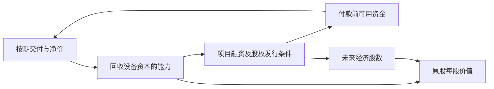

# Nebius Group（NBIS）：综合投资评估、上游复核与跨公司比较报告

## 0．执行摘要：有真实右尾，现价缺乏稳健回报缓冲，配置优先级低于更好的AI载体

**综合裁决：NBIS有独立投资价值，适合能够承受该笔本金大幅乃至全部损失的投资者，以小仓参与平台与高价算力兑现；188.41美元不符合稳健基准配置标准，不列为核心首选，也不列为本次比较集的最高优先级进攻标的。** 公司已跨过真实客户、合格交付和规模收入的门槛，但尚未证明完整设备更新、预付款抵扣、偿债及持续稀释之后的每股现金回报。到2029年末，复核后基准交易价仍为195—255美元，累计约+3%—+35%，年化约+1%—+10%；这不足以补偿融资、工程与资产寿命的联合风险。乐观500—620美元、突破980—1,260美元保留有商业机制的巨大右尾，证据分别为弱、弱，不能当作已锁定收益。[NBIS-S] [NBIS-C]

**稳健标准：现价回避新增核心仓；进攻标准：值得以小仓／期权式风险预算参与，尚非高优先级进攻首选。** 近端1—2季的收入预测大致贴近或低于公开可见共识，主要预期差在2027年交付、持续净租价和融资条件，当前没有“下一季大概率大幅超预期”的充分证据。默认动作是等待Q3交付与资金表共同验证；愿意付出信息成本、避免完全踏空者，可用约0.5%的组合风险预算建立观察仓，验证前累计不超过1%。这里的“期权式”指有限本金风险预算，并非建议购买高IV短期期权，也未假设用户的实际持仓或执行交易。

**相对取舍：在本次13家对手构成的比较集中，AI资本开支逻辑优先考虑NVDA；定制芯片路线优先AVGO，较稳的数据中心设备暴露优先VRT；企业平台配置优先MSFT／AMZN。** CRWV和IREN在各自融资、交付前提成立时，模型基准赔率高于NBIS，但最新信用压力使CRWV只能作为有条件替代，不能只凭高目标价宣布其全面安全占优。NBIS相对APLD占优；相对COST、PGR、WM则是更大右尾与更弱本金保护之间的取舍。NBIS的独特用途，是补充“第三方持有资产、自己收取平台净费”的跃迁敞口；如果只押AI设备投资总量，它不是首选载体。

**三条硬证伪线：核心客户因履约失败取消重要批次并触发重大退款；已交付批次的实际全周期回报持续低于资金成本且无法通过定价／成本修复；不可取消付款与可用资金发生缺口、只能依靠毁损性救助融资或违约解决。** 出现其中任一项，退出这条投资逻辑，不因股价较买入价下跌而自动加仓。普通的一季验收顺延不等于上述证伪，但必须即时计入现金、利息及服务赔偿。

- **研究日、信息截止：**2026-10-16；`2026-10-16T03:56:51-07:00`，America/Los_Angeles，等于10:56:51 UTC。网页读取状态截至本轮检索；没有字段级更新时间的数据单独降级，不把检索时间冒充数据发生时间。
- **统一价格基准：**2026-10-15美股常规收盘，16:00 EDT／13:00 PDT；NBIS **188.41美元／Class A普通股**。本地日度快照与公开收盘记录相符；另一成交源188.44有0.03差异，采用188.41。截止时10月16日常规交易未开市；参考收盘不是可保证成交的实时买卖盘。[日度快照][LOCAL-D] [行情核验][S18]
- **证券、币种、ADR：**NBIS为荷兰Nebius Group N.V.在Nasdaq直接上市的A类普通股；B类经济分配权相同、投票权不同。交易、集团财报和模型均为USD；**非ADR，换算比例不适用**。本次全部13家对手的比较证券也均为USD直接上市普通股，不存在本表的跨币种换算。
- **最新财报：**2026Q2／H1，截至2026-06-30，财报于2026-08-12公布；Q3期间已经结束，但未取得已公布Q3财务结果。Q3财报日期第三方存在10月22日、11月10日等冲突，未取得公司正式确认，按11月窗口跟踪，不把第三方财历写成承诺。[Q2财报与附注][S01] [公司新闻室][S05]
- **完全稀释口径：**六月末实发流通271.855m股＋8月换债约15.8m＋NVIDIA预付权证21.066m＋奖励增量代理10.043m，约**318.8m经济股数起点**；不是10月16日登记确认值。可转债另按每个价格端点在债权与转股之间联立；2029基准经济股数约412.5—436.3m，乐观409.9m，突破396.6m。快照220.41m不能作为集团全部经济权益分母。[S01] [S03] [S04]
- **主要目标日：**NBIS四情景统一为**2029-12-31**，从共同报价日计约3.21年。对手保留各自原观察日，并全部按同一报价日计算CAGR；附录另给2029年末的等年化数学等值，防止不同期限的累计收益造成误导。

金额默认USD；B／bn＝十亿美元，m＝百万。事实F、管理层目标M、直接计算C、研究推断E、公开共识样本K及未知U分别标示；证据强度不是概率。所有股价回报不含现金股息、税费和交易成本，重要分红差异在第3章单列。

### 0.1 目标与13家对手的同口径总表

**统一价格日：2026-10-15。统一估值主尺为P/PV_DCF：现价÷〔基准目标日剩余股权DCF按13%年化折回的价格〕，低于1才意味着达到这一共同的条件现金价值要求。** 它用于统一时间成本；13%是本次增长资金的比较门槛，不是宣称COST、保险与NeoCloud应承担相同风险，也不是概率加权公允价值。原DCF的资本成本、业务假设和未来稀释仍有差异，须结合正文判断。该主尺比把亏损云公司的P/S、芯片公司的重估后P/E、保险公司的EV/EBITDA直接排大小更可解释。原经营倍数、目标现金流和原报告均列于附录A；直接GPU云另做同18倍EV/NOPAT检验。

市值通常为同日日度源的普通股口径；NBIS重新列普通／经济股数代理市值，CRWV、GOOGL核对全部经济类别。市值不是完全稀释权益价值，源股数字段存在滞后或单一类别问题。表内“纯业务”固定各上游报告明确的当前或合理基准倍数，包含融资和稀释，不含新增估值扩张；不同公司的经营倍数本身不直接比高低。

| 公司代码与名称 | 比较关系类别 | 同日股价、市值与统一基准估值 | 壁垒、增长驱动与关键短板 | 纯业务驱动回报：基准 | 四情景股价回报及年化：悲／基／乐／突 | 近期1—2季催化与预期差 | 基准／乐观证据 | 与NBIS逐一裁决及配置取舍 |
|---|---|---|---|---|---|---|---|---|
| **NBIS Nebius** 目标2029-12-31 | 本研究核心对象 | USD 188.41；普通股约54.20B；经济股数代理约60.06B P/PV_DCF **1.49×** | 合格交付＋推理栈；新单净价与伙伴资产净费是主线；最大短板是全周期更新、前置融资和普通股稀释。 | USD 230；+22.1%（年化+6.4%） | 悲：-100.0%（年化-100.0%） 基：+3.5%～+35.3%（年化+1.1%～+9.9%） 乐：+165.4%～+229.1%（年化+35.5%～+44.9%） 突：+420.1%～+568.8%（年化+67.1%～+80.7%） | Q3大致贴近共识；Q4研究中枢低于可见共识；2027放量是主要预期差。 | 中／弱 | 综合配置靠后；AI稳健载体次于NVDA/AVGO/VRT；独立NeoCloud进攻顺位有条件次于CRWV/IREN，保留平台专项小仓。 |
| **CRWV CoreWeave** 目标2029-12-31 | 直接同池 | USD 69.69；$38.44B P/PV_DCF **0.35×** | 集群、W&B/Forge、订单和交付规模领先；债务与长租刚性高，更新成本假设较NBIS宽松。 | USD 211.93；+204.1%（年化+41.4%） | 悲：-100.0%～-98.9%（年化-100.0%～-75.1%） 基：+164.3%～+276.7%（年化+35.3%～+51.1%） 乐：+607.6%～+831.6%（年化+83.9%～+100.4%） 突：+886.7%～+1163.4%（年化+104.0%～+120.3%） | Q3/Q4交付加速有硬线索；最新信用市场压力使融资验证优先于收入惊喜。 | 中／中 | 特定维度：CRWV基准赔率、规模胜；NBIS较小债务量和平台差异有价值。提款正常选CRWV；授信失效均不重配。 |
| **IREN IREN** 目标2029-06-30 | 直接同池 | USD 30.39；$11.98B P/PV_DCF **1.07×** | 自有电力及Horizon工程；便宜电力须先转合格集群；GPU采购、摊还和新增融资仍重。 | USD 53.68；+76.6%（年化+23.4%） | 悲：-87.3%～-78.4%（年化-53.3%～-43.3%） 基：+43.6%～+109.6%（年化+14.3%～+31.4%） 乐：+461.2%～+611.9%（年化+89.1%～+106.4%） 突：+870.4%～+1105.2%（年化+131.5%～+150.7%） | Horizon 2—4验收及40亿美元合同ARR转实收；非同定义ARR不直接比。 | 中／中 | 特定维度：IREN同18倍基准赔率及乐观弹性更高；NBIS实际云规模和推理平台成熟度更好；按验收/融资选择。 |
| **ORCL Oracle** 目标2030-05-31 | 直接同池／综合云 | USD 134.47；$407.65B P/PV_DCF **1.34×** | 数据库、应用和OCI销售复用；资本负担与大客户预算风险高于传统软件。 | USD 176.91；+31.6%（年化+7.9%） | 悲：-78.0%～-75.8%（年化-34.2%～-32.4%） 基：+44.7%～+68.8%（年化+10.7%～+15.5%） 乐：+169.2%～+219.7%（年化+31.4%～+37.8%） 突：+251.1%～+329.6%（年化+41.4%～+49.5%） | 下一两季OCI约9/11.2B的上游工作点；预付款、客户供卡比例决定净融资。 | 中／弱 | NBIS右尾倍数更大；ORCL正常兑现回报及现金底盘胜。综合优先ORCL，不能称其没有建设风险。 |
| **APLD Applied Digital** 目标2029-12-31 | 替代路径／机房房东 | USD 20.39；$6.17B P/PV_DCF **43.13×** | 长期机房租金；NOI可观但优先资本、母公司费用和子公司少数权益侵蚀普通股。 | USD 8；-60.8%（年化-25.3%） | 悲：-100.0%（年化-100.0%） 基：-90.2%～-51.0%（年化-51.5%～-19.9%） 乐：-16.6%～+22.6%（年化-5.5%～+6.6%） 突：+32.4%～+81.5%（年化+9.1%～+20.4%） | 250MW已交付验证房租；低利润装修、硬件转售使总收入误导。 | 中／弱 | 目标优先：NBIS基准和右尾价值归属更清楚。APLD尚不能以低P/S成为同逻辑更优替代。 |
| **AMZN Amazon** 目标2029-12-31 | 替代路径／Trainium与综合云 | USD 254.76；$2.75T P/PV_DCF **1.19×** | AWS/Trainium、广告与物流；已有现金来源和客户分发，巨额再投资与客户信用支持需持续核查。 | USD 476；+86.8%（年化+21.5%） | 悲：-47.0%～-35.2%（年化-17.9%～-12.7%） 基：+33.5%～+53.1%（年化+9.4%～+14.2%） 乐：+96.3%～+121.8%（年化+23.4%～+28.1%） 突：+182.6%～+214.0%（年化+38.2%～+42.8%） | AWS Q2已加速；近季云供给、广告利润及CapEx转化较Logo更重要。 | 中／中 | NBIS非线性幅度胜；AMZN商业多样性、融资能力和基准回报胜；核心资金选AMZN。 |
| **GOOGL Alphabet** 目标2029-12-31 | 替代路径／TPU与全栈平台 | USD 349.22；$4.27T P/PV_DCF **1.44×** | TPU/模型/搜索分发全栈；搜索入口、硬件毛利、信用支持与监管均是分歧。 | USD 504；+44.3%（年化+12.1%） | 悲：-58.2%～-47.0%（年化-23.8%～-17.9%） 基：+25.1%～+44.3%（年化+7.2%～+12.1%） 乐：+90.1%～+115.3%（年化+22.2%～+27.0%） 突：+148.3%～+179.5%（年化+32.7%～+37.7%） | Cloud与TPU外售已形成收入；Q3/Q4服务与硬件验收要拆分。 | 中／中 | NBIS右尾更陡；GOOGL既有利润和架构主动权更强，综合优先GOOGL；现价仍非深折价。 |
| **AVGO Broadcom** 目标2028-10-29 | 替代路径／定制ASIC与网络 | USD 344.33；$1.64T P/PV_DCF **1.08×** | 定制ASIC、网络和软件；低厂房支出与高现金转化有优势，但客户backstop带来信用尾部。 | USD 754.13；+119.0%（年化+46.9%） | 悲：-64.5%～-53.9%（年化-39.8%～-31.6%） 基：+50.3%～+72.4%（年化+22.1%～+30.6%） 乐：+99.9%～+135.6%（年化+40.4%～+52.2%） 突：+177.5%～+211.7%（年化+64.9%～+74.6%） | FY26Q4 AI放量及FY27客户导入；最新公司调研已补充信用承诺。 | 中／中 | AVGO基准年化更高，且截留技术与网络利润；NBIS只在独立GPU云/平台分支占优，综合选AVGO。 |
| **MSFT Microsoft** 目标2029-06-30 | 上下游／核心客户兼竞争者 | USD 539.44；$4.01T P/PV_DCF **1.42×** | 企业软件、身份、开发与Azure；已盈利底盘承担扩建；AI资本效率仍需验证。 | USD 826；+53.1%（年化+17.0%） | 悲：-42.0%～-29.2%（年化-18.2%～-12.0%） 基：+24.4%～+44.2%（年化+8.4%～+14.5%） 乐：+67.4%～+91.3%（年化+21.0%～+27.1%） 突：+118.4%～+147.5%（年化+33.4%～+39.7%） | FY27Q1/Q2关注Azure、Copilot净付费与经济CapEx；同时验证NBIS买方预算。 | 中／中 | NBIS上行百分比更大；MSFT现金、壁垒与基准赔率胜。稳健资金优先MSFT。 |
| **NVDA NVIDIA** 目标2030-01-31 | 上下游／核心设备与生态 | USD 217.23；$5.25T P/PV_DCF **0.93×** | CUDA＋整机/网络系统与迭代；利润捕获领先；ASIC、采购承诺和伙伴信用支持不可忽略。 | USD 465；+114.1%（年化+26.0%） | 悲：-58.6%～-47.1%（年化-23.5%～-17.5%） 基：+65.3%～+108.1%（年化+16.5%～+24.9%） 乐：+150.0%～+207.0%（年化+32.0%～+40.5%） 突：+242.0%～+312.5%（年化+45.2%～+53.7%） | Rubin从样机进入有限生产采用；订单与应收、客户融资须共同核验。 | 中／中 | NVDA在基准赔率、当前盈利和生态上压制NBIS；NBIS独立平台尾部不能替代这些优势。AI配置首选NVDA。 |
| **VRT Vertiv** 目标2029-12-31 | 上下游／供电与热管理 | USD 214.75；$82.68B P/PV_DCF **1.29×** | 电源、散热、服务和交付；跨GPU/ASIC客户销售；订单预收回落和客户拆包是短板。 | USD 482.1；+124.5%（年化+28.6%） | 悲：-58.6%～-47.4%（年化-24.0%～-18.1%） 基：+33.8%～+62.4%（年化+9.5%～+16.3%） 乐：+101.4%～+139.6%（年化+24.4%～+31.3%） 突：+169.8%～+217.7%（年化+36.2%～+43.3%） | H2交付与利润率爬坡，核查预收变动后真实现金转换。 | 中／中 | NBIS突破弹性胜；VRT更新负担、跨客户收益及基准赔率胜。较稳AI基础设施优先VRT。 |
| **COST Costco** 目标2029-10-11 | 跨行业／会员零售 | USD 978.01；$433.38B P/PV_DCF **2.35×** | 会员复购、采购与仓储密度；内生扩张，估值高且数字服务尚未证明利润跃迁。 | USD 1,247；+27.5%（年化+8.5%） | 悲：-42.7%～-32.8%（年化-17.0%～-12.5%） 基：+2.7%～+15.6%（年化+0.9%～+5.0%） 乐：+31.3%～+49.0%（年化+9.5%～+14.3%） 突：+62.6%～+83.1%（年化+17.6%～+22.4%） | 月度同店/客流可跟踪，难以产生NBIS式数倍利润突变。 | 强／中 | 特定维度：资本保全选COST；高弹性选NBIS。不能用高商业质量掩盖COST低基准回报。 |
| **PGR Progressive** 目标2029-12-31 | 跨行业／保险定价与资本 | USD 213.75；$124.06B P/PV_DCF **1.35×** | 风险定价、理赔与渠道数据；股息/资本可分配；当前获客与续保走弱必须正视。 | USD 257；+20.2%（年化+5.9%） | 悲：-45.3%～-35.0%（年化-17.1%～-12.5%） 基：+11.8%～+28.7%（年化+3.5%～+8.2%） 乐：+64.2%～+87.6%（年化+16.7%～+21.6%） 突：+94.2%～+120.8%（年化+22.9%～+28.0%） | 9月/Q3核心结果已披露；后续看完整10-Q、10/11月保单与CR，不再赌已知Q3。 | 中／中 | 特定维度：分配现金与抗融资冲击选PGR；平台右尾选NBIS；PGR含息比较另见3.12节。 |
| **WM Waste Management** 目标2029-12-31 | 跨行业／处置牌照与密度 | USD 224.19；$89.61B P/PV_DCF **1.71×** | 处置许可、路线密度与医疗协同；现金流稳定，增长与新工程回报受约束。 | USD 275；+22.7%（年化+6.6%） | 悲：-45.6%～-37.1%（年化-17.3%～-13.4%） 基：-11.2%～+22.7%（年化-3.6%～+6.6%） 乐：+10.6%～+47.6%（年化+3.2%～+12.9%） 突：+30.2%～+69.1%（年化+8.6%～+17.8%） | Q3与Q4看净价减量、医疗留存及RNG实际销售。 | 中／中 | 特定维度：左尾与现金优先WM；右尾优先NBIS；WM估值并未给出明显价格优势。 |

对手行的“中／中”是原上游基准／乐观经营证据的承接标签，**不等于本次确认其全部长期融资已落实**；特别是CRWV信用市场、AVGO客户支持、NVDA采购承诺，须在直接对决中再次约束。本表是条件路径比较，不是可把14家公司乐观收入同时相加的联合预测。

### 0.2 NBIS上游四情景复核及最终价格

研究日2026-10-16；参考价188.41美元，2026-10-15 16:00 EDT；交易／财报均USD、非ADR；经济股数代理约318.8m起步，目标日按转股状态分配；共同目标2029-12-31、约3.21年。**本次四行情景价格维持原值，证券底座、条件适用性、近端共识差和相对配置结论进行了独立核验。没有为了显示“校准”而任意更改价格。** 第1章明确采用与否决的口径及保留分支。

| 经营情景 | 上游原纯业务价（涨跌幅） | 上游原目标交易价（涨跌幅） | 本次裁决及原因 | 复核后纯业务价（涨跌幅） | 复核后目标交易价 | 相对现价变化及CAGR | 复核后证据 |
|---|---|---|---|---|---|---|---|
| 悲观／受损 | USD 0（-100.0%） | USD 0（-100.0%） | 采用；仅适用于融资失灵且原股无重整剩余的结构损伤分支；不能代表每次经营失速。 | USD 0（-100.0%） | USD 0 | -100.0%（年化-100.0%） | 弱 |
| 基准／正常兑现 | USD 230（+22.1%） | USD 195～255（+3.5%～+35.3%） | 采用条件路径；量价、CapEx、股本桥可闭合；2028份额与融资须持续验证，不再额外叠加风险折价。 | USD 230（+22.1%） | USD 195～255 | +3.5%～+35.3%（年化+1.1%～+9.9%） | 中 |
| 乐观／超预期 | USD 500（+165.4%） | USD 500～620（+165.4%～+229.1%） | 采用；高租价及交付有早期依据，93%收费覆盖与全池复制仍未证实。 | USD 500（+165.4%） | USD 500～620 | +165.4%～+229.1%（年化+35.5%～+44.9%） | 弱 |
| 突破／非线性 | USD 800（+324.6%） | USD 980～1,260（+420.1%～+568.8%） | 采用为条件上界；伙伴平均付费1.4GW、12%净费及外部资本须同时成立；不是今日可兑现的软件价值。 | USD 800（+324.6%） | USD 980～1,260 | +420.1%～+568.8%（年化+67.1%～+80.7%） | 弱 |

悲观0美元是“融资失灵并重整、原普通股不保留剩余”的特定分支；公司在该分支仍可有经营收入。该行不能替代所有衰退情景，也不能拿来推断当前已破产。轻度延迟、租价下降、更新成本和融资折价的连续损伤另列敏感性。四情景并非穷尽状态，未赋主观概率，不能直接计算一个伪精确的“预期目标价”。

### 0.3 六个正交角度的独立判断

| 投资角度 | 独立结论 | 核心支持 | 主要约束 |
|---|---|---|---|
| 近期兑现与预期修正，1—2季 | 利弊并存；等待交付与融资共同验证 | 晚2026容量和已签新单支持收入加速；Q2已真实收费 | Q3研究中枢贴近共识，Q4中心偏低；高IV和资金前置放大兑现风险 |
| 中远期复利与壁垒，2—4年＋ | 强成长潜力，完整资本复利尚未证实 | 集群工程、推理栈和跨资产平台可以形成服务粘性 | 不独占GPU／CUDA；更新、客户预算与融资后每股归属制约复利 |
| 基准赔率与安全边际 | 不利；现价估值偏满 | 固定18倍业务价230，业务确能扩大每股成果 | 基准交易年化约1%—10%；统一13%折回的基准DCF约126，低于188.41 |
| 乐观／突破非线性 | 有利；真实但弱证据的强右尾 | 乐观固定倍数价500；伙伴平均付费1.4GW净费提供资本效率跃迁机制 | 伙伴资本、12%净费、交付、净价格须一起验证；突破不只靠软件收入 |
| 下行资本保全与外生韧性 | 不利；可能永久损伤 | 真实客户预付、已募集现金和可减投项目提供缓冲 | 预付有履约责任；2030偿债、设备寿命、受限资金和低价增发可能共同压毁原股 |
| 相对吸引力与机会成本 | 局部占优；存在更优配置载体 | 相对APLD价值归属更直接，平台专项敞口不同于纯房东 | AI基准资金优先NVDA/AVGO/VRT；CRWV/IREN融资成立时的价格赔率更强 |

## 1．穿透复核：收入真实，不等于普通股资本回报已经成立

### 1.1 证券、市值和企业价值桥：先纠正分母，再讨论便宜与否

NBIS六月末A类238.400m、B类33.455m，合计271.855m；约50.186m库存A股不算流通。NVIDIA预付权证只需极少行权现金，经济上必须计入；8月交换旧可转债新增约15.8m股。**普通股代理约287.655m，对188.41的市值约54.20B；加权证及奖励代理后约318.764m，对应约60.06B。** 这两个数各有用途，不能一边采用基本市值、一边用完全稀释盈利宣称便宜。[S01]（股本及EPS注释） [S03] [S04]

六月末的10.043m奖励来自期间反稀释计算，并非完整最新未归属证券台账；有行权价的奖励按库存股法计算也会随股价变化。因此318.8m是复用并核实定义后的模型起点，**精确实时完全稀释股数仍未知**。季度加权平均EPS股数含预付权证，实发流通股数不含，不能再把两种分母直接相加。Eigen已发行的参与分红未归属股份已在实发股中，不额外再加一次。[S01]（注2）

| 复核项目 | 采用／修正裁决 | 对估值的传导 |
|---|---|---|
| 日度NBIS价格188.41 | 采用；与外部收盘交叉核对 | 14家公司全部从同一报价日重算回报，避免继承旧报告买价 |
| 日度股数220.41m、市值47.84B | 股数不采用为全部权益；市值不作为完全稀释值 | 重建普通54.20B、经济60.06B代理；不改写源快照 |
| TTM P/E149.53、正EPS1.26 | 不采用为云业务盈利锚 | 净利润受非上市投资重估影响，经营亏损不能用表面正P/E合理化 |
| 现金8.042B与受限1.056B | 分别采用六月末日期；不把受限资金加入自由现金 | “现金多”不能直接抵销全部债务与未来设备付款 |
| 六月末债务账面约8.546B | 采用账面历史；偿债用最终现金索取另重建 | 扣旧债交换、加8月新债增值条款后，不转换现金索取约16.554B，非当日会计EV |
| 经营租赁、递延收入 | 租金进成本，预收按收取／抵扣／退款建模 | 不把整笔租赁和递延既放现金流、又在EV桥重复扣一次 |
| 非上市投资权益 | 不并收入，按净可实现权益单列 | 不能将被投企业估值、重估利润和股权价值重复计三次 |

同样的多类别核对用于对手：CRWV的A股458.872m加B股92.665m为551.537m，69.69美元对应普通市值约38.44B；日度A股分母不能解释全部市值。GOOGL按A/B/C合计12.230B股，349.22对应约4.271T；日度5.87B是单一类别量级，不能用来指控总市值“高算一倍”。[CRWV-S]（4.2） [GOOGL-S]（5.2）

### 1.2 财务起点、近端运行速率与年度模型闭合

Q2集团收入0.5823B，核心云0.5749B；集团调整后EBITDA0.2362B，D&A0.2597B、SBC0.1025B、并购等调整0.0499B，桥接后GAAP营业亏损0.1759B。去掉可识别交易调整、保留SBC，仍亏约0.126B。服务器／网络折旧从四年延至五年，令Q2少提约0.043B折旧；它改善报表，不增加现金。**采用收入与真实服务改善，否决用50%云调整后EBITDA率代替全成本毛利或ROIC。**[S01] [NBIS-C]（3.2）

H1 CFO4.5041B、现金CapEx8.1303B，相减-3.6262B；CFO中递延变动贡献4.395B、应收回收贡献0.428B。机械剔除两项仅余约-0.319B，但这也不是稳态CFO，因为其他营运资本尚未正常化。不能一方面把预付款用于设备融资，另一方面把未来全部确认收入再次当新现金。[NBIS-C]（3.3；原现金流已由S01复核）

| 收入桥，B | H1实际 | 本次Q3代表点 | 本次Q4配套代表点 | 全年 |
|---|---:|---:|---:|---:|
| 中心联合路径E | 0.9813 | 0.9000 | 1.3187 | 3.2000 |
| 允许的单季工作区间E | — | 0.82—1.00 | 1.18—1.52 | 两季合计必须满足全年3.0—3.4指导 |

管理层全年收入3.0—3.4B、年末ARR7—9B、集团调整后EBITDA率约40%、现金CapEx20—25B的指导，仍与这一联合路径相容。ARR为季末最后一月云收入×12，不是全年已确认收入；年末ARR8B意味着12月云收入约0.667B，明显高于Q4季度平均月收入，符合晚季交付，但非常依赖实际验收日期。[NBIS-S]（2.3；公司股东信及官方会议口径S02）

联合约束为`2.0187≤Q3＋Q4≤2.4187`；例如Q3取1.00时，Q4不能同时取1.52后仍声称全年不超过3.4。季度范围是配对条件区间，不是可任意组合的四个独立端点。

**两份NBIS上游报告不是同一组预测。** 公司调研2027／2028工作点13.76／24.01B，情景决策基准14.97／29.66B；差异分别约+8.8%、+23.5%。后者并非新财报带来的已核实上修：它把C池更大比例按20—21m/MW年计价，2028平均付费量约1,101MW年，而公司调研的旧／新批次450／600MW年采用12／20m。对应公司调研CapEx35／40B，情景决策28.88／30.35B，主要又因新增MW和设施、在建预算不同。

**裁决：保留情景决策作为本次四情景的统一条件路径，否决把其2028“基准”表述为已经由公司调研中心完全印证。** 新单20—25m及旧代新单提价支持较高价格的可能性，尚不足以证明所有旧批次都已重定价；因此以价格敏感性保留公司调研偏低价组合分支。不能简单把两组收入取平均，再同时按较高CapEx、更高WACC、更低倍数扣四次。后续逐批净价格若不能支持统一情景，应直接重建C池与融资，而非只调一个收入增长率。[NBIS-C]（8.2—8.3） [NBIS-S]（附录A） [S02]

### 1.3 可加子池、同行份额与资源守恒

行业正式报告采用C1／C2（计算服务）、H1／H2（机房租金）的名称，而非T1／T2。**C1+C2可加，H1+H2可加；C与H及综合云转售收入不能相加为最终需求。** 本次沿用该原始边界，不把APLD向CRWV收取的租金再变成一份独立GPU终端预算；Oracle／微软销售的云服务也可能包含采购NBIS／CRWV的中间服务。[行业正式报告][LOCAL-I]

| 同一自然年计算服务池对账，B | 2027 | 2028 | 口径与裁决 |
|---|---:|---:|---|
| 行业C基准代表点／条件范围 | 64.34／47.70—85.40 | 101.47／72.84—135.90 | E，不是审计全球总量；私营和地方供给存在缺口 |
| NBIS基准H合同＋C算力，不含伙伴净费及其他 | 14.83 | 29.31 | H是本公司专用计算合同代号，并非行业机房H池 |
| CRWV基准核心计算，不含独立软件 | 27.84 | 45.83 | 采用其正常化计费／容量模型，不是已签收入 |
| IREN计算的自然年近似 | 6.36 | 12.87 | 以相邻FY各一半近似、剔除软件及挖矿；季度爬坡未知，不冒充精确CY |
| 三家合计／占行业代表点 | 49.03／76.2% | 88.01／86.7% | 2028仅给其他供应商留下约13.46B；NBIS约占行业代表点28.9% |
| 留给其余供应商的残余 | 15.31 | 13.46 | Lambda、Nscale、Crusoe等不可能被当作零；需要更大池或份额变化 |

三家基准在2028已超过行业下沿约20.8%，**不能把“小行业池下沿＋所有头部公司基准＋私营扩张”同时采用**。在代表点未超过100%，在上沿则约占64.8%，所以也不能据此直接断言NBIS预测不可能。份额裁决为：CRWV更大RPO及已签电力支持其较大份额，NBIS有高净价和大客户交付支持增长，但其从目前公开三家公司季度收入约18%的占比走向2028样本约三分之一，需要实质抢占或更快扩张。当前不能把全部缺口只扣在NBIS头上；**采用上游基准的必要条件，是可兑现C池接近代表点偏上、且NBIS新增签约能持续跑赢未覆盖供应商。** 若实际池落在行业下沿，必须下修头部合计，而不是维持全部基准再声称低估。[CRWV-C] [IREN-S]（附录C） [NBIS-S]

| 四情景规模与容量横截面 | 悲观 | 基准 | 乐观 | 突破 |
|---|---:|---:|---:|---:|
| NBIS CY2029集团收入B | 17.02 | 42.71 | 55.81 | 67.18 |
| NBIS CY2029年末自担IT GW，模型 | 1.46 | 2.91 | 3.53 | 3.83 |
| NBIS CY2029伙伴平均付费GW | 0.06 | 0.35 | 0.65 | 1.40 |
| CRWV CY2029集团收入B | 22.94 | 64.58 | 95.62 | 108.30 |
| CRWV CY2029年末自营GW，模型 | 受损停扩 | 5.30 | 6.80 | 7.20 |
| IREN FY2029集团收入B | 6.78 | 15.89 | 22.93 | 31.01 |

NBIS受损年末MW由2026起点600＋H新增260＋C新增600＝1,460MW，采用**1.46GW总规模代理，C池有效付费覆盖按72%—78%折损**，不能把全部装机直接乘满年租价。其余三条容量也按附录新增数直接复算，均为研究模型而非逐站点公司披露。IREN财年比CY提前半年，不能将上表当精确同期全球份额加总；行业正式模型没有2029／2030完整同边界总池，本次不补造精确分母。

**Gartner分歧必须正面处理。** 6月23日其预测2030年267B AI云中NeoCloud占20%，直接推算53.4B；这明显低于本地C池及头部报告之和。10月14日其另一原始研究预测AI优化IaaS为2027年66B、2030年174B，并警告资产回报不足、超过80%的NeoCloud或停止独立运营。它们是外部研究预测，不是合同取消事实，且公开稿没有提供与本地“首次计算销售、含批发采购”相匹配的逐层桥。[S24] [S25]

**裁决为保留条件分支，并否决无口径说明的直接替换。** 不能把6月53.4B作为本地C的硬上限；也不能凭“口径不同”消除其对客户最终付费与资本回收的反证。若174B是包含转售去重后的较窄IaaS，不能再把全部OCI、Azure、C池硬相加；若未来同口径数据确证独立计算池接近53B且份额未集中，NBIS42.7B与CRWV64.6B就不能同时成立，应重估收入、停投和融资。本次维持高增长条件情景，拒绝把它提升为稳健中心，也不依据80%的企业数量预测给NBIS赋80%破产概率。

另一项交叉约束来自[调度与推理运行时行业][LOCAL-I3]：其2028基准可覆盖纯软件净收费A＋R约3.795B，不能把所有推理账单都视作软件利润。NBIS基准2028伙伴净费0.30B、突破1.44B，后者相当于这一软件池量级约38%。NBIS平台净费还包括架构、获客、运维，范围比A＋R宽，故38%不是准确市占率，也不能当硬上限；但它揭示突破需要很大的独立收费控制权。开源Dynamo、vLLM及客户自管正在限制通用运行时独占租金，净费必须由可重复的生产责任和实际合同支持。**采用平台机会的机制，否决“推理量增长必然等比例变成高毛利独立软件收入”。**[LOCAL-I3]

### 1.4 上下游交叉事实：芯片足够、客户预算强，都不能替代项目现金回报

上游供应侧确有实物进展：9月30日CoreWeave披露数百颗Rubin在生产负载有限供应，NBIS也已开展新代系统测试。它们支持技术路线跨过仅有路线图阶段，**不证明2027全行业所有机柜、HBM、交换网络与电力都能如期齐套**。最新NVDA公司调研还列出279B供应／产能承诺和最高105B园区担保，说明解除供给瓶颈也可能把风险移到供应商资产负债表。[NVDA-C] [S27]

[云厂自研ASIC行业][LOCAL-I2]亦已确认Trainium、TPU等生产采用，并把“含HBM的封装采购、合作设计方收入、合作方利润”分层。2028扩展五生态封装采购基准245.5B不是AVGO收入、不是云服务账单，更不能再加进C池。它支持路线替代已进入商业阶段，也提醒ASIC供应商同样可能承担客户融资与返利；因此本次优先AVGO并非把风险凭空移出产业链。[LOCAL-I2]

买方方面，微软FY26经营现金182.935B、现金CapEx115.948B，AWS Q2经营利润16.621B，Google Q2 Cloud经营利润8.814B，为持续采购提供真实资源。它们也拥有Trainium、TPU、多供应商采购和自建选项。**三者“算力单位任务成本下降”与NBIS“每MW收入提高”可以因代际性能提升同时发生；但必须有更高有效工作量和真实付费覆盖，不能无条件同时外推。**[MSFT-C] [AMZN-C] [GOOGL-C]

本地建设背景的2027／2028新增验收14.44／17.93GW是全球条件量级，采购21.15／25.65GW又包含替换，不是NBIS的独占配额。NBIS基准2027—29自担新增0.81／0.85／0.65GW，物理上未明显越过全行业边界；但订单、设备、贷款、机房验收仍须逐批对应。伙伴突破的1.4GW平均付费，需要约42B设备资本由外部承担，不能在NBIS轻资产表述中让这些资本消失。[建设规模背景][LOCAL-B1] [电力台账][LOCAL-B2] [NBIS-S]（3.1）

### 1.5 风险重复折价排查与融资反身性

| 风险 | 上游已经承担的代价 | 本次处理 |
|---|---|---|
| 价格／占用不及预期 | C净价、付费覆盖和延期已直接进入收入、现金 | 保留连续敏感性；不再因同一理由统一砍收入、利润、概率及倍数 |
| GPU更新 | 五年整批替换＋设施维护；四年寿命另测 | 基准不凭“保守”再改四年；但四年必须作为真实失败分支 |
| SBC与可转债 | 2029前股数法、之后现金替代成本；每端点求转股 | 不再在已稀释每股利润全扣同一SBC；不同时扣整债和全部转股数 |
| 客户预收 | 新预收、旧款抵扣、退款／服务责任 | 不把同一预收既作为永久净现金、又当未来新收入现金 |
| 工程／融资 | 现金缺口、发行折价、股数和债务已联动 | 最新信用压力用融资可得性分支；没有已签成本重设时不机械全面加息 |
| 伙伴模式 | 净费确认、外部设备资本、责任边界 | 不额外把伙伴底层销售加到集团收入；未证实的担保不能当已完全转移 |

上游基准2027—29累计CapEx82.48B、CFO减CapEx-21.43B，新现金债11.35B、股权7.56B，期末现金3B。发行价126／142／159来自该条件经营价值及发行折让，**没有将现价188永久当成融资救助价格**。2027Q1还需约5B前置流动性，全年现金闭合不能证明季内能付款。季度缺口与全年融资不能再加一次，须按付款日重排。[NBIS-S]（3.4及附录B）

### 1.6 DCF、固定倍数业务价与目标交易价的分离裁决

NBIS采用固定18倍SBC前正常化EV/NOPAT，加现金／净非上市权益、扣相容债权，再除已稀释股数。现期经营亏损，18倍是合理基准锚，不是可用的当前P/E。直接对手CRWV原固定20倍、IREN18倍；统一以18倍作静态检验时，CRWV基准业务价约184.16，而非211.93，**从69.69买入仍约+164%**，高于NBIS从188.41到230的约+22%。这一差异不是靠给CRWV更高固定倍数才出现，融资条件则仍各自有风险。[CRWV-S]（5章） [IREN-S]

NBIS目标交易倍数基准16—20、乐观18—22、突破22—28，独立理由分别是后续收入斜率、更新负担、ROIC和平台资本效率；并未按远期DCF除当年利润反推出唯一“必然交易倍数”。基准18倍位于直接重资本同业正常化锚附近，明显低于软件平台26—30倍量级；突破倍数提高要求伙伴净收费改变资本配置，不能只凭收入翻倍获得。**本次采用这组条件交易带；不将DCF当作未来市场一定会收敛到的交易价格，也不将交易带上沿当内在价值下限。**

| NBIS 2029状态 | 稀释法NOPAT B | 相容经济股数m | 每经济股NOPAT USD | 固定倍数业务价 | 目标交易价 | 同日剩余DCF |
|---|---:|---:|---:|---:|---:|---:|
| 受损重整 | 1.27，归新权益 | 原股归属0 | 原股0 | 0 | 0 | 原股0 |
| 基准 | 6.33 | 412.46—436.28 | 约14.51—15.35 | 230 | 195—255 | 186.91 |
| 乐观 | 12.13 | 409.89 | 约29.59 | 500 | 500—620 | 504.49 |
| 突破 | 18.18 | 396.60 | 约45.84 | 800 | 980—1,260 | 1,086.55 |

以上NOPAT尚未扣债务利息，不是EPS。不同情景股数不必随收入递增：较好经营状态允许较高发行价、较少股份，但这是内生融资条件，不能移植到坏状态。基准目标日DCF186.91按13%折回约126，终值约占企业DCF71.5%；乐观、突破终值约75%，远期回收、资本成本与ROIC仍决定大部价值。**基准目标日DCF187美元不能和今天188美元直接比较后宣布“估值合理”。**

### 1.7 最终复核裁决与最重要的连续损伤分支

四行情景采用，是因为已核对的财务、合同、设备更新与股债分配形成可解释条件链；不是认为每条都有同样充分证据。悲观归零保留为融资关闭分支；基准需较高可兑现行业池及净价格；乐观需更高付费覆盖与资金效率；突破需外部资产净费规模。**不再重复打折，也不将“未来年份未有当期订单”本身当成利润率必然崩塌的证据。**

| NBIS上游独立敏感性，非可相加折价 | 2029DCF USD | 固定18倍业务价 USD | 商业含义 |
|---|---:|---:|---|
| 基准 | 186.91 | 227.57，展示取230 | 中心条件参考 |
| C池净对价全期低10% | 81.62 | 120.92 | 收入、现金缺口和稀释一起恶化；不是仅对目标倍数打九折 |
| C池付费覆盖低5个百分点 | 127.75 | 170.18 | 延期／闲置对已发生资本更敏感 |
| 预付金额加权覆盖55%降至40% | 158.10 | 199.85 | 新股权需求由7.56B升至约10.43B |
| 发行折让15%升至35% | 178.36 | 217.64 | 说明单独发行价压力与单位经济性失败不是同一种风险 |
| 设备成本高20%，管理层仍强行扩张 | 7.51 | 19.76 | 这是必须减投／JV／重整的警报路径，不是理性长期经营基准 |

四年寿命、其他条件静态不变的DCF仅约4.74；有伙伴接盘并同时削减对应自担收入的设备成本压力应对，约41.09。两者都依赖特定假设，不是目前资产已损坏的事实。它们解释了为什么收入增长和高EBITDA不能给188美元普通股提供资产清算底线。[NBIS-S]（附录D）

## 2．互联网与交易层增量：预期差在2027，风险首先在融资窗口

### 2.1 先按根事件去重，再判断哪些是真增量

目标上游已更新至本研究同日。本次未核到其截止后新增的重大经营公告或已公布Q3财报，**不把旧合同、公司转述及媒体再传播包装成三份新证据**。增量主要来自上游未展开的共识、内部人、空头、IV、利率及跨公司信用与行业规模冲突。

| 根事件／原始时间 | 事实层级与本次增量 | 对路径的净影响 |
|---|---|---|
| NBIS Q2财报／股东信，08-12 | F：已实现收入；M：新单20—25m/MW、22个月预计回收、2027部署；均属同一财报事件 | 支持更高净价与交付方向，不能把公司信与电话会累计为独立订单证据 |
| 伙伴模式07-15、Palantir09-08、Inferize10-01 | F：公告发生；E：未来净平台费；无公开足量费率、采购保底或独立收入 | 右尾入口增强；没有足够金额证明上调基准或突破价 |
| APLD 10-07披露10-01 PF1新增75MW、累计250MW | 供应方F，先于CRWV最新完整财报 | 强化可用机房交付；不直接等同CRWV终端验收或NBIS收入 |
| CRWV债券，10-15报道引用Tradeweb | **市场报道：部分债券收益率超过15%。** 未取得逐CUSIP成交底稿。[S26] | 需要重查新贷款和提款，不能把二级市场收益率等同所有存量贷款立即重设 |
| Gartner 10-14原始研究 | E：资本回收／整合预测，详见1.3 | 提高资金回收验证门槛；不按企业数量比例机械下调NBIS概率 |
| NBIS Form 4，10-05／06／13披露 | F：税款卖出、预定计划卖出与行权，逐单见2.3 | 纠正“全部异常套现”说法；没有形成主动增持的正信号 |
| 09-30空头结算、10-09发布；10-15期权快照 | 结算日期、发布日和报价日不同 | 关注与分歧较高；均不能替代经营回报或断言逼空必然发生 |

公司对Revolut、Recraft等案例及独立ClusterMAX测试支持真实客户使用和系统质量，**未披露客户净留存、单客全成本毛利、推理净费规模**。招聘、开发者数量和收购团队人数没有取得可与收入可靠连接的新增序列，不用来填造盈利预测。[NBIS-C]（4—7章）

### 2.2 一致预期：近期没有足够大的独立正差，2027预测比可见样本更积极

| 期间／指标，USD B | 可见公开样本K | 本次复核路径E | 差异与可靠性裁决 |
|---|---:|---:|---|
| 2026Q3集团收入 | MarketBeat0.90482；Zacks可访问页面0.91415；ChartMill检索摘录0.92189 | 0.82—1.00，联合中心0.90 | 中心约-2%至0%；没有高把握大幅beat优势 |
| 2026Q4集团收入 | Zacks页面1.47，6家；页面未给字段级更新日 | 1.18—1.52，联合中心1.3187 | 相对样本中心约-10.3%；需末季更快验收才能达到其高预期 |
| FY2026收入，12月财年 | S&P承载页3.34、21家，标记10-07更新；Zacks3.36、6家 | 3.0—3.4，中心3.20 | 相对3.34／3.36约-4.2%／-4.8%，且仍在公司指引内 |
| FY2027收入 | Zacks可访问页面12.35，8家，范围8.50—17.99 | 基准14.97；乐观18.59 | 分别比样本中心高约21%／51%；样本与分散度不足以叫全市场确定预期 |
| FY2028细分收入、毛利、CapEx共识 | 未取得可核日期及统一口径的免费完整样本 | 基准集团29.66；C池及资本见1章 | U；不把付费栏“Upgrade”或无日期转述变成精确共识 |

来源：[S19] [S20] [S21] [S18]。Zacks生产域正文访问失败，使用其可访问stage页面，**只作为有具体期间和人数的次级样本，时效与生产版一致性未确认**；检索摘录数与打开正文数有变化，表中以正文0.91415／1.47／3.36／12.35为准，不混拼旧缓存。ChartMill正文未成功打开，0.92189只作为摘录旁证，不承担模型中枢。可见样本约0.905—0.922的区间不是统计置信区间，也不是对多个平台再平均得到的“新共识”。

这些渠道EPS定义存在巨大差异，S&P页面明确为non-GAAP调整值，Zacks最近已报-0.12也并非GAAP净亏每股-0.68；缺少SBC、交易调整与股数的逐项桥，本次**不比较EPS点差，也不采用其75.6%毛利当作含GPU折旧的可比毛利率**。收入期间较可比，核心云单独一致预期与正式CapEx共识仍未知。[S19] [S20] [S01]

**反推现价要求：**188.41以13%持有至2029年末，需约279美元终值；上游基准交易195—255和目标DCF186.91均低于此要求。保持付费MW、成本与融资机制，持续提高2027—2035 C池净对价约9.6%，现价才与该要求相容；2029约从20.5提升至22.47m/MW年。这落在最新新单20—25m区间内，所以现价不必押中完整突破；但它要求更高价格在全资产池、续约及未来代际持续，远强于一笔短期40m订单。[NBIS-S]（5.1）

以经济股数代理及条件年末现金、债务桥，现价对应经营EV约69.8B、约21.8倍2026收入或4.7倍2027收入。**这是使用模型年末现金等假设的条件桥，非实时EV；4.7倍销售不意味着便宜**，未来设备、融资和每股稀释正是销售收入之后还要支付的代价。

### 2.3 内部人：监管原件推翻“将所有卖出合计为主动看空”的解释

| 人员／交易日／披露日 | 原始交易与条款 | 裁决 |
|---|---|---|
| CEO Volozh，10-01／10-05 | 37,778股，234.16美元；附注明确为RSU归属时覆盖估算税款、自动指令，非自主择时 | 不作为异常主动减持；不能把剩余A股785,236误当其全部B股及控制权益。[S13] |
| Chief Infrastructure Officer Korolenko，10-01／10-05 | 29,090股，234.16；同样明确仅为RSU预扣税 | 与相同归属安排的卖出属于同类根因，不作多位高管同时改变经营判断的独立证据。[S14] |
| COO Nave，10-05／10-06 | 分12档价格合计500,000股，约117.8m美元；05-22设立10b5-1；约占其授予权益17%，文件称该计划下不再销售 | 规模大、值得跟踪，但属于已设计划，不等于临时得知坏消息；既不能忽略，也不能当作内幕证伪。[S15] |
| CRO Boroditsky，10-12／10-13 | 行权7,000股并出售7,000股，211.23；06-15的10b5-1计划 | 行权代码M不等于主动买入；第三方把M与S合并成14,000股会重复计算。[S16] |

没有从本次核到的这些文件建立近期管理层自掏资金主动增持的正证据；这不等于保证所有内部人均无买入。公司最新资金使用主要是扩建而非注销回购，未核到可支持改变股本模型的本期大额净回购执行；库存股变化也含激励／融资，不能直接当注销。

机构集中度未完成全部13F／13G、A/B类别和近期发行的同日穿透，保留未知。六月持仓披露与九月末应报但尚未完整公开的持仓不能混成10月16日实时“筹码锁定率”；也不能把NVIDIA战略权证、内部人控制权与自由流通机构持仓相加。

### 2.4 空头与拥挤度：高分歧、有反弹弹性，但不是被迫回补的证明

09-30结算、10-09披露的公开转引空头股数为**44,695,449股**，两个渠道一致；Benzinga按float213.696m得到20.92%、Days to Cover2.71，ChartExchange按float202.055m得到22.12%。另一渠道17.66%实质用了约253m的不同分母。**采用股数44.70m、覆盖天数约2.7；比例列作约21%—22%并保留分母，不强选一个伪精确官方float。**[S17] [S18B]

相对09-15空头减少2.084m、约4.46%，是同一结算事件的变化，不能把两家转引算作独立多头信号。可转债套利可能包含空头对冲，但具体份额未知，不能把44.7m全解释为经营看空，也不能全解释为中性套利。结论是**市场关注高、多空分歧大，具短期回补弹性；未证实多头高度一致，也未证实借券已构成挤兑**。日内short volume不是未平仓short interest，本次不混用。

### 2.5 期权IV：同到期同行权价可比，负偏度不等于股价方向预测

日度快照NBIS合约为2026-11-13到期、K＝190美元，Call IV89.7%、Put IV86.0%，以10-15报价日计剩29个日历日；到研究日按日期计为28天。两者到期与K相同，**Put−Call＝-3.7个百分点**，即看涨报价端隐波较高。源采用impliedVolatility字段并筛选合约，未提供本次可审计的bid/ask、成交量、OI、逐腿报价时间或IV求解细节，故不据3.7个百分点做强方向推论。[LOCAL-D]（NBIS行）

简单扩散近似`IV×√(29/365)`给约24%—25%的一个标准差波动量级，约46—48美元。这不是期末置信区间、不是预测涨跌，也没有包含跳空和肥尾。相同日度样本中CRWV Call约92.6%、IREN104.0%，NVDA37.0%、MSFT33.7%，说明NeoCloud风险定价显著更高；个别对手Call与Put行权价不同，例如VRT210／215，**不计算其偏度，也不将其同NBIS的skew直接排名**。

高Call IV可以反映上行需求、杠杆资金和报价结构，不能证明市场已低估突破；高Put IV也不意味着公司即将破产。NBIS基本面存在大右尾和永久亏损左尾，期权昂贵与此并不明显背离。若没有识别出强于市场的近期催化，支付高IV再承担时间衰减，并不自动优于有限金额的普通股观察仓。

### 2.6 利率、政策与跨境布局：长期借款成本不能按低票息概括

9月16日FOMC将联邦基金目标区间上调至3.75%—4.00%；财政部10月15日10年期名义国债为5.10%。短端政策与长端融资基准不同，不能互相替代。对基准交易年化1%—10%的NBIS，低端连长期国债机会成本都未覆盖，高端也没有很厚风险补偿。[S23] [S23B]

NBIS7月有抵押贷款按Term SOFR＋2.50%，含DSCR至少1.15、抵押及特定母公司担保；8月可转债本金还有到期增值，低票息不代表全部资金成本低。只对基准2027—29新增11.35B现金债做**额外100bp、全部提用后的年度**算例，税前利息增加约113.5m、20%税后约90.8m，相当目标经济股数每股约0.21—0.22；若按18倍资本化，量级约4美元。这个直接付息效应与WACC从10.5%升至12.5%带来的全DCF变化是两种压力检验，**不机械相加**。后者在上游约从187降至130美元量级，体现终值久期。[NBIS-S]（3.4及附录D）

10月信用市场风险的关键不是给所有票据改成15%，而是**还借不借得到、抵押折扣多大、预付是否先到账**。NBIS2029现金3B，而2030年2月、9月及10月贷款的不转换到期额合计约6.39B，再加更新投入；再融资不是可选的模型尾注。若高收益债市场紧张，项目资产担保融资可能仍可行，但客户信用与设备回收价值必须满足贷款条件。

公司跨美国、欧洲、英国、以色列等经营，暴露于美国原产GPU出口／再出口、制裁客户筛查、远程技术访问、当地电力接入与用水／建设许可。公司贸易控制政策明确云和跨境数据也可能受约束。具体新园区的全部GPU许可、关税转嫁及最终电价机制未公开到可量化程度，本次不编造一个“政策折价百分比”。主权AI与Palantir合作能扩大合规本地化市场，也会增加本地运维责任；框架合作不是免监管通行证。历史俄罗斯业务已剥离，不能把旧业务收入、资产或地理风险直接回接当前模型。[NBIS-C]（2及10章） [公司贸易政策][S28]

## 3．与每一家对手直接较量：买谁承载同一投资逻辑

本次完整索引覆盖245家公司；按经济关系选13家。CRWV、IREN、ORCL争夺相关算力订单；APLD代表把GPU资产责任交给租户的房东路径，AMZN／GOOGL／AVGO代表综合云及ASIC替代；MSFT既是客户也是竞争者，NVDA与VRT为上游收益捕获；COST、PGR、WM提供三个跨行业机会成本。类别按主要比较问题归属，不声称现实中互斥。所选每一家均已调阅公司调研和情景决策正式报告，版本、日期与哈希列于附录C；没有读取历史比较／排序结论。

### 3.0 先对齐每股归属、现金与资本责任

下表均为**各原目标窗口的基准模型E，非公司已实现数或市场共识**；金额B，股数另注。FCFF为企业层付息前、FCFE为股权层可分配口径，CFO减CapEx为现金流表差值，定义逐格保留，不能将它们混成一个现金转换率排名。相同业务增长下，谁需要更新设备、谁要再融资、谁能保留原股每股收益，是直接对决的核心。

| 公司／目标窗口 | 正常化经营与每股锚 | 现金／再投资负担 | 稀释及优先索取；对NBIS的比较意义 |
|---|---|---|---|
| NBIS／CY2029 | 收入42.71、NOPAT6.33；经济股每股NOPAT约14.51—15.35 | CFO减CapEx约-0.34；2027—29 CapEx82.48；长期ROIC14%为假设 | 经济股412.5—436.3m，对起始代理318.8m；新增股权7.56、现金债11.35，增长并未立即变成普通股现金。[NBIS-S] |
| CRWV／CY2029 | 收入64.58、经济NOPAT9.71；正常化扣息收益约9.32/股 | 扣息现金FCF8.33；五年更新80%，全重置后DCF203.15另测 | 经济股680.4—699.1m，有息债53.70；高每股现金依赖融资不断档，不能只看原模型295.46 DCF。[CRWV-S] |
| IREN／FY2029 | 收入15.89、NOPAT3.67；18倍锚每股NOPAT4.73 | FCFF约-5.03，尚未扣息；三年CapEx65.50；长期ROIC13%假设 | 经济股741—785m，对当前约394m；三年新增股权10.56、期末债29.45，稀释最重的一组。[IREN-S] |
| ORCL／FY2030 | 收入174.8、正常化EPS10.79，OCI116.6 | 数据库／应用现金可支持建设；仍需承担大规模设备与租赁资本 | 稀释3.265B股、银行＋融资租赁净债146.7；有成熟缓冲但不是轻资本SaaS。[ORCL-S] |
| APLD／CY2029 | 收入约3.8、EBITDA约2.3；物业NOI不能直接归普通股 | 1,410MW建设和GPU子公司仍需资金；资产NOI收益率先于融资、税及总部费用 | 股数366—416m、HPC债约12.1、优先累计额约5.0；普通股残余先被资本瀑布截留。[APLD-S] |
| AMZN／CY2029 | 正常化营业利润202.3，CNO约16.5/股 | FCFF78.1、现金CapEx250；云、广告与零售共同出资，仍有大额再投资 | 稀释11.24B股，SBC持续增股；未假设现金分红或净回购，不能把表面净利润全留给旧股。[AMZN-S] |
| GOOGL／CY2029 | NOPAT211.9、每股NOPAT16.68 | 现金CapEx285；基准后续经济再投资逐步过渡，长期ROIC18%假设 | 完全摊薄12.71B股，对当前12.23B；未靠净回购制造增长；搜索现金缓冲仍强于NBIS。[GOOGL-S] |
| AVGO／FY2028 | 收入254.5、NOPAT126.7，约25.36/股 | FCF105.5；高现金转化须另扣客户信用／残值支持的风险资本 | 约4.998B股；现金104.6／债本金42.8，回购已入股数；不能把backstop当表外零风险。[AVGO-S] |
| MSFT／FY2029 | 营业利润247.3、正常化EPS26.31 | 经济FCFF85.2，经济资本获取195.0；办公现金支持云，租赁分类不能减少真实投入 | 约7.397B股，SBC保留经济成本及抵消发行的真实现金；股本更稳定、融资选择更多。[MSFT-S] |
| NVDA／FY2030及前瞻FY2031 | FY2030营业利润628；FY2031经济FCF*每股23.23 | 前瞻FCF*533，含SBC／股数和信用支持处理，不是GAAP或公司官方FCF | 目标约22.948B股；回购付真实现金，伙伴担保、采购及资产支持仍要占经济资本。[NVDA-S] |
| VRT／CY2029 | 收入24.04、现金EBIT率27%，NOPAT约12.28/股 | FCFF4.00；制造／库存投入小于反复采购全GPU资产，但客户预付不可永久年化 | 约401.1m股；按经济成本承担SBC，稀释较温和，跨客户交付使其更适合作为建设载体。[VRT-S] |
| COST／FY2029 | 营业利润15.04、EPS26.91；模型平均资本ROIC约28% | 经济股权FCF8.10、CapEx8.5；内生融资，但现金转换低于只看会员费 | 444.427m股，SBC现金等价成本已付，无外部股权融资；质量优势大，价格也贵。[COST-S] |
| PGR／CY2029 | 正常化净利10.45、EPS18.36，CR92.5% | FCFE6.07，监管资本留存制约分红；投资资产不是多余自由现金 | 569.3m股；比NBIS少外部融资依赖，资本收益要看正常灾损及风险定价，不能用EV掩盖保险负债。[PGR-S] |
| WM／CY2029 | EBITDA9.81、EPS10.67，经济FCFE约8.71/股 | 许可及密度形成现金；医疗、资源化、维护、回购与去杠杆争用同一现金 | 387.6m股，净债21.09；能减少股数但并非无杠杆资产，底线强于NBIS却不保证股价底。[WM-S] |

ROIC仅列能够从上游模型识别的定义，未知或口径不齐者不补造精确横排；尤其GPU批次IRR、零售平均经营资本ROIC、保险风险资本回报不是同一指标。现金流定义不同的部分，已经通过共同股权DCF与目标每股价格完成最终资金机会成本比较。

### 3.1 NBIS对CRWV：模型赔率显著落后，信用风险使替代必须附条件

CRWV Q2收入2.575B、调整后EBITDA约1.510B，GAAP营业亏损约0.049B、净利息0.640B。RPO103.7B、6月底活跃电力1.5GW，均大于NBIS现有规模，外部房东交付又提供实物印证。其W&B／Forge也在争取平台和客户调度控制权，因此NBIS不能把“自己有软件、对手只有GPU”作为差异化前提。[CRWV-C]（1—3章） [S08]

CRWV基准：USD 184.16～262.55，股价回报+164.3%～+276.7%（年化+35.3%～+51.1%），原目标日2029-12-31；乐观：USD 493.14～649.24，股价回报+607.6%～+831.6%（年化+83.9%～+100.4%），原目标日2029-12-31。NBIS对应USD 195～255，股价回报+3.5%～+35.3%（年化+1.1%～+9.9%），原目标日2029-12-31。统一18倍近同业经营锚后，CRWV业务参考约184，NBIS230，但买价分别69.69／188.41，每一美元投入的条件业务增长明显偏向CRWV。

差距有口径成分：CRWV五年经济更新只花新建资本80%，NBIS按完整重置；把CRWV改为全额更新后，其目标日DCF从295.46降至203.15、NOPAT从9.71降至9.53、债务升至55.82B。折回同一13%时间门槛仍约137美元，高于69.69，说明比较优势并未完全由低估更新制造；**但这仍是贷款可续、客户能付款的条件DCF**。四年寿命又降至169.60，不能当成确知回收价值。[CRWV-S]（附录敏感性）

10月债券风险定价转弱，且现有提款有抵押／交付条件；不能把低股票价格本身当安全边际。NBIS绝对债额较小，不等于按当前现金造血能力衡量的杠杆一定更低。**裁决：特定维度CRWV占优，有条件优先CRWV；若项目融资可继续提款，NBIS不是同池首选；若融资窗口关闭，两者都不应因高模型涨幅获得核心仓。** NBIS只在自己更少追索责任、伙伴净费已兑现等公司独立证据出现时取得相对优先。

### 3.2 NBIS对IREN：IREN右尾更陡，NBIS平台与实际云规模更成熟

IREN FY26集团707m收入中AI仅128.8m、6月季度AI70.5m，现有规模小于NBIS；但微软首批50MW已验收，约9.664B、五年200MW合同与项目融资构成真实底座。所谓4B合同ARR按已签GPU小时定价×8,760等计算，与NBIS末月收入×12不同，不把两个ARR直接作为收入效率排名。[IREN-C] [S09]

IREN基准：USD 43.65～63.71，股价回报+43.6%～+109.6%（年化+14.3%～+31.4%），原目标日2029-06-30；乐观：USD 170.55～216.35，股价回报+461.2%～+611.9%（年化+89.1%～+106.4%），原目标日2029-06-30。两家固定锚同为18倍EV/NOPAT；IREN目标53.68的纯业务参考从30.39买入，约+77%，高于NBIS约+22%。这给高风险资金一个更低的当前权益价格入口，但FY27计划25—30B CapEx、约14B现金／融资／预款组合并不等于全部已经融资，且14B包含账面现金，不能再加一遍。

IREN基准三年新增股权约10.56B、FY29经济股数约741—785m，远高于当前394m；Mackenzie24亿美元设备融资有母公司付款担保，不能一概叫有限追索。NBIS在推理软件、付费客户组合和现有收入规模上更领先；IREN便宜电力的价值则必须在合格集群和全成本收费中实现。**裁决：条件性替代。Horizon后续验收、提款与新单回收均成立时，进攻资金更倾向IREN；专项押注外部资产净平台费时，NBIS更直接。两家都不满足现价稳健核心标准。**

### 3.3 NBIS对ORCL：Oracle不轻资产，但正常兑现的赔率与缓冲更好

Oracle FY27Q1截至8月底，OCI收入7.388B、同比121%，集团收入19.345B、GAAP营业利润6.728B，说明它既有建设又有现成数据库／应用盈利。NBIS可以更专注、放量百分比更高，却缺少同量级成熟利润池。Oracle客户供GPU、预付和自购设备的组合，也给投资者不同于纯自担GPU的风险分担路径。[ORCL-C] [S10]

ORCL基准：USD 194.63～226.99，股价回报+44.7%～+68.8%（年化+10.7%～+15.5%），原目标日2030-05-31；乐观：USD 361.93～429.86，股价回报+169.2%～+219.7%（年化+31.4%～+37.8%），原目标日2030-05-31。目标为2030-05-31，比NBIS晚五个月，年化已对齐，不能只比较+69%左右累计上沿。其基准EPS10.79、未来股数3.265B与约146.7B银行／融资租赁净债务已经承担融资；不是把现有软件利润无成本地套在新GPU收入上。

Oracle仍有高资本开支、客户集中、预付退款和建设责任，出现买方融资中断也会损伤普通股。其统一13%现金价值比并非深折价，不能只因供应商Forward P/E低就称便宜。**裁决：NBIS在非线性上行幅度占优，综合资金优先ORCL；后者是较好的同逻辑配置替代，但不足以宣称在所有状态全面压制NBIS。**

### 3.4 NBIS对APLD：房东避开GPU折旧，却先向债权与优先资本分配

APLD FY27Q1集团341.9m收入中，HPC基础租金65.8m、装修183.5m，ChronoScale还含约23m硬件转售；约60%的总收入是低利润装修／硬件。PF1两个季度实际租金约1.76m/MW年、NOI约1.57m，对11—13m/MW建设成本，是约12%—14%的未扣融资资产NOI收益率，不能直接称为普通股回报。[APLD-C] [S11]

APLD基准：USD 2～10，股价回报-90.2%～-51.0%（年化-51.5%～-19.9%），原目标日2029-12-31；乐观：USD 17～25，股价回报-16.6%～+22.6%（年化-5.5%～+6.6%），原目标日2029-12-31。12.75%起息、最低回报倍数及共同权益的优先资本，加项目债务、集团费用、子公司少数权益后，普通股基准2—10美元并不因20.39较低买价就变得好。已签1,410MW及约36B基础期合同属15年租金，续约上限86B也不是确定额外订单。

NBIS自担GPU折旧与融资更重，但保有较直接的计算／推理／平台客户收益；APLD的长期物业寿命优势，当前被资本瀑布部分截留。**裁决：在可承受同类AI基础设施风险、仍要求增长归属原股的条件下，NBIS优先；APLD不构成更优的低估值替代。** APLD后续若重构优先资本、证明剩余项目融资与普通股现金分配，应重算这场对决，而非永久贴标签。

### 3.5 NBIS对AMZN：纯GPU弹性更大，AWS与现金生态是更完整的资金载体

Amazon Q2 AWS收入42.232B、经营利润16.621B，广告收入19.809B，零售与物流又是独立经营来源。Trainium和Bedrock能截留模型／系统效率收益；NBIS只采购主要硬件并经营服务，在架构主动权与内生融资上处于不同位置。Amazon投资AI客户形成的采购不能当作全独立终端需求，相关重估也不能直接年化成经营利润。[AMZN-C] [S12]

AMZN基准：USD 340～390，股价回报+33.5%～+53.1%（年化+9.4%～+14.2%），原目标日2029-12-31；乐观：USD 500～565，股价回报+96.3%～+121.8%（年化+23.4%～+28.1%），原目标日2029-12-31。其固定业务价476明显高于340—390交易带，说明原报告已对28.23倍现金经营锚的延续作出约束；原因是再投资强度与后续现金回收，不能将倍数下降全说成“无证据保守”。但长期净价与维护CapEx仍需验证，目标317.4的DCF低于交易上沿，AMZN也不是无条件便宜。

**裁决：综合AI采用配置优先AMZN，NBIS只在追求独立GPU云及伙伴平台更大右尾时补充。** AWS自建／ASIC若降低外包需求，会损伤NBIS份额；若行业任务量增速超过效率改善，两者可以共同增长，不能写成一方涨另一方必跌的零和结论。

### 3.6 NBIS对GOOGL：谷歌掌握芯片与分发，资本强度使其优势也有代价

Google Q2 Cloud收入24.768B、分部营业利润8.814B，首次确认外售TPU系统；搜索63.271B仍增长。Cloud82%增速、约35.6%分部利润率和513.9B积压合同分别有硬件组合、共享费用及短约纳入范围的限制，不能直接拼成一条纯软件复利线。NBIS优势是专用服务、部署灵活和股价尾部弹性，Google优势是模型、芯片、分发和既有现金来源。[GOOGL-C] [S29]

GOOGL基准：USD 437～504，股价回报+25.1%～+44.3%（年化+7.2%～+12.1%），原目标日2029-12-31；乐观：USD 664～752，股价回报+90.1%～+115.3%（年化+22.2%～+27.0%），原目标日2029-12-31。统一13%折回的基准DCF比接近1.44倍，离NBIS约1.49倍并没有数量级便宜；选择Google的核心理由是融资与平台韧性，**不是把受投资重估推动的17.8倍TTM P/E当作真实经营折价**。

Google也需承担285B基准2029 CapEx、客户信用和监管，外售硬件可能降低服务粘性或改变毛利。**裁决：综合优先GOOGL，NBIS在乐观／突破百分比上占优；若只接受稳健现金DCF折价，两者现价都未充分满足，需要更好资本效率或更低买价。**

### 3.7 NBIS对AVGO：定制ASIC路线的基准回报更好，但信用支持不再是旁枝

Broadcom FY26Q3 AI半导体收入16.7B，占集团29.591B的56.4%；季度经营现金14.197B。它把客户系统需求转成定制芯片、交换网络和软件利润，资产更新主要由云客户承担，与NBIS反复买设备、收服务费不同。AI扩张若偏向TPU／自研，AVGO可以受益而NBIS未必同步受益。[AVGO-C] [S30]

AVGO基准：USD 517.54～593.62，股价回报+50.3%～+72.4%（年化+22.1%～+30.6%），原目标日2028-10-29；乐观：USD 688.22～811.24，股价回报+99.9%～+135.6%（年化+40.4%～+52.2%），原目标日2028-10-29。原目标2028-10-29、约两年，不能把该累计收益直接与NBIS三年多比较，也不能假设2029会自动重复同速。按统一时间成本，其基准年化显著高于NBIS，固定业务价754.13也说明经营增长已提供主要动力。

最新公司研究补充了首批XPV35B融资对应的约29B租赁backstop，以及最高42B条件性客户可转安排；低自有厂房CapEx不等于低经济资本。这些与客户销售同根，不能把信用支持当第二份独立需求。**裁决：同样看好AI预算，综合优先AVGO，NBIS仅在独立GPU云平台超预期时取得更大倍数；AVGO仓位必须额外约束客户融资尾部，不能因现金流好就忽略担保。**

### 3.8 NBIS对MSFT：买客户的平台控制力，还是买供应商的剩余杠杆

微软FY26收入331.839B、营业利润155.237B，CFO182.935B减现金CapEx115.948B为66.987B。成熟办公、身份和开发工具利润使其可以承受AI扩建；NBIS需先用客户合同融资，再争取更新后的剩余回报。微软既提供NBIS支付信用，也能自建、换供应商或迁移架构，两者的客户关系并不等于利益永久一致。[MSFT-C] [S31]

MSFT基准：USD 671～778，股价回报+24.4%～+44.2%（年化+8.4%～+14.5%），原目标日2029-06-30；乐观：USD 903～1,032，股价回报+67.4%～+91.3%（年化+21.0%～+27.1%），原目标日2029-06-30。目标FY2029年末比NBIS早半年，年化已按同一10月15日买价修正。微软基准DCF530在目标日并不等于现价539便宜；现价仍要求部分资本效率改善，只是其成熟现金和资本选择权明显强于NBIS。

**裁决：稳健AI资金优先MSFT；NBIS在巨大非线性百分比方面局部占优，适合作为平台跃迁小仓补充。** 若买方一边要求持续TCO降本、供应商一边假设全池永远溢价，必须由单位有效任务量、代际效率与付费合同证明相容，不能两边同时拿最高利润率。

### 3.9 NBIS对NVDA：AI投资总量的首选收益捕获者，仍须承担生态信用的反身性

NVIDIA FY27Q2收入96.221B、营业利润63.734B、CFO24.077B，当前盈利、系统架构及CUDA／网络生态与NBIS有数量和质量差异。上游芯片经营并非无资本风险：供应采购承诺、36B AI云服务安排和最高105B园区担保，把部分下游融资及残值风险反向带回。Rubin有限生产采用支持技术，不能直接证明全客户未来多年采购预算。[NVDA-C] [S27]

NVDA基准：USD 359～452，股价回报+65.3%～+108.1%（年化+16.5%～+24.9%），原目标日2030-01-31；乐观：USD 543～667，股价回报+150.0%～+207.0%（年化+32.0%～+40.5%），原目标日2030-01-31。原情景以2030-01-31为目标，使用下一财年前瞻经济FCF，不能混称CY2029当期P/E；本次用共同P/PV_DCF及CAGR比较。其上游FY2030收入1,009B本身很积极，需持续核验客户现金、供应链容量及ASIC份额，不能把“中”证据写成1万亿美元必然收入。

**裁决：在本次比较集中、看好AI资本开支与系统需求的综合配置上，NVDA优先；它在基准价格赔率、当前利润、架构控制与内生融资上压制NBIS。** NBIS突破百分比仍可能更大，所以不是四个情景数学上每一项都输；但投资者没有必要仅为表达“AI需求很强”就承担NeoCloud额外的融资和更新尾部。

### 3.10 NBIS对VRT：跨架构的机电交付，优于单一资产池的重置负担

VRT Q2收入3.2743B、调整后营业利润率22.6%，现金CapEx173.3m；其供电、散热、系统交付和服务可覆盖GPU、ASIC和不同运营商。NBIS需要收回整个GPU及网络批次资本，VRT主要承担制造、库存、交付和服务；这使后者在AI基础设施组合中有更低的持续设备重置负担。[VRT-C] [S32]

VRT基准：USD 287.4～348.8，股价回报+33.8%～+62.4%（年化+9.5%～+16.3%），原目标日2029-12-31；乐观：USD 432.6～514.6，股价回报+101.4%～+139.6%（年化+24.4%～+31.3%），原目标日2029-12-31。原纯业务锚37.86倍现金NOPAT较高，不能将482.1业务价当保守目标；287.4—348.8交易带已反映目标日独立定价。H1 CFO1.867B中递延变动1.823B，同样说明预收会扭曲短期现金转换，VRT也不能仅靠CFO很高就获得无风险标签。

**裁决：较稳的AI物理建设敞口优先VRT；NBIS在平台突破时的弹性胜出。** VRT若遭客户拆包、液冷份额下滑或库存难交付，需要调低利润与现金；若GPU云整合而建设继续，卖给多家客户的VRT相对NBIS仍有载体优势。

### 3.11 NBIS对COST：商业确定性远逊，但Costco的价格也未给出好基准赔率

Costco FY26会员费5.907B、营业利润11.685B、CFO15.817B、CapEx6.435B；美加续费92.3%，内生现金足以支撑扩店。会员费不是零成本利润，续费统计又有滞后；但成熟复购和门店效率的证据仍远强于NBIS完整设备回收。[COST-C] [S33]

COST基准：USD 1,004～1,131，股价回报+2.7%～+15.6%（年化+0.9%～+5.0%），原目标日2029-10-11；乐观：USD 1,284～1,457，股价回报+31.3%～+49.0%（年化+9.5%～+14.3%），原目标日2029-10-11。978.01的买价对应统一13%现金价值比约2.35倍，不能因为“顶级生意”而无视估值。核心经营强、价格赔率薄可以同时成立；常规股息也不足以把其改造成高收益现金替代。

**裁决：资本保全、经营可见性和低融资依赖选COST；追求三倍以上右尾、可承受大幅永久损伤才选NBIS小仓。** 两者都不是现价下稳健高回报的充分答案，COST也不能全面压制NBIS的上行弹性。

### 3.12 NBIS对PGR：正常化承保与现金分配，胜过仅看表面低P/E

PGR9月／Q3核心结果已于10月14日公开，前三季NPE64.410B、净利润8.671B、CR87.5%；完整Q3 10-Q仍待11月。剔除上年佛州保户返还与准备金发展后，Q3当期事故年含灾损CR约从87.15恶化到91.13，且新客、预计续保期走弱。低P/E不能建立在异常低灾损和准备金顺风永续上。[PGR-C] [S34]

PGR基准：USD 239～275，股价回报+11.8%～+28.7%（年化+3.5%～+8.2%），原目标日2029-12-31；乐观：USD 351～401，股价回报+64.2%～+87.6%（年化+16.7%～+21.6%），原目标日2029-12-31。原基准到目标日模型现金股息约29.62美元，若不再投资，含息基准约+25.7%—+42.5%、年化约7.4%—11.7%；这明显高于只看股价表的结果，且多数由实际经营和监管资本可分配性支撑。不过特别分红仍需董事会决定，不能把2026年1月已支付的历史股息再算作本次收益。[PGR-S]（5章）

**裁决：要求可分配现金与较小融资尾部，优先PGR；要求AI平台倍数跃迁，选NBIS受限小仓。** 保险没有可比的GPU资产EV/NOPAT，不强行用负债／保费周转包装成同一经营倍数；统一股权DCF、年化及含息补充已经完成机会成本对比。

### 3.13 NBIS对WM：左尾与现金选择WM，现价下并非高回报避风港

WM Q2核心收运／处置外部收入5.479B、调整后EBITDA2.115B，核心提价5.7%但可比量仍-0.4%；H1严格CFO减CapEx约1.947B。处置许可和路线密度具有长期价值，医疗协同、RNG又有各自的客户留存和资本回收门槛；不能把资源化增长全部当无资本第二曲线。[WM-C] [S35]

WM基准：USD 199～275，股价回报-11.2%～+22.7%（年化-3.6%～+6.6%），原目标日2029-12-31；乐观：USD 248～331，股价回报+10.6%～+47.6%（年化+3.2%～+12.9%），原目标日2029-12-31。原上游买价208.83已更新为224.19后，基准部分区间转为负回报；判断来自当前价格对目标经营的关系，没有使用过往涨跌轨迹。加入模型累计13.675美元股息后，基准现金不再投资的总回报约-5%—+29%，仍不能提供很高的成长资金回报。

**裁决：偏重稳定收款和抗融资冲击选WM；偏重高倍数上行选NBIS小仓。** 若资金目标是稳健且明显超越长期国债，不能因为WM生意稳定便自动从NBIS切换过去；也应等待更好买价或医疗／资源化兑现提高基准价值。

## 4．六个角度分别作决策：增长、价格与时机不能互相替代

### 4.1 近期兑现：收入会加速，惊喜需要比市场已经期待的更好

NBIS从Q2约0.58B到Q3约0.9B、Q4约1.3B，经营加速可以很明显；市场也已在期待这一步。当前更有辨别力的是季末计费ARR、已验收服务月份、新合同净价，以及设备付款前的可用融资。只看到收入接近0.91B而资金缺口扩大，不足以称为正向催化。Q4达到1.47B共识样本时，全年会更接近指导上沿；它需要具体交付，不是仅靠报更多合同。独立裁决为**近期利弊并存，等待重要不确定性落地**。

### 4.2 长期复利：工程壁垒有价值，普通股需要通过再投资考试

硬件可采购、开源可复制，不等于集群可靠性、数据治理、推理运行和客户迁移没有壁垒。NBIS真实平台和客户采用应获确认；其复利瓶颈却是每轮新增／更新资本是否赚过资本成本，以及谁出这笔资本。基准到2029每经济股NOPAT约14.5—15.3美元，但扣息CFO减CapEx仍约负0.34B，2029并未变成可大量分配现金的成熟平台。长期判断为**有壁垒的强成长，尚未验证稳定每股现金复利**，不能用高收入CAGR替代股东复利。

### 4.3 基准价格：没有依赖极端突破仍可赚钱，但补偿不足

195—255的价格路径允许正回报，不能说现价绝对毫无价值；但低端年化仅约1%、高端约10%，同时承担归零分支和融资窗口。固定倍数230也只有约22%累计，并没有厚安全边际。按13%时间门槛，基准交易下沿可接受买价约132、中点约152、基准DCF约126；**“公司增长快”和“188买入便宜”不是同一个命题**。当前投资若成立，主要要靠优于基准的净价、资本效率或平台，而非稳健中心兑现本身。

### 4.4 右尾：确有非线性，不应把所有上行都归于拔估值

乐观固定18倍已约500，说明大部分乐观上行来自经营、资本效率和每股归属，而非把重资本公司估成SaaS。突破固定倍数约800，再由目标倍数变动增加约180—460美元；其中伙伴净收入3.36B仅占2029总收入约5%，其较高现金贡献率约72%可改善边际回报，却没有使其余64B自担云收入消失。因此突破既是软件／平台期权，也押了很强核心云路径，不能宣传成一个几乎无资本、独立于GPU景气的纯软件机会。独立裁决为**值得保留的强右尾，证据不支持高优先级重仓**。

### 4.5 左尾：波动可恢复，低价资本重组可能无法恢复

一季延期如果客户仍付、设备可延用、资金可桥接，主要是服务时间和估值波动；若合同取消伴退款、GPU更新提前、项目抵押回收不足，又失去新增贷款，普通股会因稀释与优先债权永久受损。现金余额和设备账面价值无法对这种联合状态提供硬底。管理层可停建、卖资产、JV和削减孵化投入，但现有长租、最低电力、设备NCNR和已发生债权并不会等比例消失。该角度独立判为**高波动且存在资本永久损伤，仓位按损失预算约束**。

### 4.6 机会成本：有用的补充，不是表达AI看多的默认第一选择

较好的公司也可能价格贵，较便宜的模型也可能融资脆弱。本次结果不是“买所有好生意、回避所有重资本”：APLD弱于NBIS，COST／WM现价回报也薄，CRWV／IREN的高数字又有融资条件。资金若只寻求AI总量增长，NVDA、AVGO、VRT提供更明确的收益截留与更好基准路径；NBIS应承担它们不能替代的平台净费／专用云右尾角色。其**绝对参与价值成立，相对核心顺位靠后**；独立NeoCloud进攻顺位在贷款与验收均成立时为CRWV／IREN优先、NBIS补充，而不是宣布一条永远不变的综合排名。

## 5．组合执行、加减仓触发与动态路标

### 5.1 两种标准、两个时间窗口的明确动作

| 投资标准／窗口 | 当前裁决 | 对应执行 |
|---|---|---|
| 稳健基准核心，2—4年 | **不符合稳健标准，现价回避新增核心仓** | 优先评估NVDA／VRT／MSFT等更符合目的的载体；即便NBIS跌价，也需排除资金及合同损伤 |
| 高风险高收益进攻，2—4年 | **值得以小仓／期权式仓位参与，非最高优先级** | 约0.5%观察风险预算；能接受这笔全部损失，且能按期跟踪；融资和交付共证前累计不超过1% |
| 未来1—6个月介入 | **默认等Q3交付与资金一起验证；可用观察仓承接踏空风险** | 不把大增速直接当beat；重点比较与共识的净差及2027付款前融资 |
| 已有大仓 | 研究逻辑支持保留有限右尾，不支持以大仓承担融资闭环未知 | 按最坏损失和相关NeoCloud仓位合并评估；本报告不替实际持仓下交易单 |

若确认后涨到250美元、其余情景不变，基准195—255只余-22%至+2%，乐观500—620仍有+100%至+148%，而现在乐观约+165%至+229%。**等待有踏空成本，追入也要重新付机会成本。** 小观察仓可以减少完全错过上行的代价；追价只有在新证据同步提高经营、现金或价值路径时才成立，不能因为“基本面更确定”就忽视买价已经吞掉基准回报。

### 5.2 价格、经营与资金三种触发，必须交叉成立

| 条件 | 动作及计算依据 | 适用边界 |
|---|---|---|
| 188附近，资金表尚未知 | 默认等待，或约0.5%观察仓 | 预期收益依赖较好路径，不伪装成稳健抄底 |
| 140—150，合同和融资未损伤 | 可将观察仓分步提高到约0.5%—1%；基准中点价格225对应接近13%以上年化 | 基准下沿回报仍较低，不因价格低就升级核心属性 |
| 125—132，且三项里程碑正常 | 更新模型后可考虑1%—2%的受限进攻仓 | 约132对应195下沿13%年化；约126为基准DCF时间锚，仍不是清算底线 |
| Q3收入／ARR达到上沿、同时未来12个月已落实可提款融资 | 先上调相应交付月份与资金路径，再按新基准回报决定加仓 | 单一收入或一个融资“额度公告”不够；提款条件、抵押与退款要读原件 |
| 200—250以上，只有估值或旧合同重复传播 | 不提高累计风险预算 | 基准年化被进一步压薄；要加仓需新增价值而非新增标题 |
| 股价提前达到500—620且仅基准／弱乐观证据 | 分步兑现较大部分进攻仓 | 已预支乐观经营；若平台MW、净费和资本责任证明突破，可保留较小尾仓 |
| 提前达到980以上但无1.4GW平均付费伙伴／12%净费证据 | 大幅兑现，不把名义合作当突破实现 | 如果事实已改变，应重建更高情景，而不是无条件用旧目标止盈 |

这些比例是独立研究的风险预算示例，未使用用户净值、持仓和约束；相关CRWV／IREN／APLD风险须合并，三个各1%的仓不等于三个独立风险。没有用统计概率或固定权重将它们伪装成最优组合。

### 5.3 必须退出的三条证伪线

1. **合同和信用被证伪：**Microsoft／Meta等核心批次因NBIS无法履约被实质取消，且产生重大退款或补偿，短期没有可融资替代合同。这推翻已交付底盘和客户信用支持，不等待多年叙事自行修复。
2. **单位经济性被证伪：**连续两个可追踪投用／续约批次显示，扣电力、机房、软件支持、设备实际更新与资本成本后NPV为负，且提价、成本或延长经济使用均无可行修复。停止以更大CapEx换收入；若该状态覆盖核心扩张逻辑，退出。
3. **资金闭环被证伪：**现金与无条件可提款资金不足以覆盖未来两个季度不可取消净付款，可靠客户现金仍补不上，且已出现提款失败、契约违约或毁损性低价救助；管理层又没有具法律约束的减投／出售／伙伴方案。此时普通股是资本重组风险，而非普通估值波动。

若只是同口径RPO下降，应先拆已履约、取消、重估和新签；若只是收入延期，应先看可追回月份。硬证伪线不能由一个未经核实传闻触发，也不能因股票从高点回落自行触发。

### 5.4 未来两季的五项核验表

下一两个期间为2026Q3及Q4／全年；财报精确发布日以公司后续公告为准。金额B，ARR仅核心AI云，其余集团；区间端点不能任意拼接。

| 指标 | Q3本研究E／公开样本K | Q4／全年本研究E／公开样本K | 受损阈值 | 基准与乐观／突破的区分 |
|---|---|---|---|---|
| 收入及核心云 | 集团0.82—1.00，中心0.90；云约少0.01；K约0.905—0.922 | Q4 1.18—1.52，配套中心1.3187；全年3.0—3.4；K Q4约1.47、全年3.34—3.36 | Q3<0.80／Q4<1.15且非可解释的短期时点；进入2027仍无法追回 | Q3≥1.00、Q4≥1.50且没有代价性提前确认强化上行；仅0.91左右不构成独立大beat |
| ARR与验收／可收费容量 | ARR4.2—5.3，中心约4.7；细分K未知 | 年末7—9；connected 0.8—1.0GW为M，不等于计费IT MW | Q3<4.0、年末<6.5，或延期超过一季无可信补救 | 年末≥9且可验收、客户付费支持提高2027平均容量；不能仅用contracted power替代 |
| 盈利质量 | 调整后EBITDA0.34—0.43；完整含折旧毛利K未知 | Q4 0.49—0.62；全年约40%调整后率M；GAAP仍可能亏 | 收入增长但净价／现金贡献率失速，折旧或SBC持续超模型 | 高贡献率需由实际净价、客户组合证明；不得把延长寿命单独当经营改善 |
| CapEx、现金与付款前融资 | CapEx6—8；CFO约2.5—3.5；K无统一可核样本 | Q4 CapEx6.5—9.5；全年20—25；期末现金代表约5.6而非承诺 | CapEx>25且计费落后；未来两个季度不可取消净付款没有覆盖 | 全年支出、客户预付抵扣、可提款授信逐季闭合；先锁定约5B 2027Q1过桥能力 |
| 同口径RPO／新单回收 | RPO约38—45；净新单20—25m/MW年为验证区间；细分K未知 | RPO40—50，且解释未来24个月转化；短约应单列 | RPO<34且非履约释放；新单价弱于资本回收且退款义务扩大 | 新单／可用GPU／贷款逐批相配，披露实收、22个月回收的成本桥与担保；有收入无资本回收不算突破 |

Q3／Q4若超上述上沿，只能先强化交付路径；伙伴净费、外部付费MW和闲置责任尚未披露时，不直接把它升为平台突破。

### 5.5 未来6—24个月的分化节点

| 时窗 | 应看到的可量化里程碑 | 交叉核验与模型动作 |
|---|---|---|
| 2027H1 | 第二份Meta专用容量开始分批收费；2026接电队列转验收；现金、授信覆盖付款 | 同微软／Meta采购与现金能力、供应商机房交付核对；延期改服务月份、租金和融资，不删除已发生成本 |
| 2027全年 | NBIS计划每年部署>1GW的connected／IT定义桥；净新签与实际平均付费量 | 同CRWV新签电力、IREN Horizon／Sweetwater、云平台自建对账；全行业份额加总不能超过同边界池 |
| 2027—2028 | 首批高价中期合同续费或新批次回收；旧GPU续约价、维修与替换支出 | 同代、同地区、同期限净价格；Ornn短租只作边际信号，不替代长约实收 |
| 2027—2028 | 伙伴实际付费MW、净收入、费率、资产融资及最低采购／残值责任 | 基准2029平均350MW、突破1,400MW的推进必须来自多个实际运营伙伴；框架Logo不计 |
| 2027—2028 | Rubin及后续代际量产、网络与机房齐套；TPU／Trainium采用分流 | 看最终付费任务与采购预算；AI任务增长与独立GPU收入可能不同步 |
| 2027—2028 | 2030年2月等到期资金的提前置换／转股方案 | 每笔债权最终索取与转换价格联立；不是等到到期前一个季度才看有无现金 |

## 附录A．可复算价格、估值和时间底稿

`T＝（原目标日－2026-10-15）／365.2425`；`股价回报＝目标价／共同参考价－1`；`CAGR＝（目标价／共同参考价）^(1/T)－1`。零终值按-100%处理。日期采用观察日，即使是周末也不自行创造未来可成交报价。不同原观察日下的**相同CAGR可比较时间效率，但不代表风险、未来利润证据或经济周期完全相同**。

`共同现金价值比较价＝原目标日基准剩余每股DCF／1.13^T`；`P/PV_DCF＝共同参考价／比较价`。这只是对条件股权现金价值统一持有回报门槛，没有将原公司内部WACC全部改成13%；不含期间现金股息，PGR、WM等应看第3章含息补充。原DCF的终值、资产寿命及融资假设差异使这一比例仍不能代替商业审查。价格／股权DCF可统一，银行保险的经济资本不能强行套经营企业EV指标。

| 公司 | 原情景报告日／原目标日 | 原固定倍数基准 | 纯业务参考价：悲／基／乐／突（USD） | 目标交易价：悲／基／乐／突（USD） | 同目标日基准DCF／按13%折回价格（USD） | 原始文件 |
|---|---|---|---|---|---|---|
| NBIS | 2026-10-16／2029-12-31；3.212年 | 18× EV/NOPAT | 0／230／500／800 | 0；195～255；500～620；980～1,260 | 186.91／126.23 | [NBIS-S] |
| CRWV | 2026-10-11／2029-12-31；3.212年 | 20× EV/经济NOPAT | 0／211.93／493.14／623.37 | 0～0.8；184.16～262.55；493.14～649.24；687.65～880.48 | 295.46／199.54 | [CRWV-S] |
| IREN | 2026-10-02／2029-06-30；2.708年 | 18× EV/NOPAT | 15.96／53.68／170.55／277.06 | 3.86～6.55；43.65～63.71；170.55～216.35；294.9～366.25 | 39.64／28.47 | [IREN-S] |
| ORCL | 2026-10-02／2030-05-31；3.625年 | 16.36× 正常化盈利＋现金 | 48.34／176.91／283.09／353.02 | 29.55～32.51；194.63～226.99；361.93～429.86；472.13～577.68 | 155.89／100.09 | [ORCL-S] |
| APLD | 2026-10-11／2029-12-31；3.212年 | HPC 10.5×／GPU 4× EBITDA | 0／8／11／13 | 0；2～10；17～25；27～37 | 0.7／0.47 | [APLD-S] |
| AMZN | 2026-10-16／2029-12-31；3.212年 | 28.23× EV/CNO | 274／476／630／796 | 135～165；340～390；500～565；720～800 | 317.4／214.36 | [AMZN-S] |
| GOOGL | 2026-10-16／2029-12-31；3.212年 | 30× EV/NOPAT | 303／504／664／813 | 146～185；437～504；664～752；867～976 | 359／242.45 | [GOOGL-S] |
| AVGO | 2026-10-02／2028-10-29；2.040年 | 29.33× EV/NOPAT | 357.65／754.13／913.63／1,164.85 | 122.19～158.74；517.54～593.62；688.22～811.24；955.66～1,073.42 | 407.51／317.59 | [AVGO-S] |
| MSFT | 2026-10-02／2029-06-30；2.708年 | 30.77× EV/NOPAT | 535／826／993／1,208 | 313～382；671～778；903～1,032；1,178～1,335 | 530／380.67 | [MSFT-S] |
| NVDA | 2026-10-02／2030-01-31；3.296年 | 18.59× EV/前瞻经济FCF | 168／465／623／766 | 90～115；359～452；543～667；743～896 | 349／233.27 | [NVDA-S] |
| VRT | 2026-10-02／2029-12-31；3.212年 | 37.86× EV/现金NOPAT | 231.4／482.1／643.5／802.6 | 89～112.9；287.4～348.8；432.6～514.6；579.5～682.2 | 246.3／166.34 | [VRT-S] |
| COST | 2026-10-11／2029-10-11；2.990年 | 47.57× EV/NOPAT | 960／1,247／1,416／1,642 | 560～657；1,004～1,131；1,284～1,457；1,590～1,791 | 600／416.35 | [COST-S] |
| PGR | 2026-10-16／2029-12-31；3.212年 | 14× 正常化P/E | 149／257／351／401 | 117～139；239～275；351～401；415～472 | 234／158.03 | [PGR-S] |
| WM | 2026-10-11／2029-12-31；3.212年 | 13× EV/经营EBITDA | 200／275／303／321 | 122～141；199～275；248～331；292～379 | 194.1／131.09 | [WM-S] |

本次没有重建13家对手的全部逐年资金账；承接的是允许的正式报告条件路径，并用最新公司报告、原始事实、同业更新成本及信用市场检验其适用性。**原目标价维持不等于确认融资已获承销或所有情景可同时发生。** 对原报告中的市场倍数差异，保留独立商业理由；没有用同一倍数同时给高ROIC零售、金融资本和重资本GPU制造形式上的可比。

### A.1 统一至2029年末的年化等值检验

为让所有行可在同一时间长度观察，列`等值价＝P0×（原目标价/P0）^(T_NBIS/T_peer)`。**它是数学等值，不是对原报告目标日之后再作增长预测，也不是上调AVGO或提前确认ORCL收入。** 正文决策仍同时看原期间及经济条件。

| 公司 | 基准原目标价／年化 | 等年化的2029-12-31数学等值价（非新目标价） | 纯业务基准价／年化 |
|---|---|---|---|
| NBIS | 195～255／+1.1%～+9.9% | 195～255 | 230／+6.4% |
| CRWV | 184.16～262.55／+35.3%～+51.1% | 184.16～262.55 | 211.93／+41.4% |
| IREN | 43.65～63.71／+14.3%～+31.4% | 46.69～73.12 | 53.68／+23.4% |
| ORCL | 194.63～226.99／+10.7%～+15.5% | 186.59～213.83 | 176.91／+7.9% |
| APLD | 2～10／-51.5%～-19.9% | 2～10 | 8／-25.3% |
| AMZN | 340～390／+9.4%～+14.2% | 340～390 | 476／+21.5% |
| GOOGL | 437～504／+7.2%～+12.1% | 437～504 | 504／+12.1% |
| AVGO | 517.54～593.62／+22.1%～+30.6% | 654.05～811.7 | 754.13／+46.9% |
| MSFT | 671～778／+8.4%～+14.5% | 698.8～832.85 | 826／+17.0% |
| NVDA | 359～452／+16.5%～+24.9% | 354.39～443.55 | 465／+26.0% |
| VRT | 287.4～348.8／+9.5%～+16.3% | 287.4～348.8 | 482.1／+28.6% |
| COST | 1,004～1,131／+0.9%～+5.0% | 1,005.96～1,143.26 | 1,247／+8.5% |
| PGR | 239～275／+3.5%～+8.2% | 239～275 | 257／+5.9% |
| WM | 199～275／-3.6%～+6.6% | 199～275 | 275／+6.6% |

### A.2 NBIS权益分配和代表算式

价内转换由每端点求解：

`经营企业价值＋现金＋净非上市权益＝P×普通及奖励股数＋现金债权＋Σmax(未转债最终现金索取，P×转换股数)`。

基准原始计算：2029 NOPAT约6.33B；16／18／20倍形成经营EV，再加3.0B现金、1.2B净非上市权益，扣对应现金债与未转换票据；原始价格约197.41／227.57／256.58，统一粗粒度展示为195—255、业务230。**不能把436m全部股数与全部15.7B可转债同时扣在同一端点，也不能在股价低时让全部债务消失。**

这一简化用现金索取与转换股值较大者，未完整计长久期可转债期权时间价值；即便价格桥算术无误，也仍可能高估普通股。六月末奖励代理和八月换股约数也有误差，后续获得精确台账应重算，不通过增加小数位掩盖未知。

### A.3 分红与统一比较的边界

表0.1和JSON均不含现金股息。NBIS、CRWV、IREN、APLD、AMZN的模型不假设现金股息；GOOGL约2.86，NVDA原持有期约3.25，VRT约0.81等只改变较小部分回报。PGR基准29.62、WM13.675的影响更大，已单列重算；COST常规股息约5.88/年，不能假设未公告特别股息。原报告起日不同时，精确期间股息应按未来实际登记／除息日更新，这里不把旧累计股息当新增已宣布支付承诺。

## 附录B．新增外部资料、证据等级及去重清单

以下链接为本次实际检索或打开的公开资料。财报和监管原件支持F；公司商业目标支持M；研究机构预测支持E；市场聚合页为K／转引，未验证部分保留U。原事件被媒体、官网及对手重复转述只计一次。网页取用日为2026-10-16，单独保留其原公开／数据日期。

| 编号／原公开日期 | 原始资料与定位 | 证据用途与限制 |
|---|---|---|
| S01／2026-08-12 | [NBIS H1财务附注][S01]，余额、股本、EPS注2、RPO注4、设备、债权 | F；季度／半年末数据，非研究日余额 |
| S02／08-12 | [NBIS Q2股东信][S02]，第2—4、9—10页 | F/M；新单、预计回收和预付，不是独立第三方审计 |
| S03／03-11 | [NVIDIA预付权证6-K][S03] | F；融资与潜在股数，不当额外销售订单 |
| S04／08-24 | [5.75B融资交割][S04] | F；最终规模、约15.8m换股，区别初步发行计划 |
| S05／截止日页面 | [Nebius新闻室][S05] | 检查10-01后是否出现重大经营公告，网页缺失不保证没有任何监管文件 |
| S06／07-15 | [伙伴商业模式][S06] | M；责任形式多种，无已验证12%净费规模 |
| S07A／09-08；S07B／10-01 | [Palantir合作][S07A]；[Inferize收购][S07B] | F/M；未披露可用于上调模型的最低采购、独立收入与完整交易成本 |
| S08／08-11 | [CRWV Q2原始财报][S08] | F/M；收入、盈利桥和指导；与官方电话会为同根 |
| S09／08-27 | [IREN FY26 10-K][S09] | F；财年、股数、合同、融资，后续MW为目标 |
| S10／09-11 | [Oracle FY27Q1 10-Q][S10] | F；截至08-31，财年不等于自然年 |
| S11／10-07 | [APLD FY27Q1][S11] | F/M；租金、NOI和交付，装修不是持续租金 |
| S12／07-30 | [Amazon Q2财报][S12] | F/M；云与广告、现金；投资重估不年化 |
| S13／10-05 | [Volozh Form 4][S13] | F；税款自动卖出原件 |
| S14／10-05 | [Korolenko Form 4][S14] | F；同类税款原因 |
| S15／10-06 | [Nave Form 4][S15] | F；05-22预设计划、500,000股、约17%授予权益 |
| S16／10-13 | [Boroditsky Form 4][S16] | F；M与S各7,000，不双计成交 |
| S17／09-30结算、10-09发布 | [Benzinga空头转引][S17] | K；44.70m、DTC及其float口径，非新空头交易量 |
| S18B／同一结算 | [ChartExchange空头转引][S18B] | K；验证相同股数与另一float，不算第二份独立空头根数据 |
| S18／10-15收盘 | [MarketBeat报价与财历][S18] | K；188.41、Q3共识；财历为估计且有历史日期误差，降级 |
| S19／标记10-07更新 | [S&P数据承载页][S19] | K；FY26收入3.34、21家；EPS是non-GAAP，未来付费栏不补造 |
| S20／截止日打开正文 | [Zacks可访问stage页][S20] | K、低置信时效；0.91415／1.47／3.36／12.35B有期间人数，生产域未成功验证 |
| S21／10-13页面摘录 | [ChartMill估计][S21] | 仅摘录旁证；正文未成功取得，不采用其财报日期 |
| S22／10-15 | [Ornn H100][S22A]、[B200][S22B]；[NBIS标价][S22C] | F为报价／指数公布；成交样本有利益关系，不等同全池实现净价 |
| S23／09-16 | [FOMC原始声明][S23] | F；目标区间3.75%—4.00%，不拿来替代长债利率 |
| S23B／10-15 | [财政部收益率曲线][S23B] | F；10年期5.10%，核对日期及列名 |
| S24／06-23 | [Gartner 2030云市场预测][S24] | E；267B×20%的53.4B为直接计算，口径未与C池完全对账 |
| S25／10-14 | [Gartner资产回收与整合预测][S25] | E；174B、80%均为研究预测，非某公司破产事实 |
| S26／10-15 | [Axios引Tradeweb债券数据][S26] | 市场报道；只引用部分债券收益率超过15%这一有限事实，未核逐笔债价 |
| S27／08-26，后续技术事实见NVDA-C | [NVIDIA FY27Q2][S27] | F/M；收入与盈利、产品，不将伙伴信用支持视作已赚现金 |
| S28／2025-11政策 | [NBIS贸易控制政策][S28] | 公司控制框架；不替代逐园区最新许可法律意见 |
| S29／07-23 | [Alphabet Q2 10-Q][S29] | F；股数、业务范围及资本责任 |
| S30／09-02 | [Broadcom FY26Q3][S30] | F/M；AI收入与现金；进一步信用条款按最新AVGO-C／监管来源核对 |
| S31／07-29 | [Microsoft FY26Q4][S31] | F/M；买方利润和现金来源 |
| S32／07-29 | [VRT Q2财报][S32] | F/M；制造现金与预收，不等同NeoCloud更新经济性 |
| S33／10-07 | [Costco FY26 10-K][S33] | F；会员／现金与滞后续费口径 |
| S34／10-14 | [PGR9月及Q3经营月报][S34] | F；核心Q3已知，完整10-Q未知 |
| S35／07-28 | [WM Q2财报][S35] | F/M；经营现金与协同、项目仍须兑现 |

10月15日Ornn H1003.13／B2007.92美元/小时，30日分别+23.7%／+9.8%，相对10月10日本地行业页已有变化。**采用最新可核指数，推翻“旧GPU租金截止日仍单边下跌”的描述；不据此把未来三年全池净价线性上调。** NBIS H1004.50／H2005.40／B2008.50标价、可中断低起价、短租成交与大集群长约的服务责任不同，不能择其中最利好或最利空的一种当统一价格。[S22A] [S22B] [S22C]

仍属决定性未知：最新完整奖励和ATM台账；可转债期权时间价值；逐批已验收IT MW和净实现租价；退款／取消全部条款；2027—29未签贷款与担保；伙伴净费、最低采购和资产残值责任；同边界2029全球计算池；细分业务一致预期和机构持仓集中度。它们已进入条件与跟踪，不用0或主观概率填补。

## 附录C．允许的本地正式输入与版本固定

研究池索引为[245家公司索引][LOCAL-X]；行情／IV为[2026-10-15每日金融数据][LOCAL-D]。相关正式行业与背景仅使用[NeoCloud行业][LOCAL-I]、[云厂自研ASIC][LOCAL-I2]、[调度与推理运行时][LOCAL-I3]、[数据中心建设规模][LOCAL-B1]、[电力与项目台账][LOCAL-B2]、[贸易流量与算力租价][LOCAL-B3]。没有将公司索引主分类当收入归属，没有读取其他金融资料子目录、技术面、情绪面、历史比较排序、备份或已有临时草稿作为投资证据。目录AGENTS仅用于执行与归档规则；历史工作流记忆不作为本报告的研究来源。

| 公司 | 正式公司调研与SHA-256 | 正式情景决策与SHA-256 |
|---|---|---|
| NBIS | [NBIS_Nebius_Group_公司调研_2026-10-16.md][NBIS-C] `901976c13ed82d5222ea42f5ba803d645cb27251a9bb21c93ef9ea55d148d5aa` | [NBIS_经营情景市场状态投资决策_2026-10-16.md][NBIS-S] `ca5bae24a6d92cdc5488d597844a029aa9922b603dd11fb570d1130bf9f483ad` |
| CRWV | [CRWV_CoreWeave_公司调研_2026-10-11.md][CRWV-C] `a8650b88db78273e235bf92f5ae271ff009c8189f950c516cf896675d28f4f04` | [CRWV_经营情景市场状态投资决策_2026-10-11.md][CRWV-S] `c4631e31f448a9b049bf1f2d4fb3788b76f8334dcc66b561d38f12f6ab0ce2f6` |
| IREN | [IREN_IREN_Limited_公司调研_2026-09-26.md][IREN-C] `a6ca7b14e3553517fcb133656c71975998cab8daf3ebfcfa2d590400626a52e5` | [IREN_经营情景市场状态投资决策_2026-10-02.md][IREN-S] `8a7622e0472cca0ff16990ddca8aa4fa1109e5a18c5e705a82dcf3c41a6aa68f` |
| ORCL | [ORCL_Oracle_Corporation_公司调研_2026-09-26.md][ORCL-C] `99e182865928461733071acefb4d9da149f6b31642eea48f8b6fa119a87a4ed3` | [ORCL_经营情景市场状态投资决策_2026-10-02.md][ORCL-S] `bc04d070a1ca3126e985394097ae03d3ff39365b0f3f4b0c70b29e0bce1fcd7f` |
| APLD | [APLD_Applied_Digital_公司调研_2026-10-11.md][APLD-C] `a227b431038f789332756a07ad530c41f4fe5ad6118b3cd9faab86a5c2d3c714` | [APLD_经营情景市场状态投资决策_2026-10-11.md][APLD-S] `392e51174ca6b22c4bdab953308c43b840fdf860c0b32357bf696fd6c74eba13` |
| AMZN | [AMZN_Amazon_公司调研_2026-10-16.md][AMZN-C] `bba28e29197683b6aaa95ea392b702fc3e05021aa3eddd1fac0b266e6c3b7d77` | [AMZN_经营情景市场状态投资决策_2026-10-16.md][AMZN-S] `3ebbc33fc00aaeaab13081e71bb5836a3bd4de3082950023c7a61d25ccc6de98` |
| GOOGL | [GOOGL_Alphabet_Inc_公司调研_2026-10-16.md][GOOGL-C] `d71887a754bbbc6961903c9bd0d1c54e64fd098b2e82f3c3b8540b9848cdd2b7` | [GOOGL_经营情景市场状态投资决策_2026-10-16.md][GOOGL-S] `943d620638b796908f455edad66f3545d99f7da8453521cf4c74fac67d944890` |
| AVGO | [AVGO_Broadcom_公司调研_2026-10-14.md][AVGO-C] `8a86f5fef2ef3bde3a940771d3d2cc114a0f79ef19aeff37a1dbf1eec6f8ee8a` | [AVGO_经营情景市场状态投资决策_2026-10-02.md][AVGO-S] `fd862e5bf5ebaf3a0f7fafb2a56a30211a8ffb81cdaa598ed9a435125365f1db` |
| MSFT | [MSFT_微软_公司调研_2026-09-26.md][MSFT-C] `aef002b1248506c842808f1be24a90e5fe49e9b839f4f35bd1b7420217f76086` | [MSFT_经营情景市场状态投资决策_2026-10-02.md][MSFT-S] `117682f75f5fcdc90b84623e1d352e8b3b7b716ee6aaa3896b47fb2e0bd2e7b0` |
| NVDA | [NVDA_NVIDIA_公司调研_2026-10-14.md][NVDA-C] `fa4d23835f8b02bb43b435b997416e468ffa237684abb591bf46694a5e461bce` | [NVDA_经营情景市场状态投资决策_2026-10-02.md][NVDA-S] `f8131732e1c64394e65f485f4e203648faafa862515533f25099dafb73317943` |
| VRT | [VRT_Vertiv_公司调研_2026-09-26.md][VRT-C] `b3c3096137dabda0c8f4bb2dd57471f3e96740c03b21b9929fd4bbafa97320d6` | [VRT_经营情景市场状态投资决策_2026-10-02.md][VRT-S] `e1bd2d32a1613380328f7006f2932ad371407fb81fd5c8e2bed15286c71c1650` |
| COST | [COST_Costco_Wholesale_好市多_公司调研_2026-10-11.md][COST-C] `ee5f1b3231cdd06c322e6720004b792e506cec0317886a5dfe335e5aa12dd83a` | [COST_经营情景市场状态投资决策_2026-10-11.md][COST-S] `2289122fbcb72e63ff266fd6adb13ec6a68ac51a946936e1fdcb0f052135c247` |
| PGR | [PGR_The_Progressive_Corporation_公司调研_2026-10-16.md][PGR-C] `7ad1b75d6f0f75fcd14cc20f0216f8d6bb64ff4281c948ca3a1015fe6a96cc85` | [PGR_经营情景市场状态投资决策_2026-10-16.md][PGR-S] `2cc3825e7dce022f15f1b2be19cf302b6b41c8f82eb4a22b900ee897731b41c6` |
| WM | [WM_Waste_Management_WM_公司调研_2026-10-11.md][WM-C] `e3f37b24be33796a8d5a38d7bd6e6429ee08e337dba1250f76b249bff1baa0c1` | [WM_经营情景市场状态投资决策_2026-10-11.md][WM-S] `24a4a8503f7c7f310ba83c58ed3c1d393ee1bd3a6e77d07714d2294a085f8647` |

| 其他正式输入 | SHA-256 |
|---|---|
| 基本面/公司调研/公司索引.md | `c7f4133685b6b1011ffad07448a2ff12edefe55bdefe9c1c164555e3ffa219c8` |
| 金融资料/每日金融数据/每日金融数据_2026-10-15.md | `57b0bd44850853bcbb41d821885a69319b733ce8ca77e6a95eeccc24f8d0cf02` |
| 基本面/行业调研/结果/AI服务器_存储_芯片/行业调研_AI云算力外包和NeoCloud与AI数据中心运营商_2026-10-10.md | `289a509462ce1fb46c6077a2f997c2ff32d3e2259dd7185d7539f3d94f0f0085` |
| 基本面/行业调研/结果/AI服务器_存储_芯片/行业调研_云厂自研AI_ASIC_2026-10-10.md | `6f640fbb9e11154508060bc1b8f81331d258e7f0e3352a23801d6033aa6c6c6f` |
| 基本面/行业调研/结果/AI服务器_存储_芯片/行业调研_AI集群调度与推理运行时_2026-10-10.md | `1545ce857617e5b75c70ce78ad545d9fcb957d0bf2b5dc10f7a97c13c4c33888` |
| 基本面/产业背景/结果/数据中心建设规模_2026-10-10.md | `b4f40c7861ca535ed9346ce47e5f901cc1a63f09ac11207c62e64cd4e43ea8f0` |
| 基本面/产业背景/结果/数据中心电力与项目台账_2026-10-10.md | `0971b464b3f2ad553bd0109aa25ff6879db79d9106bd404d3ae5f88037187bda` |
| 基本面/产业背景/结果/AI硬件贸易流量与算力租价_2026-10-10.md | `a0a80d2f25877f99a3bca6adfe4659b76ce8d79d169195417ddea188e7a440bf` |

哈希固定实际读取的正式文件版本，不代表对外部事实或未来预测的审计。临时摘录、计算脚本和验证底稿只存本结果目录同级`tmp/nbis_20261016/`，不是新增正式研究文件；正式交付仅本Markdown与同名JSON。

## 附录D．交付自检

1. **对称复核：**明确采用已验证收入／合同，修正证券分母解释，保留公司调研与情景决策不同净价格／CapEx的条件分支；设备更新、预款、SBC、租赁与债股转换不重复扣减。四情景价格采用不等于无条件认可其兑现。
2. **增量口径：**财报／订单、管理层目标、公开共识、市场报道分层；Form 4逐单读附注，空头按结算与分母，IV仅同到期同K计算偏度；缺失保留未知。
3. **逐一横评：**总表目标＋13家对手，正文13场对决和JSON13项完全对应；全部使用10-15价格、各原目标日CAGR及共同时间等值，明确默认配置取舍与条件。
4. **正交决策：**近期交付与长期资本回报、基准与右尾、稳健与进攻、绝对价值与相对顺位分别裁决；不设固定分数、权重或未经校准的概率平均。
5. **资料边界与定价独立：**只用指定正式公司／情景、相关正式行业／背景和每日金融数据；没有依据过去数月涨跌先验宣布透支或安全。报告所有回报由当前买价、每股经营与资本承载力推导。

JSON只记录本次最终四情景、六视角和13家相对裁决，不复制本底稿的对手情景、回报或叙述；与正文共同构成本次交付。

[NBIS-C]: ../../../基本面/公司调研/结果/云算力_IDC_边缘云/NBIS_Nebius_Group_公司调研_2026-10-16.md
[NBIS-S]: ../../公司情景投资决策/结果/NBIS_经营情景市场状态投资决策_2026-10-16.md
[CRWV-C]: ../../../基本面/公司调研/结果/云算力_IDC_边缘云/CRWV_CoreWeave_公司调研_2026-10-11.md
[CRWV-S]: ../../公司情景投资决策/结果/CRWV_经营情景市场状态投资决策_2026-10-11.md
[IREN-C]: ../../../基本面/公司调研/结果/云算力_IDC_边缘云/IREN_IREN_Limited_公司调研_2026-09-26.md
[IREN-S]: ../../公司情景投资决策/结果/IREN_经营情景市场状态投资决策_2026-10-02.md
[ORCL-C]: ../../../基本面/公司调研/结果/云算力_IDC_边缘云/ORCL_Oracle_Corporation_公司调研_2026-09-26.md
[ORCL-S]: ../../公司情景投资决策/结果/ORCL_经营情景市场状态投资决策_2026-10-02.md
[APLD-C]: ../../../基本面/公司调研/结果/云算力_IDC_边缘云/APLD_Applied_Digital_公司调研_2026-10-11.md
[APLD-S]: ../../公司情景投资决策/结果/APLD_经营情景市场状态投资决策_2026-10-11.md
[AMZN-C]: ../../../基本面/公司调研/结果/云算力_IDC_边缘云/AMZN_Amazon_公司调研_2026-10-16.md
[AMZN-S]: ../../公司情景投资决策/结果/AMZN_经营情景市场状态投资决策_2026-10-16.md
[GOOGL-C]: ../../../基本面/公司调研/结果/云算力_IDC_边缘云/GOOGL_Alphabet_Inc_公司调研_2026-10-16.md
[GOOGL-S]: ../../公司情景投资决策/结果/GOOGL_经营情景市场状态投资决策_2026-10-16.md
[AVGO-C]: ../../../基本面/公司调研/结果/AI计算芯片_EDA_IP_custom_ASIC/AVGO_Broadcom_公司调研_2026-10-14.md
[AVGO-S]: ../../公司情景投资决策/结果/AVGO_经营情景市场状态投资决策_2026-10-02.md
[MSFT-C]: ../../../基本面/公司调研/结果/云算力_IDC_边缘云/MSFT_微软_公司调研_2026-09-26.md
[MSFT-S]: ../../公司情景投资决策/结果/MSFT_经营情景市场状态投资决策_2026-10-02.md
[NVDA-C]: ../../../基本面/公司调研/结果/AI计算芯片_EDA_IP_custom_ASIC/NVDA_NVIDIA_公司调研_2026-10-14.md
[NVDA-S]: ../../公司情景投资决策/结果/NVDA_经营情景市场状态投资决策_2026-10-02.md
[VRT-C]: ../../../基本面/公司调研/结果/热管理_流体_水处理/VRT_Vertiv_公司调研_2026-09-26.md
[VRT-S]: ../../公司情景投资决策/结果/VRT_经营情景市场状态投资决策_2026-10-02.md
[COST-C]: ../../../基本面/公司调研/结果/零售_会员制_食品_折扣渠道/COST_Costco_Wholesale_好市多_公司调研_2026-10-11.md
[COST-S]: ../../公司情景投资决策/结果/COST_经营情景市场状态投资决策_2026-10-11.md
[PGR-C]: ../../../基本面/公司调研/结果/保险_财产险_特色险_再保险/PGR_The_Progressive_Corporation_公司调研_2026-10-16.md
[PGR-S]: ../../公司情景投资决策/结果/PGR_经营情景市场状态投资决策_2026-10-16.md
[WM-C]: ../../../基本面/公司调研/结果/环境服务_固废_回收_资源化/WM_Waste_Management_WM_公司调研_2026-10-11.md
[WM-S]: ../../公司情景投资决策/结果/WM_经营情景市场状态投资决策_2026-10-11.md
[LOCAL-X]: ../../../基本面/公司调研/公司索引.md
[LOCAL-D]: ../../../金融资料/每日金融数据/每日金融数据_2026-10-15.md
[LOCAL-I]: ../../../基本面/行业调研/结果/AI服务器_存储_芯片/行业调研_AI云算力外包和NeoCloud与AI数据中心运营商_2026-10-10.md
[LOCAL-I2]: ../../../基本面/行业调研/结果/AI服务器_存储_芯片/行业调研_云厂自研AI_ASIC_2026-10-10.md
[LOCAL-I3]: ../../../基本面/行业调研/结果/AI服务器_存储_芯片/行业调研_AI集群调度与推理运行时_2026-10-10.md
[LOCAL-B1]: ../../../基本面/产业背景/结果/数据中心建设规模_2026-10-10.md
[LOCAL-B2]: ../../../基本面/产业背景/结果/数据中心电力与项目台账_2026-10-10.md
[LOCAL-B3]: ../../../基本面/产业背景/结果/AI硬件贸易流量与算力租价_2026-10-10.md
[S01]: https://www.sec.gov/Archives/edgar/data/1513845/000110465926094844/nbis-20260812xex99d2.htm
[S02]: https://assets.nebius.com/assets/4462517b-ce83-41f2-96ed-f2ac1bc06a05/SHLQ226%20%281%29.pdf
[S03]: https://www.sec.gov/Archives/edgar/data/1513845/000110465926026163/tm268532d1_6k.htm
[S04]: https://nebius.com/newsroom/nebius-group-announces-closing-of-private-offering-of-convertible-senior-notes-with-aggregate-gross-proceeds-of-approximately-5-75-billion
[S05]: https://nebius.com/newsroom
[S06]: https://nebius.com/newsroom/nebius-introduces-business-model-to-scale-ai-cloud-globally-through-infrastructure-partnerships
[S07A]: https://nebius.com/newsroom/palantir-and-nebius-partner-to-deliver-a-complete-sovereign-ai-stack-to-palantir-customers
[S07B]: https://nebius.com/newsroom/nebius-acquires-inferize-to-strengthen-nebius-token-factorys-production-inference-stack
[S08]: https://investors.coreweave.com/news/news-details/2026/CoreWeave-Reports-Strong-Second-Quarter-2026-Results/default.aspx
[S09]: https://www.sec.gov/Archives/edgar/data/1878848/000187884826000052/iren-20260630.htm
[S10]: https://www.sec.gov/Archives/edgar/data/1341439/000119312526389274/orcl-20260831.htm
[S11]: https://ir.applieddigital.com/news-events/press-releases/detail/163/applied-digital-reports-fiscal-first-quarter-2027-results
[S12]: https://ir.aboutamazon.com/news-release/news-release-details/2026/Amazon-com-Announces-Second-Quarter-Results/default.aspx
[S13]: https://www.sec.gov/Archives/edgar/data/1513845/000151384526000120/xslF345X06/form4.xml
[S14]: https://www.sec.gov/Archives/edgar/data/1513845/000151384526000124/xslF345X06/form4.xml
[S15]: https://www.sec.gov/Archives/edgar/data/1513845/000151384526000126/xslF345X06/form4.xml
[S16]: https://www.sec.gov/Archives/edgar/data/1513845/000151384526000128/xslF345X06/form4.xml
[S17]: https://www.benzinga.com/calendars/short-interest?tickers=NBIS
[S18B]: https://chartexchange.com/symbol/nasdaq-nbis/short-interest/
[S18]: https://www.marketbeat.com/earnings/reports/2026-11-10-nebius-group-nv-stock/
[S19]: https://stockanalysis.com/stocks/nbis/forecast/
[S20]: https://stage.zacks.com/stock/quote/NBIS/detailed-earning-estimates
[S21]: https://www.chartmill.com/stock/quote/NBIS/estimates
[S22A]: https://data.ornn.com/markets/h100-sxm
[S22B]: https://data.ornn.com/markets/b200
[S22C]: https://nebius.com/prices
[S23]: https://www.federalreserve.gov/newsevents/pressreleases/monetary20260916a.htm
[S23B]: https://home.treasury.gov/resource-center/data-chart-center/interest-rates/TextView?field_tdr_date_value=2026&type=daily_treasury_yield_curve
[S24]: https://www.gartner.com/en/newsroom/press-releases/2026-06-23-gartner-predicts-neocloud-providers-will-capture-20-percent-of-the-267-billion-dollar-ai-cloud-market-by-2030
[S25]: https://www.gartner.com/en/newsroom/press-releases/2026-10-14-gartner-says-over-us-dollars-three-and-a-half-trillion-of-artificial-intelligence-infrastructure-spending-could-be-exposed-to-impairment-by-the-end-of-2030
[S26]: https://www.axios.com/2026/10/15/ai-coreweave-bonds-stocks
[S27]: https://investor.nvidia.com/news/press-release-details/2026/NVIDIA-Announces-Financial-Results-for-Second-Quarter-Fiscal-2027/default.aspx
[S28]: https://assets.nebius.com/assets/1dc8c914-7318-4924-b5e3-ba709e15223f/Nebius%20Group%20Trade%20Controls%20Policy%20November%202025%20Final.pdf
[S29]: https://www.sec.gov/Archives/edgar/data/1652044/000165204426000071/goog-20260630.htm
[S30]: https://investors.broadcom.com/news-releases/news-release-details/broadcom-inc-announces-third-quarter-fiscal-year-2026-financial
[S31]: https://www.microsoft.com/en-us/investor/earnings/fy-2026-q4/press-release-webcast
[S32]: https://www.sec.gov/Archives/edgar/data/1674101/000162828026050323/q22026exhibit991vrt07292026.htm
[S33]: https://www.sec.gov/Archives/edgar/data/909832/000090983226000093/cost-20260830.htm
[S34]: https://www.sec.gov/Archives/edgar/data/80661/000008066126000367/pgr202609ex99earningsrelea.htm
[S35]: https://investors.wm.com/news-releases/news-release-details/wm-announces-second-quarter-2026-earnings/
