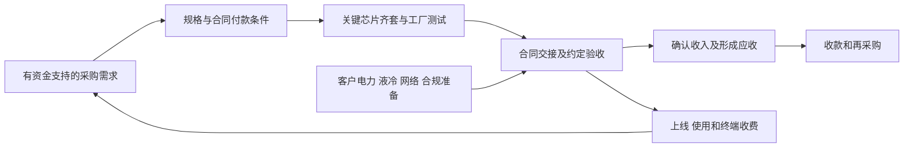

# Super Micro Computer（美超微，NASDAQ：SMCI）业务前景、经营情景、股价与投资决策

## 0. 当前结论与共同口径

**当前判断：在35.09美元参考价附近，可以用小仓位参与“经营增长兑现＋资金效率修复”，暂不作为核心底仓。** 以风险预算示例计，先配置约1%，连续两次财报同时验证利润、周转及融资安全后，才考虑提高到2%—3%。这不是要求先等价格大幅上涨再研究，也不是因低远期市盈率就直接重仓。公司已经具有大规模交付和利润，普通股的胜负手是：**大额订单能否按时收现、AI业务放量时能否保留净集成利润、增长是否还需要以昂贵优先权和新股融资支持。**

| 项目 | 本次统一口径 |
|---|---|
| 研究日与信息截止 | 研究日2026-10-16；截止 **2026-10-16T02:49:46-07:00**，即09:49:46 UTC。后续取证只使用此前已公开的事实。 |
| 参考买价、报价时间 | **35.09美元**，2026-10-15 16:00 EDT／13:00 PDT的正常交易时段收盘价；两个行情页面及本地10月15日快照相互核对。[报价时点][Q01]、[历史日线][Q02] |
| 是否为当前可成交买价 | 截止时尚未进入10月16日正常交易时段；页面另显示当日05:34 EDT盘前35.12美元。模型固定使用前收盘，收益率是**能按35.09美元附近成交**的条件计算；盘前成交价、价差及开盘跳空须另核对，不保证该价格仍可成交。 |
| 证券、交易和财务币种 | 美国普通股SMCI；交易与财务币种均为USD；不是ADR，**1股就是1股，无ADR换算**。SMCIP为另一项优先股存托证券，本文不研究其买卖。全部每股及股数为2024-09-30十拆一后口径。 |
| 已披露财报与发布日期 | 最新完整实际期间为FY2026，截至2026-06-30；2026-08-11业绩公告，**2026-08-31审计10-K**。FY2027Q1截至2026-09-30，期间已结束但截止前实际结果尚未取得，指引不等于实际。[审计年报][S01]、[业绩公告][S02]、[申报清单][S24] |
| 资本结构与股数日期 | 财务余额截至2026-06-30；普通股截至2026-07-31为**656,965,384股**。没有把这个数称为10月16日实时股数。6月末已授予期权/RSU、优先股和可转债另行纳入经济摊薄。[10-K封面、注9/12/13][S01] |
| 共同主要目标日 | **2029-06-30，FY2029财年末**；距研究日约2.70年。足以观察两代平台交付、独立配套及服务复购，也在预计2029-06-01强制可转优先股转换之后，能把普通股权益与现金路径放到同一口径。财年末若非交易日，实务以此前最近正常交易日价格对照。[转换条款][S04] |
| 数值单位与证据 | bn＝十亿美元；1bn＝10亿美元。F＝披露事实，M＝管理层目标，M-T＝经转录取得的管理层陈述，C＝直接计算，I＝本次推断/假设，U＝未知。下表预测均为I；证据强弱不等于发生概率。 |

下一次财报最有辨别力的不是延续17.5%的单季毛利，而是收入是否接近14.5—15.5bn官方指引、毛利回到约10%—11%后绝对利润是否仍增加、库存/应收与收款是否匹配。随后一个季度应进一步检验交付后移是否消化，而非再将其顺延。

| 经营情景 | 目标期经营、资本与每股状态 | 纯业务价及目标日DCF参考 | 目标日交易价格 | 相对35.09美元变化 | 证据支撑与决定性依据 |
|---|---|---|---|---|---|
| 悲观／受损 | GPU净收费受压、项目延期；重谈采购、缩表并增发；没有假设失去全部供货资格；FY29收入43.9bn、营业利润2.69bn、FCF 3.48bn；FD 985百万股，现金NOPAT/股 $2.48 | USD 33（-6.0%）；DCF约25 | USD 18—26 | -48.7% 至 -25.9% | 中；周转与采购不对称已经发生；受损持续期和再融资仍属条件 |
| 基准／正常兑现 | 订单和新平台正常交付；低双位数毛利、改善周转；独立配套及服务渐进扩大；FY29收入88.3bn、营业利润7.29bn、FCF 4.90bn；FD 867百万股，现金NOPAT/股 $7.28 | USD 91（+159.3%）；DCF约85 | USD 69—91 | +96.6% 至 +159.3% | 中；审计销售、具体客户运行及订单支持；净取消率、周转和持续毛利未证实 |
| 乐观／超预期 | 更多企业订单、交付与预收改善；净集成费用和附着率同时提高；FY29收入113.2bn、营业利润11.98bn、FCF 8.01bn；FD 893百万股，现金NOPAT/股 $11.34 | USD 148（+321.8%）；DCF约182 | USD 148—182 | +321.8% 至 +418.7% | 弱；企业扩张及产品已可供；高AI占比下的持续高毛利尚缺联合证明 |
| 突破／非线性 | 核心业务优于乐观；DCBBS责任平台及有偿运维形成第二利润池；FY29收入135.0bn、营业利润16.02bn、FCF 9.69bn；FD 909百万股，现金NOPAT/股 $14.95 | USD 194（+452.9%）；DCF约330 | USD 284—344 | +709.3% 至 +880.3% | 弱；产品、渠道和装机入口存在；独立净收费、复购、服务利润仍须跨越门槛 |

表中经营与每股指标采用FY2029全年，目标交易价格也统一对该年指标定价，**没有把下一财年预测盈利混入第一层“已在目标期形成的基本面”**。纯业务价固定使用12倍EV/现金NOPAT；“现金NOPAT”指SBC前、正常化税后的营业利润，薪酬的经济代价通过股份与现金桥体现，定义见第四章。目标价另用6—9／9—12／12—15／18—22倍。DCF是目标日剩余每股经济价值，不是当天目标交易价。

普通股预测期不分红、不假设主动回购；期间自由现金先支付债务与优先股息、留存经营缓冲，余款只在目标日桥接一次。优先股转换、现有员工权益、新授予及可转债净摊薄均已计入。价格按整美元展示，底稿保留小数仅为复算，不能理解为预测具有美分精度。四种情景不是概率全集，不将突破栏的高涨幅直接当作预期收益率。

## 1. 研究依据与分歧裁决

本次本地研究输入限于目标公司的正式公司调研、相关正式行业/背景报告，以及有日期的每日金融数据。上游报告用于找事实与反证线索；**收入预测、情景、证据分级、估值和投资动作均由本次模型形成**。没有读取或继承既有投资决策、评级、比较排序、评分、技术面、情绪结论或备份研究。目录规则仅决定读写边界。具体文件、SHA256和外部原始来源见附录。

三项分歧必须先裁决：

1. **“逾60bn订单”能否视为FY2027已锁定收入？不能。** 原公告的对象是FY26Q4取得的新订单，明确包含可能非firm、取消或延期的部分；年末RPO约2.612bn又适用短期合同披露豁免，范围不同。不能把两者互相否定，也不能相加。[原始订单限定][S03]、[10-K注2][S01]
2. **17.5%毛利是否已证明DCBBS永久重估？尚未证明。** Q4较高毛利与真实收入是正面证据；但AI项目后移提高企业组合权重，关税/库存因素也有贡献。电话会给下一季约10.4%—10.8%毛利预期，本次以低双位数作基准，以高AI占比下能否持续提高绝对毛利作分水岭。[Q4财务表][S02]、[CFO转录陈述，M-T][S06]
3. **大额库存是确定未来收入，还是必然报废？两者都过度。** 它支持已有组件和成品资源，也暴露于指定客户验收、出口审查及代际替换。缺少客户×平台×库龄×预付款矩阵，不足以估算确定取消率或统一残值。本次把差异落实到交付速度、毛利、营运资本和融资，保留严重停供/重组的表外尾部。

## 2. 业务经济本质、竞争与经营起点

### 2.1 客户购买的结果与公司保留的价值

SMCI把芯片、主板、内存、机箱、供电、互连、冷却和管理工具组合成合格系统。买方主要是云/AI基础设施运营商、企业、OEM与渠道；最终使用者、设备采购方及融资付款方可以不同。客户愿意付款的主要结果是按期可用、负载稳定、减少内部工程与故障协调，以及降低全生命周期成本。交期缩短能让昂贵GPU更早产生服务收入，但只有真实使用和收费，才形成客户ROI。

系统收入的绝大部分不是SMCI独自创造的芯片租金。GPU价格上涨或配置变贵，可以同时提高报表收入、采购付款和库存，却不提高每套绝对毛利。客户改为自供高价值部件时，SMCI完成同样工程工作，也可能确认更少收入。研究必须跟踪**可留存费用、单位资金占用和每股结果**，不能只跟踪系统销售额。

公司只有一个报告经营分部。本文采用下列互斥研究单元，不声称已披露这些分部利润：

| 单元 | 谁付款、收费及主要价值 | 可持续性、代价与失败条件 |
|---|---|---|
| A 加速计算系统 | 云、AI运营商及企业采购完整GPU/加速系统；含系统发票内的机架、初始液冷/供电/互连及集成 | 平台适配、测试、交付与响应有价值；昂贵BOM、少数大买方和跨代认证限制议价权。配额不足、现场不能验收或客户无法付款都会阻断复制。 |
| B CPU、存储及边缘硬件 | 企业/云CPU、存储、Blade/多节点及边缘设备；兼容性、配置宽度和渠道服务 | 既有利润池，客户较分散，但仍受大厂、ODM与组件成本竞争。企业/渠道口径也包含GPU，不能把该口径全部归入B。 |
| C 独立DCBBS基础设施 | A/B发票以外、单独获得对价的网络、机架供电、CDU/换热、配套和工程包 | 从卖设备走向系统责任；工程、可靠性、质保和驻场成本增加。若只是重分类、免费捆绑或替伙伴转售，就没有额外平台利润。 |
| D 单独软件及付费服务 | 管理软件、安装集成、上门支持和延保等履约义务；按合同/服务期确认 | 可复用软件和装机基数产生机会；现场支持、人力、备件及伙伴分成使它不是纯SaaS。没有独立收费、续约和成本证据，就不能把全部装机变成ARR。 |

同一发票只计一次；一套系统的嵌入液冷不再计入C，赠送管理软件不再计入D。CPU/agent、KV/context存储与边缘机会先放在B/D，不另加一个宏大AI市场。AMD于10月12日公布Helion CPU/agent路线并列SMCI等伙伴，计划11月供货；STX发布仍包含原型与后续验证。这些支持产品可行性和进入资格，尚不支持独立集团级收入。[AMD原公告][S27]、[STX阶段限定][S28]

收入与利润按集团并表口径；客户的数据中心和长期算力营业收入不因SMCI供货就并入公司。非并表股权/JV不按其全部销售计入A—D；年末少数权益很小，但母公司债权、优先股及员工权益对普通股的分配影响很大。场站转租亦不解除SMCI原租约义务，未把项目容量等同于公司拥有的算力资产。

### 2.2 采用链条与客户预算能否承受

发运、会计收入、上线和现金不是同一天。产品通常在控制权转移时确认，客户接受条款及服务义务会改变时点；预收款在履约前也不是无义务利润。[收入政策，10-K注1/2][S01]

具体采用证据比Logo更有约束力。Lambda/ECL披露运行Supermicro制造的GB300系统，支持真实部署能力；Gorilla披露约2bn设备安排，9月进入分期交付/安装，支持有对象的采购链，但没有证明全项目均已验收并付清。DataVolt约20bn仍是非约束MOU且须最终协议，不能另加在60bn队列上。Cisco提供企业客户入口，合作方当前页面把完整堆栈全球可订时点列在10月底，Cisco为主要支持接口，不能把其全部软件/服务价值归给SMCI。[买方运行][S26]、[设备安排][S11]、[交付更新][S12]、[MOU原文][S25]、[Cisco责任及可订日期][S10]

头部买方确有很大资本预算，但财务承受力分化。Microsoft FY26Q4披露CapEx 41bn、现金PPE 35.8bn、CFO 55.4bn；Meta当季CapEx 31.08bn对CFO 31.86bn，全年CapEx指引130—145bn。前者显示有现金支持的支出能力，后者显示即使大型盈利客户的投资也明显挤压自由现金。**这些不是SMCI获得同等份额的订单证据，更不是对NeoCloud和主权项目的统一担保。** 项目融资、长期算力合同、设备担保和客户预付仍须逐项确认。[Microsoft原始讲话][S17]、[Meta财务及指引][S18]

客户TCO的一个独立条件算例：同为1MW IT负载，PUE从1.35降至1.15、电价0.10美元/kWh，年节电约17.5万美元；增量冷却投资100万美元，仅这项节电的静态回收约5.7年。更有价值的支付理由可能是提前上线、提高密度或减少停机，但需要可收费负载和可用率支持。不能把厂商“最高节能”比例普遍乘每个项目。

### 2.3 护城河与竞争者的真实能力

SMCI的优势是模块化产品、适配速度、广泛配置、液冷/机架工程和交付组织；强关系与已认证产品可以提高复购。核心GPU/IP、CUDA/互连生态和客户预算控制权分别在平台方与买方手中。NVIDIA减少托盘装配工序，既能提高SMCI效率，也降低简单装配稀缺性；托盘装配时间不等于整个集群验收时间。[NVIDIA技术原文][S16]

竞争已经进入规模交付阶段。Dell同季AI服务器收入16.4bn、订单60.9bn、积压95bn，表明大项目并非SMCI专属；ISG 15%营业利润率包含传统服务器、网络与存储，不能当AI系统毛利率。HPE的Vultr 1.2bn Helios订单说明AMD全套液冷方案也有竞争者。Wiwynn部分内存改代理采购，提示收入分母和毛利率能因采购责任变化而改变。[Dell原始经营数据][S13]、[HPE订单][S14]、[Wiwynn原文][S15]

本次裁决是：新代际和复杂系统交付具有结构性需求，SMCI可以继续扩大收入；**可持续超额利润取决于客户愿不愿为验证、责任和维护独立付费**。面对大买方多源采购及平台标准化，单靠“最早推出新品”不足以支持永久高收费。

### 2.4 产能、单位经济性与资本负担

管理层展示FY27超过6,000机架/月的能力方向、其中约3,000液冷，并披露85+10MW全球电力能力。它们是厂商能力主张，非特定平台的已验收产量；不同CPU、八卡节点和NVL机架不能按相同价格相乘。约束是**资金支持的订单、芯片/组件齐套、合格测试、现场准备四者的最小值**。[公司演示页5][S05]、[月度单位的管理层说明，M-T][S06]

基准FY27的A按每100美元净收入留下7.5美元毛利，已含采购、制造测试、物流、常态质保和制造折旧，未扣集团费用。按55天应收、100天库存、35天应付的年度流量代理，核心资金占用约31.5美元。即使单位贡献为正，还要负担研发、销售、服务、利息和税，不能称作几乎无资本的高回报生意。价格降1%、采购成本暂不降时，A的年度利润损失可接近0.48bn；同额收入增长不代表同额利润增长。

厂房CapEx不是全部增长代价。公司出售的GPU主要作为库存周转，不能把其成本按自营GPU云的多年折旧来“改善”自由现金。模型的CapEx用于制造、测试、实验室及系统维护；每代产品的研发、现场团队与维修大部分已进入经营费用/毛利。前置备货和应收才是最可能限制扩张的资本池。

基准FY27 CapEx 0.30bn中，约0.10—0.15bn视为维护/替换，其余用于扩张和测试〔I〕；测试服务器约3—5年、制造/实验室装备约5—7年、建筑更长的混合经济寿命支持折旧与更新假设，不声称这是公司已披露的完整拆分。现金桥D&A仅对应固定资产，不把经营租赁使用权摊销加回后又遗漏租金支付；后期维护资本至少覆盖折旧。

### 2.5 干净的财务起点与正常化桥

下表为已披露数据，金额bn；季度现金流为单季。FY26Q4严格CapEx由全年减前三季计算，不用公告“CapEx及净投资”混合口径替代。历史利润不作主观加回。[业绩表][S02]、[审计报表][S01]

| 指标 | FY2025 | FY2026 | FY26Q3 | FY26Q4 |
|---|---:|---:|---:|---:|
| 收入 | 21.972 | 39.063 | 10.243 | 11.120 |
| GAAP毛利率 | 11.1% | 10.8% | 9.94% | 17.47% |
| 营业利润 | 1.253 | 2.770 | 0.626 | 1.488 |
| 净利润，优先股分配前 | 1.049 | 2.230 | 0.483 | 1.178 |
| CFO | 1.660 | −6.810 | −6.615 | 0.747 |
| 购建固定资产现金 | 0.127 | 0.162 | 0.080 | 0.028 |
| FCF＝CFO−CapEx | 1.532 | −6.972 | −6.696 | 0.719 |

全年现金可复核为：净利润2.230453＋非现金等净调整0.607930＋经营资产负债净变动−9.648269＝CFO −6.809886bn。供应商信用和付款时点是大变量：Q2应付曾升至13.753bn，Q3降至3.687bn；不能将Q2低现金流出当成永久轻资本能力。Q4应收减少而库存仍增加，真实收款改善与尚待交付并存。

正常化桥不将关税、库存常态损耗、返利减少和控制费用全部“加回”。FY26法定营业利润2.770＋SBC 0.412＝SBC前营业利润3.183bn；按模型正常化税率22%为现金NOPAT约2.482bn。它**不是GAAP净利润或普通股EPS**，利息、优先权、员工权益和资金占用尚须继续桥接。FY26优先股采用two-class method；本研究不把“净利润减优先股息÷旧股数”冒充GAAP EPS。[注5/12/13][S01]

### 2.6 治理如何传导至经营

BDO对财务报表出具无保留意见，同时对财报内控出具否定意见，ITGC缺陷仍未消除；两种审计结论不能混淆。Mark Long已于10月14日就任CFO、10月15日披露，这是已发生的人事变化，尚不是回款和内控改善的结果。[审计意见和内控章节][S01]、[CFO 8-K][S23]

3月美国起诉针对相关个人，公司未列被告；8月公司调查未发现现任高管知悉转运、也未认为既有报表因此不能依赖，但仍配合政府调查。10月Sun替代起诉文书可取得，Reuters又报道其认罪；完整认罪/合作条款未取得，不能据此判定公司或其他个人已被定罪。相反，也不能因公司内部调查结束就写成外部程序已经终结。[DOJ原公告][S19]、[公司调查范围][S20]、[法院Document 61][S21]、[Reuters报道层][S22]

台湾还有独立的B300出口案证据。基隆地检8月24日原始新闻稿描述相关卖方因产品检查、交付延误及赔偿承担经济损害；公告公司名匿名化为“美○微”，本文将其作为与SMCI台湾销售/出口链条相关的风险线索，而非据此认定全球业务均受同样限制。检方陈述不等于法院已认定，覆盖范围、持续期和公司实际损失额仍未知，故不另编造一笔罚款或把全部销售冲销。[原始新闻稿，页1及页5][S30]

这些问题先影响最终用户审核、供应资格、验收时间、信用条款和费用，再影响可赚利润与现金。本研究没有先把全部收入认作虚假，也没有只用一个抽象治理折价替代实际经营损耗。

## 3. 未来两次财报与中远期经营路径

### 3.1 两个即将披露期间的可检验预测

FY2027Q1为截至2026-09-30季度，预计在2026年11月前后披露；FY2027Q2为截至2026-12-31季度，预计在2027年2月前后披露。**这是窗口估计，未把第三方日历当公司确认日期。** 表中预测范围是相容经营包络，不能把收入上限与最低费用随意拼成新的中心值。

| 指标，bn另有注明除外 | FY2027Q1 本次I | FY2027Q2 本次I | 与当前官方口径及原因的对照 |
|---|---|---|---|
| 总收入 | **14.0—15.5**，工作点14.8 | **15.5—17.5**，工作点16.5 | Q1官方14.5—15.5；本次下沿纳入部分现场延后。Q2尚无公司正式指引。 |
| A加速系统收入 | 10.0—11.8，点11.0 | 11.0—13.0，点12.0 | 研究分类；不等同管理层包含CPU/agent的“广义AI占比”。未对Rubin编造单独收入或GPU出货数。 |
| GAAP毛利率 | **10.0%—11.2%**，点10.5% | **10.3%—11.8%**，点11.0% | Q1电话会预期约10.4%—10.8%，转录性质M-T；大AI项目恢复可令收入升、混合毛利降。 |
| GAAP营业费用／营业利润 | 费用0.46—0.55；营业利润约0.85—1.28 | 费用0.55—0.65；营业利润约0.95—1.52 | Q1管理层费用约0.453；本次允许销售、服务和整改支出稍高，不把费用率无限压低。 |
| 资本开支／FCF | CapEx 0.05—0.08；FCF约−1.6至+0.75 | CapEx 0.06—0.10；FCF约−0.6至+1.4 | Q1管理层CapEx约0.05—0.06；公司未给这两个FCF区间，主要未知是收款/备货时点。 |
| 核心W＝应收＋库存−应付 | 约19—22.5 | 约19—22 | 期初16.774；收入放量允许占资增加，但W持续超过23且无新增客户资金支持，将使全年路径失配。 |
| 订单、积压与先行指标 | 预计仍有高额订单叙述；交接、客户准备与付款比总额更关键 | 应看到延期队列消化、企业渠道新增交付与服务合同 | 没有滚动表，不预测一个伪精确净backlog；RPO受合同期豁免影响，不能用它平移60bn订单。 |

Q1官方GAAP EPS指引0.89—0.98、非GAAP 1.01—1.10，分别采用745/761百万加权稀释股数及不同分配口径。本表直接预测营业利润和现金，避免用本研究的经济保留股数冒充公司GAAP季度EPS。[官方指引][S02]、[费用/毛利/CapEx讲话转录，M-T][S06]

最可能的正向惊喜是延期项目顺利交接、回款快于新增备货，且企业/独立配套维持较好绝对毛利；最可能的负向惊喜是收入达到指引但核心W继续上升、现金依靠新融资，或者毛利的Q4组合红利消退得比市场理解更快。**本次不预测公司下一次必然上调指引。** 基准全年65.9bn接近现有65—72bn下沿；若两季分别实现14.8/16.5bn，下半年还需约34.6bn，即季度平均17.3bn，季度推进要求清楚可检验。

### 3.2 从订单队列到年度收入，保留真实未知

本次不采用行业报告中的TAM/份额预测，也不把65—72bn指引当成已经交付。先使用首个60bn新订单作归一化队列：

\[
R_{队列,FY27}=(60-d)\times u\times f
\]

其中d为FY26已确认且包含在这批新单中的收入，u为剩余队列仍具有商业有效性的比例，f为有效部分在FY27交接比例。**三者均未公开，本次是条件假设，不是合同事实。** d约3—9bn、u约85%—95%、f约75%—90%，对应队列贡献约32.5—48.7bn。其他排重业务以FY26收入扣除队列已确认部分后的约33bn为基底，假设保留约70%—80%的复购/原队列交接，再加约1—2bn不重叠新项目，形成约24—28bn条件带宽。这个续购比例来自存量客户与企业更新机制判断，并非披露NRR。

中心取d＝6、u＝90%、f＝83%，原队列约40.3bn；其他排重收入取约25.6bn，合计65.9bn。客户明细未公开，工作点的可信精度约1—2bn，表中小数仅用于公司财务桥，不是逐客户合同精度。**原队列和其他业务给的是收入约束范围，不构成已锁定65.9bn的证明。**

中心点只是对这一宽约束中“订单兑现、正常延误及其他复购继续”的公司路径作出的明确判断。与“所有订单失效”相比，审计销售、具体客户运行和现有新平台交付支持持续扩张；与“订单即现金”相比，真实延期、供应商付款波动和采购条款要求保留充分的资金条件。60bn、DataVolt、Gorilla及Cisco机会不能在未知重叠下机械相加。

远期按业务驱动分别推进。基准A在FY27/28/29/30为48/57/64/69bn；这一变化可理解为合格交付工作量约100/120/137/150的条件指数、混合净价约100/99/97/96的组合，而非同型号持续提价。数量指数表示项目交接和系统工作量，**不是已查到的机架或GPU数量**，也不构成另一份独立证据。近两年主要靠订单转化；之后靠复购、平台替换与更多企业项目，增速逐步放缓。

B基准14.5→16→17.5→19bn，源于CPU/存储更新、渠道复购与agent相邻需求；C为2.5→3.8→5→6bn，仅计独立对价；D为0.9→1.3→1.8→2.4bn，按服务期确认，FY26实际服务/软件0.538bn提供起点。未把硬件升级、原系统替换和服务合同总额同时计作新增收入。完整年度量价/毛利参数在附录A。

物量仅作否决性约束：若完整采购包约5万—9万美元/GPU封装，48bn相当于约53万—96万封装的年度采购量级；该价带包含服务器及配套，Gorilla设备安排仅提供一个宽参照。它**不是独立出货预测，不能拿这个倒算数量验证同一个收入假设**。当前公开资料缺少足以单独证明该配额与客户验收槽位的分母，故基准远期证据为中，不升级为强。

### 3.3 四种路径的分水岭与突破的最少条件

悲观不是公司停止思考或无期限毁损现金：项目延期、净集成费用下降，FY27规模44.1bn；采购协商和控费后，FY28仍约42.2bn，随后缓慢恢复至FY29 43.9bn。A的毛利从5%逐渐修复至6.5%，不假设其恢复原有全部份额。管理层先收缩未匹配付款的采购和可选扩张，保留有现金支持的客户。

基准是新平台及订单正常兑现、成本和客户准备仍有普通摩擦。FY27/28/29收入65.9/78.1/88.3bn，混合毛利10.6%/11.2%/11.9%；利润来自规模与合理组合，**不依赖维持17.5%毛利**。A的单位毛利改善有限，B、独立配套和付费服务逐步增加。

乐观解除的是测试交付、客户付款和企业净收费约束，FY29 A/B/C/D为80/22/8/3.2bn，A毛利10%、集团约14.1%；它仍然是可比较的系统/配套/服务生意，并未给全部服务器套用软件利润。

突破则必须出现不同的价值捕获机制：在更强的核心交付上，公司成为可跨客户复用的DCBBS责任平台，客户为运维、可靠性、控制和独立配套持续付款。FY29 A/B/C/D为91/24/14/6bn，毛利11.5%/22%/27%/50%，经营费用6.5bn；核心A和B均高于乐观，不为突出第二曲线而压低主业。最少成功条件为：

- 至少两个大客户/渠道队列证明独立配套不是A收入重分类，合同、净对价与验收可对应；Cisco等伙伴未将主要新增收费全部留在自身。
- 服务/软件从FY26的0.538bn到FY29约6bn，必须有可重复付费、分期确认和成本覆盖；FY28至少应出现约3bn年收入方向，不能只展示管理软件功能。
- 新平台高AI占比下，集团毛利仍向15%以上靠拢；单位质保、现场团队和支持成本不随收入同比无限上升。
- 核心资金占用改善到约42/75/42天的应收/库存/应付代理，不能用客户无钱验收的成品支持“高收入＋高现金”同时发生。

C的量价用“适用计算系统支出×选择独立配套的客户覆盖×新增外部内容量”约束。基准FY29计算A+B约81.5bn，覆盖约40%—50%、独立内容约12%—15%，对应约4—6bn，工作点5bn；突破计算支出115bn、覆盖约70%—80%、新增内容约15%—18%，对应约12—17bn，工作点14bn。这些都是I，内容只包含A/B没有计过的外部网络、供电、热管理和工程，不能把已含液冷再加一次。**C不是单一CDU市场，14bn也不能用液冷TAM独自证明。** 若真实可独立收费内容仅5%，突破C只有约4bn，平台利润将显著低于表中路径。

D用可服务装机队列、付费覆盖与年度收费检验：基准FY29约150bn适用历史硬件、约30%选择付费、年费约3%，加约0.45bn当期部署/专业服务，得到约1.8bn；突破约200bn适用硬件、60%付费、年费约4%，加约1.2bn当期服务，约6bn。适用硬件是存量，不是当年收入；年费及覆盖均未公开，必须验证客户净对价、合同期限和履约成本。它不会因历史全部硬件销售就自动形成。

更高收费还有买方预算门槛。条件算例：一柜72颗GPU、完整购置5百万美元、利用率75%、小时净租价5美元/GPU，年收入约2.37百万；4%设备年费为0.20百万，已占收入约8.5%。再扣四年直线设备成本1.25百万、约0.18百万电费和其他运营/融资，买方余量并不宽；若小时价跌至3美元，年收入仅约1.42百万，原收费更难承受。因此突破的高付费覆盖须有企业任务ROI、可用率或提前上线价值支持，不能套给全部商品化NeoCloud。D毛利50%同时保留约3bn直接服务/软件成本，伙伴和现场资源不能无限免费复制。

突破路径FY27—29 CapEx累计3.2bn，比乐观多1.55bn；同期费用累计14.1bn，比乐观多4.3bn，包含更大的业务规模、软件和服务组织。没有零成本的平台跃迁。

若FY28独立收费和复购证伪，合理管理层应暂停后续可选扩张、转售/处置可用设备、将渠道合作缩回系统供应，并承担已发生研发、人员及部分0.5—1bn级别重组/减值的条件损失。这个失败分支不能保留突破全部收入，又省掉其全部成本；也不强行继续扩建至负现金。四个合成情景保持公司总价值递进，失败或融资中断则触发重新建模。

## 4. 利润、现金、资本结构与每股基本面闭合

### 4.1 利润与营运资本模型

各年毛利＝A/B/C/D收入分别乘相应毛利率；营业利润＝毛利−集团研发/销售/管理等费用。费用含常规薪酬、SBC和控制/服务能力投入，制造折旧及标准质保在成本内，D&A只在现金桥加回一次。有效税率统一22%，既不永久外推FY26约19.9%的低税率，也不把NOL、研发税抵或递延税资产直接当作现金。

模型核心W以硬件和服务分开：

\[
W_t=R_{H,t}\frac{DSO_t}{365}+R_{D,t}\frac{30}{365}+COGS_{H,t}\frac{DIO_t-DPO_t}{365}-采购后移额_t
\]

这里H＝A+B+C；期初W＝6.125414＋12.895949−2.247003＝**16.774360bn**。天数用年度流量估计期末存量，是研究代理，不冒充公司平均余额法DSO/DIO。基准FY27/28/29采用55/100/35、52/95/35、50/90/35天，得到期末W约20.26/22.32/23.56bn；收入上升同时要求资金强度改善，不能称为无条件结果。

未单列的服务预收、产品预付款、采购预付、税款与保修时点，合计净变动中心取0。**这要求新预收补足既有履约转出，不是把期初递延再当新现金加入。** 若净退款或预付多1bn，现金就相应少1bn。期初受限现金0.110bn不进入可支付现金；其他非流动应收、非上市投资和代他人持有资产不作为立即可用融资资源。

### 4.2 SBC只计一次，资本结构逐项处理

会计利润含SBC。到2036年，现金桥按实际非现金性质加回SBC，同时按**新授予价值÷本情景发行/授予价格**增加潜在股份；已授予未归属部分先在基期权益储备中计入，不再用同一金额重复发行。定价指标取SBC前税后营业利润，避免既扣未来薪酬现金又把同一薪酬股份重复惩罚。**GAAP NOPAT/股作为对照仍列在附录，并非另一套定价扣款。**

基期经济保留股数＝656.965百万普通股＋34.704百万已有期权＋18.210百万未归属RSU＝709.880百万。已有期权全额保留且不加行权现金，是一个偏审慎的潜在摊薄口径，**不是GAAP库存股法股数**；部分期权可能不归属或价外，若全额行权，约0.89bn行权款的上限尚未计入。未来新授予与已授予费用摊销分开；基准FY27/28/29新授予价值0.25/0.40/0.80bn、当年SBC费用0.60/0.70/0.80bn，未将旧奖项再发一遍。未取得按员工/奖项的滚动计划，这仍属I。[现有权益储备，注12][S01]

普通股目前授权10亿股。本次已检验经济潜在股数不超过该上限；悲观路径FY29接近9.85亿，故从FY30起将后续相同薪酬改为现金支付，费用不消失，不假定股东必然增加授权。其他路径从2037年以现金等价薪酬正常化，GAAP费用保持，停止新增稀释；这用于远期现金价值等价测算，**不是公司已承诺的薪酬政策**。若现实继续发股，应重算股数与现金，不能两边同时省成本。基准采用员工取得全额股票后自行缴税的简化；若公司代缴，现金与少发股份同步调整，历史已付税款已在起点现金中。

资本条款与处理如下：[10-K注8/9/10/13][S01]、[融资条款][S04]、[首期股息][S29]

| 项目，2026-06-30起点 | 事实与模型处理 |
|---|---|
| 非受限现金／银行债务 | 现金7.521bn，其中境外约0.871bn；银行借款4.056bn。集团桥假定境外现金可用于相应当地采购，不假定全部立即汇回美国；若偿债地与现金所在地错配且不能调拨，局部预算缺口最高可再多约0.871bn。FY27支付2.040bn、FY28支付1bn、FY29支付余款；后两年属模型主动降杠杆安排，不把2030-12-29 JPM法定到期写成FY29到期。银行现金利率假设6.5%，按年内平均余额。 |
| 可转债 | 面值4.725bn：2028券0.700bn于2028-07-15（FY29）到期，票息2.25%；2029券1.725bn于2029-03-01到期，票息3.5%；2030券2.300bn于2030-06-15到期，常规零票息。模型按面值现金偿还，未将账面摊余额当现金到期额。 |
| 转换及capped call | 2028/2029/2030转换价约61.06/83.44/55.20美元；后两者call上限94.17/81.78美元。现金付本金，超本金部分用净股票，call在有效和可收回条件下抵消至上限。2030券净潜在股份已预留于目标FD，债务本金仍保留2.3bn，两者对应不同权利，不是债转股本金重复扣款。 |
| 强制可转优先股 | 清算优先额4.3125bn，7%累计股息；预计2029-06-01转换。按转换窗口VWAP低于27.4997或高于32.9989分别约增加156.82或130.69百万股，中间随价格变化。四种路径均按现金付股息；FY27约0.2901bn，FY28/29各0.301875bn，此后为0。目标日不再扣优先清算额，也不再扣未来优先股息。 |
| 经营租赁与其他优先权 | 租赁负债现值约0.540bn、未折现付款约0.716bn；租金在经营成本/费用，未再当金融债重复扣除。Vernon空间转许可不解除原义务。少数股东权益约0.000164bn，低于本文0.01bn精度；非上市投资不另给溢价。 |
| 未用融资渠道 | ATM原授权1.25bn是发行工具，不是已到账现金；应收出售工具上限也非无条件承诺授信。6月JPM 2bn基本已动用，不能再次加为备用现金。 |
| 信贷契约 | JPM净杠杆上限从4倍逐步降至3.5/3倍，特定优先分派还涉及固定费用覆盖约2倍要求；公司称6月末合规。合同定义与抵押合格率不等于本模型EBITDA，未伪称已按银行口径核准未来可借余额。 |

内生融资的价格假设公开保留：悲观FY27Q2按15美元发行1.25bn毛额，费用3%，净得1.2125bn、增加83.33百万股；它低于悲观当时工作价格20—24美元，具有折让，并非在低价值路径假定能按现价35美元长期募资。其余路径不依赖额外普通股融资。新授予价格FY27/28/29分别为悲观20/22/24、基准38/55/75、乐观50/90/135、突破52/105/190美元；这些是资本结算条件，不是独立股价预测。它们按经营兑现阶段递进，并对照第五章价值；更低结算价要重新增加股份。

### 4.3 年度现金桥、断点与管理层应对

\[
FCFF=EBIT(1-T)+SBC+D\&A-CapEx-\Delta W
\]
\[
FCFE=FCFF-现金利息(1-T)-优先股息-偿债本金
\]
\[
期末现金=期初现金+FCFE+外部股权净流入
\]

上述FCFF是**显式股份稀释前的现金口径**，不能再拿其除以不变旧股数估值；SBC转现金支付之后加回额为0。CFO＝净利润＋SBC＋D&A−ΔW；FCF＝CFO−CapEx，不扣优先股息和偿债本金。四情景FY27—FY40逐年表集中在附录A—C，表中每股指标也沿用各自股数。经营利润、现金与股数没有混用其他路径的期初余额。

基准FY27的桥接例：营业利润4.725→NOPAT 3.686，加SBC 0.600和D&A 0.150，减CapEx 0.300、ΔW约3.483，FCFF约0.652；再减税后利息约0.213，FCF约0.439。付优先股息约0.290及银行本金2.040后，现金从7.521变成约5.63bn。**大量营业利润不等于同额股东可分配现金。** FY29同口径FCF约4.90bn，期末现金8.47bn、剩余金融债2.3bn，才较接近内生支持扩张。

悲观FY27在85/160/35天代理下，先协商将2bn采购后移，并在费用内保留0.15bn协商/重组成本，W仍约21.79bn；FCF约−3.19bn。没有新股融资，付息/本金后的年末现金约2.00bn，低于研究经营缓冲3bn。按上述融资才回到约3.21bn。**采购后移须供应商同意，并非公司单方面取消不可取消承诺**；次年W以降低后的期初余额衔接，延期采购恢复与存货消化一并计算，未把同一2bn永久释放两遍。

| 路径 | FY27 Q1/Q2/Q3/Q4 FCF，bn | 相应期末现金，bn | 最低季末现金 | 融资截止要求 |
|---|---|---|---|---|
| 悲观／受损 | -2.10 / -1.80 / 0.20 / 0.51 | 4.85 / 3.67 / 3.29 / 3.21 | 3.21 | Q2净流入1.2125bn |
| 基准／正常兑现 | -0.80 / -0.20 / 0.40 / 1.04 | 6.15 / 5.36 / 5.18 / 5.63 | 5.18 | 无新增外部权益融资 |
| 乐观／超预期 | -0.30 / 0.50 / 1.00 / 1.83 | 6.65 / 6.56 / 6.98 / 8.23 | 6.56 | 无新增外部权益融资 |
| 突破／非线性 | -0.50 / 0.30 / 0.90 / 2.10 | 6.45 / 6.16 / 6.48 / 7.99 | 6.16 | 无新增外部权益融资 |

这是一组由年度结果约束的FY27季度资金预算〔I〕，不是已知季度现金事实或逐周银行证明。悲观发行必须在FY27Q2的采购/还款前完成；在这组时序下，为保3bn最低现金需要约1.00bn净资金，1.2125bn提供约0.21bn余量。**峰值资金缺口的实际日期和规模仍取决于未公开付款条款**：若再有1.5bn重要回款延期，最低现金降至约1.7bn，应再取得客户预付、减少可选采购或落实新增融资；不可原样维持该收入路径。3bn是研究缓冲，不是银行契约。

34.2bn采购承诺主要在随后12个月，是公司的履约/资金责任；已经进入COGS、库存和采购付款的部分不再从估值一次性扣第二遍。已付库存的减值是原计划回收额减少，不能又作为相同金额新现金支出扣一次。若供应资格全面中断、无法重谈采购又融资关闭，应改做重组/残值分配；普通股可能接近零，**18美元不是破产保护底价**。

## 5. 估值转化、固定倍数与市场重估

### 5.1 先看剩余经济价值

使用逐股FCFE DCF，适合本公司优先股转换、现金偿债及持续发股；不假设融资工具免费。目标日经营权益价值按FY2030—FY2040各年FCFE除以**当年完全摊薄经济股数**后折现，另加目标日超过3bn经营缓冲的现金。2030券本金已在FY30 FCFE支付，**DCF端不再重复扣这笔债务**。为对照市场倍数，附录另列等价EV桥。

股权要求回报率统一11.5%〔I〕，可由长期无风险利率基准约4%、权益风险溢价约4.5%、周期系统风险系数约1.65—1.7解释；这是长期估值假设，不声称为当日国债即时报价。业务执行、周转与融资损伤已经进现金/股份，未再为悲观或突破另加任意高风险溢价重复惩罚。

显式经营期至FY2040。FY2037—40收入增长依次收敛：悲观4%/3.5%/3.2%/3%，基准4.5%/4%/3.5%/3%，乐观5.5%/4.5%/3.7%/3%，突破6%/5%/4%/3%。成本结构保持各路径经济状态，**没有因远期缺合同而安排收入断崖**。2037起薪酬按现金等价费用支付，悲观路径更早于2030开始，未同时享受SBC加回与无稀释。

2041年起永续增长3%，维护CapEx覆盖折旧，增长再投资按经营W、净PPE及租赁经营资本的3%计入；新资产增长、现有资产更新和员工薪酬均保留。目标日DCF约**24.5／85.1／181.8／330.3美元**，按11.5%折回研究日约**18.3／63.4／135.4／246.0美元**。它们是各自完整条件路径的价值，不是四个可同时取得的当前报价。

终值现值占经营权益现值约50.1%／44.7%／47.4%／49.1%，仍然重要。终值ROIC代理约12.6%／22.7%／36.3%／46.4%：高路径要求低固定资产制造、良好营运资本及付费服务共同产生高回报，不能仅据CapEx小就宣布成立。若将远期增量ROIC上限强制压到20%，同一目标日DCF约24.5／84.4／176.0／316.2美元；原模型的额外高ROIC不是全部右尾价值来源，**未来实际利润规模与复购仍更决定结果**。该测试只增加终值再投资，不把高路径的新增收入免费保留。完整现值、再投资和折现敏感性在附录D/E。

### 5.2 固定倍数：把纯业务与股份变化锁在第一层

统一使用：

\[
CNOPAT_{29}=(EBIT_{29}+非现金SBC_{29})(1-22\%)
\]
\[
P_{业务}=\frac{12\times CNOPAT_{29}+\max(Cash_{29}-3,0)-Debt_{29}}{FD_{29}}
\]

现金NOPAT用于配合显式股份法，不能与传统GAAP P/E混比。12倍是固定基准锚：以研究日价格、基期经济保留普通股约709.9百万股、优先股清算额近似其价值、金融债面值与现金估计，企业价值约30.5bn，除以FY26正常化现金NOPAT约2.48bn约12.3倍；若将3bn经营现金也视为经营资产，则约13.5倍。优先股真实市值、期权行权款与税务差异会改变这一近似，故**不把12倍宣传为精确的当前市场倍数**。

这个锚也相当于在系统制造的资本回报和正常增长上要求约8.3%的税后经营收益率，保留中期增长但不使用纯软件溢价。四行情景都用12倍，所以第一次比较不会靠拉高乐观倍数制造业务回报。对应纯业务参考价约33／91／148／194美元，已经计入采购资金、现金留存、普通股融资与优先股/员工/可转债摊薄。

### 5.3 第二层定价与DCF自洽性

目标日市场倍数取决于此后增长与经济质量：

- **悲观6—9倍**：资本回报贴近资本成本、客户信用与单位费用受损，且有较大新股融资。固定12倍价约33，最终18—26；业务每股成果已经不强，约7—15美元进一步下降来自倍数压缩。若这些结构损伤未出现，不应无故杀到这组倍数。
- **基准9—12倍**：规模扩大、毛利合理、现金转好，但没有独占平台租金。固定倍数约91，最终69—91；下沿约22美元差额来自约25%倍数压缩，**不是模型假定业务失败**。DCF约85落在区间内。
- **乐观12—15倍**：持续交付和企业净收费验证，较好ROIC及后续增长允许有限溢价；固定价约148，最终148—182，新增0—34美元来自重估。DCF约182，没有用数倍于经济价值的价格凑右尾。
- **突破18—22倍**：只有前述责任平台、独立收费和复购共同成立才使用。固定价约194，最终284—344，其中约90—150美元来自平台化重估；这部分回报的依赖性必须单独承认。FY30收入由135增至165bn、利润继续扩大，之后长期利润池也显著高于乐观，DCF约330支持这一量级；若只是更多GPU转售，仍应使用较低系统商倍数。

最终目标区间均没有显著高出各自DCF。突破上限约高4%，基准上限约高7%；这些小幅差异可以来自目标日市场对随后成长与利率的正常定价弹性。不能从“突破具备商业机制”跳到“突破已有强证据”；当前该路径仍为弱支撑。

普通股无预测现金股息，故表中股价回报等于本模型含息回报；按2.70年折算的条件年化回报在附录D列示，不是组合预期年化回报。回购没有进入模型，不能再叠加一笔EPS提升或股息收益。

## 6. 当前投资决策与动态验证

### 6.1 现价隐含什么

使用同一DCF、同一税率、客户周转和偿债规则反推：固定B及集团费用计划，仅将A/C/D整个经营规模相对于基准路径统一缩放，同时把新授予结算价格改成从35.09美元按11.5%要求回报递进的路径，并重算股数和现金。达到现价需要的缩放系数约**55.8%**，对应FY27/29/30收入约**43.2/57.0/62.2bn**；并非65.9/88.3/96.4bn基准。完整计算保留在附录E。

这条反推路径因少备货而释放现金，和本研究“延误＋坏周转＋折价融资”的悲观不是同一状态。它说明现价可以由**显著弱于基准的规模、同时尚可的资金转换**解释；也可由更高尾部风险或更低持续毛利解释，不能将一条反推解当成市场唯一真意。当前没有充分理由说股价已经按乐观/突破兑现定价；更接近悲观与基准之间，并承担了无法用普通倍数稳定刻画的信用、控制及法律尾险。

胜负手只保留三项：一是净订单到可收款交接，二是高AI占比下每套可留存费用，三是增长的核心W与普通股融资成本。新品数量、装配名义产能和静态低P/E只能提供线索。

### 6.2 具体动作、机会成本与仓位属性

在32—37美元、且未出现新的供应限制或回款恶化证据时，本研究倾向**先有约1%的研究型持仓**。理由是基准约69—91美元的条件交易回报达到约97%—159%，主要由业务本身支持；真实交付、审计利润和产品入口足以使这项机会区别于只有概念的泡沫。仓位小，是因为悲观约18—26美元仍可损失约26%—49%，更严重的停供/采购失配或融资重组可使普通股接近零，现金并没有构成硬保底。

仓位上限2%—3%是风险预算示例：允许初始逻辑错误被限定，而不是对用户资产、期限或其他持仓的个性化最优计算。放大仓位需要连续两个季度回款与正常化利润改善；不能只因股价下跌就机械摊薄成本。优先考虑两类加仓触发：

- **28—31美元附近且基本面未坏**：有效订单/回款证据保持、没有新增融资缺口或供应限制，可提高第一阶段投入；若跌价来自取消/融资证伪，应先改模型。
- **即使45—50美元，若两季联合验证**：收入分别达到约15.5/17.5bn方向，毛利稳步升至约11.5%/12.5%，累计CFO转正、核心W受控且无需被迫股权融资，仍可考虑将仓位提高到2%—3%。以原目标不变计，上涨空间缩至约38%—102%，承担的经营不确定性也更少。

完全等待的代价是，前两季若同时证明收款和净收费，股价可能在完整长期服务数据出来前重估，之后很难再按35美元成交。先付一小部分不确定性价格有合理性；但若涨至60美元以上而只有订单叙述、没有现金或利润验证，原基准回报仅约15%—52%，不宜按突破栏追价。价格触发必须与基本面一起使用。

若出现主要平台/产品资格实质受限、重大客户回款失效、年内核心W失控且资金无法落实，降低/退出的触发来自经营与资本逻辑，而不是等到某个既定目标价。若只出现收入分母因客户自供BOM下降，同时绝对毛利、资金回报和复购改善，则应重算收入与利润结构，不能机械当作失败。

### 6.3 未来两次财报及6—24个月路标

| 窗口与验证对象 | 强化路径的具体条件 | 触发受损或推翻的条件与动作 |
|---|---|---|
| FY27Q1披露，约2026年11月 | 收入≥15.5bn、GAAP毛利≥11.5%，同时W≤21.5bn、CFO非负，增强乐观；收入14—15.5且毛利约10%—11%仍可支持基准 | 收入<13.5bn且W≥23bn/成品继续上升，先降低队列交付率；不能只把延期滚到下季。 |
| FY27Q2披露，约2027年2月 | 收入≥17.5bn、毛利≥12.5%，上半年累计CFO≥0.5bn且W≤21.5bn，支持提高规模/单位费用；需要几项联合而非挑一项 | 收入<14.5bn或毛利<9.5%，且现金靠融资维持，降至受损路径；可支付现金<3bn、承诺授信不清时停止加仓。 |
| 截至2027年6月的全年现金与采购 | FCF转正、W大体在20—22bn且新增客户预付/付款条款可解释增长；采购承诺与实际交接匹配 | 维持FY26全年W/收入约42.9%的占资强度，65.9bn要求W约28.3bn，远高于基准20.3bn，需额外约8bn资金；原路径不再自洽，先改采购/融资和稀释。 |
| 2026年10月底—2027年中，Cisco与企业 | 可订落地后出现付费项目、净对价、支持分工与复购；企业资格转成现金销售 | 只有产品展示/伙伴Logo、未披露交付和收费，不上调C/D毛利或把伙伴全部利润归SMCI。 |
| 2026年末—2027年中，Gorilla等项目 | 分期交付之后，验收、支付及上线有互相支持的更新；减少时点折扣 | 只重复多年总合同额、无付款及运行证明，维持较低年度转化；特定客户未融资不扩大采购。 |
| FY27—28，新平台与收费 | 连续两季广义AI≥75%且毛利≥13%；FY27 D至少约1bn、FY28向2—3bn，有成本和分期确认说明，才向乐观/突破迁移 | 毛利上升仅因GPU订单后移、C/D来自重分类或服务免费，剔除平台溢价；收入增长但质保/现场成本同步吞没贡献也属反证。 |
| 每季—FY28，治理与资金规则 | CFO实际改善现金系统、ITGC经运行测试并获审计确认，外部案件范围收敛；融资条件有原始文件 | 任命/内部声明不足以认定整改完成。新增供货、检查、信用或契约限制先传导到交期、W和融资，再修正价值。 |
| 未来6—24个月，竞争与架构 | 比较同配置净费用、客户自供比例、竞争者交付和售后；观察CPU/agent、KV存储付费复制 | 若平台标准化/二供使A净费用持续下调，不能只靠行业总支出增长维持利润；改用较低收费、较小报表分母和相应资金强度。 |

阈值是研究证伪线，非管理层已承诺KPI。单季度低于中心点不自动等于长期永久受损；必须结合合同、成本、现金和管理层应对，判断是延期、经济性变化还是资本结构断点。

## 7. 附录底稿与复核

### A. 分业务年度序列及公司利润

以下全为本次I；金额bn，A/B/C/D互斥。括号中的四个毛利率依次对应A/B/C/D，不是公司报告分部。FY2037—40为渐进稳态过渡，收入、费用及单位利润继续衔接。

#### 悲观／受损

| 财年 | A/B/C/D收入 | A/B/C/D毛利率 | 总收入 | 毛利 | 经营费用 | 营业利润 |
|---|---|---|---|---|---|---|
| FY2027 | 30.00 / 12.00 / 1.50 / 0.60 | 5.0% / 17.0% / 15.0% / 32.0% | 44.10 | 3.96 | 1.85 | 2.11 |
| FY2028 | 28.00 / 12.00 / 1.50 / 0.70 | 6.0% / 17.5% / 16.0% / 34.0% | 42.20 | 4.26 | 1.90 | 2.36 |
| FY2029 | 29.00 / 12.50 / 1.60 / 0.80 | 6.5% / 18.0% / 17.0% / 35.0% | 43.90 | 4.69 | 2.00 | 2.69 |
| FY2030 | 31.00 / 13.00 / 1.80 / 0.90 | 6.5% / 18.0% / 17.0% / 35.0% | 46.70 | 4.98 | 2.15 | 2.83 |
| FY2031 | 33.00 / 13.50 / 2.00 / 1.00 | 6.5% / 18.0% / 17.0% / 35.0% | 49.50 | 5.26 | 2.30 | 2.96 |
| FY2032 | 35.00 / 14.00 / 2.20 / 1.10 | 6.5% / 18.0% / 17.0% / 38.0% | 52.30 | 5.59 | 2.45 | 3.14 |
| FY2033 | 37.00 / 14.50 / 2.40 / 1.20 | 6.5% / 18.0% / 17.0% / 38.0% | 55.10 | 5.88 | 2.60 | 3.28 |
| FY2034 | 39.00 / 15.00 / 2.60 / 1.30 | 6.5% / 18.0% / 17.0% / 38.0% | 57.90 | 6.17 | 2.75 | 3.42 |
| FY2035 | 41.00 / 15.50 / 2.80 / 1.40 | 6.5% / 18.0% / 17.0% / 38.0% | 60.70 | 6.46 | 2.90 | 3.56 |
| FY2036 | 43.00 / 16.00 / 3.00 / 1.50 | 6.5% / 18.0% / 17.0% / 38.0% | 63.50 | 6.75 | 3.05 | 3.71 |
| FY2037 | 44.72 / 16.64 / 3.12 / 1.56 | 6.5% / 18.0% / 17.0% / 38.0% | 66.04 | 7.03 | 3.17 | 3.85 |
| FY2038 | 46.29 / 17.22 / 3.23 / 1.61 | 6.5% / 18.0% / 17.0% / 38.0% | 68.35 | 7.27 | 3.28 | 3.99 |
| FY2039 | 47.77 / 17.77 / 3.33 / 1.67 | 6.5% / 18.0% / 17.0% / 38.0% | 70.54 | 7.50 | 3.39 | 4.12 |
| FY2040 | 49.20 / 18.31 / 3.43 / 1.72 | 6.5% / 18.0% / 17.0% / 38.0% | 72.65 | 7.73 | 3.49 | 4.24 |

#### 基准／正常兑现

| 财年 | A/B/C/D收入 | A/B/C/D毛利率 | 总收入 | 毛利 | 经营费用 | 营业利润 |
|---|---|---|---|---|---|---|
| FY2027 | 48.00 / 14.50 / 2.50 / 0.90 | 7.5% / 18.0% / 18.0% / 35.0% | 65.90 | 6.97 | 2.25 | 4.72 |
| FY2028 | 57.00 / 16.00 / 3.80 / 1.30 | 8.0% / 18.5% / 19.0% / 37.0% | 78.10 | 8.72 | 2.70 | 6.02 |
| FY2029 | 64.00 / 17.50 / 5.00 / 1.80 | 8.5% / 19.0% / 20.0% / 40.0% | 88.30 | 10.49 | 3.20 | 7.29 |
| FY2030 | 69.00 / 19.00 / 6.00 / 2.40 | 8.5% / 19.0% / 20.0% / 42.0% | 96.40 | 11.68 | 3.65 | 8.03 |
| FY2031 | 74.00 / 20.00 / 7.00 / 3.00 | 8.5% / 19.0% / 20.0% / 42.0% | 104.00 | 12.75 | 4.10 | 8.65 |
| FY2032 | 78.00 / 21.00 / 8.00 / 3.60 | 8.5% / 19.0% / 20.0% / 42.0% | 110.60 | 13.73 | 4.50 | 9.23 |
| FY2033 | 82.00 / 22.00 / 9.00 / 4.20 | 8.5% / 19.0% / 20.0% / 43.0% | 117.20 | 14.76 | 4.90 | 9.86 |
| FY2034 | 86.00 / 23.00 / 10.00 / 4.80 | 8.5% / 19.0% / 20.0% / 43.0% | 123.80 | 15.74 | 5.30 | 10.44 |
| FY2035 | 90.00 / 24.00 / 11.00 / 5.40 | 8.5% / 19.0% / 20.0% / 43.0% | 130.40 | 16.73 | 5.70 | 11.03 |
| FY2036 | 94.00 / 25.00 / 12.00 / 6.00 | 8.5% / 19.0% / 20.0% / 43.0% | 137.00 | 17.72 | 6.10 | 11.62 |
| FY2037 | 98.23 / 26.12 / 12.54 / 6.27 | 8.5% / 19.0% / 20.0% / 43.0% | 143.16 | 18.52 | 6.37 | 12.14 |
| FY2038 | 102.16 / 27.17 / 13.04 / 6.52 | 8.5% / 19.0% / 20.0% / 43.0% | 148.89 | 19.26 | 6.63 | 12.63 |
| FY2039 | 105.73 / 28.12 / 13.50 / 6.75 | 8.5% / 19.0% / 20.0% / 43.0% | 154.10 | 19.93 | 6.86 | 13.07 |
| FY2040 | 108.91 / 28.96 / 13.90 / 6.95 | 8.5% / 19.0% / 20.0% / 43.0% | 158.73 | 20.53 | 7.07 | 13.46 |

#### 乐观／超预期

| 财年 | A/B/C/D收入 | A/B/C/D毛利率 | 总收入 | 毛利 | 经营费用 | 营业利润 |
|---|---|---|---|---|---|---|
| FY2027 | 55.00 / 16.00 / 4.00 / 1.30 | 9.0% / 20.0% / 22.0% / 40.0% | 76.30 | 9.55 | 2.60 | 6.95 |
| FY2028 | 68.00 / 19.00 / 6.00 / 2.00 | 9.5% / 20.5% / 23.0% / 43.0% | 95.00 | 12.59 | 3.20 | 9.39 |
| FY2029 | 80.00 / 22.00 / 8.00 / 3.20 | 10.0% / 21.0% / 24.0% / 45.0% | 113.20 | 15.98 | 4.00 | 11.98 |
| FY2030 | 90.00 / 24.00 / 10.00 / 4.50 | 10.0% / 21.0% / 24.0% / 47.0% | 128.50 | 18.55 | 4.70 | 13.86 |
| FY2031 | 100.00 / 26.00 / 12.00 / 6.00 | 10.0% / 21.0% / 24.0% / 47.0% | 144.00 | 21.16 | 5.50 | 15.66 |
| FY2032 | 110.00 / 28.00 / 14.00 / 7.50 | 10.0% / 21.0% / 24.0% / 47.0% | 159.50 | 23.77 | 6.20 | 17.57 |
| FY2033 | 120.00 / 30.00 / 16.00 / 9.00 | 10.0% / 21.0% / 24.0% / 47.0% | 175.00 | 26.37 | 7.00 | 19.37 |
| FY2034 | 129.00 / 32.00 / 18.00 / 10.50 | 10.0% / 21.0% / 24.0% / 47.0% | 189.50 | 28.88 | 7.80 | 21.07 |
| FY2035 | 137.00 / 34.00 / 20.00 / 12.00 | 10.0% / 21.0% / 24.0% / 47.0% | 203.00 | 31.28 | 8.60 | 22.68 |
| FY2036 | 145.00 / 36.00 / 22.00 / 13.50 | 10.0% / 21.0% / 24.0% / 47.0% | 216.50 | 33.69 | 9.40 | 24.29 |
| FY2037 | 152.97 / 37.98 / 23.21 / 14.24 | 10.0% / 21.0% / 24.0% / 47.0% | 228.41 | 35.54 | 9.92 | 25.62 |
| FY2038 | 159.86 / 39.69 / 24.25 / 14.88 | 10.0% / 21.0% / 24.0% / 47.0% | 238.69 | 37.14 | 10.36 | 26.77 |
| FY2039 | 165.77 / 41.16 / 25.15 / 15.43 | 10.0% / 21.0% / 24.0% / 47.0% | 247.52 | 38.51 | 10.75 | 27.76 |
| FY2040 | 170.75 / 42.39 / 25.91 / 15.90 | 10.0% / 21.0% / 24.0% / 47.0% | 254.94 | 39.67 | 11.07 | 28.60 |

#### 突破／非线性

| 财年 | A/B/C/D收入 | A/B/C/D毛利率 | 总收入 | 毛利 | 经营费用 | 营业利润 |
|---|---|---|---|---|---|---|
| FY2027 | 56.00 / 16.50 / 4.50 / 1.40 | 9.5% / 21.0% / 23.0% / 42.0% | 78.40 | 10.41 | 3.10 | 7.31 |
| FY2028 | 73.00 / 20.00 / 8.00 / 3.00 | 10.5% / 21.5% / 25.0% / 47.0% | 104.00 | 15.38 | 4.50 | 10.88 |
| FY2029 | 91.00 / 24.00 / 14.00 / 6.00 | 11.5% / 22.0% / 27.0% / 50.0% | 135.00 | 22.52 | 6.50 | 16.02 |
| FY2030 | 108.00 / 28.00 / 20.00 / 9.00 | 12.0% / 22.0% / 28.0% / 52.0% | 165.00 | 29.40 | 8.20 | 21.20 |
| FY2031 | 123.00 / 32.00 / 27.00 / 13.00 | 12.5% / 22.0% / 28.0% / 55.0% | 195.00 | 37.12 | 10.50 | 26.62 |
| FY2032 | 138.00 / 36.00 / 34.00 / 17.00 | 12.5% / 22.0% / 28.0% / 55.0% | 225.00 | 44.04 | 12.50 | 31.54 |
| FY2033 | 151.00 / 39.00 / 40.00 / 21.00 | 12.5% / 22.0% / 28.0% / 55.0% | 251.00 | 50.20 | 14.50 | 35.70 |
| FY2034 | 164.00 / 42.00 / 46.00 / 25.00 | 12.5% / 22.0% / 28.0% / 55.0% | 277.00 | 56.37 | 17.00 | 39.37 |
| FY2035 | 176.00 / 45.00 / 52.00 / 29.00 | 12.5% / 22.0% / 28.0% / 55.0% | 302.00 | 62.41 | 19.50 | 42.91 |
| FY2036 | 188.00 / 48.00 / 58.00 / 33.00 | 12.5% / 22.0% / 28.0% / 55.0% | 327.00 | 68.45 | 22.00 | 46.45 |
| FY2037 | 199.28 / 50.88 / 61.48 / 34.98 | 12.5% / 22.0% / 28.0% / 55.0% | 346.62 | 72.56 | 23.32 | 49.24 |
| FY2038 | 209.24 / 53.42 / 64.55 / 36.73 | 12.5% / 22.0% / 28.0% / 55.0% | 363.95 | 76.18 | 24.49 | 51.70 |
| FY2039 | 217.61 / 55.56 / 67.14 / 38.20 | 12.5% / 22.0% / 28.0% / 55.0% | 378.51 | 79.23 | 25.47 | 53.77 |
| FY2040 | 224.14 / 57.23 / 69.15 / 39.34 | 12.5% / 22.0% / 28.0% / 55.0% | 389.86 | 81.61 | 26.23 | 55.38 |

### B. 从利润至企业现金流

金额bn；ΔW为正表示占用现金。NOPAT是含薪酬费用的EBIT×78%；SBC现金加回与股份发行对应。悲观路径2030起及其他路径2037起SBC加回为0，因为同等薪酬以现金支付，费用仍在A表中。CFO比FCFF＋CapEx少税后现金利息；没有把经营租金再作一笔金融债。

#### 悲观／受损

| 财年 | NOPAT | SBC加回 | D&A | ΔW | CapEx | FCFF | CFO | FCF |
|---|---|---|---|---|---|---|---|---|
| FY2027 | 1.64 | 0.45 | 0.12 | 5.01 | 0.18 | -2.98 | -3.01 | -3.19 |
| FY2028 | 1.84 | 0.45 | 0.13 | -5.04 | 0.18 | 7.28 | 7.33 | 7.15 |
| FY2029 | 2.10 | 0.45 | 0.14 | -1.05 | 0.20 | 3.54 | 3.68 | 3.48 |
| FY2030 | 2.20 | 0.00 | 0.15 | -0.20 | 0.22 | 2.33 | 2.55 | 2.33 |
| FY2031 | 2.31 | 0.00 | 0.16 | 0.92 | 0.24 | 1.31 | 1.55 | 1.31 |
| FY2032 | 2.45 | 0.00 | 0.17 | 0.92 | 0.26 | 1.44 | 1.70 | 1.44 |
| FY2033 | 2.56 | 0.00 | 0.18 | 0.92 | 0.28 | 1.54 | 1.82 | 1.54 |
| FY2034 | 2.67 | 0.00 | 0.19 | 0.92 | 0.30 | 1.64 | 1.94 | 1.64 |
| FY2035 | 2.78 | 0.00 | 0.20 | 0.92 | 0.32 | 1.74 | 2.06 | 1.74 |
| FY2036 | 2.89 | 0.00 | 0.21 | 0.92 | 0.34 | 1.84 | 2.18 | 1.84 |
| FY2037 | 3.01 | 0.00 | 0.22 | 0.84 | 0.28 | 2.10 | 2.38 | 2.10 |
| FY2038 | 3.11 | 0.00 | 0.23 | 0.77 | 0.28 | 2.29 | 2.57 | 2.29 |
| FY2039 | 3.21 | 0.00 | 0.23 | 0.72 | 0.28 | 2.43 | 2.72 | 2.43 |
| FY2040 | 3.31 | 0.00 | 0.24 | 0.70 | 0.29 | 2.56 | 2.85 | 2.56 |

#### 基准／正常兑现

| 财年 | NOPAT | SBC加回 | D&A | ΔW | CapEx | FCFF | CFO | FCF |
|---|---|---|---|---|---|---|---|---|
| FY2027 | 3.69 | 0.60 | 0.15 | 3.48 | 0.30 | 0.65 | 0.74 | 0.44 |
| FY2028 | 4.70 | 0.70 | 0.18 | 2.06 | 0.40 | 3.12 | 3.38 | 2.98 |
| FY2029 | 5.68 | 0.80 | 0.22 | 1.24 | 0.50 | 4.96 | 5.40 | 4.90 |
| FY2030 | 6.27 | 0.90 | 0.26 | 2.07 | 0.55 | 4.81 | 5.36 | 4.81 |
| FY2031 | 6.75 | 1.00 | 0.30 | 1.94 | 0.60 | 5.51 | 6.11 | 5.51 |
| FY2032 | 7.20 | 1.10 | 0.34 | 1.67 | 0.65 | 6.33 | 6.98 | 6.33 |
| FY2033 | 7.69 | 1.20 | 0.38 | 1.67 | 0.70 | 6.90 | 7.60 | 6.90 |
| FY2034 | 8.15 | 1.30 | 0.42 | 1.67 | 0.75 | 7.45 | 8.20 | 7.45 |
| FY2035 | 8.60 | 1.40 | 0.46 | 1.67 | 0.80 | 8.00 | 8.80 | 8.00 |
| FY2036 | 9.06 | 1.50 | 0.50 | 1.67 | 0.85 | 8.55 | 9.40 | 8.55 |
| FY2037 | 9.47 | 0.00 | 0.52 | 1.62 | 0.68 | 7.70 | 8.38 | 7.70 |
| FY2038 | 9.85 | 0.00 | 0.54 | 1.50 | 0.69 | 8.20 | 8.89 | 8.20 |
| FY2039 | 10.20 | 0.00 | 0.56 | 1.37 | 0.70 | 8.70 | 9.39 | 8.70 |
| FY2040 | 10.50 | 0.00 | 0.58 | 1.21 | 0.70 | 9.17 | 9.87 | 9.17 |

#### 乐观／超预期

| 财年 | NOPAT | SBC加回 | D&A | ΔW | CapEx | FCFF | CFO | FCF |
|---|---|---|---|---|---|---|---|---|
| FY2027 | 5.42 | 0.70 | 0.17 | 2.64 | 0.40 | 3.25 | 3.43 | 3.03 |
| FY2028 | 7.33 | 0.85 | 0.22 | 3.00 | 0.55 | 4.85 | 5.27 | 4.72 |
| FY2029 | 9.34 | 1.00 | 0.30 | 1.87 | 0.70 | 8.07 | 8.71 | 8.01 |
| FY2030 | 10.81 | 1.15 | 0.38 | 3.16 | 0.85 | 8.33 | 9.18 | 8.33 |
| FY2031 | 12.21 | 1.30 | 0.46 | 3.18 | 1.00 | 9.80 | 10.80 | 9.80 |
| FY2032 | 13.70 | 1.50 | 0.54 | 3.18 | 1.15 | 11.42 | 12.57 | 11.42 |
| FY2033 | 15.11 | 1.70 | 0.62 | 3.18 | 1.30 | 12.95 | 14.25 | 12.95 |
| FY2034 | 16.44 | 1.90 | 0.70 | 2.95 | 1.45 | 14.64 | 16.09 | 14.64 |
| FY2035 | 17.69 | 2.10 | 0.78 | 2.73 | 1.60 | 16.24 | 17.84 | 16.24 |
| FY2036 | 18.94 | 2.30 | 0.86 | 2.73 | 1.75 | 17.62 | 19.37 | 17.62 |
| FY2037 | 19.98 | 0.00 | 0.91 | 2.50 | 1.26 | 17.14 | 18.40 | 17.14 |
| FY2038 | 20.88 | 0.00 | 0.95 | 2.15 | 1.25 | 18.43 | 19.68 | 18.43 |
| FY2039 | 21.66 | 0.00 | 0.98 | 1.85 | 1.24 | 19.55 | 20.79 | 19.55 |
| FY2040 | 22.31 | 0.00 | 1.01 | 1.56 | 1.23 | 20.53 | 21.76 | 20.53 |

#### 突破／非线性

| 财年 | NOPAT | SBC加回 | D&A | ΔW | CapEx | FCFF | CFO | FCF |
|---|---|---|---|---|---|---|---|---|
| FY2027 | 5.70 | 0.80 | 0.20 | 3.09 | 0.60 | 3.01 | 3.40 | 2.80 |
| FY2028 | 8.48 | 1.10 | 0.30 | 2.37 | 1.00 | 6.51 | 7.38 | 6.38 |
| FY2029 | 12.50 | 1.40 | 0.45 | 3.00 | 1.60 | 9.75 | 11.29 | 9.69 |
| FY2030 | 16.54 | 1.80 | 0.60 | 5.32 | 2.00 | 11.61 | 13.61 | 11.61 |
| FY2031 | 20.77 | 2.20 | 0.80 | 5.20 | 2.50 | 16.07 | 18.57 | 16.07 |
| FY2032 | 24.60 | 2.60 | 1.00 | 5.24 | 3.00 | 19.96 | 22.96 | 19.96 |
| FY2033 | 27.85 | 3.00 | 1.20 | 4.49 | 3.50 | 24.06 | 27.56 | 24.06 |
| FY2034 | 30.71 | 3.40 | 1.40 | 4.49 | 4.00 | 27.02 | 31.02 | 27.02 |
| FY2035 | 33.47 | 3.80 | 1.60 | 4.30 | 4.50 | 30.07 | 34.57 | 30.07 |
| FY2036 | 36.23 | 4.20 | 1.80 | 4.30 | 5.00 | 32.93 | 37.93 | 32.93 |
| FY2037 | 38.40 | 0.00 | 1.91 | 3.51 | 3.05 | 33.75 | 36.80 | 33.75 |
| FY2038 | 40.33 | 0.00 | 2.00 | 3.10 | 3.01 | 36.21 | 39.22 | 36.21 |
| FY2039 | 41.94 | 0.00 | 2.08 | 2.61 | 2.93 | 38.49 | 41.41 | 38.49 |
| FY2040 | 43.20 | 0.00 | 2.15 | 2.03 | 2.80 | 40.50 | 43.31 | 40.50 |

### C. 融资、完全摊薄权益与每股指标

金额bn、股数百万。FCF每股是现金口径，需与当年新增员工权益一起看；GAAP NOPAT/股并非GAAP EPS。下表现金假设自由现金留存，**DCF在目标日之后按可分配等价现金折现，不再把2040留存现金另加一次**。未列其他非经营资产溢价或主动回购。

#### 悲观／受损

| 财年 | 现金利息 | 优先股息 | 偿还本金 | 股权净流入 | 期末现金 | 债务 | 净PPE | FD百万股 | GAAP/现金NOPAT每股 | FCF每股 |
|---|---|---|---|---|---|---|---|---|---|---|
| FY2027 | 0.27 | 0.29 | 2.04 | 1.21 | 3.21 | 6.74 | 0.69 | 957.5 | 1.72 / 2.08 | -3.33 |
| FY2028 | 0.17 | 0.30 | 1.00 | 0.00 | 9.06 | 5.74 | 0.74 | 966.6 | 1.90 / 2.27 | 7.39 |
| FY2029 | 0.07 | 0.30 | 3.44 | 0.00 | 8.79 | 2.30 | 0.80 | 985.4 | 2.13 / 2.48 | 3.53 |
| FY2030 | 0.00 | 0.00 | 2.30 | 0.00 | 8.83 | 0.00 | 0.87 | 985.4 | 2.24 / 2.24 | 2.37 |
| FY2031 | 0.00 | 0.00 | 0.00 | 0.00 | 10.14 | 0.00 | 0.95 | 985.4 | 2.35 / 2.35 | 1.33 |
| FY2032 | 0.00 | 0.00 | 0.00 | 0.00 | 11.57 | 0.00 | 1.04 | 985.4 | 2.48 / 2.48 | 1.46 |
| FY2033 | 0.00 | 0.00 | 0.00 | 0.00 | 13.11 | 0.00 | 1.14 | 985.4 | 2.60 / 2.60 | 1.56 |
| FY2034 | 0.00 | 0.00 | 0.00 | 0.00 | 14.75 | 0.00 | 1.25 | 985.4 | 2.71 / 2.71 | 1.66 |
| FY2035 | 0.00 | 0.00 | 0.00 | 0.00 | 16.49 | 0.00 | 1.37 | 985.4 | 2.82 / 2.82 | 1.76 |
| FY2036 | 0.00 | 0.00 | 0.00 | 0.00 | 18.32 | 0.00 | 1.50 | 985.4 | 2.93 / 2.93 | 1.87 |
| FY2037 | 0.00 | 0.00 | 0.00 | 0.00 | 20.43 | 0.00 | 1.56 | 985.4 | 3.05 / 3.05 | 2.14 |
| FY2038 | 0.00 | 0.00 | 0.00 | 0.00 | 22.72 | 0.00 | 1.61 | 985.4 | 3.16 / 3.16 | 2.33 |
| FY2039 | 0.00 | 0.00 | 0.00 | 0.00 | 25.15 | 0.00 | 1.66 | 985.4 | 3.26 / 3.26 | 2.47 |
| FY2040 | 0.00 | 0.00 | 0.00 | 0.00 | 27.71 | 0.00 | 1.71 | 985.4 | 3.36 / 3.36 | 2.59 |

#### 基准／正常兑现

| 财年 | 现金利息 | 优先股息 | 偿还本金 | 股权净流入 | 期末现金 | 债务 | 净PPE | FD百万股 | GAAP/现金NOPAT每股 | FCF每股 |
|---|---|---|---|---|---|---|---|---|---|---|
| FY2027 | 0.27 | 0.29 | 2.04 | 0.00 | 5.63 | 6.74 | 0.78 | 848.7 | 4.34 / 4.89 | 0.52 |
| FY2028 | 0.17 | 0.30 | 1.00 | 0.00 | 7.31 | 5.74 | 1.00 | 856.0 | 5.49 / 6.13 | 3.48 |
| FY2029 | 0.07 | 0.30 | 3.44 | 0.00 | 8.47 | 2.30 | 1.28 | 866.7 | 6.56 / 7.28 | 5.66 |
| FY2030 | 0.00 | 0.00 | 2.30 | 0.00 | 10.98 | 0.00 | 1.57 | 877.6 | 7.14 / 7.94 | 5.48 |
| FY2031 | 0.00 | 0.00 | 0.00 | 0.00 | 16.48 | 0.00 | 1.87 | 888.7 | 7.59 / 8.47 | 6.20 |
| FY2032 | 0.00 | 0.00 | 0.00 | 0.00 | 22.81 | 0.00 | 2.18 | 900.0 | 8.00 / 8.95 | 7.03 |
| FY2033 | 0.00 | 0.00 | 0.00 | 0.00 | 29.71 | 0.00 | 2.50 | 911.3 | 8.44 / 9.46 | 7.57 |
| FY2034 | 0.00 | 0.00 | 0.00 | 0.00 | 37.16 | 0.00 | 2.83 | 922.7 | 8.83 / 9.93 | 8.08 |
| FY2035 | 0.00 | 0.00 | 0.00 | 0.00 | 45.16 | 0.00 | 3.17 | 934.2 | 9.21 / 10.38 | 8.56 |
| FY2036 | 0.00 | 0.00 | 0.00 | 0.00 | 53.71 | 0.00 | 3.52 | 945.7 | 9.58 / 10.82 | 9.04 |
| FY2037 | 0.00 | 0.00 | 0.00 | 0.00 | 61.41 | 0.00 | 3.67 | 945.7 | 10.02 / 10.02 | 8.14 |
| FY2038 | 0.00 | 0.00 | 0.00 | 0.00 | 69.61 | 0.00 | 3.82 | 945.7 | 10.42 / 10.42 | 8.67 |
| FY2039 | 0.00 | 0.00 | 0.00 | 0.00 | 78.31 | 0.00 | 3.95 | 945.7 | 10.78 / 10.78 | 9.20 |
| FY2040 | 0.00 | 0.00 | 0.00 | 0.00 | 87.48 | 0.00 | 4.07 | 945.7 | 11.10 / 11.10 | 9.70 |

#### 乐观／超预期

| 财年 | 现金利息 | 优先股息 | 偿还本金 | 股权净流入 | 期末现金 | 债务 | 净PPE | FD百万股 | GAAP/现金NOPAT每股 | FCF每股 |
|---|---|---|---|---|---|---|---|---|---|---|
| FY2027 | 0.27 | 0.29 | 2.04 | 0.00 | 8.23 | 6.74 | 0.86 | 879.4 | 6.16 / 6.79 | 3.45 |
| FY2028 | 0.17 | 0.30 | 1.00 | 0.00 | 11.64 | 5.74 | 1.19 | 885.5 | 8.28 / 9.02 | 5.33 |
| FY2029 | 0.07 | 0.30 | 3.44 | 0.00 | 15.91 | 2.30 | 1.59 | 892.9 | 10.47 / 11.34 | 8.98 |
| FY2030 | 0.00 | 0.00 | 2.30 | 0.00 | 21.94 | 0.00 | 2.06 | 900.3 | 12.00 / 13.00 | 9.25 |
| FY2031 | 0.00 | 0.00 | 0.00 | 0.00 | 31.74 | 0.00 | 2.60 | 907.5 | 13.46 / 14.58 | 10.80 |
| FY2032 | 0.00 | 0.00 | 0.00 | 0.00 | 43.15 | 0.00 | 3.21 | 914.8 | 14.98 / 16.25 | 12.48 |
| FY2033 | 0.00 | 0.00 | 0.00 | 0.00 | 56.11 | 0.00 | 3.89 | 922.2 | 16.38 / 17.82 | 14.05 |
| FY2034 | 0.00 | 0.00 | 0.00 | 0.00 | 70.74 | 0.00 | 4.64 | 929.7 | 17.68 / 19.28 | 15.74 |
| FY2035 | 0.00 | 0.00 | 0.00 | 0.00 | 86.98 | 0.00 | 5.46 | 937.2 | 18.88 / 20.62 | 17.33 |
| FY2036 | 0.00 | 0.00 | 0.00 | 0.00 | 104.60 | 0.00 | 6.35 | 944.7 | 20.05 / 21.95 | 18.65 |
| FY2037 | 0.00 | 0.00 | 0.00 | 0.00 | 121.74 | 0.00 | 6.69 | 944.7 | 21.15 / 21.15 | 18.14 |
| FY2038 | 0.00 | 0.00 | 0.00 | 0.00 | 140.17 | 0.00 | 7.00 | 944.7 | 22.11 / 22.11 | 19.51 |
| FY2039 | 0.00 | 0.00 | 0.00 | 0.00 | 159.71 | 0.00 | 7.25 | 944.7 | 22.92 / 22.92 | 20.69 |
| FY2040 | 0.00 | 0.00 | 0.00 | 0.00 | 180.25 | 0.00 | 7.47 | 944.7 | 23.61 / 23.61 | 21.73 |

#### 突破／非线性

| 财年 | 现金利息 | 优先股息 | 偿还本金 | 股权净流入 | 期末现金 | 债务 | 净PPE | FD百万股 | GAAP/现金NOPAT每股 | FCF每股 |
|---|---|---|---|---|---|---|---|---|---|---|
| FY2027 | 0.27 | 0.29 | 2.04 | 0.00 | 7.99 | 6.74 | 1.03 | 894.3 | 6.37 / 7.07 | 3.13 |
| FY2028 | 0.17 | 0.30 | 1.00 | 0.00 | 13.06 | 5.74 | 1.73 | 901.9 | 9.41 / 10.36 | 7.07 |
| FY2029 | 0.07 | 0.30 | 3.44 | 0.00 | 19.01 | 2.30 | 2.88 | 909.3 | 13.75 / 14.95 | 10.66 |
| FY2030 | 0.00 | 0.00 | 2.30 | 0.00 | 28.32 | 0.00 | 4.28 | 916.9 | 18.03 / 19.57 | 12.66 |
| FY2031 | 0.00 | 0.00 | 0.00 | 0.00 | 44.39 | 0.00 | 5.98 | 924.5 | 22.46 / 24.32 | 17.38 |
| FY2032 | 0.00 | 0.00 | 0.00 | 0.00 | 64.35 | 0.00 | 7.98 | 932.0 | 26.39 / 28.57 | 21.41 |
| FY2033 | 0.00 | 0.00 | 0.00 | 0.00 | 88.41 | 0.00 | 10.28 | 939.5 | 29.64 / 32.13 | 25.61 |
| FY2034 | 0.00 | 0.00 | 0.00 | 0.00 | 115.43 | 0.00 | 12.88 | 947.1 | 32.42 / 35.22 | 28.53 |
| FY2035 | 0.00 | 0.00 | 0.00 | 0.00 | 145.50 | 0.00 | 15.78 | 954.7 | 35.06 / 38.16 | 31.50 |
| FY2036 | 0.00 | 0.00 | 0.00 | 0.00 | 178.43 | 0.00 | 18.98 | 962.3 | 37.65 / 41.05 | 34.22 |
| FY2037 | 0.00 | 0.00 | 0.00 | 0.00 | 212.19 | 0.00 | 20.11 | 962.3 | 39.91 / 39.91 | 35.07 |
| FY2038 | 0.00 | 0.00 | 0.00 | 0.00 | 248.40 | 0.00 | 21.12 | 962.3 | 41.90 / 41.90 | 37.63 |
| FY2039 | 0.00 | 0.00 | 0.00 | 0.00 | 286.89 | 0.00 | 21.96 | 962.3 | 43.58 / 43.58 | 39.99 |
| FY2040 | 0.00 | 0.00 | 0.00 | 0.00 | 327.39 | 0.00 | 22.62 | 962.3 | 44.89 / 44.89 | 42.09 |

目标FY29权益储备拆解：

| 情景 | 原普通股 | 既有员工权益储备 | 强制转换 | 新授予累计 | 增发 | 可转债净潜在 | 合计FD |
|---|---|---|---|---|---|---|---|
| 悲观／受损 | 656.97 | 52.91 | 156.82 | 35.34 | 83.33 | 0.00 | 985.37 |
| 基准／正常兑现 | 656.97 | 52.91 | 130.69 | 24.52 | 0.00 | 1.58 | 866.66 |
| 乐观／超预期 | 656.97 | 52.91 | 130.69 | 20.52 | 0.00 | 31.80 | 892.88 |
| 突破／非线性 | 656.97 | 52.91 | 130.69 | 23.64 | 0.00 | 45.06 | 909.26 |

可转债净股份采用2028/2029/2030分别约24/24/25、70/75/82、125/135/155、175/190/235美元结算价格假设，按情景顺序。2028券无已建模call；后两券仅对超过cap的未保护部分计净股份。call对手方、提前转换、现金替代及make-whole条款可能改变结果；这不是券商精确期权定价。既有期权储备未加行权款使结果偏低，但不改变任何情景次序。

### D. 目标日企业价值至每股价值及DCF拆解

以下先列未取整算术值；最终交易价格、纯业务价与配套JSON均采用第0章的整美元值。

| 情景 | FY29现金NOPAT | 超额现金 | 金融债 | 12倍经营EV | 未取整业务价 | 目标倍数 | 未取整交易价 |
|---|---|---|---|---|---|---|---|
| 悲观／受损 | 2.447 | 5.793 | 2.300 | 29.362 | 33.34 | [6, 9] | 18.44—25.89 |
| 基准／正常兑现 | 6.306 | 5.469 | 2.300 | 75.676 | 90.98 | [9, 12] | 69.15—90.98 |
| 乐观／超预期 | 10.124 | 12.911 | 2.300 | 121.493 | 147.95 | [12, 15] | 147.95—181.97 |
| 突破／非线性 | 13.591 | 16.011 | 2.300 | 163.098 | 194.45 | [18, 22] | 284.14—343.93 |

市场桥＝倍数×FY29现金NOPAT−金融债＋超额现金，除以FD；优先股已转换，不再减4.3125bn。3bn现金留在经营中，不计作可分配余款。DCF是FCFE法，未来本金在FCFE中支付，故下表DCF直接加超额现金、**不再次减债**；“等价EV”仅用于与市场桥对照，是已扣未来员工权益后的经济口径。

| 情景 | 2030—40显式现值/股 | 终值现值/股 | 超额现金/股 | 目标日DCF/股 | DCF等价EV，bn | 研究日DCF/股 | 终值占经营权益 |
|---|---|---|---|---|---|---|---|
| 悲观／受损 | 9.30 | 9.35 | 5.88 | 24.52 | 20.673 | 18.27 | 50.1% |
| 基准／正常兑现 | 43.57 | 35.27 | 6.31 | 85.14 | 70.622 | 63.43 | 44.7% |
| 乐观／超预期 | 88.08 | 79.26 | 14.46 | 181.80 | 151.715 | 135.43 | 47.4% |
| 突破／非线性 | 159.01 | 153.64 | 17.61 | 330.26 | 286.584 | 246.02 | 49.1% |

终值经济参数：

| 情景 | FY40收入 | FY40营业利润率 | FY41 NOPAT | FY41再投资 | FY41 FCFE | 终值ROIC代理 |
|---|---|---|---|---|---|---|
| 悲观／受损 | 72.65 | 5.8% | 3.406 | 0.813 | 2.593 | 12.6% |
| 基准／正常兑现 | 158.73 | 8.5% | 10.816 | 1.428 | 9.388 | 22.7% |
| 乐观／超预期 | 254.94 | 11.2% | 22.975 | 1.899 | 21.076 | 36.3% |
| 突破／非线性 | 389.86 | 14.2% | 44.492 | 2.874 | 41.618 | 46.4% |

条件年化回报和倍数贡献，均不含普通股现金股息：

| 情景 | 最终交易价USD | 股价变化 | 条件年化回报 | 重估相对纯业务价USD | 纯业务价及回报 |
|---|---|---|---|---|---|
| 悲观／受损 | 18—26 | -48.7% 至 -25.9% | -21.9% 至 -10.5% | -15 至 -7 | 33（-6.0%） |
| 基准／正常兑现 | 69—91 | +96.6% 至 +159.3% | +28.4% 至 +42.2% | -22 至 +0 | 91（+159.3%） |
| 乐观／超预期 | 148—182 | +321.8% 至 +418.7% | +70.2% 至 +83.8% | +0 至 +34 | 148（+321.8%） |
| 突破／非线性 | 284—344 | +709.3% 至 +880.3% | +116.6% 至 +132.5% | +90 至 +150 | 194（+452.9%） |

### E. 敏感性、反推和资本边界

折现敏感性均指2029-06-30剩余每股DCF，保持经营路径不变，未把它们当另一组目标交易价。

| 情景 | ke9.5%/g3% | ke11.5%/g2% | ke11.5%/g3% | ke11.5%/g4% | ke13.5%/g3% | g3%、终值ROIC≤20% |
|---|---|---|---|---|---|---|
| 悲观／受损 | 31.2 | 24.3 | 24.5 | 24.8 | 20.4 | 24.5 |
| 基准／正常兑现 | 110.9 | 82.7 | 85.1 | 88.2 | 69.2 | 84.4 |
| 乐观／超预期 | 239.0 | 174.9 | 181.8 | 190.5 | 146.7 | 176.0 |
| 突破／非线性 | 440.5 | 315.9 | 330.3 | 348.4 | 262.9 | 316.2 |

| 扰动〔I/C〕 | 量化影响 | 边界及动作 |
|---|---|---|
| A毛利率自FY27起少1个百分点，其他机制相同 | 基准固定倍数价从90.98降至82.43；目标日DCF从85.14降至53.78 | 不是收入大幅下跌才会伤害每股价值；W按更高成本同步重算。 |
| FY29硬件库存额外20天 | 额外占资约4.20bn，约4.85美元/股现金 | 静态金额；若跨年发生会压低现金缓冲，须重跑融资/股数，不以现金不足路径照常扩张。 |
| 基准前三年新授予结算价低25% | FD29增加约8.2百万股；固定倍数价约90.13 | 保持同额新授予价值，没有假设股价跌而员工成本自动消失。 |
| 悲观2bn采购后移协商失败 | FY27现金缓冲少约2bn；原融资后约1.2bn，低于3bn研究底线 | 需更大融资、客户预付或缩小后续采购/收入；原悲观价格不再适用。 |
| 基准净客户预收/采购预付差额少1bn | 现金约少1bn，约1.15美元/股；不改变当期确认收入 | 是营运资金时点，不把该1bn自动计作坏账；持续缺口须融资。 |
| 更严重供货中断、客户信用与采购无法同时处理 | 不属于常规18—26美元悲观区间，需重组/残值估计，普通股可接近零 | 原始合同及担保处置资料不足，不给伪精确统一残值或概率。 |

反推底稿：以基准B和费用固定，A/C/D量整体缩放至0.5579，重算W、利息、股数、现金及DCF；FY27/28/29/30收入分别43.18 / 50.65 / 57.00 / 62.18bn，营业利润分别2.80 / 3.48 / 4.12 / 4.46bn；研究日DCF为35.09美元，最低年末现金仍大于3bn。新授予价格与要求回报路径相容，没有保留原基准高价发行以减少稀释。它是一组可解释现价的充分条件，**不能从一个股价唯一识别所有经营变量或概率**。

### F. 来源与本地输入指纹

下面的事实来源均按原对象、原会计期间使用。公司/客户/伙伴新闻稿各有利益关系；同一条新闻的转载不作为新的独立证据。报告文件日、底层经济发生日、原始披露日与研究取用日分开；网页动态关联文章不用于补入截止后的事实。无法取得的合同全文、订单取消滚动表、客户级毛利及付款表继续标U。

| 编号 | 原始资料与链接 | 日期、对象、定位及限制 |
|---|---|---|
| S01 | [SMCI FY2026 Form 10-K][S01] | 2026-08-31；截至2026-06-30；页45—53、56—64及注1/2/5/6/8/9/10/12/13/15、内控章节；申报号0001375365-26-000022 |
| S02 | [SMCI FY26Q4及全年业绩][S02] | 2026-08-11；初步全年报表、Business Outlook；随后以S01审计数为准 |
| S03 | [SMCI Q4初步业务更新][S03] | 2026-07-21；季度新订单及forward-looking限定；不是审计合同清单 |
| S04 | [SMCI融资定价公告][S04] | 2026-06-11；普通股、优先股、ATM、转换及股息条款；完成后余额取S01 |
| S05 | [SMCI FY26Q4公司演示][S05] | 2026-08-11；页3、5—8、11；订单表述、机架/电力及DCBBS范围 |
| S06 | [SMCI FY26Q4电话会转录][S06] | 2026-08-11；Quartr转录、StockAnalysis提供；CEO/CFO关于组合、毛利及未来费用的陈述标M-T，非独立第二证据 |
| S07 | [SMCI Rubin NVL72出货公告][S07] | 2026-09-23；厂商对出货阶段的披露，不证明全部客户已验收付款 |
| S08 | [SMCI OCP产品扩展公告][S08] | 2026-10-13；48V供电、RDHx、网络和管理软件；产品可供不等于独立收费规模 |
| S09 | [Cisco Secure AI Factory扩展公告][S09] | 2026-08-25；合作方对架构与渠道的披露 |
| S10 | [Cisco—Supermicro产品与支持页面][S10] | 页面无独立发布日期；截止前公开版本；When can I order、Who supports；10月底计划尚未发生 |
| S11 | [Gorilla 20亿美元设备安排][S11] | 2026-06-02；买方披露采购规模及25,856张GPU配置；非SMCI已收款证明 |
| S12 | [Gorilla—Yotta进入物理交付][S12] | 2026-09-08；采购方原始新闻稿，经Nasdaq分发；分期交付与安装集成 |
| S13 | [Dell FY27Q2 SEC业绩附件][S13] | 2026-09-01；季度截至2026-07-31；AI订单、收入、积压和ISG口径 |
| S14 | [HPE—Vultr Helios订单][S14] | 2026-09-30；12亿美元订单；不等于已交付收入 |
| S15 | [Wiwynn 2026Q2经营披露][S15] | 2026-08-10更新；部分内存代理采购及NRE影响；保留新台币原币 |
| S16 | [NVIDIA Vera Rubin POD技术原文][S16] | 2026年3月发布、截止前版本；托盘工序、系统设计和维护；厂商性能主张 |
| S17 | [Microsoft FY26Q4官方电话会][S17] | 2026-07-29；CapEx、现金PPE与CFO；买方预算相容性，非SMCI定点证据 |
| S18 | [Meta 2026Q2业绩][S18] | 2026-07-29；当季CFO/CapEx及全年资本开支指引；非SMCI客户身份确认 |
| S19 | [美国司法部三人起诉公告][S19] | 2026-03-19，页面更新03-31；指控对象、金额及程序性质 |
| S20 | [SMCI内部调查完成公告][S20] | 2026-08-20；独立董事及顾问调查范围、整改与继续配合政府调查 |
| S21 | [Sun替代起诉文书，法院原件][S21] | Document 61；Case 1:26-cr-00100-ER；盖章2026-10-06，截止前可公开取得；不是认罪协议或公司判决 |
| S22 | [Reuters关于Sun认罪的报道][S22] | 2026-10-09，经AOL公开转载；认罪细节为报道层，未取得完整协议 |
| S23 | [SMCI CFO更替8-K][S23] | 2026-10-15提交；事件2026-10-14；Item 5.02；申报号0001375365-26-000024 |
| S24 | [SEC公司申报清单][S24] | 本次检索；只使用截止前条目；用于排查新的财报、融资及管理层申报 |
| S25 | [SMCI—DataVolt MOU][S25] | 2025-05-16；200亿美元产品机会、非约束及仍需最终协议的限定 |
| S26 | [Lambda/ECL上线公告][S26] | 2025-09-23；买方原始新闻稿经Nasdaq分发；Supermicro制造系统的运行证据，未披露SMCI回款与利润 |
| S27 | [AMD Helion公告][S27] | 2026-10-12；CPU/agent机架、SMCI等伙伴与11月可供计划；不同于Helios GPU机架 |
| S28 | [SMCI BlueField-4 STX公告][S28] | 2026-03-17；原型、软件移植与验证阶段，不是规模付费收入 |
| Q01 | [SMCI报价与收盘时间][Q01] | 2026-10-15 16:00 EDT收盘35.09美元；只取报价，不采用其评级、目标价或估值判断 |
| Q02 | [SMCI历史日线交叉核对][Q02] | 2026-10-15收盘35.09美元；只核对价格与日期 |
| S29 | [SMCI首期优先股股息8-K][S29] | 2026-08-05；Item 8.01；首期每优先股14.7778美元、9月1日支付；其后正常季度按7%年息建模 |
| S30 | [基隆地检B300出口案原始新闻稿][S30] | 2026-08-24；7页，尤其页5检查、交期及赔偿描述；公司名匿名化、为检方指控而非法院判决。原PDF SHA256：CE9C69EB1EDB1088DA34DB943BF88A7313D9B9908C00AE89AFDA34518A11034F |

本地输入清单；目录规则文件用于合规读写，不是经营依据：

| 允许使用的正式文件 | SHA256，原字节 |
|---|---|
| [基本面/公司调研/结果/AI服务器_存储_EMS/SMCI_Super_Micro_Computer_Inc_公司调研_2026-10-16.md](../../../基本面/公司调研/结果/AI服务器_存储_EMS/SMCI_Super_Micro_Computer_Inc_公司调研_2026-10-16.md) | ABB691BE82D65C0B1146A13391C99522E08FC0C6FEF6A2C9FB5DCDEC17440F9D |
| [基本面/行业调研/结果/AI服务器_存储_芯片/行业调研_AI服务器整机与机架集成_2026-10-10.md](../../../基本面/行业调研/结果/AI服务器_存储_芯片/行业调研_AI服务器整机与机架集成_2026-10-10.md) | 28188C55E06F3EFC7CBC3C6C04DCB2FC6D21A00A9AE809181014C222F832BB43 |
| [基本面/行业调研/结果/AI园区电力_机电_冷却/行业调研_数据中心直液冷系统_2026-10-10.md](../../../基本面/行业调研/结果/AI园区电力_机电_冷却/行业调研_数据中心直液冷系统_2026-10-10.md) | 3149F25352BC13BBBB3C8873E6F2513A6A08E57724F5F4002E1764D0B8FE2D25 |
| [基本面/产业背景/结果/AI产业链瓶颈与反证指标总表_2026-10-10.md](../../../基本面/产业背景/结果/AI产业链瓶颈与反证指标总表_2026-10-10.md) | C97BFB61CD63F439E70F687FD825C3E5E973082F9AB13CB710F2EB1D9234CAFB |
| [金融资料/每日金融数据/每日金融数据_2026-10-15.md](../../../金融资料/每日金融数据/每日金融数据_2026-10-15.md) | 57B0BD44850853BCBB41D821885A69319B733CE8CA77E6A95EECCC24F8D0CF02 |

仅使用正式公司报告的事实/线索，未继承其预测、概率与经营代表点；行业/背景报告仅使用相关机制和来源线索，未采用其TAM、概率或评级。每日快照只取日期和市场事实；其中646.87百万股及22.70bn市值与审计封面及当前报价页面的656.97百万股/约23.05bn不一致，本研究用可定位原始股数，不让数据商派生P/E替代资本核验。

本次下载的10-K公司镜像与SEC原件是同一提交，不能算两份独立证据；临时抓取清单记录原文件SHA256，正式输入文件的哈希按本次实际字节记录。复算脚本位于[同级tmp中的model.py](../tmp/SMCI_2026-10-16/model.py)，本报告所有参数与关键输出已在正文/附录完整保留，阅读不依赖临时文件。

### G. 交付自检

1. 业务—估值分层：第二至四章先处理机制、两季预测、跨年经营、现金及权益，倍数与DCF转化置于第五章；摘要先行展示最终结论。
2. 四情景递进：共同历史起点、目标日、证券及税率；目标收入、营业利润、现金NOPAT、纯业务价、DCF及交易价格依次提高。突破A/B高于乐观；早期FCF可因多投入略低，不将其误作整体价值倒挂。
3. 资本闭合：逐年W、SBC/现金薪酬、优先股息、银行与可转债本金、融资费用及股数衔接；额外融资价格与受损路径相容，潜在股数保留在现有授权内。采购重谈、股权发行成功及实际付款时序是明确条件，未声称已经取得未来融资证明。
4. 内在价值与市场价格：固定12倍价与重估差额分别保留；FCFE DCF不重复扣债；终值占比、ROIC、再投资和敏感性公开，未用极高倍数制造脱离DCF的右尾。
5. 决策与验证：给出当前小仓位参与、加仓和停止条件、价格触发、踏空机会成本及两次财报的联合验证数字。JSON只记录本次正文最终价格与证据等级，不加入概率、回报率或新的判断。

**复核限制：算术一致性验证模型内部衔接，不证明未来订单、毛利、融资或市场倍数一定发生。**

[S01]: https://www.sec.gov/Archives/edgar/data/1375365/000137536526000022/smci-20260630.htm
[S02]: https://ir.supermicro.com/news/news-details/2026/Supermicro-Announces-Fourth-Quarter-and-Full-Fiscal-Year-2026-Financial-Results/default.aspx
[S03]: https://ir.supermicro.com/news/news-details/2026/Supermicro-Provides-Fourth-Quarter-of-Fiscal-Year-2026-Preliminary-Business-Update/default.aspx
[S04]: https://ir.supermicro.com/news/news-details/2026/Supermicro-Announces-Pricing-of-Equity-and-Equity-Linked-Financing-Transactions-To-Fund-AI-Orders/default.aspx
[S05]: https://s204.q4cdn.com/707617056/files/doc_financials/2026/q4/FQ426-Earnings-Deck-VFinal.pdf
[S06]: https://stockanalysis.com/stocks/smci/transcripts/660964-q4-2026/
[S07]: https://ir.supermicro.com/news/news-details/2026/Supermicro-Now-Shipping-NVIDIA-Vera-Rubin-NVL72-Racks/default.aspx
[S08]: https://ir.supermicro.com/news/news-details/2026/Supermicro-Expands-Integrated-Open-Compute-Project-Portfolio-to-Accelerate-Rack-Scale-AI-Data-Center-Deployments/default.aspx
[S09]: https://newsroom.cisco.com/c/r/newsroom/en/us/a/y2026/m08/cisco-secure-ai-factory-nvidia-rack-scale.html
[S10]: https://www.cisco.com/site/us/en/solutions/global-partners/supermicro/index.html
[S11]: https://investors.gorilla-technology.com/gorilla-technology-announces-2-billion-ai-infrastructure-deal-in-india-with-supermicro-expanding-strategic-collaboration-across-asia-pacific/
[S12]: https://www.nasdaq.com/press-release/gorilla-technology-moves-yotta-ai-infrastructure-programme-physical-execution-2026-09
[S13]: https://www.sec.gov/Archives/edgar/data/1571996/000157199626000039/exhibit991earnings8kq2fy27.htm
[S14]: https://www.hpe.com/us/en/newsroom/press-release/2026/09/hpe-secures-its-first-amd-helios-order-in-12-billion-deal-with-vultr.html
[S15]: https://www.wiwynn.com/news/wiwynn-reports-second-quarter-2026-financial-results
[S16]: https://developer.nvidia.com/blog/nvidia-vera-rubin-pod-seven-chips-five-rack-scale-systems-one-ai-supercomputer/
[S17]: https://www.microsoft.com/en-us/investor/events/fy-2026/earnings-fy-2026-q4
[S18]: https://investor.atmeta.com/investor-news/press-release-details/2026/Meta-Reports-Second-Quarter-2026-Results/default.aspx
[S19]: https://www.justice.gov/usao-sdny/pr/three-charged-conspiring-unlawfully-divert-us-artificial-intelligence-technology-china
[S20]: https://ir.supermicro.com/news/news-details/2026/Supermicro-Announces-Completion-of-Independent-Investigation-and-Continued-Enhancement-of-Export-Compliance-Program/default.aspx
[S21]: https://storage.courtlistener.com/recap/gov.uscourts.nysd.660030/gov.uscourts.nysd.660030.61.0_1.pdf
[S22]: https://www.aol.com/articles/super-micro-contractor-pleads-guilty-222717000.html
[S23]: https://www.sec.gov/Archives/edgar/data/1375365/000137536526000024/smci-20261014.htm
[S24]: https://data.sec.gov/submissions/CIK0001375365.json
[S25]: https://ir.supermicro.com/news/news-details/2025/Supermicro-Announces-Strategic-Partnership-with-DataVolt/
[S26]: https://www.nasdaq.com/press-release/lambda-and-ecl-bring-first-hydrogen-powered-nvidia-gb300-nvl72-systems-online-2025-09
[S27]: https://ir.amd.com/news-events/press-releases/detail/1301/introducing-amd-helion-agentic-ai-compute-at-rack-scale
[S28]: https://ir.supermicro.com/news/news-details/2026/Supermicro-Among-First-to-Unveil-NVIDIA-BlueField-4-STX-Storage-Server-to-Improve-AI-Inference-Performance/default.aspx
[Q01]: https://stockanalysis.com/stocks/smci/
[Q02]: https://www.investing.com/equities/super-micro-compu-historical-data
[S29]: https://www.sec.gov/Archives/edgar/data/1375365/000137536526000020/smci-20260805.htm
[S30]: https://www.klc.moj.gov.tw/media/450456/1150824%E5%9F%BA%E6%AA%A2%E5%81%B5%E7%B5%90%E4%B8%8D%E6%B3%95%E5%87%BA%E5%8F%A3%E9%AB%98%E9%9A%8E%E4%BC%BA%E6%9C%8D%E5%99%A8%E6%A1%88%E4%BB%B6%E6%96%B0%E8%81%9E%E7%A8%BF.pdf?mediaDL=true
