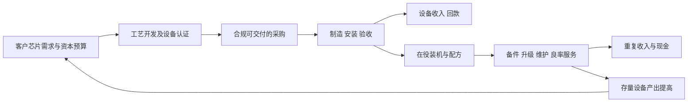

# Applied Materials（应用材料，AMAT）：经营情景、市场定价与当前投资决策

## 0. 当前结论与四情景总表

**当前判断：在375.58美元附近，可以按景气右侧参与、分步建立中期底仓；已有仓位以持有和验证现金兑现为主。公司有真实的盈利、客户预算与工艺位置支撑，上行不必依赖SENZ等新业务成功；但现价接近本研究基准DCF现值，尚不是以净现金或清算价值保护的深度折价。首笔投入宜为计划仓位的约三分之一，余下随财报和价格分步落实。**

**研究日：2026-10-22；信息截止：2026-10-22T16:00:00-07:00（洛杉矶PDT，等于23:00 UTC）。** 统一参考买价为 **375.58美元/普通股**：本地当天金融快照于13:30:02 PDT采集；联网行情工具显示同价、最新成交标记为22:43:55 UTC，StockScan当日历史价亦为375.58。ChartExchange显示常规时段末375.64，差额0.06、约0.016%；本文固定375.58，不混用盘后377.00。该价格是已发生的市场参考，研究完成后的可执行买价须以当时订单为准。[L7][S1][S2]

证券为 **NASDAQ: AMAT普通股**；交易、报告和模型币种均为USD；**不涉及ADR、ADR换算比例不适用**。不采用历史拆股前股数，股价回报不含现金股息；含息回报另列。共同主要目标观察日为 **2029-10-28**，按10月最后一个周日设置FY2029末模型观察点，覆盖GAA扩产、先进DRAM、产能扩建和服务复购；未来正式财历、相邻交易日以公司和交易所公告为准。期限约3.02年。

金额除每股价格、每股指标和另有说明外，均为**十亿美元**；表中股数为百万股。下表是情景条件结果，价格区间不是置信区间，证据等级不是发生概率。

| 经营情景 | FY29关键经营、资本与每股状态 | 目标日剩余DCF/股 | 纯业务参考价/股：固定M0 | 目标日预计交易价/股 | 相对375.58的股价变化 | 证据支撑度与决定性依据 |
| --- | --- | --- | --- | --- | --- | --- |
| 悲观／受损 | 收入34.82、EBIT10.07、FCFF7.63；FD 795.62百万股；NOPAT/股10.63；净现金25.55 | USD 175.7 | USD 407.5（+8.5%） | USD 225.2—278.3 | -40.0%至-25.9% | 弱 weak：全球订单大幅收缩和持续份额损伤尚未发生；中国/许可风险有事实，不能等同全面受损。健康信用与正现金保留下行参照。 |
| 基准／正常兑现 | 收入57.31、EBIT21.08、FCFF15.56；FD 786.93百万股；NOPAT/股23.04；净现金33.61 | USD 482.7 | USD 855.4（+127.8%） | USD 667.5—782.7 | +77.7%至+108.4% | 强 strong：现有合格产品、已发生设备/服务增长、客户预算与八季沟通相互支持；不依赖AR成功，具体多年斜率并非合同保证。 |
| 乐观／超预期 | 收入71.98、EBIT29.10、FCFF20.20；FD 788.27百万股；NOPAT/股31.75；净现金39.26 | USD 726.8 | USD 1168.6（+211.1%） | USD 1005.0—1195.5 | +167.6%至+218.3% | 中 medium：既有需求支持更强交付，但更大份额、定价与40%集团营业率须跨期验证。 |
| 突破／非线性 | 收入89.86、EBIT38.50、FCFF24.78；FD 789.54百万股；NOPAT/股41.94；净现金44.03 | USD 1099.8 | USD 1532.6（+308.1%） | USD 1400.4—1735.8 | +272.9%至+362.2% | 弱 weak：平台收费、更多份额、18/季有效Systems产出与显示/光学量产要多步同时成功；机制可行、未锁定。 |


`business_price`四行共同固定 **当前正常化EV/NOPAT倍数M0=35.1536x**，不是不同情景分别选锚。计算为`[M0×目标日NOPAT+目标日净现金+非经营投资税后值]/目标日摊薄股数`。主估值分母使用已扣SBC的正常化税后营业利润，避免把建设期低自由现金流机械资本化。目标市场倍数分别为18—23、27—32、30—36、32—40x EV/NOPAT；净现金只在股权桥加一次。没有预设新增股权融资，没有为乐观情景安排更便宜的回购。股息不计入上述三类股价，回购现金和股数变化已计入。

**必须区分两个基准回报。** 基准目标交易价667.5—782.7需要市场继续给予成长溢价；其目标日剩余DCF仅482.7。若市场只按后者交易，连同8.21美元模型现金股息，约为 **+30.7%总回报、年化9.3%**，明显低于市场交易情景的年化21.5%—28.0%。当前行动建立在公司可持续盈利、正常兑现路径及可保留的右尾上，不把目标交易区间视作保底收益。

当前最关键的三处分歧是：

1. **客户钱包能否变成交付。** 台积电N2/N3、美光新增设备及洁净室搬入已给出预算和日期，但土地、厂房、预付款不是AMAT收入。未来两季Systems和DRAM收入能否持续增长，比终端AI市场规模更有判别力。
2. **工艺复杂度能否变成AMAT的净收费。** 新步骤、份额、价格与良率价值分成要超过设备复用、客户议价和Lam、ASM、TEL等竞争带来的抵消；先进封装、eBeam、HBM不能重复加总。
3. **利润能否变成普通股股东现金。** 应收、库存、EPIC及制造扩建先占用资金。若订单强而现金持续弱，应先下修可分配现金与资本效率，不用回购假设掩盖。

近期最有用的验证窗口为 **2026-11-12 FY26Q4财报**和随后FY27Q1财报。本文预测Q4收入10.00—10.65、Systems 7.70—8.20、AGS 1.80—1.90；Q1收入10.60—11.50，须扣除14周季度的额外一周效应。11月9/10日出口关联企业规则的法定窗口同样可能改变下一季指引，不能把政治延期表态直接等同具体规则已改。[S3][S5][S13]

## 1. 研究边界、事实起点与时间口径

### 1.1 资料范围与独立判断

本地事实线索仅使用附录登记的AMAT正式公司报告、三份相关正式行业报告、两份正式产业背景报告，以及有日期的每日金融快照。没有读取既有情景投资决策、公司评估、排序、特征评分、技术面、情绪、备份或其他研究方案。没有采用同业评级或目标价。公司、行业报告中的预测不直接继承，本次预算池、经营参数、情景、证据等级、估值与投资选择重新形成。

决定性财务和证券事实追至SEC；客户预算追至客户原始材料；出口规则追至BIS和Federal Register；行业预测保留发布主体和时间。公开日期、经济期间、研究取用日期分别列在附录。下载发生在执行期间，但只纳入信息截止前已经公开的内容，不将后来查到的未来事实倒填。网上某些IR静态文件反复返回403，未完成页面复核的独立单项指标没有据此成为模型硬事实，失败请求保留在临时来源清单。

### 1.2 最新财务与资本结构日期

截至截止时间，最新完整期间为 **FY2026 Q3，截至2026-07-26**；业绩发布于 **2026-08-13**，10-Q提交于 **2026-08-20**。FY26Q4于10月25日结束、11月12日公布，尚非实际业绩。FY2025截至2025-10-26，业绩于2025-11-13发布，10-K于2025-12-12提交。[S3][S4][S6][S7]

Q3期末普通股 **793,597,443股**，季度稀释加权平均股数800百万股；后者不能当成披露的期末股数。本模型以 **800百万股作为期末摊薄估计基数**，即期末普通股加约6.4百万股潜在稀释的取整估计，参考当季约6百万股稀释影响与期末约8百万股未归属奖励，并非声称SEC披露期末FD恰为800。未授予的计划容量不全算现有股份。若起点改为803百万股，目标交易及DCF每股价值约降低0.4%，不改变判断。未来表内FD均为模型估计。[S4]（封面、Note 2、Note 12）

Q3资本结构：现金7.037、短期投资2.196、长期投资5.268；其中全部期限固定收益投资5.043，公开股权投资1.979、私募股权投资0.442。受限现金0.057不计入可分配金融流动资产。短债1.299、长债5.245，账面有息债务合计6.544。经营租赁负债0.802已反映在经营成本和现金流中；合同负债3.271按经营营运资本处理，不当作可随意分红的现金，也不在EV桥再次当债扣除。未见重大单列优先股、可转债或少数权益索偿需要在本模型另扣。[S4]（Notes 3、8、9）

### 1.3 会计口径调整

自FY26Q1起，200mm设备由AGS转入Systems，全部公司支持费用向分部配置；Q3公告及10-Q重列比较数。下文不把旧AGS的200mm新机再计为服务增长，也不在已分摊分部费用之外再减一遍集团费用。[S3][S4]

正常化EBIT以公司非GAAP营业利润为校准：保留SBC、常规研发、维护与现场工程费用；剔除已明确的一次性和解、重组及收购无形摊销等。**这不是把全部非GAAP净利润拿来估值。** 战略投资涨跌、特殊税项和财务收益另行剥离。前九个月战略股权净收益0.927不外推，相关资产只在股权桥计税后值。[S3][S4][S6]

TTM至Q3的GAAP营业利润9.141，正常化桥为9.141+0.545=**9.686**，与前九个月非GAAP营业利润7.739+FY25Q4的1.947一致。统一按14%税率得TTM正常化NOPAT **8.32996**。14%为研究正常化税率，不是公司当期实际有效税率；管理层给FY2027约13%的非GAAP税率，本文多留1个百分点应对全球最低税和地区组合。[S5][S6]

## 2. 业务经济本质、竞争与价值捕获

### 2.1 公司卖的是合格工艺及持续产出

AMAT出售设备、腔体、材料处理配方、工程整合以及持续服务。直接付款者是晶圆代工厂、存储原厂、IDM、封装和显示厂；芯片设计商和云厂影响技术路线及采购需求，通常不直接支付前道设备发票。设备先要进入客户工艺开发，经过资格认证、采购、安装和接受，再按控制权转移条款确认收入；服务按实际履约确认。已发货、已安装、客户技术签字、会计确认和收款可以跨季度。[S4][S7]

客户购买的结果是更高合格晶圆产出、更低缺陷、更短爬坡时间、更低单位制造成本。采购团队会以新增芯片利润、良率损失、停线风险及设备占地比较投入。高价工具若确实减少数月爬坡或提高高价值晶圆良率，支付意愿可以很高；但这种价值须在净成交价、服务收费和份额中被AMAT捕获，不能将客户全部芯片收益直接归供应商。



最后一条反馈有双重作用：服务可以提高客户粘性，也可能减少下一轮新机采购。预测设备和服务时不能默认二者独立、无约束地高速叠加。

### 2.2 经济单元、壁垒及失败机制

| 经济单元 | 为何付费、为何选择AMAT | 增长与盈利的约束、证伪条件 |
| --- | --- | --- |
| 领先逻辑晶体管与互连 | GAA纳米片、外延、选择性处理、金属化、CMP和背面工艺；配方、低损伤、一致性与跨工序整合经过客户验证后形成高转换成本 | 客户逐节点重新选型；某些工序被整合、减少或由对手取得。客户N2/A14扩产而AMAT相应收入连续落后，是份额或复用反证 |
| DRAM与相关HBM工艺 | 电容、外围晶体管、布线及相关封装需要更复杂材料工程，HBM同时消耗更多前道晶圆资源 | 原厂预算高度集中；HBM、普通DRAM与后道争用同一资金池。不能把DRAM阵列、HBM堆叠、base die各算成同一笔新增前道采购 |
| NAND | 高层结构及钼等新材料带来沉积、去除和改造需求 | 单片bit和QLC效率提高减少新增晶圆需求；Lam在关键工艺和装机上的位置制约AMAT；升级收入不能假定都来自新厂 |
| ICAPS与成熟/特色工艺 | 200mm、28nm、功率、模拟和传感器已有产品与服务基础 | 工业、汽车需求与先进AI逻辑不同步；本土替代、二手机、价格竞争和中国可售范围更重要。本文并入逻辑及其他池，另做中国敏感性 |
| PDC/eBeam与先进封装材料工艺 | 难测结构、缺陷复查、TSV、电镀、CMP、表面处理和封装薄膜提高良率，扩展已有材料工程能力 | eBeam不是整套高速光学检测的等价替代，不能直接继承KLA全部市场；封装载体、良率和节拍决定规模，Besi键合机销售不是AMAT全部收入 |
| AGS服务 | 在役工具、原厂配方、零件和现场团队降低停线损失；订阅、升级及交易性备件反复收费 | 人员、备件库存和许可证是真成本；客户也可自维或采购替代件。AIx连接数未必都是独立新增付费量 |
| 显示、MAX OLED与SENZ | 大面积材料能力延伸至新显示制造、波导与完整视觉系统 | 客户试验、重复订单和共同研发不等于大规模盈利；需经历良率、终端产品、净内容、分成及重复采购验证，失败时仍有研发和设施成本 |

建模采用Systems三个官方应用大类、AGS及Other五个可加收入行。PDC、eBeam、先进封装、HBM和ICAPS是穿透分析维度，**不再额外加到公司收入之上**。Q3管理层明确DRAM收入包括HBM相关封装；这使“按应用拆分”与“按技术拆分”尤其容易重计。[S3][S5]

### 2.3 壁垒是进入生产流程，不能免于竞争

Viva处理、Sym3 Z Magnum刻蚀、Spectral金属ALD等解决GAA表面、三维沟槽及互连阻抗问题；原厂已披露客户采用，证明存在生产进入路径。仍需验证覆盖步骤、重复订单、净价及单位毛利，不以产品先进性替代收入证明。[S14]

工艺经验和装机地位使客户转换需要承担重新开发配方、污染、一致性、停线和良率风险，因此不是随时最低价替换。但每个新节点也给Lam、ASM、TEL和中国供应商重新竞争的机会；客户通常保留多源采购和自有工艺整合能力。Lam最新实际单季毛利率52.3%、营业率40.0%，证明竞争者也有高附加值和经营杠杆，不能假设全部行业增量自动归AMAT。[S10]

需要同时观察“增加新步骤”和“减少旧工作量”：背面供电与GAA增加特定处理；吞吐改善、设备升级、复用和工序整合可以减少单位芯片所需机台工时。AMAT最持久的价值不是所有设备永远稀缺，而是在客户最难、最昂贵的工艺上维持收费权。

一个仅作机制检验的算例：设备净收入10、制造安装保修4.5、持续研发及销售支持2.0，则营业利润3.5。若净价跌15%而成本未降，利润降至2.0、下滑43%。**这些并非真实ASP或BOM**，比例参照Systems当前约55%毛利及约38%营业率，说明良好需求若不能维持净价，利润弹性会远差于收入。

### 2.4 AGS的持续性与资本负担

AGS收入可理解为“可服务的运行工具×付费覆盖×每覆盖工具收入”，再加随晶圆加工量变化的备件、维护与升级。Q3收入1.781、同比约22%，毛利率35.6%、营业率30.1%，已有真实商业规模；服务备件库存1.866也说明这不是边际成本接近零的软件业务。[S3][S4]

10月公司提出CY2026服务收入增长超过20%、CY2030超过12。这个目标意味着未来不仅要扩装机，还要提高覆盖、升级价值或每工具收费。基准AGS为FY27/28/29的8.01/9.21/10.41，增速17%/15%/13%，不需要把全部装机同时转成高价订阅；乐观和突破才进一步扩大收费强度。新机爬坡需驻场工程师、复杂备件和现场数据整合，成本已经保留在分部毛利及费用率中。[S8]

服务的首个经济门槛是持续净贡献；更高收费若依赖更多现场人员而不能复用，毛利不会像软件一样扩张。本文基准将AGS营业率从30.7%渐升到32.3%，突破才到37%，后者要求远程诊断、自动化、覆盖率和价值分成共同改善。

### 2.5 早期业务与所有权边界

MAX OLED已有技术平台和客户进入证据，但原始发布的评估、订单不等同全部客户完成量产认证。SENZ于2026年6月发布，整合波导、光引擎、感测、视力矫正与调光，并有合作伙伴；没有公开足以核销本模型的最低采购量、单位净收费、量产毛利和分成。无显示的AI眼镜增长也不自动产生波导需求。[S15][S16]

保留一个有规模意义的条件分支：若到FY29真正使用相关AMAT光学的年销量达到1,000万—2,000万套、每套归属AMAT的净收入50—75美元，则相关收入约0.5—1.5。这里的数量和价格是**成功门槛假设**，不是已披露订单。其毛利还需覆盖合作制造、报废及专属研发；低量时持续亏损完全可能。突破Other的4.8同时需要MAX OLED、现有显示及光学业务共同扩大，不由单个SENZ算例自动生成。

NEXX于2026-06-03完成收购，卖方披露基础现金对价0.120、仍受调整，增强电镀和面板封装工艺；收购与整合支出是现金用途，不能凭“进入先进封装”就给出独立高利润收入。Besi的战略少数股权只带来相应权益价值，不并表Besi全部销售；相关战略投资在本模型经营EBIT中剥离、在股权桥加税后值。[S17][S18]

EPIC于10月12日揭幕，5.0为随客户项目展开的资本投入计划口径，不是次年必须再付一笔5.0，也不是新增独立订单池。其成功体现为更早定点、更快工艺转产、更高价值分成和研发复用；失败体现为折旧、人员与客户支持成本先发生，合作成果却未产生持续收费。合作研发协议未公开的IP归属、排他性和分成，不假定全部经济价值归AMAT。模型已将研发作为当期经营费用、设施和制造扩展作为CapEx。[S19]

## 3. 近期财报前瞻与中远期业务预测

### 3.1 未来两个财报期：先给能检验的数字

以下是本研究条件预测，不是公司已披露业绩；区间变量相关，不能任意拼接每项上端。当前未取得带明确更新时间、同一会计期的一致预期原始样本，因此不宣称这些数字高于或低于“华尔街一致预期”，比较对象为公司现行指引、近期实际和本模型。

| 指标 | FY26Q4：截至2026-10-25，11月12日发布 | FY27Q1：模型截至2027-01-31，预计2027年2月公布，精确日期待公司确认 |
| --- | --- | --- |
| 公司现行指引 | 收入10.25±0.50；非GAAP EPS 4.02±0.20；Systems约7.9、AGS约1.84、Other约0.51；非GAAP毛利约50.4%、OpEx约1.58 | 尚无正式季度收入/EPS指引；管理层提示14周季度、费用台阶较大，FY27税率约13% |
| 本研究收入 | **10.00—10.65，中点工作值10.25** | **10.60—11.50，工作值11.05** |
| Systems／DRAM／AGS／Other | 7.70—8.20／2.50—2.90／1.80—1.90／0.45—0.55；中心7.90／2.686／1.84／0.51 | 8.25—9.00／2.80—3.25／1.88—1.99／0.30—0.50；中心8.65／约3.05／1.94／0.46 |
| 毛利与正常化营业利润 | 非GAAP毛利50.1%—50.8%；正常化EBIT约3.42—3.82，中心3.586；GAAP毛利可能略低 | 非GAAP毛利50.3%—51.0%；费用1.72—1.82；正常化EBIT约3.55—4.10，中心约3.84 |
| CapEx、现金 | 现金CapEx约0.70—0.90；CFO约2.4—3.5；扣SBC的经济股权FCF约1.5—2.7；模型经营FCFF中心1.851 | CapEx约0.75—0.95；扣SBC的经济股权FCF约1.4—2.7，取决于应收/备货与税款。不是公司现金指引 |
| 先行指标 | DRAM占Systems约32%—36%；AGS增长和毛利维持；应收随收入增加但代理DSO不再大幅恶化；合同预收没有与收入脱节 | 剔除额外一周后仍能维持或提高每周Systems交付；FY27客户设备排期没有大规模后移；订单能见度与回款相互验证 |

指引来源为8月13日公告和准备稿；11月12日日期已在10月22日公司公告及财历确认。Q4应用拆分与全部Q1数字均为本次估计。Q1从10.25到11.05的表面增长约7.8%，与增加一周的7.7%很接近，**单看环比增长不足以确认新一轮加速**。[S3][S5][S20]

最可能高于本研究中心的环节是DRAM设备验收提前、Other显示集中交付，以及已有高价值产品净价；最可能低于的是中国许可、客户厂房及安装时差、备件供应和新增人员费用。Q4非GAAP EPS含特殊税收利益，模型用正常化税率估经营现金，不能把低税EPS直接长期复利。

Q4年报若披露backlog，将优先核对分部重列、未来12个月交付、服务期限和取消条款。FY25末backlog 15.002中含多年服务、设备及部分交付时差；Q3约1.0的长期RPO采用短合同豁免、合同负债3.271又是不同口径。**本研究不伪造FY26末精确新订单、NCNR比例或book-to-bill目标；它们未按可比范围公开。** 当前可检验的是收入、预收、库存与现金是否一起支持排期。[S4][S7]

### 3.2 客户预算、物理时间与支付能力

| 原始证据、公开日 | 对模型的约束 | 不能直接推出的结论 |
| --- | --- | --- |
| 台积电2026-10-15：CY26 CapEx 60—64；N2年度产能2027预计超过翻倍；新增N3与A14有2027—28投产窗口 | 领先逻辑、互连及服务有已运行平台和真实预算，设备搬入先于量产，支持2027—28持续采购 | 不能把全部CapEx都乘AMAT份额；海外复制和建筑成本也抬高预算；N2总产能翻倍不等于AMAT收入翻倍 |
| 美光2026-09-30准备稿：FY27H1净CapEx约25，H2更高；建设增长快于设备；新增产线按季度渐进放量 | 支付能力、DRAM及相关封装需求有支持，同时设备采购受洁净室先后约束；净CapEx还包含政府激励口径 | 不当作一份精确的全年设备采购合同；客户现金预收和存储涨价不能各加一次成为新增设备预算 |
| SK hynix 2026-02-25：Y1首洁净室提前至2027年2月，31万亿韩元设施投资口径不含设备安装 | 2027搬入窗口是物理锚，不能提前当作合格晶圆；后续洁净室阶段释放 | 不能把园区投资全额当AMAT订单，亦不能把首间洁净室开门当作全厂满产 |
| Lam 2026-10-21：9月季收入8.219、环比+22%；WFE CY26约mid-150、CY27初步>200 | 行业已发生设备交付，最新预算方向比年中预测强；竞争者也在获份额，部分供给受限 | 这仍是管理层市场估计，不是AMAT订单；不能忽略Lam产品组合、升级和统计范围差异 |

来源与具体页码：[S9]（第4—6页）、[S11]（第3、10页）、[S12]、[S10][S10a]（演示第5页）。客户最终预算部分共同依赖AI基础设施支出，不能当成完全独立的三份终端需求验证。

传导链为：客户总CapEx减土建、一般厂务及无关支出，再调整预付款、设备复用和验收时差，才得到可执行设备采购；随后乘AMAT已合格、可合法交付的工艺位置与净收费。客户已有芯片利润与现金支持这一链条，但不能消除后续投资回报、终端成本上升和预算重新分配风险。

### 3.3 对行业规模分歧作明确裁决

SEMI 7月OEM口径预测CY26 WFE 143.9、2027增长21.8%至约175.3、2028至约200；10月13日的300mm厂端设备支出预测CY26为149、2029为227，包含范围和确认时点不同，二者不能相加。Lam 10月21日的CY27>200则明显更强。[S10][S21][S22]

允许使用的本地前道行业报告给出2027/28代表180/208，保留较多洁净室、复用和预算落地折扣。**本研究裁决不是取三个数字的均值：** 客户近端预算、实际设备收入和八季度滚动沟通支持将2027—28可执行预算中枢提高；同时仍对厂房、设备复用和FY/CY边界打折。采用FY匹配的预算池 **FY26约155、FY27基准196、FY28基准233、FY29基准252**。FY26为现阶段研究估计，后三年是条件路径，均不是已发生行业销售。[L2][L5][S5][S9][S10][S11][S12]

相对本地180/208，本次2027/28约高9%/12%，原因是对最新客户采购落地的取用权重不同，不声称原报告没有看见同一消息。若未来实际只到180/208，按本模型相同比例折减Systems，FY27/28公司收入将由约43.3/51.9降至约40.6/47.5；固定费用不能同步缩减，营业利润和FCF也应下修。若反而CY27>200被多家交付及客户采购确认，而AMAT明显落后，就应优先检查份额与出口范围，不能笼统归因行业弱。

### 3.4 预算、实现系数与服务的可复算推导

公开资料没有全产品真实台数和ASP，本文不用“合成机台数”冒充底层订单。Systems采用三类可比预算池×实现系数：逻辑及其他、DRAM、NAND。FY26预算约95/45/15；以Q3前九个月已披露应用占比、Q4工作拆分建立FY26收入起点16.535/7.948/1.563，相应实现系数约17.4%/17.7%/10.4%。

**实现系数不是第三方数据库市场份额**：它合并可覆盖工艺、份额、净价/产品组合和FY验收时差；Systems含相关封装、PDC、200mm及升级，与WFE并非逐美元同范围。本模型只将其作为预算相容性校准，不能声称精确测量各产品份额。系数只保留有经济意义的约一位小数百分比，表内更多金额小数用于加总复算。

基准FY29池147/82/23，实现系数18.4%/18.9%/10.7%，得到Systems **45.01**；AGS由FY26的6.845按17%/15%/13%增长至10.41，Other至1.90，合计 **57.31**。Systems等效捕获比由约16.8%升至17.9%，支持幅度低于把管理层全部份额目标直接计入。量、净价和产品内容的独立贡献无法完全识别；工作解释是逻辑/DRAM主要靠预算量与节点转换，基准净价格和更高价值内容贡献约每年1%—3%，其余才是资格与份额变化，不能把这些再额外加在实现系数之上。

AGS预测同时受装机与覆盖约束：基准可以由有效可收费基础约年增9%—11%、每工具净收入约年增3%—5%共同支持，不把它们当已披露精确队列。Other按现有显示节奏与研发投入建模，基准没有强行加入AR大规模量产。完整年度预算、实现系数与收入在附录A。

### 3.5 商业时钟、供给能力与动态应对

FY27主要看既有GAA、DRAM与包装产品搬入和接受；FY28看新增洁净室、节点和AMAT制造能力释放；FY29才让持续份额、收费、服务覆盖和小业务跃迁充分影响公司结果。公司8月提出到2028年将当时季度系统产出能力翻倍，起点约7.0，对应约14的季度能力目标。基准FY28 Systems约40.9、季均约10.2；乐观约47.8、季均11.9；突破约55.0、季均13.7，均须满足产品与现场能力，不能凭厂房面积就证明可交付。[S5]

突破FY29 Systems约72.1、季均18，超过上述2028目标，因而另计FY27—29现金CapEx **4.0/5.0/5.5**，要求下一轮制造、合格子系统和现场工程在2029及时到位。突破FY28季均约13.7，也意味着接近14的能力须在FY28较早形成，不能只到年末才达到；若放量推迟，须下修当年收入并保留等待成本。若只有研发与名义面积增加、缺少合格产出或客户准备，该分支至少延期，不将费用删掉而只保留收入。

悲观时，管理层削减非核心扩建、放缓新项目、保留维护和关键研发，CapEx降至2.5/1.7/1.8；Other亏损支出收缩。应收与库存释放部分现金，不能假定公司为了原来的乐观计划继续无期限投资。MAX OLED、SENZ或面板业务若连续未越过量产复购及正贡献门槛，可停损或转合作制造；退出仍有整合、人员、库存和减值代价。核心预测不要求FY29以后机械断崖回落，也不把建设中的全部计划当作不可取消负债。

## 4. 四种经营情景、资本配置与每股基本面

### 4.1 四条相容路径

**悲观／受损**：FY27尚有已进入产线的采购，FY28行业预算降至150、FY29仅恢复167，且中国、成熟设备及部分新步骤丢失使实现系数下移。到FY29收入34.82、营业率28.9%，接近FY26收入但质量和增量空间受损。公司停缓部分扩建并回收营运资金，不假定长期无视亏损。全球订单崩塌尚未在当前财报出现，故此路径是压力条件，证据弱。

**基准／正常兑现**：N2/N3、先进DRAM与相关封装沿已有客户平台扩大；设备预算和可交付位置温和提高，服务随装机及覆盖增长，Other仍承担投入。FY27/28/29收入约43.3/51.9/57.3，集团营业率到36.8%，不要求提前达到公司CY2030约40%的全部目标。核心增长依靠已验证业务，不依赖SENZ量产、全面混合键合切换或新融资窗口。按核心机制与客户需求锁定程度评强；具体年度幅度和现金转换仍是推断，不是合同覆盖率。

**乐观／超预期**：CY27强预算更充分传导，之后洁净室和供应跟上，逻辑、DRAM与部分NAND新位置取得跨期复购；价值收费和服务效率更强，FY29收入71.98、营业率40.4%，相当于较早完成较强的长期经营目标。主业事实坚实，但这一级增量依赖更高实现系数和费用杠杆，评中。

**突破／非线性**：在乐观级别的核心需求上，整合材料平台、先进封装/背面工艺、PDC和服务价值分成明显提高，其他新业务开始形成实质规模。最低必要条件是：FY29可执行预算池约340；Systems等效实现比约21.2%；季度有效交付能力约18；AGS达13且营业率37%；Other 4.8、营业利润约0.9，且相关客户、良率和付费归属成立。FY29收入89.86、营业率42.8%。只有核心好、份额/收费、新产能和新业务多项同时成立才可达，证据弱，但没有把技术机会机械置零。

突破的资源上限也明确：FY29的340预算池中逻辑/其他184、DRAM124、NAND32已经包括相关AI晶圆投资；不再另加一笔HBM或封装客户预算。Other的显示/光学客户另有预算，但其制造与AMAT人员/资金仍在集团CapEx和费用内。四情景核心、现金及每股结果递进，突破没有人为压低主业。

### 4.2 利润、现金与再投资闭合

`NOPAT=正常化EBIT×(1−正常化税率)`；`经济FCFF=NOPAT+D&A−现金CapEx−ΔNWC`。模型EBIT已含SBC，**FCFF不把SBC加回**；未来D&A为与正常化EBIT一致的经营折旧估计，不再把已剔除的收购无形摊销重复加回。借款利息及金融资产收益在FCFE桥单列，战略投资公允价值收益不进入经营利润。

营运资本采用可复核的窄定义`应收+库存−应付−合同负债`，Q3为7.691+6.564−2.387−3.271=**8.597**；其他经营应计/预付净额增量暂按接近零处理，另做现金敏感性，不能将此称为完整公司披露NWC。FY26末工作值9.2；基准FY27—29为收入的24%/23%/22.5%，体现回款及备货效率逐步改善。若未改善，FCF会少约1—2，而非利润凭空变少。[S4]

**现金没有被利润掩盖。** FY26前九个月CFO5.568、CapEx1.988、SBC0.545，公司FCF3.580；再扣SBC的权益经济现金近似为3.035。TTM相应约4.922，低于正常化NOPAT8.330，主要拖累为建设、营运资金和现金税项。已付和解0.253与历史过渡税等属真实现金，正常化分析可以另看，但不能改写为本期股东可分配现金。[S3][S4][S7]

基准FY29 Systems毛利57.0%、经营费用17.1%，AGS毛利37.5%、费用5.2%；Other仍亏损约0.24，合成集团EBIT21.08。SBC约1.10包含在这些成本中。现金CapEx2.8高于D&A1.2，营运资本仍增加约0.97，因此经济FCFF15.56低于NOPAT18.13；公司既没有把研发资本化虚增利润，也没有用零增长资本投入支持高增长。年度桥见附录B。

模型维护投入以可用资产寿命和折旧作下限校准，新增制造、实验室及工程设备仍需成长投入。SEC披露建筑寿命3—30年、演示及制造设备5—8年，不能把所有设施按建筑长寿命折旧，也不能把研发实验设备当作一次建成后永久免维护。长期DCF将再投资约束提高到与稳态ROIC相容的水平，见第五章。[S4]（Note 8）

ROIC另作资本闭合检查：Q3经营投入资本近似为`股东权益25.626+有息债6.544−金融流动资产12.080−账面战略股权2.421=17.669`，TTM正常化NOPAT/这一期末资本约47%，不是公司披露的平均资本ROIC。以Q4净资本投入、ΔNWC和小额并购滚至FY26末约19.002，再逐年加`CapEx−D&A+ΔNWC+现金并购`，可复算出以下近似值；未来补助、递延税和非现金减值未作精细预测，不把它称为审计后的会计投入资本。

| 情景、FY | 期末经营投入资本近似 | NOPAT/期初期末平均资本 |
| --- | --- | --- |
| 悲观／受损 2027 | 20.99 | 48.6% |
| 悲观／受损 2028 | 20.93 | 34.2% |
| 悲观／受损 2029 | 21.81 | 39.6% |
| 基准／正常兑现 2027 | 22.90 | 61.0% |
| 基准／正常兑现 2028 | 26.73 | 64.3% |
| 基准／正常兑现 2029 | 29.50 | 64.5% |
| 乐观／超预期 2027 | 24.02 | 66.0% |
| 乐观／超预期 2028 | 29.51 | 73.3% |
| 乐观／超预期 2029 | 34.60 | 78.1% |
| 突破／非线性 2027 | 24.81 | 66.1% |
| 突破／非线性 2028 | 33.34 | 80.5% |
| 突破／非线性 2029 | 42.02 | 87.9% |


基准64.5%、突破87.9%的显式期回报很高，要求现有研发/客户资格复用、外部子系统供给和组装模式继续成立。研发已在EBIT支付，并未作为零成本资源：若仅在基准投入资本额外加10—15的有效研发资产而不提高NOPAT，保守回报对照约42%—48%；严格资本化研发还需同步调整利润和摊销，本次不制造精确点值。若扩张必须改成高强度自有制造、工程人力不能复用，CapEx和经营费用都须上调。终值ROIC回落至18%—30%也正是在约束这种显式期高资本效率不能永远维持。

### 4.3 股本、回购、分红和金融资产

FY26末起点由7月末流动金融资产12.080滚至约13.051、债务6.444、FD估计799.23百万股；其间假设Q4经济FCFF1.851、税后净财务收益0.040、股息0.420、经济净回购0.300、并购0.100及偿还CP0.100。该滚动是估计，不能称10月22日已披露余额。

SBC采用统一经济成本法：从已扣SBC的利润和CFO扣SBC后的可分配现金出发，模型用相同市场价格、相同等额资金中和未来员工发行，**不再把同一SBC另加永久稀释**。实际现金CFO会加回SBC，该部分用于中和发行；经济净回购另减股本。中和金额按SBC费用近似，不声称授予日费用必等于归属日市值。若实际中和需要每年额外0.30现金，三年目标每股净现金约少1.1—1.2，应相应下修，不能隐藏该误差。

净回购的金额、均价、股数都逐年给出：基准1.5/2.0/2.5，均价400/480/570；乐观1.7/2.3/2.8，均价430/620/850；突破回购均价更高而非更低。把Q4、SBC中和及净回购合计，四情景分别用掉当前12.8授权中的 **3.95/9.50/11.05/11.55**，全部不依赖新增授权。基准三年FD仅由799.23降到786.93、约1.5%，每股增量主要来自营业利润，非巨额缩股。[S4]（Note 11）

普通现金股息是假设而非已获未来董事会批准：悲观年2.12，基准2.32/2.56/2.80，乐观与突破2.40/2.80/3.20；计入Q4约0.53后，累计6.89/8.21/8.93/8.93美元。实际宣派以公告为准。

**80%—100%长期资本回报政策与模型现金留存的差异不能省略。** 公司提出长期返还公司口径FCF的80%—100%，本模型不预设未来新增巨额回购授权，超过已建模分配的现金先留作目标日净金融资产。基准目标净现金33.61，是“可留存或待分配现金”的估计，不代表管理层承诺长期存放这么多。若以后新增特别股息，目标交易价应等额减少、含息财富不变；若新授权用于回购，则须按当时价格重新计算股数与现金，不能同时保留全部现金和缩股收益。本次JSON按上述留存口径、不含现金股息。[S8]

量化该口径影响：基准FY27—29公司口径现金FCF近似`经济FCFE+SBC`合计41.49，已建模的股息及包括SBC中和的总回购约15.09。若按80%返还，另需分配约18.10；假定在目标日前一次以现金分配，约23.0美元/股，则目标交易区间改为约**644.5—759.7**，累计现金股息相应增加23.0，含息总财富不变。若分期更早派发，还须减少后续现金利息并计入投资者再投资选择。这一对照说明主表价格含资本配置条件，不能把留存现金当永久不可分配资产，也不能把额外分红视为额外创造的价值。

全部期限固定收益投资计入流动金融资产，但不是全部现金等价物；假设税前收益率3.5%，债务平均成本4.5%，按平均余额计算税后净利息。战略股权税后价值基准/乐观/突破取2.10、悲观1.40，不押Besi股价再上涨；受限现金不加回。租赁费用已扣在经营流中，未再将0.802经营租赁债重复扣EV；若未来出现重大融资租赁或新增借款，必须更新资本桥。

### 4.4 内生融资、债务红线及下行实体参照

四情景均可内生融资，无外部普通股、可转债或优先资本需求，故不存在以高价增发救低价值路径的矛盾。2027年1.2、2029年0.7票据按期用现金偿还；0.1 CP在Q4偿还。2030年票据0.75在目标日后，长期债到期由持续正现金及留存资产覆盖。账面债与面值的小额摊销/掉期差异简化保持，不将其当作融资来源。[S4]（Note 9）

悲观三年最小EBIT/模型利息约 **36x**。更严的再融资压力把全部6.544债务成本升到9%，利息约0.589，最低经营利润仍可覆盖约14x，远高于1.5x压力线。真实银行条款是**调整后EBITDA/净利息不低于3.00x**，与EBIT/总利息1.5x并非同一指标；合同对净利息分母还有下限。已独立核对五年协议§5.03。旧364天额度2026年9月已到原定期限，续期未取得充分确认，不计作当前可用融资；模型也不靠它。[S23][S24]

压力路径没有产生年度资金缺口，悲观最低年度末金融流动资产约18.1，四情景最低为突破扩建期约17.5；但公开资料不能排除季度内部现金峰值波动。即使在全年配置之前额外锁住3.0流动资金，7月末12.080流动金融资产仍足以覆盖当时1.299短债及维护开支。若BIS暂缓拒绝令被激活，可能不只是中国收入下降，而是更广泛交付和许可证受损；那会超出本悲观中心值，须重新估退出成本、现金消耗和普通股索偿，不能沿用本表价格。[S4][S13][S25]

下行参照按Q3、FD800百万股计算：

| 参照 | 计算及美元/股 | 经济含义与局限 |
| --- | --- | --- |
| 仅现金减有息债 | (7.037−6.544)/0.800=**0.62** | 最窄口径，不包括证券投资 |
| 现金加短期投资减债 | (7.037+2.196−6.544)/0.800=**3.36** | 较常用净现金，短期投资仍有价格和信用风险 |
| 现金加全部期限固定收益减债 | (12.080−6.544)/0.800=**6.92** | 主EV桥的净金融资产口径；不包括战略股票，不把受限现金算入 |
| 1.0x有形净资产TBV | (25.626−3.873−0.315)/0.800=**26.80** | 含账面非现金资产，非资产即时变现保证，存货/应收回收可折价 |
| 可复制资产与工艺能力重置算例 | TBV21.438加净额6—10的可用研发/工程积累=27.438—31.438，对应 **34—39** | 6—10为按约4的年度研发、约3年可复用期及50%—80%保留比例所作边界；不是专利估价、不是可成交下限，无法复制的客户资格另无硬价格 |
| 持续经营收购经济性参照 | 以悲观FY29 NOPAT8.456的12—16x，加该时点净现金25.551和投资1.4，除795.62百万股，约 **161—204** | 研究假设的买方回收价格带，未取得可比控制权交易支持，不冒充行业已观察收购倍数；反垄断、出口与政治条件可阻断交易 |

悲观目标225.2—278.3高于上述实体及买方参照，无需用持续正FCF企业跌破净现金的假设制造下行。反过来，净现金和TBV离375.58很远，**不能给当前买价提供很厚的账面保护**。普通股的主要保护来自持续经营收费和现金流；没有已知优先股瀑布需要挤出普通股，若发生新增优先融资、重大赔偿或拒绝令激活，须重做EV-to-common桥。

### 4.5 主要年份公司与每股产出

完整收入与现金桥集中于附录。以下表给出进入估值前锁定的经营结果，净现金与FD均为模型期末值；NOPAT/股不含金融投资收益，EPS才包含税后净财务收益。

| 情景、FY | 营业率 | 净现金 | 期末FD股数百万 | NOPAT/期末FD股 | FCFF/期末FD股 | 正常化EPS/期间均股 |
| --- | --- | --- | --- | --- | --- | --- |
| 悲观／受损 2027 | 30.8% | 12.88 | 797.62 | 12.18 | 9.81 | 12.46 |
| 悲观／受损 2028 | 26.8% | 19.44 | 797.62 | 8.98 | 9.11 | 9.52 |
| 悲观／受损 2029 | 28.9% | 25.55 | 795.62 | 10.63 | 9.59 | 11.39 |
| 基准／正常兑现 2027 | 34.3% | 12.89 | 795.48 | 16.08 | 11.42 | 16.34 |
| 基准／正常兑现 2028 | 35.8% | 22.06 | 791.31 | 20.16 | 15.57 | 20.71 |
| 基准／正常兑现 2029 | 36.8% | 33.61 | 786.93 | 23.04 | 19.78 | 23.99 |
| 乐观／超预期 2027 | 35.3% | 12.92 | 795.28 | 17.86 | 11.86 | 18.12 |
| 乐观／超预期 2028 | 38.1% | 23.64 | 791.57 | 24.80 | 18.17 | 25.38 |
| 乐观／超预期 2029 | 40.4% | 39.26 | 788.27 | 31.75 | 25.62 | 32.83 |
| 突破／非线性 2027 | 35.7% | 12.30 | 795.14 | 18.21 | 11.35 | 18.46 |
| 突破／非线性 2028 | 39.9% | 23.85 | 792.08 | 29.54 | 19.21 | 30.11 |
| 突破／非线性 2029 | 42.8% | 44.03 | 789.54 | 41.94 | 31.39 | 43.11 |


## 5. 估值转化、倍数解构与股价预测

### 5.1 内在价值：对目标日之后的现金流折现

本章才将前文锁定的经营结果转为价格。主方法为多阶段FCFF DCF；从共同目标日FY29末开始折现 **FY2030—2039十年现金流**，随后进入稳态，得到`dcf_price`目标日剩余经济价值。它不是当前价值，也没有把FY27—29现金流再加到目标日EV一次。当前DCF另将FY27—29经营FCFF及目标日剩余经营EV折回FY26附近，并加当时估计净金融资产，采用当前FD基数；不再加未来回购和股息形成双计。

统一WACC **10.5%**。参考10月21日美国10年国债5.13%，以研究假设beta约1.3、股权风险溢价约4.2%构成约10.6%股权成本，少量债务税盾后取10.5%。beta与风险溢价不是声称刚刚测得的精确市场参数；它们是跨周期估值假设。四情景不再各加一套执行风险溢价：需求、份额、失败费用和周期损耗已在现金流中，避免重复惩罚。[S26]

FY30—39收入增长序列分别为：悲观6%、6%、5%、4%、4%、随后3.5%；基准12%、11%、10%、9%、8%、7%、6%、5%、4.5%、4%；乐观16%、14%、12%、11%、10%、9%、7.5%、6%、5%、4%；突破20%、18%、16%、14%、12%、10%、8%、6.5%、5%、4%。它们是经营机制延长后的条件推断，非已签十年订单。利润率用五年过渡至下表中枢，没有把FY29全部高增长永续化，也没有在FY30突然砍掉健康业务。

稳态`FCFF=NOPAT×(1−g/长期ROIC)`；悲观g=3.5%、ROIC=18%，其余g=4%、ROIC分别25%/28%/30%。因此长期净再投资率分别约19.4%/16.0%/14.3%/13.3%的NOPAT，不是零资本消耗。研发继续费用化；经营折旧/收入渐至3%，经营NWC/收入渐至20%，CapEx逐渐过渡到满足上述稳态再投资的水平。

| 情景 | FY2030收入／FCFF | FY2034收入／FCFF | FY2039收入／FCFF | 终值营业率 | g | 长期ROIC | 终值CapEx/收入 |
| --- | --- | --- | --- | --- | --- | --- | --- |
| 悲观／受损 | 36.90/7.84 | 44.43/9.47 | 52.76/10.79 | 29.5% | 3.5% | 18% | 7.1% |
| 基准／正常兑现 | 64.19/17.21 | 92.27/25.93 | 119.42/33.50 | 38.5% | 4.0% | 25% | 7.5% |
| 乐观／超预期 | 83.49/23.80 | 130.16/38.21 | 176.54/53.13 | 40.5% | 4.0% | 28% | 7.2% |
| 突破／非线性 | 107.83/31.51 | 188.45/58.05 | 260.36/84.20 | 43.0% | 4.0% | 30% | 7.2% |


基准终值营业率38.5%低于公司CY2030约40%的非GAAP目标，但仍保留高质量材料平台和服务网络；稳态CapEx约收入7.5%，高于FY29的约4.9%，反映设施替换及长期资本效率下降的保守压力。长期ROIC不是从财报精确审计出来的点值：它是终值的约束，显式期仍允许已费用化研发形成较高增量回报。若这一资本压力过高，DCF会偏低，不能因此自动认定交易倍数错误。

| 情景 | 2030—39 FCFF现值 | 2039终值现值 | 终值占EV | 目标日经营EV | 加净现金 | 加战略投资税后值 | FD股数百万 | 目标日DCF$/股 | 当前DCF$/股 |
| --- | --- | --- | --- | --- | --- | --- | --- | --- | --- |
| 悲观／受损 | 55.46 | 57.38 | 50.9% | 112.84 | 25.55 | 1.40 | 795.62 | 175.7 | 138.9 |
| 基准／正常兑现 | 148.36 | 195.80 | 56.9% | 344.15 | 33.61 | 2.10 | 786.93 | 482.7 | 367.4 |
| 乐观／超预期 | 220.87 | 310.71 | 58.5% | 531.58 | 39.26 | 2.10 | 788.27 | 726.8 | 548.0 |
| 突破／非线性 | 330.32 | 491.92 | 59.8% | 822.25 | 44.03 | 2.10 | 789.54 | 1099.8 | 822.2 |


四情景终值现值占经营EV约51%—60%，仍是重要来源。基准显式2030—39现金流现值约占43%，其余约57%来自2039末终值；不能将482.7美元称为不依赖远期的硬底。当前DCF约 **138.9/367.4/548.0/822.2**，与目标日DCF的时间口径不同。当前价格375.58在这一视角接近基准，未要求乐观或突破发生。

### 5.2 固定当前倍数的纯业务价格

统一基准锚的计算为：

```text
当前摊薄权益价值 = 375.58 × 0.800 = 300.464
经营EV = 300.464 − 5.536净金融资产 − 2.100非经营股权税后值 = 292.828
TTM正常化NOPAT = (7.739 + 1.947) × 86% = 8.32996
M0 = 292.828 / 8.32996 = 35.1535901733x
business_price_s = (35.1535901733 × NOPAT_2029_s + 净现金_2029_s
                    + 战略投资税后值_s) / FD股数_2029_s
```

当前PE约32.4x也与正常盈利企业相符，但不能直接用含投资和税项的11.58美元GAAP EPS推演长期经营。本模型选择的EV/NOPAT为正、约35.2x，不属于因亏损、微利或周期谷底分母形成的负值/50x以上极端锚，因此使用M0。当前经济FCF倍数较高主要受扩建、营运资金和税款影响，未把它外推为固定百倍现金流估值。若将来NOPAT分母也失真，才须切换统一Mnorm，不能在四行情景间任选有利锚。

固定M0的业务价407.5/855.4/1168.6/1532.6，是经营及每股变化的**隔离测算**，不是承诺市场三年后仍按今天TTM倍数交易。基准NOPAT/股从约10.41升至23.04，净金融资产亦累积，因而纯业务价显著增长；本模型FD只缩约1.5%，没有把收入、利润和每股增长混为同一增长率。

### 5.3 目标市场倍数及重估的硬依据

目标倍数统一以FY29已实现的正常化NOPAT为分母，再加金融资产；并非一行情景用远期PE、另一行用当期EV/FCF。

- **悲观18—23x**：2028真实设备池收缩、FY29仍未恢复至正常扩张轨道，部分中国/成熟业务与新步骤位置受损，集团营业率仅约29%。公司仍有服务、正FCF及健康信用，因而不用困境清算倍数；相对M0的大幅压缩来自本情景明确的周期及竞争损伤，不能解释成所有健康增长资产都该自动杀估值。
- **基准27—32x**：FY29之后首年经营增长约12%、随后仍接近双位数，成熟主业、服务及资本结构支持成长溢价；但增速低于当前Q4指引所暗含的约51%同比，EPIC折旧、客户议价与存储周期并未消失，因此不固定35.15x作为最终市场价。27—32x约对应3.1%—3.7%的当期经营盈利收益率，较高国债利率只能由持续增长和高回报再投资解释。压缩幅度约9%—23%，仍保留+78%—108%股价回报。
- **乐观30—36x**：FY29营业率约40%，服务与工艺位置更清楚，FY30—34仍有16%向10%过渡的增长。下沿小幅压缩、上沿接近当前倍数，不要求全面泡沫化重估。
- **突破32—40x**：需平台位置、服务收费、新产能和小业务全部实质验证，且目标后首年仍增长约20%；上沿允许超过当前倍数，代价是对更长增长期的依赖更高。上沿不是对任一新产品名称给出的独立期权加价。

这些是研究给出的目标日市场合理价格带，非现有券商目标价或已观察未来交易。所有金融资产已在桥里，不再加一个含Besi或现金的“平台估值”造成重复。

| 情景 | 固定M0业务价 | 业务贡献$/股 | 目标EV/NOPAT | 倍数变动贡献$/股 | 最终目标价 | 累计现金股息/股 | 含息总回报 | 含息年化回报 |
| --- | --- | --- | --- | --- | --- | --- | --- | --- |
| 悲观／受损 | 407.5 | +31.9 | 18—23x | -182.3—-129.2 | 225.2—278.3 | 6.89 | -38.2%—-24.1% | -14.7%—-8.7% |
| 基准／正常兑现 | 855.4 | +479.8 | 27—32x | -187.9—-72.7 | 667.5—782.7 | 8.21 | +79.9%—+110.6% | +21.5%—+28.0% |
| 乐观／超预期 | 1168.6 | +793.0 | 30—36x | -163.6—+26.9 | 1005.0—1195.5 | 8.93 | +170.0%—+220.7% | +39.0%—+47.1% |
| 突破／非线性 | 1532.6 | +1157.0 | 32—40x | -132.2—+203.2 | 1400.4—1735.8 | 8.93 | +275.2%—+364.6% | +55.0%—+66.4% |


这里的美元变化具有加法恒等式：`目标价−375.58=(业务价−375.58)+(目标价−业务价)`。基准业务贡献约+479.8美元，倍数变化抵消约72.7—187.9；悲观业务价仍较当前高31.9，但竞争/周期损伤使倍数贡献为−182.3至−129.2，最终负回报主要来自有条件的定价中枢下降。不能只展示末行百分比而隐去这一来源。

### 5.4 DCF、业务价和交易价之间的定量检验

基准市场价较目标DCF高 **38%—62%**。这一差异不能只用“市场愿意给更高倍数”解释。做等价压力反推，在WACC10.5%、终值g4%、利润率与资本口径不变的条件下，要让目标DCF升到667.5/782.7，需要FY30—39每年增长较保守DCF序列额外增加约 **4.9/7.3个百分点**，使FY39收入由119.4升至约186.9/230.1。那已是显著更长的超额增长期，**不属于基准已锁定的财务事实**。

市场溢价的商业来源可以是：材料步骤及每片价值的持续扩张、服务长期覆盖、更多节点复制、客户由设备采购转向可验证产出和良率价值分享，以及EPIC形成更长的平台延展。它们有当前进入线索，却没有十年锁定证据。另一种解释是资本效率高于DCF所假设的25%稳态ROIC、或未来利率低于当前基准。敏感性显示WACC9.5%、g4.5%时基准DCF为588.6，与交易下沿差距缩小但仍未完全消失。

因此，667.5—782.7可以作为**经营基准兑现且市场继续支付平台成长溢价时**的交易预期；用于当前资金安排时，同时看482.7的目标经济价值和367.4的当前DCF。没有用保守DCF机械封顶，也没有把超过DCF的全部价格都说成已经证实。若未来经营兑现而市场拒绝该溢价，持有者仍可能获得较温和正回报，须接受与交易区间不同的结果。

基准目标日剩余DCF的敏感性，美元/股；每格同步调整终值再投资以满足对应g/ROIC，不是只改分母：

| WACC／终值g | 3.0% | 4.0% | 4.5% |
| --- | --- | --- | --- |
| 9.5% | 530.3 | 565.3 | 588.6 |
| 10.5% | 461.7 | 482.7 | 496.3 |
| 11.5% | 409.4 | 422.2 | 430.4 |


其他能改变每股价值的具体扰动：

| 扰动，均以基准FY29为参照 | 经济后果，其他条件暂不变 | 对投资逻辑的含义 |
| --- | --- | --- |
| Systems净价下降2%，物理成本未降 | 营业利润约少0.90、NOPAT少0.77；按27—32x约少27—32美元/股，另有期间现金影响 | 净价比简单TAM更能决定利润；不能仅看出货增长 |
| 实现系数各降低绝对1个百分点 | 252预算池对应收入少2.52；以45%增量经营贡献约少NOPAT0.98，目标价约少33—40美元/股 | 更低捕获、竞争或交付时差需要下修模型，不用宏观叙事覆盖 |
| 期末NWC/收入高2个百分点 | 多占现金约1.15、净现金约少1.46美元/股；当期EBIT未必下降 | 利润与股东现金不是同一个数字，跨年持续恶化影响更大 |
| 正常税率14%升至16% | FY29 NOPAT约少0.42，目标交易价约少14—17美元/股，未含累积现金 | 公司税率指引需跟踪全球最低税、地区及转移收益，不能永久用特殊低税 |
| 三年不做基准6.0经济净回购，全部留现金 | FD较高、现金也较高；不计新增利息的近似目标价仅低约3—5美元/股 | 基准上行并非依赖回购工程；不能只算少回购的股数而漏掉留存现金 |

## 6. 当前投资动作、机会成本与动态验证

### 6.1 现价究竟隐含什么

按TTM正常化NOPAT，当前经营EV约292.83、倍数35.15x；按本研究FY27经营NOPAT，倍数已降到约26x。这一变化首先来自近期经营利润提高，不需要股价上涨。采用统一DCF，375.58较基准当前DCF367.4略高约2%，显著高于受损139、低于乐观548和突破822：**现价更接近基准经营路径的经济定价，尚未充分按乐观/突破兑现定价。** 这并不等同当前价格完全没有高增长要求。

反向看三年投资要求：若要求含息年化12%，375.58买入、按基准股息8.21，需要FY29卖价约 **520.5**。在本模型FY29股数、现金和27—32x定价下，需要NOPAT约 **11.7—13.8**；本研究基准18.13更高。若市场仅以本研究较保守DCF的资本约束看待公司，回报则靠近9.3%年化。这两个反推分别对应市场交易终值和经营现金流估值，不能把较低的隐含利润要求当作无条件安全边际。

本次胜负手集中于三点：一是FY27—28真正可执行的设备预算能否接近196/233；二是逻辑和DRAM的资格、净价及服务收费能否维持实现系数；三是现金和资本效率能否在高投入后改善。SENZ、MAX OLED和全面混合键合成功是重要右尾，当前基准买入并不依赖它们全部成功。

### 6.2 具体动作与仓位属性

**仓位属性：高质量、强景气但有资本和出口风险的半导体设备底仓候选。** 不按防御性债券或净现金套利配置；同时有真实成熟利润池与服务收入，足以支持适度参与。悲观股价损失约26%—40%，基准DCF回报有限而交易回报更高，上行右尾可以保留但不能当高概率基准。

对没有仓位的中期投资者，以“该单一公司计划投入额”而非全部资产为单位：

1. **350—385美元可建立约三分之一计划仓位。** 375.58就在此区间，允许承担财报与11月规则窗口风险；以基准当前经济价值附近买入成熟平台，获得现有盈利和后续可验证增长。
2. **315—345美元且核心逻辑未破坏，可完成第二步。** 相对基准当前DCF约有6%—14%折价，但须确认下跌没有对应新许可丧失、客户排期撤回或现金坏账，不能见跌就机械加仓。
3. **285—310美元且持续正现金、客户预算和合规可售范围仍在，可考虑完成剩余仓位。** 这是经营未损坏条件下约16%—22%的基准DCF折价；若事实已转向受损，先重做模型，原价格线失效。

以上区间是按本次模型制定的动作条件，不是无风险挂单承诺。已有成熟仓位不因一次缺乏高倍数扩张就全部卖出；若占组合过高，优先用事件前后涨幅和验证结果恢复风险预算。由于没有投资者总资产、同业集中度与期限资料，不把上述“三分之一”误写成个人总资产比例。

**允许基本面确认后在更高价格参与。** 若Q4收入≥10.5、Systems≥8.1，随后Q1收入≥11.4且剔除额外周仍有增长，毛利与现金同时改善，FY27收入可上修至约45或更高；届时400—430可以用第二步资金参与。若股价已超过450而经营没有同步上修，不因“怕踏空”主动加满，重新比较DCF与目标日倍数。

### 6.3 等待的机会成本与踏空风险

全部等到下一两季可能错过既有订单和利润的价格反映。以本次基准交易下沿667.5计算，375.58到目标日的股价空间约77.7%，若确认后425买入降至约57.1%，450买入约48.3%；剩余持有期会变短，但承受更高起点的同时，下行金额也增加。若只按目标DCF482.7，425买入的价差仅13.6%、450仅7.3%，即使加之后股息，收益厚度明显减弱。

这就是先投入一部分的经济理由：用有限资金保留成熟业务及景气的参与权，其余资金购买后续验证的确定性。现金等待也有利息收入，但无法完全补偿一个季度内经营与价格快速重估；反过来，首笔仓位也可能承受受损情景40%左右的股价下行。本文不为四情景强行赋予精确概率，证据强弱不代替这一非对称权衡。

### 6.4 未来两个财报期的触发阈值

| 窗口及指标 | 强化基准、乐观或突破的证据 | 下修、减仓或重做模型的条件 |
| --- | --- | --- |
| 2026-11-12，FY26Q4收入与应用 | 总收入≥10.5、Systems≥8.1、DRAM≥2.7，且不是Other集中交付单独造成增长 | 收入<9.75或Systems<7.5且解释为订单/许可损失而非几周接受时差；先下修FY27，不用“年度强”掩盖 |
| Q4毛利、费用和现金 | 非GAAP毛利≥50.4%，费用大致1.58；经济权益FCF≥2.0且应收周转改善，支持现金转化 | 毛利<49.8%且存在净价/组合恶化，或扣SBC经济FCF<1.2且收入很强、应收和库存加速上升；调查保修、验收及赊销 |
| 11月9/10日及后续许可 | 正式文本确认关联规则延期，或恢复后取得可执行许可并有交付；非政治表态 | 实际失去许可/服务范围、库存损失和下一季指引合计显示年化收入影响>1.0；需按边际利润和持续期下修，不直接套旧0.6估计 |
| FY27Q1，14周季度 | 收入≥11.4、Systems≥8.9，标准化每周交付仍提高；AGS≥1.95，毛利继续改善 | 收入<10.2，或额外周后的表面增长掩盖每周交付连续下降；如还伴客户延期，FY27基准预算与实现系数一起下修 |
| 两季AGS与现金联动 | AGS收入同比仍接近15%—20%、毛利≥35.5%，服务效率超过人员投入，支持更高附着 | AGS同比跌至个位数且毛利<34%，或收入依赖低毛利现场投入；降低FY28—29覆盖及利润假设 |
| Backlog、RPO与预收 | 同范围、同分部重列后，12个月可交付覆盖、真实预收和收入匹配；跨期客户定点及取消条款更清楚 | 服务合同增大掩盖设备订单减少、预收退款或库存配置不匹配；不能用RPO单一增速替代合同审查 |

阈值是模型更新线，不是单一指标触发的自动交易指令。价格下跌本身不验证受损，价格上涨本身也不验证突破。涉及“现金弱但利润强”，先区分税款、增长占款、验收延迟和坏账，再决定经营路径是否被推翻。

### 6.5 未来6—24个月路标

2027上半年先跟踪台积电N2年度产能、N3新线搬入与客户资本预算、SK hynix首洁净室准备及实际工具排期；美光重点区分建设支出与设备支出、HBM封装起量和新厂爬坡，不能只看总CapEx。若洁净室持续后移两个季度以上，应按收入和人员/库存成本一起后移，而不是只顺延收入、不计等待成本。[S9][S11][S12]

2027—28跟踪AMAT季度Systems输出是否向约14目标推进，关键供应、现场安装、验收和保修是否跟得上；若产能扩建完成但毛利不升，检查新产品成本、客户折让和实际利用。竞争侧看Lam在导体刻蚀、DRAM和先进封装的重复量产位置，ASM/TEL在替代工序的净效果，以及成熟设备本土替代是否从低端延伸到AMAT高利润步骤。竞争者产品发布只是线索，至少结合客户采用、收入和净价来裁决。[S5][S10]

对突破分支，至2027末需看到新封装/表面处理平台跨客户或跨代复购，服务净收费和工程效率改善，以及显示/光学具名量产产品；至2028末若仍主要是样机、研发合作和连接数量，应推迟其规模，对已发生费用照计，并缩减Other后续投入。若少数产品率先成功，可先把其独立增量计入，不必等全部右尾同时完成；但合成公司突破表时仍须保持主业、资本与资源相容。

## 7. 附录底稿、来源及一致性核验

### A. 预算、实现系数与分业务年度预测

下表预算是FY匹配的研究池，非客户已签订单，范围差异按第三章说明；价格、份额、时差合并于实现系数，不再额外叠加。FY26起点收入34.287包含Q4指引中点，并非已实现全年收入。

| 情景、FY | 预算池：逻辑及其他／DRAM／NAND | 实现系数：逻辑及其他／DRAM／NAND | Systems收入 | AGS收入 | Other收入 |
| --- | --- | --- | --- | --- | --- |
| 悲观／受损 2027 | 105/52/17 | 16.9%/17.4%/10.0% | 28.49 | 7.60 | 1.45 |
| 悲观／受损 2028 | 90/44/16 | 16.0%/16.7%/9.5% | 23.27 | 7.20 | 1.30 |
| 悲观／受损 2029 | 100/48/19 | 16.0%/17.0%/9.5% | 25.96 | 7.50 | 1.35 |
| 基准／正常兑现 2027 | 116/61/19 | 17.8%/18.2%/10.4% | 33.73 | 8.01 | 1.60 |
| 基准／正常兑现 2028 | 136/75/22 | 18.1%/18.6%/10.6% | 40.90 | 9.21 | 1.75 |
| 基准／正常兑现 2029 | 147/82/23 | 18.4%/18.9%/10.7% | 45.01 | 10.41 | 1.90 |
| 乐观／超预期 2027 | 123/65/20 | 18.1%/18.8%/11.0% | 36.68 | 8.40 | 1.65 |
| 乐观／超预期 2028 | 148/85/25 | 18.9%/19.9%/11.6% | 47.79 | 10.10 | 1.95 |
| 乐观／超预期 2029 | 168/104/28 | 19.7%/20.5%/12.0% | 57.78 | 11.90 | 2.30 |
| 突破／非线性 2027 | 124/64/20 | 18.2%/19.0%/11.2% | 36.97 | 8.50 | 1.70 |
| 突破／非线性 2028 | 159/94/27 | 19.9%/21.3%/12.2% | 54.96 | 10.50 | 2.80 |
| 突破／非线性 2029 | 184/124/32 | 21.4%/23.0%/13.0% | 72.06 | 13.00 | 4.80 |


以下可加收入按官方三个Systems应用行、AGS、Other组织；交叉技术已经分配，营业利润之和等于集团结果。费用率参数在临时模型中保留，正文已解释其机制。

| 情景、FY | 逻辑及其他 | DRAM含相关HBM封装 | NAND | AGS | Other | 总收入 | Systems／AGS／Other营业利润 |
| --- | --- | --- | --- | --- | --- | --- | --- |
| 悲观／受损 2027 | 17.75 | 9.05 | 1.70 | 7.60 | 1.45 | 37.54 | 9.69/2.20/-0.33 |
| 悲观／受损 2028 | 14.40 | 7.35 | 1.52 | 7.20 | 1.30 | 31.77 | 6.86/1.94/-0.28 |
| 悲观／受损 2029 | 16.00 | 8.16 | 1.80 | 7.50 | 1.35 | 34.82 | 8.18/2.10/-0.21 |
| 基准／正常兑现 2027 | 20.65 | 11.10 | 1.98 | 8.01 | 1.60 | 43.33 | 12.68/2.46/-0.27 |
| 基准／正常兑现 2028 | 24.62 | 13.95 | 2.33 | 9.21 | 1.75 | 51.86 | 15.87/2.92/-0.24 |
| 基准／正常兑现 2029 | 27.05 | 15.50 | 2.46 | 10.41 | 1.90 | 57.31 | 17.96/3.36/-0.24 |
| 乐观／超预期 2027 | 22.26 | 12.22 | 2.20 | 8.40 | 1.65 | 46.73 | 14.16/2.60/-0.25 |
| 乐观／超预期 2028 | 27.97 | 16.91 | 2.90 | 10.10 | 1.95 | 59.84 | 19.64/3.36/-0.18 |
| 乐观／超预期 2029 | 33.10 | 21.32 | 3.36 | 11.90 | 2.30 | 71.98 | 25.02/4.17/-0.08 |
| 突破／非线性 2027 | 22.57 | 12.16 | 2.24 | 8.50 | 1.70 | 47.17 | 14.42/2.68/-0.26 |
| 突破／非线性 2028 | 31.64 | 20.02 | 3.29 | 10.50 | 2.80 | 68.26 | 23.47/3.62/0.12 |
| 突破／非线性 2029 | 39.38 | 28.52 | 4.16 | 13.00 | 4.80 | 89.86 | 32.79/4.81/0.90 |


### B. 营业利润至经济自由现金流完整桥

负ΔNWC表示释放资金，正值表示占用。税率为正常化经营税率；各情景SBC均已含成本，最后一列用于核对费用/授权，**不再从FCFF重复减去**。

| 情景、FY | 收入 | 正常化EBIT | 税率 | NOPAT | D&A | 现金CapEx | ΔNWC | 经济FCFF | SBC已含成本 |
| --- | --- | --- | --- | --- | --- | --- | --- | --- | --- |
| 悲观／受损 2027 | 37.54 | 11.56 | 16% | 9.71 | 0.80 | 2.50 | 0.19 | 7.83 | 0.80 |
| 悲观／受损 2028 | 31.77 | 8.53 | 16% | 7.16 | 1.00 | 1.70 | -0.81 | 7.27 | 0.80 |
| 悲观／受损 2029 | 34.82 | 10.07 | 16% | 8.46 | 1.10 | 1.80 | 0.13 | 7.63 | 0.85 |
| 基准／正常兑现 2027 | 43.33 | 14.87 | 14% | 12.79 | 0.80 | 3.30 | 1.20 | 9.09 | 0.90 |
| 基准／正常兑现 2028 | 51.86 | 18.55 | 14% | 15.95 | 1.00 | 3.10 | 1.53 | 12.32 | 1.00 |
| 基准／正常兑现 2029 | 57.31 | 21.08 | 14% | 18.13 | 1.20 | 2.80 | 0.97 | 15.56 | 1.10 |
| 乐观／超预期 2027 | 46.73 | 16.51 | 14% | 14.20 | 0.85 | 3.60 | 2.02 | 9.43 | 1.00 |
| 乐观／超预期 2028 | 59.84 | 22.83 | 14% | 19.63 | 1.10 | 3.80 | 2.55 | 14.38 | 1.25 |
| 乐观／超预期 2029 | 71.98 | 29.10 | 14% | 25.03 | 1.40 | 3.80 | 2.43 | 20.20 | 1.50 |
| 突破／非线性 2027 | 47.17 | 16.84 | 14% | 14.48 | 0.90 | 4.00 | 2.36 | 9.03 | 1.05 |
| 突破／非线性 2028 | 68.26 | 27.21 | 14% | 23.40 | 1.30 | 5.00 | 4.48 | 15.22 | 1.40 |
| 突破／非线性 2029 | 89.86 | 38.50 | 14% | 33.11 | 1.80 | 5.50 | 4.63 | 24.78 | 1.80 |


### C. 现金、债务、分红和股本桥

每年`期末金融流动资产=期初资产+FCFF+税后净利息−现金股息−经济净回购−现金并购−还债+抵免现金回款`。净利息按平均资产/债务余额联立计算。未来1.2投资税收抵免回款分0.5/0.6/0.1进入三年，保留延期敏感性；这是Q3已登记待退金额的实现假设，不是每年新补助，也未同时冲减模型现金CapEx。若全部延后到目标日后，目标价现金部分约少1.5美元/股，DCF的后续回款时点亦须调整。[S4]（Note 8）

| 情景、FY | FCFF | 税后净利息收益 | 现金股息 | 净回购 | 回购均价$/股 | 并购 | 抵免回款 | 还债 | 期末金融流动资产 | 债务 | 期末FD股数百万 |
| --- | --- | --- | --- | --- | --- | --- | --- | --- | --- | --- | --- |
| 悲观／受损 2027 | 7.83 | 0.24 | 1.69 | 0.50 | 310 | 0.10 | 0.50 | 1.20 | 18.12 | 5.24 | 797.62 |
| 悲观／受损 2028 | 7.27 | 0.43 | 1.69 | 0.00 | 230 | 0.05 | 0.60 | 0.00 | 24.68 | 5.24 | 797.62 |
| 悲观／受损 2029 | 7.63 | 0.62 | 1.69 | 0.50 | 250 | 0.05 | 0.10 | 0.70 | 30.09 | 4.54 | 795.62 |
| 基准／正常兑现 2027 | 9.09 | 0.24 | 1.85 | 1.50 | 400 | 0.20 | 0.50 | 1.20 | 18.13 | 5.24 | 795.48 |
| 基准／正常兑现 2028 | 12.32 | 0.48 | 2.03 | 2.00 | 480 | 0.20 | 0.60 | 0.00 | 27.30 | 5.24 | 791.31 |
| 基准／正常兑现 2029 | 15.56 | 0.80 | 2.21 | 2.50 | 570 | 0.20 | 0.10 | 0.70 | 38.15 | 4.54 | 786.93 |
| 乐观／超预期 2027 | 9.43 | 0.24 | 1.91 | 1.70 | 430 | 0.25 | 0.50 | 1.20 | 18.17 | 5.24 | 795.28 |
| 乐观／超预期 2028 | 14.38 | 0.51 | 2.22 | 2.30 | 620 | 0.25 | 0.60 | 0.00 | 28.88 | 5.24 | 791.57 |
| 乐观／超预期 2029 | 20.20 | 0.90 | 2.53 | 2.80 | 850 | 0.25 | 0.10 | 0.70 | 43.80 | 4.54 | 788.27 |
| 突破／非线性 2027 | 9.03 | 0.23 | 1.91 | 1.80 | 440 | 0.35 | 0.50 | 1.20 | 17.55 | 5.24 | 795.14 |
| 突破／非线性 2028 | 15.22 | 0.50 | 2.22 | 2.20 | 720 | 0.35 | 0.60 | 0.00 | 29.09 | 5.24 | 792.08 |
| 突破／非线性 2029 | 24.78 | 0.98 | 2.53 | 2.80 | 1100 | 0.35 | 0.10 | 0.70 | 48.57 | 4.54 | 789.54 |


潜在股权融资缺口四行均为零。债券偿还改变现金及债务，两边同步减少，不能把还债本身算成普通股价值凭空损失，也不能只减债不减现金。并购按年度小额现金预算计入，不另估未披露大型交易的收入。模型按当前授权约束缩股，额外待分配现金按第四章说明处理。

### D. DCF显式期完整年度桥及终值

FY30以后不再假装能可靠拆到未披露小产品，以公司级经营增长、营业率、资本和NWC约束延续。下表给出全部十年序列；末年再投资平滑接向`g/ROIC`，终值从下一年FCFF计算。EV是经营资产价值，Equity Bridge只加目标净金融资产和战略投资税后值，没有再加客户负债、税收抵免账面价值或期间已分配现金。

| 情景、FY | 收入 | 营业率 | NOPAT | D&A | CapEx | ΔNWC | FCFF | 2029现值 |
| --- | --- | --- | --- | --- | --- | --- | --- | --- |
| 悲观／受损 2030 | 36.90 | 29.0% | 9.00 | 1.16 | 1.98 | 0.34 | 7.84 | 7.10 |
| 悲观／受损 2031 | 39.12 | 29.1% | 9.58 | 1.22 | 2.18 | 0.35 | 8.28 | 6.78 |
| 悲观／受损 2032 | 41.07 | 29.3% | 10.10 | 1.28 | 2.37 | 0.26 | 8.74 | 6.48 |
| 悲观／受损 2033 | 42.72 | 29.4% | 10.54 | 1.32 | 2.55 | 0.17 | 9.15 | 6.14 |
| 悲观／受损 2034 | 44.43 | 29.5% | 11.01 | 1.37 | 2.73 | 0.17 | 9.47 | 5.75 |
| 悲观／受损 2035 | 45.98 | 29.5% | 11.39 | 1.41 | 2.92 | 0.12 | 9.76 | 5.36 |
| 悲观／受损 2036 | 47.59 | 29.5% | 11.79 | 1.45 | 3.12 | 0.12 | 10.01 | 4.98 |
| 悲观／受损 2037 | 49.26 | 29.5% | 12.21 | 1.49 | 3.32 | 0.11 | 10.26 | 4.62 |
| 悲观／受损 2038 | 50.98 | 29.5% | 12.63 | 1.54 | 3.54 | 0.11 | 10.52 | 4.28 |
| 悲观／受损 2039 | 52.76 | 29.5% | 13.07 | 1.58 | 3.77 | 0.10 | 10.79 | 3.97 |
| 基准／正常兑现 2030 | 64.19 | 37.1% | 20.50 | 1.40 | 3.31 | 1.39 | 17.21 | 15.57 |
| 基准／正常兑现 2031 | 71.25 | 37.5% | 22.96 | 1.62 | 3.86 | 1.39 | 19.33 | 15.83 |
| 基准／正常兑现 2032 | 78.38 | 37.8% | 25.49 | 1.85 | 4.45 | 1.37 | 21.52 | 15.95 |
| 基准／正常兑现 2033 | 85.43 | 38.2% | 28.03 | 2.10 | 5.08 | 1.32 | 23.74 | 15.92 |
| 基准／正常兑现 2034 | 92.27 | 38.5% | 30.55 | 2.35 | 5.73 | 1.24 | 25.93 | 15.74 |
| 基准／正常兑现 2035 | 98.73 | 38.5% | 32.69 | 2.60 | 6.39 | 1.13 | 27.78 | 15.26 |
| 基准／正常兑现 2036 | 104.65 | 38.5% | 34.65 | 2.85 | 7.05 | 0.98 | 29.47 | 14.65 |
| 基准／正常兑现 2037 | 109.88 | 38.5% | 36.38 | 3.10 | 7.69 | 0.81 | 30.98 | 13.94 |
| 基准／正常兑现 2038 | 114.83 | 38.5% | 38.02 | 3.34 | 8.34 | 0.73 | 32.29 | 13.15 |
| 基准／正常兑现 2039 | 119.42 | 38.5% | 39.54 | 3.58 | 8.99 | 0.63 | 33.50 | 12.34 |
| 乐观／超预期 2030 | 83.49 | 40.4% | 29.04 | 1.71 | 4.57 | 2.38 | 23.80 | 21.54 |
| 乐观／超预期 2031 | 95.18 | 40.5% | 33.12 | 2.05 | 5.39 | 2.36 | 27.42 | 22.45 |
| 乐观／超预期 2032 | 106.60 | 40.5% | 37.11 | 2.41 | 6.24 | 2.25 | 31.03 | 22.99 |
| 乐观／超预期 2033 | 118.33 | 40.5% | 41.20 | 2.80 | 7.16 | 2.25 | 34.59 | 23.20 |
| 乐观／超预期 2034 | 130.16 | 40.5% | 45.34 | 3.22 | 8.13 | 2.22 | 38.21 | 23.19 |
| 乐观／超预期 2035 | 141.88 | 40.5% | 49.42 | 3.66 | 9.13 | 2.13 | 41.81 | 22.97 |
| 乐观／超预期 2036 | 152.52 | 40.5% | 53.12 | 4.09 | 10.11 | 1.85 | 45.25 | 22.50 |
| 乐观／超预期 2037 | 161.67 | 40.5% | 56.31 | 4.51 | 11.03 | 1.49 | 48.30 | 21.73 |
| 乐观／超预期 2038 | 169.75 | 40.5% | 59.12 | 4.91 | 11.91 | 1.23 | 50.90 | 20.72 |
| 乐观／超预期 2039 | 176.54 | 40.5% | 61.49 | 5.30 | 12.72 | 0.93 | 53.13 | 19.58 |
| 突破／非线性 2030 | 107.83 | 42.9% | 39.76 | 2.27 | 6.71 | 3.81 | 31.51 | 28.51 |
| 突破／非线性 2031 | 127.24 | 42.9% | 46.95 | 2.80 | 8.05 | 4.02 | 37.68 | 30.86 |
| 突破／非线性 2032 | 147.59 | 42.9% | 54.50 | 3.40 | 9.49 | 4.12 | 44.29 | 32.82 |
| 突破／非线性 2033 | 168.26 | 43.0% | 62.18 | 4.04 | 11.00 | 4.06 | 51.16 | 34.31 |
| 突破／非线性 2034 | 188.45 | 43.0% | 69.69 | 4.71 | 12.52 | 3.84 | 58.05 | 35.24 |
| 突破／非线性 2035 | 207.29 | 43.0% | 76.66 | 5.39 | 13.98 | 3.43 | 64.64 | 35.51 |
| 突破／非线性 2036 | 223.88 | 43.0% | 82.79 | 6.05 | 15.33 | 2.84 | 70.66 | 35.13 |
| 突破／非线性 2037 | 238.43 | 43.0% | 88.17 | 6.68 | 16.58 | 2.33 | 75.94 | 34.17 |
| 突破／非线性 2038 | 250.35 | 43.0% | 92.58 | 7.26 | 17.67 | 1.70 | 80.47 | 32.76 |
| 突破／非线性 2039 | 260.36 | 43.0% | 96.28 | 7.81 | 18.65 | 1.25 | 84.20 | 31.02 |


主要公式与时间：

```text
EV_2029 = Σ[FCFF_(2029+t)/(1+10.5%)^t], t=1..10
          + [NOPAT_2039×(1+g)×(1−g/ROIC)/(10.5%−g)]/(1+10.5%)^10
DCF价格_2029 = (EV_2029 + 净现金_2029 + 战略投资税后值_2029)/FD股数_2029
市场价格_2029 = (情景倍数×NOPAT_2029 + 同一股权桥)/同一FD股数
股价回报 = 目标价/375.58−1
含息总回报 = (目标价+期间每股现金股息)/375.58−1
含息年化 = [(目标价+股息)/375.58]^(1/3.0171)−1
```

DCF、业务价及目标区间在MD和JSON均四舍五入至0.1美元，计算底稿保留更多小数用于复核，不代表预测有0.1美元的实际准确度。含息收益未假定股息再投资，不扣个人税费或交易成本。

### E. 原始资料、公开时间与支持范围

| 编号 | 原始来源、公开日/期间及定位 | 用途与限制 |
| --- | --- | --- |
| S1 | [AMAT历史交易价：ChartExchange][S1]；2026-10-22常规时段及盘后，日期表 | 独立报价对照；与主参考价差0.06，不混用 |
| S2 | [AMAT历史价格：StockScan][S2]；2026-10-22行；另在联网金融报价工具交叉核验375.58、22:43:55 UTC标记 | 市场数据不是公司财务；仅用于价格，不采用站内分析或评级 |
| S3 | [FY26Q3业绩公告，SEC 8-K附件][S3]；2026-08-13，截至07-26；损益、分部、现金和Q4指引 | 财务事实及官方指引，指引不是订单保证 |
| S4 | [FY26Q3 10-Q][S4]；2026-08-20；封面、财务报表，Notes 2/3/7/8/9/11/12/14、MD&A | 股数、资产负债、投资、现金、收入确认、分部重列和客户集中 |
| S5 | [FY26Q3业绩会准备稿][S5]；2026-08-13，PDF第1、3、5—7页 | 八季度沟通、产能目标、HBM应用归属、税率和14周口径；属于管理层陈述 |
| S6 | [FY25Q4业绩公告][S6]；2025-11-13；集团业绩及GAAP调节 | TTM正常化EBIT及历史季度；旧分部口径不直接拼接 |
| S7 | [FY2025 10-K][S7]；2025-12-12，截至2025-10-26；Business、Backlog、现金流和承诺 | 完整年度现金与backlog定义、收入政策、取消和维护责任 |
| S8 | [公司10月投资者日原始新闻稿][S8]；2026-10-13 12:45 ET | 2030毛利54%、营业率40%、服务>12、份额目标和资本回报；不是本研究已实现值 |
| S9 | [台积电3Q26原始法说稿][S9]；2026-10-15，PDF第4—6、13—14页 | CapEx60—64、N2/N3/A14与客户预算机制，FY/CY边界保留 |
| S10 | [Lam截至2026-09-27季度业绩][S10]；2026-10-21；[官方演示第5页][S10a] | 实际交付和竞争能力，CY26/27 WFE为管理层预测 |
| S11 | [美光FY26Q4准备稿][S11]；2026-09-30，PDF第3、10页 | 新厂爬坡、净CapEx、建设与设备区别；不套用为AMAT订单 |
| S12 | [SK hynix龙仁设施原厂公告][S12]；2026-02-25，洁净室和设备排除脚注 | 2027年2月物理准备节点，不是全厂满产 |
| S13 | [BIS关联企业规则暂停文本][S13]；2025-11-12刊登、11-10生效；第1—3页 | 暂停至2026-11-09、11-10恢复的法定文本，截止时未取得替代实施文书 |
| S14 | [AMAT GAA与互连新品原厂发布][S14]；2026-02-10，Viva、Sym3、Spectral段落 | 技术机制与客户采用线索，未披露独立收入/ASP |
| S15 | [SENZ原厂发布][S15]；2026-06-17，技术和合作段落 | 商业进入、组件与合作；不证明最低采购或毛利 |
| S16 | [MAX OLED原厂发布][S16]；2024-11-21，客户与系统段落 | 原始阶段证据，不将早期评估当所有客户量产 |
| S17 | [ASMPT NEXX交易公告][S17]；2026-05-04，SPA/对价/目标公司财务；[交割公告][S17a]2026-06-04 | 现金0.120基础对价、06-03已交割，卖方条款摘要不冒充完整合同 |
| S18 | [AMAT Besi战略少数股权投资公告][S18]；2025-04-14 | 持股与合作关系，不能并表全部Besi；当前投资公允价值以10-Q为准 |
| S19 | [EPIC揭幕原始公告][S19]；2026-10-12，PDF第1—3页及资本脚注 | 资本计划、合作和时间，不与已付CapEx重复加总 |
| S20 | [AMAT财历和活动页][S20]，FY2026表及11-12会议；10月22日已发布会议预告 | 下一财报确定日期；FY27Q1精确发布日未知 |
| S21 | [SEMI 7月OEM预测原始新闻稿][S21]；2026-07-14，应用及WFE表 | 143.9、2027 +21.8%、2028约200的当时预测 |
| S22 | [SEMI 10月300mm厂端展望][S22]；2026-10-13，设备及建设段落 | 149及2029 227，统计范围与OEM不同，不能相加 |
| S23 | [2025-02-24五年银行协议][S23]；2025-02-27提交，§5.03及定义 | 真实净利息覆盖契约3.00x，不声称当前市场债券收益率 |
| S24 | [2025-09-25的364天协议][S24]；2025-09-26提交，终止日、§2.21/5.03 | 原定2026-09到期，转长期贷款有条件；未当作研究日已续期额度 |
| S25 | [BIS和解及Order完整文件][S25]；2026-02-11，Order及审计/暂停条款 | 暂缓拒绝令、付款和审计责任；与公司已付罚款对照 |
| S26 | [美国财政部2026国债曲线][S26]；本文取2026-10-21行，10年5.13% | 日期固定的无风险利率参照，不称研究日实时可成交收益率 |
| S27 | [SEC AMAT提交清单][S27]，筛选截至2026-10-22的10-K/10-Q/8-K | 未发现更晚完整财报；8月27日8-K为董事变动，不是新财务期间 |

以上来源的本次研究取用日期均为2026-10-22（洛杉矶）；与表内经济期间、公开日期分开。原件下载清单另保留实际UTC取用时间、成功/失败状态和原始字节哈希。截止时间之后下载的历史材料只采用截止前已经公开的内容，不使用网页推荐区的后来消息。

公开网页检索与PDF提取均作适用性核对，Lam第5页、台积电预算页及美光CapEx页另作图像阅读。部分供应商技术和行业市场估计只能作为其单方陈述，不能因多个转载而增加独立证据数。没有取得逐客户NCNR、精确ASP/机台清单、SENZ最低采购及可执行控制权收购报价，相关未知按条件与敏感性保留。

### F. 允许使用的本地正式输入及文件指纹

仅下列本地成果被用作事实发现、口径对照或价格参考；其中公司/行业原报告的投资含义不继承。链接相对当前报告位置，均指向D:/investment现行目录，不改写任何历史原文。

| 编号 | 正式文件 | 取用时SHA256 |
| --- | --- | --- |
| L1 | [AMAT_Applied_Materials_公司调研_2026-10-22.md][L1] | 1C9F3AC9E297DFEB078814045F185CB46A7C6571C832D56A741F8922343C1EB9 |
| L2 | [行业调研_AI芯片前道制造设备_2026-10-22.md][L2] | 7AB2F99D14332707693286BD974F8BA05A72F5593DE50BEFADA840C849CB3212 |
| L3 | [行业调研_存储前道制造设备_2026-10-22.md][L3] | B38383C7CC46CCDD69955878795D99D8FC4BB33A9A17DEDE9F8797E12A6A68FF |
| L4 | [行业调研_先进封装设备与混合键合_2026-10-22.md][L4] | C9FFAB377D7542BFCAFE450ED6BC522659674D809E5D0E7C399DA1DDCA514008 |
| L5 | [全球晶圆厂扩产与先进封装产能台账_2026-10-22.md][L5] | 84EF2C5C0C51B2BFD5AC85F8BE8FB3685D0C62BF2434E9E3CAABD495F6806AE7 |
| L6 | [全球宏观利率汇率与贸易出口管制_2026-10-22.md][L6] | 1ABFBFB92F67A5111DF80237095BBD5C9BAE03B1A1B30DA654929856F58CAF78 |
| L7 | [每日金融数据_2026-10-22.md][L7] | 0385D450CA3D68681AB7E0D1547C0E51FC9C89FA534651D60111BA0118D698B2 |

[L1]: ../../../基本面/公司调研/结果/晶圆制造_前道设备/AMAT_Applied_Materials_公司调研_2026-10-22.md
[L2]: ../../../基本面/行业调研/结果/半导体与电子制造_设备_材料_测试/行业调研_AI芯片前道制造设备_2026-10-22.md
[L3]: ../../../基本面/行业调研/结果/半导体与电子制造_设备_材料_测试/行业调研_存储前道制造设备_2026-10-22.md
[L4]: ../../../基本面/行业调研/结果/半导体与电子制造_设备_材料_测试/行业调研_先进封装设备与混合键合_2026-10-22.md
[L5]: ../../../基本面/产业背景/结果/全球晶圆厂扩产与先进封装产能台账_2026-10-22.md
[L6]: ../../../基本面/产业背景/结果/全球宏观利率汇率与贸易出口管制_2026-10-22.md
[L7]: ../../../金融资料/每日金融数据/每日金融数据_2026-10-22.md

上游本地研究：L1为AMAT业务事实与原始来源定位；L2—L4用于工艺、设备与封装边界及相反机制；L5用于项目日期/预算口径；L6用于利率和出口规则线索，决定性原文另核；L7提供当日价格与证券事实。未把其中所有预测设为本研究“事实”。SHA256在本次取用时计算，若上游后来更新，指纹变化应重新核对，不覆盖这次取用记录。

### G. 交付前五项自检

1. **业务与估值分层**：第2—4章先给业务、未来两季、预算与实现、利润/现金和每股结果；第5章才设置价值与市场倍数。第0章摘要提供最终结果便于阅读，不用于倒推经营。
2. **情景递进**：共同起点、会计期及证券口径；FY29收入、营业利润、经济FCFF、每股NOPAT、DCF、业务价和目标价均悲观<基准<乐观<突破。突破核心没有回落到基准，更高产能有更高资金代价。
3. **资本与融资**：SBC成本法不再加同项稀释；回购含中和开支不超12.8现授权；年度资产现金桥闭合、无外部融资缺口；偿债同步减现金，租赁和合同负债不重复扣；悲观信用、净现金、TBV及经济重置/收购参照均有测算。
4. **多价格锚**：M0四行统一35.1536x；目标日DCF与当前DCF分开，三类股价均不含现金股息；业务与倍数美元贡献相加可还原目标价；市场高于DCF的增长/资本假设有定量反推，没有以DCF机械封顶，也没有无依据杀估值。
5. **证据和动作**：基准强、乐观中、悲观和突破弱，按已锁定核心假设而非概率定级；当期稳健下的受损不机械评中；建议为分步参与，含价格线、两季数字、政策和现金证伪、机会成本及踏空约束。

配套JSON只记录本次结果，固定四键、价格均为数值区间，同币种同证券同目标日；没有把正文、回报率或新判断塞入JSON。模型、下载件、错误记录、输入指纹及验证脚本仅保存在同级`tmp/AMAT_20261022/`，不增加另一份正式研究成品。算术及字段核验只能证明内部一致，不证明未来会实现。

[S1]: https://chartexchange.com/symbol/nasdaq-amat/historical/
[S2]: https://stockscan.io/stocks/AMAT/price-history
[S3]: https://www.sec.gov/Archives/edgar/data/6951/000162828026056699/exhibit991q32026earningsre.htm
[S4]: https://www.sec.gov/Archives/edgar/data/6951/000162828026058235/amat-20260726.htm
[S5]: https://ir.appliedmaterials.com/static-files/e9985149-77c2-4cf3-aaad-a579178cbfe4
[S6]: https://www.sec.gov/Archives/edgar/data/6951/000162828025051998/exhibit991q42025earningsre.htm
[S7]: https://www.sec.gov/Archives/edgar/data/6951/000162828025056742/amat-20251026.htm
[S8]: https://www.globenewswire.com/news-release/2026/10/13/3380021/0/en/applied-materials-set-to-outperform-as-ai-drives-sustained-demand-for-wafer-fab-equipment.html
[S9]: https://investor.tsmc.com/schinese/encrypt/files/encrypt_file/reports/2026-10/eba4fac72873bf546b669bd2b5d973df5c93215d/TSMC%203Q26%20Transcript.pdf
[S10]: https://investor.lamresearch.com/2026-10-21-Lam-Research-Corporation-Reports-Financial-Results-for-the-Quarter-Ended-September-27%2C-2026
[S10a]: https://filecache.investorroom.com/mr5ir_lamresearch2/1519/Q1_2027-slides-full_final.pdf
[S11]: https://s25.q4cdn.com/621799436/files/doc_financials/2026/q4/Q4-FY26-Prepared-Remarks.pdf
[S12]: https://news.skhynix.com/en/new-facility-investment-for-yongin-semiconductor-cluster/
[S13]: https://public-inspection.federalregister.gov/2025-19846.pdf
[S14]: https://www.appliedmaterials.com/us/en/newsroom/press-releases/021026-applied-materials-unveils-transistor-and-wiring-innovations-faster-ai-chips.html
[S15]: https://www.appliedmaterials.com/us/en/newsroom/press-releases/061726-applied-materials-unveils-senz-visual-system-next-gen-smart-glasses.html
[S16]: https://ir.appliedmaterials.com/news-releases/news-release-details/applied-materials-breakthrough-bring-oled-displays-tablets-pcs/
[S17]: https://doc.irasia.com/listco/hk/asmpt/announcement/a260504.pdf
[S17a]: https://www.hkexnews.hk/listedco/listconews/sehk/2026/0604/2026060400142.pdf
[S18]: https://ir.appliedmaterials.com/news-releases/news-release-details/applied-materials-announces-strategic-investment-be
[S19]: https://investors.appliedmaterials.com/static-files/fd90b1fb-459e-4b09-a0e8-ce67fd68f25c
[S20]: https://investors.appliedmaterials.com/events
[S21]: https://www.prnewswire.com/news-releases/global-semiconductor-equipment-sales-forecast-to-reach-a-record-229-billion-in-2028-semi-reports-302824184.html
[S22]: https://www.prnewswire.com/news-releases/global-300mm-fab-equipment-spending-to-reach-227-billion-in-2029-as-buildout-accelerates-semi-projects-302906628.html
[S23]: https://www.sec.gov/Archives/edgar/data/6951/000119312525039328/d830912dex101.htm
[S24]: https://www.sec.gov/Archives/edgar/data/6951/000162828025042933/exhibit101creditagreement9.htm
[S25]: https://www.bis.gov/media/documents/2026.02.11-amat-settlement-documents-combined.pdf
[S26]: https://home.treasury.gov/resource-center/data-chart-center/interest-rates/TextView?type=daily_treasury_yield_curve&field_tdr_date_value=2026
[S27]: https://data.sec.gov/submissions/CIK0000006951.json
