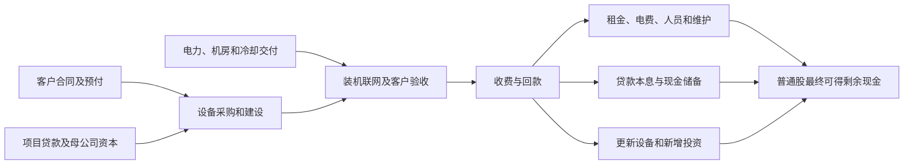

# CoreWeave（CRWV）公司业务前景、经营情景、市场定价与投资决策

## 0. 当前结论与四情景总表

**当前决策：以55.60美元为参考，建立约0.5%的高风险成长观察仓，按经营和融资里程碑分步参与；条件改善后再考虑提高至1%—2%。** 这是一般组合风险预算的研究建议，没有执行交易。公司已有大规模付费交付与真实长约，业务并未被证伪；但普通股价值对设备回收年限、建设资金与客户验收极其敏感。基准现金流价值折回当前的余量有限，不能把远期交易价与现价之间的差额全部看成安全边际。

三个胜负手依次是：**已投设备能否在约六年内保留足够收费价值；active power能否及时成为通过验收的收费集群；扩建资金能否以项目回款可承受的价格取得。** 软件、托管推理与Omni提供右尾，但目前没有证据把整个公司当成轻资产软件平台。

- **研究日及信息截止：**2026-10-22；`2026-10-22T17:30:00-07:00`，America/Los_Angeles。仅使用该时点之前已公开的经济信息；资料下载发生在研究执行期间，不改变原始披露日。
- **参考买价：**NASDAQ上市Class A普通股CRWV，USD **55.60**，2026-10-22正常交易时段收盘，16:00 EDT／13:00 PDT；为已发生的可交易收盘参考，不是研究结束时实时可成交的买卖盘。[当日价格记录][S20]与[本地当日金融快照][L06]相互核对。盘后价格没有混入本次收益率计算。
- **证券、币种与权益口径：**美国普通股，非ADR，ADR换算不适用；交易币种与财报币种均为USD。股本以IPO后普通股口径计，A、B类共同分享经济权益；不以自由流通盘作总股本。本研究没有跨拆股日计算历史收益，也不引入假设分红或回购。
- **财报锚点：**最新完整财报为截至2026-06-30的Q2及H1，业绩于2026-08-11公布，10-Q于2026-08-12提交。Q3虽然经济期间已于9月30日结束，截至截止时点尚未取得已发布实绩；下文Q3、Q4全部是预测。[Q2公告][S02]、[Q2 10-Q][S01]
- **资本日期：**资产负债表为2026-06-30；最近能直接定位的精确普通股数为2026-07-31的A股458,871,690股＋B股92,664,912股＝**551,536,602股**。9月已完成融资另行更新；截止日现金和完全稀释股数的完整实时快照未知。快照中的458.87百万股只覆盖A类，其30.67十亿美元市值实际上接近A+B合计乘收盘价；不能直接用该A类股数做每股分母。[10-Q封面][S01]
- **共同主要目标日：**2030-12-31，距参考日约4.19年。选择该日是为了同时观察公司2030年电力扩张目标、2026年新设备的主要合同回收，以及2031—2033年可转债和其他融资的衔接，略长于通常四年窗口。**所有目标价都是该目标日的条件价格，不能当成未来一两季目标。**

金额未另注均为**十亿美元，USD billion；1十亿美元＝10亿美元**。GW为功率，十亿股为股数；二者均不是金额。F＝已披露事实，G＝管理层目标，C＝计算，I＝研究推断，A＝条件假设，U＝未知。预测点用于闭合模型，不代表订单承诺或统计精度。

| 经营情景 | 目标日关键经营、资本与每股状态（金额：十亿美元） | 目标日剩余DCF参考价 | 纯业务驱动参考价，固定16倍 | 目标日预计交易股价区间 | 相对55.60美元变化 | 证据支撑度及决定性依据 |
|---|---|---|---|---|---|---|
| 悲观／受损 | 2030收入23.2、EBIT -2.0、融资前FCFE 2.4；净债务45.2；完全稀释股数约0.628—0.628十亿股 | USD 0.0 | USD 0.0（-100.0%） | USD 0.0—0.0 | -100.0%至-100.0% | 弱：长期降价、融资失灵及退出尚未发生；债务与租约放大损失的机制已有事实支持。 |
| 基准／正常兑现 | 2030收入72.4、EBIT 15.1、融资前FCFE 5.0；净债务56.4；完全稀释股数约0.846—0.853十亿股 | USD 100.3 | USD 177.2（+218.8%） | USD 147.3—206.8 | +164.9%至+272.0% | 中：长约与设施投运支持放量；资本成本下降、设备回收和集团利润率改善仍待跨期验证。 |
| 乐观／超预期 | 2030收入109.4、EBIT 32.9、融资前FCFE 16.0；净债务49.0；完全稀释股数约0.785—0.793十亿股 | USD 492.3 | USD 540.1（+871.4%） | USD 612.2—828.6 | +1,001.2%至+1,390.3% | 弱：需供电、验收、较高净价与较低融资成本同时领先基准；不能仅由RPO推定。 |
| 突破／非线性 | 2030收入137.6、EBIT 50.6、融资前FCFE 31.4；净债务30.5；完全稀释股数约0.789—0.792十亿股 | USD 903.0 | USD 870.9（+1466.4%） | USD 1,202.9—1,534.9 | +2,063.5%至+2,660.6% | 弱：生产客户与Forge/Omni已有线索，独立付费平台规模与资本效率尚未锁定。 |

**统一价格锚：**因当期净利润、自由现金流及正常化盈利分母失真，`business_price`统一使用**正常化前瞻EV/NOPAT 16倍（M_norm）**，不延用负值或百倍级表观当期倍数。具体以2031年正常化NOPAT形成经营EV，扣2030年净债务，再按包含融资、员工奖励和可转债净摊薄的股数分配。16倍是本次独立建立的正常化行业经济标尺，非声称已观测到的同行均值。受损情景无正持续经营NOPAT，普通股价值按退出受偿瀑布归零，不对负利润硬乘倍数。

总表中的高上行主要来自已明确的经营、资本和每股条件，仍依赖未来兑现。尤其基准市场价比剩余DCF高约47%—106%，需要目标日市场认可更长的超额增长期；它并非已有现金流保障。DCF也会受设备寿命假设显著影响。没有现金股息，股价回报即本模型持有期总回报；没有回购缩股，融资稀释完整进入分母。

未来两份财报优先看四个数：Q3收入能否落在约3.45—3.65、调整后营业利润约0.20—0.30；Q4能否实现约4.45—4.90收入及0.56—0.78调整后营业利润。还要核对新增收费容量、现金CapEx和融资可用性，单看backlog继续增长不构成加仓充分条件。

## 1. 业务经济本质与竞争位置

### 1.1 谁购买什么，CoreWeave在哪一层收钱

CoreWeave出售指定时间、地点、系统性能和可用性责任下的AI计算服务。客户的模型团队提出需求，基础设施、采购和财务团队决定容量、期限、预付与验收；实际使用者与付款决策者往往不同。客户主要支付更快获得集群、更短作业完成时间、更稳定推理时延，以及少建一套运维组织的价值。供应商获得的收入不是客户模型或应用的全部收入。

本研究分三个可相加的经济单元，另把地区与物理AI视为获客渠道：

| 研究单元 | 收费与收入确认 | 客户为什么支付 | 全成本与失败条件 |
|---|---|---|---|
| 长约专用集群 | 预留容量×服务期间；验收/可用起点决定收入，不等同客户GPU实际忙碌率 | 稀缺容量、系统工程、交付速度、运维与SLA | GPU、网络、存储前置投入，机房长租，债务本息；延迟、SLA扣减、续租降价或客户信用受损 |
| 弹性、短约及托管推理 | 按小时、较短承诺或token计费；与长约资源池互斥 | 缩短部署、降低每次有效任务成本、免自建闲置容量 | 较高净价可能伴随较低计费率、获客、并发与续租波动；更快芯片亦可能压低每token价格 |
| 外售平台、W&B/Forge与Omni | 独立软件订阅、管理服务或在客户持有硬件上收费 | 开发、评估、可观测、运维与跨代部署复用 | 研发和服务人员、客户转化、独立付费与留存；开源和跨云兼容约束收费权 |

Q2约98%收入来自committed contracts；历史初始期限通常一至六年。2025年底及更早活跃合同加权预付比例为TCV的15%—25%，并非每笔2026新约都采用同一比例。预付成为递延收入，之后交付时确认；它降低建设融资需求，但未来确认收入的一部分不再带来同额新现金。[10-Q收入与合同说明][S01]、[2025 10-K商业与会计政策][S03]

训练、RL和推理是工作负载，不能再与上述收费单元叠加统计。物理AI、金融、主权云和海外可以增加客户预算，但同一GPU在同一时段只能贡献一次容量收入。W&B关联存储、CPU、网络的收费若已进入集群净价，也不能再次全部计为软件。

### 1.2 交付和工程护城河已经有证据，长期收费权仍需维护

可验证的优势是集群网络、存储、调度、故障恢复、客户支持与跨代迁移的整体工程能力。CUDA、GPU路线和核心芯片利润主要由NVIDIA等上游掌握；模型与数据权益主要属于客户。CoreWeave需要靠减少客户等待和失败损失，持续获得系统层服务溢价。

9月30日公司与客户具名披露：Cognition已在Vera Rubin NVL72上运行生产任务，工程师在SWE-2工作负载测得相对GB200最高4.8倍token吞吐。它比样机跑分更接近真实采用，但仍是选定负载、合作方披露，缺少完整公开价格、功耗、质量与成本对照。**4.8倍token不等于4.8倍收入或利润。**[具名生产部署与客户测试][S15]

Forge于9月30日上线，整合实验、评估、后训练与推理，MasterClass、Canva被列为采用者。它可把基础设施销售延伸到开发工作流，Omni则可能把同一云栈卖到客户自有硬件上。前者增加客户生命周期参与，后者有望降低自有设备资本负担。当前独立收入、续费队列和单位交付成本未充分披露，不能把产品可用直接当成数十亿美元软件利润。[Forge产品及客户公告][S16]、[Q2电话会的Omni与非GPU业务陈述][S05]

竞争压力来自四处：大客户自建和ASIC、其他专业云、客户自用设备对外出租，以及开源调度与推理运行时。Microsoft在7月29日披露新增数据中心和自有容量，并继续部署Maia及其他厂商硬件；它既可能外购赶进度，也具备替代供应商的能力。其降本成果会压低外包服务可承受价格，不能将全部Azure增长自动归属CoreWeave。[Microsoft FY26Q4原始电话会][S18]

### 1.3 客户的钱包能够支付近期订单，不能无限外推

Q2前两大客户收入占比36%及26%，合计62%；前三家约72%。字母客户可能随期间变化，不能把A/B永久等同特定客户。新客户和应用扩张已经降低过去单一客户的集中度，仍未形成分散软件订阅的风险结构。[10-Q客户集中说明][S01]

Meta在10月21日公布的Q3经营现金流32.79、现金和可交易证券82.45，全年CapEx指引135—145，说明其具备大额投入能力，同时当季自由现金流已为负2.12。CoreWeave与Meta约21的扩展协议服务至2032年；该多年金额不是当年收入，也不是Meta全部预算转给CoreWeave。[Meta财报与指引][S17]、[双方扩展采购公告][S14]

对有盈利的云商与广告公司，付款来自经营现金、现金储备和融资；对前沿实验室，融资、预收及未来模型变现更重要。本研究没有获得所有私营客户可用现金与逐年采购表，因此没有把私营融资公告额等同于已到账、可全部支付给CoreWeave的预算。

基准2030收入72.4意味着：即使三家大客户各贡献10，其余客户仍需合计42.4；乐观109.4、突破137.6需要更多独立预算来源或更高份额。这是**付款能力门槛的逆算**，不是已签客户分配。基准需要每年追踪主客户现金流、外购/自建比例、应收账款与预付；乐观和突破还需要企业、金融与主权客户形成大额续约队列。不能拿上游GPU销售、机房租金和下游模型收入相加，证明这些收入均可支付。

### 1.4 合同保护、预付款与订单不是同一种资产

截至6月30日，RPO为103.7，backlog为104.2；41%的RPO预计未来24个月确认，约42.5。8月管理层另称早期Q3新增客户承诺超过25。两者日期和口径不同，不能拼成一个精确“当前129.2 backlog”；收入、取消/调整与新增也会同时改变余额。[10-Q Note 2][S01]、[9月SEC投资者演示][S06]

对照基准，2026H2约8.2＋2027约28.7＋2028H1近20，合计约57；6月底24个月RPO覆盖其大约四分之三，早期Q3新增承诺可进一步补足。这支持放量可见度，却不证明全部后续年份、利润和融资已锁定。

独立核验Meta MSA §11：存在违约及破产终止、退回未服务预付款；由CoreWeave依约终止时可要求剩余费用，但处置或转配相关服务器所得须抵减客户所欠金额。**保底合同有经济保护，仍以履约和法律条款为前提。**模型未同时计入全额违约赔偿与同一设备的完整重租收入；没有把删节的合同净价填成已知值。[Meta MSA §11(b)—(c)][S19]

NVIDIA 2025年9月订单初始价值6.3，涉及残余未售容量，期限延至2032年4月。它能支持特定容量，不是集团所有债务、所有园区或全部GPU残值的担保；相同容量被第三方购买后不能再算一份NVIDIA需求。[NVIDIA安排8-K][S21]

### 1.5 从电力到计费容量，瓶颈是串行交付

6月底active power为1.5 GW、contracted power为3.7 GW；8月11日contracted达4.2 GW，全年active目标提高至超过1.85 GW，2030至少8 GW为管理层目标。active不是全部GPU已经到货、验收或满额收费；另有土地、选项及LOI也不是可直接收费的供给。[Q2公告][S02]、[Q2电话会][S05]

独立业主证据支持实际设施交付：Applied Digital 10月7日披露Polaris Forge 1已分批达到250 MW。该设施的可用性支持CoreWeave供给兑现，但仍不能替代GPU装机、网络联调和终端客户验收。ERCOT 9月董事会材料记录对新的≥75 MW相关大负荷送电审批暂停、核验和12月10日报告安排；未取得CoreWeave逐站受影响名单，不能把全部全球电力视为被暂停。[APLD结果][S12]、[ERCOT原始材料][S13]



### 1.6 干净的财务起点与全周期单位经济性

2026Q2收入2.575、调整后EBITDA 1.510、GAAP营业亏损0.049、净利息费用0.640、净亏损0.626。收入减cost of revenue看起来约65.9%，但大量GPU折旧位于technology and infrastructure；扣该项后贡献率仅约7.3%，且其中仍混有研发口径。本文不用65.9%冒充设备全成本毛利率。[Q2公告及非GAAP对账][S02]

Q2的最小利润桥是：**1.510调整后EBITDA－1.393 D&A－0.165费用化SBC－约0.001其他调整≈−0.049 GAAP EBIT**。其他收益、投资公允价值变化及税项不年化成算力经营利润。2025年W&B并购带来软件与商誉；收购贡献与原生增长不能在公开拆分不足时伪造“同店增速”。[Q2现金流与费用说明][S01]

H1 CFO为3.663、现金购建固定资产14.117，因此通常的现金FCF约−10.454；再扣融资租赁本金0.033为−10.487。若选择把费用化及资本化SBC当现金等价经济成本，另扣0.353，得到−10.840；这是另一口径。**本次前瞻采用2030年前显式员工发股，故资金表不再把同一SBC扣一次。**[Q2现金流量表及补充资料][S01]

公司定义的H1 CapEx为16.139、Q2为9.352，与现金购买额不同。建设转固、CIP、应付设备款和OEM融资都会改变两者时点。未来资金缺口使用现金CapEx，公司官方35—39指引另行对照；不把全部成长投资当成维护支出，也不将所有负FCF视为存量项目亏损。[SEC演示的CapEx对账][S06]

一个独立的100 MW条件算例（全部A/C）：初始设备、网络与存储投入3.20；满计费年价15百万美元/MW，计费96%，年收入1.44；现金经营成本0.576，SBC等价成本0.0432，维护投入0.032，六年直线折旧，24%正常化税率。年度税后无杠杆现金约0.720，第六年残值按原投入10%、净税后0.243计，六年IRR约**10.7%**。若相同收费能力只持续五年或四年，IRR约6.2%／−0.9%，且未计可能的剩余租约退出损失。这个算例不是某一秘密客户合同，也不保证公司能实现相同回报。

六年仅是基准经济寿命假设。10-K的会计政策确实从2023年起采用六年，旧代A100亦有续约至2029的个案；二者支持非零余值，不能证明每批新卡均可六年维持相同收益。完整单位经济性还要包含验收延迟、短约重定价、设施长租和债务成本。到2030，基准假定每新增可服务MW投入降至26百万、现金成本率改善，才能支撑更好的边际资本回报；这是待验证的核心增量条件。[会计寿命政策][S03]、[旧代续约及定价演示][S06]

## 2. 近期财报前瞻与中远期业务预测

### 2.1 下一季Q3与紧随其后的Q4

官方8月指引：Q3收入3.45—3.60、调整后营业利润0.20—0.26、净利息费用0.86—0.94、公司定义CapEx 11.5—13.5；全年收入12.4—13.2、调整后营业利润0.960—1.150、公司CapEx 35—39、12月收入年化运行率18.5—19.5。该ARR是末月收入×12，不是SaaS递延订单指标。[官方Q3与全年指引][S04]

| 指标与口径 | 2026Q3本次预测A/I | 2026Q4本次预测A/I | 依据及限制 |
|---|---|---|---|
| 总收入 | 3.45—3.65，工作点3.55 | 4.45—4.90，工作点4.65 | H1 4.653加工作点得全年12.853；上下限约12.55—13.20，和官方范围基本相容 |
| 核心GPU及集群服务收入 | 约3.35—3.58 | 约4.30—4.78 | 公司未披露独立分部；仅估计GPU、附属网络存储仍占绝大多数，不冒充财报分部指引 |
| 调整后营业利润 | 0.20—0.30 | 0.56—0.78 | 全年指引扣H1约0.149和Q3后，隐含Q4约0.55—0.80；爬坡、7月价格调整与D&A共同约束 |
| GAAP营业利润近似 | −0.02至0.10 | 0.34—0.55 | 扣员工SBC和其他调整；不是将调整后利润直接当GAAP |
| 技术基础设施后贡献率，非标准毛利率 | 约8%—12% | 约12%—18% | Q2约7.3%；较完整反映设备成本，分类变化时须重算 |
| 公司定义CapEx | 11.5—13.5 | 约7.5—10.0 | 与全年35—39及H1 16.139对照，不要求端点任意交叉相加 |
| 现金CapEx | 约9.0—10.5 | 约8.5—10.0 | 付款可落后转固，也可支付前期CIP；H2融资起点采用合计19.0 |
| CFO | 约1.5—2.5 | 约2.3—3.9 | 工作点2.0及3.1；预收和应收结算影响很大，非官方预测 |
| 期末active power | 约1.65—1.80 GW | 约1.85—2.00 GW | 这是公司功率口径，需补充收费装机映射，不能称GPU利用率 |
| 期末backlog | 约120—140 | 约125—155 | Q2余额、早期Q3承诺与收入消化约束；新签、取消、变动未有完整台账，不给毛订单伪精度 |

近期最容易被误读的“超预期”是RPO继续变大、但转固和现金效率未改善。真正强化中期路径的是收费容量、调整后营业利润与CFO同步改善；真正的坏信号是现金投入超额、CIP滞留、收入与利润又低于指引。管理层所称7月约25% SKU提价包含需求及组件成本传导，不能对全部锁价长协一次性加25%收入。[Q2电话会定价、预付与指引][S05]

截至截止时点，本次未取得Q3及Q4财报发布日期的可确认公告；按公司惯例观察11月及翌年2—3月窗口，不把该估计写成已公布日历，也不引用尚未发生财报的实绩或“最新一致预期”。

### 2.2 先固定物理及商业驱动，再形成收入

模型依次输入平均active power、可收费转换比例、长约/弹性分配、各自计费率、净价，以及独立外售软件收入。**没有先定收入目标再倒凑GPU数量。**本模型的有效GW是分析代理：公开active定义、gross/IT差异、硬件填充和验收滞后合并在转换比例里；不是公司披露的精确IT功率或GPU总数。

$$
R_{long}=GW_{avg}\times q_{ready}\times s_{long}\times u_{bill}\times ASP_{long}
$$

$$
R_{flex}=GW_{avg}\times q_{ready}\times(1-s_{long})\times u_{flex}\times ASP_{flex}
$$

GW乘百万美元/MW年的单位换算，直接得到十亿美元年收入。长约计费率是收费/履约比例，弹性计费率还受客户负荷影响。独立软件另加，内部平台调用不加。

下表是关键驱动，完整逐年三业务收入在附录。每组斜杠依次为2027／2028／2029／2030；均为A/I。

| 情景，2027／28／29／30 | 年末active GW | 平均active GW | 可收费转换比例 | 长约资源比例 | 长约净价，百万/MW年 | 弹性净价，同单位 | 独立外售软件收入 |
|---|---|---|---|---|---|---|---|
| 悲观／受损 | 2.35／2.55／2.55／2.55 | 2.10／2.40／2.55／2.55 | 0.82／0.87／0.90／0.91 | 0.90／0.90／0.88／0.86 | 14.0／13.0／12.0／11.5 | 17.0／15.0／14.0／13.0 | 0.25／0.35／0.45／0.55 |
| 基准／正常兑现 | 3.00／4.00／5.00／6.00 | 2.30／3.45／4.50／5.50 | 0.85／0.89／0.92／0.93 | 0.88／0.85／0.82／0.80 | 15.0／14.8／14.5／14.0 | 19.0／18.5／18.0／17.5 | 0.40／0.80／1.30／2.00 |
| 乐观／超预期 | 3.25／4.75／6.25／7.80 | 2.50／4.00／5.50／7.00 | 0.90／0.94／0.96／0.96 | 0.85／0.78／0.73／0.70 | 16.0／16.0／15.7／15.5 | 20.5／20.0／19.5／19.0 | 0.60／1.40／2.70／4.20 |
| 突破／非线性 | 3.35／5.00／7.00／8.80 | 2.60／4.25／6.00／8.00 | 0.91／0.95／0.97／0.97 | 0.84／0.76／0.70／0.65 | 16.3／16.5／16.4／16.0 | 21.0／21.0／20.5／20.0 | 0.70／1.90／4.30／8.00 |

基准初始1.85 GW来自2026年底官方目标；2027年底3 GW、2030年底6 GW为研究路径，低于管理层2030至少8 GW，但保留显著成长。原因是截至8月已签4.2 GW与远期8 GW之间还需新站点、客户、设备和资金，当前并未全部齐备。采用较晚交付的年度平均容量，避免把年末存量当全年流量。

净价15百万美元/MW年约相当于假设500个GPU等价单元/MW、满计费时3.42美元/等价GPU小时。公开GB200四GPU实例42美元/小时仅提供标价上界，大额承诺折扣、代际功耗和服务范围都不同；不能把GPU等价单位当真实装机数量，也不能把一个挂牌折扣当实收合同价。[公司公开价格][S22]

资本约束独立交叉核验：6月底已转固原值约40.7，除以active 1.5 GW，约27.1百万美元/active MW，但代际、CIP、IT口径不同，不能当新批次精确成本。基准新设备及配套32→30→28→26百万美元/有效MW，反映代际功耗、规模采购与建设复用的条件改善；若组件涨价抵消这些改善，就必须上调CapEx和D&A，不能只保留收入增长。[固定资产构成][S01]

### 2.3 四种路径怎样分开，管理层怎样应对

**悲观／受损：**新电力到收费的转换较慢，续租/新约净价下调，昂贵融资继续侵蚀剩余收益。管理层将扩建停在约2.55 GW，出售部分未充分使用资产，减少更新并最终退出低回报业务。收入先因前期交付升至约24，再停滞；不假设公司无限扩大亏损。由于设施租约和借款存量，缩表不自动保住普通股。

**基准／正常兑现：**核心长约正常履行，容量继续扩张，GPU与平台复用降低单位建设成本，弹性池保持受控比例。现金EBITDA率由约58%升至62%，折旧洪峰与真实员工成本仍计入，2030营业利润率约20.9%。它包含快速增长，没有把悲观约束逐项叠在一起；其关键不确定性是每代设备资本效率及融资，而不是凭空假定需求消失。

**乐观／超预期：**供电与验收更快、净价较高、计费更充分，项目资金成本下降；2030年末7.8 GW、平均7 GW，外售软件4.2。超额增量仍大多是重资产交付，需要累计约180现金CapEx，不能用软件叙事把资金需求抹去。

**突破／非线性：**核心集群至少优于乐观路径，同时Omni、Forge/W&B与托管能力形成更多独立外部收费，2030年软件/外部管理收入8、该单元现金EBITDA率65%；年末8.8 GW、平均8 GW。新增设备、设施与人才代价完整保留，2027—2030现金CapEx约204。外售平台8可以用“约150个年费20百万的大型管理项目＝3，加5的平台/开发/运维收费”的数量级解释，但它们还不是已获订单，且套餐和客户须去重。它需要标准化交付、独立付款与续约同时过关，不能由下载量或免费采用率推定。

软件8对比乐观4.2，单在2030增加约3.1现金EBITDA；更大跃迁还来自资本负担较轻的后续增长。这个独立边际贡献没有通过压低核心主业来制造；公司层面的收入、营业利润、现金余量与价值均严格递进。四情景内长约与弹性共用功率，分配合计100%，不会把同一GPU算成两份收入。

## 3. 公司四情景财务、资本与每股基本面

### 3.1 当前债权和资产的干净起点

| 2026-06-30项目，F，十亿美元 | 数额 | 对普通股的含义 |
|---|---:|---|
| 现金及等价物／可交易证券 | 5.524／0.015 | 有日期的已报数，不能说成10月22日实时余额 |
| 受限现金，流动及非流动合计 | 1.380 | 不纳入可自由填补新项目的现金 |
| 借款本金／扣融资费用后账面借款 | 35.551／35.068 | 资金桥使用本金，避免与净账面额混用 |
| 有追索／无追索借款净账面额 | 31.405／3.663 | 项目无追索不等于集团债务全部无追索 |
| 经营租赁负债／融资租赁负债 | 16.319／0.221 | 前者现金租金已进经营成本；DCF不得再全额减一次 |
| 递延收入 | 9.692 | 已收客户款须继续履约，进入营运资金轨迹 |
| 固定资产净额／其中CIP原值 | 46.736／11.918 | 未验收资产、设备残值与处置权决定回收额 |
| 股东权益／商誉／无形资产 | 5.024／1.101／0.245 | 有形账面并非可兑现现金底 |
| 已发行优先股／普通股股息 | 0／无普通股已宣告股息 | 授权可发行不等于已有优先受偿股份 |

来源为[10-Q财务表与Notes 5、9—13][S01]。经营租约未折现付款约29.135，另有尚未起租已签约租金约35.5及若干条件建设安排；它们不是全在今天到期的银行债务，但限制了停建后立即停止现金支出的能力。现有两开发JV最高投入承诺1.7，H1已有0.55，本模型H2另预留0.50、2027再预留0.65；没有把合作方全部资产或整个项目利润并给普通股，现有JV也未额外赋予免费终值。

6月底已披露借款本金偿还排程为：2026H2 **4.413**，2027 **6.184**，2028 **4.416**，2029 **2.421**，2030 **3.221**，之后 **14.896**。这是当时存量借款的摊还/到期表，不包含后来新贷款。四情景2027—2030使用更高还本额，显式纳入后续借款摊还，不能只盯2031以后的债券到期而忽略2027即发生的现金需求。

W&B纳入公司并表业务；SPV项目按合并经营资产及相应借款一起处理。DDTL 4.0对应的CCAC VIII是全资体系，独立JV的权益与分配限制不能由“合作”二字推断。本模型不建立未披露少数股东利润池，也不把JV资产当成控股公司可随时提取的现金。若新融资改为合作方持股，须同时减少归属收入/利润和权益价值，不能只减少母公司CapEx。

### 3.2 9月融资的真实可用资金与潜在股数

9月22日完成4.2本金、票息2.875%、2033年4月到期可转债；净募集4.137，减capped call成本0.5662后约3.5708可用，另有其他发行费用。初始转换价97.85、对冲上限199.70。9月17日最多35百万股ATM/领式远期安排存在至少30天限制，额度不等于已发或已收钱。[已完成可转债8-K][S07]、[ATM/远期安排8-K][S08]

6月底反稀释证券约116百万股当量包括57可转债、24期权、31 RSU/RSA、4权证。不能把116无条件加到551.5：RSA可能已合法发行、期权有行权款，可转债可现金结算，capped call影响净稀释。模型处理是：未来员工归属/发股逐年显式计入；旧期权/权证另保留28百万股毛额且不计行权款；既有可转债保留本金债权，按转换及对冲后的**净增量股份**处理，既不把本金免还、又只计净稀释，也不把31百万奖励再整笔重复加入。[10-Q Note 13][S01]

该28百万是保守毛股数储备，未经逐个行权价净额化，不声称是精确的当前完全稀释股本。2026H2员工普通股增加假定来自奖励归属等变动，旧24百万期权仍保留，避免将同一行权重复列在两处。

### 3.3 2026年末起点是有条件的预测，不能冒充已披露余额

为让四情景共用同一起跑线，采用2026年底现金6.0、借款49.338、基础股本0.600十亿股。其桥接为：

| 2026H2资金桥，十亿美元，F/A分开 | 数值 |
|---|---:|
| 6月末现金，F | 5.5240 |
| H2 CFO，A | +5.1000 |
| H2现金CapEx，A | −19.0000 |
| 其他/JV投资，A | −0.5000 |
| 9月capped call，F | −0.5662 |
| 融资租赁本金，A | −0.0500 |
| 6月底已披露H2借款本金偿还表，F，假定如期 | −4.4130 |
| H2新借款毛本金，A，含已完成4.2可转债 | +18.2000 |
| 新股现金净入及其他融资成本净额，A | +1.7052 |
| 2026年底现金，A/C | **6.0000** |

18.2不是全部已经提款；除4.2可转债外，仍需要项目/OEM等贷款真实取得。1.7052拆为假定使用全部35百万ATM股、55美元毛价取得1.9250，减2%综合股权费用0.0385、可转债发行折让0.0630、其他新借款费用预留0.1183；capped call另扣。股数551.5366百万＋35百万新现金融资股＋约13.4634百万奖励及其他变动＝约600百万。35百万全部使用是A，未声称截止日已执行；其后不剩可重复计入的同一额度，2027仍需独立新股融资。成本或实际发行价不同，须同步改现金与股数。

若2026年末未达到这一起点，必须用Q3/Q4实际现金、借款、AP/CIP和股数重跑。与该起点相比每少1现金或多1净债务，都会压低后续权益价值；更关键的是可能让2027建设先断粮，而非仅使目标价小幅下降。

### 3.4 公司现金流与融资怎样闭合

模型现金EBITDA包含日常租金、电力、支持、研发和集团开支，排除SBC与D&A。GAAP近似营业利润为现金EBITDA−D&A−SBC；正常化NOPAT使用24%税率、亏损不制造税收退款。正常化税率用于估值，实际资金表另用0.1—5.0的情景现金税，不把NOL无限当现金资产。2025年底联邦NOL约4.3、州NOL约0.905，利用还受盈利、地域和所有权变动限制。[10-K及10-Q税项][S03][S01]

2030年前，对基准/乐观/突破：

```text
CFO = SBC前现金EBITDA − 现金利息 − 现金税 + 净营运资金现金贡献
融资前FCFE = CFO − 现金CapEx − JV等投资 − 融资租赁本金
期末现金 = 期初现金 + 融资前FCFE − 借款还本
           + 新借款 − 借款费用 + 新股融资 − 股权费用 + 资产出售
期末基础股数 = 期初股数 + 新现金融资股数 + 员工发股
```

SBC按收入3%、除以该年发股价形成股数，不在CFO再扣现金。受损路径改为人员现金等价成本，停止假设公司可以用高价股票持续发薪。2031起在DCF中把SBC当现金费用，停止新增员工股数；因此未来员工报酬只扣一次。前2030 FCFF若展示规范税率，则从NOPAT加回当期股票支付SBC；它不混同CFO或实际现金税。

现金CapEx按新增有效容量×设备配套单价＋更新旧批次＋其他维护更新＋设施投入计算；设备基准六年，新增当年及退役年度各计半年D&A，中间年度计全年，设施十五年同理。2026期初设备批次成本按2021—2026年约0.05／0.20／1.50／6.50／17.0／35.0分配，这是对缺少逐批台账的研究近似。基准约2026年集中购置形成2032年更新洪峰，不能用2030某一年较小的更新额当永久维护需求。

新借款**上限**由新增设备投资可贷比例与当年本金再融资比例确定，实际只提取维持缓冲所需金额；不为做高“净现金”而无谓借款。基准新增设备可贷50%、到期本金可再融50%；乐观/突破60%与60%；借款利率从9.0%→8.3%、7.7%→7.2%、7.5%→6.7%变化。它们均为条件承销，不是已承诺授信。新借款计1%费用、现金股权计2%费用。

基准员工发股/现金融资价使用2027—2030的50／65／85／105美元；乐观65／95／135／180；突破70／110／170／230。这些是融资/归属时点的条件价格，低于相应目标日价值，没有用当前股东价值极低却长期高价增发的假设保护分母。基准主要现金增发发生在2027，毛额约6.61、净约6.48、增加132.2百万股；它需要独立融资，不能说已有ATM足够。

| 2027—2030累计／期末 | 现金CapEx | 新借款毛额 | 本金偿还 | 股权融资毛额 | 借款峰值 | 2030基础股数，十亿 | 2027／28／29／30 EBIT/利息 |
|---|---|---|---|---|---|---|---|
| 悲观／受损 | 27.76 | 37.37 | 39.00 | 0.00 | 53.26 | 0.600 | -0.08／-0.21／-0.28／-0.34 |
| 基准／正常兑现 | 128.93 | 59.10 | 48.00 | 6.61 | 66.73 | 0.812 | 0.51／1.37／2.17／2.90 |
| 乐观／超预期 | 180.24 | 62.65 | 58.00 | 0.90 | 76.58 | 0.688 | 1.59／3.11／4.74／7.38 |
| 突破／非线性 | 204.00 | 60.50 | 64.00 | 0.27 | 74.74 | 0.676 | 2.02／4.27／7.31／13.29 |

基准2027融资前现金缺口约19.4，加9还本，当年毛需求约28.4；可用初始现金缓冲约2、项目借款约20.14、股权净入约6.48，扣借款费用后闭合至4.0现金。2028仍有约6.1现金缺口，2029—2030才形成正融资前FCFE。基准借款在2028约66.7见峰，不以收入增长自动“偿清所有债务”。四条现金轨迹完整列于附录。

再用投入资本检验利润：以2026年底PP&E约61.34（6月底46.736＋H2现金投入19−D&A约4.4）、净营运资本−7与JV投入1.05，形成期初经营投入资本约55.39。后续按CapEx−D&A＋ΔNWC＋JV投入滚动，租金已进经营成本，经营租赁ROU不另资本化。这是现金与转固时点近似下的分析代理，非已审计ROIC；设备应付或CIP时点大变时须更新。

| 情景 | 2027／28／29／30正常化ROIC代理 | 相应期末投入资本，十亿美元 |
|---|---|---|
| 基准／正常兑现 | 3.0%／7.4%／10.9%／12.6% | 73.0／82.2／88.3／94.2 |
| 乐观／超预期 | 8.1%／14.3%／18.0%／20.7% | 79.9／100.2／114.5／127.2 |
| 突破／非线性 | 10.0%／18.0%／23.2%／28.4% | 81.3／104.0／128.4／142.9 |

这里的ROIC＝扣SBC的正常化NOPAT／平均期初期末经营投入资本。基准只有随着交付成熟才接近并超过10.5%的资本成本；不能由成熟单项目利润率直接认定整个扩建集团已经高回报。乐观和突破还需要更好的净价、成本、平台利润和资金共同兑现。

### 3.5 股债联动、租约尾部与下行实体参照

DDTL 4.0容量8.5、SOFR+2.25%及固定利率分支、2032年3月到期，有有限追索保证；借款人DSCR最低1.15倍。DBRS对该特定项目给A(low)，其约1.20倍DSCR建立在Meta take-or-pay及合约内摊销上；这不是集团投资级或每个新项目相同条件。[DDTL 4.0 8-K][S09]、[DBRS原始评级对象与依据][S10]

8月DDTL 5.5容量2.6、SOFR+5.5%、母公司保证，底层合同平均期限较债务更短；协议存在续约/替代合同、预测DSCR及合同价值约束。不能假定旧客户离开后贷款仍可原规模无限保留。[DDTL 5.5及完整信用协议][S11]

更重要的是APLD公开担保原件：Colocation客户合同到期、终止或若干违约等可触发母公司对机房租金及履约的责任。设备贷款的有限追索，没有消除更长机房租期的尾部义务。本模型已在经营成本和退出现金流中处理租约，不在现有租赁承诺上再虚增同一负债。[APLD担保§2(A)][S23]

将EBIT/利息1.5倍作为研究警戒线，基准2027约0.51、2028约1.37，2029才超过2；受损全程为负。**这说明融资窗口仍决定成败，但不能把这条研究警戒线冒称公司已违反某项集团契约。**已知贷款的实际契约按借款主体、定义和测试起点执行。若再融资成本上升3个百分点，仅按约60的借款粗算，全年利息可增加约1.8；存量固定债券票息不会随二级收益率当天重置。

受损情景已采取缩表、出售2＋1资产、暂停大部分扩建/更新，2030仍有47.7本金与2.5可用现金。2031起不再盲目更新亏损资产，按合同跑完、逐步退出：2031—2034退出现金流现值仅约16.7，低于净债权45.2。**普通股归零来自受偿顺位，既不是把良好主业机械套低倍数，也不是让公司无限烧钱。**如果贷款在更早年份不能展期，困境重组只会更早；没有凭空假设按4—5美元持续募资救普通股。

实体底线也核对：以6月底资产负债和7月底股数，净现金每股约**−54.82美元**，TBV每股约**6.67美元**。前者已为负，后者含有高度依赖设备变现及租约处置的权益，不构成健康净现金公司的硬底。受损假设下，设备、合同与设施可出售价值若在约25—40区间，扣未计入经营EV的净债权后仍无普通股剩余；未取得可执行并购买价，不能声称GPU重置成本就是股东保底。逐SPV抵押、担保与现金封存明细不足，也使精确法律清算瀑布无法还原；16.7为经济退出算例，不是法院分配预测。

### 3.6 进入估值前锁定公司与每股产出

| 情景，2030年 | 收入 | 现金EBITDA，SBC前 | 营业利润，SBC后 | 融资前FCFE | 借款本金 | 可用现金 | 完全稀释股数，十亿 | 2031每股正常化NOPAT，美元 |
|---|---|---|---|---|---|---|---|---|
| 悲观／受损 | 23.16 | 12.65 | -1.98 | 2.43 | 47.71 | 2.50 | 0.628 | 退出、无正持续经营NOPAT |
| 基准／正常兑现 | 72.39 | 45.08 | 15.13 | 4.96 | 60.44 | 4.00 | 0.850 | 15.23 |
| 乐观／超预期 | 109.40 | 71.20 | 32.93 | 16.02 | 53.99 | 5.00 | 0.789 | 37.29 |
| 突破／非线性 | 137.61 | 93.11 | 50.61 | 31.38 | 45.84 | 15.38 | 0.790 | 56.31 |

本表的2031每股NOPAT在2030年末为统一前瞻指标，已扣设备D&A及2031现金等价员工成本，仍是利息前企业经营口径，不能直接当可派普通股EPS。融资前FCFE包含全部成长和更新投资，负值需要融资；NOPAT增长、FCFE增长和每股价值增长可以不同步。完全稀释股数会随可转债及对冲结算价格略变，具体函数见附录。

## 4. 估值转化、固定倍数与市场重估

### 4.1 2030年末剩余现金流DCF

该DCF站在2030年末，只折现2031年以后剩余现金流；不是将研究日DCF再简单滚动四年。基准、乐观、突破显式预测至2040，之后以稳态ROIC约束再投资；悲观使用2031—2034退出现金流、无永续终值。

$$
FCFF=NOPAT+D\&A-CapEx-\Delta NWC-其他项目投入
$$

$$
TV_{2040}=\frac{NOPAT_{2041}(1-g/ROIC_{steady})}{WACC-g}
$$

统一WACC **10.5%**，体现重资产基础设施的系统性风险与长期资本结构，不把每条经营情景再叠一层任意高折现率。可理解为税后债务约6%—8%、权益要求约13%—16%、长期债务权重约40%—50%的中心组合，均是估值参数，不声称2030利率已知。执行损耗、净价、验收和更新已经在现金流中变化，避免重复惩罚。

2031以后：基准有效容量继续增长至2040年末约10.6 GW，乐观15、突破18；可收费/业务组合延续各自状态。基准每MW净价每年下降1%，乐观/突破下降0.5%，同时现金运营成本/MW仍增长0.5%，不假设售价下降而毛利率永远不动。新增设备单位成本每年下降2%、到龄设备按原成本85%重置；均是带技术进步条件的研究假设，并非已锁定采购价格。净客户融资逐步按收入15%负营运资本稳态计算，先消化已有预付款履约负担，不让2030预收永远成为免费资本。

| 情景 | 2031—2040或退出期现金流现值 | 终值现值 | 2030年末经营EV | 终值占EV | 永续g／稳态ROIC |
|---|---|---|---|---|---|
| 悲观／受损 | 16.66 | 0.00 | 16.66 | 0.0% | 无永续终值 |
| 基准／正常兑现 | 68.75 | 71.92 | 140.66 | 51.1% | 3%／13% |
| 乐观／超预期 | 213.56 | 218.40 | 431.96 | 50.6% | 3%／16% |
| 突破／非线性 | 356.30 | 381.66 | 737.96 | 51.7% | 3%／20% |

终值占比约51%—52%，仍是估值重要来源。先将2038—2040三个年度NOPAT按稳态g归一至2040并平均，平滑更新周期，所得正常化NOPAT约18.48／53.12／88.74，分别用于基准／乐观／突破。基准永续g 3%、ROIC 13%意味着再投资率23.1%，乐观/突破分别18.8%／15.0%；剩余现金才可分给资本提供者。终值不直接沿用某个GPU批次的满负荷EBITDA；2041隐含CapEx须足额补偿D&A并再投资g/ROIC。若稳态ROIC只能接近WACC，超额增长价值会缩小。

| 情景 | 归一化2040收入 | 稳态营业利润率 | 稳态NOPAT率 | 再投资率 | 2041净再投资 | 2041稳态FCFF |
|---|---|---|---|---|---|---|
| 基准／正常兑现 | 127.96 | 19.0% | 14.4% | 23.1% | 4.39 | 14.64 |
| 乐观／超预期 | 223.21 | 31.3% | 23.8% | 18.8% | 10.26 | 44.46 |
| 突破／非线性 | 303.29 | 38.5% | 29.3% | 15.0% | 13.71 | 77.69 |

上表收入与NOPAT都由2038—2040年归一，稳态营业利润率为NOPAT率÷76%。净再投资＝CapEx−D&A＋ΔNWC，故GPU更新和客户预付的长期变动均包含在终值资本需求中；不能将稳态FCFF解释为不再更新设备。

| 情景 | 经营EV | 减：借款本金 | 减：融资租赁 | 加：可用现金 | 原普通股剩余权益价值 | DCF完全稀释股数，十亿 | DCF每股，美元 |
|---|---|---|---|---|---|---|---|
| 悲观／受损 | 16.66 | 47.71 | 0.000 | 2.50 | 0.00 | 0.628 | 0.0 |
| 基准／正常兑现 | 140.66 | 60.44 | 0.000 | 4.00 | 84.22 | 0.840 | 100.3 |
| 乐观／超预期 | 431.96 | 53.99 | 0.000 | 5.00 | 382.98 | 0.778 | 492.3 |
| 突破／非线性 | 737.96 | 45.84 | 0.000 | 15.38 | 707.50 | 0.784 | 903.0 |

经营租赁已扣租金，因此不再将16.319历史经营租赁负债全部减一次；受限现金未加回。现有未并表JV不额外赋值，未确认少数股东权益、优先股不凭空添加。新增项目若引入JV分成必须重跑经营归属，不能沿用本表全资利润。

### 4.2 统一16倍正常化锚的来由与纯业务价格

当期净利润为负，FCF因扩建大幅为负，当前倍数不适合固定外推。本研究以EV/前瞻正常化NOPAT **16倍**为共同M_norm：它是成长期专业基础设施的正常化标尺。没有干净上市可比能把GPU更新、负债和软件份额全部对齐，故不借用同业评级或目标价。

倍数可用一组不含股票价格的经济假设复核：未来十年NOPAT增长12%、增量ROIC 25%，之后g 3%、ROIC 13%，WACC 10.5%，其前瞻NOPAT倍数约15.8，取16。**25%是新增投入的条件边际回报，非声称当前集团ROIC已达25%。**当前批次经济性弱于这个标尺时，DCF可低于固定锚；平台化提高回报时也可高于它。它因此回答固定正常化倍数下的成长价值，不充当保证兑现的现金流底。

$$
P_{business}=\frac{16\times NOPAT_{2031}-Debt_{2030}-FinanceLease_{2030}+Cash_{2030}}{S_{FD}(P_{business})}
$$

基准前瞻NOPAT约12.938，经营EV约207.0，扣净债务56.4、以相应稀释股数约0.849十亿股分配，纯业务价约177.2。收入72.4并不会全部成为股东现金：营业成本、27.8的D&A、员工成本、利息、更新投入和融资股数逐层分走价值。相对2027年初的0.600十亿基础股，本模型基准2030基础股已增至0.812，再加潜在股份，未通过忽略稀释做高每股结果。

### 4.3 目标日市场为什么可能高于DCF

目标倍数使用2031年NOPAT统一口径：基准14—18倍、乐观18—24倍、突破22—28倍；受损使用退出受偿，不给负利润乘数。基准对应约4.02—5.17倍2030 SBC前现金EBITDA，乐观约7.44—9.92倍，突破约10.52—13.38倍。较高倍数必须由后续增长和资本效率支撑，不由“AI”标签赋予。

基准目标日之后仍有2031约13.6%的收入增长及改善的收费资产基数；市场可能认为2030后的高净价、长设备回收期和客户工作流复用，比保守DCF的逐年净价侵蚀持续更久。乐观、突破还包含更大弹性服务和外售平台利润。与此同时，固定长租、资产更新与客户集中使基准不适用纯软件倍数。目标区间也包含不同利率和后续增长预期的市场状态，没有单一必然交易价。

溢价必须可度量：

| 情景 | 市场价格较DCF溢价 | 经营EV额外现值，十亿美元 | 对应永续增量FCFF等价，十亿美元/年 |
|---|---|---|---|
| 基准／正常兑现 | 46.9—106.3% | 40.5—92.2 | 3.0—6.9 |
| 乐观／超预期 | 24.4—68.3% | 97.9—274.5 | 7.3—20.6 |
| 突破／非线性 | 33.2—70.0% | 241.2—508.3 | 18.1—38.1 |

“永续增量FCFF等价”用EV差额×(10.5%−3%)计算，表示要支撑市场溢价，2031起类似永续现金流需增加多少；不是声称该现金已实现。基准上沿所需增量相当大，只能由更长超额增长、更新资本效率或平台利润解释。如果到2030仍看不到这些条件，合理市场价应更靠近DCF，不维持表中的高端。**允许市场价高于DCF，与把差额视为无条件安全边际，是两件不同的判断。**

### 4.4 股价回报中有多少来自增长，有多少来自倍数

为避免可转债不同价位改变股数而混淆，下表先固定business_price对应股数计算倍数贡献，再单列净稀释变化；三项贡献均以55.60为分母，百分点可相加。悲观的−100%来自业务受损及债权优先，非倍数压缩。

| 情景 | 纯业务及资本桥贡献 | 倍数贡献，下沿／上沿 | 可转债净摊薄调整，下沿／上沿 | 合计回报，下沿／上沿 |
|---|---|---|---|---|
| 基准／正常兑现 | +218.8% | -54.8%／+54.8% | +0.9%／-1.6% | +164.9%／+272.0% |
| 乐观／超预期 | +871.4% | +135.5%／+542.1% | -5.8%／-23.2% | +1001.2%／+1390.3% |
| 突破／非线性 | +1466.4% | +613.6%／+1227.3% | -16.5%／-33.0% | +2063.5%／+2660.6% |

基准市场下沿14倍相对固定16倍确有压缩，但主要正回报来自业务兑现；没有假定一面强劲增长、一面无理由把倍数砍到衰退清算水平。乐观和突破的右尾也不是全部由重估创造：即使用相同16倍，纯业务参考价仍显著高于现价。另一方面，固定16倍自身包含正常化成长回报要求，不能称其完全不需要资本效率改善。

### 4.5 情景证据支撑与可实现性分开判断

**基准为中（medium）**：长协商业模式、RPO、业主交付和生产客户支持收入底盘；但集团从低盈利高投入转为约21%营业利润率、六年经济回收及大额新资金，属于尚未跨期验证的核心增量。没有因2030数字未写进合同就降级，降级原因是股东现金回收机制仍需验证。

**悲观为弱（weak）**：高杠杆和资本消耗是事实，但永久性续租降价、主客户退出和普通股最终被债权耗尽尚未发生；当前部分SKU提价、旧卡续约与新增承诺是反证。不能把已存在的风险暴露等同危机已锁定。

**乐观为弱（weak）**：价格、产能、客户与融资都有正面线索，但目标需要多个增量门槛一起领先基准，目前没有完整跨代、跨站点队列锁定其组合。商业上可实现，证据尚不足以当成中心路径。

**突破为弱（weak）**：Cognition生产、Forge采用与Omni首单提供可核查起点，故没有判为无依据幻想；8的平台收入、跨区域扩张和更优资本效率仍是多步条件外推。既未与明确硬约束冲突到足以评“不足”，也未因右尾很大就评“强”。

本公司没有一条完整公司级路径满足strong的锁定标准。三种weak的原因不同，和发生概率无直接对应；本次不为凑齐四档而伪造证据差异，也不将风险事实与未来损伤混成medium。单独的近期合同存在与已交付事实可以很强，不能自动替代整个公司经营情景评级。

## 5. 现价隐含要求、当前投资动作与验证路标

### 5.1 55.60美元究竟在定价什么

以15%年化权益回报要求为条件，4.19年后至少需要约99.88美元。固定16倍、维持本次基准2030净债务和已融资股数，仅需约8.77的2031 NOPAT，低于基准12.94。若只改变2031收入、保留基准现金成本率与D&A，该NOPAT约对应72.9收入，较基准82.2低约11%；这是一维反推，不是减产后资本与债务全部自动不变的新情景。

因此，现价**并没有按本次乐观/突破路径充分定价**，更接近折价的正常交付与较弱设备回收组合。但它也不是显著低于所有现金价值：基准目标日DCF100.3按15%折回当前约**55.8**，只比55.6高约0.4%。这个回报要求折算用于比较时间成本，不是把2030 DCF误称成研究日的完整DCF。

最重要的对照是经济寿命：五年寿命分支让融资价与该分支当年剩余经济价值联立，目标日DCF仅约12.0；六年约100.3。相同收入也能带来截然不同普通股结果。当前价格包含对资本回收风险的折价，尚不能证明市场错误。四年更新的联合压力需要约34以上股权资金，联立融资价格后没有正的可行解，必须转入减投/重组，不按六年路径的高价增发维持原成长。

### 5.2 当前怎么参与，什么时候改变动作

本次选择**先约0.5%观察仓**，因为付费交付、RPO与客户生产采用已经存在，右尾在物理和商业机制上说得通；将全部不确定性视为等待理由，会失去融资和交付验证后的部分上行。仓位上限来自受损情景可归零、基准2027仍有大额新股融资及低利息覆盖，而不是来自短期股价波动率。

| 条件与价格窗口，I/A | 投资动作 | 为什么 |
|---|---|---|
| 约45—60美元，近期交付与融资条件未恶化 | 可建立约0.5%观察仓；不因价格更低自动加仓 | 当前已在窗口内，真实商业底盘支持参与；现金价值余量有限 |
| 约35—45美元，同时未来12个月刚性资金支出有已签可用融资覆盖，且订单与验收保持正常 | 可再加约0.5%，一般总仓暂不超过1% | 价格改善要与资金和业务一起成立；现金断裂时价格下跌不提供同等机会 |
| Q3/Q4通过下列验证，2027建设资金缺口已有可核验安排；股价已在75—85美元 | 可用更小增量加至约1%—2%，重新计算更新年限与稀释 | 更高买价以较低执行/融资风险交换，不能原样搬用现价赔率 |
| 收入、验收或融资触发联合否定条件 | 减至零或停止参与，并重跑模型 | 此时需改变业务与股本路径，单调低一个倍数不足以反映损失 |

35—45不是净现金/TBV硬底，也不是无条件限价买单。若普通股只能靠与其经济价值不相容的高价增发维持原扩建，就要削减容量或转项目JV分成；原股东的利润归属和目标价同步下降。

等待也有成本：如果两季验证后股价由55.6升至85，踏空约53%；相同基准目标147.3—206.8对应的剩余股价回报从约165%—272%降至约73%—143%。若届时距离目标约3.7年，年化约16%—27%，仍可参与，但安全余量不同。选择观察仓的作用是承受一小部分归零风险，保留随证据调整的空间，而非现在就为突破满仓下注。

### 5.3 未来两份财报可证伪的路标

| 验证对象 | 强化基准／上行的信号 | 触发下修的信号 | 对应动作 |
|---|---|---|---|
| Q3收入与营业杠杆 | 收入≥3.60且调整后营业利润≥0.26，服务/收费容量有同步说明 | 收入<3.30，或利润<0.15并与延期、CIP滞留同时出现 | 前者可提高交付假设；后者下修2027平均收费容量，检查提款和客户补偿 |
| Q4及全年指引 | 收入≥4.80、调整后营业利润≥0.75、12月年化运行率≥19.5 | 收入<4.20或年末运行率<17，且缺少明确延期恢复节点 | 修改2027收入起点，不用原目标全年直线外推 |
| 供电→验收 | 年底active至少1.85 GW，新增批次开始收费，预付/应收与合同一致 | 年底<1.75 GW，或功率增长但已投GPU长时间不计费 | 下修转换比例，增加资金峰值与延期成本 |
| Backlog/RPO | Q3约125以上且兑现期间、预付和取消调整透明 | 大幅增长却没有对应交付资金，或净调整/退款明显上升 | 合同保护逐笔重验，不能只因大数字加仓 |
| 现金与建设 | Q3现金CapEx约9—10.5、Q4约8.5—10，CFO分别约1.5—2.5与2.3—3.9 | 连续投入超出区间20%以上、营收/验收仍低于指引，或未来12月已承诺资金缺口为负 | 先缩减容量假设、估算融资价与稀释，再决定仓位 |
| 资本条款 | 可用融资覆盖已承诺建设、现金缓冲可维持约4；发股价与股东经济价值相容 | 高担保/短合同新贷款挤压现金，提款条件难满足，或续约导致强制缩贷 | 不用新债面额当现金跑道；需要时转受损路径 |

单一季度CFO受预付节奏影响，不单独判定项目不赚钱；单一季度active高于目标，也不自动把计费率升到100%。联合观察的目的，是把工程、收入和现金接在一起。

### 5.4 未来6—24个月的产业与竞争路标

2026年底至2027上半年，核对Q3/Q4实绩、DDTL提款窗口与2027建设资金。ERCOT 12月10日报告是已知原始时间锚，但它是否改变具体站点仍需逐站证据。2027年主要验证新容量能否向3 GW基准末值推进、营业利润改善是否在D&A洪峰后仍成立，以及股权融资是否接近本模型6.6的毛需求。

2027年中至2028，重点追踪：大客户自建/ASIC上线后外包是否续约；首批短约到期与旧代GPU重定价；印度/印尼等项目的实际RFS、客户和资金；Omni独立合同与W&B/Forge付费留存。海外新增站点若仅有合作公告而无验收和最低付费，不将其提前计入平均容量。若平台收入开始跨客户复用、净留存和现金毛利得到披露，再提高外售平台假设；若只是更多工具免费采用，维持或下修。

模型最需要更新的三个参数始终是：**每批设备税后回收、平均收费容量、每单位新增资本归普通股的份额。**市场价格变化本身不会改变这些参数。

## 6. 附录底稿

### A. 允许使用的本地正式资料、日期与文件指纹

下列文件是本次本地研究资料范围；公司/行业报告只提供待核事实和取证线索，其原有预测、概率与选择没有直接搬入本次模型。目录AGENTS仅用于交付管理。没有采用既有投资决策、评估、排序、特征评分、技术面、情绪、备份或其他任务临时研究。所有新计算和原件下载均保留在本任务同级tmp，未增加其他正式成品。

| ID | 正式文件标识 | 用途 | SHA-256 |
|---|---|---|---|
| L01 | [基本面/公司调研/结果/云算力_IDC_边缘云/CRWV_CoreWeave_公司调研_2026-10-22.md](../../../基本面/公司调研/结果/云算力_IDC_边缘云/CRWV_CoreWeave_公司调研_2026-10-22.md) | 公司事实线索与合同定位 | 48c29b22ceefa368e8b9bdbdcc15fbe20180f83d3fd17ab0d54b360dac0a807b |
| L02 | [基本面/行业调研/结果/AI服务器_存储_芯片/行业调研_AI云算力外包和NeoCloud与AI数据中心运营商_2026-10-22.md](../../../基本面/行业调研/结果/AI服务器_存储_芯片/行业调研_AI云算力外包和NeoCloud与AI数据中心运营商_2026-10-22.md) | 经济单元和预算边界 | 47fb6e32d70dcff2cb1f2a3afd7bacd45bc303604d5262ad54636afb451672a9 |
| L03 | [基本面/产业背景/结果/数据中心电力与项目台账_2026-10-22.md](../../../基本面/产业背景/结果/数据中心电力与项目台账_2026-10-22.md) | 电力/交付口径 | ef92e91315b7ac95a4463722a8c92c9656fa00adf76b4a6bf39c942262a1e1ce |
| L04 | [基本面/产业背景/结果/全球AI需求与Token经济框架_2026-10-22.md](../../../基本面/产业背景/结果/全球AI需求与Token经济框架_2026-10-22.md) | 使用量、支付和上下游去重 | e7643bc5451a7ab1af41984fc0326287453806cb449e082af5fa0a8795fa2857 |
| L05 | [基本面/产业背景/结果/AI硬件贸易流量与算力租价_2026-10-22.md](../../../基本面/产业背景/结果/AI硬件贸易流量与算力租价_2026-10-22.md) | 租价口径与代际差异 | c8d23f0f7027171bd64e75b6cff5863078fabc528a5bed63e01bbd8cdb02ce8e |
| L06 | [金融资料/每日金融数据/每日金融数据_2026-10-22.md](../../../金融资料/每日金融数据/每日金融数据_2026-10-22.md) | 当日收盘与证券币种；股数单独校正 | 0385d450ca3d68681ab7e0d1547c0e51fc9c89fa534651d60111ba0118d698b2 |

指纹为本次读取后的SHA-256，小写十六进制；没有改写原文件。外部原件的URL、原始发布日期和引用位置如下，下载留档不是“首次公开”时间。

### B. 历史与近期口径底稿

| 历史期间，十亿美元 | 2025全年 | 2026H1 | 2026Q2 |
|---|---:|---:|---:|
| 收入 | 5.131 | 4.653 | 2.575 |
| GAAP营业利润 | −0.046 | −0.193 | −0.049 |
| 净利息费用 | 见原件 | 1.176 | 0.640 |
| D&A | 见原件 | 2.540 | 1.393 |
| CFO | 3.058 | 3.663 | 0.679 |
| 现金购建固定资产 | 10.309 | 14.117 | 6.422 |
| 费用化SBC | 0.630 | 0.318 | 0.165 |
| 资本化SBC | 0.059 | 0.035 | 0.020 |
| 融资租赁本金 | 0.058 | 0.033 | 0.018 |

历史表只列本模型需要的数字；来源为[2025 10-K][S03]和[2026Q2 10-Q][S01]。2025现金购建额小于公司定义CapEx，正是付款/转固口径差异，不能混填。H1 CFO包含应收释放及递延收入增加，预付增长和后续履约在未来现金流中相应处理。资本化利息、融资租赁利息已随原现金分类纳入，未拿净利息费用再次整笔扣现金。

### C. 2027—2030完整驱动、分业务收入和利润现金桥

所有表是A/C。长约、弹性、外售软件三单元收入互斥；“基础股数”未加旧期权/权证及转换净股份。“FCFF”是规范24%税率下的经营现金流：2030前年份对已发股SBC加回，2031起员工报酬现金扣除。资金闭合以实际现金税口径CFO为准。

#### C.1 悲观／受损

| 年 | 平均可收费GW代理 | 长约收入 | 弹性收入 | 外售平台 | 总收入 | 现金EBITDA | SBC | D&A | 营业利润 | 规范NOPAT |
|---|---|---|---|---|---|---|---|---|---|---|
| 2027 | 1.722 | 20.40 | 2.05 | 0.25 | 22.69 | 12.05 | 0.68 | 11.80 | -0.43 | -0.43 |
| 2028 | 2.088 | 21.99 | 2.04 | 0.35 | 24.37 | 12.96 | 0.73 | 13.53 | -1.30 | -1.30 |
| 2029 | 2.295 | 21.33 | 2.58 | 0.45 | 24.36 | 13.12 | 0.73 | 14.12 | -1.73 | -1.73 |
| 2030 | 2.321 | 19.74 | 2.87 | 0.55 | 23.16 | 12.65 | 0.69 | 13.94 | -1.98 | -1.98 |

| 年 | 扩容设备 | 到龄更新 | 其他更新 | 设施 | 现金CapEx | JV等投资 | 现金利息 | 现金税 | NWC现金贡献 | CFO | 融资前FCFE | 规范FCFF |
|---|---|---|---|---|---|---|---|---|---|---|---|---|
| 2027 | 13.94 | 0.04 | 0.50 | 0.60 | 15.08 | 0.65 | 5.38 | 0.10 | 0.70 | 6.59 | -9.21 | -3.66 |
| 2028 | 5.57 | 0.17 | 0.50 | 0.30 | 6.54 | 0.00 | 6.12 | 0.10 | -0.40 | 5.61 | -0.99 | 5.29 |
| 2029 | 0.00 | 1.27 | 1.00 | 0.30 | 2.57 | 0.00 | 6.20 | 0.10 | -0.20 | 5.89 | 3.27 | 9.62 |
| 2030 | 0.00 | 2.76 | 0.50 | 0.30 | 3.56 | 0.00 | 5.87 | 0.10 | 0.00 | 5.99 | 2.43 | 8.40 |

#### C.2 基准／正常兑现

| 年 | 平均可收费GW代理 | 长约收入 | 弹性收入 | 外售平台 | 总收入 | 现金EBITDA | SBC | D&A | 营业利润 | 规范NOPAT |
|---|---|---|---|---|---|---|---|---|---|---|
| 2027 | 1.955 | 24.77 | 3.57 | 0.40 | 28.74 | 16.71 | 0.86 | 13.31 | 2.53 | 1.92 |
| 2028 | 3.071 | 37.08 | 7.07 | 0.80 | 44.95 | 27.38 | 1.35 | 18.46 | 7.57 | 5.76 |
| 2029 | 4.140 | 47.26 | 11.40 | 1.30 | 59.96 | 37.20 | 1.80 | 23.22 | 12.18 | 9.26 |
| 2030 | 5.115 | 55.00 | 15.40 | 2.00 | 72.39 | 45.08 | 2.17 | 27.78 | 15.13 | 11.50 |

| 年 | 扩容设备 | 到龄更新 | 其他更新 | 设施 | 现金CapEx | JV等投资 | 现金利息 | 现金税 | NWC现金贡献 | CFO | 融资前FCFE | 规范FCFF |
|---|---|---|---|---|---|---|---|---|---|---|---|---|
| 2027 | 31.28 | 0.04 | 1.00 | 1.50 | 33.82 | 0.65 | 4.94 | 0.15 | 3.50 | 15.12 | -19.42 | -14.87 |
| 2028 | 26.70 | 0.17 | 1.50 | 1.70 | 30.07 | 0.00 | 5.53 | 0.30 | 2.50 | 24.05 | -6.08 | -2.01 |
| 2029 | 25.76 | 1.27 | 2.00 | 1.80 | 30.84 | 0.00 | 5.61 | 0.65 | 1.50 | 32.44 | 1.55 | 4.94 |
| 2030 | 24.18 | 5.52 | 2.50 | 2.00 | 34.20 | 0.00 | 5.22 | 1.20 | 0.50 | 39.16 | 4.96 | 7.75 |

#### C.3 乐观／超预期

| 年 | 平均可收费GW代理 | 长约收入 | 弹性收入 | 外售平台 | 总收入 | 现金EBITDA | SBC | D&A | 营业利润 | 规范NOPAT |
|---|---|---|---|---|---|---|---|---|---|---|
| 2027 | 2.250 | 29.99 | 5.95 | 0.60 | 36.54 | 22.29 | 1.10 | 13.97 | 7.22 | 5.49 |
| 2028 | 3.760 | 45.99 | 14.89 | 1.40 | 62.28 | 39.77 | 1.87 | 20.98 | 16.93 | 12.87 |
| 2029 | 5.280 | 58.70 | 25.02 | 2.70 | 86.42 | 56.06 | 2.59 | 28.10 | 25.37 | 19.28 |
| 2030 | 6.720 | 70.72 | 34.47 | 4.20 | 109.40 | 71.20 | 3.28 | 35.00 | 32.93 | 25.02 |

| 年 | 扩容设备 | 到龄更新 | 其他更新 | 设施 | 现金CapEx | JV等投资 | 现金利息 | 现金税 | NWC现金贡献 | CFO | 融资前FCFE | 规范FCFF |
|---|---|---|---|---|---|---|---|---|---|---|---|---|
| 2027 | 39.06 | 0.04 | 1.00 | 1.70 | 41.80 | 0.65 | 4.55 | 0.25 | 4.00 | 21.49 | -21.02 | -17.90 |
| 2028 | 40.89 | 0.17 | 1.70 | 2.00 | 44.76 | 0.00 | 5.45 | 0.60 | 3.50 | 37.22 | -7.60 | -5.55 |
| 2029 | 38.88 | 1.27 | 2.50 | 2.30 | 44.95 | 0.00 | 5.35 | 1.50 | 2.50 | 51.71 | 6.70 | 7.51 |
| 2030 | 37.20 | 5.52 | 3.50 | 2.50 | 48.72 | 0.00 | 4.46 | 3.00 | 1.00 | 64.74 | 16.02 | 15.58 |

#### C.4 突破／非线性

| 年 | 平均可收费GW代理 | 长约收入 | 弹性收入 | 外售平台 | 总收入 | 现金EBITDA | SBC | D&A | 营业利润 | 规范NOPAT |
|---|---|---|---|---|---|---|---|---|---|---|
| 2027 | 2.366 | 31.75 | 6.92 | 0.70 | 39.36 | 24.35 | 1.18 | 14.14 | 9.03 | 6.86 |
| 2028 | 4.037 | 49.62 | 18.72 | 1.90 | 70.24 | 45.61 | 2.11 | 21.59 | 21.91 | 16.65 |
| 2029 | 5.820 | 65.48 | 33.29 | 4.30 | 103.06 | 68.53 | 3.09 | 30.01 | 35.43 | 26.93 |
| 2030 | 7.760 | 79.09 | 50.52 | 8.00 | 137.61 | 93.11 | 4.13 | 38.38 | 50.61 | 38.46 |

| 年 | 扩容设备 | 到龄更新 | 其他更新 | 设施 | 现金CapEx | JV等投资 | 现金利息 | 现金税 | NWC现金贡献 | CFO | 融资前FCFE | 规范FCFF |
|---|---|---|---|---|---|---|---|---|---|---|---|---|
| 2027 | 40.95 | 0.04 | 1.10 | 1.80 | 43.89 | 0.65 | 4.47 | 0.30 | 4.50 | 24.07 | -20.53 | -17.86 |
| 2028 | 43.89 | 0.17 | 1.90 | 2.30 | 48.26 | 0.00 | 5.14 | 0.80 | 4.00 | 43.68 | -4.64 | -3.91 |
| 2029 | 50.44 | 1.27 | 3.00 | 2.70 | 57.41 | 0.00 | 4.85 | 2.20 | 3.00 | 64.48 | 7.01 | 5.61 |
| 2030 | 41.90 | 5.52 | 4.00 | 3.00 | 54.43 | 0.00 | 3.81 | 5.00 | 1.50 | 85.81 | 31.38 | 28.04 |

### D. 2031—2040剩余DCF显式序列及退出

基准/乐观/突破的容量、成本、折旧、更新和NWC共同演化；表内没有后续新增股数，因为员工成本已在现金中支付，新增成长投资全部进入FCFF。终值依照正文g/ROIC重新正常化，未直接永续化2038年或其他单一更新峰值。

#### D.1 基准／正常兑现

| 年 | 平均active GW | 收入 | 现金EBITDA | SBC现金等价 | D&A | 规范NOPAT | 现金CapEx | ΔNWC占用 | FCFF |
|---|---|---|---|---|---|---|---|---|---|
| 2031 | 6.30 | 82.23 | 50.73 | 2.47 | 31.24 | 12.94 | 33.17 | 2.67 | 8.34 |
| 2032 | 6.90 | 89.39 | 54.60 | 2.68 | 33.48 | 14.01 | 48.18 | -1.07 | 0.38 |
| 2033 | 7.50 | 96.42 | 58.31 | 2.89 | 35.49 | 15.15 | 45.63 | -1.06 | 6.06 |
| 2034 | 8.05 | 102.71 | 61.48 | 3.08 | 37.35 | 16.00 | 39.77 | -0.94 | 14.52 |
| 2035 | 8.55 | 108.26 | 64.13 | 3.25 | 39.02 | 16.61 | 40.11 | -0.83 | 16.36 |
| 2036 | 9.00 | 113.06 | 66.27 | 3.39 | 40.43 | 17.06 | 40.44 | -0.72 | 17.77 |
| 2037 | 9.40 | 117.16 | 67.93 | 3.51 | 41.60 | 17.34 | 39.39 | -0.62 | 20.17 |
| 2038 | 9.80 | 121.17 | 69.49 | 3.64 | 42.57 | 17.70 | 51.98 | -0.60 | 8.88 |
| 2039 | 10.15 | 124.48 | 70.60 | 3.73 | 43.19 | 17.99 | 47.63 | -0.50 | 14.05 |
| 2040 | 10.45 | 127.12 | 71.27 | 3.81 | 43.62 | 18.12 | 42.53 | -0.40 | 19.60 |

#### D.2 乐观／超预期

| 年 | 平均active GW | 收入 | 现金EBITDA | SBC现金等价 | D&A | 规范NOPAT | 现金CapEx | ΔNWC占用 | FCFF |
|---|---|---|---|---|---|---|---|---|---|
| 2031 | 8.20 | 127.74 | 82.68 | 3.83 | 40.12 | 29.44 | 39.27 | -1.16 | 31.45 |
| 2032 | 9.00 | 140.05 | 90.11 | 4.20 | 43.33 | 32.36 | 54.19 | -1.85 | 23.34 |
| 2033 | 9.80 | 152.33 | 97.41 | 4.57 | 46.18 | 35.46 | 58.16 | -1.84 | 25.33 |
| 2034 | 10.60 | 164.55 | 104.59 | 4.94 | 48.88 | 38.59 | 60.06 | -1.83 | 29.24 |
| 2035 | 11.40 | 176.68 | 111.61 | 5.30 | 51.48 | 41.67 | 59.61 | -1.82 | 35.36 |
| 2036 | 12.15 | 187.93 | 118.00 | 5.64 | 53.81 | 44.51 | 60.17 | -1.69 | 39.83 |
| 2037 | 12.85 | 198.38 | 123.81 | 5.95 | 55.97 | 47.03 | 51.84 | -1.57 | 52.74 |
| 2038 | 13.50 | 208.03 | 129.02 | 6.24 | 57.85 | 49.35 | 62.19 | -1.45 | 46.46 |
| 2039 | 14.10 | 216.85 | 133.66 | 6.51 | 59.28 | 51.58 | 65.32 | -1.32 | 46.87 |
| 2040 | 14.70 | 225.56 | 138.16 | 6.77 | 60.50 | 53.88 | 66.69 | -1.31 | 49.00 |

#### D.3 突破／非线性

| 年 | 平均active GW | 收入 | 现金EBITDA | SBC现金等价 | D&A | 规范NOPAT | 现金CapEx | ΔNWC占用 | FCFF |
|---|---|---|---|---|---|---|---|---|---|
| 2031 | 9.30 | 159.92 | 107.70 | 4.80 | 44.34 | 44.51 | 44.26 | -3.99 | 48.57 |
| 2032 | 10.30 | 177.51 | 118.98 | 5.33 | 48.32 | 49.65 | 59.11 | -2.64 | 41.51 |
| 2033 | 11.30 | 195.22 | 130.23 | 5.86 | 51.91 | 55.07 | 64.69 | -2.66 | 44.95 |
| 2034 | 12.30 | 213.03 | 141.43 | 6.39 | 55.30 | 60.61 | 67.54 | -2.67 | 51.03 |
| 2035 | 13.30 | 230.86 | 152.54 | 6.93 | 58.45 | 66.25 | 74.55 | -2.68 | 52.82 |
| 2036 | 14.25 | 247.85 | 162.99 | 7.44 | 61.29 | 71.64 | 69.27 | -2.55 | 66.20 |
| 2037 | 15.15 | 263.91 | 172.72 | 7.92 | 64.06 | 76.57 | 60.26 | -2.41 | 82.77 |
| 2038 | 16.05 | 279.96 | 182.35 | 8.40 | 66.71 | 81.51 | 72.52 | -2.41 | 78.11 |
| 2039 | 16.90 | 295.20 | 191.36 | 8.86 | 68.88 | 86.35 | 74.96 | -2.28 | 82.55 |
| 2040 | 17.65 | 308.79 | 199.21 | 9.26 | 70.47 | 90.80 | 75.17 | -2.04 | 88.14 |

受损转入退出而非继续无经济回报更新。下表“现金经营盈余”已含人员现金成本，租金和电力也已扣；出售资产所得只计一次。退出时仍有债权优先，未凭空给旧普通股保留新公司份额。

| 年 | 收入 | 现金经营盈余 | 维护投入 | 现金税 | NWC退出现金占用 | 资产出售 | 退出费用 | 净FCFF |
|---|---|---|---|---|---|---|---|---|
| 2031 | 20.00 | 9.50 | 1.00 | 0.10 | 3.00 | 6.00 | 0.00 | 11.40 |
| 2032 | 14.00 | 5.50 | 0.50 | 0.10 | 3.00 | 5.00 | 0.00 | 6.90 |
| 2033 | 8.00 | 2.00 | 0.20 | 0.10 | 1.00 | 3.00 | 0.00 | 3.70 |
| 2034 | 2.00 | -0.50 | 0.00 | 0.05 | 0.50 | 1.00 | 3.00 | -3.05 |

### E. 逐年资本与每股底稿、转换处理

#### E.1 悲观／受损

| 年 | 期初现金 | 新借款 | 还本 | 借款费 | 股权毛融资 | 股权费 | 资产出售 | 期末现金 | 借款本金 | 发股价USD | 新现金股，十亿 | 员工股，十亿 | 基础股，十亿 |
|---|---|---|---|---|---|---|---|---|---|---|---|---|---|
| 2027 | 6.00 | 12.83 | 9.00 | 0.13 | 0.00 | 0.00 | 2.00 | 2.50 | 53.17 | 未现金增发／员工付现 | 0.0000 | 0.0000 | 0.6000 |
| 2028 | 2.50 | 10.09 | 10.00 | 0.10 | 0.00 | 0.00 | 1.00 | 2.50 | 53.26 | 未现金增发／员工付现 | 0.0000 | 0.0000 | 0.6000 |
| 2029 | 2.50 | 6.80 | 10.00 | 0.07 | 0.00 | 0.00 | 0.00 | 2.50 | 50.06 | 未现金增发／员工付现 | 0.0000 | 0.0000 | 0.6000 |
| 2030 | 2.50 | 7.65 | 10.00 | 0.08 | 0.00 | 0.00 | 0.00 | 2.50 | 47.71 | 未现金增发／员工付现 | 0.0000 | 0.0000 | 0.6000 |

#### E.2 基准／正常兑现

| 年 | 期初现金 | 新借款 | 还本 | 借款费 | 股权毛融资 | 股权费 | 资产出售 | 期末现金 | 借款本金 | 发股价USD | 新现金股，十亿 | 员工股，十亿 | 基础股，十亿 |
|---|---|---|---|---|---|---|---|---|---|---|---|---|---|
| 2027 | 6.00 | 20.14 | 9.00 | 0.20 | 6.61 | 0.13 | 0.00 | 4.00 | 60.48 | 50.0 | 0.1322 | 0.0172 | 0.7495 |
| 2028 | 4.00 | 17.26 | 11.00 | 0.17 | 0.00 | 0.00 | 0.00 | 4.00 | 66.73 | 65.0 | 0.0000 | 0.0207 | 0.7702 |
| 2029 | 4.00 | 11.57 | 13.00 | 0.12 | 0.00 | 0.00 | 0.00 | 4.00 | 65.30 | 85.0 | 0.0000 | 0.0212 | 0.7914 |
| 2030 | 4.00 | 10.14 | 15.00 | 0.10 | 0.00 | 0.00 | 0.00 | 4.00 | 60.44 | 105.0 | 0.0000 | 0.0207 | 0.8120 |

#### E.3 乐观／超预期

| 年 | 期初现金 | 新借款 | 还本 | 借款费 | 股权毛融资 | 股权费 | 资产出售 | 期末现金 | 借款本金 | 发股价USD | 新现金股，十亿 | 员工股，十亿 | 基础股，十亿 |
|---|---|---|---|---|---|---|---|---|---|---|---|---|---|
| 2027 | 6.00 | 29.44 | 10.00 | 0.29 | 0.90 | 0.02 | 0.00 | 5.00 | 68.77 | 65.0 | 0.0139 | 0.0169 | 0.6307 |
| 2028 | 5.00 | 20.80 | 13.00 | 0.21 | 0.00 | 0.00 | 0.00 | 5.00 | 76.58 | 95.0 | 0.0000 | 0.0197 | 0.6504 |
| 2029 | 5.00 | 9.39 | 16.00 | 0.09 | 0.00 | 0.00 | 0.00 | 5.00 | 69.97 | 135.0 | 0.0000 | 0.0192 | 0.6696 |
| 2030 | 5.00 | 3.01 | 19.00 | 0.03 | 0.00 | 0.00 | 0.00 | 5.00 | 53.99 | 180.0 | 0.0000 | 0.0182 | 0.6878 |

#### E.4 突破／非线性

| 年 | 期初现金 | 新借款 | 还本 | 借款费 | 股权毛融资 | 股权费 | 资产出售 | 期末现金 | 借款本金 | 发股价USD | 新现金股，十亿 | 员工股，十亿 | 基础股，十亿 |
|---|---|---|---|---|---|---|---|---|---|---|---|---|---|
| 2027 | 6.00 | 30.57 | 10.00 | 0.31 | 0.27 | 0.01 | 0.00 | 6.00 | 69.91 | 70.0 | 0.0039 | 0.0169 | 0.6207 |
| 2028 | 6.00 | 18.83 | 14.00 | 0.19 | 0.00 | 0.00 | 0.00 | 6.00 | 74.74 | 110.0 | 0.0000 | 0.0192 | 0.6399 |
| 2029 | 6.00 | 11.10 | 18.00 | 0.11 | 0.00 | 0.00 | 0.00 | 6.00 | 67.84 | 170.0 | 0.0000 | 0.0182 | 0.6581 |
| 2030 | 6.00 | 0.00 | 22.00 | 0.00 | 0.00 | 0.00 | 0.00 | 15.38 | 45.84 | 230.0 | 0.0000 | 0.0179 | 0.6760 |

公司只有现金需求时才在借款上限内提款；超出债权支持的缺口以新股融资。资产出售是条件金额，须有买方和抵押权释放；没有将账面资产直接等同现金。借款、股权费用独立列出，资金恒等式逐年核对。

受损现金表给予债权人同意约90%存量本金展期、对局部完工项目继续支持约45%新增设备款的宽限条件；这是使有序减投可执行的A，不是融资已经锁定。若债权人拒绝，重组可能提前到2027，旧普通股仍按0处理。本研究没有把这种算术闭合解释成债权人一定同意。

对既存可转债，保留全部未偿本金在净债务，假定以现金结算本金；转换价上方增量权益以股份支付。capped call先对冲转换价到上限间的稀释，超过上限才有净增量。计算形式为：

$$
S_{FD}(P)=S_{basic}+0.028+\sum_i\frac{Debt_i}{K_i}\max(0,1-Cap_i/P)
$$

三笔Debt/K/Cap依次为2.588/107.80/107.80、4.0/119.60/230.00、4.2/97.85/199.70。第一笔未核得足以计价的有效对冲保护，故保守不给转换价以上保护；不是断言其法律上没有对冲。其余按已披露上限，仍有调整、对手方及结算风险。用该股数函数联立P=(EV−净债务)/S_FD，避免目标价、股数与债权桥相互矛盾。[可转债条款][S03][S07]

本金现金结算不等于2030立即到期：它是统一权益估值方法，假设公司到实际到期日可以支付/再融资。若改为全额换股，应同时移除对应本金并加入毛转换股，且加回对冲资产；不能同时免债又只计对冲后净股。当前对冲支付成本已在2026资金起点扣除，未来不再次收取同一费用。

### F. 敏感性与反身性审计

基准目标日DCF每股，USD；每个格点重新计算转换净摊薄。

| WACC／g | 2% | 3% | 4% |
|---|---|---|---|
| 9.5% | 120.8 | 126.7 | 134.5 |
| 10.5% | 96.9 | 100.3 | 104.4 |
| 11.5% | 77.8 | 79.6 | 81.6 |

寿命变化同时改变折旧、更新CapEx、资本需求和股本，并非只改会计利润。五年分支把融资/员工发行价设为当年剩余DCF每股价值的80%，将新增现金、员工股数与分母联立；解得约7.88／8.29／8.99／9.58美元，2030基础股数增至约2.201十亿。四年分支的剩余经营价值不足覆盖债权，融资价格没有正解，应改为缩建/重组，旧普通股按0处理。没有沿用六年路径价格保护稀释。

| 设备经济寿命 | 股权毛需求，2027—2030十亿美元 | 2030基础股，十亿 | 目标日DCF，美元 | 融资相容性 |
|---|---|---|---|---|
| 4 | 34.19 | 无可行融资解 | 0.0 | 无法维持原扩张，重组/减投 |
| 5 | 7.19 | 2.201 | 12.0 | DCF价值与发行价联立，20%折让 |
| 6 | 6.61 | 0.812 | 100.3 | 原路径价格与现金桥 |
| 7 | 6.57 | 0.811 | 152.5 | 原路径价格与现金桥 |

融资敏感性在经营状态不变时，降低设备可贷比例会把同一建设缺口推到股权端；只要股权能按合理价格融到，企业价值未必大变，原股东股数却变。若股权窗口关闭，就必须调低容量，不能继续引用该固定经营敏感性。

| 新增设备可贷比例 | 股权毛需求，十亿美元 | 2030基础股，十亿 | 目标日DCF，美元 |
|---|---|---|---|
| 30% | 15.71 | 0.980 | 95.3 |
| 40% | 10.39 | 0.884 | 97.8 |
| 50% | 6.61 | 0.812 | 100.3 |
| 60% | 3.59 | 0.752 | 102.8 |

| 员工/融资发行价相对原路径 | 2030基础股，十亿 | 目标日DCF，美元 | 固定锚业务价，美元 |
|---|---|---|---|
| 75% | 0.883 | 92.5 | 163.8 |
| 100% | 0.812 | 100.3 | 177.2 |
| 125% | 0.770 | 105.6 | 186.4 |

发股价折让25%时，基准目标日DCF约92.5、固定16倍业务价约163.8，低于原100.3／177.2；这反映原普通股让渡比例。它仍假设能融得所需现金，不涵盖零融资窗口。融资价格若跌至经济价值附近且需求超过资本市场承受力，线性敏感性失效，转入受损/重组。

### G. 关键分歧裁决与仍未知项目

| 分歧 | 本次裁决 | 尚不能由现有材料确定 |
|---|---|---|
| 高RPO是否等于无条件应收 | 长约提高收入可见度；验收、SLA、退款及执行仍重要 | 完整逐订单价格、取消/转让与净预付台账 |
| GPU代际升级是否令旧卡归零 | 旧卡生产与续约否定即时归零；六年同等经济回收仍是条件 | 每批残值、续租净价、维修和更新成本 |
| 高EBITDA是否说明高股东FCF | 必须扣资本回收、融资和稀释；不能只看65.9%表观贡献率 | 逐项目完整税后IRR和可分配现金 |
| 项目投资级是否消除母公司风险 | 只适用于特定借款人和合同；设施尾部可触发母公司责任 | 全部SPV现金封存、担保及追索交叉关系 |
| 算力涨价是否能全量外推 | 当期部分SKU与特定期限有提价；锁价长约不统一重定价 | 同配置同期限真实成交量价及利用率 |
| 平台化是否已成立 | 已有具名采用及首单线索，商业机制合理 | 独立外售软件ARR、付费NRR、交付人力与净毛利 |

未获得完整逐站GPU验收清单、客户信用资产负债、所有项目授信可提款条件和所有对冲细节；因此报告使用带资源约束的条件路径，不输出虚假的精确违约概率、隐含概率权重或“精确当前完全稀释股数”。没有引用同行评级或目标价替代独立经营推演。

### H. 原始资料清单与定位

| ID | 原始材料 | 首次公开/资料日期 | 可定位内容与限制 |
|---|---|---|---|
| S01 | [CoreWeave 2026Q2 10-Q](https://www.sec.gov/Archives/edgar/data/1769628/000176962826000366/crwv-20260630.htm) | 2026-08-12 | 财务表pp.6—11；Notes 2、5、9—13、16；封面股数 |
| S02 | [Q2 2026业绩公告](https://investors.coreweave.com/news/news-details/2026/CoreWeave-Reports-Strong-Second-Quarter-2026-Results/default.aspx) | 2026-08-11 | Q2/H1财务、非GAAP对账、active/contracted power |
| S03 | [CoreWeave 2025 10-K](https://www.sec.gov/Archives/edgar/data/1769628/000176962826000104/crwv-20251231.htm) | 2026-03-02 | 会计寿命政策、年度现金流、可转债、NOL、并购 |
| S04 | [Q3及FY2026 Outlook原件](https://s205.q4cdn.com/133937190/files/doc_financials/2026/q2/CoreWeave-Q2-26-Earnings-Outlook-Presentation.pdf) | 2026-08-11 | 第3页：收入、调整后营业利润、利息、CapEx、ARR |
| S05 | [Q2电话会公司发布修订稿](https://s205.q4cdn.com/133937190/files/doc_financials/2026/q2/CRWV-US-CORRECTED-TRANSCRIPT-CoreWeave-Q2-2026-Earnings-Call-11August2026.pdf) | 2026-08-11 | pp.3—10及问答：8 GW、Omni、价格、短约、预付与指引；管理层陈述 |
| S06 | [9月SEC EX-99.2投资者演示](https://www.sec.gov/Archives/edgar/data/1769628/000176962826000429/crwv2026convertpresentat.htm) | 2026-09-17 | 旧GPU续约、backlog、CapEx及费用对账，尤其pp.27—36 |
| S07 | [9月已完成可转债8-K](https://www.sec.gov/Archives/edgar/data/1769628/000176962826000432/crwv-20260917.htm) | 2026-09-22 | Item1.01：4.2本金、净所得、转换、capped call |
| S08 | [9月ATM/领式远期8-K](https://www.sec.gov/Archives/edgar/data/1769628/000176962826000429/crwv-20260917.htm) | 2026-09-17 | 最多35百万股、限制期与发行方式；非已到账 |
| S09 | [DDTL4.0借款8-K](https://www.sec.gov/Archives/edgar/data/1769628/000176962826000129/crwv-20260330.htm) | 2026-03-31 | Item1.01：额度、利差、追索范围、2032到期、DSCR1.15 |
| S10 | [DBRS对CCAC VIII原始评级意见](https://dbrs.morningstar.com/research/478180/morningstar-dbrs-assigns-credit-rating-of-a-low-with-a-stable-trend-to-coreweave-compute-acquisition-co-viii-llc) | 2026-04-03 | 对象为项目，Meta take-or-pay、DSCR1.20、建设及验收风险 |
| S11 | [DDTL5.5完整信用协议及相关8-K](https://www.sec.gov/Archives/edgar/data/1769628/000176962826000357/ex101creditagreement.htm) | 2026-08-10 | 2026-08-07执行；到期MSA、现金瀑布、DSCR/合同价值与保证 |
| S12 | [Applied Digital FY27Q1结果](https://ir.applieddigital.com/news-events/press-releases/detail/163/applied-digital-reports-fiscal-first-quarter-2027-results) | 2026-10-07 | 财期至8月31，含10月1日后续设施交付更新，Polaris Forge1 250MW |
| S13 | [ERCOT Batch Zero原始董事会材料](https://www.ercot.com/files/docs/2026/09/11/14-Batch-Zero-Update.pdf) | 2026-09-14/15 | pp.3—6：≥75MW、核验与12月10日报告；非CoreWeave全站清单 |
| S14 | [CoreWeave与Meta扩展协议公告](https://www.coreweave.com/news/coreweave-and-meta-announce-21-billion-expanded-ai-infrastructure-agreement) | 2026-04-09 | 约21、至2032年、跨站点；多年承诺非当期收入 |
| S15 | [Cognition生产Rubin部署公告](https://investors.coreweave.com/news/news-details/2026/CoreWeave-Delivers-NVIDIA-Vera-Rubin-NVL72-Performance-at-Production-Scale-Starting-With-Cognition/default.aspx) | 2026-09-30 | 具名客户、SWE-2推理及RL测试；非普适实收价格和利润证据 |
| S16 | [Forge产品及客户公告](https://www.coreweave.com/news/coreweave-forge-launches-turning-the-ai-loop-production-run-into-a-better-model-and-agent) | 2026-09-30 | 产品已可用与具名采用；独立付费额未披露 |
| S17 | [Meta Q3 2026结果](https://investor.atmeta.com/investor-news/press-release-details/2026/Meta-Reports-Third-Quarter-2026-Results/default.aspx) | 2026-10-21 | CFO、FCF、现金、CapEx全年指引；付款方预算交叉核验 |
| S18 | [Microsoft FY26Q4电话会](https://www.microsoft.com/en-us/investor/events/fy-2026/earnings-fy-2026-q4) | 2026-07-29 | 自建容量、交付、自有芯片及客户预算的竞争背景 |
| S19 | [Meta MSA EX-10.1](https://www.sec.gov/Archives/edgar/data/1769628/000176962825000050/redactedmetamsa929finald.htm) | 2025-09-30公开 | §11：终止、未服务预付退款、剩余费用及转售抵减；条款有删节 |
| S20 | [StockScan CRWV历史价格](https://stockscan.io/stocks/CRWV/price-history) | 2026-10-22记录 | 当日正常收盘55.60；数据商参考，与本地快照交叉 |
| S21 | [NVIDIA残余容量安排8-K](https://www.sec.gov/Archives/edgar/data/1769628/000176962825000047/crwv-20250909.htm) | 2025-09-15公开 | 2025-09-09签署，Item1.01：初始6.3、期限与条件 |
| S22 | [CoreWeave公开价目](https://www.coreweave.com/pricing) | 2026-10-22采样 | 北美GB200四GPU实例42美元/小时；不是长约实收ASP |
| S23 | [APLD ELN-02 Springing Guaranty](https://www.sec.gov/Archives/edgar/data/1144879/000149315226014498/ex10-1.htm) | 2026-04-01公开 | 2026-03-30执行，§2(A)及触发条款，母公司租赁尾部责任 |

### I. 交付自检与复算说明

1. 业务和近期预测先行：第一至三章先完成客户/价格/容量、Q3/Q4、设备更新、融资与每股产出；第四章才引入倍数与股价。
2. 四情景递进：共享历史事实，长约与弹性容量守恒；公司收入、营业利润、2030剩余DCF、固定锚价格与目标交易价均满足悲观＜基准＜乐观＜突破。
3. 资本闭合：逐年现金恒等式、借款本金、融资费用、SBC发股与转换净股份核对；不做回购/分红；受损使用减投和退出瀑布，没有依靠虚高价格增发续命。
4. 多价格锚自洽：16倍共同M_norm、目标日前瞻NOPAT、净债务和股数函数统一；市场溢价以额外现金流等价量化，DCF未机械封顶市场价，也未把高价当保障。
5. 证据与动作：评级以锁定程度而非概率；基准待验证的利润/资本跃迁明确，受损仍为压力假设，乐观及突破保留实现机制与失败代价；两期财报阈值与分步仓位触发具体。

复算底稿位于`../tmp/CRWV_2026-10-22/`：`model.py`、`model_results.json`、`research_checks.py`、`research_checks.json`、原件及manifest。正式结果只有本Markdown及同名结构化JSON；JSON只序列化本报告最终四行价格和证据，不加入概率、正文、涨跌幅或额外字段。小数位用于对账，输入证据精度低于算术精度。

[L01]: ../../../基本面/公司调研/结果/云算力_IDC_边缘云/CRWV_CoreWeave_公司调研_2026-10-22.md
[L02]: ../../../基本面/行业调研/结果/AI服务器_存储_芯片/行业调研_AI云算力外包和NeoCloud与AI数据中心运营商_2026-10-22.md
[L03]: ../../../基本面/产业背景/结果/数据中心电力与项目台账_2026-10-22.md
[L04]: ../../../基本面/产业背景/结果/全球AI需求与Token经济框架_2026-10-22.md
[L05]: ../../../基本面/产业背景/结果/AI硬件贸易流量与算力租价_2026-10-22.md
[L06]: ../../../金融资料/每日金融数据/每日金融数据_2026-10-22.md
[S01]: https://www.sec.gov/Archives/edgar/data/1769628/000176962826000366/crwv-20260630.htm
[S02]: https://investors.coreweave.com/news/news-details/2026/CoreWeave-Reports-Strong-Second-Quarter-2026-Results/default.aspx
[S03]: https://www.sec.gov/Archives/edgar/data/1769628/000176962826000104/crwv-20251231.htm
[S04]: https://s205.q4cdn.com/133937190/files/doc_financials/2026/q2/CoreWeave-Q2-26-Earnings-Outlook-Presentation.pdf
[S05]: https://s205.q4cdn.com/133937190/files/doc_financials/2026/q2/CRWV-US-CORRECTED-TRANSCRIPT-CoreWeave-Q2-2026-Earnings-Call-11August2026.pdf
[S06]: https://www.sec.gov/Archives/edgar/data/1769628/000176962826000429/crwv2026convertpresentat.htm
[S07]: https://www.sec.gov/Archives/edgar/data/1769628/000176962826000432/crwv-20260917.htm
[S08]: https://www.sec.gov/Archives/edgar/data/1769628/000176962826000429/crwv-20260917.htm
[S09]: https://www.sec.gov/Archives/edgar/data/1769628/000176962826000129/crwv-20260330.htm
[S10]: https://dbrs.morningstar.com/research/478180/morningstar-dbrs-assigns-credit-rating-of-a-low-with-a-stable-trend-to-coreweave-compute-acquisition-co-viii-llc
[S11]: https://www.sec.gov/Archives/edgar/data/1769628/000176962826000357/ex101creditagreement.htm
[S12]: https://ir.applieddigital.com/news-events/press-releases/detail/163/applied-digital-reports-fiscal-first-quarter-2027-results
[S13]: https://www.ercot.com/files/docs/2026/09/11/14-Batch-Zero-Update.pdf
[S14]: https://www.coreweave.com/news/coreweave-and-meta-announce-21-billion-expanded-ai-infrastructure-agreement
[S15]: https://investors.coreweave.com/news/news-details/2026/CoreWeave-Delivers-NVIDIA-Vera-Rubin-NVL72-Performance-at-Production-Scale-Starting-With-Cognition/default.aspx
[S16]: https://www.coreweave.com/news/coreweave-forge-launches-turning-the-ai-loop-production-run-into-a-better-model-and-agent
[S17]: https://investor.atmeta.com/investor-news/press-release-details/2026/Meta-Reports-Third-Quarter-2026-Results/default.aspx
[S18]: https://www.microsoft.com/en-us/investor/events/fy-2026/earnings-fy-2026-q4
[S19]: https://www.sec.gov/Archives/edgar/data/1769628/000176962825000050/redactedmetamsa929finald.htm
[S20]: https://stockscan.io/stocks/CRWV/price-history
[S21]: https://www.sec.gov/Archives/edgar/data/1769628/000176962825000047/crwv-20250909.htm
[S22]: https://www.coreweave.com/pricing
[S23]: https://www.sec.gov/Archives/edgar/data/1144879/000149315226014498/ex10-1.htm
