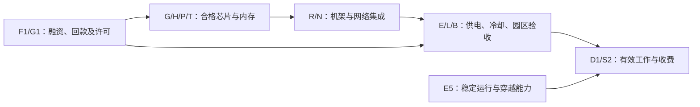

# AI产业链瓶颈与反证指标总表

研究截止日期：**2026年10月10日**（美国洛杉矶当地日期）。仅使用截至该日可取得的外部公开资料；未把本地既有研究作为输入。目录规则仅用于确定交付位置。

研究期：**2026年为Y0，2027年为Y1，2028年为Y2**。2026年已经披露的部分为实际观测，其余为管理层目标或研究推断；表内2027、2028年均为前瞻判断。公司财年不替代自然年：英伟达FY2027Q2截至2026年7月26日，美光FY2026Q4截至2026年9月3日。主要经营数据来自2026年6—9月的季度披露；最新监管档案查阅至10月10日，所引最新实质采购命令为9月29日；非正式线索日期为10月9日。电网资料含2027/28交付年规划，不能当成2026年实际用电缺口。

## 1. 截止日的主要判断

**AI供给确有约束，但不存在一条可以对全球、所有代际和所有客户同时成立的“唯一瓶颈”。** 最强的制造端证据是先进封装、测试设备和部分成熟制程电源管理芯片：台积电直接说明封装容量限制客户增长、测试设备短缺，并区分AI相关成熟节点短缺与其他成熟节点需求不强。它们比涨价或高毛利更接近“缺了就无法完成交付”的证据。[S01](https://investor.tsmc.com/english/encrypt/files/encrypt_file/reports/2026-08/3e494f0c14dd0890f897aa044415e21d93486cc4/TSMC%202Q26%20Transcript.pdf)

当前最值得优先判断的是六组机制：

1. **P1/T1/PM1：制造端约束具有串联关系。** 更多前道晶圆不一定增加完成测试的合格加速器；放大封装又可能增加基板、良率和测试压力。2027年可能改善，但没有足够公开有效产出数据证明将全面解除。
2. **M1/M2/S1：内存层的约束正在分化。** 三家大厂均披露HBM4出货或销售进展，不能继续沿用“HBM4完全没有量产供应”的判断；对同一客户的可替换容量仍未知。传统DRAM和NAND也出现涨价与供给压力，不能只研究HBM。[S05](https://news.skhynix.com/en/q2-2026-business-results/) [S06](https://news.samsung.com/global/samsung-electronics-announces-second-quarter-2026-results)
3. **E1/E2：区域可靠电力与接入资格可能决定最终上线。** PJM容量采购低于2027/28可靠性目标是直接规划证据；具体园区受阻多少MW尚未知。现场燃气可以绕过部分接入限制，却把约束转向燃机、燃气、冗余投资、排放许可和融资。[S15](https://www.pjm.com/-/media/DotCom/committees-groups/committees/mrc/2026/20260219/20260219-item-05---2027-2028-base-residual-auction-reserve-target-shortfall-report.pdf) [S35](https://www.iea.org/reports/key-questions-on-energy-and-ai/executive-summary)
4. **L1/R1/B1：机架到可服务集群的最后阶段，局部约束与改善并存。** Modine明确披露组件短缺限制产量并压低利润；微软披露主要地区GPU从到货到上线的时间已大幅缩短。两者适用供应链与客户不同，不能互相否定。[S27](https://www.sec.gov/Archives/edgar/data/67347/000110465926088230/mod-20260729xex99d1.htm) [S09](https://www.microsoft.com/en-us/investor/events/fy-2026/earnings-fy-2026-q4)
5. **F1/D1：融资和可收费使用量是扩建的经济约束。** 积压、签约电力和硬件收入不能代替已上线、已利用和已收款。当前没有证据认定大型云厂商整体需求不足，也没有可比数据证明全行业AI投资回报已经覆盖资本成本。
6. **G1/E5：政策与运行要求会改变同一硬件的交付价值。** 中国H200许可未等于广泛可交付销售；PJM大负荷切离事件提示电压、频率穿越能力可能成为新的工程和准入要求。后者截至截止日仍须区分实际事件与拟议规则。[S08](https://investor.nvidia.com/files/doc_financials/2027/NVDA-2027-Q2-10Q-Final-including-exhibits.pdf) [S18](https://insidelines.pjm.com/pjm-dominion-review-large-load-transfer-event/) [S20](https://insidelines.pjm.com/reliability-standards-to-manage-large-load-disconnection-events-proposed-by-pjm/)

价值捕获的方向也不统一：封装和测试改善可以增加前道与整机出货，却削弱个别部件的急单溢价；内存长期合同可能稳住卖方现金和最低价格，同时限制上行收益；冷却厂商自身缺关键组件时，稀缺收益可能流到其上游。最关键的反证是：**同口径交期缩短是否伴随合格出货、客户上线和收费使用增加，还是伴随取消、迁移与库存积累。**

尚未解决的核心缺口是合格HBM位供给、各类封装的有效产出与良率、按产品的测试小时、真实光器件成交价、受阻园区的确定MW、按代际的出租利用率及二手残值。没有这些分母，不给全球“解除后多交付多少GPU”的精确数字。

## 2. 判断单位与证据规则

本报告把结果分为三层：**硬件出货、通过验收并可服务的系统、完成并可收费的有效工作**。在指定产品、客户和地区下，若取消某项约束能提高后两层之一，才认定其具有系统约束意义；只影响采购价格或卖方利润的紧张另行标注。

证据等级：

- **A1**：已有数量或实际事件、交易阻断证据；仍需说明它直接证明的是哪一层结果。
- **A2**：生产方或买方直接说明产能、认证或组件限制交付，但没有公开损失数量。
- **B**：实际收入、积压、价格、库存或供给进展；可以支持紧张，不能单独确定系统瓶颈。
- **C/U**：技术路线、目标或非正式线索／缺少直接证据。

“严重”仅用于特定市场的关键交付门槛；“局部”不代表全球短缺；“缓解”不等于消失；“过剩”需要同口径闲置、取消或持续库存证据；“不确定”不是默认看多。不同地区的“有电”包括不同的容量保障、可中断条件、配电能力与价格，不能只比较电价。

预测范围若有数字，明确是**外部披露原范围、工程参数条件范围、研究情景示例或主观概率区间**。本报告没有建立统计置信区间，也没有用公司收入增长反推芯片数量。

## 3. 约束状态总表

下表“当前”指截止日最新已取得观测；“2026余期”是剩余期间估计。2027、2028为在需求仍扩张、没有重大地缘中断条件下的基准方向，不是已兑现状态。证据与反证均使用同一标识。

| 标识、对象与范围；性质 | 限制结果与证据强度 | 当前状态 | 2026余期 | 2027 | 2028 | 持续／缓解／转移判断 | 受益、受压与迁移条件；最早验证 |
|---|---|---|---|---|---|---|---|
| **D1** 付费需求、利用率；全球但买方分层；需求/价格 | 有效使用与回款；大型云容量不足A2，行业ROI为U | 大厂局部供给受限；长尾经济需求不确定 | 不确定、分化 | 不确定、分化 | 可持续扩张或局部过剩均可能 | 不能用订单总额判断终端需求；效率和降价可能扩大使用，也可能降低收入 | 新容量快速收费利于运营商；取消压上游。需同代际利用率、价格与收款；2026Q3披露 |
| **C1** Blackwell/Blackwell Ultra、Rubin；先进前道GPU；全球非受限客户；产能/交付 | 合格加速器出货；收入B、生产进展B，前道单独受阻数量U | 新旧代际局部；未证明所有GPU普遍缺货 | Rubin爬坡与既有代际并存 | 新代际局部；已成熟代际可能缓解 | 不确定，允许旧代际过剩 | 约束可能来自P1/M1/T1，不能重复归因于晶圆 | 前道/整机放量；旧卡租金可能受压。需合格整机验收；2026Q3—2027H1 |
| **C2** TPU/Trainium等ASIC与软件迁移；特定云与工作负载；认证/有效使用 | 替代路线的可用工作；实际商业收入B，跨工作负载替代U | 部分已商用；局部适配约束 | 局部 | 局部、扩展 | 可缓解部分GPU议价约束 | 绕过GPU品牌依赖，通常仍需要HBM、封装与电力 | 云自研与定制芯片链受益；迁移成本压买方。需同质量任务成本和客户复购；2027 |
| **M1** HBM3E/HBM4、后续HBM4E；韩/美厂及指定平台；产能/认证 | 指定BOM能否完成；出货和合同B，厂商有限供给A2 | HBM4已有供给；追加/认证容量局部；全行业缺口未知 | HBM4爬坡；3E不能外推4 | 新增未锁供客户可能持续受限 | 不确定；4E可能重新形成局部约束 | 多供应商出货已是进展，客户级互换和合格位量才是解除 | 合格供应商受益；未获分配买方受压。转向P1/T1/M2；2026Q4—2027H1 |
| **M2** DDR5高容量RDIMM、SOCAMM/LPDDR；服务器市场；产能/价格/产品配额 | 容量配置、成本和有效吞吐；有限产能A2、ASP变化B | 局部紧张；价格上行已观测 | 局部 | 持续风险较高 | 不确定；新洁净室晚期贡献有限 | 不能把传统内存等同于已经过剩；价格与实际缺配置须分开 | 内存卖方；服务器买方受压，可能削减容量。缓解转向CPU、S2及需求；未来两个财季 |
| **P1** 大尺寸CoWoS-L等、EMIB/CoPoS替代；台湾及认证后端；产能/良率/认证 | 完成封装的AI芯片；直接限制客户增长A2 | 严重（相关大尺寸封装客户） | 持续 | 局部至严重；改善需证据 | 缓解或新代际局部并存 | 新线、OSAT、替代封装可能放量；不能以名义片数等比例换算大型封装 | 封装/设备受益；前道客户受压。解除转T1/P2/M1/E1；下次台积电电话会及2027客户出货 |
| **P2** 大尺寸高层ABF、低CTE T玻纤；日本/台湾供应链；材料/认证 | 合格基板及封装；材料作用C，2026交付损失U | 高端子项不确定；普通ABF不推定短缺 | 不确定 | 高端认证可能局部；数量未知 | 可能缓解；新尺寸仍不确定 | ABF厂产能、玻纤和玻璃芯基板不是同一供给；需分别认证 | 已认证材料/基板供应商；封装厂受压。转向翘曲、良率和测试；2026Q4起客户确认 |
| **T1** SoC/高功率测试、存储测试、SLT；制造后端；设备/测试小时 | 合格芯片放行；短缺A2，设备销售B | 局部且已直接确认 | 持续 | 扩产缓解与复杂度上升相抵 | 不确定、可转移至接口/程序 | 测试机台数增加不等于可用测试小时增加 | ATE/接口/服务受益；晶圆与封装客户受压。需并行度、测试时长及出货；2026Q4—2027 |
| **PM1** 0.18µm/90nm等AI电源管理IC；指定电源产品；物理产能/认证 | 板卡或电源BOM完整性；厂商直接称短缺A2 | 局部 | 局部 | 可能缓解，依赖认证转厂 | 不确定；不外推全部成熟节点 | 小金额组件可卡住大系统；其他成熟节点可同时闲置 | 合格PMIC供方；电源/服务器买方受压。转E4/L1；2026Q4 |
| **R1** 高密度液冷机架与整机集成；指定OEM/云；交付/验收 | 出货到上线；订单B、买方上线改善A2，OEM交付损失U | 局部；头部客户已有改善 | 局部改善 | 成熟代际缓解，新代际重启认证 | 局部或缓解 | 工厂交付完成不是园区上线完成 | 有部署服务能力OEM；现场工程/运营商受压。转E1/L1/B1/N1；未来两个季度 |
| **N1** 机架内NVLink/铜连接、交换硅、以太网/UALink适配；指定拓扑；认证/交付 | 集群可工作与通信效率；产品/收入B，普遍缺货U | 不确定、局部适配 | 局部 | 局部；替代生态成熟度不一 | 可缓解、亦可能向光互联转移 | 标准可用不等于原系统能直接换装；铜受距离/信号预算条件限制 | 芯片/系统软件供方；跨平台迁移买方受压。需端到端集群验收；2027 |
| **N2** 800G/1.6T可插拔、EML/CW激光、CPO/OCS路线；光网络；产能/认证/价格 | 端口交付和功耗；收入B，10月线索C，系统停交U | 高速器件局部风险；未证全球光模块统一短缺 | 不确定、爬坡 | 1.6T及光源可能局部紧张 | 替代分化，不能统一判过剩 | CPO/LPO可能减少DSP价值，却增加光源、封装与维修要求 | 受益随路线变化；模块商未必保留全部溢价。需合格端口/成交价；2026Q4—2027 |
| **S1** NAND/数据中心SSD；全球，企业级产品单列；产能/价格/认证 | 存储配置与成本；实际价格B、厂商供给有限A2 | 局部价格紧张；系统阻断量未知 | 局部 | 需求与供给仍可能偏紧 | 不确定，晚期新厂不是全年供给 | 新NAND位元不等于认证企业SSD；消费端和服务器端不混算 | NAND/企业SSD供方；系统买方受压。转S2及网络；未来两个财季 |
| **S2** KV缓存、CPU/DRAM/SSD数据路径；特定长上下文/并发任务；带宽/时延 | 有效工作量；产品出货B，全行业瓶颈U | 工作负载局部；量化缺口未知 | 局部 | 卸载缓解HBM容量或转为I/O约束 | 不确定，架构可改变 | 数据放到SSD不等于具有HBM访问性能 | 数据路径软硬件供方；低效部署买方受压。需同质量p99与单位成功任务成本；2026Q4起 |
| **E1** 电网接入/可靠容量/服务条件；重点美国PJM；物理/政策/交付 | 最终可服务MW；资源充裕度A1，园区延期量U/B | 局部；不是美国全面停电 | 局部 | 部分新负荷严重受限风险 | 持续或地域迁移 | 保供权、输电、申请去重与项目真实进度分开；IRAS尚按提案处理 | 有电力权与新供给者；园区/云买方受压。绕过转E2/E4/F1；2026Q4审查、2027-02-28采购机制节点及后续商运 |
| **E2** 燃机/现场燃气/新增可靠发电；美国重点、设备全球；产能/施工/成本 | 可承担负荷与上线时间；设备预订B、工程模型C | 局部设备与项目约束 | 局部 | 持续；绕过速度未获普遍证实 | 产能扩张后仍可能局部 | 燃机出厂后还有气源、施工、冗余、许可；不能只看GW订单 | 设备/服务/气源供方；买方承担冗余和燃料成本。转B1/E4；2027机组交付与商运 |
| **E3** 既有核电复机/增容与新SMR；美国项目级；许可/工程 | 新增可靠供给；许可进展B、未商运项目C | 局部方案；新增供给尚未兑现 | 不确定 | Crane等复机可能改善局部 | 局部；不能靠新SMR默认全面解除 | 复机与新建SMR的时间和规模不同；条件性购电不是新发电 | 电站/长期电价合同方；付费方承担期限与项目风险。转输电/配电；2027项目商运 |
| **E4** 变压器、开关柜、UPS及站内配电；美国/全球；设备/认证/价格 | 送电及高密度承载；积压B，具体产品停交量U | 局部紧张可能，需SKU确认 | 局部 | 扩产改善或订单增长相抵 | 局部/缓解不确定 | 电气积压含非AI和并购；不是某型号变压器交期 | 合格设备和服务供方；工程方受压。转E1/L1；2026Q3—2027 |
| **E5** 大负荷电压/频率穿越、快速切离；PJM/Dominion；运行/工程/拟议政策 | 稳定运行；事件A1，新增交付门槛U | 已有局部运行事件；准入影响不确定 | 标准制定中 | 可能新增验收/改造约束 | 若改造有效可缓解 | 不能因事件已受控就忽略集体切离，也不能说已导致大规模停服 | 控制/储能/电源服务方；运营方受压。转E4/F1；拟2026年11月申报 |
| **L1** 液冷CDU、冷水与热排出系统；特定产品/供应链；组件/产能/认证 | 冷却产品产出、密度与验收；实际限制A2 | 局部，已有季内改善 | 局部改善可期 | 新产线及认证有望缓解 | 成熟产品缓解；新密度仍可能局部 | 机架液冷与最终向环境排热是两层；短缺收益可能在更上游 | 组件/系统/服务供方；冷却厂和运营商受压。转B1/E4；2026后续财季、2027Q2新线 |
| **B1** 土建、工程人员、许可/水资源与集成验收；园区地域；工程/政策 | 完整上线；买方改善B/局部A2，全球工期分布U | 局部；部分头部流程显著改善 | 局部 | 地域迁移后可能重现 | 局部或缓解 | 拿地和建壳不代表液冷、电气、消防、用水与系统可验收 | 有人员/许可的工程方；开发商受压。转E1/L1/R1；2026Q4起园区进度 |
| **F1** 项目融资、合同回款、GPU残值；大厂与独立云分开；融资/需求/成本 | 开工、持续服务及利润；利息/合同A1/B，行业断供U | 大厂有融资能力；独立云经济风险局部 | 不确定、分化 | 取决于交付、收费和续借 | 残值与合同期限风险更显著 | 担保可解融资约束，也可把风险留在硬件卖方；折旧寿命不是市场残值 | 融资方/已锁供买方；高杠杆运营商/担保者受压。需实际现金与二手成交；每季度 |
| **G1** H200/其他受控产品对华及目的地许可；政策/价格 | 合法销售、进口与验收；实际限制A1 | 中国指定产品严重；其他市场不同 | 不确定 | 不确定 | 不确定 | 一侧许可不等于两侧可交付；型号、客户和测试条件逐单确认 | 获许可/本地替代供方；受限买方和原供方受压。转国产认证/性能/成本；政策实时、季度实际销售 |
| **G2** 台湾等地域集中与跨境物流尾部风险；全球；地缘/事件 | 多环节可能同时中断；本次未确认新增停交U | 无已确认广泛中断；集中风险存在 | 不确定 | 不确定 | 不确定 | 不给无证据的战争发生率；海外扩厂不等于同代际整链可切换 | 真正合格第二来源受益；集中链条受压。需事件与实际产出；事件发生即核查 |

本表包含**24个候选分析单元**，并不认定24个瓶颈。尤其P2、N1、N2、S2、B1的全球量化、F1的行业性融资断供、G2的实际中断均未获直接确认。对这些项目保留“不确定”是研究结论的一部分。

## 4. 决定结论的当前观测与可比前期

F=披露事实（包括厂商自行披露的生产状态）；M=管理层目标或评价；D=直接计算；I=研究推断；U=未知。F不自动等于已经独立审计的产能。下表只在可比口径存在时比较；目标不填进实际产出栏。

| 标识 | 当前及可比前期的原始观测 | 对应经济期间；公开日期 | 类型 | 能支持什么／不能支持什么 |
|---|---|---|---|---|
| D1/E1 | 全球数据中心电力需求**485 TWh（2025）**；同比**17%**，AI数据中心电量同比**50%**。2026数据在该报告中为估计 | 2025；2026-04-16，[S35](https://www.iea.org/reports/key-questions-on-energy-and-ai/executive-summary) | 机构观测估计；非电表普查 | 支持需求强与效率未使总电量下降；不推导2026—2028实际交付总量，也不把950 TWh的2030模型值当2028值 |
| P1 | 台积电明确称后端封装容量限制客户增长，欢迎替代路线释放前道业务；未披露合格大尺寸封装月产量、良率或延期数量 | 2026Q2状态；2026-07-16，[S01](https://investor.tsmc.com/english/encrypt/files/encrypt_file/reports/2026-08/3e494f0c14dd0890f897aa044415e21d93486cc4/TSMC%202Q26%20Transcript.pdf) | A2/F/M；数量U | 直接支持相关客户存在瓶颈；不能据行业“晶圆/月”传闻计算芯片数 |
| P1 | 4月称CoPoS在建试验线，预计约两年后生产；7月对玻璃等新路线称约再一年成熟 | 2026Q1/Q2前瞻；4月16日/7月16日，[S02](https://investor.tsmc.com/english/encrypt/files/encrypt_file/reports/2026-04/3cef85204275f94fd111485cfdf4adb3c0263c45/TSMC%201Q26%20Transcript.pdf) [S01](https://investor.tsmc.com/english/encrypt/files/encrypt_file/reports/2026-08/3e494f0c14dd0890f897aa044415e21d93486cc4/TSMC%202Q26%20Transcript.pdf) | M | 问题和技术范围不同，不能写成CoPoS量产已从2028提前到2027 |
| T1/PM1 | 台积电称测试设备短缺；0.18µm、90nm等AI电源管理芯片短缺，同时其他成熟节点并非普遍短缺 | 2026Q2；2026-07-16，[S01](https://investor.tsmc.com/english/encrypt/files/encrypt_file/reports/2026-08/3e494f0c14dd0890f897aa044415e21d93486cc4/TSMC%202Q26%20Transcript.pdf) | A2/F/M | 直接机制证据；并未量化机架损失或全部成熟制程价格 |
| T1 | Advantest季度销售**JPY 367.5 billion**，同比**39.3%**。全年销售预测由4月**JPY 1,420.0 billion**升至**JPY 1,714.0 billion** | 实际截至6月30日；预测财年截至2027-03-31；7月披露，[S29](https://www.advantest.com/en/investors/financial-highlights/review/) [S30](https://www.advantest.com/en/investors/financial-highlights/forecast/) | F/M | 实际销售与预测上调分列；预测金额不是测试机台产能或新增测试小时 |
| M1 | SK海力士在2026Q2开始HBM4量产出货；三星Q2扩大HBM4销售；美光9月称HBM4爬坡执行良好 | 2026Q2及截至9月3日季度；7月29/30日、9月30日，[S05](https://news.skhynix.com/en/q2-2026-business-results/) [S06](https://news.samsung.com/global/samsung-electronics-announces-second-quarter-2026-results) [S03](https://s25.q4cdn.com/621799436/files/doc_financials/2026/q4/Q4-FY26-Prepared-Remarks.pdf) | F/M；产量U | 推翻“没有商业HBM4供应”；不能证明三家对同一系统都已合格、也不能证明追加供应充足 |
| M1/F1 | 美光已为**绝大多数2027日历年HBM位供给**达成协议，并称同比显著涨价；精确覆盖率未披露 | 2027合同安排；2026-09-30，[S03](https://s25.q4cdn.com/621799436/files/doc_financials/2026/q4/Q4-FY26-Prepared-Remarks.pdf) | F/M；覆盖率U | 支持未锁供客户的分配风险；不把“绝大多数”改成90%或100%，也不等于供方违约或客户未满足 |
| M2 | 美光DRAM收入**USD 39.8 billion**；环比**27%**。位出货环比“中个位数”，价格环比“高十几” | FY2026Q4相对Q3；2026-09-30，[S03](https://s25.q4cdn.com/621799436/files/doc_financials/2026/q4/Q4-FY26-Prepared-Remarks.pdf) | F（原范围） | 涨价与位量均有观测；这是公司DRAM组合，不是同规格DDR5合同价指数 |
| S1 | 美光NAND收入**USD 14.1 billion**；环比**42%**，位出货约**10%**，价格约**30%** | 同上，[S03](https://s25.q4cdn.com/621799436/files/doc_financials/2026/q4/Q4-FY26-Prepared-Remarks.pdf) | F（原近似值） | 不把组合ASP当企业级同SKU涨幅；约1.10×1.30=1.43与收入增长大致一致，差异允许舍入/组合 |
| M2/S1 | 美光库存**USD 10.4 billion**；DIO **129天**，环比增加**9天**（前季120天为D）；公司说明提前备货及计入库存的激励成本等因素 | FY2026Q4；2026-09-30，[S03](https://s25.q4cdn.com/621799436/files/doc_financials/2026/q4/Q4-FY26-Prepared-Remarks.pdf) | F/D/M | 库存增加已发生，但不能独自证伪短缺；需看成品结构、客户取消及价格/出货组合 |
| M1/M2 | 美光新加坡HBM封装初始产出目标**2027年初**、台湾Tongluo显著出货目标**2027年中**、日本扩建初始产出**2028年末**；新加坡新NAND厂初始产出目标**2028H2** | 前瞻；2026-09-30，[S03](https://s25.q4cdn.com/621799436/files/doc_financials/2026/q4/Q4-FY26-Prepared-Remarks.pdf) | M，非已产出 | 2027—2028有效供给要逐线验证；“首次产出”不等于全年满产 |
| M2/S1 | 美光总收入原值**USD 54,229 million**，前季**41,456 million**；GAAP毛利率**86.8%**，前季**84.6%**；non-GAAP为**87.0%**、**84.9%** | 截至9月3日与5月28日季度；9月30日，[S04](https://investors.micron.com/news/press-release/2026/Micron-Technology-Inc--Reports-Record-Fiscal-Fourth-Quarter-and-Full-Year-2026-Results/) | F | 是公司组合价值捕获证据；不能等同于HBM单品利润，也不混合GAAP/non-GAAP |
| C1 | 英伟达数据中心收入**USD 89.0 billion**，同比**117%**、环比**18%**；公司总GAAP毛利率**75.0%**，前季**74.9%**；称Rubin进入全面生产 | 截至2026-07-26季度；8月26日，[S07](https://investor.nvidia.com/news/press-release-details/2026/NVIDIA-Announces-Financial-Results-for-Second-Quarter-Fiscal-2027/) | F/M | 强出货与价值捕获；收入包含系统/网络、产品组合变化，不能据此算GPU数量或Rubin行业验收比例 |
| C2/N1 | 博通AI半导体收入**USD 16.7 billion**，同比**221%**、环比**54%**；包含定制加速器和网络 | 截至2026-08-02季度；9月2日，[S12](https://investors.broadcom.com/news-releases/news-release-details/broadcom-inc-announces-third-quarter-fiscal-year-2026-financial) | F | ASIC已大规模商业化；不能把全额当XPU收入、市场份额或通用GPU可替换工作量 |
| R1/D1 | 戴尔AI订单**USD 60.9 billion**、AI收入**16.4 billion**、期末积压**95 billion**；AI收入较上年同期**8.2 billion**增长100% | 截至2026-07-31季度；9月1日，[S13](https://www.dell.com/en-us/dt/corporate/newsroom/announcements/detailpage.press-releases~usa~2026~09~dell-technologies-delivers-second-quarter-fiscal-2027-financial-results.htm) | F | 金额积压约为当季收入5.8倍（D），**不是5.8个季度交期**；缺少单位、BOM、验收和取消结构 |
| D1/R1/B1 | 微软Azure及其他云服务收入同比**43%**；管理层称需求继续超过可用容量、新增容量迅速变现。主要地区GPU dock-to-live较上一财年近乎减半 | 截至6月30日季度/财年；7月29日，[S09](https://www.microsoft.com/en-us/investor/events/fy-2026/earnings-fy-2026-q4) [S10](https://www.microsoft.com/en-us/Investor/earnings/FY-2026-Q4/press-release-webcast) | F/M | 支持买方局部供给不足和流程改善；比较范围是主要地区，未给绝对天数或全行业分布 |
| D1/R1/E1 | 微软连续两季均称新增**1 GW容量**：FY2026Q3与Q4；Q3主要地区dock-to-live相对年初减少近20%，Q4称相对整个上一财年减少近50% | 季度截至3月31日/6月30日；4月29日/7月29日，[S11](https://www.microsoft.com/en-us/investor/events/fy-2026/earnings-fy-2026-q3) [S09](https://www.microsoft.com/en-us/investor/events/fy-2026/earnings-fy-2026-q4) | F/M | 1GW按公司原“capacity”口径保留，不假定全部为新增AI IT负荷；两个交付时间降幅的基准窗口不同，不相加，也不做可比百分点趋势 |
| F1/D1 | 微软将建筑/数据中心估计使用寿命从**15年改为25年**，更多租赁转为经营租赁；2026 CapEx口径变为约**USD 175 billion**，并称基础投资预期未改 | FY2027开始生效的会计变更及2026指南；7月29日，[S09](https://www.microsoft.com/en-us/investor/events/fy-2026/earnings-fy-2026-q4) | F/M | 下调金额不能直接当取消投资；只涉及建筑等资产，不是GPU寿命从15年延至25年 |
| F1/E1 | CoreWeave在运电力**1.5 GW**，签约电力约**3.7 GW**；积压约**USD 104 billion**，有交付/服务可用条件。季度收入**USD 2,575 million**，净利息费用**640 million**、净亏损**626 million**；去年同期分别1,212/267/290 million | 2026Q2；8月11日，[S14](https://investors.coreweave.com/news/news-details/2026/CoreWeave-Reports-Strong-Second-Quarter-2026-Results/default.aspx) | F | 利息/收入约24.9%（D）；在运与签约差额不是闲置电力，二者比值不是利用率 |
| E1/E2 | PJM 2027/28累计采购**145,777.1 MW UCAP**，低可靠性目标**6,517 MW UCAP**；IRM **14.4%**，目标**20%** | 2027/28交付年拍卖；报告2月9日、会议材料2月19日，[S15](https://www.pjm.com/-/media/DotCom/committees-groups/committees/mrc/2026/20260219/20260219-item-05---2027-2028-base-residual-auction-reserve-target-shortfall-report.pdf) | F（采购结果）/规划口径 | 不是2026停电6.517GW；UCAP、发电铭牌与数据中心IT MW不能直接等同 |
| E1/D1 | PJM 2026预测加强近端确定承诺要求；9月29日启动2027预测的大负荷审核，并引入独立顾问评估兑现因素 | 规划口径变更；1月14日/9月29日，[S16](https://insidelines.pjm.com/pjms-updated-20-year-forecast-continues-to-see-significant-long-term-load-growth/) [S17](https://insidelines.pjm.com/pjm-kicks-off-annual-process-of-vetting-large-load-requests/) | F/M | 预测下修可能是去重、折扣与承诺标准变化；不必然是已经发生的需求取消 |
| E2 | GE燃气设备积压加槽位预留由**100 GW增至116 GW**；目标2026Q3达到**20 GW年化产出**、2028达到**24 GW** | 2026Q2及目标；7月22日，[S21](https://www.gevernova.com/news/press-releases/ge-vernova-reports-second-quarter-2026-financial-results-raises-2026-financial) | F/M | 两个产出数字是目标、不是全年实际投运；116GW混合积压和预留，不能算统一排队年限 |
| E3 | Crane **835 MW**；燃料许可修改及容量接入权转移取得进展，目标2027复机，尚未新增商运 | 2026Q2披露及项目现状；8月6日，[S22](https://investors.constellationenergy.com/news-releases/news-release-details/constellation-reports-second-quarter-2026-results) [S23](https://www.constellationenergy.com/about/locations/crane-clean-energy-center.html) | F/M | 是具体复机方案，不是新建SMR已规模化 |
| E4 | Eaton电气总体积压同比**43%**；Electrical Americas积压**33%**；电气滚动12个月book-to-bill **1.2**；Global收入增长含Boyd Thermal并购 | 2026Q2；7月31日，[S24](https://www.sec.gov/Archives/edgar/data/1551182/000155118226000027/etn06302026exhibit99.htm) | F | 不把总电气积压归属为变压器或AI；book-to-bill是滚动12个月，非单季 |
| E5 | PJM总负荷在事件中由**99,984 MW降至96,205 MW**；报告约**3,800 MW**数据中心切离，事件已被调度控制；9月提出穿越要求 | 事件7月22日；8月11日/9月10日，[S18](https://insidelines.pjm.com/pjm-dominion-review-large-load-transfer-event/) [S20](https://insidelines.pjm.com/reliability-standards-to-manage-large-load-disconnection-events-proposed-by-pjm/) | F/拟议政策 | 负荷切离不等于计算服务同量停机；约3800是事件总观测，不叠加第一/第二波而制造另一总数 |
| L1 | Modine披露组件短缺限制生产，数据中心收入同比**90%**同时利润率暂受压；公司称季度内逐步改善。Vertiv收入**USD 3,274 million**，有机增长**18%**，调整后营业利润率**22.6%**，同比增410bp | 2026Q2经营期；7月29日，[S27](https://www.sec.gov/Archives/edgar/data/67347/000110465926088230/mod-20260729xex99d1.htm) [S25](https://investors.vertiv.com/news/news-details/2026/Vertiv-Reports-Strong-Second-Quarter-2026-with-Diluted-EPS-Growth-of-53-Adjusted-Diluted-EPS-Growth-of-60-Raises-Full-Year-2026-Guidance-Across-All-Key-Metrics/default.aspx) | F/M | 支持局部瓶颈、不同企业价值捕获方向不同；不能用一家改善宣布全行业解除 |
| L1 | Vertiv拟投入约**USD 50 million**扩建俄亥俄设施，目标**2027Q2**投运，扩液冷/冷水产能 | 2026-03-30公告，[S26](https://www.vertiv.com/en-us/about/news-and-events/corporate-news/2026/vertiv-to-expand-ohio-manufacturing-to-boost-u.s.-production-of-critical-thermal-management-technologies-for-ai-data-centers/) | M | 投资与投运目标尚不提供年产多少MW冷却能力 |
| N1/N2 | Arista收入**USD 3.036 billion**，环比**12.1%**、同比**37.7%**；发布1.6T/LPO平台。Lumentum季度收入**USD 1.01 billion**，前季**808.4 million** | 2026Q2及Lumentum截至6月27日季度；8月4日/11日，[S31](https://www.arista.com/company/news/press-release/24401-pr-20260804) [S32](https://investor.lumentum.com/financial-news-releases/news-details/2026/Lumentum-Announces-Fourth-Quarter-and-Full-Fiscal-Year-2026-Results/default.aspx) | F/产品披露 | 网络放量可见，但成交价、组件库存、客户停交数量未公开；技术标称功耗不能等同整园区节能 |
| G1 | BIS于1月13日允许H200/MI325X等逐案审查；英伟达随后披露H200已获部分美方许可却受中方限制，季度相关销售不足数据中心收入**1%**，相关上半年减值/采购义务费用**USD 0.4 billion** | 政策1月13日；截至7月26日经营期，8月26日签署10-Q，[S36](https://media.bis.gov/sites/default/files/documents/DoC%20Revises%20License%20Review%20Policy%20for%20Semiconductors%20Exports.pdf) [S08](https://investor.nvidia.com/files/doc_financials/2027/NVDA-2027-Q2-10Q-Final-including-exhibits.pdf) | F | 许可开放到实际交付之间仍有阻断；本次不推定后续每笔交易的法定许可状态 |
| E1/F1 | FERC于9月29日接受PJM保底可靠容量采购RBP，但暂停五个月，生效日为**2027-02-28**，仍受退款及后续程序约束；原定9月30日采购没有启动。IRAS是**ER26-3515**另一申请，不能混为同一批准 | 9月29日命令；9月30日说明；官方目录10月10日查阅，[S37](https://insidelines.pjm.com/ferc-accepts-pjm-reliability-backstop-proposal/) [S38](https://www.pjm.com/library/filing-order.aspx) | F；新增产出U | 已触发对“2026采购立即带来新增供给”的反证；未来要看新时间表、成本归属、实际中标和商运，命令本身不增加MW |

金额保留原币；没有把KRW/JPY财务数字换成美元再比较毛利。价格采用厂商原范围与“约”限定，不把“高十几”伪装成某个精确百分点。美光财年与自然年期间并不一致，年度同比收入也不能当作产量增长。多数比较为同一披露内的前季或上年同期，未借用本地历史报告补齐。

## 5. 约束如何缓解、转移及改变利润

### 5.1 P1—T1—P2—PM1：完成芯片的能力比单项扩产更重要

台积电欢迎其他封装路线、并认为这有利于自己的前道业务，是一个重要的反共识机制：**封装稀缺收益的竞争与前道晶圆利润增长可以同时发生**。不能把替代后端进入简单写成台积电整体利润下降。这个判断针对已能保持前道订单、并让客户最终完成封装的情况；如果客户同时改用其他前道厂，结论需要重算。[S01](https://investor.tsmc.com/english/encrypt/files/encrypt_file/reports/2026-08/3e494f0c14dd0890f897aa044415e21d93486cc4/TSMC%202Q26%20Transcript.pdf)

大封装的名义产能需要依次乘以产品分配、面积/尺寸适配、良率和认证通过比例。没有相应分母时，同为“增加若干晶圆/月”的扩产不能同比例计为加速器供给。测试又存在独立门槛：更复杂的芯片若测试时长、功耗或系统级验证增加，机台数上升也可能仅抵消每颗芯片所需资源增长。Advantest已把复杂度列为需求驱动，但销售金额不提供有效测试小时。[S29](https://www.advantest.com/en/investors/financial-highlights/review/)

解除P1后，最先要核查T1与P2；PM1则可能卡住随后板卡和电源的完整BOM。不同成熟节点有闲置能力也不代表某电源芯片能立即转厂，需要设计、工艺、封装及可靠性再认证。买方收益是更少的停线和较快出货，不必然是每颗芯片采购价下降。卖方能保留溢价，需要已经锁定的价格、分配权和认证壁垒，而非只靠“仍在短缺”。

P2本次只确认材料功能，未确认2026年某客户因T玻纤缺货而减少了多少芯片。Nittobo公开报告说明低热膨胀玻纤用于封装、高频低损耗材料用于网络等不同用途；普通ABF、T玻纤和玻璃芯基板不能混成同一产能口径。公司2026年IR目录可定位新材料披露，但相关PDF正文未能完整取得，因此不采用媒体转述的份额或倍增产能作为确定值。[S34](https://www.nittobo.co.jp/eng/ir/pdf/Nittobo_Integrated-Report_2025.pdf)

### 5.2 M1/M2/S1/S2：更大的内存需求不只留在HBM上

HBM4已经有多厂商出货进展，这是认证解除的一部分。仍欠缺的是**同一平台、同一速度/层数、合格良率下、同一时间可交付多少位**，以及客户是否能在不改变板卡和封装的情况下替换。已签约也可能只是供给被提前分配，不证明现有买方缺货。持续性判断应特别区分已签长约大客户与追加采购的新客户。

普通DRAM和NAND的当前涨价不能全部归为结构壁垒，也不能因它们过去是周期品就认为2027必然供给过剩。新增HBM消耗晶圆、后端和工程资源，长上下文及并发又扩大主存/存储需求；客户可能降低每台配置、改变卸载方式，或因成本取消采购。这里需要价格、位量、实际配置和取消同时观察，单看ASP不够。

**HBM重要性与利润排序并非同一件事。** 美光披露CMBU毛利率为83%、CDBU为90%，并解释前者更高的HBM组合抵消了涨价收益；这挑战了“HBM天然比普通内存更赚钱”的笼统判断，但不能从两个业务单元算出HBM单品毛利率。其26份SCA预计覆盖至2030期间超过35%的收入，带价格框架、部分带上下限；这是管理层估计与合同机制，不是2027已有35%收入保底。[S03](https://s25.q4cdn.com/621799436/files/doc_financials/2026/q4/Q4-FY26-Prepared-Remarks.pdf)

对S2，KV缓存卸载可以缓解HBM容量，却可能提高CPU主存、PCIe、SSD随机读取或网络压力。美光已披露面向KV缓存应用的产品出货，证明路径在落地；没有端到端延迟和单位成功任务成本，不能认定“SSD普遍替代HBM”。[S04](https://investors.micron.com/news/press-release/2026/Micron-Technology-Inc--Reports-Record-Fiscal-Fourth-Quarter-and-Full-Year-2026-Results/) 量化、缓存压缩和模型改进也须在相同质量、上下文和并发下比较；节约单任务资源后，用户可能增加调用，从而重新加重其他约束。

### 5.3 E1—E2—E3—E4—E5：接入、可靠供电和稳定运行是不同约束

PJM的容量拍卖没有达到可靠性目标，支持该区域新增负荷面临资源约束，**不证明2026年已经缺电停服**。还有两种容易被混淆的变化：申请去重/提高承诺标准会下调规划需求；新发电真实商运会增加有效供给。前者主要减少不确定项目，后者才直接提高可承担负荷。

IRAS/自带新增容量框架提出让部分新负荷在紧急时先减载，并重新分配新建供给成本。它是2026年8月13日的提案；本次未取得足够证据核实截至10月10日的最终FERC生效状态，故所有交付和经济影响按**条件性政策路径**处理，不能引用为已经普遍执行的法律标准。[S19](https://insidelines.pjm.com/pjm-proposes-framework-to-connect-data-centers-without-compromising-reliability-affordability/) 如果实施，可中断服务可能促成较早上线，却降低特定推理SLA、可收费利用与抵押价值。批训练通常更有调度余地，但检查点、截止时间和业务合同可能限制这种弹性。

另一项更近的进展是**RBP保底容量采购**：9月29日命令接受方案但暂停五个月，原定9月30日未启动，生效日期为2027年2月28日，并伴随退款及进一步程序。该案ER26-3380涉及的成本分配、输电退出责任和负荷服务实体抵押要求仍有后续审理；IRAS的ER26-3515不是同一个批准。委员意见也指出负荷增长者承担成本和预测质量的重要性；意见本身不是新的生效规则。即使采购启动，供给还需中标、建设、并网和商运，不能把“方案获接受”记为2026已增加电力。[S37](https://insidelines.pjm.com/ferc-accepts-pjm-reliability-backstop-proposal/) [S38](https://www.pjm.com/library/filing-order.aspx) [S39](https://www.ferc.gov/news-events/news/commissioner-sees-concurrence-pjms-reliability-backstop-procurement-er26-3380-000)

现场燃气把E1移向E2/B1/F1。IEA的可靠供电分析给出相对负荷**30%—70%**的冗余建设条件，说明“设备MW”不同于“可稳定供给负荷MW”。设备公司对2028年年化产出的扩张目标也不是气源、建筑或验收的完成证明。太阳能PPA、现有核电PPA可以改变成本与合同归属，若没有新增发电或新增输电能力，不自动增加系统净供给。[S35](https://www.iea.org/reports/key-questions-on-energy-and-ai/executive-summary)

E3要区分复机、增容与新SMR。Crane是有现有设施和明确规模的复机项目，燃料许可和容量权进展提高了兑现可能；新增电量仍要等待复机及运行验证。与之相比，SMR条件性购电协议不能按GW全额计入2027—2028供给。[S22](https://investors.constellationenergy.com/news-releases/news-release-details/constellation-reports-second-quarter-2026-results) [S23](https://www.constellationenergy.com/about/locations/crane-clean-energy-center.html)

E5的7月事件已被调度控制，没有依据声称发生相同比例的计算服务停机。但它暴露了大量数据中心同时转备用电源会反过来影响电网的问题。9月拟议标准涉及现有与未来负荷，预计11月向FERC提交；实际波形穿越、控制参数和改造成本应跟踪，不能只跟踪新增发电总量。[S20](https://insidelines.pjm.com/reliability-standards-to-manage-large-load-disconnection-events-proposed-by-pjm/)

### 5.4 L1/R1/B1/N1/N2：最有用的“交付”指标在客户侧

Modine的短缺在2026年二季度经济期（FY2027Q1）确实限制产出，同时收入高速增长、利润暂受压；这说明组件供应商可能比最终冷却厂更能捕获稀缺收益。其年度披露还说明部分原料转嫁存在数月到一年的滞后。季度内改善需要下一季量、利润和交付继续验证，不能把“供应已锁定”的评价当完全解除。[S27](https://www.sec.gov/Archives/edgar/data/67347/000110465926088230/mod-20260729xex99d1.htm) [S28](https://s205.q4cdn.com/270741342/files/doc_financials/2026/ar/Modine-2026-Annual-Report-Final.pdf)

Vertiv扩建投运与客户系统认证是不同节点。增加CDU/冷水设备产能，只解机架到设施回路的一部分；外部热排出、用水/消防许可、变压器、管路清洗和现场调试仍可能限制上线。微软主要地区dock-to-live近乎减半提供了买方侧改善证据，但没有公布绝对天数和所有地区分布，因此不能用于推导全行业工期缩短50%。[S26](https://www.vertiv.com/en-us/about/news-and-events/corporate-news/2026/vertiv-to-expand-ohio-manufacturing-to-boost-u.s.-production-of-critical-thermal-management-technologies-for-ai-data-centers/) [S09](https://www.microsoft.com/en-us/investor/events/fy-2026/earnings-fy-2026-q4)

网络上，NVLink、以太网、UALink和不同光互联路线不应按相同替代速度处理。Arista的LPO产品声称相较传统可插拔降低互联功耗约60%，只针对互联部分、规定产品比较，不是整机或园区节电60%，也没有证明全部链路在现有运维条件下可换装。[S31](https://www.arista.com/company/news/press-release/24401-pr-20260804) CPO可能降低电路径耗能、DSP需求，却增加激光、光封装与服务难度；OCS改变连接组织，也不等于所有光器件数量下降。

10月9日Lumentum公司媒体目录出现“产能售罄至2029”的采访标题；原视频全文未能取得。其利益关系为光器件供应商，产品边界、订单取消权、扩产基数及未满足需求量均未核实。这是一条有日期的线索，**没有升级为全行业光互联瓶颈证据**。已有季度收入增长支持商业放量，替代解释仍包括客户提前锁产能、少数规格集中或扩产滞后。[S33](https://www.lumentum.com/en/newsroom/in-the-news) [S32](https://investor.lumentum.com/financial-news-releases/news-details/2026/Lumentum-Announces-Fourth-Quarter-and-Full-Fiscal-Year-2026-Results/default.aspx)

### 5.5 D1/F1/G1/G2：可交付、可融资与可盈利不能互相代替

GPU整机销售、云合同、模型公司预付、项目担保可能连接成同一融资链。英伟达10-Q披露对SB Energy相关安排的担保上限**USD 105 billion**，对应约**4.25 GW IT负荷**的分期项目，首期预计在FY2029开始；担保随租约开始生效、仅在规定违约条件触发付款，并限定部分租赁/电力责任。这不是已经支出的1050亿美元，也不是2026年已建成4.25GW。[S08](https://investor.nvidia.com/files/doc_financials/2027/NVDA-2027-Q2-10Q-Final-including-exhibits.pdf) 它可帮助买方融资并锁定卖方平台，却让卖方承担新的对手方风险；不能只按硬件毛利评价项目。

CoreWeave的利息和净亏损是融资经济性的实际压力，不能据此认定公司已发生融资断供。需要比较在运电力转化为收入的进度、合同现金回款、实际借款利率及到期债务，而非只看调整后EBITDA。GPU的会计折旧与二手成交残值分别跟踪：技术换代可以降低老卡每瓦竞争力，但老卡仍可能因适合的任务和较低成本产生价值；本次未取得可比二手成交序列，故不估统一报废年限。

微软租赁分类变化已经使CapEx总额失去跨期直接可比性。判断需求转弱，需要把现金PP&E、融资租赁、经营租赁承诺和合同范围先统一，再看实际取消与新容量收费，不能把一个总额下降当反证。

G1给出另一个利润反例：英伟达称获许可H200需要先在美国检验、对应美国入境25%关税，且未能向客户转嫁。**政策放宽可能增加可卖数量，同时降低单笔交易经济性**；不能用“许可获批”替代交付或利润确认。[S08](https://investor.nvidia.com/files/doc_financials/2027/NVDA-2027-Q2-10Q-Final-including-exhibits.pdf) 这是特定公司、流程与披露期的实际经验，不推广为所有型号或未来交易的税率。G2则缺少本次已发生的大规模中断证据；所有替代供给须验证完整产业链和客户认证，不把海外厂开幕当全面地缘去风险。

## 6. 关键估计：量化可支持的边界

### 6.1 串联约束与有效工作模型

对固定代际、BOM与工作负载，把各环节折成同单位的可服务IT MW或可交付机架：

**可验收容量 Q ≤ min（合格加速器G、配套内存H、封装P、测试T、网络N、可靠电力E、冷却L、施工/集成B）**。

这是用于找项目最小约束的模型，不把不同厂商、不同地区的公开产能放到同一min里。有效工作量再乘以每MW在固定任务下的吞吐系数、可用率a和有效利用率u；收费量与收款还受合同和价格限制。只提高非最小项，系统交付增量可以为零。压缩单任务算力需求也可能释放现有容量，或吸引新需求把另一项压满。

图为机制关系，不代表全国或全球已经存在同样的最小约束。

### 6.2 能计算的交付与成本增量

| 关联约束与目标时期 | 数据或参数条件 | 直接计算／边界 | 交付和利润含义；主要未知 |
|---|---|---|---|
| E2，2027—2028现场供电 | IEA可靠供电冗余条件30%—70%；以100MW受保负荷作条件实例 | 需**130—170MW**现场发电容量；单按相同单位造价，发电设备投资比无冗余高30%—70% | 不代表所有项目配置；燃机类型、维护、气源及许可改变结果。冗余不是全年燃料消耗同比增加同一比例。设备供方收入机会增加，买方融资负担上升 |
| E2，2028相对2026目标 | GE年化设备产出目标24−20=**4GW/年**；假设这部分全部可用于所述现场路线且冗余适用 | 4/1.7—4/1.3=**2.35—3.08GW**可承担负荷的条件上限；实际AI净增量范围仍为**0至该上限** | 原数字为目标而非实际，且是全球设备产出；分配、建设、气源、是否替代旧机组未知，不能计为美国2028新增IT MW |
| E3，2027/2028复机 | Crane铭牌835MW；投运、可交付和是否已计入PJM采购是条件 | 项目额外铭牌供给**0—835MW**。若未计入原采购且信用容量不超过铭牌，最多相当于6,517MW UCAP缺口的**12.8%** | 12.8%是极限比较，**不是已填补比例**；已计入目标/拍卖则不可再加，UCAP与铭牌口径需核实。完整解除PJM缺口不能只靠此项目 |
| E1/L1，任一100MW园区 | 固定设施电力上限100MW；PUE由1.25降至1.15为研究参数示例 | IT预算80→**86.96MW**，增**6.96MW/8.7%** | 非行业预测。仅在G/H/P/T/N等也能增加且密度可承受时转为新增交付，否则是余量；冷却改善未必是电费减少，因为总电力上限固定 |
| E1/F1，2027一个季度 | 已有其余条件的25MW IT容量延迟一季，以2,190小时作季度近似 | 少**54.75GWh IT运行机会**；实际有效工作还乘可用率和利用率 | 不是实际销售损失；租赁、债务与交付违约成本可继续发生。季节与季度长度需按项目替换 |
| E2/F1，全年价格敏感度 | 100MW连续设施负荷、8,760小时；电价增加USD0.01/kWh为敏感度 | 年电费增加**USD8.76 million**；未计备用冗余、启停和燃料费用 | 对未锁电价买方是成本增量；卖方能否保留取决于合同、监管和燃料/资本支出。2028闰年按8,784小时为USD8.784 million |
| M1/M2/P1，采购成本 | 部件占采购BOM比例s、该部件价格变化x；s未知 | 总BOM变化近似**s×x**；若s=20%、x=−20%这一条件例成立，则成本下降4% | 不把20%视为实际份额；折旧、能源和资本成本另算。买方收入和云租价是否同步下降决定利润兑现 |
| P1/T1等，全年单位利润 | 研究压力例：单位售价100、变动成本60；价格降15%、数量增30%，成本暂不变 | 单位毛利40→25，总毛利40→**32.5（−18.75%）**，收入100→**110.5（+10.5%）** | 非任何公司预测。证明交付改善和收入增长也可能伴随供应商毛利总额下降；若单位成本下降或合同锁价，结果改变 |

上限不能相加：同一台机架可能同时受封装与电力限制；GE的潜在供给、Crane复机和同一PJM采购也可能重叠。更不能把设备年化能力、IT负荷、设施取电、年度TWh及可靠性UCAP之间直接换算成“行业新增GPU”。

### 6.3 2027与2028同期限情景比较

下表比较相同对象在**2027年底与2028年底**的基准、持续/恶化、缓解/绕过路径。数量只取可公开支持的项目规模或条件上限；没有合格产出和客户分配分母的环节，不能填写虚构的系统MW。范围是**条件/情景范围，不是置信区间**。“基准”表示当前资料支持的方向，并未赋予互斥行业情景权重。

| 关联约束；路径 | 2027同目标期的交付/有效使用结果 | 2028同目标期及相对变化 | 价格、成本和双方利润；决定上下界的条件 |
|---|---|---|---|
| **E1/E2/E3：基准**，PJM接入仍局部，采购与复机推进 | RBP在2027-02-28的机制节点之后还需实际采购/商运；没有证据给定2027新增可服务MW。Crane若成功商运，项目额外铭牌贡献最多835MW，净增需排除原已计入部分 | GE年化设备目标24GW，较2026年20GW目标多4GW；全年新增AI可用负荷未知。Crane持续运行贡献是同一存量，不能2028再加835MW | 电价/容量成本没有可比项目序列，具体涨跌未知。电源/设备卖方可能获量，园区承担接入、冗余及融资；已锁价格与未锁价格买方不同。[S15](https://www.pjm.com/-/media/DotCom/committees-groups/committees/mrc/2026/20260219/20260219-item-05---2027-2028-base-residual-auction-reserve-target-shortfall-report.pdf) [S21](https://www.gevernova.com/news/press-releases/ge-vernova-reports-second-quarter-2026-financial-results-raises-2026-financial) [S22](https://investors.constellationenergy.com/news-releases/news-release-details/constellation-reports-second-quarter-2026-results) [S37](https://insidelines.pjm.com/ferc-accepts-pjm-reliability-backstop-proposal/) |
| **E1/E2/E3：持续/恶化**，采购、气源/并网或复机延期 | 若Crane截至2027年底未商运，来自该项目的新增供给为0；对所有已具备其他条件但缺电项目，等待期间新增可验收容量可为0，延期MW总量未知 | 若到2028年底仍未商运，该项目贡献仍为0；若燃机产出未达24GW目标或现场配套延迟，4GW设备目标差额不能完整转化为负荷 | 电力溢价可能提高存量保供资产收益；没有合同价格就不量化。园区有持续资金/租赁成本；25MW延迟一季的54.75GWh运行机会与100MW每涨一美分的年电费敏感度见6.2，不能等同实际亏损 |
| **E1/E2/E3：缓解/绕过**，新增可靠电源及服务权真实完成 | Crane在2027商业复机且有实际新增可交付能力，相对未复机路径增加**0—835MW铭牌**，上界受信用容量、既有采购及输电限制；其他新增电源商运量未知 | 若GE额外4GW年化设备目标实现，并全部用于所述现场路线及完整商运，可承担负荷的工程条件量为2.35—3.08GW；**实际AI净增为0至该条件上限**，由分配、冗余、气源与建设决定 | 不能将此量全部归入PJM或IT。买方较快上线可提高收费与固定成本吸收，但现场设备冗余对应的设备资本增加30%—70%条件仍在；电源/设备卖方获量不证明超额利润长期保留 |
| **P1/M1/T1/PM1：基准**，扩产与复杂度/认证并行 | HBM4商业供给与已锁定2027供给增加可用性；封装及测试直接限制尚未量化解除。合格芯片和最终上线增量**未知**，不可用收入或名义晶圆片数替代 | 新增后端、CoPoS及内存扩建可能贡献，但部分初始产出在2028末；全年合格位量/大尺寸封装产出未知，新代际可再形成局部约束 | 美光称2027已协议HBM价格同比显著提高，是其合同判断，非行业统一涨幅；2028可比ASP未知。锁供卖方与未获份额买方的方向不同。[S01](https://investor.tsmc.com/english/encrypt/files/encrypt_file/reports/2026-08/3e494f0c14dd0890f897aa044415e21d93486cc4/TSMC%202Q26%20Transcript.pdf) [S02](https://investor.tsmc.com/english/encrypt/files/encrypt_file/reports/2026-04/3cef85204275f94fd111485cfdf4adb3c0263c45/TSMC%201Q26%20Transcript.pdf) [S03](https://s25.q4cdn.com/621799436/files/doc_financials/2026/q4/Q4-FY26-Prepared-Remarks.pdf) |
| **P1/M1/T1/PM1：持续/恶化**，大尺寸/测试资源增加超过扩产 | 对原来最小项仍不变的项目，新增其他资源释放的**系统交付增量可为0**；不是断言所有厂商停止增长。缺具体客户BOM和有效产出，无法给全球减少数量 | 若HBM4E或新封装认证不及预期，原产品缓解可与新产品受限并存；缺口与时间须按代际重新判断 | 买方急单、低配或资金占用成本可能增加；供方能否保留溢价取决于锁价、成本转嫁和认证，毛利变化百分比未知 |
| **P1/M1/T1/PM1：缓解/绕过**，合格供给与买方验收相互确认 | P1/T1/M1不再是最小项时，交付转受E1/L1/R1限制。增量上限由6.1的更新后最小能力与旧最小能力之差决定，所需量未公开 | 同样规则适用于2028；若P2/新代际再次成为最小项，新增名义供给不能全额计入。单任务效率改善需看真实工作负载 | 买方可放量；有竞争的封装/内存部件可能失去溢价，前道、集成及服务获量。BOM成本近似s×x、量增但总毛利降的条件演算见6.2；不冒充真实采购结构或公司预测 |
| **D1/F1：需求持续且回款支持**，物理供给改善 | 新上线容量快速形成收费工作与回款，才支持需求扩张；在运MW、积压美元或ARR不能单独给出有效使用增量 | 利用率、续约及融资条件继续支撑则有效工作扩张；同代际收费利用和残值未知，因此不设2028行业回报率 | 单位固定成本随有效工作增加而降；新建、自发电、液冷和融资增加的成本需另算。硬件担保与云采购义务可能支持买方融资，也保留卖方对手风险。[S08](https://investor.nvidia.com/files/doc_financials/2027/NVDA-2027-Q2-10Q-Final-including-exhibits.pdf) [S09](https://www.microsoft.com/en-us/investor/events/fy-2026/earnings-fy-2026-q4) [S14](https://investors.coreweave.com/news/news-details/2026/CoreWeave-Reports-Strong-Second-Quarter-2026-Results/default.aspx) |
| **D1/F1：需求/融资转弱**，交期变短但取消、租价和收费使用下滑 | 物理可交付容量可能增加而有效工作减少，方向不能用统一利好替代。有效工作增量仍需同质量吞吐×Q×u×a的真实参数 | 延续至2028会降低固定成本吸收、残值与续借能力；若低价刺激新使用，可能转为另一条恢复路径，未经观测不能指定渗透比例 | 同一资产固定成本K相同且其他参数不变时，单位有效工作成本按利用率的反比变化；买方采购更便宜但行业利润可降，上游可能量价同受压。取消条款、预付款及担保决定损失归属 |

这些路径可在不同客户和地区同时出现，不合计100%，也不把电力、HBM、封装事件当独立事件相乘。若要更新某项目的数量预测，必须取得同代际BOM、合格交付、园区服务权、验收和收费利用的共同分母；只增加某一环节的资源，增量可能由0开始，而不是必然落在正数区间。

对尚未公开的光器件ASP、封装同尺寸合同价、GPU租金/二手成交价，本报告不给统一涨跌幅。产品、地区、期间和合同条款一致后才代入价格；上下界宽或未知反映缺少分母，而非为了简洁把不同子市场合为一个小范围。

## 7. 重要事件概率与成功标准

下列为**研究者主观事件概率区间**，不是公司指南、统计置信区间或情景权重。没有足够可比项目样本形成可靠频率；区间来自当前工程阶段、目标日期与仍需跨越的环节，采用宽区间表达这种不足。

| 事件标识；关联约束 | 成功标准及目标时期 | 概率对象与范围 | 支持、未知及调整证据 |
|---|---|---|---|
| **V1；E3** Crane复机 | 835MW项目在**2027-12-31前恢复商业运行**；不是只有许可或试运行 | 无条件事件概率 **60%—80%** | 已有设施，燃料许可/容量权取得进展，运营方目标2027；仍欠完整复机、调试与商业运行证据。最终授权、燃料装载/并网试验按期上调；关键工期推迟下调。只是一个项目，非行业规模核电突破 |
| **V2；M1** 美光新加坡HBM封装初始产出 | **2027-06-30前有初始合格商业产品产出**；不是仅洁净室或设备安装 | 无条件事件概率 **60%—80%** | 公司称洁净室进度领先，目标2027年初出初始产出；但初始客户资格、稳定良率与具体产量未知。合格出货证据上调；目标延后/认证不顺下调。目标比“开始生产”更严格，故未直接采用极高概率 |
| **V2b；M1/P1/T1/E1** V2对某买方最终上线的贡献 | 已锁定该厂供给、其余BOM/场地配套齐备的买方，在**2027年底**按约定数量上线 | **P(成功上线｜V2发生、该买方获得所需合格位供给、其余关键条件完成)**：偏高，数值未知 | 买方订单量、供给分配及最低约束没有公开分母，不报百分比。V2只是母事件；P(V2且上线)不得超过P(V2)，也不能把V2与电力/封装概率当独立事件相乘 |

V2不是HBM行业全面解除：原材料/前道晶圆、指定堆叠良率、客户认证和分配都可能继续限制规模。V1也不是PJM全部电力约束解除。对“2028年新SMR规模解除美国AI供电约束”“CPO全面替代可插拔”“HBM4E全面充足”等行业突破，证据与分母不足，仅保留条件路径，不填百分比。

## 8. 反证指标总表

### 8.1 判别规则与时间口径

这里的“上修/下修”均指**该标识下约束强度或持续性的判断**，不是股票评级：上修表示更强或更久，下修表示缓解；证伪表示具体判断不再成立。一个指标可以下修物理约束，同时下修供应商的稀缺利润。对尚未认定的约束，新增直接停交证据可以从“不确定”上修；没有证据不等于它已解除。

领先指标观察能力、合同或认证的形成；同步指标观察当期实际产出、验收和使用；滞后指标观察收款、毛利、可靠性和残值。它们不能互相替代。以下把**截至2027-01-10的未来3个月、截至2027-10-10的未来12个月、2027全年及2028全年**分别列明；未公布的财报日期只给季度窗口。更新频率是未来跟踪建议，不能代替当前已取得观测。

没有依据统一规定“交期低于几周就解除”。“连续两个披露期”“供买双方相互确认”只是研究者的交叉检查规则，用于减少一次性因素，不是公司披露标准、工程验收门槛或统计显著性。确实无法公开取得的成品库存、按平台合格位数或出租利用率，保持缺口，不用零填补。

### 8.2 需求、计算和制造

| 标识；领先 / 同步 / 滞后指标 | 判别条件：适用范围、机制和反证组合 | 时间窗口、更新频率与来源 | 约束判断方向 | 对系统交付/有效使用 | 对供应商经济性 | 截止日触发状态及缺口 |
|---|---|---|---|---|---|---|
| **D1** 新合同现金/取消；同代际收费利用、租价；收款与单位工作利润 | 同一地区、硬件、质量和客户群。交期缩短伴上线、收费工作和收款增加支持供给改善；伴取消、闲置与同口径成交租价下降才支持经济需求转弱。Azure总增速不能代替AI利用率 | 3个月及12个月；云厂/独立云季报，公开成交与运行数据按月；S09/S10/S14/S17 | 前一组合下修供给约束；后一组合上修需求约束、证伪普遍“需求无上限” | 物理交付可增而有效使用降；必须同时报告 | 收费量与价格共同决定运营商利润；取消传向上游 | 大厂容量不足已披露；长尾收费利用、续约价及AI现金回报缺口仍在 |
| **C1** Rubin客户资格/交付计划；合格GPU及整机验收；老代际成交租价/减值 | 每一代际分别核查；前道、后端、HBM及机架限制分开归因。完成生产而客户仍缺合格机架不证明前道是最小项；旧代际同质库存积累与租价降才能支持局部过剩 | 3个月、2027H1、2028；英伟达及整机/云厂季度；S07/S08/S13 | 客户验收增加下修；前道直接限量且其他项充足才上修前道约束 | 只有通过BOM和客户验收才增加可用集群 | 数量与代际组合支持收入；旧卡价格、库存和担保风险可能压利润 | “Rubin仍未进入生产”已被管理层生产声明反证；行业规模验收及前道单独缺口未知 |
| **C2** 软件/编译器和模型适配；相同质量吞吐/每成功任务成本及迁移耗时；复购和维护成本 | 特定TPU/Trainium/定制ASIC与实际工作负载，不用理论TOPS比较。持续生产使用、同质量成本优势且迁移成本可回收，才支持绕过；不能用一个样本推广所有任务 | 12个月及2027—2028；买方技术披露/季报每季，重复可复核基准随版本；S09/S12 | 成功组合下修品牌/软件依赖；若只能少数任务或总迁移成本更高则下修替代范围 | 可释放适配任务GPU需求；不自动解M1/P1/E1 | 云自研和定制链获量；GPU卖方议价可能减弱，收益取决于采购及开发成本 | 已有商业收入/内部使用；跨客户通用替代比例、全生命周期成本未知 |
| **M1** 新线及平台级资格、供给分配；同速度/层数HBM合格位量及买方短配；合同实现价/索赔 | HBM3E、4、4E分别观察。至少供方合格出货和指定买方配置满足同时确认；扩产或签约不能单独解除。交期缩短若伴需求取消、成品库存与降价不属单纯供给改善 | 3个月、2027H1初始产出、2027/2028全年；三厂季度及客户代际公告；S03/S05/S06 | 合格位量与满足率提高下修；4E未认证或追加份额不足上修对应子项 | 释放完整BOM，随后检查P1/T1/E1是否仍卡住 | 锁价/分配合同可维持收益；增量竞价或成本下降另评；不以行业涨价推定产品毛利 | “HBM4无商业供给”已被多厂出货进展反证；同客户互换、需求满足率仍未知 |
| **M2** 服务器产品分配/新增洁净室；同规格DDR5/RDIMM或SOCAMM出货与配置；成品库存、合同ASP、利润 | 产品容量、速度、地区与合同期间一致。合格出货增长且不再缺配置支持缓解；成品库存、取消、价格持续走弱支持过剩。公司DRAM组合ASP不能当DDR5价格指数 | 3个月/12个月及2028新增产出节点；厂商季度；同口径公开合同数据若可得则按月；S03/S06 | 上述第一组合下修；短配持续上修；第二组合证伪持续稀缺并转过剩 | 成本压力缓解也可能允许更大内存配置；价格变化本身不等于交付增加 | 长约地板/天花板、成本和产品组合决定保留收益 | 位量与涨价已发生；DIO增9天单独未触发过剩反证，成品结构缺失 |
| **P1** 新线设备/OSAT或替代路线资格；同尺寸封装合格产出和买方延期；单位价/良率/回报 | 同一封装面积、产品和良率。供方不再限客户、替代后端实际交付且买方不再因封装延迟，可证伪相关客户严重约束；名义晶圆/月增长不足 | 3个月/12个月、CoPoS约2028目标；台积电、后端与客户季度；S01/S02 | 合格产出及解除限量下修；面积扩大抵消产能或延迟持续上修 | 可放量，但增量上限为下一最小项T1/P2/M1/E1 | 后端急单溢价可能降；前道因释放订单而获益，需分别核算 | 直接限制客户增长已确认；缺同尺寸产出/良率与延期量，解除尚未确认 |
| **P2** 低CTE玻纤/高层ABF分项认证；合格基板产出、客户材料缺件或翘曲损失；同SKU价格/报废 | 普通ABF与高端材料、新型玻璃芯分开；需制造方或客户直接说明材料缺少造成封装无法完成，才从U升为系统瓶颈。替代认证成功且良率稳定可下修 | 3个月起、2027—2028；材料/基板IR及封装客户每季；S34及待完整取得的新披露 | 直接停交证据上修；真实替代和客户满足下修；广泛闲置需同产品证据 | 若确为最小项，解约束才增芯片；否则只是成本/良率改变 | 材料价格与转换成本、客户议价决定收益；不借未经核实份额推定护城河 | 材料作用已确认；2026高端缺口和客户损失未确认，新PDF正文缺口保留 |
| **T1** 设备交付/安装、接口/程序资格；每颗测试秒数、并行度、有效机时和放行；排队与ATE服务利润 | SoC/HBM/SLT及功耗级别分开。装机增加超过单颗测试资源增长、供方排队减少且合格芯片放行增加，才支持缓解；金额收入增长不够 | 3个月/12个月、2027/2028；台积电/Advantest/客户季度；S01/S29/S30 | 有效机时及放行满足下修；复杂度抵消扩产或延迟上修 | 解封装之后的放行门槛；仍需整机及园区配套 | ATE销售可在系统短缺缓解时增长；接口/服务收入持续性与整机竞争分开 | 测试设备短缺有直接证据；测试秒数、排队、有效机时公开缺口仍在 |
| **PM1** 转厂/第二来源认证；特定0.18µm/90nm电源芯片足量及BOM缺件；合同价/加急费 | 同型号与可靠性要求。供方分配解除、客户完整BOM出货同时发生可下修；其他成熟节点低利用率不是反证 | 3个月、2027；台积电与电源/服务器客户季度及资格公告；S01 | 客户缺件消失下修；小部件仍停整机上修 | 可以释放高价值板卡/机架；无缺件时新增晶圆不增系统 | 转厂认证慢可保留分配权，单价和利润公开未知 | 指定AI电源管理芯片短缺已披露；具体型号及整机损失量未知 |

### 8.3 集成、互联与数据路径

| 标识；领先 / 同步 / 滞后指标 | 判别条件：适用范围、机制和反证组合 | 时间窗口、更新频率与来源 | 约束判断方向 | 对系统交付/有效使用 | 对供应商经济性 | 截止日触发状态及缺口 |
|---|---|---|---|---|---|---|
| **R1** 整机BOM及客户验收计划；工厂完成/到货/上线分段天数；返修、回款及集成利润 | 特定代际/OEM/客户地区。工厂完成快但dock-to-live慢说明迁移至现场；两段改善并伴在运容量增加才下修总交付约束。积压下降需先排除取消和范围变化 | 3个月/12个月；戴尔、英伟达、微软及其他买方每季；S07/S09/S13 | 出货和上线组合下修；新代际返修/验收推迟上修 | 最终验收增加才计可服务系统 | 放量与服务收入可增；固定价项目返修、缺件/急运可能压OEM利润 | 微软主要地区上线时间改善已反证其流程一成不变；全OEM分布未知 |
| **N1** 拓扑/UALink或以太网栈资格；实交端口、集群通信性能和故障；端口成交价/运维 | 固定规模、链路距离、任务和通信比例。缺网络导致整机无法验收才认物理瓶颈；网络充足但吞吐低属设计/软件约束。标准公布不代替互操作测试 | 3个月/12个月、2027；系统/交换硅/Arista及云厂季度，版本更新时复核；S07/S12/S31 | 端到端达标下修适配约束；确认缺件停交或规模性能失效上修 | 可增可工作集群或同硬件效率；解除后可能转N2/S2 | 竞争生态减少平台溢价；总端口需求增长仍支持供方量 | 网络商业收入强；普遍短缺、端口延期量尚未确认 |
| **N2** 1.6T激光/模块产能与平台资格；合格端口交付、买方短配及返修；同距离ASP、取消与毛利 | 可插拔EML、CW/CPO、LPO、OCS分项。售罄标题只有在产品、分配、取消权明确且买方实际短配时才升级。交期缩短伴数量增与取消少支持缓解；伴取消/成品积压支持需求走弱 | 3个月及2027/2028；厂商季度/新代际公告，公开同SKU价格按月若可得；S31/S32/S33 | 真正短配停交上修；合格替代且量增下修；取消组合转需求约束 | 路线降低互联耗能可释放部分电力，但须重新计算光源/封装与维修 | DSP、激光、模块和服务收益方向可相反；量增不保证模块ASP稳定 | 10月9日线索尚未验证全文/订单边界；没有统一短缺结论，真实ASP缺口 |
| **S1** 企业级SSD资格与NAND产品分配；同规格出货/系统短配；成品库存、ASP、取消/利润 | 同耐久、容量、接口与合同期，消费NAND单列。位量增加不代表认证SSD充足；库存、取消与ASP联动才区分供给改善/过剩 | 3个月/12个月、2028H2新厂初始产出；存储厂/客户季度；S03/S04/S05 | 配置满足下修；短配上修；同产品成品过剩证伪稀缺持续 | 放量或配置增加；若只是涨价变化系统物理交付可能不变 | 合约价格/成本/产品组合决定收益；新厂投入可能提高折旧 | NAND组合涨价与位量增长已观测；企业级实际短配和成交序列未知 |
| **S2** KV卸载/缓存压缩适配；同质量下p99、吞吐和成功任务耗能；生产故障/单位收费工作利润 | 固定模型质量、上下文长度、命中率和并发。HBM节省但I/O排队或p99恶化不算有效解除；任务成功且总体成本下降才支持绕过 | 3个月/12个月、2027；可复核技术报告/买方运行披露随版本、季度复查；S04/S09 | 端到端收益下修原容量约束；I/O/主存恶化上修迁移目标项 | 可在原硬件增有效使用，或允许更大任务；不把缓存命中样本推全负载 | SSD/主存/网络获量，HBM压力可能降；运营商收益看收费与运维 | KV相关产品已出货；端到端代表性数据不足，行业解除未触发 |

### 8.4 电力、工程、融资与政策

| 标识；领先 / 同步 / 滞后指标 | 判别条件：适用范围、机制和反证组合 | 时间窗口、更新频率与来源 | 约束判断方向 | 对系统交付/有效使用 | 对供应商经济性 | 截止日触发状态及缺口 |
|---|---|---|---|---|---|---|
| **E1** 真实负荷登记、接入/保供合同及RBP程序；获服务MW、净新增UCAP与实际园区上电；中断/电费及合同回款 | PJM及具体负荷区，UCAP、铭牌和IT MW分开。资源与已承诺负荷同口径达标且项目获保供，才下修；申请去重不等于电源新增。IRAS以最终规则、服务合同和中断责任为前提 | 3个月、12个月、2027/2028；PJM规划按年、委员会/监管按月及事件，买方季度；S15—S17/S19/S37/S38 | 真正可服务与可靠容量增下修；采购/接入推迟或缺口持续上修 | 解除才能增加最终上线；可中断服务可能增物理上线但降低SLA有效使用 | 有可靠供给者可能获收益；新成本/抵押责任传向买方，能源利润受监管及合约限制 | 2027/28采购短于目标已知；“9月采购即增加供给”已被暂停反证。具体延期MW、IRAS最终状态仍有缺口 |
| **E2** 燃机生产/交付槽位、气源/排放许可；实际设备交付及现场商业可用负荷；燃料/维护/融资成本 | 同项目和可靠性标准。GE订单槽位不能直接算IT容量；合格设备、气源、冗余与施工齐备并商运才算绕过。维护停机、气压或燃料不足可反证“现场供电更快更稳” | 3个月看产能目标兑现；12个月/2028；设备厂季度、项目许可/商运按事件；S21/S35 | 完整商运下修E1但可能维持E2成本；设备/气源延期上修E2 | 条件上限见6.2，实际供给以可用负荷计 | 长期槽位/服务支持设备卖方；买方负担冗余、燃料、维护，不能只比较设备单价 | 槽位扩大和年产目标已披露；目标兑现、项目分配及可用负荷缺口 |
| **E3** Crane最终许可/燃料/试验；商业复机、实际可用功率；容量信用、连续运行及电价 | 835MW既有项目单列；若已计入采购不再加。商运确认下修该项目风险；延后至2028后证伪2027成功事件V1。SMR需另有规模商运证据，PPAs不能代替 | 3个月看工程节点、2027-12-31看V1、2028看运行；NRC/FERC及运营方按事件/季度；S22/S23 | 工程按期上调V1概率但不立即解除；商运下修局部E3；延期下调V1 | 项目净增上限见6.2，仍受E1/E4配套；一个复机不解行业全部约束 | 量与合同电价支持电站；超支和付费义务影响买卖双方 | 许可/容量权有进展；未确认商运，V1尚未触发。SMR行业规模为未知 |
| **E4** 具体变压器/开关柜/UPS资格与工厂能力；同型号交付和买方缺件/送电；价格、库存、质保和电气利润 | 地区、电压/容量、产品和承诺期一致；订单和积压剔除并购/非AI。交付提升且缺件不再延迟送电才支持缓解；整体收入增不够 | 3个月/12个月及2028；Eaton/系统厂季度、买方工程节点按月若公开；S24/S25 | 停交确认上修；真实送电改善下修；取消与成品积累下修稀缺、上修需求风险 | 释放站内电力承载，再检查接入、冷却和验收 | 合同锁价、认证和服务可留利润；旧价项目遇成本涨可受压 | 积压增长已观测但含口径变化；同SKU成交交期与延期量缺口，不认普遍系统瓶颈 |
| **E5** 最终穿越标准/整改设计；事件波形、同区域切离MW和业务可用率；改造成本/可靠性赔偿 | PJM/Dominion大负荷，区分转备用、电网失负荷和计算停服。合规要求、验收执行及项目阻断才升级准入约束；控制有效降低切离且业务可用稳定支持缓解 | 3个月含拟11月FERC提交、2027/2028；PJM/FERC事件及月度程序，实际测试随验收；S18/S20 | 实际规则/验收阻断上修；技术改善下修；不能以没有停服否认电网事件 | 可提高稳定性或降低允许密度；整改可能暂缓上线 | 控制/储能/电源服务商获量；运营商增加资本与运维，收益不等于溢价 | 约3800MW转备用是已发生事件；显著系统可靠性损害未发生。新规则及行业改造费用待确认 |
| **L1** 第二供应商认证、新线安装；CDU/冷水/热排出组件足量与客户热负荷验收；成本转嫁、返修和毛利 | 冷却链分段、产品/流量/密度同口径。组件充足、系统出货和客户热稳定验收同时提高才支持解除；扩建宣布或工厂投运不足 | 3个月/12个月，Vertiv目标2027Q2及2028；Modine/Vertiv/客户季度；S25—S28 | 实际量与验收改善下修；持续缺件或新密度失效上修 | 解配套瓶颈，可能转E4/B1；收益仅当这些项也够 | 上游组件可能先获溢价；系统厂成本转嫁滞后可仍压利润，解除后恢复程度另验 | Modine已披露季度内改善，尚非全面解除；实际热容量及买方延期量未知 |
| **B1** 许可、工人/分包和水/消防进度；电气/热/系统验收及dock-to-live绝对天数；缺陷、违约与项目回报 | 每个园区/地区分别，新增园区和成熟复制不同。客户实测工期改善且验收量增才下修；地域迁移后水、电/许可更难可再上修。框架协议不能替代施工 | 3个月/12个月及2027/2028；买方季度、地方许可/项目公告按月或事件；S09/S11/S25 | 同园区流程改善下修；工程延期/验收失效上修 | 形成最终可服务容量；壳体面积不入交付分母 | 工程人员和服务收入可增；固定价超期及返工可压承包商/买方利润 | 头部主要地区改善已触发对“工期始终不变”的反证；绝对工期、地区分布及水约束量未知 |
| **F1** 硬件无追索融资/抵押与实际现金承诺；按期回款、运营现金、债务偿付和已收费MW；再融资利差/真实二手成交残值 | 大厂/独立云分开。租赁分类统一后看经济投资，取消/付款违约、抵押折扣扩大或融资撤回才升级断供；股价跌或折旧调整不足。残值只用同代际实际交易，挂牌价仅线索 | 3个月/12个月及2028；10-Q/债务文件/季度，重大融资按事件；S08/S09/S14/S38/S39 | 现金支持、验收/回款提升下修；实际断供/续借恶化上修 | 可能延迟开工或维持服务；担保可改善开工但不增加物理供给 | 杠杆买方付息，硬件卖方有担保/云购义务；盈利取决于续约和残值 | 利息压力、担保安排已披露；未确认行业融资断供。将微软CapEx口径变化当需求削减已被解释反证 |
| **G1** 两侧许可/进口与客户资格；已清关、验收销售；税费承担、库存减值和单笔利润 | H200/具体型号及客户目的地分别，适用制度和交易日期一致。许可→进口→验收→收款全链证据才支持解除；任一侧阻断继续维持指定市场约束 | 3个月/12个月、2027/2028；BIS/目的地正式规则实时，英伟达季度；S08/S36 | 真正交付上量下修；客户/目的地限制维持或上修；不能从单款推广全球 | 特定市场可服务供给改变，迁移到本地替代认证/性能限制 | 准售增量可能伴税费/合规成本；须看能否转嫁，不统一利好 | “美国许可即充分销售”已被不足1%的H200收入及目的地限制反证；后续逐单状态未知 |
| **G2** 同代际第二来源完整资格与物流；事件后合格产出和实际断供；恢复时间/额外成本 | 地域集中风险是条件；只在实际多环节中断或缺合格替代时上修现时约束。第二厂开幕不能单独证明整链冗余；完整前道/后端/材料/客户资格成立才下修集中脆弱性 | 3个月、2027/2028；官方事件、供应商与客户季度/事件即时；S01/S03/S08 | 实际中断上修；完整替代且持续合格下修；不填无证据事件概率 | 可保护交付或缩短恢复；无事件时不是新增缺口 | 冗余投入抬成本、合格替代获份额；无事件不必然产生保险式收益 | 本次未确认新增广泛中断；整链跨地域替代分母未知 |

上述表中的S编号在第10节给出直接链接与日期。没有公开交易序列的指标只列为缺口与未来取证方向，不把厂商挂牌、跟踪频率或本报告阈值写成现时事实。

## 9. 新证据如何改变判断

处理新证据时，先保留原数字、单位、产品、地区、经济期间和披露日，再依次确认四件事：**它改变了哪层能力；变化来自新增供给还是需求/范围变化；它是否是对应项目的最小约束；谁按什么合同收到增量现金或承担增量成本。** 只有前后期间可比时才称趋势。供方和买方重复引用同一订单不计作两个独立需求确认。

几个可操作的判断例子：

- **“封装产能提高”**：先问同尺寸合格产出、良率和分配；若测试排队增加而合格芯片不增，P1可能在缓解，系统增量仍被T1封住。对封装卖方价格的影响还需锁价及竞争进入，不能从扩产直接推毛利。
- **“HBM交期缩短、价格下降”**：若同平台位出货、整机验收和收费量增加，属于供给改善；若伴取消、降配置和成品积压，则D1可能转弱。M1物理约束下修和内存卖方利润下修可以同时发生。
- **“园区有100MW电力协议”**：核实设施或IT口径、可靠/可中断、气源及商运时间；只有新增而非重复的可服务供给才能入Q。备用电源转移事件不自动等于计算中断，E5另查业务和电网影响。
- **“监管接受新采购机制”**：查案号、生效日、后续程序与实际采购，随后追踪商运。RBP的暂停已说明政策进展与物理增供间可能隔着多个节点；IRAS另有服务/中断责任，不能互相替代。
- **“CapEx下降、积压下降”**：先统一租赁分类、并购和收入确认范围，再看取消、实际交付和收款。前者可能只是会计口径，后者可能是消化积压或需求消失；两者对上游利润完全不同。

未来3个月优先补足P1/T1/PM1的限制是否继续、HBM4平台级满足、Modine组件交付与下一季利润、PJM RBP新时间表及穿越规则、云厂新增容量的收费速度。未来12个月重点检验新加坡HBM初始合格产出、液冷新产线到买方验收、独立云现金偿债及Crane工程节点；2027/2028全年才判断这些进展是否形成有规模的可服务容量。没有正式公布的会议、财报或商运日期不写成确定日程。

本次不能可靠量化的是全球各约束解除的可加总GPU数、光模块统一ASP、HBM产品单独毛利、AI云按代际的收费利用率和行业GPU残值。它们分别影响交付分母、溢价持续、利润排序与融资抵押，不是可忽略误差。最能降低判断不确定性的新证据，是**指定客户的完整BOM、合格供给、可靠电力、实际上线、收费使用和收款的同口径对应关系**。

## 10. 重要来源与证据边界

表中“一手”表示公司/监管者/电网运营商公开原始披露，**不表示已经独立验证管理层全部判断**。新闻稿、同公司电话会和10-Q可能来自同一经营信息；转载同一访谈不构成第二来源。三家内存厂可以交叉确认各自供给进展，但各自的需求预测仍有相似商业利益与客户集中风险。IEA模型用于范围约束，不能代替单项目现场验收。

| 标识与直接来源 | 公开日期 | 对应经济期间/内容 | 性质 | 支持的约束、指标或判断 |
|---|---|---|---|---|
| **S01** [台积电 2026Q2 电话会](https://investor.tsmc.com/english/encrypt/files/encrypt_file/reports/2026-08/3e494f0c14dd0890f897aa044415e21d93486cc4/TSMC%202Q26%20Transcript.pdf) | 2026-07-16 | 2026Q2及前瞻 | 一手：公司托管电话会 | P1、T1、PM1：直接限制；P2：路线研发 |
| **S02** [台积电 2026Q1 电话会](https://investor.tsmc.com/english/encrypt/files/encrypt_file/reports/2026-04/3cef85204275f94fd111485cfdf4adb3c0263c45/TSMC%201Q26%20Transcript.pdf) | 2026-04-16 | 2026Q1及前瞻 | 一手：公司托管电话会 | P1：CoPoS试验线与量产目标 |
| **S03** [美光 FY2026Q4 准备发言](https://s25.q4cdn.com/621799436/files/doc_financials/2026/q4/Q4-FY26-Prepared-Remarks.pdf) | 2026-09-30 | 季度截至2026-09-03 | 一手：IR原稿 | M1/M2/S1/F1：价格、库存、合同及扩产 |
| **S04** [美光 FY2026Q4 财报](https://investors.micron.com/news/press-release/2026/Micron-Technology-Inc--Reports-Record-Fiscal-Fourth-Quarter-and-Full-Year-2026-Results/) | 2026-09-30 | 季度截至2026-09-03 | 一手：财报公告 | M2/S1：原值及前季比较；S2：产品出货 |
| **S05** [SK海力士 2026Q2 业绩](https://news.skhynix.com/en/q2-2026-business-results/) | 2026-07-29 | 2026Q2 | 一手：公司公告 | M1/M2/S1：HBM4量产出货和供给限制 |
| **S06** [三星 2026Q2 业绩](https://news.samsung.com/global/samsung-electronics-announces-second-quarter-2026-results) | 2026-07-30 | 2026Q2及2026H2目标 | 一手：公司公告 | M1/M2：HBM4销售、有限产能 |
| **S07** [英伟达 FY2027Q2 业绩](https://investor.nvidia.com/news/press-release-details/2026/NVIDIA-Announces-Financial-Results-for-Second-Quarter-Fiscal-2027/) | 2026-08-26 | 季度截至2026-07-26 | 一手：财报公告 | C1/R1/N1：出货、代际进展；利润 |
| **S08** [英伟达 FY2027Q2 10-Q](https://investor.nvidia.com/files/doc_financials/2027/NVDA-2027-Q2-10Q-Final-including-exhibits.pdf) | 文件签署2026-08-26；公司PDF版本标记2026-08-27 | 截至2026-07-26，含8月后续事项 | 一手：监管披露 | G1/F1：实际销售限制、担保与合同边界 |
| **S09** [微软 FY2026Q4 电话会](https://www.microsoft.com/en-us/investor/events/fy-2026/earnings-fy-2026-q4) | 2026-07-29 | 季度截至2026-06-30及前瞻 | 一手：官方逐字稿 | D1/C2/R1/B1/F1：需求、上线、租赁分类 |
| **S10** [微软 FY2026Q4 财报](https://www.microsoft.com/en-us/Investor/earnings/FY-2026-Q4/press-release-webcast) | 2026-07-29 | 季度截至2026-06-30 | 一手：财报公告 | D1：Azure收入与应用收费进展 |
| **S11** [微软 FY2026Q3 电话会](https://www.microsoft.com/en-us/investor/events/fy-2026/earnings-fy-2026-q3) | 2026-04-29 | 季度截至2026-03-31 | 一手：官方逐字稿 | D1/R1：可比前期与效率范围 |
| **S12** [博通 FY2026Q3 业绩](https://investors.broadcom.com/news-releases/news-release-details/broadcom-inc-announces-third-quarter-fiscal-year-2026-financial) | 2026-09-02 | 季度截至2026-08-02 | 一手：财报公告 | C2/N1：定制加速器与网络实际收入 |
| **S13** [戴尔 FY2027Q2 业绩](https://www.dell.com/en-us/dt/corporate/newsroom/announcements/detailpage.press-releases~usa~2026~09~dell-technologies-delivers-second-quarter-fiscal-2027-financial-results.htm) | 2026-09-01 | 季度截至2026-07-31 | 一手：财报公告 | R1/D1：订单、收入、积压分开 |
| **S14** [CoreWeave 2026Q2 业绩](https://investors.coreweave.com/news/news-details/2026/CoreWeave-Reports-Strong-Second-Quarter-2026-Results/default.aspx) | 2026-08-11 | 截至2026-06-30，部分早期Q3事项 | 一手：财报公告 | F1/E1/D1：在运与签约电力、利息和收入 |
| **S15** [PJM 2027/28 容量拍卖缺口报告](https://www.pjm.com/-/media/DotCom/committees-groups/committees/mrc/2026/20260219/20260219-item-05---2027-2028-base-residual-auction-reserve-target-shortfall-report.pdf) | 报告标注2026-02-09；2026-02-19会议材料 | 2027/28交付年容量采购 | 一手：电网运营商 | E1/E2：UCAP与可靠性目标；非当期停电 |
| **S16** [PJM 2026 长期负荷预测说明](https://insidelines.pjm.com/pjms-updated-20-year-forecast-continues-to-see-significant-long-term-load-growth/) | 2026-01-14 | 2026—2046规划预测 | 一手：电网运营商 | E1/D1：近端承诺审核及预测口径 |
| **S17** [PJM 大负荷申请审核更新](https://insidelines.pjm.com/pjm-kicks-off-annual-process-of-vetting-large-load-requests/) | 2026-09-29 | 为2027规划预测审核申请 | 一手：电网运营商 | D1/E1：提高兑现概率审查，防重复 |
| **S18** [PJM/Dominion 大负荷转移事件](https://insidelines.pjm.com/pjm-dominion-review-large-load-transfer-event/) | 2026-08-11 | 事件2026-07-22 | 一手：运营商初步调查 | E5：约3800MW切离；未出现重大可靠性损害 |
| **S19** [PJM IRAS 与新增容量框架提案](https://insidelines.pjm.com/pjm-proposes-framework-to-connect-data-centers-without-compromising-reliability-affordability/) | 2026-08-13 | 拟议新增大负荷服务，涉及2027以后 | 一手：申请方提案说明 | E1/E2：拟议服务与成本责任；非已核实生效规则 |
| **S20** [PJM 大负荷穿越标准提案](https://insidelines.pjm.com/reliability-standards-to-manage-large-load-disconnection-events-proposed-by-pjm/) | 2026-09-10 | 9月8日提案；拟11月向FERC提交 | 一手：电网运营商 | E5：准入、改造与稳定性要求尚在制定 |
| **S21** [GE Vernova 2026Q2 业绩](https://www.gevernova.com/news/press-releases/ge-vernova-reports-second-quarter-2026-financial-results-raises-2026-financial) | 2026-07-22 | 2026Q2及2026/2028生产目标 | 一手：财报公告 | E2/E4：设备积压、预留槽位与年产目标 |
| **S22** [Constellation 2026Q2 业绩](https://investors.constellationenergy.com/news-releases/news-release-details/constellation-reports-second-quarter-2026-results) | 2026-08-06 | 2026Q2及Crane复机目标 | 一手：公司公告 | E3：燃料许可与容量权转移进展 |
| **S23** [Crane 电站项目官网](https://www.constellationenergy.com/about/locations/crane-clean-energy-center.html) | 动态页；本次查阅2026-10-10；首次公开日期未统一标注 | 835MW项目；拟2027复机 | 一手：运营方项目页 | E3：项目规模；与S22共同支持时间口径 |
| **S24** [Eaton 2026Q2 业绩（SEC附件）](https://www.sec.gov/Archives/edgar/data/1551182/000155118226000027/etn06302026exhibit99.htm) | 2026-07-31 | 季度截至2026-06-30 | 一手：财报公告 | E4：积压、订单口径与并购影响 |
| **S25** [Vertiv 2026Q2 业绩](https://investors.vertiv.com/news/news-details/2026/Vertiv-Reports-Strong-Second-Quarter-2026-with-Diluted-EPS-Growth-of-53-Adjusted-Diluted-EPS-Growth-of-60-Raises-Full-Year-2026-Guidance-Across-All-Key-Metrics/default.aspx) | 2026-07-29 | 季度截至2026-06-30 | 一手：财报公告 | L1/E4/B1：短期供给拥堵、收入与利润 |
| **S26** [Vertiv 俄亥俄扩产公告](https://www.vertiv.com/en-us/about/news-and-events/corporate-news/2026/vertiv-to-expand-ohio-manufacturing-to-boost-u.s.-production-of-critical-thermal-management-technologies-for-ai-data-centers/) | 2026-03-30 | 扩建拟2027Q2投运 | 一手：扩产公告 | L1：投资目标与最早验证节点 |
| **S27** [Modine FY2027Q1 业绩](https://www.sec.gov/Archives/edgar/data/67347/000110465926088230/mod-20260729xex99d1.htm) | 2026-07-29 | 季度截至2026-06-30 | 一手：SEC财报附件 | L1：组件短缺确实限制生产并压低利润 |
| **S28** [Modine 2026 年报](https://s205.q4cdn.com/270741342/files/doc_financials/2026/ar/Modine-2026-Annual-Report-Final.pdf) | 2026版；精确首次公开日未核实 | FY2026截至2026-03-31及前瞻 | 一手：年报 | L1：短缺始点、认证与原料转嫁滞后 |
| **S29** [Advantest 2026财年Q1经营回顾](https://www.advantest.com/en/investors/financial-highlights/review/) | 2026-07-29 | 季度截至2026-06-30 | 一手：财报说明 | T1：测试复杂度、实际销售与扩产 |
| **S30** [Advantest 2026财年预测更新](https://www.advantest.com/en/investors/financial-highlights/forecast/) | 2026-07更新（与7月29日Q1披露配套） | 财年截至2027-03-31；4月预测作比较 | 一手：预测说明 | T1：收入预测上调；非实际测试产能 |
| **S31** [Arista 2026Q2 业绩](https://www.arista.com/company/news/press-release/24401-pr-20260804) | 2026-08-04 | 季度截至2026-06-30 | 一手：财报与产品公告 | N1/N2：网络收入、1.6T/LPO路线 |
| **S32** [Lumentum FY2026Q4 业绩](https://investor.lumentum.com/financial-news-releases/news-details/2026/Lumentum-Announces-Fourth-Quarter-and-Full-Fiscal-Year-2026-Results/default.aspx) | 2026-08-11 | 季度截至2026-06-27 | 一手：财报公告 | N2：实际收入与1.6T/OCS进展 |
| **S33** [Lumentum 转载媒体目录](https://www.lumentum.com/en/newsroom/in-the-news) | 目录标注访谈2026-10-09；本次查阅10月10日 | 光器件产能前瞻至2029的媒体标题 | 公司转载目录；原视频未取到全文 | N2：有利益关系、尚待验证的最新线索 |
| **S34** [Nittobo 2025 综合报告](https://www.nittobo.co.jp/eng/ir/pdf/Nittobo_Integrated-Report_2025.pdf) | 2025版；具体公开日未核实 | 材料功能与技术路线 | 一手：公司报告 | P2：T/NE玻纤功能；不支持2026实际缺货数量 |
| **S35** [IEA Key Questions on Energy and AI](https://www.iea.org/reports/key-questions-on-energy-and-ai/executive-summary) | 2026-04-16 | 2025观测估计、2026估计及远期模型 | 独立行业机构：自建数据及模型 | D1/E1/E2：需求、并网与现场燃气冗余条件 |
| **S36** [BIS 对华芯片许可政策公告](https://media.bis.gov/sites/default/files/documents/DoC%20Revises%20License%20Review%20Policy%20for%20Semiconductors%20Exports.pdf) | 2026-01-13 | H200/MI325X许可审查政策 | 一手：监管机关公告 | G1：逐案审查条件；实际交易用S08验证 |
| **S37** [PJM 保底可靠容量采购监管进展](https://insidelines.pjm.com/ferc-accepts-pjm-reliability-backstop-proposal/) | 2026-09-30 | FERC 2026-09-29命令；拟2027-02-28生效 | 一手：电网运营商对其方案的说明 | E1/E2：五个月暂停、采购未启动；非新增商运容量 |
| **S38** [PJM Filings & Orders 官方目录](https://www.pjm.com/library/filing-order.aspx) | 动态目录查阅2026-10-10；所引条目9月23/29日 | ER26-3380采购命令；ER26-3515 IRAS申请 | 一手：当事方官方监管档案目录 | E1/F1：生效日期与后续程序；区分不同案号 |
| **S39** [FERC Commissioner See 对RBP的协同意见](https://www.ferc.gov/news-events/news/commissioner-sees-concurrence-pjms-reliability-backstop-procurement-er26-3380-000) | 2026-09-29 | ER26-3380-000意见，非独立新增法规 | 一手：监管委员意见 | E1/F1：新需求成本归属与负荷预测争议；不能替代命令正文 |

资料取得的限制：P2的2026年材料IR正文和N2的10月9日访谈全文本次未能完整取得，故未据此认定实际缺货数量、市场份额或全行业瓶颈。PJM RBP命令正文PDF未能完整取得，已由官方命令目录核对案号、生效日期及后续程序，并由当事方说明核对采购未启动；IRAS仍按独立提案而非已全面生效规则处理。动态项目页或未注明精确首次公开日的报告，日期栏明确写出查阅日或未知，不以查阅日冒充原始发布日期。

## 11. 交付前检查

- **直接约束与紧张信号分开。** P1/T1/PM1、特定L1及G1有生产、交付或交易阻断证据；价格、收入、积压和财务压力没有被普遍升级为系统瓶颈。E1是区域资源规划证据，E5是运行事件，具体园区新增延期量仍未知。
- **24个标识贯穿两项总表。** 每项给出范围、性质、限制结果、2026—2028方向及反证窗口；不确定项也列出升级与下修需要的证据，没有强行写成短缺。
- **交付与利润分别判断。** 解释了放量但部件总毛利下降、获许可但交易成本上升、上游缺件但冷却厂利润受压等路径；供应商整体利润不以单项价格替代。
- **缓解去向明确。** P1→T1/P2/M1/E1，现场电力→E2/B1/E4/F1，KV卸载→主存/SSD/I/O，新光路线→光源/封装/维修。最小约束未解除时，非最小项扩产的系统增量可能为零。
- **数字与概率边界保留。** 原币、原范围、经济期和披露期分列；量化实例注明参数/情景条件，未冒充全球预测或统计区间。V1/V2为不同事件的主观无条件概率，不相加；V2b保持条件及母事件上限。
- **已触发与待触发分开。** HBM4商业供给、头部上线流程改善、H200许可到销售的阻断、CapEx会计分类及RBP采购暂停已有证据；规模解除、客户级满足、商运与利润兑现仍须验证。
