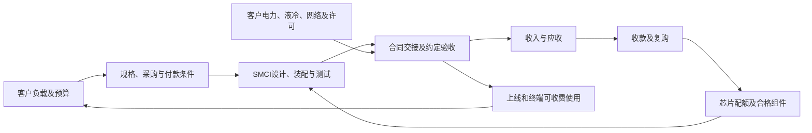

# Super Micro Computer（Supermicro，美超微，NASDAQ：SMCI）公司调研

研究截止：**2026-10-16，美国洛杉矶当地日期，本次检索时可取得的公开信息**。最新已披露完整财务期间为截至2026-06-30的FY2026；截至2026-09-30的FY2027Q1已经结束，但本次核查SEC申报清单及公司公告，尚未取得该季度实际业绩。不能将8月给出的9月季度指引当作实际结果。本文研究经营能力和普通股经济权益，不给股票目标价。

除特别说明，财务模型金额用**十亿美元，记作bn，1bn＝10亿美元**；历史季度表用百万美元。财年截至每年6月30日：FY2027＝2026-07-01至2027-06-30，FY2028＝2027-07-01至2028-06-30。所有股数及每股数字采用2024-09-30十拆一后的口径。SMCI为美国普通股，交易和财务报告币种均为美元；SMCIP是另一种证券，其权利不能与SMCI混用。

证据标记：**F＝已披露事实，M＝管理层目标或厂商主张，C＝直接计算，I＝研究估算、机制判断或条件路径，U＝重要未知**。F表示已经公开披露并核查到原文，不表示研究者审计了底层交易。M-T表示通过第三方电话会文字转录取得的管理层陈述。所有预测区间是经营条件范围，不是统计置信区间；工作路径不是数学期望。

## 一、经济实质与当前判断

**SMCI已经证明能够把昂贵的加速器、主机、互连和液冷组成大规模可交付系统；尚未充分证明的是，在业务继续扩大时，能够同时稳定保留集成利润、缩短资金占用，并让普通股获得与收入增长相称的净增权益。** 它的稀缺能力在产品工程、平台适配、工厂测试及现场交付组织，经济控制权则与NVIDIA、其他芯片平台、大客户和渠道共同分配。DCBBS扩大了公司承担的工作和客户责任，但不会自动把芯片、企业软件和数据中心地产的利润全部变成SMCI的利润。

决定判断的数字集中如下；后文解释机制，不把表中不同口径金额相加。

| 观察对象、公开日期及期间 | 已核查数字或状态 | 对公司判断的意义 |
|---|---|---|
| FY2026；2026-08-31审计年报 | 收入39.063bn、毛利4.227bn、营业利润2.770bn、净利润2.230bn；经营现金流 **−6.810bn** | 收入增长77.8%、营业利润增长121%，但增长需要大量外部资金；利润真实与现金充足是不同问题。[S01，页45—48、58—64][S01] |
| FY2026Q4；2026-08-11 | 收入11.120bn、GAAP毛利率 **17.5%**、营业利润1.488bn；经营现金流+0.747bn | 利润改善很大，但包含客户/产品组合、低毛利合同后移以及较低关税与库存调整。下一季度管理层毛利率预期已经明显低于17.5%。[S02][S02]、[S09，财务负责人说明][S09] |
| 2026-06-30资产与承诺；08-31披露 | 库存 **12.896bn**，其中制成品10.276bn；应收6.125bn；不可取消采购承诺 **34.2bn**，主要在随后12个月 | 成品、交接、客户准备和资金周转比单纯新增厂房更接近经营约束。采购义务与客户订单的可取消性不对称。[S01，注6、注15][S01] |
| 新订单；2026-07-21 | FY2026Q4取得超过 **60bn** 新订单；原公告明确其中部分可能不是firm commitments，可能取消或延期 | 有重要采购机会，不能把60bn全部当成不可撤销、尚未交付且会在FY2027收现的收入。[S08][S08] |
| 管理层FY2027指引；08-11 | 全年收入 **65—72bn**；FY2027Q1收入14.5—15.5bn | 这是需跨过交付和资金门槛的目标。本文更支持FY2027收入 **58—66bn** 的工作范围，代表点62bn；来源与推导见第七节，未按指引任意打折。[S02][S02] |
| 资金与股东归属；06-30余额 | 现金7.521bn，银行贷款及可转债账面额8.720bn；新增强制可转优先股清算优先额4.3125bn、年股息7% | 净债务约1.199bn不能单独代表承受力。优先股每完整年度约0.302bn股息，预计2029年转换另增加约130.7—156.8百万普通股，另有可转债和员工股权。[S01，注8、9、13][S01] |
| 截止前更新 | 09-23宣布Rubin NVL72开始出货；10-13扩展OCP产品；10-14新CFO实际就任、10-15披露 | 产品阶段确有推进，组织整改也有动作；均不代替付费验收、现金和内控有效性的证明。[S10][S10]、[S11][S11]、[S30，Item 5.02][S30] |

**经营判断〔I〕：** 未来12—24个月，需求与系统复杂度仍足以支持SMCI扩大业务。更可能形成的利润结构，是大额GPU系统提供规模、CPU/存储和部分企业项目提供较高毛利、DCBBS配套与服务逐步增加贡献。集团毛利率的工作区间约11%—13%，比把Q4的17.5%持续化更有依据。FY2027代表点62bn收入、7.40bn毛利、5.30bn营业利润，在周转改善的条件下可有约2.03bn经营现金流；若保持FY2026年末资金占用强度，同一收入和利润条件下，经营现金流反而约为−4.96bn。这个差异比多数小产品预测更能改变结论。

**最强相反解释**是：高订单和高收入中相当部分由少数采购方的融资、预采购及供应商信用推动，最后上线与可收费使用没有同步；平台标准化与多源采购进一步压低集成费用，SMCI被留下库存、应收和刚性采购。反对“全部只是融资叙事”的证据包括已披露销售、Q4的大客户收款、Lambda已运行系统，以及采购方对设备交付的更新。反对“利润率已永久重估”的证据则是Q4的组合效应、未来订单条款未知、成熟竞争者已经放量，以及巨额采购和库存。两种极端解释均不足以覆盖现有事实。

**最重要的未解问题**是：60bn订单的合同层级与净转化、主要客户项目的付款及验收条件、可重复的DCBBS绝对毛利、库存按代际/客户的可转用性，以及司法与合规检查对交期、供应资格和信用的影响。对这些缺口，本文给条件规模和验证节点，不以“尚未披露”自动判负，也不把未知当成已经解决。

## 二、公司如何赚钱，以及它实际控制什么

### 2.1 从部件库到系统交接

公司以可复用的主板、机箱、电源、散热、管理和系统设计为基础，针对芯片平台与客户负载组合产品。采购主体主要是云和AI基础设施运营商、企业、OEM appliance客户、科研及主权项目，也通过经销商、VAR和集成渠道销售。使用者是模型/应用团队，采购和验收者通常是IT、基础设施及供应链部门；付款者可能是客户本身、项目融资主体或分销商。不能把“云厂客户”直接等同于最终模型使用者。

大部分经济收入来自**系统、机架或部件的销售对价**。公司采购关键芯片和组件，负责设计、组装、测试、集成、运输及约定的交付工作；GPU很贵，使销售额和营运资本都很大。若客户改为自供组件，SMCI可能只销售其余硬件和服务，收入分母可以下降而集成工作量不降。公司现行材料没有披露一个足够完整的客户自供件比例，不能把竞争者的采购模式变化直接当作SMCI已发生的会计改变。

产品收入在控制权转移时确认，通常为发运或送达，合同要求客户接受时则需满足相应条件；分销收入也以分销商取得控制权为依据。延保在标准保修结束后开始按期确认，上门服务随履约期确认，机架安装集成服务在执行和客户消耗服务时确认。一般账期30—60天，部分客户更长，部分合同有预付款。因此**发货、确认收入、客户上线、终端付费和收款可能是五个不同日期**。[S01，注1页67—68、注2页75—76][S01]

箭头是因果和时间关系，不代表收入可以沿供应链相加。工厂交接已经满足合同的设备，可能先确认收入后上电；反之，现场验收未完成时，已经制造的系统可能仍留在库存。

### 2.2 保留四种经济差异，不伪造历史分部

公司只披露**一个经营分部**。下列A—D是本文的研究拆分，用于解释价格、成本、资金和未来变化，不是公司披露分部；企业/渠道与大数据中心是另一种客户维度，不能直接等同于产品分部。[S01，注2][S01]

| 研究单元 | 客户任务与收费单位 | 经营差异及与其他业务的关系 |
|---|---|---|
| **A：加速计算系统** | NVL72机架、HGX等多卡节点及相应集成；按完整系统对价 | 包含随系统销售且不可拆出的机架电源、液冷和初始管理配置。高BOM、客户集中、代际切换快；平台、配额和验收决定交付。企业购买的GPU系统也归A，不能再归B。 |
| **B：CPU、存储及边缘硬件** | 企业/云服务器、存储节点、Blade、多节点系统、IoT/电信边缘设备 | 配置广、单笔相对分散，旧平台兼容、渠道与认证有价值；仍受CPU/内存成本和大厂竞争影响。AI agent的CPU执行可能增加需求，也可能只是传统IT升级重新贴标签。 |
| **C：独立DCBBS基础设施硬件** | 不在A/B系统发票内的CDU、液气换热、后门换热器、机架配电/BBU、独立网络和相关设施配套 | 从设备供应跨向系统责任，增加工程、现场、质量和质保要求。只有单独取得的外部对价纳入C；A/B内已包含的冷却/网络不再加一次。当前独立收入、利润和附着率未单列。 |
| **D：单独软件与付费服务** | 管理软件、安装集成、上门服务及延保等履约义务 | 可延长客户关系、带来预收和存量收入；需履行服务、备件及现场响应。硬件捆绑的软件并不自动产生独立订阅费。FY2026全部服务与软件仅0.538bn。 |

四者共享平台研发、采购、厂房和客户入口；新项目可以带来交叉销售，也会争用测试电力、关键工程师、服务人员和现金。FY2026研发0.771bn不是四个单元可以各扣一遍的费用。基础设施和服务使客户少协调几家供应商，但更大责任边界也可能增加延迟赔偿和长期维护成本。

### 2.3 经济控制权的边界

SMCI控制自有品牌、模块化系统设计、产品组合、部分机械/电源/热管理设计和管理工具，并积累客户验证、制造测试和部署经验。它没有因此取得NVIDIA GPU、NVLink、CUDA或AMD CPU/GPU的核心知识产权；也不拥有客户训练数据、模型收益或云端GPU小时收入。与Ablecom、Compuware合作的部分设计由SMCI出资并保留相应知识产权，但生产执行和关联方利益仍需分别判断。[S01，业务、注11][S01]

客户买的是交期、合格系统和责任接口；平台方控制关键架构和供货资格，大客户控制预算、最终配置和多源采购。对超大规模定制客户，SMCI兼有ODM式工程执行特征；对企业客户，它更像品牌OEM和方案商。公司可以在两个市场同时增长，但不能把企业价格或服务附着赋给全部大型GPU订单。

截至2026-06-30，合并少数股东权益只有约0.000164bn，集团利润大体归属母公司股东；**母公司内部普通股、优先股和债权人的分配**才是本次权益分析的主要问题。美国上市SMCI不是海外服务器项目或客户数据中心的直接持有凭证。

## 三、财务基线：利润增长与现金消耗如何同时发生

### 3.1 最近五个季度的可比表

金额为百万美元，毛利率为GAAP；现金、应收、库存和应付是期末存量，CFO和CapEx是单季流量。Q4现金流及CapEx按全年减九个月直接计算；FY2025年末应收采用FY2026年报的重分类后口径。来源为各季业绩公告、2026Q3 10-Q及FY2026 10-K。[S01][S01]—[S06][S06]、[S03Q，财务报表页1、2、6][S03Q]

| 指标 | FY25Q4 2025-06-30 | FY26Q1 2025-09-30 | FY26Q2 2025-12-31 | FY26Q3 2026-03-31 | FY26Q4 2026-06-30 |
|---|---:|---:|---:|---:|---:|
| 收入 | 5,756.9 | 5,017.8 | 12,682.5 | 10,243.0 | 11,119.8 |
| 毛利 | 544.1 | 467.4 | 798.6 | 1,018.7 | 1,942.6 |
| 毛利率 | 9.45% | 9.31% | 6.30% | 9.94% | 17.47% |
| 营业利润 | 228.4 | 182.3 | 474.3 | 625.9 | 1,488.1 |
| 净利润，未扣优先股分配 | 195.2 | 168.3 | 400.6 | 483.4 | 1,178.2 |
| CFO，经营现金流 | +863.6 | −917.5 | −23.9 | −6,615.4 | +747.0 |
| CapEx，购建固定资产现金 | 22.7 | 32.3 | 21.2 | 80.3 | 28.2 |
| FCF＝CFO−上述CapEx | +840.9 | −949.8 | −45.1 | −6,695.7 | +718.7 |
| 现金及等价物 | 5,169.9 | 4,196.9 | 4,091.1 | 1,290.3 | 7,521.5 |
| 应收账款，净额 | 2,203.9 | 2,525.0 | 11,004.1 | 8,413.4 | 6,125.4 |
| 库存 | 4,680.4 | 5,730.0 | 10,595.4 | 11,103.4 | 12,895.9 |
| 应付账款 | 1,282.0 | 1,279.7 | 13,753.2 | 3,687.0 | 2,247.0 |

这个序列有三个比“某季度EPS超预期”更重要的事实。

第一，**FY26Q2的低现金流出不表示该季增长几乎不占资金**。当时应收和库存同时增加，应付却升至13.753bn，供应商信用承担了大量现金需求。Q3应付减少约10.066bn，虽然应收回落约2.591bn，仍出现6.615bn经营现金流出。将Q3全部归为“囤货”会漏掉供应商付款时点；将Q2的低流出看成持久商业模式也会误判。

第二，Q4现金转正同时，库存仍增加约1.793bn。它依靠当期利润、应收减少约2.288bn、客户预收/递延等共同支持，并非靠清空库存获得现金。收款是有辨别力的正面证据；库存继续上升则说明下一阶段交付还需要完成。

第三，现金从Q3的1.290bn升至7.521bn，不能主要归功于经营改善。6月普通股和优先股发行合计净流入约5.639bn，FY2026银行借款净流入约3.948bn。全年融资现金流约9.479bn，抵消了经营和投资消耗。[S01，页63—64][S01]

**口径校正。** Q4公告中的“CapEx and investments约25百万”接近该季净投资现金流，而严格的购建固定资产现金约28.230百万；因此本文统一定义FCF为747.0−28.2＝718.7百万，不把公司转录中约722百万的FCF混入同一序列。这是口径区别，金额不足以改变主要判断。FY2025年末旧公告的流动应收约2.375bn，后续重分类为2.204bn，并伴随非流动应收变化；本文没有把这0.171bn直接称为新增坏账或回款。

### 3.2 拉长到完整增长周期

| 财年，美元bn | FY2024 | FY2025 | FY2026 |
|---|---:|---:|---:|
| 收入 | 14.989 | 21.972 | 39.063 |
| 毛利率 | 13.8% | 11.1% | 10.8% |
| 营业利润 | 1.211 | 1.253 | 2.770 |
| 研发 | 0.464 | 0.637 | 0.771 |
| CFO | −2.486 | +1.660 | −6.810 |
| CapEx | 0.124 | 0.127 | 0.162 |

FY2025收入增长约47%，营业利润却只增长约3.5%；FY2026收入再增长约78%，营业利润增长约121%。前者显示高价值GPU系统和竞争性报价可压低混合毛利率，后者显示毛利金额扩大及费用摊薄能够产生利润杠杆。三年的现金序列则表明，某一年的库存/应收释放不足以证明全周期不需资本。FY2026 CapEx仅0.162bn，而库存和应收净增数十亿美元，公司的核心资本负担明显偏向营运资本。[S01，页45—48、63][S01]

年报把FY2026增长主要归于GB200/GB300、GPU与机架等高价值系统，不是重大并购。Hyper Servers、GPU & Super Racks等产品组增加收入15.262bn，但该口径包含不同系统，不能全部直接命名为“纯GPU增量”。FY2025披露的ASP增加34%也含配置和组合变化，不等于同型号提价34%。服务与软件FY2026增长约63%至0.538bn，占总收入仅1.38%。

### 3.3 Q4毛利改善中，什么可以持续

管理层在8月电话会把约750个基点的非GAAP环比改善，约四分之三归于客户与产品结构，包括若干大额合同后移；其余归于较低关税及库存准备。Q4企业/渠道收入约5.6bn、占50%，Q3占28%；大数据中心/OEM占比相应下降。Q4广义AI约占60%，管理层预期后续将重新超过80%，并给FY2027Q1毛利率约10.4%—10.8%的预期。这些具体比例来自**M-T电话会转录**，不是审计分部利润表。[S09，财务说明和问答][S09]

据此，更可信的因果顺序是：大GPU项目后移→当季较高毛利产品权重提高，同时部分成本压力缓和→Q4毛利显著增加；项目恢复交付时，收入增长与混合毛利率下降可以同时发生。不能把全部改善称为一次性，也不能把它全归为DCBBS定价权。

有两个计算限制了“只靠小额调整解释全部Q4”的说法。按披露值，Q4毛利1.943bn，占全年毛利约46%；即使剔除某些短期有利因素，利润改善仍很大。另一方面，FY2026全年库存调整188.110百万减去前三季度239.255百万，隐含Q4该现金流调整项目为−51.145百万，约当季收入0.46%。**这是同口径差额计算，不是公司单列的“库存转回”说明**；缺少季度准备滚动表，不能判定具体SKU的转回原因，也不能仅据差额认定会计违规。它的量级远不足以解释全部毛利跃升。[S01，注6、现金流表][S01]、[S03Q，页6][S03Q]

年报还披露FY2026关税费用同比增加0.238bn、供应商返利减少带来的成本增加约0.313bn。合计相当于FY2026收入约1.41个百分点〔C，其他不变〕。说明平台供货条款、返利和贸易成本可以明显改变利润；它们并非都可收回，本文不将之全部加回“正常利润”。

### 3.4 库存、应收和长期责任

库存约79.7%是制成品〔C〕，不是全部仍可自由配置的零件。成品可能在等客户场站、电力、网络、出口检查或特定验收；也可能暴露于新代际替换和价格下跌。公开披露缺少按平台、客户、库龄和已收预付款对应的矩阵，无法知道129亿美元中有多少能无损转给其他客户。模块化设计降低部分零件报废风险，却不能让旧GPU、指定液路、CPU/内存规格和客户认证完全互换。

FY2026库存现金流变动8.877bn，与账面库存增加8.216bn不是一回事。按公开报表可复算：8.877−0.188库存调整−0.466“asset held for others”−0.007转固定资产≈8.216bn。**数值闭合不证明重分类的全部经济背景**；0.466bn代他人持有资产不是现金，不能计入可即刻支付采购的资源。预付库存另约0.315bn。[S01，页63—64、注6][S01]

期末三个客户分别占应收23.0%、17.1%、12.5%，合计52.6%；最大一笔对应约1.409bn〔C〕。账面信用损失准备仅约0.109百万。小准备代表管理层当前估计，并不保证未来零损失，也不证明现在已经需要巨额减值。需跟踪账期、后续收款、信用保险和设备担保的实际可执行性；按收入排名不能擅自识别这三个应收客户。[S01，注1、注6][S01]

FY2026产品保修计提约0.138bn、实际利用约0.128bn，期末准备约0.028bn。规模扩大后，新平台可靠性、冷却液路、现场备件和响应能力会占成本。保修准备不是事故责任的完整上限；关键组件返修、供应商担保、免费初始保修与有偿延保也不能简单合并成同一个利润率。

## 四、技术优势如何变成业务，哪里会被复制或绕过

### 4.1 机架是系统工程单位，芯片性能不是SMCI的收费权

大模型训练、MoE通信、长上下文和低延迟推理，要求计算、内存、scale-up互连、scale-out网络、电力与冷却共同工作。单卡性能不足以决定实际任务吞吐；故障恢复、尾延迟和持续运行也会影响客户验收。SMCI的价值在于把相应平台较快变成可订购、可交接和可维护的系统。

2026-09-23公司宣布开始出货Vera Rubin NVL72，并给出72个Rubin GPU、36个Vera CPU、18个计算托盘的配置，以及16个计算机架、1,152个GPU的Scalable Unit蓝图；配套含额定1.8MW行级CDU及N+1设计、网络和现场服务。这证明阶段已经推进到**厂商自报开始交付**，不能再停留在“未来可能发布”；但公告未披露本次交付数量、独立客户验收数、净成交价或收到的现金。[S10][S10]

9月16日MLCommons仍把其该轮Rubin提交列为Preview；这是特定提交时点和可得性分类，与9月23日以后供应商开始出货并不矛盾。测试结果支持指定模型、质量与时延条件下的技术可行性，不能证明每个客户的总成本回报，也不能把平台吞吐倍数变成SMCI价格或利润倍数。[S26][S26]

NVIDIA原始技术资料又显示，Rubin计算托盘以中板等设计简化线缆、软管和风扇，厂商称托盘装配由近两小时缩至约五分钟。对象是**计算托盘工序**，不是整柜满载验证、运输、场站调试或集群上线。对SMCI有双向影响：提高装配效率、降低工时和部分错误；参考设计标准化也会减少简单组装的稀缺性，使价值更依赖验证、现场执行和服务。平台方自己的韧性、诊断和管理工具，还可能收走一部分SMCI希望销售的软件价值。[S25][S25]

### 4.2 液冷的客户价值与利润分配

直液冷先解决高密度芯片能否稳定运行，再谈省电。流量、压降、接液材质、污染、漏液检测、冗余、隔离和维护决定系统可用性；CDU的额定热功率不等于客户可部署的IT容量。N+1、进出液温度和设施侧排热条件不同，同样“1.8MW”不能直接比较整套报价。

公司宣称DLC-2在适用条件下有较大节电及TCO改善，这是厂商主张，公开公告没有提供覆盖所有客户的统一基准和现金回收审计。一个独立条件算例〔I/C〕：相同1MW IT负载，PUE从1.35降至1.15，全设施耗电降低14.8%；电价0.10美元/kWh时，每年节电约17.52万美元。若增量冷却投资为100万美元，仅靠这项电费差回收需约5.7年。它既不能否定不同配置下更大的收益，也说明不能把“最高节能40%”普遍套给每个项目。

真正可能产生更高支付意愿的是：在同一电力、楼板和空间边界下提前投运更多可收费计算，或减少客户多方集成、故障和等待成本。客户只有在设备被充分使用、产出能售出或替代支出确实发生时，才获得这些经济收益。若客户自己设计液冷、组件标准化、竞品认证完成，SMCI仍能多交柜，但每柜配套费可能下降。

2026-10-13的OCP产品扩展包含48V DC机架、电源、液冷、后门换热、管理及800G/1.6T网络方向。其中后门换热器公开范围10—120kW，面向残余空气热负荷和部分既有机房改造，不能独自替代更高密度机架的芯片液路或设施供电。已扩展产品组合是F，净附着率、实际成交毛利和长期售后负担仍是U。[S11][S11]

### 4.3 CPU、存储和新架构的机会应单独保留

**企业CPU及存储更新。** 这是已经有销售基础的业务，客户买兼容、内存容量、虚拟化、数据库、存储带宽及运维便利。FY26Q4企业需求回升和渠道扩展支持它有真实经济意义；不能因为GPU更显眼就忽略。更多内存和高价值配置可增加收入，也会提高BOM。Dell同期传统服务器/网络和存储也强劲增长，说明这不完全是SMCI独有份额或定价胜利。[S09][S09]、[S22][S22]

**Agent执行与CPU架构。** agent编排、代码执行、浏览器/沙箱、检索和状态管理消耗CPU、内存、网络；模型推理本身可能仍在远端GPU。SMCI于6月公布Arm合作，10月12日AMD公布Helion，列SMCI等为伙伴，CPU-only与CPU/GPU混合配置适应不同负载，合作方配置目标11月可供。Helion与GPU机架Helios是不同路线。前者可能提高SMCI的CPU系统机会，尚未证明特定数量付费客户或新增毛利；开放参考设计同时帮助Dell、HPE、ODM进入。[S27][S27]、[S28][S28]

**AI存储、KV/context层。** 长上下文、共享前缀和状态恢复可扩大存储/网络需求，也能减少重复计算或缓解HBM压力。3月17日的BlueField-4 STX公告明确称其为原型，并将软件移植、验证和特定SSD测试列为后续工作；它提供进入路径，截至截止日未取得足以证明这一具体产品已规模付费验收的公开资料。关键是命中率、恢复带宽和尾延迟收益超过新增设备与软件成本；SSD容量并不能无条件替代热数据所需HBM带宽。SMCI可取得服务器、集成及服务收入，VAST等伙伴的核心软件租金不自动归SMCI。该分支在B和部分D内；没有单列公开收入，未再作为“第二个AI市场”叠加。[S29][S29]

**AMD、ASIC和替代平台。** AMD GPU系统可以扩大客户选择、分散部分单平台风险，但SMCI没有因支持多个平台就取得所有云厂自研ASIC的设计定点。自研体系可增加定制工程量，也可减少外售芯片溢价、客户自供BOM和系统商报表收入。软件迁移、互连、验证和客户工程关系决定资格，不能用ASIC市场总量乘任意份额计入。HPE已在9月宣布Vultr的1.2bn Helios订单，说明开放路线的真实竞争也在形成。[S23][S23]

**边缘、AI-RAN和小型企业推理。** 本地数据、低延迟和离线运行能形成需求入口，但场景分散、认证和支持成本高，云服务和小模型会替代部分本地GPU采购。公司公开产品和合作较多，未取得足以独立约束集团级收入的数量与复购数据，故保留在B，未虚构一个高增长独立分部。超出服务器边界的远期用途若无公司特定合同、付费负载和责任划分，当前不能改善规模判断。

## 五、需求与竞争：先看实际采用，再看可捕获规模

### 5.1 逐项目辨别阶段和谁付钱

| 对象、材料日期 | 已经取得的商业证据 | 能支持的规模与仍缺什么 |
|---|---|---|
| **Lambda**；2025-09-23买方公告，2025年B200集群材料 | 买方宣布在ECL运行Supermicro制造的GB300 NVL72，单系统142kW；另有HGX B200集群上线材料 | 支持SMCI能够交付实际运行的新平台。未披露这里的机架总数、SMCI净价、毛利及设备账款结算；公告具有客户/合作方利益关系。“两小时整合”也不是从签单到建成只需两小时。[S19][S19]、[S19B][S19B] |
| **Colossus/xAI、现SpaceX相关AI业务**；客户历史页面、2026-05-06 | 客户披露历史集群扩张；5月公告与Anthropic签署Colossus 1算力访问协议，涉及超过220,000 GPU的集群 | 已有真实基础设施及对外算力需求。客户页面的历史200k/180k等字段不完全同步，不能当统一当前物理库存；更不能据此把全部GPU、后续扩建或28.1%的匿名收入客户都归给SMCI。[S20][S20]、[S21][S21] |
| **Gorilla—Yotta**；2026-06-02、09-08 | 采购方宣布与SMCI约2bn供货安排，20,736张B300、5,120张B200及网络/配套；9月更新设备已开始交付、进入安装集成阶段 | 数量与采购链条比Logo更具体。4月曾给9月30日前完成增量部署目标；截止日取得的更新是“分期交付进行中”，未取得全部25,856 GPU已完成验收和付款的证明，不能写为已全部完成。[S14][S14]、[S15][S15]、[S16][S16] |
| **DataVolt**；2025年5月买方材料、05-16公司公告 | 合作方以20bn多年项目表述；SMCI原公告明确是非约束MOU，仍须谈妥一份或多份最终协议 | 这是有对象的重大机会，法律和兑现层级低于已交付订单。针对双方公开材料检索后，未取得可将全20bn计为不可取消SMCI订单的完整合同、付款与年度交付表。不在60bn之外再机械加20bn。[S17][S17]、[S18][S18] |
| **Cisco渠道**；2026-08-25公告、截止日前产品页 | 合作方确认将SMCI计算系统放入Secure AI Factory架构；最新页面把全球可订完整堆栈时间细化到10月底，Cisco为首要支持接口 | 公司获新渠道和企业资格入口，但截至10月16日不能把月底计划当既成销售。没有披露保底采购量、SMCI分成或独立利润；Cisco也掌握客户入口、服务与部分软件价值。[S12][S12]、[S13][S13] |

这些证据共同支持“已规模商业化、仍在跨平台和项目复制”，不支持“所有大额合同都已融资、上电和回款”。Gorilla的2bn设备安排、约2.8bn项目合同价值、未来多年算力收入不是三笔可以相加的SMCI收入；NVIDIA相关offtake可改善项目可融资性，但不能代替所有融资交割和终端付款证明。客户自己也同时存在扩张和资金需求。[S14][S14]—[S16][S16]

### 5.2 客户集中及预算的相关性

FY2026最大客户占收入28.1%，对应约10.977bn〔C〕。管理层称年收入超过1bn的客户由四家增至九家，这支持采购对象扩大，**不等于最终资金来源互相独立**：多个NeoCloud、主权项目或分销商可能依赖同一芯片平台、融资环境、模型实验室和云采购预算。公开字母客户与媒体推定身份不作为本研究事实。[S01，注2][S01]、[S07，页3][S07]

按发运地统计，FY2026美国占70.9%；这不是最终计算用途、客户总部或全部信用风险的地域分布。FY2025泰国曾占收入10.9%，与DOJ案件中的东南亚转售链条有地理线索，但期间和客户范围不同，不能把该地域全部等同涉案客户，或把指控的2024—2025年2.5bn全数从FY2026收入扣除。

客户支付能力来自自身现金、股权债务、长期算力合同和预付等。SMCI真正需要的是**设备付款节点与自身采购付款节点匹配**，不是采购方名义估值高。供应商融资、客户算力承诺及设备销售可能彼此支持，须追踪独立用户使用和回款；不能仅因有合作融资就认定虚假需求，也不能把融资额直接当SMCI订单额。

### 5.3 竞争者已证明的能力

| 竞争对象及可比日期 | 原始经营观察 | 对SMCI的传导及比较限制 |
|---|---|---|
| **Dell**；2026-09-01披露截至7月31日季度 | AI服务器收入16.401bn、订单60.9bn、积压95bn；FY27 AI收入指引74bn | 有规模交付、企业入口、服务和融资能力；客户大单不是SMCI专属。Dell财年和产品范围不同，ISG 15%营业利润率含传统服务器、网络和存储，不能当AI毛利率或直接赋给SMCI。[S22][S22] |
| **HPE/Vultr**；2026-09-30 | 首笔Helios系统订单1.2bn，含计算、网络、直液冷与部署能力 | 反驳“液冷/全套交付只有SMCI能做”。订单不等于截至报告日全部交付，不能当当季收入。[S23][S23] |
| **Wiwynn及ODM体系**；2026-08-10，Q2 | 收入NT$278.153bn、毛利率9.3%、营业利润率7.3%；部分客户内存改代理采购，收入/成本剔除，并有新品NRE收入 | 单纯对比收入增速或毛利率可能混入分母和一次性工程费变化；其客户、资格、资本和产品不同。它证明大客户有能力改变价值分配，不证明SMCI已同样改口径。[S24][S24] |
| **平台与买方自研** | NVIDIA提供更完整参考架构、软件和系统可靠性能力；开放CPU/AMD机架有多个伙伴 | 上游降低客户进入成本，可能扩大SMCI工作，也降低独家集成溢价。客户直采组件和ODM定制可以绕过部分品牌收费，但仍需系统制造与验证。 |

SMCI较有胜算的对象是需要新平台较快交付、愿意采用开放配置、又没有全套内部工程组织的企业、成长云和部分主权项目。可持续收费来自避免延误、提高可用性、减少客户工程负担，以及多年维护。对能自行设计并多源采购的大买方，低报价、供应能力和融资条款可能比品牌更重要；高销售额不必然形成高资本回报。

### 5.4 供给端：不能用名义机架能力直接乘NVL72价格

8月材料给FY27超过6,000总机架、约3,000液冷与3,000风冷的能力方向，电话会明确为每月；并提到全球85+10MW电力能力。它们属于管理层能力主张/扩张状态，不是按平台独立审计的已验收产量。7月30日机架结构产品公告的“最多每月3,000，其中2,000液冷”范围不同，不能把两者差异当作真实产能突然下降。[S07，页5、8][S07]、[S09][S09]、[S31][S31]

真正可交付数量取决于：

**可实现交付＝需求与资金允许数量、合格芯片/组件齐套、适配产线与满载测试、客户合同验收能力四者的共同约束。**

工厂扩班可以快于新园区建设；GPU/HBM/板级配置、冷却接口、交换机、固件验证和出口检查可能串联卡住一柜。库存129亿美元说明公司已取得大量物料和成品，但不能证明目标新平台全部齐套。客户现场电力和网络未准备好时，更多工厂装配反而可能增加成品资金占用。

第七节44bn的AI系统工作点，若70%收入来自平均4.5百万美元完整机架，30%来自平均0.38百万美元八卡节点，需要约**6,844个机架、34,737个八卡节点，合计约77.1万GPU封装**〔I/C〕。机架并非全部同代际或液冷，节点也不等于独立物理柜。这是收入路径要求的物量，不是独立预测出货或已获配额。它没有碰到管理层名义装配能力上界，但**缺少能独立证明77万颗相关GPU配额、同规格合格测试和验收槽位的公开资料**；不能据“还有工厂空间”断定可兑现。

用相同机架工作量作测试资源筛查〔I/C〕：若6,844柜每柜0.2MW、需要占用满载测试48—168小时，全年平均专用测试电力约7.5—26.3MW；还未包括节点、并行返工、网络及实验室。测试时长与功率是假设，85+10MW又非全部可分配给这一工序。因此这个量级说明电力/测试是可研究的资源，并不构成产能认证。最关键新证据是实际放行率、返工/质保、按平台交付和回款，公开资料当前没有完整分母。

## 六、订单、资本与治理：决定能否承受成功或延期

### 6.1 订单数字的法律与统计层级

| 口径 | 截止日事实及来源 | 本文怎样使用 |
|---|---|---|
| 超60bn新订单 | 7月21日公告明确为FY26Q4新取得；含可能非firm及可取消/延期项 | 证明机会量级和客户选择；不直接设为全部FY27收入。 |
| 超60bn back orders | 8月11日演示第3页的简化表述；电话会仍主要讲Q4 new orders | 管理层对强订单簿的陈述；缺少期初、收入转出、取消、变更滚动表，不能据此合成精确净积压。 |
| RPO约2.612bn | 年报采用原合同期≤1年的披露豁免，预计约60%在随后12个月确认 | 范围与全订单簿不同；不能用其较小否定全部短订单，也不能与60bn相加。 |
| 递延收入2.612bn | 含延保/现场服务、部分不可取消产品合同的预先对价；当年产品相关预先对价增加约0.943bn | 提供真实资金/履约线索，但非全为下一季GPU收入，亦非全部无义务自由现金。 |
| 客户押金约0.315bn | 另列应计负债；退款、最终抵扣和合同关系未充分细化 | 不与递延收入自动视作两笔互不相关的确定设备订单。 |
| 不可取消采购34.2bn | 年报注15，主要未来12个月，含约0.2bn关联方 | 是公司的供货与现金义务，不能与收入订单净额相抵就忽略，也不能在已进入模型成本/库存后再扣第二遍。 |

资料来源为[S08][S08]、[S07][S07]、[S01，注2、6、15][S01]。公开资料不足以算毛取消率、订单定金覆盖率和价格重置比例；用新订单减收入或净积压变化得到的残差都不是取消率。DataVolt、Gorilla或Cisco进入后续订单簿时，必须扣除重叠；本研究没有凭公开项目名假定它们在60bn内或外的精确金额。

### 6.2 资本来源、优先权和到期

| 2026-06-30口径，bn | 金额、期限或条款 | 经济影响 |
|---|---|---|
| 非受限现金及等价物 | 7.521；另有0.110受限现金 | 受限现金不当作自由支付资源。境外现金约0.871bn，涉及当地经营和融资要求，资金位置有意义。 |
| 银行借款 | 4.056，其中FY27到期2.040；JPM循环贷款2.000已动用、2030-12-29到期；CTBC循环设施约1.764已动用 | 主要大额设施不是尚未使用的备用现金。美国担保融资有资产抵押和净杠杆等契约，不能仅凭可抵押资产大就假定能随时加借。 |
| 可转债 | 账面4.664、面值合计4.725；2028年0.700、2029年1.725、2030年2.300 | 低/零票息不免除到期兑付；2029券已由原零息修改为3.5%，2028券2.25%，2030券无常规利息。转换及capped call只在特定条件下减轻现金或稀释。 |
| 强制可转优先股 | 清算优先额4.3125；年累积股息7%；预计2029-06-01强制转换 | 约0.302bn完整年度股息，可依条款用现金/普通股支付；延期不消灭累计权益，经济上由普通股承担。 |
| 经营租赁 | 负债现值0.540；未折现未来付款0.716 | 含厂房、仓储和数据中心空间；不能全部当制造设备投资，亦不应与同一租约分项重复计债。 |
| 应收出售工具 | 上限1.790，未承诺；FY26出售约0.832，费用约0.0057 | 可加快部分回款，但买方有选择权、合格应收受限且有成本；“上限未用”不是无条件授信。 |
| ATM | 6月定价后计划上限1.25bn；8月管理层表示当时无使用计划 | 是可选股权发行渠道，不是已到账现金，也不是对10月或以后永不使用的承诺。 |

来源：[S01，流动性章节、注7—10、13][S01]、[S32，2026-06-11融资定价][S32]。JPM契约初期最高总净杠杆4倍，后续逐步降至3.5倍、3倍；特定优先股分派也涉及固定费用覆盖约束。公司称6月末合规，不意味着未来收入延期时自动仍有同样借款能力。本文没有足够契约定义数据重算每一项可借金额，故不以模型EBITDA直接冒充银行可融资余额。

8月5日8-K已经宣布首期现金股息：每优先股14.7778美元、每SMCIP存托股0.73889美元，约定9月1日支付。按发行数量直接计算，首期约0.0637bn；若随后三个正常季度均按现金支付，FY2027现金股息约0.2901bn。本文现金模型统一采用完整年度0.3019bn负担，较该支付路径多约0.0117bn，属于略偏审慎的全年化假设，不是已公布的FY2027实际现金总额，也不改变融资断点判断。[S41，Item 8.01][S41]

优先股最终转换约增加130.7—156.8百万股〔C，按已发行4.3125百万优先股及转换率〕，相当于6月末普通股数约20%—24%的增量，尚未计未来股息用股、员工激励和其他可转债。原有普通股的持股比例相应下降约16.6%—19.3%，并非把这两个百分比混为一谈。6月融资中的普通股新增已经进入当前股本，不能在未来再重复稀释。

优先股参与分配后，公司EPS采用two-class method；净利润除以旧普通股数并不能得到正确每股收益。因此本文模型保留集团净利润、优先股年度权益和资本需求，**不把“净利润减股息”直接命名为GAAP普通股归属净利润，也不据此报出未经完整分配计算的预测EPS**。[S01，注5、注13][S01]

### 6.3 小规模场站安排也可能改变风险边界

公司2024年签下Vernon约21MW数据中心空间，三批已于2025年投入，租期到2035-09-30；同步的转许可没有解除SMCI原有义务。6月末相关租赁负债约0.290bn；未来转许可最低收款约0.402bn，FY2026转租收入约0.0397bn列在其他收益，不是服务器或软件收入。[S01，注10及相关展品][S01]

该安排的规模不足以决定集团收入，却说明公司有时用资产负债表和长期空间义务帮助客户取得资源。它不能同时被描述成完全轻资产、零信用风险的服务收入。若客户未按约支付，SMCI仍面对原空间义务；本文没有再将21MW、客户GPU采购和多年租金加成三笔独立增长。

### 6.4 治理要区分已确认问题、指控及整改

| 时间与出处 | 可核查状态 | 对经营和证据的影响 |
|---|---|---|
| 2020-08-25，SEC | 公司就历史提前确认收入、少计费用及内控事项与SEC和解，罚款17.5百万；按和解并未承认或否认调查认定 | 是已经发生的历史监管结果，不能拿来证明2026每笔收入虚假；但使本轮验收、费用和控制证据需要更直接。[S33][S33] |
| 2024-10-24事件、10-30披露，EY辞任 | EY对依赖管理层等提出严重关切；公司不同意部分结论。12月2日董事会特别委员会称未发现管理层/董事不当行为并建议更换CFO等 | 两种观点不能互相替代。委员会为公司组织的调查，结论不等于外部司法裁决。[S34][S34]、[S35][S35] |
| 2026-06-30；08-31年报 | BDO对财务报表出具无保留意见；三项既有重大缺陷整改，剩余ITGC缺陷未消除，对财报内控出具否定意见 | 应使用已审计报表作为基线，同时保留系统权限、信息完整性和及时报告风险；不能把内控否定意见写成财报审计否定意见。[S01，页56—57、122—126][S01] |
| 2026-03-19，DOJ起诉 | 当时与公司有关的三人被控出口违法合谋，涉及2024—2025年约2.5bn服务器采购、其中一段约0.510bn转运指控；公司未被列为被告 | 对其他个人仍须区分指控和裁决。最终用户真实性、渠道审核及产品流向会影响收入资格、交期、成本和融资，不仅影响声誉。[S36][S36] |
| 2026-08-20，公司调查公告 | 独立董事与外部顾问未发现现任高管知悉相关转运，也未认为既有财报因此不能依赖；公司采取解雇及合规措施，并继续配合政府调查 | 是有范围的公司调查结果，降低部分管理层知情假设的支持度；不终结DOJ/SEC或其他地区程序。[S37][S37] |
| 2026-08-24，基隆地检原始公告 | 台湾另一案件起诉九人，涉及B300、经销/现场核查链条；公告还称相关产品检查、交付延误及赔偿造成损害 | 不是美国同一三人案件的简单重复。检查影响的覆盖、持续时间及具体金额未披露；不能据此推为全球全面禁售，也不能视为只有舆情。[S38，页1—6][S38] |
| 2026-10-09公开法院文件及报道 | Sun的替代起诉信息/放弃大陪审团文件可取得；Reuters据法院文件报道其对四项罪名认罪 | 这使相关个案超出“仅有三月指控”的阶段。本文未取得完整认罪协议与合作条款；该个人认罪不自动证明公司或其他被告已被定罪。[S39A][S39A]、[S39B][S39B]、[S39C][S39C] |
| 2026-10-08、10-15披露 | Shesha Krishnapura 10-09任独立董事、Judy Lin退休；Mark Long 10-14就任CFO，Weigand同日卸任该职务 | 更换CFO已完成，不能继续当未来待发生事件。新CFO有大型科技财务经验，能否改善现金、系统和控制仍需后续执行记录。[S30][S30]、[S40][S40] |

2024年12月提出CFO更替建议，到2026年10月实际完成约22个月，这显示复杂组织调整的执行速度。不能因长期等待而否认已经就任，也不能凭任命把控制缺陷提前认定为消除。

关联交易的风险在利益安排及控制，不在把所有外包采购统称虚假。FY2026向相关方采购约0.726bn，占销售成本约2.1%；Ablecom/Compuware与创始人家庭存在不同持股、经营及亲属关系，公司披露部分设计/IP归自己。这个比例不足以解释全部GPU成本，但关键机箱/电源的资格和利益冲突可能影响少量金额背后的供应连续性。创始人兼CEO、董事长，家庭及供应链影响力强，并不等于持有法定绝对多数投票权。[S01，注11、治理部分][S01]

激励也有取舍。2023年CEO期权奖最多5百万股，以收入和股价门槛归属；截至6月末收入门槛均已达到，最高股价门槛仍未达到，FY2026未向CEO新授股权奖。它有股东回报联系，却没有把现金转换和资本回报作为同一组直接门槛；不能从“低工资、持股多”推出所有资本决策都最优。新CFO额外绩效现金奖的具体条款在10月8-K中尚待确定，不能提前假定已经与回款KPI挂钩。[S01，注12、薪酬页138—143][S01]、[S30][S30]

**当前治理判断〔I〕：** 有真实整改、审计完成和人员补充，也有持续的系统缺陷和跨地区个案。经营研究不能以指控预设所有收入无效；资本模型也不能假定合规检查、信用和供应资格永远不受影响。与其把一个抽象“治理折价”乘所有利润，本研究把后果落实到交期、预付款、应收、库存、服务/调查费用和融资门槛。

## 七、单位经济性与公司可获规模：统一工作模型

### 7.1 收入、交付与可留存费用分别建模

本文的工作路径不是将行业TAM乘份额，也不是把最新季度乘四。其起点是：公司FY2026已交付39.063bn、最近四季收入5.0/12.7/10.2/11.1bn，已有大型客户、实际平台交付和新订单；其下一步需要在新平台和客户现场上，把更多采购承诺转成可收款的系统。预测主要受**订单转化时点、每套系统净对价、产品/客户混合毛利和营运资本**约束。

FY2027工作范围58—66bn、代表点62bn，比管理层65—72bn指引略低。选择这个范围的原因是，现有大额订单和约束松动足以支持继续增长，但公开证据尚不能证明所有新大单均已取得现场准备、付款、芯片配额和验收资源；Q4合同后移已经是现实，不应在下一年假定不再发生。另一方面，把收入压至FY2026以下作为最支持的结果，也需要否定大量已经形成的商业基础，现有证据不足以这样做。

这一结论仍有**中低程度的规模证据约束**：集团销售和具体客户交付较直接，未来分业务量价并未公开。下表是明确的I，不是披露分部，也不是已签订单覆盖表。

| FY2027经济单元 | 收入工作点，bn | 毛利率工作假设 | 毛利，bn | 数量、收费与规模成立条件 |
|---|---:|---:|---:|---|
| A 加速计算系统 | 44.0 | 8.5% | 3.740 | 如第五节的约6,844个完整机架及34,737个八卡节点组合；平台更换、批量价格与八卡/整柜混合可改变该物量。需要约77万颗可用GPU、齐套测试、合同交接与付款。 |
| B CPU/存储/边缘硬件 | 14.0 | 19.0% | 2.660 | 建立在已有企业/渠道及云CPU业务上；相当于季度平均3.5bn，低于Q4全部企业/渠道5.6bn，但两者范围不同。需企业更新持续、渠道复购与服务资格，不能把全部Q4企业销售都映射为B。 |
| C 独立DCBBS基础设施硬件 | 3.0 | 20.0% | 0.600 | 含A/B以外的配套网络、电源、冷却等外部对价；数量和价格未单列。3bn需要例如10,000个机架/项目采购等价单位平均30万美元额外内容量，且须从计算发票剔除重叠。这个是规模门槛算例，不是已披露附着率或客户数。 |
| D 单独软件/付费服务 | 1.0 | 40.0% | 0.400 | 比FY26全部0.538bn增长约86%；需新硬件对应的服务合同、按期确认和实际支持支出。预收服务通常跨年，不能把全部递延一次确认。 |
| **集团** | **62.0** | **11.94%** | **7.400** | 同一发票按履约义务分配一次；A—D可加，不再叠加一个DCBBS或AI标签收入。 |

**价格假设的可信度。** 4.5百万美元/机架和0.38百万美元/八卡节点只是混合配置工作价格，公开资料没有提供SMCI全样本真实ASP。Gorilla披露2bn设备与配套安排对应25,856 GPU，直接相除约7.74万美元/GPU，但范围含网络与其他设施，约定值也不是已交付净价，不能当GPU价格或把所有机架定价为同一数额。它只能约束完整采购包确实可以达到数十亿美元的量级。[S14][S14]

上述A的44bn需要公司扩大已存在的系统业务，不依赖公司凭空进入全新芯片市场；C与D则是模型里证据更弱的部分。若C只是从A内改名而没有额外可收对价，必须把同一金额移回A并采用相应毛利；若C项目根本没有取得，则集团收入也应减少。不能用营销口径“DCBBS覆盖全部系统”支持独立C收入3bn。

**订单交叉检验〔I/C，必要条件，不是另一套独立证据〕。** 仅取已公布新订单中的首个60bn作归一化队列，设FY2026已确认d、剩余商业有效比例u、有效部分FY2027交付比例f，则该队列FY2027贡献为(60−d)×u×f。举例d＝3bn、u＝90%、f＝82%，贡献约42.1bn；要到62bn，还要约20bn来自该队列以外、已排重的旧订单/复购/新客户收入。公告没有披露d、u、f，也没有证明这20bn的完整排重表；不能把全部B/C/D都默认放到队列外。此式揭示为什么“有60bn新订单”仍不是“62bn已被完全覆盖”。若d从0变成11.12、其他不变，队列贡献相差约8.2bn，足以改变全年结论。

### 7.2 什么单位经济性才值得继续扩大

| 单位条件算例，均为I | 净收入 | 直接成本及毛利 | 主要资本/费用含义 |
|---|---:|---|---|
| A 完整机架 | 4.500百万美元 | 毛利0.3825百万，直接成本4.1175百万 | 含采购、制造测试、运输、常态质保及制造折旧；未扣集团研发、销售和管理。利润不是整套芯片价值的自主定价。 |
| A 八卡节点 | 0.380百万美元 | 毛利约0.0323百万，直接成本0.3477百万 | 客户小批量、售后及配置不同，实际可高可低；不能把它与NVL72视为相同性能/同一物理柜。 |
| B 每100美元硬件销售 | 100美元 | 直接成本81、毛利19 | 产品宽度和复购可收更高费用，也需要渠道、适配和较多支持；公共云直采CPU订单不一定有这一水平。 |
| C 每1百万美元独立交付包 | 1百万美元 | 直接成本0.8、毛利0.2百万 | 现场工程、材料、漏液/供电责任及分包会影响净毛利；转售伙伴产品时不享有伙伴全部毛利。 |
| D 每1美元确认收入 | 1美元 | 服务/软件直接成本0.6、毛利0.4 | 混合了人力、备件、第三方服务和软件；不是纯SaaS毛利。当前没有披露足以直接验证40%的分部成本表。 |

工作点集团GAAP经营费用2.10bn，其中研发约0.95、销售约0.65、管理约0.50bn〔I〕，覆盖平台持续研发、服务/销售组织和控制改善。相对FY2026的1.457bn增加约44%，反映扩张的组织成本，没有把费用率继续无限下降。C/D的前期开发和人员支出已经计入这组费用，不再另扣一次“新业务投入”。

在上述价格、成本和规模下，毛利7.40−费用2.10＝营业利润5.30bn。设净非经营费用0.25bn、所得税22%，净利润约3.939bn，**尚未进行优先股参与分配**。22%是研究假设，高于FY2026约19.9%的实际税率；不是公司税务保证，也不把R&D抵税、递延税资产当即刻现金。

这里有三个重要门槛。

1. **销量门槛。** 固定费用重要，若以相同11.94%混合毛利覆盖2.10bn经营费用，静态收入约17.6bn才到营业盈亏平衡〔C〕。它只是当成本结构可保持时的边界；骤降到该规模通常还伴随库存损失、低利用率和重组，真实现金盈亏平衡会更高。
2. **资金门槛。** 按每100美元A销售、硬件55天应收、100天库存和30天应付作年度周转代理，核心占资约32.6美元；8.5美元毛利还要覆盖研发、支持、利息、税和固定资产。仅靠短期贡献为正，不能证明全周期资本回报充分。
3. **净收费门槛。** 以相同销量、成本暂不动，A平均售价下调1%使营业利润减少约0.44bn，约工作点的8.3%。如果加速器涨价只被全额原价转嫁，单位绝对毛利可以不变，毛利率却下降、资金需求上升；不能把报表收入增加都理解成更多可留存价值。

没有产品成本披露时，单一8.5%不能当已证实结果。工作包络同时改变数量、组合和费用：收入58bn的下端取A/B/C/D＝41/13.5/2.7/0.8bn、毛利率8%/18.5%/18%/35%、费用2.05bn，营业利润约4.49bn；66bn上端取47/14.5/3.4/1.1bn、毛利率9%/20%/22%/42%、费用2.25bn，营业利润约6.09bn。这给出**约4.5—6.1bn营业利润**的相容条件范围，不是将每项最有利端点独立拼在一起。

### 7.3 现金模型与资本回报

为避免把软件库存化，现金模型先把硬件A+B+C与服务D分开。设RH、CH为硬件收入、直接成本，RD为服务收入，则：

- 核心营运资本W＝应收＋库存−应付；FY2026年末实际W＝6.125＋12.896−2.247＝**16.774bn**。
- 期末W代理＝RH×硬件应收天数/365＋RD×30/365＋CH×(硬件库存天数−硬件应付天数)/365。
- CFO代理＝集团净利润＋SBC＋折旧摊销＋其他净调整−ΔW。
- FCF＝CFO−购建固定资产现金。优先股息、到期债务和员工股权税代缴另在融资/权益现金桥扣除，不重复从经营利润扣减。

天数是以全年流量推算期末资产的**研究代理参数**，不是公司季度平均余额计算的DSO/DIO/DPO。不同硬件单元的实际账期未披露，本文采用加权硬件参数，而不是宣称每个客户都有相同条款。服务预收、预付采购、税与保修时点及其他非现金差异进入“其他净调整”；它是净额假设，不叠加一组互相重叠的乐观释放。

FY2027工作点采用硬件应收55天、库存100天、应付30天，SBC0.60bn、折旧摊销0.15bn、其他净调整+0.20bn、CapEx0.25bn。结果为期末W约19.630bn、比期初增加2.856bn；CFO约2.033bn、FCF约1.783bn。收入增约59%，核心W只增约17%，所以**周转改善是本工作路径的必要条件**，不是模型自动产生的好处。

相反，若保持FY2026年末W/年收入约42.94%的资金强度，62bn收入要求W约26.62bn；同样净利润和其他调整，CFO约−4.96bn、FCF约−5.21bn。用7.521bn期初现金，再扣0.302bn优先股息、2.040bn到期银行债务和0.15bn员工股权税代缴，现金会触及缺口。**这个路径不能在不改变采购、客户条款、借款或权益融资的情况下照常延续。**

以工作点税后营业利润约4.13bn，对应平均核心W约18.20bn，再加约1bn其他净经营资本作简化筛查，资本回报量级约21%—22%〔I/C〕。这不是审计ROIC：未完整净计递延服务、租赁、预付、现金税和所有资产批次。意义在于，较好的利润与周转组合有机会覆盖资本成本；若A毛利低几个百分点、库存更久或客户自供BOM，回报和现金会明显不同，不能仅用当前正利润证明新增采购都值得。

### 7.4 足以改变结论的敏感性

| 扰动与不变条件，均为I/C | 结果量级 | 经营解释 |
|---|---|---|
| A每套净价下降1%，销量和采购成本暂不变 | 营业利润约−0.44bn | 多源采购/标准化先改变可留存费用，收入只小幅下调，利润变化更大。 |
| 假设A每100收入中80为暂不可转嫁的外购BOM，成本涨5% | 成本约+1.76bn，接近A工作毛利的一半 | 若全额立即转嫁，绝对毛利可保住，但分母和营运资本增大；若只能转嫁一半，当期毛利仍约少0.88bn。80为条件参数，不是披露BOM。 |
| A约10%的年度交付延期，相关货已按91.5%成本采购，客户仅预付售价20% | 约3.146bn净采购资金被锁；约0.374bn当期毛利延后 | 不是同时损失4.4bn收入和4.026bn成本现金两次。若随后成功交付，主要是时间及融资代价；若取消，才增加残值/减值问题。 |
| 工作点硬件库存再延长20天，其他相同 | 约2.96bn额外占资 | 库存天数比数个新小产品更能改变融资需要。 |
| C有2bn本来嵌入A、按原总对价重新归类 | 在20%与8.5%毛利假设差下，毛利差约0.23bn | 只是归类和成本责任检验，不允许总收入多加2bn。若C订单完全未取得，收入与毛利损失则另算。 |
| D从0.538增至1.0bn，假设40%毛利 | 新增毛利约0.185bn | 服务增长有价值，但单靠这一增量难抵销A两个毛利率百分点约0.88bn的损失。 |
| 一笔相当于最大期末应收的客户延迟付款 | 约1.409bn计划回款延期 | 不等于立即发生同额新现金支出或最终坏账；会压缩采购和偿债缓冲。 |

## 八、发展路径：阶段、时间、投入与相反后果

### 8.1 当前更支持的路径及其投入顺序

当前起点是**系统业务已规模商业化，DCBBS硬件扩展和服务附着仍需证明可复制利润**。Rubin已经有出货公告，不能再仅列未来发布；CFO更替已经完成，也不能继续当作待实现里程碑。接下来主要等待客户现场、交接和回款，再形成复购及更好的周转。

1. **2026年余期至2027年上半年：交付新平台、消化成品，并建立下一批收付款条件。** 芯片齐套、满载测试、客户站点、监管检查和资金可能并行推进，最后按合同验收相互汇合。硬件交付领先于多年服务确认，不能在上线同一季把服务全额计入。FY2027工作路径的研发约0.95bn和CapEx0.25bn，与数十亿美元潜在营运资本增量相比，后者更可能决定增长速度。
2. **FY2027内：把新增企业/渠道资格变成复购，把DCBBS对价与支持成本分开。** Cisco可订时间是10月底的伙伴计划；若兑现，仍需询价、客户验证、订单与交付过程。没有保底量时，渠道接入不马上等于收入爆发。Helion计划11月供货也只是下一阶段入口，尚需付费部署验证。
3. **FY2028：多代平台并存下扩大存量服务，证明每套毛利和资金回报。** 这一阶段的机会来自企业CPU/存储、独立冷却/网络/电源和软件服务的更高内容量，也面临参考设计、买方直采及对手认证后的价格压力。新机型不能简单加在原GPU业务上而不扣旧代替换。

维持性与成长性CapEx没有公司完整拆分。工作点0.25bn中，约0.08—0.12bn维持/替换、其余扩张与验证只是研究分配；主要平台研发、人员和控制改善已在经营费用。新厂地和实验室有一定可回收性，指定GPU系统、客户定制液路和前期工程费用的失败残值更不确定。不能将全部库存视作现金等价物，也不把厂房支出当成功所需全部资本。

### 8.2 三条相容路径，先算各自经营和资本后果

下表不是概率全集，不对代表点赋权求均值。强路径要求多项条件共同改善，延期路径则同时改变交付、折价、费用和资金；没有把所有上行/下行端点彼此独立相加。

| 路径与年份，金额bn | A/B/C/D收入 | A/B/C/D毛利率 | 集团收入 / 毛利率 | 营业费用 / 营业利润 | 集团净利润，优先股分配前 |
|---|---|---|---|---|---:|
| **工作 FY27**：已有业务扩张，项目仍有普通延误，周转改善 | 44 / 14 / 3 / 1 | 8.5 / 19 / 20 / 40% | 62 / 11.94% | 2.10 / 5.30 | 3.939 |
| 工作 FY28：平台放量、配套与服务增加，竞争限制涨价 | 54 / 16 / 4.5 / 1.5 | 9 / 19 / 21 / 42% | 76 / 12.47% | 2.60 / 6.875 | 5.129 |
| **强路径 FY27**：新平台与现场较快交付，企业/DCBBS净收费提高，预收和周转较好 | 54 / 16 / 4.5 / 1.5 | 10.5 / 22 / 24 / 45% | 76 / 14.40% | 2.45 / 8.495 | 6.392 |
| 强路径 FY28：渠道复购、独立配套及服务规模化，价格优势部分维持 | 68 / 21 / 8 / 3 | 11 / 22 / 25 / 48% | 100 / 15.54% | 3.50 / 12.04 | 9.157 |
| **延期 FY27，调整前**：GPU交付少、折价和爬坡成本，收款与库存变慢 | 30 / 12 / 2.4 / 0.6 | 5.5 / 17 / 16 / 35% | 45 / 9.52% | 1.95 / 2.334 | 1.509 |
| 延期 FY28，须先完成下述资本调整：业务稳定、存货消化 | 30 / 12.8 / 2.5 / 0.7 | 6.5 / 18 / 18 / 35% | 46 / 10.76% | 1.95 / 2.999 | 2.027 |

FY27工作/强/延期的净非经营费用分别0.25/0.30/0.40bn，FY28分别0.30/0.30/0.40bn；均以22%税率计算，未假定亏损分支立即取得现金退税。各毛利内已含常态制造、物流、质保和库存成本，费用内含SBC。强路径FY28的C＝8bn、D＝3bn尤其需要新合同和净收费证据，其证据可靠性明显弱于当前集团收入，不能因为公式相加就升级成预测事实。

在工作路径附近，FY2028收入68—85bn和营业利润约5.7—8.3bn是可讨论的条件包络：低端A/B/C/D＝48/14.5/4/1.5，毛利率8.5%/18.5%/20%/40%、费用2.45；高端61/17/5/2，毛利率9.5%/20%/23%/44%、费用2.90。它需要FY2027资金与资格门槛已跨过；不能独立于前一年失败状态使用。

### 8.3 延期路径不能用平均现金掩盖断点

| 现金参数与结果，bn | FY27工作 | FY27强路径 | FY27延期，调整前 |
|---|---:|---:|---:|
| 硬件应收 / 库存 / 应付天数代理 | 55 / 100 / 30 | 45 / 80 / 40 | 75 / 145 / 30 |
| SBC / 折旧摊销 / 其他净调整 | 0.60 / 0.15 / +0.20 | 0.70 / 0.17 / +0.40 | 0.50 / 0.13 / −0.30 |
| CapEx | 0.25 | 0.40 | 0.18 |
| 期末核心W | 19.630 | 16.347 | 21.878 |
| ΔW | +2.856 | −0.427 | +5.104 |
| CFO | +2.033 | +8.089 | −3.265 |
| FCF | +1.783 | +7.689 | −3.445 |
| 期末现金：未新融资，按完整年度优先股息假设、付FY27到期银行债务及0.15股权税代缴后 | **6.813** | **12.719** | **1.585** |

这不是逐周流动性预算，季内采购先付、客户收款后到可能使最低现金显著低于年末。2bn现金缓冲是本研究经营筛查阈值，**不是公司银行契约**。延期路径1.585bn低于该阈值，继续扩大采购并不可行，至少需补约0.42bn缓冲，还要处理季内峰值和供应商资格。

一个可行但**尚未达成**的调整算例〔I〕：在不影响45bn当年交付的前提下，取得供应商同意，将1.5bn尚未必需的采购/库存补充后移，承担0.10bn现金费用，则核心W少1.5bn、当年现金净改善1.4bn，期末约2.985bn；若没有税务收益，调整后集团净利润约1.409bn、营业利润也需相应下调。不可取消条款意味着这不能靠公司单方面删订单完成。延后的1.5bn在FY2028仍须安排到货和付款，不能永久从资本义务消失。

上述延期FY2028采用硬件65/115/35天、SBC0.50、折旧0.14、其他净调整0、CapEx0.18bn；以前一年调整后的W20.378bn为起点，期末W17.022bn，CFO约6.023bn、FCF约5.843bn。**其中约3.356bn来自营运资本释放**，不能把这一现金反弹解读成46bn收入具备与强路径相同的持续获利质量。该计算已经从较低的调整后期初库存出发，不能再把同一1.5bn算一遍释放。

为使第二年现金结果可在报告内复算，三条FY2028路径采用如下参数。每列均承接自身FY2027状态；延期列以完成上述采购调整为前提，不能与工作/强路径期初资金混用。CFO和FCF口径同第七节，不含优先股分派、债务本金偿还及员工股权税代缴。

| FY2028现金参数与结果，bn | 工作 | 强路径 | 延期，前一年已调整 |
|---|---:|---:|---:|
| 硬件应收 / 库存 / 应付天数代理 | 50 / 85 / 35 | 40 / 70 / 45 | 65 / 115 / 35 |
| SBC / 折旧摊销 / 其他净调整 | 0.70 / 0.18 / +0.15 | 0.85 / 0.22 / +0.30 | 0.50 / 0.14 / 0 |
| CapEx | 0.35 | 0.60 | 0.18 |
| 期初 / 期末核心W | 19.630 / 19.323 | 16.347 / 16.555 | 20.378 / 17.022 |
| ΔW | −0.308 | +0.208 | −3.356 |
| CFO | +6.466 | +10.320 | +6.023 |
| FCF | +6.116 | +9.720 | +5.843 |

若不能协商采购，其他选择有：对真正合格应收使用有成本的出售工具；以实际新承诺替换到期贷款；减少可选扩产和招聘；出售可处置资产；或者使用ATM/其他股权融资。它们分别受到应收资格、银行契约、客户服务能力、资产折价和市场接受度限制。假设以20—30美元每股发行10亿美元普通股，需要新增约33—50百万股，约现有普通股的5%—8%增量，尚未计费用；这是融资敏感性，**不是当前股价或发行预测**。用股付优先股息可保留部分现金，也会继续稀释，不能视为无成本资本。

### 8.4 更严重的供应资格/资金中断与退出

若关键产品资格受限、主要客户失去融资或无法真实验收，影响首先落到交付/回款，再落到指定成品和不可取消采购。34.2bn未来采购中只要有10%即3.42bn成为暂时没有匹配可收款客户的到货义务，就足以吃掉很大一部分经营缓冲；若再出现大额应收延期和降价清货，7.5bn现金不能被看作无限承受力。

例如现有库存成本额外损失10%约1.29bn，是利润及资产损失，**不能在库存已付现金之后又当同额新增现金支出扣第二次**；其现金后果是原计划回收减少及可抵押价值变低。相反，未来采购确实付款却不能交接，是新的资金占用。两者在融资断点处会联合作用。

该严重路径下，先处理供应商重谈、客户预付、库存转售、融资契约及资本重组，才能判断后续可经营规模。若这些条件不能成立，应减至有预付/可靠回款支持的订单、出售资产或退出相关项目；旧普通股的经济结果取决于清偿顺序和新增资本条件。公开资料不足以为全面供货中断提供一个可信统一发生率或残值，**不让负现金模型原样延续到FY2028，也不假设公司总能及时融资后恢复100bn规模**。

### 8.5 与既有路径不同的突破及限制

**较强的非对称上行**是企业/主权客户把更多“上线责任”交给SMCI，并愿意为软件、主动维护、网络与冷却单独付费。它可以提高每项目绝对毛利和预收，减轻大GPU硬件低毛利的影响；强路径FY2028中C+D＝11bn已体现这种扩展，不能再额外加一个未计入的软件机会。若只有A销售重分类而没有更高对价或更低支持成本，这条利润突破就没有发生。

**技术成功但报表增长较弱的路径**也必须保留：平台和开放接口减少工程工时，客户自供芯片/内存或直接控制采购，SMCI完成更多系统却只确认较少硬件收入；资金效率改善，毛利率可能升高，而绝对毛利未必增加。另一种是软件/更高利用率使终端任务增长快于设备采购，CPU/缓存工作增加但GPU采购减少。不能把AI应用成功自动等同于SMCI销售增长，也不能把收入增速下降自动判成竞争失败。

## 九、发生可能性、证据可靠程度与验证

### 9.1 分开回答结果、可能性和证据

以下是基于机制的主观判断，不由管理层信心、证据等级或股价变化换算。缺少可比项目的完整统计样本，概率范围较宽；这些事件有重叠和共同依赖，**不能相加，也没有用于计算一个伪精确概率加权EPS**。

| 明确定义的事件与期间 | 条件结果或经济影响 | 当前发生判断〔I〕及理由 | 支持证据可靠性 |
|---|---|---|---|
| **FY2027全年收入达到至少65bn** | 进入管理层指引下沿；仍不保证高毛利和正现金 | **约40%—55%**。大额订单、现有交付和新平台支持较高机会；客户现场后移、订单非firm部分和资金需求限制上端。若判断低于20%，需更多证据表明现有采购大范围失效；若高于70%，则需更充分的客户准备和合同确定性。 | 已发生集团销售较直接；65bn时点和转化率主要是外推，可靠性中低。 |
| **FY2027内连续两个季度，广义AI占比至少75%且集团GAAP毛利率至少13%** | 证明利润改善不只靠GPU订单后移；比单季17.5%更有辨别力 | **约25%—40%**。有企业/DCBBS策略和成本改善，但高AI大单压价、Q1较低毛利预期及竞争，使这一联合条件较苛刻。 | 需求存在的证据强于单位利润；没有产品净价和毛利披露，概率可靠性偏低。 |
| **FY2027年度CFO非负，且不靠新增应收出售规模或一次性资产变现改善经营指标** | 增长开始由经营回款较多支持；仍需付股息、债务和资本开支 | **约45%—60%**。Q4收款与部分预收支持，工作模型可成立；FY26供应商信用大幅摆动和库存未降形成强反证。融资现金本身不进入CFO，不能用发行股票“实现正CFO”。 | 资产和历史现金证据较直接，未来合同天数未披露，可靠性中低。 |
| **FY2027服务/软件确认收入至少1.0bn** | 按40%毛利条件约0.4bn毛利，但不是足以独自改写集团的纯软件利润池 | **约40%—60%**。硬件基数、服务与软件已增长、预收支持扩大；合同跨年、伙伴分成及实际续约未知，不能直接把递延余额全当下一年软件。 | 当前0.538bn较可靠，未来量与毛利可靠性分别为中低、低。 |
| **FY2028当年收入至少90bn且毛利率至少15%** | 接近强路径，需规模和收费权同时提高 | **约20%—30%**。并非技术上不可能；必须同时取得配额、现场、企业/配套净收费、服务复制及资金效率，当前尚缺联合证明。单纯收入达90bn的机会高于这个联合事件。 | 远期分支收入和成本主要为条件估算，可靠性低。 |
| **主要平台全面停止供货、严重融资失效或大规模收入重述** | 需先重组资本和交付，普通股后果非线性 | 目前不足以给统一数值概率；按不同事件分别跟踪。公司未被列为三月案件被告、已有财报审计与继续出货是重要正面证据，个案认罪、台湾检查链条及未整改ITGC也使尾部不能忽略。 | 事件当前阶段可核查，未来法律结果、范围和损失不可由现有公开资料可靠赋权。 |

对FY2027≥65bn取约40%—55%，与58—66bn工作范围并不冲突：前者是一个门槛事件的主观概率，后者是研究最支持的经营条件区间，不是包含固定概率质量的统计区间。强/延期代表点并不覆盖全部结果，因此本文不把它们拼成完整联合分布，也不以未说明依据的折扣代替判断。

### 9.2 已经改变判断的证据

- 9月实际开始Rubin交付的公告，使“新平台仅停留路线图”不再是当前准确描述；缺少客户数量和现金，仍限制商业外推。
- Q4大量利润与正CFO，使“业务规模只带来亏损、从未有收款改善”缺乏支持；同时库存继续增加、年度现金大幅为负，阻止把一季结果当作资本问题已经解除。
- 7月原始订单公告中的非firm/可取消条款，使60bn不能按无风险已锁定收入处理；这比同源新闻多次转述更有经济意义。
- Cisco当前页面把可订时间细化到10月底，显示伙伴接入有具体商业入口，也阻止在10月16日把未来可订当已实现销量。
- Sun个案的新法院文件和认罪报道，以及台湾检方对审核/交付链条的具体描述，使“公司8月内部调查完成即等于所有外部程序结束”不成立；新CFO已上任又是实际组织变化，不能忽略。

### 9.3 下一项验证必须改变哪一个参数

| 观察窗口与具体对象 | 有辨别力的观察 | 如何修改本研究 |
|---|---|---|
| **FY2027Q1正式业绩；预计2026年11月前后，非已确认发布日期** | 实际收入与14.5—15.5bn指引、同比较口径毛利；延期合同是否交付；期末库存、应收及现金。把正式财报口径与M-T毛利预期重新对齐。 | 若收入明显低于约13bn且成品/核心W继续增加、预收没有补偿，则降低FY27交付率f和A规模；若收入达指引且收款/库存改善，则上调向65bn以上路径的支持。单独EPS超预期不足以完成验证。 |
| **2026年10月底—2027年上半年，Cisco渠道** | 伙伴可订、具体已签/已交付项目、SMCI净收入与支持分工；不是只看新Logo或发布产品数 | 首先提高可触达客户数量判断；只有交付/净对价和服务支出可见，才提高B/C/D收入或毛利。 |
| **2026年末—2027年上半年，Gorilla/Yotta与其他新大项目** | 9月开始交付之后的实际安装、验收、付款和运营更新；原9月30日部署目标已过，需核实完成量 | 若仅继续给多年合同额而无部署/回款，维持更低年度转化；若公开数量、交接和付款相互支持，则减少延期假设。不能把Gorilla多年收入重复计SMCI硬件。 |
| **随后两至四个季度，新旧GPU与CPU组合** | 在较高AI占比下的绝对毛利、同配置净价、普通库存调整与关税/返利变化；有偿服务确认和成本 | 若AI恢复超过75%同时连续毛利≥13%，将上调可持续集成费用及C/D贡献；若毛利回落而绝对毛利/资金回报改善，区分组合与商业失败。 |
| **每个报告季度至FY2027年末，资金** | W、客户预收、采购承诺、现金位置及真正未使用承诺贷款；尤其是否出现W超过约22bn且现金下降、客户未对应付款 | 工作点期末W约19.6bn。偏离先修改DSO/DIO、采购和可承受交付，再调整融资/稀释；不只削减一个抽象利润倍数。 |
| **2026年末—FY2027年报，控制和司法程序** | 新CFO对现金与系统措施、ITGC持续运行测试及审计结论；外部个案的命令、认罪/裁判和供货/检查范围 | CFO任命本身已完成。控制经运行验证且外部范围收敛，才降低相关交期/融资压力；新限制则先改资格与现金路径，不把尚未裁决个人事项直接归为公司已定罪。 |
| **2026年11月以后，Helion/Arm、STX及独立软件** | 按计划可购只是第一步；需付费客户、数量、复购、实际任务收益及净收费 | 技术测试先提高可行性；只有可重复采用和经济性，才将独立增量加入B/D。对应贡献已在现有路径时不再次加总。 |

### 9.4 最强反证与剩余认识边界

最强的看多反证是：SMCI正在形成从冷板到网络、软件和主动维护的稳定责任体系，Q4只提前显露了真实企业/DCBBS利润潜力；新客户与渠道可能让公司在高速增长中维持更高毛利，资本效率也会因更好条款改善。真实平台交付、企业客户扩展和伙伴选择支持这一解释。它最需要补的是**高AI占比下的持续利润、可重复独立对价和净收款**，而非更多宣称总解决方案的产品介绍。

最强的看空反证是：大部分新增资本回报由芯片平台和有预算控制的大客户取得，系统商收入增加却承担资产与合规风险；C/D不足以弥补GPU费率压力，旧代际库存和采购承诺使竞争性报价变成现金陷阱。历史毛利压缩、年度现金消耗和客户集中支持这个解释，但Q4收款、现有部署及核心业务持续盈利反对把全部需求认定为不可兑现。

当前最有依据的取舍是：**继续扩大业务的机会值得保留，利润与资本回报能否跟上仍须附条件；以中低双位数毛利和显著改善的周转作为工作路径，比永久维持Q4毛利或直接假定全部订单失效更符合证据。** 股东价值最敏感的不是再增加几个GPU产品型号，而是每次扩大系统交付时，单位绝对毛利、库存/应收周期、客户现金以及资本提供方的优先权怎样共同变化。

本次停止检索的理由不是所有细项已经完整，而是后续规模、净价、合同取消、客户验收/回款和法律损失的关键分母当前没有充分公开披露；继续增加同源公告不明显缩小这些经济边界。对于截止前可以取得的重大新事实，已完成核查到10月15日CFO披露、10月13日OCP、10月12日Helion以及10月上旬司法更新；没有将这些已发生事项全部留待未来观察。

## 十、来源、上游使用与计算复核

### 10.1 关键外部来源定位

各链接支持其附近明确主张，来源名称不替代具体范围。公司、客户、供应商和合作方材料保留各自利益关系；多家转载同一公告只算一条证据。M-T仅用于能回到讲话对象的管理层陈述，不使用第三方评级、目标价或股价表现反推假设。

| 编号 | 资料、公开日期/期间与具体位置 | 主要支持对象 |
|---|---|---|
| S01 | [FY2026 Form 10-K][S01]，2026-08-31提交，财政年度截至06-30；业务页1—11，MD&A页40—53，报表页58—64，注1/2/6/7/8/9/10/11/13/15，内控页122—126 | 财务基线、确认政策、库存/信用、采购、融资、权益、租赁和控制。公司IR的[相同提交镜像][S01M]用于在线提取表格，不作为另一条独立确认。 |
| S02 | [FY26Q4及全年业绩][S02]，2026-08-11；财务表、Business Outlook | Q4实际及FY27/Q1指引，初步数以随后审计年报为准。 |
| S03 / S03Q | [FY26Q3业绩][S03]，2026-05-05；[FY26Q3 10-Q公司托管原件][S03Q]，2026-05-11提交，报表页1、2、6，PDF页5、6、10 | 9个月现金流、季度财务、Q4差额计算。 |
| S04 | [FY26Q2业绩][S04]，2026-02-03，资产负债及六个月现金流表 | Q2销售、毛利及供应商信用。 |
| S05 | [FY26Q1业绩][S05]，2025-11-04，报表 | Q1实际与比较期。 |
| S06 | [FY25Q4及全年业绩][S06]，2025-08-05；其中部分流动/非流动分类按后续年报统一 | 五季度起点与完整周期。 |
| S07 | [FY26Q4 Earnings Deck][S07]，2026-08-11，页3、5、6—8、11 | 亿美元客户、back orders措辞、名义机架/电力、DCBBS范围和指引。 |
| S08 | [Q4初步业务更新][S08]，2026-07-21，新订单条目与forward-looking段 | 60bn为季度新订单及非firm、可取消/延期的明确限定。 |
| S09 | [8月11日财报电话会Quartr转录，由StockAnalysis提供][S09]，2026-08-11，CEO/CFO准备发言、客户混合/毛利/周转问答 | M-T口径的组合与成本归因、未来毛利方向及月机架能力；不是审计分部数据。 |
| S10 | [Rubin NVL72开始出货][S10]，2026-09-23，配置及Scalable Unit部分 | 已出货阶段、72 GPU/36 CPU、配套和测试部署范围。 |
| S11 | [OCP组合扩展][S11]，2026-10-13，48V、RDHx、网络及软件部分 | 截止前产品更新与独立配套进入路径。 |
| S12 / S13 | [Cisco合作公告][S12]，2026-08-25；[Cisco产品页与When can I order/Who supports部分][S13]，截止日查询，页面未给独立发布日 | 10月底可订计划、渠道入口和Cisco首要支持责任。 |
| S14 | [Gorilla与SMCI约2bn设备安排][S14]，2026-06-02，数量及forward-looking段 | 有对象供货安排、25,856 GPU及配套；非已收款证明。 |
| S15 | [Gorilla设备进入交付/安装阶段，原始公司新闻稿][S15]，2026-09-08，Newsfile经Nasdaq发布 | 已开始物理交付，尚在调试前后阶段；不是Nasdaq独立审核结论。 |
| S16 | [Yotta/Gorilla扩展项目][S16]，2026-04-29，9月目标、2.8bn范围与offtake | 设备采购、项目多年收入和融资支持的不同边界。 |
| S17 / S18 | [SMCI—DataVolt公告][S17]，2025-05-16，MOU及须完成definitive agreements段；[DataVolt发布原件][S18]，2025年5月 | 20bn机会及双方措辞层级，不能冒充已锁定当年收入。 |
| S19 / S19B | [Lambda/ECL原始客户公告][S19]，2025-09-23，Business Wire经Nasdaq发布；[Lambda/Cologix B200集群][S19B]，2025-06-03 | 买方运行证据、平台适配和场站，不支持未公开SMCI利润。 |
| S20 / S21 | [Colossus客户项目页][S20]，历史时间线至2025年；[与Anthropic计算合作][S21]，2026-05-06 | 客户实际系统、终端算力采购；不赋予SMCI全部份额。 |
| S22 | [Dell FY27Q2业绩、SEC附件][S22]，2026-09-01，订单/收入/积压、ISG和指引表 | 同期竞争交付规模及利润口径限制。 |
| S23 | [HPE—Vultr Helios订单][S23]，2026-09-30 | AMD机架、全套方案和真实竞争订单，非已验收收入。 |
| S24 | [Wiwynn 2026Q2业绩][S24]，董事会08-07、网页08-10更新，财务/采购模式段 | 代理采购改变收入成本分母、NRE及扩张融资。 |
| S25 | [NVIDIA Vera Rubin POD技术原文][S25]，2026年3月发布、截止日版本，Compute and NVLink Switch trays节 | 平台工程、托盘工序和可维护性；厂商性能主张不转为SMCI收益。 |
| S26 | [MLCommons Inference v6.1说明][S26]，2026-09-16，提交状态与新测试部分 | Preview/Available、测试任务及商业外推边界。 |
| S27 / S28 | [SMCI—Arm合作][S27]，2026-06-02；[AMD Helion原公告][S28]，2026-10-12，配置、11月计划和伙伴 | CPU/agent路线与阶段；Helion不等同Helios。 |
| S29 | [SMCI BlueField-4 STX发布][S29]，2026-03-17，原型及后续porting/validation段 | 新存储/KV路径，非已规模付费证明。 |
| S30 | [CFO更替8-K][S30]，2026-10-15提交，Item 5.02，事件10-14 | 新CFO已经就任、履历与薪酬条款。 |
| S31 | [机架结构系列公告][S31]，2026-07-30，制造/交付能力部分 | 产品能力范围与机架计数限制。 |
| S32 | [股权/股权关联融资定价][S32]，2026-06-11；完成后数量以S01为准 | ATM缩为1.25bn、发行结构和计划用途。 |
| S33 | [SEC历史监管结果][S33]，2020-08-25；[行政和解命令][S33A]，同日 | 已确认历史会计问题、罚款与法律层级。 |
| S34 / S35 | [EY辞任8-K][S34]，2024-10-30披露，事件10-24；[特别委员会审查公告][S35]，2024-12-02 | 外部审计关切与公司调查观点、更换CFO建议。 |
| S36 | [DOJ三人起诉公告][S36]，2026-03-19，Company-1/金额/指控说明 | 美国个案对象和指控金额，不是公司定罪判决。 |
| S37 | [公司内部调查完成公告][S37]，2026-08-20，范围、人员及继续配合政府调查 | 内部调查结果及其边界。 |
| S38 | [基隆地检原始新闻稿][S38]，2026-08-24，页1—6，尤其页5的交期/损害描述 | 台湾独立案件和实地审核机制；检方主张与法院裁决分开。 |
| S39A / S39B / S39C | [Sun替代起诉信息，法院原件doc.61][S39A]；[放弃大陪审团文件doc.62][S39B]，文件盖章10-06、10-09公开目录；[Reuters 10-09报道的公开转载][S39C] | 原件可验证新增指控/程序；认罪细节依Reuters据法院文件的报道，完整协议未取得。 |
| S40 | [董事更替8-K][S40]，2026-10-08，Item 5.02 | 10-09生效的独立董事任命与退休。 |
| S41 | [首期优先股现金股息8-K][S41]，2026-08-05，Item 8.01 | 首期股息、存托比例、约定支付日及全年化模型差异。 |

### 10.2 允许上游材料的使用记录

本地经营资料只从用户允许的正式结果目录选取；目录规则文件仅用于确认权限、分工和输出位置。没有读取本地公司报告、公司评分、公司排序、备份或临时研究来形成SMCI判断。读取了以下报告的开篇、相关段落或来源线索：

- `基本面/行业调研/结果/AI服务器_存储_芯片/行业调研_AI服务器整机与机架集成_2026-10-10.md`：采用“完整采购、报表收入和可留存毛利分开”的问题意识；自行核查SMCI财报、订单与平台资料，未采用其全球TAM或份额预测。
- `基本面/行业调研/结果/AI服务器_存储_芯片/行业调研_AI云算力外包和NeoCloud与AI数据中心运营商_2026-10-10.md`：提示设备采购与上线、计费和融资不同；针对SMCI的客户另查Lambda、Colossus、Gorilla和DataVolt，没有把上游行业ARR直接转换为SMCI收入。
- `基本面/行业调研/结果/AI园区电力_机电_冷却/行业调研_数据中心直液冷系统_2026-10-10.md`：提示CDU额定功率、IT负荷、现场验收与服务责任的边界；本文用公司产品原文和独立PUE条件算例，不移用行业概率或规模模型。
- `基本面/产业背景/结果/会议调研_AI_Infra_Summit_2026_2026-10-10.md`：读取相关推理测试、系统交付和电力段落；转查MLCommons与NVIDIA原文，没有把最高性能倍数外推成SMCI售价。
- `基本面/产业背景/结果/AI产业链瓶颈与反证指标总表_2026-10-10.md`：读取开篇供给/上电/收费约束，用于提出反证问题；未直接采用全球缺口、园区总量或统一瓶颈判断。

这些行业机制适用于SMCI，是因为它实际承担关键组件采购、系统交付和部分现场服务，同时有大额库存、应收与采购承诺。限制在于公司产品/客户、资金条款和供货资格独有，不能从行业普遍采用推为SMCI必然高利润。

### 10.3 复核结果与不能由复核证明的内容

已逐项核对决定结论的原始主张：60bn订单限定、FY26与Q3财务表、库存与应收、34.2bn采购、融资优先权、CFO事件日、外部案件阶段、Rubin交付、Cisco可订时间和客户交付更新。财报五季度之FY26四季收入、毛利、营业利润、净利润、CFO与CapEx均能汇总到全年。

年度现金流桥为：净利润2.230453bn＋非现金净调整0.607930bn＋经营资产负债净变动−9.648269bn＝**−6.809886bn**。其中应收−3.921872、库存−8.876747、应付+0.963258、递延+1.880650bn，其余经营项目合计解释剩余变动；没有用资产负债表简单差额替代现金流。预测各路径的A—D、毛利、费用、税、核心W和现金均已复算；延期后的采购调整与次年期初占资也已衔接。

复算脚本和JSON为本次可删除执行材料，位于`基本面/公司调研/tmp/SMCI_2026-10-16_recalculate.py`及同目录`SMCI_2026-10-16_recalculation.json`；正式研究、假设和来源均完整保存在本报告，无需依赖临时文件才能阅读。**算术闭合验证内部相容，不验证订单一定实现、假设成本真实或概率正确。**

[S01]: https://www.sec.gov/Archives/edgar/data/1375365/000137536526000022/smci-20260630.htm
[S01M]: https://d18rn0p25nwr6d.cloudfront.net/CIK-0001375365/e44c0dad-94db-43f7-950d-7dfd0cbcd9d8.html
[S02]: https://ir.supermicro.com/news/news-details/2026/Supermicro-Announces-Fourth-Quarter-and-Full-Fiscal-Year-2026-Financial-Results/default.aspx
[S03]: https://ir.supermicro.com/news/news-details/2026/Supermicro-Announces-Third-Quarter-Fiscal-Year-2026-Financial-Results/default.aspx
[S03Q]: https://d18rn0p25nwr6d.cloudfront.net/CIK-0001375365/ded6b7f6-9a1c-412b-adbc-16db0a89fd3d.pdf
[S04]: https://ir.supermicro.com/news/news-details/2026/Supermicro-Announces-Second-Quarter-Fiscal-Year-2026-Financial-Results/default.aspx
[S05]: https://ir.supermicro.com/news/news-details/2025/Supermicro-Announces-First-Quarter-Fiscal-Year-2026-Financial-Results/default.aspx
[S06]: https://ir.supermicro.com/news/news-details/2025/Supermicro-Announces-Fourth-Quarter-and-Full-Fiscal-Year-2025-Financial-Results/default.aspx
[S07]: https://s204.q4cdn.com/707617056/files/doc_financials/2026/q4/FQ426-Earnings-Deck-VFinal.pdf
[S08]: https://ir.supermicro.com/news/news-details/2026/Supermicro-Provides-Fourth-Quarter-of-Fiscal-Year-2026-Preliminary-Business-Update/default.aspx
[S09]: https://stockanalysis.com/stocks/smci/transcripts/660964-q4-2026/
[S10]: https://ir.supermicro.com/news/news-details/2026/Supermicro-Now-Shipping-NVIDIA-Vera-Rubin-NVL72-Racks/default.aspx
[S11]: https://ir.supermicro.com/news/news-details/2026/Supermicro-Expands-Integrated-Open-Compute-Project-Portfolio-to-Accelerate-Rack-Scale-AI-Data-Center-Deployments/default.aspx
[S12]: https://newsroom.cisco.com/c/r/newsroom/en/us/a/y2026/m08/cisco-secure-ai-factory-nvidia-rack-scale.html
[S13]: https://www.cisco.com/site/us/en/solutions/global-partners/supermicro/index.html
[S14]: https://investors.gorilla-technology.com/gorilla-technology-announces-2-billion-ai-infrastructure-deal-in-india-with-supermicro-expanding-strategic-collaboration-across-asia-pacific/
[S15]: https://www.nasdaq.com/press-release/gorilla-technology-moves-yotta-ai-infrastructure-programme-physical-execution-2026-09
[S16]: https://yotta.com/press-releases/gorilla-technology-yotta-expandindia-ai-infrastructure-collaboration-inproject-valued-at-approximately-us2-8billion/
[S17]: https://ir.supermicro.com/news/news-details/2025/Supermicro-Announces-Strategic-Partnership-with-DataVolt/
[S18]: https://data-volt.com/wp-content/uploads/2025/05/Datavolt-Supermicro-Press-Release-v0.1-05122025-SMCI.pdf
[S19]: https://www.nasdaq.com/press-release/lambda-and-ecl-bring-first-hydrogen-powered-nvidia-gb300-nvl72-systems-online-2025-09
[S19B]: https://lambda.ai/blog/cologix-and-lambda-b200-col4
[S20]: https://x.ai/colossus
[S21]: https://x.ai/news/anthropic-compute-partnership
[S22]: https://www.sec.gov/Archives/edgar/data/1571996/000157199626000039/exhibit991earnings8kq2fy27.htm
[S23]: https://www.hpe.com/us/en/newsroom/press-release/2026/09/hpe-secures-its-first-amd-helios-order-in-12-billion-deal-with-vultr.html
[S24]: https://www.wiwynn.com/news/wiwynn-reports-second-quarter-2026-financial-results
[S25]: https://developer.nvidia.com/blog/nvidia-vera-rubin-pod-seven-chips-five-rack-scale-systems-one-ai-supercomputer/
[S26]: https://mlcommons.org/2026/09/mlperf-inference-v6-1-results/
[S27]: https://ir.supermicro.com/news/news-details/2026/Supermicro-Collaborates-with-Arm-to-Deliver-a-New-Class-of-Energy-Efficient-Rack-Scale-Infrastructure-for-Enterprise-Agentic-AI/default.aspx
[S28]: https://ir.amd.com/news-events/press-releases/detail/1301/introducing-amd-helion-agentic-ai-compute-at-rack-scale
[S29]: https://ir.supermicro.com/news/news-details/2026/Supermicro-Among-First-to-Unveil-NVIDIA-BlueField-4-STX-Storage-Server-to-Improve-AI-Inference-Performance/default.aspx
[S30]: https://www.sec.gov/Archives/edgar/data/1375365/000137536526000024/smci-20261014.htm
[S31]: https://ir.supermicro.com/news/news-details/2026/Supermicro-Expands-DCBBS-with-Precision-Engineered-AI-Rack-Series-to-Accelerate-Deployment-and-Time-to-Online/default.aspx
[S32]: https://ir.supermicro.com/news/news-details/2026/Supermicro-Announces-Pricing-of-Equity-and-Equity-Linked-Financing-Transactions-To-Fund-AI-Orders/default.aspx
[S33]: https://www.sec.gov/newsroom/press-releases/2020-190
[S33A]: https://www.sec.gov/files/litigation/admin/2020/33-10822.pdf
[S34]: https://www.sec.gov/Archives/edgar/data/1375365/000137536524000036/smci-20241024.htm
[S35]: https://ir.supermicro.com/news/news-details/2024/Supermicro-Announces-Completion-of-Review-by-Independent-Special-Committee/default.aspx
[S36]: https://www.justice.gov/usao-sdny/pr/three-charged-conspiring-unlawfully-divert-us-artificial-intelligence-technology-china
[S37]: https://ir.supermicro.com/news/news-details/2026/Supermicro-Announces-Completion-of-Independent-Investigation-and-Continued-Enhancement-of-Export-Compliance-Program/default.aspx
[S38]: https://www.klc.moj.gov.tw/media/450456/1150824%E5%9F%BA%E6%AA%A2%E5%81%B5%E7%B5%90%E4%B8%8D%E6%B3%95%E5%87%BA%E5%8F%A3%E9%AB%98%E9%9A%8E%E4%BC%BA%E6%9C%8D%E5%99%A8%E6%A1%88%E4%BB%B6%E6%96%B0%E8%81%9E%E7%A8%BF.pdf?mediaDL=true
[S39A]: https://storage.courtlistener.com/recap/gov.uscourts.nysd.660030/gov.uscourts.nysd.660030.61.0_1.pdf
[S39B]: https://storage.courtlistener.com/recap/gov.uscourts.nysd.660030/gov.uscourts.nysd.660030.62.0.pdf
[S39C]: https://www.aol.com/articles/super-micro-contractor-pleads-guilty-222717000.html
[S40]: https://www.sec.gov/Archives/edgar/data/1375365/000137536526000023/smci-20261007.htm
[S41]: https://www.sec.gov/Archives/edgar/data/1375365/000137536526000020/smci-20260805.htm
