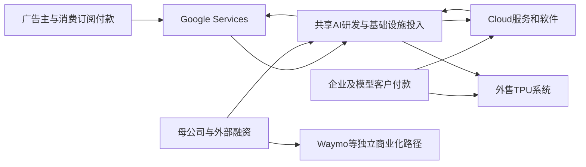

# Alphabet Inc.（谷歌母公司，NASDAQ：GOOGL）公司调研

研究截止：**2026年10月16日08:44 UTC，即洛杉矶时间2026年10月16日01:44 PDT**。只纳入此前公开且本次能够核验的材料；不使用2026年第三季度尚未发布的财务结果。最近完整财务期间为2026年第二季度，资产负债表时点为6月30日，期后融资和经营事件另列。金额除特别注明外均为**十亿美元，USD bn，1＝10亿美元**；财务采用美国GAAP，自然年口径。未作股价、目标价或投资评级判断。

本文用“披露”表示来源中的事实，用“管理层称／预计”保留陈述方的利益关系；“计算”来自已披露数据；“研究估计／条件算例”是本报告假设；“未知”保留尚不能识别的参数。预测区间不具有统计置信水平。全文工作路径是一组当前较有解释力的相容经营假设，**不是数学期望，也不是公司指引**。

## 一、当前判断：商业入口正在扩大，资本回报尚未完成验证

Alphabet的经济核心，是通过搜索、视频、移动终端和企业数据入口捕获商业意图，再用广告拍卖、订阅、软件和计算服务收取对价。它的独特能力在于：既有能够自行分发AI的消费产品，也有可以对外销售的模型、芯片、云基础设施和企业服务。因此，竞争对手采用更多AI，并不必然使Alphabet失去业务；但更多调用、更多设备和更大的合同金额，也不能直接证明普通股股东获得了更多可分配现金。

本次研究最支持的判断如下。

1. **搜索的商业体系仍在扩张，“AI已经造成搜索收入崩塌”不符合已发生结果。** 2026Q2 Search & other收入63.271，同比增长约17%；付费点击增长13%、平均CPC增长3%。这比单纯查询次数增长更接近真实付款。但它证明的是合并搜索业务仍强，不能单独识别AI答案的因果增益、成本或净蚕食。未来最危险的变化，是商业决策迁移到其他代理，而Google保留更多低变现查询及计算费用。[S01][S02]（MD&A：Google Advertising）

2. **Google Cloud已经越过“大量免费试用、没有商业需求”的阶段，但正在同时成为服务商、系统卖方和信用支持方。** Q2收入24.768、分部经营利润8.814；Q2首次确认外售TPU系统收入。2026Q1起，积压合同还纳入原预计期限不超过一年的合同。因而82%的收入增长、513.9的Cloud积压合同和35.6%的分部利润率，分别有产品组合、统计范围和共享研发归属的限制，不能拼成一条无条件的长期软件利润曲线。[S01][S02]（Notes 1–2）[S03]（Note 2）

3. **真正的新机会不只是Gemini回答问题，而是把芯片和企业执行能力卖到Google原来不控制的环境。** TPU外售触达客户自有机房；Apple已在其原始技术材料中确认，将部分Private Cloud Compute工作负载扩展到使用NVIDIA GPU的Google Cloud；10月8日发布的Gemini agent又试图在Workspace之外连接微软办公软件、第三方业务系统和模型。这些路线扩大可触达业务，也把利润分给芯片、渠道、模型和系统集成伙伴。Apple合作尤其不能全部当作TPU收入。[S10][S12][S13]

4. **目前最缺的证据是新增AI资本的完整周期回收，而不是公司能否获得收入。** Q2经营现金流39.069、现金资本开支44.924，自由现金流为−5.855；上半年自由现金流仍为正4.261。公司把2026年资本开支指引上调至195—205，并预计2027年显著增加。固定投入、未投用资产、硬件库存和合同支持的扩张，意味着会计利润可能先于或晚于现金表现。[S01][S04]（CFO发言，pp.10–14）

5. **资金承受力强，但“现金很多，所以资本没有约束”已不适用。** 6月末列报现金及可交易证券242.474，其中可交易权益证券87.063；剔除该项后为155.411，仍不是扣完债务和承诺后的自由现金。8月10日另发行25的母公司债券，Waymo在10月8日又取得5的子公司贷款。大额采购和信用支持使融资、减少投入、出售投资及股权稀释成为实质变量。[S02]（Notes 3、6、10）[S14][S15]

6. **Waymo值得作为独立经营路径研究；量子、药物发现和机器人应保留，但不能用技术愿景填集团盈利缺口。** Waymo已有每周超过50万次付费无人驾驶出行、15座美国城市的商业基础；下一门槛是车辆、城市运营和全成本回报。Isomorphic Labs的临床转化和量子计算的有用问题优势仍是更长周期的分支，资金、收入及经济权益也不全部属于GOOGL普通股。[S16][S17][S18][S19]

作为可复核的工作路径，本报告估计2026／2027／2028年收入约**503／616／695**，经营利润约**168／195／212**；对应现金资本开支200／270／300，常态经营现金代理约184／221／273，自由现金约**−16／−49／−27**。这些结果来自第九节的业务和成本假设，**不能把负自由现金流理解为必然失败，也不能把收入扩张理解为已经创造资本回报**。在更强的付费采用及利用率路径下，2028年收入可接近878、自由现金约45；反向路径则可能在削减投入后恢复少量现金，却使经营利润大幅下降。

最强的相反解释是：Google已经拥有低成本计算、全球分发和可信企业交付，当前高投入只是把已签需求提前变成供给；外售硬件又把部分机房负担转给客户，后续现金会迅速释放。这个解释有真实合同和增长支持。本研究没有排除它，但现有公开信息尚不能确定净成交价、硬件份额、客户融资依赖、资产更新成本及全部信用责任的组合，故不把它当成已经兑现的事实。

## 二、公司边界：谁付款，谁控制，利润和资金归谁

### 1. 需要保留的经济单元

| 经济单元 | 使用者、采购方与付款单位 | 取得收入和现金的机制 | 关键经济差异 |
|---|---|---|---|
| Search & other，包括重要搜索和地图商业入口 | 消费者免费使用；商家、品牌和代理商采购 | 以点击、展示等事件计费；完成广告交付后确认收入，客户账期或预付 | 意图质量、拍卖、默认分发与TAC；AI查询未必商业化 |
| YouTube广告 | 观众使用；品牌、效果广告主采购 | 广告展示、观看或交互；创作者和内容方分成列成本 | 与搜索不同，受观看时间、广告负载、版权、电视端和内容供给约束 |
| Google Network／广告技术 | 外部网站、应用、出版商和广告主 | 广告撮合、投放和变现；多项业务按毛额确认并支付伙伴 | 开放网页流量、抽成与互操作监管；不能把全部收入当净平台费 |
| 消费订阅、Play和设备 | 个人、家庭、应用开发商、设备购买者 | YouTube、Google One／AI套餐按期收费；Play通常赚服务费；设备交付确认 | 收入归同一财报大项，利润、资本和蚕食完全不同 |
| GCP基础设施与数据平台 | 企业IT、开发者、模型实验室、政府 | 按计算、存储、网络、数据处理用量；部分承诺容量按合同收费 | 计费利用率、迁移和更新周期；有明显物理资本负担 |
| 企业AI、Workspace与安全 | 业务部门、CIO、CISO及采购；员工或代理使用 | 席位、订阅、token、工作负载和服务组合 | 活跃、续约、集成、权限和推理成本；并购与捆绑可改变口径 |
| 对外TPU系统 | 少数大规模客户或其基础设施伙伴 | 硬件与软件控制权转移时确认相应收入；安装、支持、延保随履行确认 | 存货、验收、退货估计、质保、信用和交付集中；不同于持续租赁 |
| Waymo及其他探索业务 | 乘客、配送商、药企及未来工业／科研客户 | 按出行、交付、合作研发、里程碑等取得收入 | 安全许可、城市组织、临床与技术阶段；少数股东、融资及停止项目的成本 |

广告、云消费、订阅和TPU系统的收入确认依据公司会计政策。外售TPU安排可能含作为退货权核算的客户选项；不能将全部系统合同视作没有后续责任的现金销售。[S02]（Note 1） 表中业务解释并不构造公司未披露的历史分部财务。

Alphabet内部共享DeepMind／Google Research、TPU、数据中心、网络、销售、安全、账户和品牌。搜索与YouTube为前沿研究和新业务提供资金；Cloud可销售内部技术；Gemini也可能把原来广告支持的查询转到订阅或免费助手。**自用TPU、内部模型调用和内部迁移不创造集团收入**；对外API、软件、硬件及广告才有外部付款。共享模型研发已有相当部分在Alphabet-level activities，不能在各分部利润之下重复扣除同一笔研发。

图中的内部箭头表示资源和能力转移，不是可相加的营业收入。融资是资金来源，也不是终端需求。

2026Q2按客户地址统计的收入约51%来自美国、27%来自EMEA、16%来自APAC、6%来自其他美洲；这是销售地域，不是服务器、数据或最终用户位置。欧盟限制能影响重要商业入口，汇率则改变美元报告增速；具体作用取决于合同币种、成本地域和产品组合，不能只按海外收入比例统一打折。[S02]（Note 2及MD&A：Geography）

### 2. GOOGL对应的权利及能力边界

GOOGL是Alphabet直接在美国上市的Class A普通股，非ADR，每股一票；GOOG为通常无投票权的Class C；未上市Class B每股十票。普通股经济权益大体相同，但控制权明显不同。6月末A／B／C流通股分别约5,868／835／5,527百万股；仅按类别计算，B类约占A、B合计投票权的59%。该计算不是两位创始人各自的持股统计。普通股东不能通过普通经济持股比例推定对资本配置有同等控制力。[S01]（资产负债表）[S05]（Note 11）

Google掌握搜索索引、分发、广告竞价、TPU系统架构、编译和模型能力；但不拥有整个互联网内容，也不拥有半导体代工厂。数据可用性受用户同意、客户合同、版权和监管限制。Broadcom负责开发和供应定制TPU及相关网络组件；4月6日披露的安排最长延续至2031年。Google的软硬件协同不消除对外部晶圆、封装、HBM、网络及电力工程的依赖。[S20]（Item 8.01）

Apple保留PCC软件批准和用户隐私控制；Google不能把承接Apple计算量等同于取得Apple用户数据或默认助手控制权。Wiz继续支持多云，客户不必因此把全部计算迁入GCP。Waymo、Isomorphic Labs等引入外部资本后，估值、合并收入、控制权和普通股可分配收益也需分别判断；公开信息不足以逐一还原最终优先权及完全稀释权益，本文不把所有探索业务价值100%归属GOOGL。[S10][S21][S17][S18]

## 三、五个季度的可比基线：经营改善与现金负担同时发生

下表金额为十亿美元；季度为当期流量。GAAP经营利润已经包含相应股份薪酬和折旧，不能再扣一次。经营现金流减现金购置物业设备为公司定义的FCF，尚未扣并购、股权投资和分红。

| 指标 | 2025Q2 | 2025Q3 | 2025Q4 | 2026Q1 | 2026Q2 |
|---|---:|---:|---:|---:|---:|
| 集团收入 | 96.428 | 102.346 | 113.828 | 109.896 | 119.796 |
| Search & other | 54.190 | 56.567 | 63.073 | 60.399 | 63.271 |
| YouTube广告 | 9.796 | 10.261 | 11.383 | 9.883 | 11.055 |
| Network | 7.354 | 7.354 | 7.828 | 6.971 | 7.303 |
| 订阅、平台、设备 | 11.203 | 12.870 | 13.578 | 12.384 | 12.911 |
| Google Cloud | 13.624 | 15.157 | 17.664 | 20.028 | 24.768 |
| Other Bets收入 | 0.373 | 0.344 | 0.370 | 0.411 | 0.382 |
| Google Services经营利润 | 33.063 | 33.527 | 40.132 | 40.589 | 39.544 |
| Cloud经营利润 | 2.826 | 3.594 | 5.313 | 6.598 | 8.814 |
| Other Bets经营损失 | −1.246 | −1.426 | −3.617 | −2.100 | −1.799 |
| Alphabet层面经营损失 | −3.372 | −4.467 | −5.894 | −5.391 | −5.789 |
| 集团经营利润 | 31.271 | 31.228 | 35.934 | 39.696 | 40.770 |
| GAAP净利润 | 28.196 | 34.979 | 34.455 | 62.578 | 112.193 |
| 经营现金流 | 27.747 | 48.414 | 52.402 | 45.790 | 39.069 |
| 现金资本开支 | 22.446 | 23.953 | 27.851 | 35.674 | 44.924 |
| FCF | 5.301 | 24.461 | 24.551 | 10.116 | −5.855 |

来源为各季度公司原始财报的Supplemental Information、利润表和FCF对账表。[S01][S06][S07][S08][S09] 各收入列与集团之间还包含汇率对冲净额；没有以表中可见产品之和强行抹去该项。

2025全年收入402.836、经营利润129.039、经营现金164.713、资本开支91.447、FCF73.266。2026Q2结束的滚动十二个月收入计算为445.866，经营现金185.675，资本开支132.402，FCF53.273。**收入和经营现金仍在增长，但再投资更快地吸收现金**；一个季度负FCF与滚动全年正FCF可以同时成立。[S01][S07]

### 1. 哪些增长可以确认，哪些不能直接归AI

搜索收入与付费点击增加，Cloud已确认收入及分部利润扩大，是较强的商业证据。Q2报告收入增24%、固定汇率增23%；Q1为22%与19%，说明汇率对前期增速的贡献更大。不能把全部名义增长都当作采用改善。[S01][S08]

Cloud同比增长还包含3月11日并入的Wiz和Q2首次出现的TPU系统销售。管理层称，剔除TPU销售后Cloud增速仍显著加快，但未披露两项的完整季度收入、利润及可比桥；因此不能精确分解82%中的服务内生增长。Wiz原公告交易价32，与财报29.5的购买价格口径不同，后者已经过调整且排除合并后薪酬安排，不是交易突然“便宜2.5”。[S02]（Note 8）[S04]（pp.12–13）[S21]

2025Q3的Services利润含3.5的欧盟罚款；2025Q4的Other Bets损失含2.1的Waymo员工薪酬费用。两项影响可比，但不宜把持续人才成本和监管经营责任统统剔除后视为不存在。2025年美国税法允许部分国内研发即时费用化和合格资本开支加速扣除，也影响经营现金时间，不能把Q3、Q4高现金转换率固定外推。[S06][S07]

### 2. 利润和现金为什么背离

Q2营业外净收益97.983，主要来自权益投资未实现收益；它大幅推高净利润及每股收益。半年现金流对账中，证券净收益扣回135.803。**本报告经营模型不把投资重估重复作为Cloud、搜索或资本开支的现金来源**。投资最终出售可以产生现金，但金额、限制、股价和税负均另算。[S01]（现金流量表）

另一项变化来自营运资本：上半年存货现金占用增加7.739，应收占用增加6.904，其他资产占用增加9.950；这些不能由非现金重估抵消。期末存货由2.439升至9.991，与外售TPU系统及设备备货有关，但公司没有公开完整的代际、库龄、客户归属和取消数据。它既可能是已签交付前的正常爬坡，也可能在客户推迟验收时成为资金和减值负担；仅凭存货增加不能判定滞销。[S01]（现金流量表）[S02]（Notes 1、7）

6月末尚未投用资产122.814，2025年末为78.592。投入后到投用可经历数月至数年，未投用期间不按相同方式开始折旧；未来投用后，折旧与运维会继续进入利润表。公司服务器和网络设备一般按六年折旧，这不等于每一代AI资产都有六年的经济竞争寿命。[S02]（Note 7及MD&A：Capital Expenditures）[S05]（会计政策）

## 四、搜索：需要保住的是有支付意愿的商业意图

### 1. 客户为什么付费，AI能改变什么

搜索广告主付费的依据，是新增订单、有效保险线索、酒店预订、软件付费或品牌触达。决定预算的通常是增长团队、代理商和财务；最终约束来自商品贡献毛利、退货、履约、复购与现金周期。Google能提高匹配和转化，却不能创造广告主本来没有的长期支付能力。

Google的优势包含意图表达、海量候选商家、转化反馈、自动出价、反作弊、结算和分发。它不是只靠一款语言模型保住CPC。更复杂的自然语言查询可以扩大可理解的商业意图；AI Max、PMax和自动创意又降低中小广告主投放门槛。反面是，代理可能只推荐少量商家，减少广告位置；订阅助手也可能替代原来产生广告点击的比较过程。

Q2付费点击增加13%、CPC增加3%，乘积约增加16.4%，与搜索收入约17%的增长相近，剩余差异可由四舍五入及业务口径解释。**这是一项数量与平均价格分解，不是AI因果实验**。平均CPC还受地域、设备、品类和外汇影响，不能直接当作同一广告位的真实提价。[S02]（MD&A：Google Advertising）

公司在Q2电话会称，AI Max已有50万广告主采用，采用相关AI广告活动的客户平均在相似ROAS下取得约15%更多转化或价值；AAA Auto Club的案例为转化量增加17%、每条线索成本下降11%。这是有对象的商业进展，但属于供应商披露的选择样本，未提供全体客户、随机对照及退货后利润，不能外推成所有客户支付额提高15%。[S04]（pp.7–8）

### 2. 一个能显示净蚕食的经济单位

以下为条件算例，并非Google披露的每次查询收入。设原来1,000次查询带来100个付费点击，平均CPC为0.50美元，则收入50美元。AI使查询量增加10%，但每次查询的付费点击密度减少15%，CPC提高至0.52美元，则收入为：

`1,000 × 1.10 × 0.10 × 0.85 × 0.52 = 48.62美元。`

查询增加，收入仍减少2.8%。若TAC按该收入的18%计算，新查询每千次另增加2美元计算成本，那么对原来这1,000次查询对应的贡献现金变化约为：

`(48.62 − 50) × 82% − 1.10 × 2 = −3.33美元。`

若付费点击密度保持、平均CPC提高5%，同样10%的查询增长则可把收入推至57.75美元，足以覆盖较多新增计算。决定方向的不是“有多少人用了AI”，而是商业任务留存、广告密度、成交价、TAC及任务成本的组合。

新增AI回答成本若为每次0.001—0.005美元，每万亿次回答对应1—5的年度成本。该范围只是成本压力测试，**不是对Google实际单位推理成本的估计**；公司没有给出可核验的全成本点值。模型路由、缓存、轻模型和TPU效率可降低成本，更长上下文、视频、重试及代理链条也可能扩大工作量。

### 3. 分发和网页生态的最强反证

Apple、Android、Chrome、地图、账户和日常习惯共同支撑入口，但默认分发存在持续对价与监管约束。Q2集团TAC16.179约占广告收入19.8%；它混合了搜索分发和外部网络伙伴分成，不能当作搜索统一TAC率，也不能把它全部当作给Apple的付款。[S01]

Pew对2025年3月美国浏览行为的原始研究发现，出现AI摘要时，用户点击传统搜索结果链接的比例约8%，没有摘要时约15%。这是独立于Google的反证，说明开放网页的流量分配确实可能变化；但样本较早、查询复杂度不同，也不是付费广告点击实验。它不能证明2026年Google广告收入会按相同比例下降。[S22]

更深的风险是反馈循环：外部出版商回报下降，内容授权、反抓取和诉讼成本上升，新鲜独特内容供给减少；Google需要用付费数据、合作或更强检索补足。反方向则是AI将原来无法回答的问题转为新查询，并给高质量来源带来更有目的的访问。现有公开数据尚不足以区分长期均衡。

本研究更支持2027—2028年搜索继续增长，但增速低于2026年的工作路径：付费点击年增长约8%—9%，平均CPC约2%，使收入由2026年研究估计266增至295、325。这个判断依赖商业任务没有发生持续净外迁；若同口径付费点击连续两季停滞、价格也不能补足，工作路径应转向第十节的利润受压分支。

## 五、YouTube、消费AI和平台：分发相通，单位经济性不同

### 1. YouTube的价值来自内容、观看和多种付款方式

YouTube同时取得广告、Premium／Music、电视订阅及体育内容等收入。2025全年广告40.367，广告与订阅合计超过60，说明订阅不是微小附属；但不能从两者差额推定各类订阅的利润。付费免广告会减少该用户原来对应的广告库存，新增订阅收入必须扣除被替代的广告贡献及额外内容成本。[S07]

长视频观看页广告通常向创作者支付相关净广告收入的55%；Shorts创作者取得的是创作者池分配额的45%，池还受音乐版权等安排影响。**不能用“平台保留45%”把所有YouTube收入直接乘成毛利**。带宽、存储、推荐、审核、版权、获客和产品研发仍需支付，电视和体育包还可能带来较固定的内容承诺。[S23]

2026Q2广告收入11.055，同比增长13%；世界杯带来重要观看和广告需求，属于具体事件与可重复平台能力的组合，不宜把全部同比改善外推为永久斜率。可持续增长更取决于电视端观看、广告匹配、内容留存、付费升级以及Shorts与长视频之间的组合。其竞争对象包括TikTok、Reels、流媒体、播客、电视和零售媒体，并非只有另一个视频网站。

8月公布的YouTube Partner Program调整计划涉及2027年2月起的资格和订阅分配规则。官方说明中，Premium及Premium Lite分别设置基于净订阅收入30%和60%的池，再按观看分配并适用相应创作者分成。该条款说明平台正在重分配价值，**不是2026年已兑现的成本节省**；适用收入、内容权利、创作者响应和订阅流失决定净影响。[S24]

研究工作路径中的YouTube广告2026／2027／2028年为45／51／57，分别需要持续观看和商业化改善，而非只增加广告负载。若内容分成或版权成本每增加广告收入的5个百分点，以2028年57计，会减少约2.85的年度贡献；这与同等收入的搜索变化不能按同一利润率处理。

### 2. Gemini用户规模很大，直接付费和净增收入仍需约束

Q1公司披露消费服务付费订阅合计3.5亿份，主要由YouTube和Google One推动。它是订阅份数，既不是独立付费人数，也不是AI付费人数。[S08] 9月1日官方回顾确认，Gemini app在8月超过10亿月活；同期又提供面向合格学生的一年免费AI计划，并推出价格更低的Flash代际。**月活、赠送计划、已付费席位和可持续ARPU必须分别计量**。[S25]

一个规模约束：若10亿月活中有1%—4%形成真正新增、非原有存储升级的付费等价用户，每年净对价120—180美元，AI直接订阅收入约1.2—7.2。这是付费率和净价的条件范围，不是已披露用户数。更强路径若有6,000万新增付费等价用户、每年180美元，对应10.8，也不能再加到已经包含Google One增长的“订阅、平台、设备”预测之上。

经济门槛是每月实收收入能否覆盖用户的真实服务强度、分发佣金、支持、训练及资本消耗。重度视频、长输出和持续执行代理可能使少量用户消耗大部分成本；免费额度、分层模型、缓存和额度限制是经营控制工具，而非仅影响用户体验。公共API价格是另一产品的对价，不能当作消费套餐的实际内部成本。

Gemini与搜索也存在两种相反传导：它可保留用户、创造新商业任务和带动存储／订阅；也可把广告支持的高价值任务迁到低价套餐中。Android、Chrome和Pixel的作用，是减少分发依赖、取得任务上下文、使端侧模型承担部分工作，并为云服务提供入口。端侧计算节省云成本，不自动增加Google收入；硬件折扣、保修、库存及渠道费用也可能消耗协同价值。

Play与设备收入未单独完整披露，本文不伪造它们的历史利润。应用支付外部化和反引导限制削弱部分平台收费权；Pixel则是更低毛利、需要存货和售后的模式。这也是第九节没有把整个Services按纯软件利润率估值或预测的原因。

## 六、Cloud的新边界：服务增长、企业执行和TPU外售要分别兑现

### 1. 已有商业证据与代表性

| 对象、公开日期及阶段 | 已经可以核验的内容 | 支持什么判断 | 仍然不能证明什么 |
|---|---|---|---|
| Google Q2，2026-07-22 | 24.768收入、8.814分部经营利润；公司称过去一年近500个客户各处理超过1万亿token | 商业化已超出少数演示，付费工作量在扩大 | 客户分布、折扣、缓存、信用、净留存及产品利润均未完整披露；客户子集可能嵌套 |
| Apple，2026-06-08，客户原始技术披露 | 部分高要求PCC任务扩展至Google Cloud，使用NVIDIA GPU、Intel TDX和Google Titan，并保留Apple控制与可验证隐私 | 除自家消费AI外，Google取得重要第三方服务资格；机密计算与交付可构成差异化 | 合同金额、全面部署进度及单任务毛利；不能视为全部Apple AI迁入GCP或TPU |
| HSBC，2026-06-17，客户侧多年合作 | 已有600多个应用运行在GCP；计划两年增加200多个AI用例，部分工具已有数千用户使用 | 真实存量系统提供扩张入口，并有金融业的安全、实施和治理需求 | 未来目标不是已实现收益；银行保留的人力收益不等于Google收入 |
| Ryanair，2026-08-12，客户侧五年协议 | 拟向35,000名员工部署Workspace、Cloud及Gemini Enterprise，采取双云策略 | 可以进入较大员工群和核心运营预算，且多云并不阻止采用 | 35,000人不等于35,000份独立高价Gemini席位；部署、活跃、续约及净价尚未给出 |
| Anthropic，2025-10-23及2026-04-06 | 先计划至多100万TPU及2026年超过1GW；后扩展至2027年起的多GW合作 | 大型客户具有持续训练／推理需求，已形成多代TPU迁移基础 | 不代表上限全部交付；多个公告有范围重叠，也不保证全部是GCP持续服务收入 |

来源：[S01][S11][S10][S32][S33][S28][S29]。客户侧材料提高了采用对象和阶段的可信度，但仍是合作双方的陈述；本报告没有取得这些合同的完整净价、验收、回款及取消台账。

HSBC、Ryanair、Apple的证据对预算来源、交付资格和组织采用有帮助，不能用三个Logo推导Cloud全部规模。另一方面，不能因为客户合同不披露价格，就把已确认的Cloud收入视作没有需求。真正需要保留的未知，是增长在大实验室、传统企业、软件席位、系统销售之间如何分配，以及各层最终客户能否持续支付。

### 2. 企业AI的壁垒在执行和治理，不止模型榜单

BigQuery、GKE、Cloud Run、存储、网络、数据库和安全系统把模型接到真实数据与业务动作。企业采购不仅比较一次回答质量，还要求权限、审计、身份、数据驻留、异常恢复、供应商责任、费用控制和原有系统接口。数据积累和迁移成本能产生续用，但开放格式、多云以及客户自建也在降低部分锁定。

10月8日Gemini at Work发布的Gemini agent，强调持久执行、记忆、工具、skills、治理和多模型选择；可连接Workspace、Microsoft 365及第三方系统。公告中的不同功能、行业专业化和客户试验阶段并不完全相同，不能把“发布一个统一入口”视为所有企业已全面生产部署。其商业意义在于，Google尝试承接工作流预算和执行入口；失败路径则是用户仍只把它当搜索框，付费增长有限而长任务成本增加。[S12]

Wiz、Mandiant／威胁情报、安全运营及自动修复，可以在更多AI代码和工作负载出现后扩大需求。Wiz对多云的支持扩大可触达客户，也要求Google保留中立性；如果以GCP捆绑为主要条件，可能损害原有客户信任。2026年的整合、摊销和销售成本会先发生；单靠“AI攻击增多”不能证明收购得到充分回报。[S21]

作为回收门槛算例：29.5的收购对价若要求10%的年度税后资本回报，成熟期需要约2.95税后经营利润；若税前经营率30%、税率20%，对应收入约12.3。它不是Wiz预测，也没有把全部Google安全协同都归Wiz；只是说明较大的购买价格必须靠跨产品扩张、较高利润或更长期限兑现，不能用客户数量替代回报分析。

### 3. 模型、TPU和软件协同：优势存在，利润归属要另证

Google不是在通用GPU之上只加一个API。它能协同设计模型、编译器、TPU、互连和任务路由；稳定的大规模自用负载有助于验证、批处理、改进内存利用，并把研发分摊到搜索、视频、云客户和Gemini。

第八代TPU按主要瓶颈分成8t和8i：8t偏大规模训练及embedding，8i偏采样、推理和低时延服务，使用更大的片上存储、CAE和Boardfly等设计。厂方对Ironwood宣称训练性能／美元最高改善2.7倍、推理最高改善80%；这些是指定条件下的供应商比较，并非所有模型和SLA的实测结果。[S26] 若保持同等任务质量和时延，性能／美元改善80%对应单位成本下降约44%，不是下降80%；客户最终拿到多少优惠、Google保留多少利润，取决于竞争和成交条款。

这条优势的限制很具体：移植算子和编译、PyTorch／JAX兼容、长尾内核、低批量、长上下文、通信效率、可靠性及调试支持，都会改变客户的完整任务成本。NVIDIA拥有广泛工具和通用生态，AWS拥有Trainium及Anthropic的另一大训练入口；大客户可多源采购、自研、改变精度与缓存策略。Google提供GPU并不等于TPU失败，客户购买TPU也不等于把全部工作负载交给Google。

9月30日的Gemini 4 Argon是必须计入的新披露：首批经Fairwind向可信网络防御客户开放，计划再扩展到开发者、企业和消费者；初始API定价为输入2美元／百万token、输出10美元，缓存输入比输入价低95%。官方强调最长100万输出token和复杂长任务能力。**这是分阶段发布与技术／价格声明，不是全量商业采用证明**，也没有解决长任务可靠性和单位资源成本。[S34A]

Argon可帮助代码迁移、漏洞发现和内部资源优化，但内部案例没有审计到完整研发成本节省。若一次代理任务使用100万输出token，按公告标价仅输出就为10美元；客户必须取得足够的任务价值，Google也必须控制重试和推理资源。8月Flash代际更低的引入价说明性能进步可能让利给客户，而不是全部变成平台毛利。[S25][S34A]

### 4. token不能直接乘成整个Cloud收入

7月披露的API速率为每分钟220亿token，机械年化约11,563万亿token。若全部可按每百万token净收0.5—2美元计费，年化对价约5.8—23.1。这个算例故意使用很宽的混合净价，**不代表实际付费比例或收入估计**；输入、输出、缓存、免费额度、模型和模态不同，真实组合未知。[S11]

它说明两个边界：第一，API活动足以形成重要业务，但不能把全部Cloud收入命名为Gemini API收入。第二，Cloud还包含外部模型计算、非AI计算、存储、数据库、Workspace、安全和系统销售；这些预算与终端应用收入部分嵌套。Anthropic向客户收到一美元，再向Google购买计算，不是在全球最终需求中凭空增加第二美元。

### 5. 合同、系统外售和信用关系的关键区别

2026Q1，Google新增披露少数多GW的TPU硬件协议，纳入当季积压合同。Q2确认首批送达客户数据中心的系统收入。管理层预计既有系统销售协议的大部分收入在2027年兑现，2026年仅较小部分，并表示Q3增加第三方容量作为内部建设前的过渡，近端利润率会承压。[S03][S04]（pp.12–14、21–23）

因此必须保留三条路径：

- **Google自建并对外出租**：先付机房与设备资金，再按用量或承诺容量收费；承担资产更新和剩余利用率风险。
- **Google销售TPU系统给客户／其伙伴**：重点变成供应链、存货、交付验收、软件支持、退货估计及回款；客户可能承担机房，但Google不一定完全退出资金和信用风险。
- **通过Broadcom和外部运营／金融伙伴的容量合作**：需要查清Google取得的是何种硬件或服务对价、是否为主责方、信用支持与资产使用权；不能把整个租约和每一层供应商收入都归Google。

Broadcom4月6日8-K说明，Anthropic从2027年起通过Broadcom取得约3.5GW，为多GW合作的一部分，实际消费依赖Anthropic持续商业成功。不能将其与更早1GW、后来的5GW表述机械相加，也不能把3.5GW当作2027年全年平均已投用负荷。[S20]

Anthropic5月28日宣布650亿美元融资及当月超过470亿美元收入年化运行率，提供了需求和融资承受力的正证据；融资包括此前已承诺的平台投资，运行率又不是全年确认收入。[S30] 10月1日Reuters依据其取得的IPO文件报道，Broadcom可能提供最高42的融资，支持125.2的五年TPU容量租约，部分违约可触发提前付款义务。本研究**未取得该招股文件原件及附件**，该项作为可信二手线索，不作为已审计合同余额，也不与Google积压合同相加。[S31]

融资、供应和采购互相支持，可以使有价值的技术更早交付；若终端付费不足，也会把同一客户风险传到供应商、云商、租赁方和担保方。这个机制不等于已经发生虚假收入。需要的反证是实际第三方付款、合同履行和后续续约，而不是再出现一个更大的融资估值。

积压合同的合并解释集中如下：Q2集团RPO519.5，其中Cloud513.9，包含相关递延收入并排除可取消合同及部分向客户付款；公司预计略超过50%在24个月内确认。**不能再加递延收入，也不能解释为已经收到现金**。Q1统计范围纳入一年以内合同，使跨2025年的增速不可直接比较；公司没有提供可复原的毛新增、修改、取消和重定价流水，故不报告“取消率”。[S02]（Note 2）[S03]（Note 2）

## 七、从合格供给到现金：Cloud的资本门槛

### 1. 有效供给不是芯片数量或宣布的GW

Google可以在内部和外部负载之间调配资源，但这种调配有代价：自用搜索和模型训练、租给客户、卖给客户的TPU，争夺部分相同的设计、HBM、封装及工程资源。卖出系统可更早取得收入，却可能放弃多年服务收入；保留自用可保护搜索，却可能推迟外部交付。GPU补充、第三方容量和不同代际迁移提供替代路线，成本与SLA并不相同。

交付需要按顺序或并行完成：芯片与HBM齐套、系统集成及可靠性、机房／供电／冷却、网络、软件适配、客户资格和验收。厂商峰值FLOPS、购买订单、正在施工的建筑和客户表达的容量需求，分别只证明其中一部分。Cloud没有披露足以审计的自有AI可计费MW、TPU分代存量和利用率，因此本研究不声称已经测出2027年的精确供需缺口。

Broadcom2026财年第三季度AI半导体收入16.7，同比增长221%，是供应链确实在扩大交付的正证据，但包括其他客户和网络产品，不能全部还原为Google TPU片数。[S47] Intersect提供更接近发电、储能与数据中心共址的开发能力；3月10日卖方确认交割。原股权交易4.75加承债，与Alphabet财报购买价格5.9不同；同时分拆出去的IPX电网侧资产不能全部记为Google拥有的可用发电能力。[S45][S02]（Note 8）

电力的边界尤其重要：年度购买可再生电量，不保证某一园区在某日取得连续可用功率；储能时长、接入资格、备用、动态负荷和当地许可均会限制交付。获得能源开发商也没有消除电网与设备制造的等待。公司拟增加第三方容量，本身说明当前供给需要桥接，而不是任何供给都只能用自建解决。

### 2. 公开租价显示分层收费，不能用标价推断利润

截止检索时，Google官方价格页列示Iowa的Ironwood每chip-hour按需12美元、一年承诺8.40、三年承诺5.40；计费单位是芯片小时，控制台还可能显示多芯片VM小时。价格页说明READY状态计费，承诺方式又可能按预留额度月结。因此，物理忙碌率、客户有用任务利用率和卖方计费利用率可以不同。[S27]（Regional pricing及usage options）

这些价格不支持三个常见推论：一是不能把12乘所有日历小时当实际收入；二是12降至5.40包含承诺期限差异，不是同合同价格已经下跌55%；三是不同代际芯片、低精度和模型质量不同，chip-hour不是跨代同质工作量。

对Google而言，承诺计费可以降低短期闲置风险，但会把风险转为客户信用、续约及新一代替换。客户即使付完合同，若没有取得足够任务回报，也可能在下一轮转用其他平台或要求大幅折扣。

### 3. 100MW资产的完整周期算例：能盈利不等于投入充分回报

为检验经济门槛，本研究建立一个**独立假设的100MW自有IT资产块**。它不是Google园区造价、真实报价、利润率或实际ROIC估计，也不把这组参数套给全部Cloud。选择这个单位，是为了同时处理建设、爬坡、降价、资产更新和残值，而不把不同芯片的峰值性能视作可售收入。

参数均以十亿美元计：2026年末初始投入4.0，其中设备2.8、机房与配套1.2；设备经济寿命五年、机房十五年；2032年初进行2.2设备更新。首代和更新后首年的“100%计费利用率净收入能力”均假设为2.4，代内每年下降8%。2027—2036计费利用率依次为35%、70%、75%、75%、70%、65%、75%、75%、70%、65%。固定现金成本每年0.42、随收入变化成本10%，含电力、网络运维、人员及该资产对应的产品支持研发；维护投入每年0.05，营运资本为收入3%，现金税为正经营利润20%。期末税后净残值0.65，包含剩余营运资本回收并扣处置成本；未单独兑现亏损税抵扣，故税务处理略偏谨慎。

固定成本中的电力数量级可检查：100MW、PUE1.15、每年8,760小时、电价70美元／MWh，满负荷电费约0.071。其余成本、构建价格、容量收入和残值都是研究参数，不是由电费证明的真实成本。建设支付集中到2026年末；若实际提前两年付款，回报会更差。

`收入＝当代首年满计费收入能力 × 0.92^(代内年份−1) × 计费利用率。`

`自由现金＝收入−现金成本−现金税−维护和更新投入−营运资本增加＋期末净残值。`

| 年份 | 计费利用率 | 收入 | 经营利润 | 当年维护／更新投入 | 含营运资本、税及残值的自由现金 |
|---|---:|---:|---:|---:|---:|
| 2026年末 | — | — | — | 4.000初始投入 | −4.000 |
| 2027 | 35% | 0.840 | −0.304 | 0.050 | 0.261 |
| 2028 | 70% | 1.546 | 0.331 | 0.050 | 0.834 |
| 2029 | 75% | 1.524 | 0.311 | 0.050 | 0.840 |
| 2030 | 75% | 1.402 | 0.201 | 0.050 | 0.755 |
| 2031 | 70% | 1.204 | 0.023 | 0.050 | 0.614 |
| 2032 | 65% | 1.560 | 0.464 | 2.250 | −1.369 |
| 2033 | 75% | 1.656 | 0.550 | 0.050 | 0.907 |
| 2034 | 75% | 1.524 | 0.431 | 0.050 | 0.819 |
| 2035 | 70% | 1.308 | 0.237 | 0.050 | 0.666 |
| 2036 | 65% | 1.118 | 0.066 | 0.050 | 1.178，含0.65残值 |

这组假设下，十年税后无杠杆IRR约**5.8%**，12%研究门槛下NPV约**−1.01**。2028年以后多数年份盈利，并未让资本回报自动达标。维持其余假设，首年满计费收入能力要由2.4提高到约**2.83**，才达到12%回报；相当于每MW首年满计费净收入能力约2,830万美元。这是所设资产、成本、利用率和更新条件的必要收入密度，不能当作Google实际租金或行业统一门槛。

联合扰动保留经济联系：净价降低20%、计费利用率每年低15个百分点，IRR约−11.8%、NPV约−3.36；净价高10%、利用率高10个百分点，IRR约15.0%、NPV约+0.52。后一条要求客户支付、交付和持续使用同时较强，不是把所有利好端点独立相加。若合同保证收费，即使物理利用率较低，Google可取得更好现金；最终还需检验客户能否履约与续约。

Google实际能否超过这一门槛，公开资料尚不能直接识别。自研芯片、软件、已有机房和共享负载可降低投入或提升有效产出，利于回收；第三方租赁、内存涨价、延期、价格竞争和更短经济寿命则相反。**算例支持“必须查回报”的判断，不支持“Google新增AI必然低回报”的结论。**

### 4. 系统外售的资本曲线不同

TPU系统外售收入应从可交付数量、净对价及控制权转移推导。本文用“外售系统支持的有效IT功率”作为配置参照，避免在缺少代际芯片数时伪造精确片数；它不等于机房总功率，也不是Google披露的收入单位。

若2027年能验收0.8—1.5GW、每GW系统净销售额25—40，则年度收入条件范围约20—60；其跨度主要来自配置、供应范围、交付和净价，不是TAM乘份额。工作路径取35，约对应1GW、净销售额35的代表组合。它需要在多GW已签基础上完成具体交付与回款；3.5GW合作公告只能支持数量级进入调查，不能独立证明这一验收点。

系统价格与实际成本均未披露，工作模型的约20%—22%经营率是**研究假设**：一个销售额35、采购制造与集成24、相关质保／交付／销售和研发3.5的条件组合，经营贡献约7.5。若采购制造升至28、其他不变，贡献降至3.5；若售价同时降10%，几乎不再有相同贡献。这个区间的证据可靠程度低于历史Cloud分部利润，不能回填为历史TPU利润。

硬件模式可能有更短回收期，但要经过存货、交付、应收、回款和售后。若35的销售需要净占用三个月采购成本，按成本24计算，平均约6资金先被占用；客户预付可降低这一数字，退货、延迟验收、质保或融资支持则提高它。外售系统替代原本在Google云上租用的负载时，不能既保留同一套系统的全部未来租赁收入，又完整加入硬件销售。

2028年工作路径将系统收入降至30，而非沿2027大交付机械增长：既有协议多数在2027兑现后，必须有新客户、扩单、升级或其他已获资格场景支撑后续。若新订单尚未出现，2027高收入可能只是交付高峰；若客户自有机房和主权部署形成可复制销售，则硬件可进一步成为长期业务。这是一个尚可被新订单明显改变的判断。

## 八、Waymo与远期业务：保留独立路径，也保留失败成本

### 1. Waymo已有商业服务，尚未证明跨城市全成本回报

Waymo2025年提供约1,500万次出行，2026年2月披露当时每周超过40万次；9月15日的官方材料仍以超过50万次付费周出行描述商业规模，10月8日融资公告称已进入15座美国城市。城市覆盖、邀请名单和全量开放不是同一阶段；不能把每个宣布城市按旧金山成熟密度计入收入。[S17][S16][S15]

第六代Driver在2月开始完全无人驾驶运营，使用摄像头、雷达、激光雷达及清洁和冗余系统。厂方称减少摄像头数量并向每年数万辆的集成能力扩展；这是工程与产能爬坡方向，不是数万辆已验收车辆。7月Ojai已向公众乘客提供服务，10月仍有新版本生产、测试和分城市投放，说明车辆代际还在爬坡。[S34][S11][S35A]

安全证据有经济价值：较少严重事故可以降低保险、停运和社会许可成本。9月24日公布的数据覆盖截至6月末约2.7亿无人驾驶英里，厂方研究报告相对其人类基准少82%的伤害事故、少95%的重伤及以上事故。但城市、道路、时段、定义和人类基准匹配影响外推，不保证每个新城市和极端事件安全。NHTSA关于校车的召回材料构成具体反证，说明总体较好的安全率与局部软件缺陷可以并存。该2025年召回原件同时确认，受影响车辆已在2025年11月5—17日更新软件，不能写成截至本报告日仍全部未修复。[S35][S36]

乘客购买的是等候、价格、路线、可靠性、隐私和可用服务区，而不是无人驾驶本身。机场、高速、夜间、雨雪、应急处置、充电、维修及远程协助，决定车辆每天可以完成多少付费行程。Uber等分发伙伴可带来客户，也保留部分对价和客户关系；自营获客提高控制权，却增加营销和服务责任。

**单位条件算例，美元／行程：**合并确认收入20，渠道及促销3，能源、空驶、维护、保险、现场和远程服务合计8；车辆及系统10万美元、使用五年、每年运营350天、每日20单，则每单资产消耗约2.86，再分摊城市固定组织与研发2.50，经营贡献约3.64。若只完成每日10单，资产消耗升至5.71、固定分摊设为4.50，贡献约−1.21。若成熟密度下运营成本仍高3美元，原本盈利也大幅变薄。售价、造价、里程、保险和远程支持均为研究假设，**不是Waymo披露成本**。

达到年度收入10，若每单确认20美元，需要每年5亿单、每周约962万单；每日20单、全年365天的理论参照要求平均约6.85万辆可服务车辆，实际考虑停机、爬坡还需更多。这个数量级远高于当前披露周出行，需要车辆供应、城市许可、密度和运营组织多次跨越；不能用“已在15城”证明已接近10收入。

2026年2月融资16，显著多数由Alphabet提供；10月又新增5贷款。外部股东及贷款人提高扩张承受力，但贷款利率、抵押、追索、契约及最终少数股权优先权未在所获公告中完整披露。融资不是收入，私募估值也不是普通股已实现收益。[S07][S15][S17]

当前更支持的是2027—2028年继续扩大付费服务，但集团贡献仍可能为负。第九节Other Bets收入工作路径2.5／3.0不要求Waymo在2028年即达到10；亏损保留在集团。若2030年前实现每年10以上出行收入，影响会更大；本报告对这一明确事件给出30%—45%的主观可能性，主要受车辆和运营复制门槛约束，而非认为现有技术只是概念。

伦敦需要英国主管部门批准与TfL同意，日本也有本地伙伴和许可路线。9月伦敦材料仍强调争取同意；不能将未来国际计划写成已经取得无条件运营权。[S50] 重大事故、城市暂停、保险上涨或公众接受度下降，可能先损害密度并推高每单成本，再推迟新城投资回收。失败时车辆可部分出售、基础设施部分转用，软件和城市研发却难充分回收。

### 2. 药物发现、量子和机器人为什么保留，为什么暂不堆入利润

| 路线及起点 | 可获得业务的进入路径与经济量级 | 下一门槛、投入和观察窗口 | 当前取舍 |
|---|---|---|---|
| Isomorphic Labs：2026-05-12融资2.1，推进自有及药企合作管线 | 合作研发、里程碑、特许权和自有药物；少数成功资产可形成数十亿级价值，但合同里程碑上限不是年度收入 | 候选物进入临床、人体安全和有效性、合作方继续出资；通常多年，且后期试验和制造还需追加资本 | 仍是临床转化路径，未获得足以把平台预测准确率转成上市概率的公开人体数据；不为2028年集团盈利另加大额药物利润 |
| Quantum AI：Willow纠错及受限研究接入；2026-03-24增加中性原子路线 | 首先是科研、专有问题和可能的云服务／联合开发；价值取决于能否解决客户愿付费且经典计算难完成的问题 | 超导需扩展架构及有用逻辑操作；中性原子需更深电路；研发、低温／激光控制和人才持续投入；看2027—2030可复现任务优势 | 管理层称本十年末有商业相关量子机，是目标；没有把随机电路、物理比特或论文优势直接变成租赁收入 |
| Intrinsic与物理AI：2026-02-25从Other Bet进入Google | 机器人软件、仿真、部署、云和工业伙伴；可扩大计算与执行入口，不要求Google自造所有机器人 | 真实产线节拍、故障恢复、安全认证、集成工时、重复采购；未来1—3年先看付费生产而非视频演示 | 内部迁入不是新增并购收入；尚缺可拆分付费基数及单位经济性，不单列高确定性收入 |
| Wing及其他探索项目 | 实际配送与合作可形成规模，现有母公司技术和渠道可以复用 | 每次配送收费与航线密度、许可、地面处理、维护及系统责任；逐地区复制 | Q2披露累计超过100万次家庭配送是实际进展，但不能以累计交付替代当年收入和盈利；已在Other Bets预算与损失内 |

来源：[S18][S19][S48][S49][S46][S11]。药物试验存在医疗高风险，本研究只判断商业阶段和资本路径，不据技术宣传判断临床疗效。

量子不是“现在收入小，所以不重要”。若未来取得可复现、全成本有优势的有用问题能力，再通过Google Cloud触达药企、材料和工业客户，可以改变公司长期能力；但当前不能从105个物理比特、研究接入或超大经典计算时间比较，推出多少商业逻辑比特、任务或收入。Isomorphic的科学积累也可能创造非线性回报，不过临床和经济权益是两道额外门槛。

本报告暂不对这些路线赋统一成功率或虚构研发独立利润。它们已经消耗集团研发或Other Bets预算；将其条件上行另列时，不再扣同一笔前期费用，也不把外部投资人投入全部视作Alphabet承担。值得继续追踪的是客户付款、临床、可复现实验及生产验收，而不是要求所有探索都在2028年变现。

## 九、集团工作路径、资本配置与治理

### 1. 业务模型及关键驱动只在这里合并一次

以下全部为研究估计，金额十亿美元。2026年由已披露上半年与余下半年假设连接；2027—2028年是相容的工作路径。表中Cloud服务／软件、TPU系统和产品经营率均不是公司披露的历史拆分。对冲收入未来设为零；不假设未实现投资重估反复发生。

| 项目 | 2026工作路径 | 2027工作路径 | 2028工作路径 | 主要形成方式 |
|---|---:|---:|---:|---|
| Search & other | 266.0 | 295.0 | 325.0 | 2026余下半年保持商业点击增长；随后点击约8%—9%、平均CPC约2% |
| YouTube广告 | 45.0 | 51.0 | 57.0 | 持续观看、电视端和效果改善；不把世界杯全部增量永久化 |
| Network | 28.0 | 27.0 | 25.0 | 外部网页库存和抽成承压，部分被自营入口替代 |
| 订阅、平台、设备 | 55.0 | 62.0 | 70.0 | 真实付费升级、YouTube／存储与AI组合；Play和设备较弱部分抵消 |
| **Google Services小计** | **394.0** | **435.0** | **477.0** | 上述四项相加，包含消费AI直接收入，之后不另加 |
| Cloud服务和软件 | 100.0 | 143.0 | 185.0 | 计费工作量、净价、企业部署和续用，解释见下文 |
| Cloud外售TPU系统 | 7.5 | 35.0 | 30.0 | 2027既有协议交付爬坡；2028保留交付高峰回落和新单要求 |
| **Google Cloud小计** | **107.5** | **178.0** | **215.0** | 不再加入自用TPU、客户终端收入或同一硬件对应的重复租金 |
| Other Bets收入 | 1.7 | 2.5 | 3.0 | 以出行等已存在商业路径扩大为主；未堆入药物上市／量子收入 |
| **集团收入** | **503.2** | **615.5** | **695.0** | 各业务外部收入相加 |
| Services经营率 | 42.0% | 41.5% | 40.5% | 拍卖效率与规模收益，被AI服务成本、分发、内容和监管部分抵消 |
| Cloud服务／软件经营率 | 35.0% | 35.0% | 35.0% | 有利的软件组合与供给利用，抵消折旧、降价、第三方容量和销售支持 |
| TPU系统经营率 | 20.0% | 21.5% | 21.0% | 由第七节成本／售价条件约束；未披露，可靠程度较低 |
| Cloud经营利润 | 36.5 | 57.6 | 71.1 | 服务利润加系统利润；集团共享研发在下一层扣除 |
| Other Bets经营损失 | −8.0 | −10.0 | −12.0 | 服务扩大但新城、研发、人员和探索投入继续先发生 |
| Alphabet层面费用净额 | −26.0 | −33.0 | −40.0 | 共享模型研究、训练和其他未分配费用，不重复扣分部已有费用 |
| **集团经营利润** | **168.0** | **195.1** | **212.2** | Services利润＋Cloud利润−两项损失／费用 |
| **集团经营率** | **33.4%** | **31.7%** | **30.5%** | 收入扩大与利润率下降可以同时发生 |

2026Cloud服务100是当前季度基础向全年扩展的估计，而非24.768乘四：H1总Cloud44.796、Q2首次系统销售、H2供给和用量继续爬坡共同约束其数量级。总Cloud107.5意味着H2约62.7，对比2025H2约32.8，需要接近91%的增长。**这是偏强且可证伪的要求**；若Q3没有继续放量、Q4又不出现交付，2026收入和2027起点均应下调，不能靠全年表格算术闭合保留。

2027服务143可由一个透明的驱动拆分重现：将2026服务100暂分60%基础设施／容量关联、40%软件及其他服务；前者有效可计费量增60%、同等资源净对价降6%，后者付费席位、管理服务和价格／组合合计增32%，得到约143。2028前者量增40%、净对价降7%，后者增28%，约得到185。**60／40不是已披露结构**；将容量关联比例改为45%—75%，2027结果约140—146，表明更大的不确定性来自交付、付费和价格，而不是仅这一个拆分。

收入路径还受到RPO交付要求约束：集团现存519.5约一半以上在两年内确认，量级约260以上；其中绝大多数属于Cloud，却仍混合系统、服务和不同年限，不能把260平均摊到某两个自然年。工作路径需要现有合同兑现、部分当期使用超约及新客户增长；若把全部513.9都当传统云消费，又额外加入系统交付，便会高估收入。

Cloud服务35%经营率并非无条件的“软件均值回归”。它要求新增收入的直接服务、折旧及相关运营成本约45%，业务自身研发、销售和支持约20%；若直接成本每增加5个百分点，2028服务利润少约9.25。硬件回报参数更弱，2027硬件经营率每变动10个百分点，集团经营利润约变动3.5。共享AI费用每增加10，则集团经营利润直接少10，不再先给每一产品重复扣费。

### 2. 从经营利润到现金，以及为什么不直接给正常化EPS

使用下面的归一经营现金代理，检验投入需求。它采用20%的经营现金税假设，排除投资重估；**不等于完整GAAP现金流预测**。特殊投资变现税、重大法律付款、并购、股权出资和信用支持现金另在资本测试中处理。

`经营现金代理＝经营利润×80%＋折旧折耗＋股份薪酬现金流加回−净营运资金／其他经营占用−净现金利息。`

| 现金桥 | 2026 | 2027 | 2028 |
|---|---:|---:|---:|
| 税后经营利润代理 | 134.4 | 156.1 | 169.8 |
| 折旧折耗加回 | 34.0 | 56.0 | 83.0 |
| 股份薪酬加回 | 32.0 | 36.0 | 39.0 |
| 营运资本及其他经营占用 | −16.0 | −25.0 | −15.0 |
| 净现金利息 | 0.0 | −2.0 | −4.0 |
| **经营现金代理** | **184.4** | **221.1** | **272.8** |
| 现金资本开支 | −200.0 | −270.0 | −300.0 |
| **FCF代理** | **−15.6** | **−48.9** | **−27.2** |

折旧34／56／83的依据是已投用资产扩张、未投用资产陆续投入、服务器与网络一般六年折旧，以及建设支出在年度内分批发生；不是对每笔CapEx立即按完整年度折旧。估计仍受设备／建筑组合和投用日期影响。2027更高的营运资金占用，来自系统销售前备货与验收／回款；2028随着交付高峰回落降低占用。若客户预付明显增加，现金会好于表；若只是应付供应商延后，也应在后续支付时还原。

这里没有把32／36／39的股份薪酬当作免费利润。它已经进入经营费用，加回仅因当期不全是现金支付；普通股仍承担稀释或未来回购代价。如果再用FCF减股份薪酬作为经济稀释提示，会分别得到约−48／−85／−66，但这不是另一个实际现金支出，不应与实际股权结算现金、回购同时重复扣除。 经营现金税假设也会影响结论：以2028经营利润约212为参照，税率每变动5个百分点，现金约变动10.6。加速税务折旧可能使现金税低于20%，但投资变现税、跨地域税和付款时间又会反向影响，故不能用当季GAAP有效税率直接替代现金税。

不直接给正常化EPS，是因为新增股本、强制可转优先股、投资损益、税和少数权益会改变归属。集团经营利润可以较可靠地排除投资重估，完整普通股可分配收益则还需这些参数。Q2的9.11美元EPS不宜年化为经营盈利能力。

### 3. 资本承受力：区分流动资源、购买责任和或有支持

| 项目及准确时点 | 已披露口径 | 对资金判断的含义 |
|---|---|---|
| 2026-06-30现金及可交易证券 | 242.474；其中可交易权益证券87.063，剔除后计算为155.411 | 后者更接近低波动流动资源参照，但仍有债务、税、业务和法律用途 |
| SpaceX持股限制，同日 | 约80列流动可交易证券但有短期出售限制，另约14.1列其他非流动资产且限制至2027Q3 | 不能把市值重估当随时可用现金；解限、价格和税均影响变现 |
| 母公司债务及授信，同日 | 非流动长债98.165，另有流动到期部分等；授信11.7中约1.3已使用 | 债务到期较分散，近端不是全部偿还；未用授信也不能无限重复提款 |
| 已开租负债，同日 | 经营租赁合计18.037，融资租赁2.590，包含流动与非流动部分 | 部分付款已在经营现金内，融资本金和相关预付不在公司定义FCF内，需另作资金测试 |
| 未开租及短期容量合同，同日 | 已签但未开租的未来付款85.2，拟2026—2031起租；另有6月签订、拟Q3起租的不可取消短约约5.8 | 说明容量桥接不只是意向；未来分类、期间与项目担保的重叠需核对，不能把总额直接全扣当年现金 |
| 长期固定／担保采购等承诺，同日 | Note 10列707；MD&A更广的采购和其他合同义务811，其中短期200.7 | 707属于不同范围／期限的合同统计，不再加到811；包含供应、内容、能源等，不全是新增现金PPE |
| 信用支持，同日 | 信用衍生品最大敞口43.8，财务保证7.6；另有待最终定条款的未来支持估计24.1 | 最大敞口不是预期损失；资产接管、转租及终止权可能缓释，且义务间不能未经核对全相加 |
| 里程碑相关未来出资，同日 | 私营公司未来资本出资承诺20，受至2030年的指定经营／财务条件约束 | 不是立即全部到期，也不能在公司成功放量时假设永不需要付 |
| 2026-08-10期后母公司融资 | 新发美元债本金25，固定票息约4.5%—6.5%，另有浮息档，期限至2066 | 增加流动性和长期资金，也增加利息；现金与负债同时增加，不凭空增加净资产 |
| 2026-10-08 Waymo融资 | 5的定期贷款 | 不与2月16股权融资混为一项；集团追索与具体契约未由所获公告完整披露 |

来源：[S02]（Notes 3–6、10及MD&A：Liquidity）[S14][S15]。6月末数据不能称作10月银行余额。上述承诺和担保是辨认资本责任的清单，**本报告没有将811、707、RPO、全部CapEx和全部担保简单相加为一个“资金缺口”**。未来供应和电力付款可能已经包含在CapEx或运营成本中，信用支持也可能对应可回收资产。

上半年融资租赁本金支付0.840，另有拟按融资租赁核算的未开租预付0.835；它们不能因为不在公司定义FCF中而忽略。经营租赁及短期容量费用已在业务成本假设中考虑，融资本金与此类预付在下述资金测试单列，避免重复扣除。未开租85.2缺少逐年完整执行分摊，仍是现金预测的重要误差源。[S02]（Note 4）

能源协议含最低量、take-or-pay及实质终止费用，期限可延至2054；技术供应和内容协议通常较早履行。因而削减未启动可选项目，比取消已承诺的设备和电力更容易；资产越接近建设或生产，延后收入时留下的现金责任越大。

法律现金也需要单独接续：公司披露Android旧案罚款及利息5.2于7月支付，不能当成新的Q3全部费用；PriceRunner事项Q2总计约2.1的应计费用，其中MD&A拆为约1.5本金进Services费用、0.581利息及费用进营业外，已提起上诉。不能把2.1全扣经营利润后，再扣0.581。Note 10对本金及利息的文字概述与MD&A拆分表述不完全一致；本文采用MD&A明确拆分，不据两段文字相加推定更大赔偿，最终跨币本金和利息仍以判决及后续更新核对。[S02]（Note 10及MD&A：Executive Overview） 这类案件的商业后果与付款时点，均比“罚款占市值很小”更有解释力。

### 4. 普通股归属：融资已经从回购转为真实稀释

上半年没有回购A、C股，虽然董事会仍有回购授权。6月投资者演示的募资提案和ATM框架不等于全部资金已经到账，实际发行以季度文件为准。[S43]6月公开增发和Berkshire私募合计约86百万普通股，优先股净融资约19；另设最高40的ATM普通股发行计划，6月末尚未使用，拟主要应对员工股权税款。是否在Q3使用及最新股本，需要后续文件更新，不能用授权额当已经发行。[S01][S02]（Note 11）

两系列强制可转优先股存托凭证GOOGM／GOOGN，与本研究对象GOOGL不同。按实际385百万存托凭证、每20份代表一股优先股，清算优先额约19.25，6.25%年息对应约1.203。正常强制转换约在2029年5月，按两系列转换范围计算，普通股毛新增约43.6—54.5百万股，约为6月末普通股的0.36%—0.45%；反稀释调整、股息结算和capped call会改变最终净结果。公司为capped call支付的费用也不是免费保险。[S02]（Note 11）[S44]

ATM如果未来全部按350美元的**假设成交价**发行，对应约114百万股，约0.9%的当前股数；这不是股价预测。普通股增发、股份薪酬和优先股转换都必须在实际归属中保留，但不应既把它们全视为债务本金，又再次全扣股权价值。

### 5. 成功所需资金与延期时的应对

为避免用平均现金掩盖边界，设2026年末低波动流动资源为140，作为**资金压力测试起点，不是已披露年末余额**。它以6月末剔除可交易权益的155.4为参照，允许期后融资、经营收支、资本投入和法律付款改变余额；实际差异逐美元传到资金需求。

工作路径下，2027年FCF−48.9，再扣普通股及优先股分配约12、其他股权／战略资金假设10，以及融资租赁本金／相关预付假设3，年末约66.1；2028再扣27.2、12、10及租赁本金／预付假设5，仅余约11.9。3和5是根据既有支付与未开租扩张设置的资金参数，不是公司逐年指引；其余经营租赁已在成本内。若公司希望维持75的运营／流动性缓冲，需要两年累计约63的新资金或等效支出调整；75是研究缓冲假设，不是债券契约。若起点为110，则需要约93；若为170，则约33。投资变现税、担保实际支付及收购可进一步改变结果。

这条路径不能无成本延长。可行的组合包括：继续发行长债；在限制允许后出售部分投资并缴税；使用授信作桥接；通过预付、资产伙伴和合同调整分担建设；减少尚未锁定的增长项目；降低回购或分红。实际新增债务需要付利息，卖投资放弃后续权益，增发稀释普通股，减投则推迟Cloud和自用供给；伙伴融资还可能带来担保和收入分成。

上行情形也可能需要融资：供给与客户采用更快，会先产生设备和库存需求。只有成熟资产的计费现金、续约和更新后回报得到验证，资本约束才真正缓解。反向情形则需优先保护搜索、可靠服务和已签客户，延后低回报项目，并保留合同终止和退出成本；不能假设管理层永远及时做出最优调整。

### 6. 管理能力、激励与监管如何改变模型

执行的正证据是，Google在模型、产品和云交付之间完成了多次迁移，收入与Cloud利润已实际增长；负担也已表现为成本、融资与组织调整。资本开支指引从2月175—185，到4月180—190，再到7月195—205；4月变动含Intersect相关投资，7月称主要因容量交付加快。它既可能是抓住需求，也增加预算和回收不确定性，不能仅称“持续超额完成投入”。[S07][S08][S04]

8月5日组织调整，Demis Hassabis转任DeepMind主席及Alphabet首席科学家，继续领导Isomorphic；Koray Kavukcuoglu负责DeepMind、模型及相关团队，Jeff Dean和Sanjay Ghemawat转向独立公共利益公司，Google保留投资及Cloud合作。公司可把研发探索和产品执行分开，也面临知识、人才和战略协调损失；本研究不从职位变化推定模型已经落后或执行必然改善。[S42]

3月6日8-K披露的新CEO薪酬，除Alphabet相对S&P100的股东回报挂钩部分外，还授予目标价值约1.30亿美元Waymo和0.45亿美元Wing的绩效单位，以三年每单位价值增长决定兑现并结算为相应子公司权益。它提高了对后期探索商业化的关注，也使私营单位估值、融资和资本投入的监督更重要；估值增长与集团现金回报不是同一目标。董事会声称保留重大事项监督，不等于冲突已经自动消除。[S51]

监管不是一个笼统的“拆分风险”。截至截止日已经出现以下不同经营约束：

- **美国搜索案**：2025年12月5日最终判决限制排他和跨产品绑定，部分带默认条件的分发协议期限不超过一年，并要求数据及搜索联合服务。它没有把所有默认付款一律归零。2026年9月17日执行报告显示技术委员会、数据和源代码访问等仍在实施和争议中；已判定义务、实施完成和竞争者真正获客应分别观察。[S37]（§III–V）[S38]（pp.2–13）
- **美国广告技术案**：9月16日DOJ公布行为救济，包括AdX／DFP与Prebid及竞争者的互操作、出版商数据可导出、非歧视竞价和六年监督。被要求改变的是撮合规则和收费控制，不应把全部搜索广告收入视作被剥离。潜在损失先反映在Network／广告技术抽成、客户切换与支持成本，再可能影响其他广告工具。[S39]
- **欧盟DMA**：7月23日对搜索自我优待和Play引导限制分别罚4.6亿、4.3亿欧元，并要求结束不合规；7月16日另有搜索数据共享具体措施，包括符合条件的搜索型AI服务，但限制数据用途，不能任意用于通用基础模型训练。这削弱部分数据／分发优势，不等于把整个用户数据或模型权重公开。[S40][S41]

模型没有预测所有案件的终局。工作路径通过Network下降、Services利润率由42%降至40.5%及现金缓冲保留一定代价；若数据共享使对手取得大量商业查询，或分发续约成本显著上升，影响会超出这一预留。按2028搜索325计算，10%的商业变现量损失即32.5收入；若短期可避免成本为收入30%，经营利润减少约22.8，远大于单笔十亿美元级罚款。这是与经营量相连的条件冲击，不是当前已判赔金额。

## 十、替代路径、发生程度和下一项验证

### 1. 保留相容分支，不把代表情景冒充概率全集

下表为两条能够改变判断的代表路径及前述工作路径，不是覆盖所有结果的离散分布，因此不据此计算概率加权集团收入。各状态先计算收入、费用、税、投入和现金；净投资重估始终不加入经营利润。

| 路径 | 经营顺序及相容条件 | 2027：收入／经营利润／FCF代理 | 2028：收入／经营利润／FCF代理 |
|---|---|---:|---:|
| **商业迁移与投入错配** | 搜索商业流量或净价受损；企业预算及实验室融资放慢；系统延期、Cloud服务利用率偏低；2027仍需承担已锁定建设，2028才大幅减投和研发调整 | 509.7／124.1／−73.7 | 511.8／107.7／+3.1 |
| **本报告工作路径** | 搜索商业体系保持增长；企业服务和系统交付推进，但分发、折旧、模型研发及供给投入吸收更多收益 | 615.5／195.1／−48.9 | 695.0／212.2／−27.2 |
| **更强采用与计算效率突破** | 商业代理主要在Google体系转化；客户扩用、供给和现金付款较快；高有用利用率与软硬件效率抵消降价；新增资本仍先发生 | 694.0／242.8／−14.8 | 878.0／310.1／+45.1 |

下行分支的2027／2028 Services收入383／372、经营率36%／31%；Cloud收入125／138、经营率25%／22%；中央费用34／30、Other Bets损失11／8；资本开支240／180。现金桥折旧56／72、股份薪酬34／33、营运占用20／2、净利息3／6，经营税20%。因此2028少量正FCF主要来自减投和占用下降，**不能解释为经营恢复**。资产减值若发生，会降低会计利润，非现金部分需在现金桥加回，不能把同一损失再当一次现金流出。

上行分支Services收入480／560、经营率44%；Cloud210／310、经营率36%／37%；中央费用35／43、Other Bets损失9／8；资本开支285／320。折旧60／90、股份薪酬38／42、营运占用20／12、净利息2／3，税20%。2028Cloud310需要新合同、交付与强服务使用共同支持，不能仅依靠既有系统协议重播；Other Bets8也需比工作路径更强的出行／配送兑现。它不是将所有远期业务全部成功后相加的最大理论值。

下行状态中的资本应对必须接续：同样以140起始，2027年−73.7 FCF、12分配、10其他出资、3融资租赁本金／预付，若再出现15的**假设净信用支持支付**，现金降至约26.3。维持75缓冲需约48.7融资或等效调整；信用支付15不是43.8最大敞口的预期损失估计，也未把全部担保叠加。若资本市场关闭，必须出售可变现资产、使用可用授信、调整尚可取消项目或减少分配；若这些也不足，交付和成长路径必须进一步收缩。退出费用、出售折价和缩减后客户流失将降低后续收益，不能把负现金状态原样延长。

### 2. 对明确事件主动赋予可能性，同时分开证据强弱

以下为截止时点的**主观概率范围**，不是用模型分数转换的频率，也不是来自统计样本的置信区间。对象和期间已经定义；各事件相关，不能相乘后当作联合概率。

| 事件与前提 | 当前可能性判断 | 为什么不更低／为什么不更高 | 证据可靠程度 |
|---|---|---|---|
| 2028全年Search & other收入不低于本报告2026工作基数266；不以旧分发协议永久不变为前提 | **75%—85%** | 当前付费点击和广告体系仍增长，既有用户、商家及转化生态很强；但商业代理迁移、监管和支付成本足以阻止把它提至接近确定 | 历史收入和点击分解较强；2028的行为及净价判断中等偏低 |
| 2027全年Cloud收入达到150，按现行分部口径包含系统外售 | **70%—80%** | 已有收入、RPO和大客户供给路径支持；若硬件验收、供给或客户融资延期，收入仍可能明显不足 | 财报／客户阶段证据较强；合同分解与交付时点不完整 |
| 2027全年TPU系统收入达到25 | **60%—75%** | 公司明确指向2027集中兑现，多GW协议给出数量级；金额、验收、净价、退货和直接交易归属未完整公开，无法给更窄范围 | 协议存在与商业阶段较强；收入点值和产品利润较弱 |
| 2028全年Cloud收入达到215 | **50%—65%** | 有企业服务扩张与继续释放供给的路线；但必须补充后续合同并维持客户预算，不能只消耗2027交付高峰 | 方向证据中等；两年规模及组合主要依赖研究假设 |
| 在2028现金资本开支仍不少于250的条件下，全年公司定义FCF转正 | **35%—50%，条件概率** | 高经营现金和效率提供上行；折旧、库存、税及持续投入限制回收，工作路径尚为负 | 历史现金直接；投资节奏和现金税低至中等，条件本身也可能变化 |
| Waymo在2030全年确认出行收入达到10，假设收入确认范围没有重大重述 | **30%—45%** | 已有付费服务、安全和生产复制基础；仍需约十倍以上当前周行程、车辆及城市运营扩展，且存在价格和许可约束 | 当前采用事实较强；远期全成本、份额和归属较弱 |

给这些范围的依据，是现有规模、已跨过的技术／采购门槛、资金和组织约束，以及最少需要增加的交付或客户付款量。没有足够同类公司样本把它们统计校准。更低的Cloud概率需要解释为何大量已确认使用与已签义务不能兑现；更高的资本回收概率则需要比目前更直接的净价、利用率、续约和更新证据。可靠的财报证明了过去，不会自动使后续回报具有同样可靠性。

没有把每条路线再乘一次“证据可靠折扣”。概率不确定时保留条件范围，不能把一个已计入失败风险的贡献再重复扣失败率。研究工作路径的单项参数也不是上述事件概率的数学平均。

### 3. 已经改变判断的证据与仍然开放的反证

| 关键判断 | 本次已核验、真正改变判断的观察 | 最强替代解释 | 能进一步区分的证据 |
|---|---|---|---|
| 搜索仍能取得增长 | 真实收入、付费点击与CPC同时增加，而不是只报告AI月活 | 大部分增长来自宏观、世界杯、混合价格和旧业务，AI本身回报不佳 | 同口径商业点击／转化、TAC、AI回答成本和留存，尤其外部任务迁移后的结果 |
| Cloud不是只做实验 | 已确认收入与分部利润；Apple客户技术披露；HSBC存量应用和Ryanair五年协议 | 大客户集中或融资支持了大部分增长；广泛Logo的财务贡献小 | 客户付款及续约、非实验室客户收入、合同／递延／应收和系统销售的分解 |
| TPU外售扩大市场 | Q1多GW协议、Q2首次控制权转移确认收入、库存与供应链扩张 | 只是少数客户提前采购，后续需求与服务被蚕食；硬件利润低 | 新客户而非同一项目重述；实际验收／现金／退货；2027后的独立续单 |
| 自研计算可能改善回收 | 多代生产与外部客户使用，8t／8i分工和兼容软件支持 | 客户需要额外工程、闲置和切换，前端性能收益没有转成净价与利用率 | 同任务、同质量、同SLA的完整系统成本；净成交价及经济寿命 |
| Waymo值得独立研究 | 付费出行、跨城市服务和车辆代际进入商业使用 | 安全和乘客满意不等于盈利，新城低密度及高支持成本持续亏损 | 每车每日付费单、空驶、等候、保险、远程支持、实际购车与替换成本 |
| 集团资金不能视作无限 | 股权与长债融资、权益证券占流动资源比例、表外信用支持 | 主动融资只是保留选择权，投资变现和高经营现金足以覆盖 | 资产真正投用后的收费现金、融资净用途、担保结算及维持投入后的现金 |

### 4. 验证节点必须能改变规模、时间或成本

| 业务／门槛 | 预计观察窗口；哪些已完成核验 | 更支持工作或上行路径的实质结果 | 不及预期时如何调整 |
|---|---|---|---|
| 搜索商业留存与AI蚕食 | 下一次Q3业绩及随后两季；Q2点击／CPC和9月已发布模型已核验 | 商业点击保持增长，变现质量不依赖持续提高广告负载，TAC与单位成本可控 | 连续两季点击停滞且价格无法补足，则下调2027量增假设，而非只降低末年增长率 |
| Cloud基础服务扩容 | 2026Q3至2027上半年；第三方桥接有已签短期合同及管理层计划，未当作已投用数量 | 收入与真实用量扩大，第三方容量成本后仍有合理增量利润，内部新资产开始计费 | 延期先降低当期可交付量；固定成本继续计入，并提高融资需求 |
| TPU外售验收与回款 | 2026年末至2027；Q2首次销售已经确认 | 系统交付增长、应收按期回款，存货转为现金，出现独立新客户／后续订单 | 将35的2027代表收入下调或移后；保留存货、质保和合同现金，不把延期全部当永久丢单 |
| Gemini agent与Argon从受限开放到生产 | 未来3—12个月；9月30日分阶段发布和10月8日产品公告已核验 | 企业在真实权限和可靠性条件下持续付费、续用，长任务费用可控，更多客户在外部系统执行 | 若仍主要演示或重试高，则降低付费扩张与产品利润，不能由排行榜提升抵消 |
| 数据共享和分发合同执行 | 2026年末至2027；美方9月执行报告、欧方7月决定已查 | 合规实施而商业查询、分发对价和商家留存仍稳定；竞争者实际获客有限 | 如果对手取得可持续商业量或新分发成本上升，则扩大Services利润率下降幅度 |
| Waymo密度与安全／许可 | 2027年各城放量及年度运营披露；付费周行程、15城、召回材料、10月贷款已核验 | 同城单车付费单上升、新代车辆实际投运、保险和支持成本可控，伦敦／东京许可与收费分别兑现 | 许可或事故导致暂停时，先下调城市可用车日和密度，并保留场站／研发／资金成本 |
| 资本回收与承诺兑现 | 每季，重点2027—2028 | 归一经营现金增长、净采购／信用责任可解释、融资后仍能覆盖更新和运营缓冲 | 不用更高证券市值填现金；优先执行可行融资／减投，更新权益及后续规模 |
| 药物与量子商业门槛 | 2027—2030及之后；不把已公布融资或研究接入留作“未来事实” | 人体数据、伙伴持续付款；或可复现的客户有用问题全成本优势 | 只调整对应分支的阶段、投入和时间，不因集团当季利润强就提高其成功率 |

供应链和宏观风险通过这些变量传导：能源和施工冲击先延后可计费供给，可能让已到货芯片闲置；HBM、封装和贸易限制先影响系统成本、齐套和地域交付；经济疲弱压缩广告主贡献与企业IT预算；利率上升同时提高客户融资和Alphabet边际融资成本。搜索现金、Cloud客户、供应链和担保并不完全独立，不能只给每项风险一个孤立折扣后假定集团已分散。

当前取舍是明确的：**现有证据更支持Alphabet继续扩大业务，而不是快速失去核心经营能力；但扩大业务所需资本及价值分配，已经使经营增长与普通股现金回报分离。** 最有价值的新增证据，是商业点击与净转化、Cloud服务和系统交付的分解、客户真正付款、资产投用后的计费利用率，以及更新与融资之后还能保留多少现金。对这些证据的要求，不能由更高的用户、token、私募估值或模型成绩代替。

## 十一、资料范围、来源位置及复核边界

本地研究输入只读取下列正式结果材料及其相关段落；目录AGENTS仅用于遵守操作规则。没有读取本地公司报告、评分、排序、金融资料、备份或旧根目录，也没有把本地行业模型的预测值直接当作Alphabet预测。

| 本地正式资料 | 本报告使用方式及适用限制 |
|---|---|
| `基本面/行业调研/结果/AI应用_软件_数据平台/行业调研_广告推荐、搜索与数字分发_2026-10-10.md` | 提取终端广告预算、归因与增量、价值分配和AI蚕食问题；用Alphabet财报及Pew原始研究重新核验 |
| `基本面/行业调研/结果/AI服务器_存储_芯片/行业调研_云厂自研AI_ASIC_2026-10-10.md` | 提取任务／芯片／功率、供应与资产权责边界；未采用其Google芯片采购数量和供应商利润预测 |
| `基本面/产业背景/结果/全球AI需求与Token经济框架_2026-10-10.md` | 提取最终付款、渠道转移、计费利用率与设备更新的检查方向；未将全球TAM按任意份额分给Google |
| `基本面/行业调研/结果/AI园区电力_机电_冷却/行业调研_数据中心电力接入与高压变电_2026-10-10.md` | 提取接入时点、连续可靠功率和工程承诺问题；未把整个行业接入需求当Google已获产能 |
| `基本面/产业背景/结果/会议调研_Hot_Chips_2026_2026-10-10.md` | 提取同质量／同SLA比较、局部测试与完整系统成本的区别；TPU及模型主张追到厂商原文，未冒称取得全部会议材料 |

未能收敛的关键数据有不同性质：**公司未单列**的Cloud产品收入、TPU利润、真实净成交价、各客户集中度和AI消费付费率；**本次未获取原件**的Anthropic IPO文件及其融资附件；**公开材料不足以重建**的硬件退货／取消流水、信用支持重叠和子公司完整权益；以及**未来本身不可知**的技术、客户行为与监管执行结果。它们分别用拆分范围、条件模型、敏感性和阶段验证处理，没有统一填零。

证券投资收益、融资、客户采购、供应商收入、RPO及递延之间均做了边界检查。集团历史数据和预测分开；现金模型保留股份薪酬、更新和后续融资；代表情景没有被当作概率全集。模型已作算术核对，但算术通过并不证明假设会发生。

以下来源均在截止前公开；动态页面按截止检索状态使用，不将后来更新的展示内容当作历史价格。页码为文档印刷页或PDF页，并按具体对象标示。公司和合作方公告是原始陈述，独立客户验证的范围在正文另作限定。

| 编号与原始来源 | 公开日期／对应期间 | 具体位置与本文支持的主张 |
|---|---|---|
| [S01：Alphabet 2026Q2财报][S01] | 2026-07-22；2026Q2／H1及6月末 | Supplemental Information；资产负债表、利润表、现金流及FCF对账。历史基线、经营与现金区别、实际融资 |
| [S02：2026Q2 Form 10-Q][S02] | SEC列示申报日2026-07-23，接受时间7月22日；截至6月30日 | Notes 1–8、10–15；MD&A。系统确认、RPO、资产、信用支持、采购、法律、权益及区域 |
| [S03：2026Q1 Form 10-Q][S03] | 2026-04-30；截至3月31日 | Revenue Backlog及Cloud MD&A。短期合同纳入口径、多GW硬件协议进入积压合同 |
| [S04：公司Q2完整电话会文字稿][S04] | 2026-07-22；Q2及后续管理层计划 | pp.7–8广告样本；pp.10–14财务／指引；pp.21–23系统和第三方容量。陈述不自动等于实现 |
| [S05：2025 Form 10-K][S05] | SEC申报2026-02-05；2025财年 | Business、Significant Accounting Policies、Notes 11及15。收入模式、六年设备折旧、股权和费用边界 |
| [S06：2025Q3财报][S06] | 2025-10-29；2025Q3 | pp.1–2、利润表及FCF对账。季度数据、EC费用和美国税法影响 |
| [S07：2025Q4及全年财报][S07] | 2026-02-04；2025Q4／全年 | pp.1–2、年度现金流和FCF对账。年度基数、YouTube总收入、Waymo费用和初始CapEx指引 |
| [S08：2026Q1财报][S08] | 2026-04-29；2026Q1 | pp.1–2、现金流和FCF对账。季度数据、消费订阅份数、API及Waymo阶段 |
| [S09：2025Q2财报][S09] | 2025-07-23；2025Q2 | Supplemental Information及FCF对账。五季基线的起点 |
| [S10：Apple，Expanding Private Cloud Compute][S10] | 2026-06-08；当时设计和夏季预览计划 | 正文PCC on Google Cloud、GPU／TDX／Titan、Apple控制权。客户原始技术确认，非合同金额 |
| [S11：Pichai Q2原始发言][S11] | 2026-07-22；Q2经营状态 | Cloud、Other Bets和AI progress。客户token范围、实际阶段和公司利益关系 |
| [S12：Gemini at Work 2026][S12] | 2026-10-08；发布及当时客户案例 | Introducing the Gemini agent、model choice、Workspace、industry specializations。功能／预览和采用边界 |
| [S13：Apple第三代基础模型技术文档][S13] | 2026-06-08；AFM架构及合作 | 第三代模型与Google协作，端侧与云分工。技术合作不等于取得Apple全部入口和数据 |
| [S14：Alphabet期后美元债8-K][S14] | 2026-08-10；当日交割 | Item 8.01，25本金、票息及到期。补查季度后的真实融资 |
| [S15：Waymo贷款公告][S15] | 2026-10-08；当日关闭融资 | 5定期贷款、参与机构及15城商业背景；未完整披露追索和契约 |
| [S16：Waymo与Allianz Partners][S16] | 2026-09-15；当时付费出行及欧洲准备 | 首段每周超过50万付费行程；保险、理赔和当地组织门槛 |
| [S17：Waymo股权融资][S17] | 2026-02-02；2025出行及当时周规模 | 融资16、2025约1,500万出行、当时40万周行程。融资与经营量分开 |
| [S18：Isomorphic Labs Series B][S18] | 2026-05-12；融资及药物研发阶段 | 融资2.1、临床前推进和合作；不能证明人体疗效或药物上市 |
| [S19：Google量子双路线][S19] | 2026-03-24；当时研究路线及本十年目标 | 超导与中性原子规模／深度难题，商业相关时间为管理层判断 |
| [S20：Broadcom合作8-K][S20] | 2026-04-06；最长至2031的供应、2027起容量 | Item 8.01，TPU与网络合作、Anthropic约3.5GW及持续商业成功条件 |
| [S21：Google完成Wiz收购][S21] | 2026-03-11；交割当日 | 保留品牌、继续支持多云、安全平台；购买会计口径另以S02为准 |
| [S22：Pew原始浏览行为研究][S22] | 2025-07-22；2025年3月美国样本 | 有／无AI摘要的链接点击比较及方法。独立观测但非2026广告因果实验 |
| [S23：YouTube创作者收益规则][S23] | 动态帮助页，截止时核验 | Revenue share rates。观看页55%、Shorts分配45%，收费和成本范围 |
| [S24：YouTube Partner Program调整][S24] | 2026年8月公告；部分规则2027-02-01生效 | Premium／Lite池及资格说明。未来条款不回填当年利润 |
| [S25：Google八月AI进展原始回顾][S25] | 2026-09-01；2026年8月事件 | Gemini逾10亿月活、免费学生计划、Flash新代引入价；活跃不等于付费 |
| [S26：第八代TPU技术深读][S26] | 页面标2026-04-22；设计和厂方比较 | 8t／8i架构、CAE／Boardfly和性能／美元条件，非独立客户全系统利润 |
| [S27：Cloud TPU价格][S27] | 动态价格，截止时核验 | Regional pricing、usage options、Chips vs Cores vs VMs。Iowa报价、芯片小时和承诺计费 |
| [S28：Anthropic扩大TPU采用][S28] | 2025-10-23；至2026的计划 | 至多100万TPU、超过1GW容量；上限和计划不当作已交付 |
| [S29：Anthropic Google／Broadcom合作][S29] | 2026-04-06；后续多GW容量 | 客户侧扩展和既有关系；与S20属同一项目，不作两份独立需求 |
| [S30：Anthropic Series H][S30] | 2026-05-28；当月融资与运行率 | 65融资、47以上年化收入运行率及此前承诺投资，未作全年收入 |
| [S31：Reuters融资报道][S31] | 2026-10-01；依据媒体取得的IPO文件 | 42潜在融资、125.2五年租约、违约条款线索；本研究未取得原招股书，仅作二手调查证据 |
| [S32：HSBC客户公告][S32] | 2026-06-17；现有应用和未来两年计划 | 600多个存量应用、拟新增用例和团队采用。利益相关客户原文，非审计ROI |
| [S33：Ryanair客户公告][S33] | 2026-08-12；五年部署协议 | 35,000员工、Workspace／Cloud／Gemini、双云。人数不直接等于高价席位 |
| [S34：第六代Waymo开始无人运营][S34] | 2026-02-12；员工／来宾阶段及产能爬坡 | 传感、软硬件成本方向、向数万辆年能力扩展；不是当年已交车数 |
| [S34A：Gemini 4 Argon发布][S34A] | 2026-09-30；受限开放与拟定价 | Fairwind、100万输出token、2／10美元价格；发布阶段、性能和商业结果分开 |
| [S35：Waymo Safety Impact][S35] | 2026-09-24更新所述研究；截至6月末 | 2.7亿英里、伤害／重伤比较和方法；公司研究的ODD与基准边界 |
| [S35A：Waymo车辆更新条目][S35A] | 2026-10-06；Ojai新版本生产／测试 | 官方博客相应日期条目；后续投城是计划，未按计划数量计入交付 |
| [S36：NHTSA 25E084召回原件][S36] | 2025-12-10提交；2025年软件问题与修复 | pp.1–4，校车行为、受影响车辆及11月5—17日已修复；不写成截止日全部未修复 |
| [S37：美国搜索案最终判决][S37] | 2025-12-05；最终救济义务 | §III–V，分发／绑定、一年期限、数据与搜索联合服务 |
| [S38：搜索案第二次执行报告][S38] | 2026-09-17；截至报告日执行 | 技术委员会、源码访问、数据／联合服务实施；主张方为原告，不视作所有争议已裁定 |
| [S39：DOJ广告技术救济说明][S39] | 2026-09-16；已公布法院救济 | Interoperability、Data Sharing、non-discrimination及六年监督；执法方说明有立场 |
| [S40：欧委会DMA不合规决定][S40] | 2026-07-23；当日决定 | 搜索与Play两项罚款及停止不合规要求，金额保留欧元 |
| [S41：欧委会搜索数据措施][S41] | 最终决定2026-07-16；截止时Q&A | 合格受益人、搜索型AI、匿名化及用途限制；不能用于任意通用模型训练 |
| [S42：Google AI组织调整][S42] | 网页结构化公开日2026-08-05 | CEO／Hassabis原文：Koray职责、科学家角色及Dean／Ghemawat独立公司 |
| [S43：Alphabet六月投资者演示][S43] | 2026-06-03；募资方案和资本安排 | 经营及资本配置框架；提案、ATM计划与Q2实际到账分别处理 |
| [S44：强制可转优先股发行文件][S44] | 2026-06-04；A系列及关联B系列说明 | Conversion、capped call、清算和分配条款；实际发行数以S02为准 |
| [S45：Intersect卖方交割公告][S45] | 2026-03-10；交割及IPX分拆 | 4.75加承债、数字电力业务与分拆资产边界；与购买会计5.9口径对照 |
| [S46：Intrinsic加入Google][S46] | 2026-02-25；内部组织迁移 | 工业机器人软件方向；不是新增外部收入或已形成规模利润 |
| [S47：Broadcom FY2026Q3财报][S47] | 2026-09-02；截至8月2日财季 | AI半导体16.7及范围；供应交付增长，不等于Google专属采购 |
| [S48：Willow原始规格][S48] | 2024-12-09；该代处理器测试 | 105物理比特及纠错／随机电路条件，非客户有用任务利润 |
| [S49：Willow研究接入计划][S49] | 2026申请截至5月15日，截止时列示已通知入选 | 受限研究伙伴接入、实验申请要求；并非大众商用云收入 |
| [S50：Waymo伦敦计划][S50] | 2026-09-24；许可及未来商业部署 | APS、DfT与TfL同意门槛；计划与已获运营权分开 |
| [S51：CEO新薪酬8-K][S51] | 2026-03-06；3月4日董事会决定 | Item 5.02，TSR、Waymo／Wing BPU及子公司单位价值激励 |

[S01]: https://www.sec.gov/Archives/edgar/data/1652044/000165204426000066/googexhibit991q22026.htm
[S02]: https://www.sec.gov/Archives/edgar/data/1652044/000165204426000071/goog-20260630.htm
[S03]: https://www.sec.gov/Archives/edgar/data/1652044/000165204426000048/goog-20260331.htm
[S04]: https://s206.q4cdn.com/479360582/files/doc_events/2026/Jul/22/2026_Q2_Earnings_Transcript.pdf
[S05]: https://www.sec.gov/Archives/edgar/data/1652044/000165204426000018/goog-20251231.htm
[S06]: https://s206.q4cdn.com/479360582/files/doc_financials/2025/q3/2025q3-alphabet-earnings-release.pdf
[S07]: https://s206.q4cdn.com/479360582/files/doc_financials/2025/q4/2025q4-alphabet-earnings-release.pdf
[S08]: https://s206.q4cdn.com/479360582/files/doc_financials/2026/q1/2026q1-alphabet-earnings-release.pdf
[S09]: https://s206.q4cdn.com/479360582/files/doc_financials/2025/q2/2025q2-alphabet-earnings-release.pdf
[S10]: https://security.apple.com/blog/expanding-pcc/
[S11]: https://blog.google/company-news/inside-google/message-ceo/alphabet-earnings-q2-2026/
[S12]: https://cloud.google.com/blog/products/ai-machine-learning/welcome-to-gemini-at-work-2026
[S13]: https://machinelearning.apple.com/research/introducing-third-generation-of-apple-foundation-models
[S14]: https://www.sec.gov/Archives/edgar/data/1652044/000119312526342390/d171253d8k.htm
[S15]: https://waymo.com/blog/2026/10/waymo-closes-5-billion-debt-financing/
[S16]: https://blog.waymo.com/blog/2026/09/allianzpartnership/
[S17]: https://waymo.com/blog/2026/02/waymo-raises-usd16-billion-investment-round/
[S18]: https://www.isomorphiclabs.com/press/isomorphic-labs-funding
[S19]: https://blog.google/innovation-and-ai/technology/research/neutral-atom-quantum-computers/
[S20]: https://www.sec.gov/Archives/edgar/data/1730168/000119312526144028/d87999d8k.htm
[S21]: https://cloud.google.com/blog/products/identity-security/google-completes-acquisition-of-wiz
[S22]: https://www.pewresearch.org/short-reads/2025/07/22/google-users-are-less-likely-to-click-on-links-when-an-ai-summary-appears-in-the-results/
[S23]: https://support.google.com/youtube/answer/72902?hl=en
[S24]: https://support.google.com/youtube/thread/451804019/updates-to-the-youtube-partner-program-new-earning-opportunities-changes-to-eligibility?hl=en-au
[S25]: https://blog.google/innovation-and-ai/technology/google-ai-updates-august-2026/
[S26]: https://cloud.google.com/blog/products/compute/tpu-8t-and-tpu-8i-technical-deep-dive
[S27]: https://cloud.google.com/tpu/pricing
[S28]: https://www.anthropic.com/news/expanding-our-use-of-google-cloud-tpus-and-services
[S29]: https://www.anthropic.com/news/google-broadcom-partnership-compute
[S30]: https://www.anthropic.com/news/series-h
[S31]: https://www.marketscreener.com/news/broadcom-to-lend-anthropic-up-to-42-billion-to-lease-its-chips-filing-says-ce785ad3de89fe20
[S32]: https://www.hsbc.com/news-and-views/news/media-releases/2026/hsbc-and-google-cloud-announce-transformative-ai-banking-partnership
[S33]: https://corporate.ryanair.com/news/ryanair-google-cloud-announce-five-year-data-and-ai-partnership/
[S34]: https://waymo.com/blog/2026/02/ro-on-6th-gen-waymo-driver/
[S34A]: https://blog.google/innovation-and-ai/models-and-research/gemini-models/gemini-4-argon/
[S35]: https://waymo.com/safety/impact/
[S35A]: https://waymo.com/blog/
[S36]: https://static.nhtsa.gov/odi/rcl/2025/RCLRPT-25E084-7732.pdf
[S37]: https://www.justice.gov/atr/media/1421546/dl?inline=
[S38]: https://www.justice.gov/atr/media/1461926/dl?inline=
[S39]: https://www.justice.gov/opa/pr/department-justice-again-wins-substantial-relief-against-google
[S40]: https://digital-markets-act.ec.europa.eu/commission-fines-google-eur890-million-breaches-digital-markets-act-2026-07-23_en
[S41]: https://digital-markets-act.ec.europa.eu/businesses-portal/data-access/alphabet-specification-proceedings-sharing-google-search-data_en
[S42]: https://blog.google/company-news/inside-google/message-ceo/next-chapter-ai-momentum/
[S43]: https://blog.google/alphabet/investor-presentation-june-2026/
[S44]: https://www.sec.gov/Archives/edgar/data/1652044/000119312526257690/d159942d424b5.htm
[S45]: https://www.tpg.com/news-and-insights/tpg-announces-completion-of-4-75-billion-sale-of-intersect-to-google-launches-ipx-power-as-independent-power-producer
[S46]: https://blog.google/alphabet/intrinsic-joins-google/
[S47]: https://investors.broadcom.com/news-releases/news-release-details/broadcom-inc-announces-third-quarter-fiscal-year-2026-financial
[S48]: https://quantumai.google/site-assets/downloads/willow-spec-sheet.pdf
[S49]: https://quantumai.google/willowearlyaccess
[S50]: https://waymo.com/blog/2026/09/visionforlondon/
[S51]: https://www.sec.gov/Archives/edgar/data/1652044/000165204426000026/goog-20260304.htm
