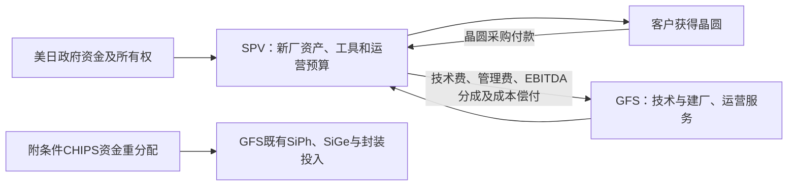

# GlobalFoundries（格芯，NASDAQ：GFS）公司调研：特色制造的现金基础、光网络放量与资本归属变化

**研究截止：2026年10月14日。** 已纳入当日美国新厂公告及13:00 EDT投资者说明会演示材料；最近财务实绩为截至2026年6月30日的第二季度和上半年。第三季度业绩预计11月4日公布，本文不将其指引写成实绩。历史财报采用公司披露的IFRS；Non-IFRS单列。除特别注明外，财务历史表单位为**百万美元**，前瞻业务与资本模型单位为**十亿美元**，1十亿美元＝10亿美元。模型年份均为自然年；晶圆数量注明实际直径或300毫米等价，等价面积不代表工艺可互换。

文中**事实**指已公开披露；**目标**指管理层前瞻；**计算**指可复算算术；**研究判断／条件模型**指本报告的推断；**未知**保留具体缺口。概率均为研究者在本截止日信息下的主观判断，没有统计置信含义。

## 一、先给公司判断

GFS已是一家有规模、有经营现金、拥有客户认证积累的特色半导体制造商。它的主要经济问题是：能否用增长更快的光网络、电源与汽车产品，提高既有资产的收入密度和现金回报，同时承担新平台和并购增加的固定费用。采购方支付的是合格工艺、长期可靠供货和特定功能的制造价值；GFS并不因此取得整个AI系统、整颗客户芯片或全部先进封装的利润。

**当前更支持“有实质进展的组合转型”，对全集团持续提价和管理层长期利润率目标仍保留较大折扣。** 支持这一判断的事实、条件和最强反证如下。

| 影响公司判断的问题 | 截止日最有辨别力的证据 | 本报告判断及边界 |
|---|---|---|
| 光网络是否已成为真实业务 | 2025硅光收入超过2亿美元；2026Q2通信基础设施与数据中心制造收入277百万美元，同比+62%；9月17日Marvell扩展SiGe多年制造协议 | 已有付费制造和扩产关系。硅光与SiGe分别收费；277百万不能全部称为硅光或AI收入，AMF并购影响也未完整分拆。[2025Q4材料第14页][S06]、[2026中报Note 3、经营讨论][S02]、[Marvell协议][S12] |
| 毛利提高是否代表定价权增强 | Q2制造服务收入／等价晶圆出货约2,536美元，同比约-3.2%；IFRS毛利率却由24.2%升至28.3% | 当前改善主要可以由组合、折旧和成本吸收解释；不能推成同产品价格上涨。集团利润仍对装载和固定费用敏感。[季度财报][S03]、[中报成本解释][S02] |
| 存量客户是否只剩疫情期合同 | Cirrus Logic披露新约：2027—2028年预计至少约600百万美元晶圆采购；季度产能预留、年度最低采购及短缺结算 | 续约证据强于客户名单。600百万是采购方估计，不是固定美元无条件保底，也不全是新增。[Cirrus 10-Q][S13]、[合同第2—7节][S39] |
| 扩产是否会吞掉全部现金 | 10月14日新厂由美日政府拥有的SPV出资并持有基础设施、设备，GFS取得技术、建厂／运营管理费用及EBITDA分成 | 这是重要的资本模式变化。首厂满产90万片／年属于SPV生产能力，不能整体计入GFS晶圆收入、资产和利润。最终合同与会计处理仍待完成。[当日演示第8—12页][S09] |
| 未来投入是否已经得到充分回报 | H1经营现金947百万，现金资本支出723百万；同期并购现金440百万、回购400百万。2025末内控仍有重大缺陷 | 生存资金较充足，但自由现金与收购、回购、股权代价必须一起看。制造转型和服务转型均增加执行、会计与组织负担。[中报现金流与Note 4][S02]、[年报Item 15及审计报告][S01] |

在第十一节统一假设下，本报告较支持的工作路径为：**不含SPV尚未确定列报的服务收入，2027年收入约77.9亿美元，2028年85.7亿美元，2030年101.5亿美元；相应核心营业利润约10.2亿、13.6亿、21.5亿美元。** SPV另外贡献的税前经济收益条件参照为0.7亿、1.3亿、2.5亿美元，不能将SPV整厂收入再加进来。这些是驱动假设形成的代表点，不是统计期望或公司指引；2030收入的合理工作带约94亿—109亿美元，真正决定范围的是硅光规模、传统产品重定价和合格供给，而非区间中点。

要走到这一工作路径，GFS需要：现有手机收入大体守住而非重新高速增长；汽车及IoT在客户量产中持续增加内容；硅光由2026约4.3亿美元条件基数增长至2030约15亿美元；中介层2028开始实际交付；并购增加的IP和工程能力带来外部收费；新增资本按认证节奏投入。2030年制造收入89亿美元若每片变现3,000美元，需约297万片300毫米等价交付，较2025隐含年能力高约9%；若只能变现2,500美元，则需356万片，供给及资本门槛显著提高。

**最强相反路径**并不要求光网络失败：光网络可以增长，但每Tb/s所需面积减少、SiGe被部分绕过，手机及成熟CMOS继续重定价，新工具折旧、IP团队和研发先发生，收入最终只有约69亿美元而核心营业亏损约1.9亿美元。该路径下应停止回购、调整可选资本投入与股息，不能原样维持扩张。

最重要的未解问题是：各平台真实晶圆净价、合格产能与良率；AMF、MIPS、ARC的独立收入和利润；TSMC中介层协议的最低采购、取消、定价和资本分担；SPV最终收费、EBITDA定义、责任和总额／净额会计；政府约4%股权安排的确切实施方式。这些缺口限制盈利点值可靠性，尚不推翻现有商业进展。

## 二、公司如何取得收入，什么权益属于GFS

### 2.1 客户买的是工艺交付，终端用户通常不直接付款

芯片设计公司或IDM提出设计、功能、可靠性和产能需求，GFS提供PDK、器件模型、设计支持、试产及晶圆制造。芯片客户通常下采购单、付款并接受晶圆，封测伙伴或客户再完成后续产品；汽车厂、手机品牌和云厂商决定系统设计及合格供应链，能对采购形成约束，但未必是GFS的直接开票对象。GM直接接入代工供应链、Apple联合Cirrus开发美国工艺，说明终端客户能影响设计入口，不能据此把终端预算都归给GFS。

制造通常按约定设计的**晶圆片数**收费，不是按客户芯片售价抽成。设计、光罩、工艺资格和IP可单独收费；良率、交付、质保、价格重置及产量折扣由具体条款决定。晶圆收入一般在出货或交至客户、控制权转移时确认；NRE及部分服务可随履约进度确认。预付款和产能保留款先形成履约义务，不能在收到现金时再次视作晶圆收入。[年报收入政策、Note 18][S01]

从2026年1月1日起，公司把“晶圆／非晶圆”更名为“制造服务／技术服务”。中报明确这只是列示术语变化，既有收入构成与确认政策不变。技术服务包括NRE、光罩、资格、部分后段服务、软件及IP许可与版税，**并不等于纯软件或高毛利版税**。当未来自定义硅、光模块和先进封装的交付边界扩大时，收入增量中可能包含外购件和加工价值，必须重新检查总额列报与净增毛利。[2026中报Note 3、经营讨论][S02]

### 2.2 为解释经济差异而保留的业务分支

| 经济单元 | 实际产品与收费入口 | 商业阶段与主要约束 | 在集团模型中的归属 |
|---|---|---|---|
| 手机与既有RF／混合信号 | RF-SOI开关、调谐器、连接、音频／相机控制、电源及显示相关晶圆 | 成熟现金业务；终端数量、双源、每设备面积和重定价 | 手机制造收入；不另加Apple／Cirrus合同 |
| 汽车及工业／家庭IoT | FDX、特色CMOS、嵌入式存储、雷达／传感、控制和部分电源 | 存量规模制造与新设计爬坡并存；认证、库存及长期可靠性 | 汽车、IoT两个客户池；MPS与FDX增量按应用嵌入 |
| 光子PIC | 调制、探测、波导及电子／光子集成，含AMF平台 | 已有量产收入；后段良率、客户架构、竞争和平台迁移 | 从通信／数据中心制造收入中拆出，保留独立硅光分支 |
| SiGe及其余通信制造 | 驱动器、TIA、RF、通信／卫星等 | SiGe已有客户生产，新一代扩产；更高集成与直接驱动可能减少含量 | 通信制造扣除PIC后的余额；不是纯SiGe分部 |
| BCD／GaN／集成供电 | MPS专有工艺导入、TSMC授权GaN、Navitas及IVR能力 | 成熟BCD与新客户／新工艺爬坡；功率器件资格、成本、许可义务 | 按终端嵌入既有制造池，不再额外加一层“AI电源总收入” |
| 中介层及嵌入DTC | 为TSMC先进封装生态提供制造服务 | 已有制造协议，量产爬坡目标2028H1 | 单列新制造分支；排除TSMC封装整单收入 |
| IP、设计与量子工程 | MIPS／ARC许可、软件、定制设计、量子NRE | 收购业务已有产品基础；交叉销售、持续版税及量产拉动未充分披露 | 技术服务；量子晶圆仅在实际客户应用池计一次 |
| 新厂技术与管理服务 | 向美日政府SPV提供技术、建厂和运营，另有分成 | 交易条款和交割待完成；2027起技术收费为目标 | 单列服务收入未知量S及经济收益Π；不并入SPV晶圆销售 |

### 2.3 证券、制造资产和技术权利不能混为一谈

GFS在Nasdaq交易的是开曼母公司的普通股，并非另有ADR兑换比例的存托凭证。2026年6月末已发行普通股约5.4875亿股，二季度稀释加权股数5.56亿；母公司归属权益118.18亿美元，少数股东权益0.56亿美元。股数是时点／期间两种口径，不直接混用。[中报财务状况及EPS附注][S02]

既有主要制造地点为美国Malta、Burlington，德国Dresden和新加坡。GFS拥有大量工艺和设计使能IP，也使用外部交叉许可、SOI基底、EDA、设备及客户专有工艺。MPS的工艺IP、Navitas的产品设计、TSMC授权的GaN和TSMC的CoWoS商业入口，均不能改写为GFS独家拥有。Renesas合作还保留将部分GF工艺移入其日本自有厂的讨论，未来制造规模可以增加而GFS晶圆销售份额不同比例增加。[Renesas采购方公告][S14]、[GaN许可公告][S17]

10月14日SPV安排尤其需要独立边界：政府持有SPV，SPV承担资金及基础设施／工具所有权；GFS提供技术和运营。是否会计并表、具体服务列报和分成处理仍依最终合同与控制权判断。本文不因“GFS运行这座厂”就认定它拥有全部资产、晶圆收入或现金。

## 三、财务基础：增长、价格、会计与现金分别解释

### 3.1 最近五个已披露季度

以下按自然季度，均为集团；净资本现金投入＝PPE及无形资产现金购买支出减相关政府资本补助。调整FCF沿用公司定义，未扣收购、回购、股息和租赁本金。

| 指标，百万美元，出货除外 | 2025Q2 | 2025Q3 | 2025Q4 | 2026Q1 | 2026Q2 |
|---|---:|---:|---:|---:|---:|
| 收入 | 1,688 | 1,688 | 1,830 | 1,634 | 1,786 |
| 晶圆交付，千片300毫米等价 | 581 | 602 | 619 | 579 | 625 |
| IFRS毛利 | 408 | 419 | 508 | 451 | 505 |
| IFRS毛利率 | 24.2% | 24.8% | 27.8% | 27.6% | 28.3% |
| Non-IFRS毛利率 | 25.2% | 26.0% | 29.0% | 29.0% | 29.9% |
| IFRS营业利润 | 196 | 195 | 255 | 180 | 174 |
| Non-IFRS营业利润 | 258 | 260 | 335 | 271 | 298 |
| IFRS净利润 | 228 | 249 | 200 | 104 | 167 |
| 经营现金流 | 431 | 595 | 374 | 542 | 405 |
| 净资本现金投入 | 154 | 144 | 110 | 309 | 408 |
| 公司调整FCF | 277 | 451 | 264 | 233 | -3 |

来源：2025Q3公告（2025-11-12，含Q2比较）[S04]、2025Q4公告（2026-02-11）[S05]、2026Q1公告（2026-05-05）[S07]、2026Q2公告（2026-08-05）[S03]。后三季同比及历史重列以相应最新比较栏为准。

二季度收入同比增长98百万、毛利增加97百万，但营业利润减少22百万，原因是研发及销售管理等费用由212增至331百万。中报具体说明：研发增加40百万，涉及MIPS／ARC及人员和股权费用；销售管理增加79百万，其中工具出售收益较少贡献29百万差额，另有收购带来的人工及专业服务成本。**这已经是“制造改善、集团盈利未同比改善”的实证。** 不能把差额都归为一次性并购摊销，也不能把全部人员投入视为无回报。[中报经营讨论，研发及SG&A][S02]

二季度IFRS营业利润174百万到调整后298百万的124百万差额，主要由股权费用86百万、结构优化7百万、收购无形摊销及相关费用31百万构成。股权费用涉及真实经济归属；现金流中可以加回，却需要用稀释或抵消性回购承担。资产出售收益减少也会影响调整后利润，Non-IFRS不自动等于可重复现金利润。[Q2调节表][S03]

### 3.2 实际业务组合与可比价格

| 收入，百万美元 | 2025全年 | 2026H1 | 2026Q2 | Q2同比 |
|---|---:|---:|---:|---:|
| 手机制造 | 2,678 | 1,202 | 644 | -5.7% |
| 汽车制造 | 1,410 | 715 | 333 | -9.5% |
| 家庭与工业IoT制造 | 1,189 | 586 | 331 | +10.3% |
| 通信基础设施与数据中心制造 | 745 | 507 | 277 | +62.0% |
| 技术服务／历史非晶圆 | 769 | 410 | 201 | +21.1% |
| 合计 | 6,791 | 3,420 | 1,786 | +5.8% |

来源：年报Note 18及2026中报Note 3 [S01][S02]。终端分类主要覆盖制造业务；不能把技术服务再次分摊后与整表相加。公司未披露这些分类的独立利润。

2025制造收入6,022百万，交付234.5万片；2024相应6,098百万、212.4万片。2025出货+10.4%，公司披露综合ASP下降10.4%，包含部分客户定价下降及较少闲置补偿，技术服务增长缓冲了制造收入减少。2026Q2制造收入1,585百万／62.5万片＝**2,536美元／片**；去年1,522百万／58.1万片＝**2,620美元／片**。这是含组合、合同补偿等影响的每片变现代理量，不是同SKU合同价。集团总收入除出货量会把IP和NRE混入，故不用于主价格判断。

H1通信增长47%、汽车增长5.6%，手机下降5.3%、IoT下降6.7%。汽车Q2下降的公司解释是某客户把出货移至下半年；这个解释合理，但应等实际补交验证。IoT第一季度较弱和第二季度回升可以同时成立，不能择一季度外推。[中报经营讨论][S02]

### 3.3 把完整周期与会计改善放回基线

2022收入81.08亿美元、2023为73.92亿美元，2024为67.50亿美元，2025为67.91亿美元。2022与2023毛利率分别27.6%、28.4%；2023还包含East Fishkill出售造成的成本边界变化。因此，高峰收入、旧资产处置和低谷恢复应分开看，不能把2026的毛利扩张解释为从未出现过的新常态。[2022公告][S30]、[2023年报经营讨论][S31]

2024营业亏损214百万含935百万长期资产减值；2025营业利润797百万。仅还原2024该项，营业利润会是721百万，2025相对只增加76百万，而非报表差额1,011百万全部来自经营。2025成本中折旧及摊销下降，还受到部分设备折旧完毕、此前减值和资本补助影响。2025经营现金1,731百万，相比2024的1,722百万基本稳定。这些事实降低了“利润大增代表现金能力跨越”的解释力。[2025年报成本、减值及现金流][S01]、[年度公告][S05]

### 3.4 现金、预付、库存与合同余额

2026H1经营现金947百万，包含折旧摊销618百万、股权费用128百万及营运资本净流出111百万；资本现金购买723百万，简单FCF224百万，加资本补助6百万后为公司调整FCF230百万。收购现金440百万、回购400百万在其后，故“调整FCF为正”没有阻止现金及证券余额从2025末约39.89亿美元降至2026年6月末33.03亿美元。现金税17百万与账面税费110百万差距很大，德国递延税及汇率影响使当季净利润难直接代表现金税负。[中报财务报表及Note 5][S02]

库存由1,577增至1,622百万，在制品及专用料不能像现金一样随时回收。公开中报不足以按产品得到库龄和报废风险；本文不据小幅库存增长断言积压，也不把全部库存当作未来订单。应和交期、风险投片、客户延期和减值一起判断。

H1合同负债的可核对桥梁为：**1,230＋现金预收99－履约确认397＋其他22＝954百万美元**。其中其他项含ARC带入合同负债约21百万。该桥梁显示前期预付正在消耗，新现金预付没有完全补回；它既不等于取消，也不表示客户采购突然减少276百万。年报2025末约110亿美元LTA剩余收入义务中，51.8%按当时条款预计在后24个月确认，折合每年约28.49亿美元，仅是合同覆盖的量级，不能覆盖整个集团或当作不能取消的现金。没有足够毛新增、修改、解除数据，不能反推取消率。[中报Note 11][S02]、[年报Note 18][S01]

## 四、手机与既有制造：现金基础仍有价值，议价权有明确上限

### 4.1 RF-SOI、混合信号和客户关系为什么能留住订单

RF开关和调谐器要求低插损、线性度、隔离和可靠性；特色模拟、相机和供电电路要求噪声、精度、电压、漏电和尺寸协调。缩小数字节点并不自动改善这些功能。将电路移到另一代工厂，需要PDK重做、掩模、测试、可靠性和系统重新认可，给合格平台形成真实转换成本。

但转换成本是客户重设计的代价，不是GFS可以无限提价的许可。2025双源客户定价调整与较少闲置补偿已压低手机收入；客户在下一代产品设计时可重新选择工艺、供应商或更小面积。设计阶段的竞争强于当期量产阶段，少数大客户还能用多个项目和未来采购议价。

年报称约63%出货属于公司定义的单一来源业务，即在其他平台制造需重大重设计；十大客户也占约63%晶圆出货。两个63%的集合不同，均不是收入百分比。单一来源比普通成熟CMOS更有黏性，客户集中又限制了利益分配。[年报单一来源及集中度条款][S01]

### 4.2 买方证据比“全球手机复苏”更接近GFS收入

Cirrus于2026年5月21日提交、截至3月28日的年报披露，旧2022—2026合同有60百万不可退产能保留费及195百万晶圆预付；截至3月末余额分别6.7百万和14.7百万，剩余晶圆义务约180百万。6月30日又签2027—2028新约，采购方估计至少采购600百万。新旧预付、晶圆购买和保留费不能混为一个订单金额，也不能把旧余额下降称为取消。[Cirrus年报承诺事项][S32]、[2026-08-05提交的新约10-Q][S13]

**公开合同原文进一步限定了保障。** 新约为300毫米55BCDL产品，按季度预留、按年度最低比例采购；预测本身不构成额外采购单，也不解除既有义务。客户采购不足须付短缺费，GF供货不足须给予抵扣；取消费与同年度短缺费抵扣，不能重复计费。双方可书面调整交期，最低比例、片数和价格均被遮蔽；连续两季低于相应承诺70%可触发对方终止权，相关短缺费仍应结算。因此它对存量收入有实质保护，却不能保证所有片数均被最终使用或把约6亿美元全视为绝对美元保底。[公开合同，第2—8节][S39]

Apple于2026年3月26日独立披露与Cirrus及GFS合作，在Malta建立用于包括Face ID相关混合信号IC的新工艺。Apple对几个新项目合计计划支出400百万至2030年；这不是给GFS一家的400百万订单。它仍提供了终端客户在美国制造中投入开发资源的证据，也表明GFS与Cirrus、Broadcom等不同客户可能共同依赖同一Apple预算。[Apple原始披露][S15]

更广的需求反证来自IDC 8月26日预测：2026全球手机出货下降16.7%，略高于10亿部，内存短缺及涨价压制低端机。预测不是全年实绩，也不能机械映射到GFS的高端客户组合，但它反对“终端数量会自然填满所有新增特色产能”。[IDC原始预测][S16]

**工作判断：** 2026手机制造收入约25亿美元，至2030约24亿美元，是销量与内容量改善被面积缩小、价格压力和高低端组合抵消的条件路径。Cirrus每年约3亿美元采购义务是其中一项可见存量基础，不能代表整个手机池。从25亿降至19亿的下行路径会少6亿美元收入；即使部分变动成本可减少，固定工厂和客户支持费用仍在，足以抵消相当一部分新光网络利润。

## 五、汽车、工业与FDX：资格积累如何变成增量，何时会失效

### 5.1 客户为什么选择FD-SOI与特色CMOS

FD-SOI使用薄硅层及埋氧层降低寄生与漏电，并通过体偏置在功耗和性能之间调节；它适合常开感知、无线、雷达、实时控制及混合信号集成。GFS的价值是把可用器件、嵌入存储、模拟／RF、电压选项和设计生态合成可量产平台。客户比较的是整颗芯片、外部器件、封装和开发周期的总成本；工艺单价更高仍可能有系统收益，但小批量产品也可能无法承担设计迁移费。[FDX技术页面，ABB及集成选项][S18]

汽车需求来自每车功能、每功能GFS可供内容和客户项目产量，而非电动车数量单一指标。ADAS雷达、车内网络、车身控制和部分电源也进入混合动力及燃油车。产品长生命周期提升留存，客户去库存、平台取消、价格下降或IDM内部产能回流则压低外包晶圆量。Auto Grade 1 ready、客户设计定点和完成整车平台量产是三个阶段，不能合并。

Renesas于2026年2月17日确认数十亿美元级制造合作，覆盖FDX、BCD及带非易失存储的特色CMOS，计划2026年中开始流片，并考虑向其日本自有厂移植部分工艺。这比泛泛汽车TAM更支持可触达客户，但合同年度分布、不可取消最低采购和已完成流片数量仍未披露；本报告没有把流片目标补成截至10月的完成事实。[Renesas公告][S14]

### 5.2 UX、嵌入式存储与FDX Fusion是不同风险的路线

9月2日40UX、22UX宣布PDK可用：40UX基于已有40纳米/eFlash模块，目标2027在新加坡规模生产；22UX强调模拟噪声、匹配、3D集成和传感读出，计划Dresden制造。已有基础平台累计百万片交付支持模块成熟度，不能证明新UX客户也已量产。该路线更接近现有客户扩展，开发及认证风险低于全新器件平台。[UX公告][S19]

10月9日发布的**FDX Fusion**则是更远但可能改变客户边界的技术。公司目标为7纳米级数字性能、相对首代FDX超过两倍密度、最高0.5THz等级RF器件表现，结合模拟、存储及计算；2027年初演示芯片、年中初版PDK、2028开始制造。**“7纳米级数字性能”不是已披露的7纳米晶体管尺寸、同等逻辑密度或已商业成功。** 性能、面积、功耗、良率、掩模与整套设计费用都需要具体基准。[FDX Fusion公告][S20]

德国同日披露SPRINT封顶、总投资11亿欧元，目标2028末Dresden年能力超过100万片300毫米晶圆；当前称最高约95万片，随组合变化。不能把“超过100万”当作新增100万。Fusion的开发还涉及IPCEI-AST批准条件，厂房、研发支持、PDK和客户量产不是同一门槛。[Dresden原始公告][S21]

**可获规模的条件约束：** 若Fusion到2029取得10—20项真正付费量产设计、每设计年1,000—3,000片、每片净制造费3,000—5,000美元，年度制造收入约0.3亿—3亿美元。客户数、每设计数量与报价全是研究条件，不能当作已获订单。这种规模可以改善产品组合，仍不足以单独重塑百亿美元集团。更大的路径需要少数高产量雷达／控制或无线平台，每项目数万片及持续复用，不能靠Logo数量推导。

本报告工作模型没有把Fusion单列再加一笔收入：早期NRE在技术服务，后续制造在汽车／IoT。若它替换22FDX，只有净新增制造面积、价格／成本差及客户留存价值属于增量。2027按时演示会提高可行性判断，却不会自动提高2029量产收入到3亿美元的概率；客户付费流片、同条件基准和重复采购才是后续分辨证据。

**工作判断：** 汽车制造收入2026约15亿美元至2030约21亿美元，约8.8%复合增长；IoT约12亿至14.5亿美元，约4.8%。需要Renesas等项目持续爬坡、既有工业／防务产品生命周期更替、供电和感知内容增加，且手机式重定价没有全面扩散。汽车资格比厂房扩产更慢，2026下半年交付回补与2027新客户生产最有检验价值。

## 六、硅光与SiGe：最重要的增长分支，也必须追问每个连接能留下多少钱

### 6.1 三种收入不能合并成一个“光通信龙头份额”

GFS可制造光子PIC，也制造驱动／接收相关SiGe电学芯片，并正向SCALE等光引擎和后段整合延伸。PIC中的波导、调制器、探测器和控制电路，把电信号转换为光并接收；SiGe驱动器／TIA处理高速模拟信号；先进数字DSP、激光器、光纤连接和整机系统可由其他厂商掌握。单一客户同时使用多个环节，GFS可以取得多种收入，但不能重复计算同一晶圆和整套模块的内含采购。

45纳米等级单片电子／光子平台重在集成和互连长度，AMF补充200毫米平台、客户和工艺能力。300毫米单片集成与200毫米光子平台的良率、设计、后段及单位成本各异，不能只按面积2.25倍宣布降本。异质InP或其他电光材料可以作为GFS平台的补充；平台需要为新材料留接口，纯硅本身不能提供所有光源及调制能力。

SMART Photonics于9月21日从合作方披露开放代工服务：在GF硅平台结构中以倒装方式集成其InP激光器及SOA等。这证明合作分工和可提供的服务，不证明已经大规模交付、GFS独占InP利润或每个产品都采用同一路线。[SMART原始公告][S22]

### 6.2 商业进展已经成立，规模和独立性仍有边界

2025硅光收入超过2亿美元，公司2月称2026接近再翻倍；2026Q2的通信／数据中心277百万收入已确认，且中报把增长明确连接到SiPh、SiGe数据中心网络。9月Marvell协议扩展已有生产，支持200G／lane并延伸NPO／CPO。这些证据比工艺发布更接近重复付费需求。[2025Q4材料][S06]、[中报][S02]、[Marvell原始协议][S12]

不过，2025年11月AMF才并入，2026完整年度比较并非完全有机；Marvell合作是双方共同披露的一项交易，不算两个独立订单样本；277百万包含卫星、传统通信和其他产品。GFS没有发布可独立核对的硅光季度财务、客户净价、晶圆良率、最大客户份额和独立利润。本文采用2026硅光约4.0亿—4.6亿美元、代表4.3亿美元作为研究基数，而非已实现全年实绩。

竞争者Tower的5月13日原始披露更进一步：签有2027年13亿美元硅光收入合同，收到2.9亿美元预付。它支持市场已经有真实产能预订，同时反对GFS可以不受竞争约束地捕获全部光子需求。Tower与GFS产品、客户、直径和服务边界并不完全相同，不能用两个金额直接计算全球份额。[Tower合同公告][S23]

### 6.3 需求、供给、价格接到同一个经济单位

采购方需要的是满足距离、带宽密度、功耗、误码、温度及可维护性要求的链路。可插拔向NPO／CPO迁移，可降低电连接损耗并扩大跨机架协同域；同时更高通道速率、共享激光源、较少网络层级和更小PIC面积会减少每Tb/s的制造内容。芯片级功耗下降还必须覆盖封装、冷却、故障更换及系统停机成本，才会支持客户支付。

SCALE于2026年5月发布，是面向OCI MSA的CPO平台方案；产品可用和标准适配增加进入客户设计的机会，未披露的批量验收、现场可靠性和净成交价仍不能由演示代替。[Q1原始披露][S07] 本地ECOC及CPO研究提供了“生产、早期采用、持续付费”和“器件、光引擎、系统”分层方法，本文只采用这些机制，未直接搬用其全球市场金额推GFS收入。

一个用于暴露门槛的**代表性300毫米PIC条件算例**：可用面积50,000平方毫米、每PIC40平方毫米、良品率75%，得每片约938个良品；若加工净费7,500美元，则每良品制造费约8美元；每光学位置用两个PIC，GFS制造内容约16美元。这里的面积、良率、报价和数量均非公司披露。若收入达到15亿美元，需要约9,375万个此类位置等价；若每位置实际制造内容为30—50美元，则需要3,000万—5,000万个。不同芯片面积、电子集成、多PIC、交付边界会极大改变数字。

这组算例的结论是**收入目标需要高产量、更多内容或更高服务价值中的至少一项成立**，并非已经证明有9,375万个订单。可检验约束是GFS具名客户的合格晶圆交付与光模块生产是否匹配，而不是先把收入倒成端口，再用端口“验证”收入。

### 6.4 单位经济性和可捕获规模

本报告把硅光收入分为已建立的可插拔／通信制造与新的NPO／CPO／计算互连内容。工作路径2028约9亿美元，其中约7.5亿来自前者、1.5亿来自后者；2030约15亿美元，分别约9.5亿和5.5亿美元。分拆属于研究估计，公开财务尚不能验证。它需要2026至2030约36.7%的硅光复合增长，依赖现有客户增长、AMF客户／平台扩大、SiPh新设计转生产及新封装方案进入批量；并未用行业TAM乘任意份额。

这些条件点最弱的是新连接数量、客户份额和净价，最强的是已有收入与量产客户。每单位带宽制造收费若下降30%，带宽交付翻倍只带来40%收入增长；若客户在新设计中同时减少GFS内容或转第二来源，收入增长还会更低。工作模型假设PIC扣直接变动成本后的贡献率由2026约60%至2030约65%，再统一扣工具折旧、制造固定费用和研发。**这不是披露的硅光毛利率。** 若后段或新材料费用转成GFS负责，贡献率可能先下降。

SiGe收入保留在其余通信池，不能把其中2026约6.2亿、2030约10.5亿美元全部称作SiGe。Marvell支持其需求，但低驱动电压调制器、电子／光子集成和直接驱动路线可能减少独立驱动器价值；GFS若能把工艺迁移到新平台可保留部分收入，不能默认净增。相反，高速模拟难度增加及更多光学位置也可提高每芯片复杂度。

硅光2030约22亿美元的上行路径，需要CPO／计算互连规模采用、合格供给及时扩充、价格下降慢于工作量及成本改善，并保持大客户资格；约6.5亿美元的下行仍允许业务比2026增长，但新架构、竞争及面积效率压低价值捕获。两者与手机、资本和组织结果在统一模型内联合变化，不能把22亿上端再叠加所有其他机会的上端。

## 七、电源：客户规模、工艺权利和最终系统采用决定收入

### 7.1 MPS是比宽泛AI功率预测更具体的进入路径

9月9日GF与MPS签订长期制造协议，把MPS专有工艺导入新加坡300毫米制造，目标2027年初扩大生产，产品涉及AI／云智能功率级、汽车、机器人和工业。GFS提供制造规模与供应地理分散，MPS保留产品、专有工艺和系统设计入口。公开材料没有片数、价格、预付或最低采购额。[双方制造公告][S26]

采购方已有实际预算增长：MPS二季度Enterprise Data收入380.6百万美元，去年144.0百万，同比增长164.3%；全部收入980.6百万。它证明AI及服务器供电产品销售增长，但Enterprise Data并非纯AI，模块收入也包括非晶圆价值。MPS扩大成品销售不能按同一增长率变成GFS加工费。[MPS 2026-07-30原始财务披露][S27]

用于约束2028潜在GFS收入的条件桥梁：若导入的相关MPS产品年成品收入15亿—30亿美元，外部晶圆制造价值占10%—18%，其中30%—60%由GF生产，则GFS年收入约0.45亿—3.24亿美元。相关产品范围、晶圆价值比例与GF分配都是研究假设，没有被协议金额独立证明。工作模型只在汽车／IoT／其余数据中心池中合计含约1亿—2亿美元MPS相关制造贡献；需要工艺转移、良率、多个产品资格和重复采购，不能把整个MPS收入池作为GFS机会。

该项目可能比自研全新功率工艺更快取得收入，因为客户已有产品和市场；它也更依赖客户IP与产量分配。若客户最终保留更多内部／其他外包供应、只将少量第二来源订单交给GF，制造合作可以技术成功而经济规模有限。2027上半年反复合格交付比首次投片更能区分两种解释。

### 7.2 GaN的性能收益与GFS利润有数道间隔

GaN可用更低开关损耗、更高频率减少磁性元件及系统体积；不同电压段服务不同转换级。实际收益还取决于驱动、寄生、散热、保护、可靠性及系统拓扑。800V直流架构采用不意味着所有功率转换都使用GaN，SiC与硅器件仍有适用区间，供电效率改善也可能减少器件数量。

GF于2025年11月取得TSMC 650V和80V GaN许可，计划在Burlington资格导入；这是外部技术授权加GF制造能力，并不代表GF拥有全部基础IP或没有许可成本。9月1日Navitas称GF美国200毫米制造的Gen-5 GaNFast首批出货**将于9月开始**；截至本研究检索所得，没有可核对的客户验收数量或GF相关收入，本报告保留为明确交付计划及商业推进。[GaN许可][S17]、[Navitas交付公告][S28]

客户大小会限制近期经济量级。Navitas截至6月末的10-Q显示Q2全部收入10.529百万、H1 19.127百万，产品还包含SiC。即便其高功率业务快速增长，当前客户成品基数不能支持GF立即取得数亿美元GaN加工收入；需要客户规模扩大、其他客户加入或制造／技术收费边界显著扩大。该10-Q还披露已进行股权融资，故不能只从经营亏损认定客户立即缺钱；客户融资能力与需求真实性仍是两个问题。[Navitas Q2 10-Q，经营及股权融资][S29]

### 7.3 IVR、集成电感和BCD应按电源级去重

7月GF收购Photeon的集成稳压业务，补充BCD、GaN及集成电感。这条路线有机会把供电移近负载，改善压降、瞬态和板面积，但高电流热密度、磁性器件、封装与系统电源网络需要共同优化。被集成掉的外部电源级可能是GF原有客户的业务，新增集成面积与旧产品损失需净额看。[Q2业务更新，7月后续事项][S03]

工作模型对电源采用的正贡献已嵌入现有终端池，未把BCD、MPS、GaN、IVR和“AI电源”各自的机会总额相加。若只有Navitas小规模首批交付而MPS和其他客户没有持续生产，电源对集团的意义将先体现在研发与资格成本，不能用“进入AI电源”直接上调集团利润率。

## 八、TSMC中介层：有合同的邻接业务，必须先明确时间和制造边界

10月8日公告称，GF与TSMC达成多年**20亿美元**制造协议，在Malta增加供给，服务TSMC CoWoS生态，包括带嵌入深沟槽电容部件的硅中介层；量产预计2028年上半年开始爬坡，初始期限五年。它是制造协议，证据强于一般合作意向，但公告没有公开完整采购、价格和解除条款。[制造协议原始公告，协议段与量产段][S11]

先进封装需要中介层连接逻辑、存储和I/O；深沟槽电容可提供封装附近去耦，缓解供电完整性问题。GFS取得的是晶圆制造、相应结构和可能相关加工的净收费，TSMC仍掌握封装流程和客户生态。硅中介层、带DTC器件、完成的CoWoS封装和整颗AI加速器属于不同价值层，不能以加速器售价反推GFS收入。

**20亿÷5＝每年4亿美元仅是平均量级，不是年度保底。** 五年期限何时起算、订单递增安排、不可取消数量、验收、良率责任、价格重置、工装资本及补助如何分担均未披露。特别不能擅自把“五年”改为“2028起五个完整收入年”。本文工作路径2028约1.5亿、2030约4亿美元；2030下行1.5亿、上行6.5亿是条件结果，不是公告保证额，也不保证初始合同足以支持全部上行。

一个可复算供给门槛：若平均制造净收费4,000—6,000美元／片300毫米晶圆，4亿美元年收入需约6.7万—10万片合格交付。报价属研究假设，实际会随尺寸、DTC复杂性和加工边界改变。它会占用真实工具、厂务及工程能力；不能只因为Malta有总产能便认定已具备这些工序和客户资格。2028H1开始爬坡也不等于2028全年满产。

项目需要的GF净资本未公开。以10万片年能力的特色改造模块作条件计算，若总增量资本4亿—8亿美元、税后增量经营利润0.5亿—0.9亿美元，未杠杆经营回报约6%—23%，跨度足以改变投资判断；这里的资本和利润是门槛假设，不能当作协议测算实绩。若无法取得可靠工具／工时边界，按合格产量、客户资本支持和实际现金投入更新比强填单一回收期更有意义。政府资金及时到位、重复工艺利用与高装载有利，额外工具、低良率和降价不利。

TSMC同时可能是GaN技术许可方、先进封装客户和其他工艺竞争者，角色应分别判断。美国本土供应资格增加GFS的可触达性，但客户自制、其他获认证中介层来源、桥接／有机中介层及封装结构变化都会影响可保留规模。该业务可成为数亿美元的可靠增量，现有证据还不足以赋予整个CoWoS产业链的利润率。

## 九、IP、量子和新存储：保留改变公司能力的路径，也保留收入稀疏的事实

### 9.1 MIPS、ARC与InfiniLink的取得成本和商业任务

MIPS于2025年8月收购，总对价226百万美元，其中现金215百万；AMF为453百万现金；InfiniLink为48百万。ARC于2026年6月1日完成收购，总对价455百万，其中现金440百万、或有对价4百万及替换股权奖励11百万。原先年报预计ARC下半年交割已被中报实际完成替代，不能继续当成未来待办。[中报Note 4][S02]

这些交易把处理器IP、软件、定制设计和高速连接设计能力接到制造平台。MIPS／ARC拥有的是实现、工具、客户及相关许可，不是垄断开放的RISC-V指令集。客户可为更快开发、软件兼容、特定工作负载优化和验证过的子系统付费；GFS可能收取许可、设计费及后续版税。使用GF的IP不必然代表所有芯片都在GF制造，代工客户也会担心中立性及供应商和自身设计竞争。

最关键的检验是：取得的IP业务能否在扣除持续研发、工具支持、销售和整合费用后产生现金，并提升制造客户留存。收购后H1技术服务410百万无法分辨纯IP、新旧NRE和后段各自贡献；不能把全额套用成熟IP许可利润率。工作路径2030技术服务12.5亿美元，较2026条件基数9亿美元增加3.5亿美元，已经包含IP与工程交叉销售。额外宣称“IP还可另贡献数亿美元”会重复计算。

收购成本本身也是回报约束。以MIPS加ARC总对价约6.81亿美元为基础，若长期税后现金收益仅每年3,000万美元，简单回本超过22年；若能达到8,000万美元则约8.5年，均未计增长和资金时间价值。这个计算说明为什么需要持续版税／客户拉动，不能只以技术队伍扩大证明资本配置成功。AMF的制造、技术、客户和折旧又属于另一套回报，不能把三者利润都归到IP。

### 9.2 量子已从意向推进到有里程碑资金和命名客户

9月8日公司宣布与美国商务部完成最高375百万美元、五年、依里程碑支付的量子研发协议，替代5月的意向阶段。它提高GF承担研发的能力，不等于375百万当期商业收入或已收现金，也不是每年必定平均收到75百万。[最终研发协议公告][S24]

10月6日客户Xanadu从采购方披露多年合作，围绕Malta 300毫米平台工业化超低损耗SiN及超导纳米线单光子探测器。低温CMOS、探测、光子和异质封装都有实际技术任务；但可扩展量子系统还需器件一致性、光损耗、探测效率与暗计数、低温互连和系统纠错共同成立。一次器件试验或政府拨款不能验证公用级计算已经可规模付费。[Xanadu原始公告][S25]

其经济意义可先用阶段单位约束：若5—10个客户每年购买2百万—5百万美元研发／资格服务，收入约1,000万—5,000万美元；若以后形成合计2万—5万片年重复制造、每片4,000—8,000美元，制造收入约0.8亿—4亿美元。这些全部是条件门槛，公开资料没有披露对应客户数、价格或订单。前者可以在规模系统成功前发生，后者需要持续客户资金和制造需求，不能相互替代。

工作模型含早期工程服务在技术服务内，未另计数亿美元量子晶圆收入。若未来证实稳定重复制造达到上述量级，再增加对应制造池，并扣共用工具、低温工艺、支持及普通产品排产损失。量子既有较高潜在影响，也有客户路线更换、资金停滞与量产需求迟迟不出现的失败路径。

### 9.3 GCRAM提供一个“技术改进未必增加晶圆收入”的反向例子

9月2日GF与RAAAM披露GCRAM测试芯片已流片，合作目标相对普通SRAM减少40%存储面积、最高60%存储功耗，2027年初向先导客户提供设计访问。这里是存储部分及公司测试／设计口径，不能解释为整颗芯片面积减少40%或已量产客户节能60%。保持时间、刷新、温度、速度、编译器、测试和系统工作负载仍需验证。[GCRAM原始公告][S35]

若在相同终端数量下芯片面积变小，GFS每设备制造收入可能下降；若更低系统成本让更多设计留在FDX平台、增加片上内存或拓展客户，则可扩大总量。当前无法量化净增，不在集团模型另外加收入，但保留其对FDX竞争力和单位面积收费的影响。

## 十、制造供给与10月14日的新模式：能力、资产与收益分别建账

### 10.1 既有工厂的有效能力

2025公司出货234.5万片300毫米等价、平均shipment utilization 86%，直接相除得到约272.7万片当年估计能力；2024利用率77%。这只恢复公司定义下的能力量级，受产品组合、研发／维护、库存与交付时点影响，不是独立设备盘点。2026Q2交付62.5万片也不能直接除以2025全年分母宣称当季精确利用率。[年报Shipment Utilization][S01]、[Q2交付][S03]

GFS的可交付供给至少受四层约束：

1. 特定工具和工序的节拍、维护、人员与厂务，不能仅看洁净室面积。
2. 产品良率及光学／电学测试，先进PIC、GaN和DTC均有专用要求。
3. 客户对厂址、工艺与可靠性的资格，同一平台转另一地区需重做部分验证。
4. 客户能够接收并装入系统的后段／配套，合格晶圆未必立即变成终端安装。

Dresden SPRINT的公开新增能力是从最高约95万片走到超过100万片的特定组合量级；新加坡MPS工艺导入与既有平台共享总资源，GaN和SiGe虽同在Burlington，也不能把全部200毫米工具视为可以无摩擦切换。2030工作模型约297万片等价制造交付，需要既有产能优化、平台组合抬升和针对性工具扩张共同成立；新SPV的能力不自动填补GFS自有制造模型的缺口。

上游也有共同依赖：年报披露2025约71.4%的SOI晶圆采购来自单一供应商。跨美、德、新加坡的厂址分散不能消除相同基底、设备、EDA和技术许可的共同风险；客户对同一SOI／PDK生态的资格也会延长替换时间。本文没有取得按供应商和平台拆分的可替换库存，不把厂址数量当成完全独立供给。[年报供应商集中度][S01]

### 10.2 新厂的资本和收入流

10月14日公告：日本提供最高210亿美元资金，第一阶段约100亿美元建新的300毫米厂，目标2029上线；第二阶段约100亿美元，**仍需批准**。每阶段在最终满产时约90万片／年300毫米等价，项目与技术服务期限至少20年。公司演示第10页把基础设施、工具和运营资金归SPV，GFS负责技术、建厂和运营管理。[当日公告][S33]、[演示第8—11页][S09]

GFS可能赚得类似每片经济利润而不承担原有同等资本，但这种等效性是管理层目标。分成基数、费用重置、成本偿付、超支、延期、最低收费、终止、知识产权和客户合同责任尚未取得最终完整条款；不能将政府出资理解为GFS不存在任何执行或机会成本。

公司给出的**首厂**目标为：2027技术费起算，至少20年；2027 Non-IFRS稀释EPS增加0.10—0.15美元，长期0.50—0.75美元；前十年累计调整FCF约30亿美元；2027营业利润率提升100—200bp，长期200—300bp。以上依交割、最终合同与会计处理，且**不含第二厂**。累计30亿不是每年3亿保底，长期EPS也不是2029第一片出货时即实现。[演示第11—12页及脚注][S09]

本报告工作模型单列首厂税前经济收益Π：2027为0.07、2028为0.13、2030为0.25十亿美元；下行和上行2030分别0.05和0.38。它包含净收费、分成和共享费用的净影响，没有将费用偿付再当作利润。2027所选量级接近公司EPS增厚目标所要求的收益下段，2030仍可能未达长期目标；这属于基于管理层经济目标的条件估计，合同强度和现金回收可靠性低于现有工厂实绩。

**服务收入S保留为变量。** 基础关系是“固定技术／管理费＋SPV EBITDA×约定分成”，共享成本偿付影响总额／净额列报。Π可以由费用节约及不同损益列报形成，不能凭Π和任意服务利润率反算一个看似精确的S。第十一节因此交付“可识别收入＋S、核心营业利润＋Π”的桥梁，并不把它冒充完整IFRS预测。

### 10.3 资金重分配、政府股权与净归属

同日公司还宣布，将原CHIPS协议的955百万美元改用于Malta及Burlington硅光、SiGe和先进封装投资，并另有美国商务部取得GF约4%股权的安排。这是已有资金的用途重分配，不是额外再加一笔955百万补助。375百万量子资金与300百万硅光LOI也不能不经具体协议、用途及支付阶段核对就全部视为自由现金。[10月14日公告][S33]、[量子协议][S24]

股权安排确切类别、发行／转让方式和实施时点本研究未取得完整条款。**若假设政府以新增普通股持有发行后4%，** 以6月末5.4875亿股不变作算例，新增约2,286万股、总股数约5.7162亿，现有股东持有比例乘0.96。仅为抵消同等利润下的每股摊薄，归属利润需增加约4.17%；若是既有股东转让则不是同一稀释结果。不能把这个算例写成已完成发行或10月实时股本。

最大相反效应是新厂按政府／供应链目标补充大量成熟／特色供给，可能与GFS现有厂争取同一客户，而GFS只取得一部分SPV利润。若因此把自有厂订单转走、压低行业价格或重复投入，服务收益会被抵消。工作模型手机收入停滞、制造价格温和受压，已承认这一竞争响应；没有在全部产能与需求端各记一次利好。

## 十一、统一模型：先在相容业务条件下算利润与现金

### 11.1 边界、公式和假设来源

模型用于检验上述机制能否共同成立，不是已披露分部利润预测。七个收入池互斥；通信池先扣除PIC，中介层单列，电源／FDX／量子制造嵌入对应终端，IP与NRE列技术服务。外购件随交付边界改变时需同时改变收入及变动成本，不能只增加收入。

设每池收入为R，扣直接变动成本后贡献比例为c，则：

- 核心收入＝ΣR；集团未来收入＝ΣR＋SPV服务列报量S。
- 核心毛利＝Σ(R×c)－制造现金固定费用－制造折旧摊销。
- 核心营业利润＝核心毛利－研发、销售管理等期间费用。
- 税前经济收益＝核心营业利润＋SPV净经济贡献Π；Π最终可能通过收入、费用分摊或其他损益体现，不能保证全部列入IFRS营业利润。
- 研究FCF＝税前经济收益＋总折旧摊销＋股权费用－现金税－营运资本净增加－现金资本购买＋资本补助；假设净现金利息约为零。其后另扣租赁本金、债务本金、股息、收购及回购。

成本与费用均计入预计股权费用、维持工艺支持与常规摊销；未发生的大额减值、诉讼和未来新增收购不预设。总折旧含制造及期间费用中的折旧，现金流仅加回一次；NRE与早期研发成本已在相应成本／研发费用内，不再为每条新业务重复扣一份。研发补助按对应成本净额考虑，资本补助按收现单列；955百万重分配不是当期收入。

历史成本的约束来自2025材料／库存变化等约16.50亿美元、人员维护公用工程约22.83亿美元及成本内折旧摊销约11.68亿美元，以及2026H1成本与费用。它们只能约束集团成本量级，不能测出各池的变动比例。下列贡献率是研究估计：传统客户池约50%—57%，通信55%左右至60%，PIC爬坡后50%—68%，技术服务60%—72%，中介层爬坡25%—55%。制造直接成本、产品复杂性和服务边界是范围来源；**均非公司披露的分部毛利率**。[2025年报Note 19][S01]、[中报成本及费用][S02]

### 11.2 工作路径：收入拆分与阶段一致

单位：十亿美元。点值保留两位便于复算，不代表此精度可预测。2026也是全年研究估计，实际只披露H1。

| 互斥收入池 | 2026工作 | 2027工作 | 2028工作 | 2030工作 | 主导的数量、价格和资格条件 |
|---|---:|---:|---:|---:|---|
| 手机制造 | 2.50 | 2.45 | 2.40 | 2.40 | Cirrus等项目留存，终端／内容改善被价格与面积效率抵消 |
| 汽车制造 | 1.50 | 1.64 | 1.80 | 2.10 | 旧客户内容、Renesas等设计量产；避免把新厂规划提前确认 |
| 家庭／工业IoT制造 | 1.20 | 1.25 | 1.32 | 1.45 | 工业库存逐步正常化，UX及控制／感知新应用净增 |
| 通信／数据中心制造，不含PIC | 0.62 | 0.78 | 0.90 | 1.05 | SiGe扩产、MPS部分电源及其他通信；独立驱动需求不被全面替代 |
| PIC硅光制造 | 0.43 | 0.65 | 0.90 | 1.50 | 既有可插拔增长及新光学任务分期兑现；含AMF完整合并边界 |
| 技术服务，不含SPV | 0.90 | 1.02 | 1.10 | 1.25 | IP、NRE、光罩与后段，扣除内部收费；并购后的完整团队投入保留 |
| TSMC中介层制造 | 0 | 0 | 0.15 | 0.40 | 2028H1开始合格交付；初年不按满产计算 |
| **核心收入合计** | **7.15** | **7.79** | **8.57** | **10.15** | 2026—2030复合增长约9.2%；另加未知服务列报量S |

2026的近期约束是：H1实绩3.420＋Q3公司收入指引中值1.885＋Q4条件1.845＝7.150。Q4并非公司指引；若Q3在指引中值附近，全年71亿—73亿美元，对应Q4约17.95亿—19.95亿美元。其经济理由是光网络、汽车延期回补及完整并购收入对冲手机疲弱，不能由Q2简单乘四得到。后续年份主变量由前文客户与供给机制给出。

工作模型没有断言2030每年均精确达到某一增长率。2027合理工作带约76亿—81亿美元，2028约82亿—91亿美元，2030约94亿—109亿美元；这是在工作机制下的经营范围，不是预设独立变量上下端全部相加，也不是概率分位数。

### 11.3 利润与现金：同一组数量、成本和投入

下列为模型假设与结果，十亿美元。核心毛利／营业利润近似沿IFRS经济成本定义，保留SBC及常规摊销；SPV单列Π。研究FCF不是公司未来Non-IFRS指引。

| 假设或结果 | 2026工作 | 2027工作 | 2028工作 | 2030工作 |
|---|---:|---:|---:|---:|
| 传统手机／汽车／IoT扣变动成本贡献比例 | 55% | 55% | 55% | 55% |
| 其余通信／PIC／技术服务／中介层贡献比例 | 55%／60%／65%／不适用 | 55%／61%／66%／不适用 | 56%／63%／67%／45% | 57%／65%／68%／50% |
| 贡献总额Σ(R×c) | 4.044 | 4.436 | 4.912 | 5.896 |
| 制造现金固定费用 | 0.85 | 0.90 | 0.95 | 1.05 |
| 制造折旧摊销 | 1.15 | 1.17 | 1.20 | 1.25 |
| 核心毛利／毛利率 | 2.044／28.6% | 2.366／30.4% | 2.762／32.2% | 3.596／35.4% |
| 研发及销售管理等期间费用 | 1.25 | 1.35 | 1.40 | 1.45 |
| **核心营业利润／利润率** | **0.794／11.1%** | **1.016／13.0%** | **1.362／15.9%** | **2.146／21.1%** |
| SPV净税前经济贡献Π | 0 | 0.07 | 0.13 | 0.25 |
| **税前经济收益合计** | **0.794** | **1.086** | **1.492** | **2.396** |
| 总折旧摊销／SBC现金流加回 | 1.25／0.26 | 1.27／0.27 | 1.30／0.28 | 1.40／0.30 |
| 现金税／营运资本净增加 | 0.12／0.08 | 0.15／0.12 | 0.20／0.15 | 0.38／0.18 |
| 现金资本购买／资本补助 | 1.55／0.10 | 1.70／0.25 | 1.85／0.30 | 2.10／0.20 |
| **研究FCF，收购与分配前** | **0.654** | **0.906** | **1.172** | **1.636** |

例如2030：5.896－1.05－1.25－1.45＝2.146；加Π0.25，再加1.40折旧及0.30股权费用，减0.38税、0.18营运资本、2.10资本购买，加0.20资本补助，得FCF1.636。若股权费用用回购抵消，回购需要的现金应在其后另扣，不能把1.636全视为不稀释的股东可分配价值。

模型中制造固定费用由2026的20亿美元升至2030的23亿美元，期间费用由12.5亿升至14.5亿，承认新增工艺、工具、客户支持和团队有成本。资本购买合计不能解释为全部维持性：约7亿—10亿美元／年的维持与替换量级为研究假设，其余为已承诺／成长投入；公司未给可严格分割的维持资本。实际维护若更高，增长和分配空间都要下降。SPV约100亿美元首厂资本未放在GF资本购买中，GFS自有SiPh、SiGe、中介层、Dresden等投入仍然保留。

**晶圆单位与利润门槛的交叉检验：** 用2026工作制造收入62.5亿美元、约2,550美元每片变现作代表，需约245万片等价交付；制造贡献约34.59亿美元，约1,411美元／片，分摊20亿美元制造固定成本约816美元／片。再考虑技术服务贡献5.85亿美元和期间费用12.5亿美元，在每片贡献1,250—1,410美元、固定投入不变时，集团营业盈亏平衡需要约189万—213万片；相对于2025隐含272.7万片能力，约为70%—80%。这是模型阈值，不是公司披露的利用率盈亏点；组合、新工具、技术服务和客户补偿改变时阈值会移动，达到营业盈利也不表示资本已获得足够回报。

**资本回报的量级：** 以6月集团权益、债务和租赁减现金／证券粗算，账面经营资本约102.5亿美元；若保留10亿美元必要现金，资本基数约112.5亿。用2026核心利润7.94亿、15%条件税率，税后约6.75亿，约6%—7%的账面回报。若2030净再投资使相关资本达到130亿—150亿，工作路径核心税后利润约18.24亿，对应约12%—14%。两者均为研究算例，税率、必要现金、资产减值与资本边界影响很大；2024减值降低了账面分母，并没有收回历史投入。SPV服务的新增低资本收益有机会提高集团回报，但必须同时考虑分成、政府股权及合同责任，不能把政府的整厂资产回报算给GFS。

### 11.4 三个2030联合路径，不强行拼成概率全集

| 2030条件，十亿美元 | 持续价格压力／放量受限 | 工作路径 | 采用加快／高值组合成立 |
|---|---:|---:|---:|
| 手机／汽车／IoT | 1.90／1.55／1.05 | 2.40／2.10／1.45 | 2.75／2.55／1.75 |
| 其余通信／PIC | 0.65／0.65 | 1.05／1.50 | 1.30／2.20 |
| 技术服务／中介层 | 0.95／0.15 | 1.25／0.40 | 1.55／0.65 |
| **核心收入** | **6.90** | **10.15** | **12.75** |
| 贡献比例：传统／通信／PIC／技术／中介层 | 50%／50%／50%／60%／25% | 55%／57%／65%／68%／50% | 57%／60%／68%／72%／55% |
| 制造固定现金／制造折旧 | 1.05／1.30 | 1.05／1.25 | 1.15／1.40 |
| 期间费用 | 1.35 | 1.45 | 1.65 |
| **核心毛利率／营业利润** | **16.8%／-0.193** | **35.4%／2.146** | **40.9%／3.568** |
| SPV Π／税前经济收益 | 0.05／-0.143 | 0.25／2.396 | 0.38／3.948 |
| 总折旧／SBC加回 | 1.40／0.30 | 1.40／0.30 | 1.55／0.35 |
| 现金税／营运资本增加 | 0.05／0.05 | 0.38／0.18 | 0.65／0.25 |
| 资本购买／资本补助 | 1.60／0.10 | 2.10／0.20 | 2.60／0.25 |
| **研究FCF，调整措施前** | **-0.043** | **1.636** | **2.598** |

下行联合机制是手机／工业需求弱、客户重新议价、光网络仍增长但每连接价值下降，新资产折旧无法及时缩减，SPV分成也较少；不是把全行业需求清零。上行联合机制是更多客户资格与较高内容量带动工具装载、净价和成本学习，同时承担更高研发和资本，不把高收入配最低投入。三者是代表性路径，不覆盖全部灾难或突破结果，因此不对其任意赋权计算所谓期望利润。

### 11.5 有经济含义的扰动

以2030工作路径为锚，其他条件暂固定，仅用于识别最重要变量：

| 扰动 | 对核心收入／营业利润的约束 | 解释 |
|---|---|---|
| 传统三个客户池59.5亿美元收入整体净价再降5%，同数量、成本未降 | 收入约少2.98亿美元，短期利润约少2.98亿美元 | 新增毛利可以被存量重定价抵消 |
| PIC收入由15亿改为9亿，贡献率仍65%，固定投入先不退 | 营业利润约少3.9亿美元 | 光网络规模兑现是核心敏感性；之后可削减部分可选投入 |
| 全部制造固定成本比工作路径多2亿美元 | 利润少2亿美元 | 毛利率降低约2个百分点，不能以出货增长覆盖全部低效率 |
| 中介层2028H1推迟至2029，全年1.5亿暂不确认 | 2028贡献少约0.675亿美元，另有在制品／资本时点影响 | 不能用全额收入损失当利润损失，也不能忽略爬坡前支出 |
| 资本补助延后3亿美元收现 | 当期FCF少3亿美元，非即时等额营业损失 | 经营和融资时点是不同变量 |
| GCRAM等使相同工作量面积减少，而器件需求暂不增 | 每设备制造收入可能下降 | 技术成功不自动转成制造收入增长 |

价格扰动中利润几乎跟随收入是短期同数量、同成本的条件；跨年可通过材料、人工、厂址和客户调整收敛，不能永久按同一刚性延伸。制造规模若按每片3,000美元不能成立，工作模型所需297万片也要调整；用2,500美元需356万片，不能把所需产量直接当作已有产能证据。

### 11.6 与管理层目标按同口径比较

5月Investor Day给出的长期跨周期收入增长目标10%—12%、退出2028 Non-IFRS毛利率约40%、长期约45%，退出2028 Non-IFRS营业利润率约25%、更长期约35%，以及年化EPS目标，属于目标模型；退出季度与全年不能混用。[Investor Day财务模型及毛利路径，第77页及财务模型页][S34]

本报告2028全年核心IFRS经济毛利约32.2%、营业利润率约15.9%，计入SBC和常规摊销；即使按当前约1—2个百分点制造端调整差额理解，仍需2028末更快的高值产品增长和装载改善才接近公司40%目标。SPV贡献又是在5月目标之后公布，应单列其增厚，不能既包含在全部服务高增长、又把当日EPS目标完整加一遍。

对管理层最有利的解释是硅光与IP比工作模型更快、工具成本吸收和旧折旧下降持续、SPV共享费用进一步降低负担；最不利解释是新工具折旧和人员上升快于可保持净价的收入。公开材料足以支持组合改善方向，尚不足以把约40%／45%毛利率当作已跨过的经营门槛。本文没有使用当前股价或外部目标价来倒推假设，也不声称任一路径尚未被市场计入。

## 十二、竞争、组织治理与资本承受力

### 12.1 竞争按客户任务发生，不能只比较节点名称

| 竞争界面 | 已有证据或具体替代 | 对GFS数量、价格与资本的影响 |
|---|---|---|
| 手机与特色模拟制造 | 双源客户已经重定价；客户有新一代设计和其他bulk CMOS／RF-SOI选择 | 单代产品黏性高，跨代仍需竞争；美国供货资格只有在买方重视且愿意支付时才有溢价 |
| 汽车／工业制造 | Renesas等IDM有内部制造和移植选项；FDX也与多芯片、bulk CMOS及FinFET系统方案比较 | 可靠性与集成保留资格，IDM内供和系统设计变化限制外包份额；新增项目需扣旧平台替代 |
| 硅光 | Tower的合同及预付款、已生产平台；UMC／Wavetek／HyperLight／Jabil形成TFLN制造与集成合作 | 新材料和更快集成可绕过某些GF工艺，也可能成为GF可兼容的补充；不能默认GF自动捕获所有光连接增长 |
| 高速电学／PIC组合 | Tower与Marvell称累计交付超过500万颗相干PIC；GF与Marvell另扩SiGe | 相同直接客户可按不同任务选择多家平台。500万是累计相干PIC，不是GF流失的当期短距AI销量 |
| 光引擎／新封装 | Tower／NewPhotonics宣布800G—1.6T高量交付，6.4T NPO为2027H1计划 | 竞争已进入商业工艺与交付，不仅是实验性能；服务边界扩大也会增加集成与质保成本 |
| 电源 | MPS掌握专有产品／工艺，TSMC提供GaN许可，客户可在外包来源间分配 | GF可获得合格制造订单，技术与成品定价权仍由多方分配；不能把成品功率级毛利率套给代工 |

竞争的新增原始依据：Tower／Marvell 2026-06-18 [S36]、Tower／NewPhotonics 2026-09-17 [S37]、UMC合作2026-03-13 [S38]。合作方公告是对具体生产、协议或计划的证据；其“高量”“省电”用语没有公开同口径数量或测试时，不提升成独立测量值。

GFS同时面对中国成熟产能、非中国供应需求、美国本土补助与其他地区政府支持。当地供货和可信制造可增加资格，却也会诱发重复建厂。贸易限制可能保护某些客户入口，又限制中国客户、设备和技术使用；欧洲能源和汇率影响Dresden，强美元／当地币变化既影响费用也影响递延税。应落到工艺、厂址、客户与合同，不能给全集团统一“政策溢价”。

### 12.2 管理层的进展与尚未证明的能力

Tim Breen自2025年4月任CEO，Thomas Caulfield转任执行董事长。已有团队完成制造扩产及工艺运营积累，新的团队推进AMF、MIPS、ARC、客户合作及外部资本新模式。2025汽车收入增长16.9%、通信增长29.1%和2026光网络增长，说明组合调整不是仅有宣传；2025总收入仍只增长0.6%、旧资产减值及较低变现，也说明产品组合转型尚未全面越过周期和定价压力。[年报管理层与经营讨论][S01]

可检验的执行记录存在正反两面：ARC比原预期下半年更早在6月完成，量子补助由意向转成最终协议，SPRINT施工阶段按时；MPS量产、中介层量产、Fusion资格和SPV收费大多尚待发生。CEO任期较短，不能把所有长期结果归给他，也不能因签约增多就认为已完成现金回报。新团队最需证明的是同时管理制造、处理器IP、光学集成与大项目服务，维持质量、客户中立性和组织资源分配。

### 12.3 控制权、内控与合规连接到经营

2025年报披露Mubadala在年报时约持有81%普通股，并拥有董事提名及重大事项同意权；股权比例是该公开时点，不是已核定的10月实时比例。它能支持长期投资与交易协调，也限制少数股东对资本配置的约束。政府约4%安排不会自动消除原有控制结构；其投票、限制及发行方式仍需最终文件。[年报Item 7][S01]

**2025末财务报告内控无效是已确认的重要问题。** 管理层及审计师指向人员保留、专业能力、业务流程人工复核与文件证据等缺陷；财务报表审计仍为在重大方面公允列报的意见，内控审计为不有效，二者不冲突。它不是已证实造假或重大财务重述。公司披露曾出现非重大错误，并持续招聘、培训和重建控制；本次没有取得截至10月已正式解除全部重大缺陷的证据。[Item 15、审计师报告][S01]

这一问题的经济相关性在于：并购带来购买价分摊、递延收入、商誉、IP估值和不同系统；SPV带来费用、分成及总额／净额判断；补助又依赖里程碑及用途。内控未验证之前，更应以客户采购、现金收付和监管附注交叉核验，不能仅凭调整后利润和模型闭合消除不确定性。2025部分新收购业务按允许的一年豁免排除在内控评估之外，也需要随后纳入。

年报还披露2024及2025对误向实体清单公司发货相关的潜在自动违约取得融资／租赁等豁免。已经取得豁免与以后永不触发是两件事；该问题会影响客户资格、融资及合规成本，而非仅一次罚款名称。本文没有把未裁决诉讼、未知罚款或潜在补助退回当成已确认损失。[年报债务及合规说明][S01]

### 12.4 资金可以支撑转型，但分配和资本不能无条件延续

2026年6月末现金及证券约33.03亿美元，债务11.22亿，扣债约21.81亿；若再扣租赁负债5.56亿，剩约16.25亿。这不是清算价值，也未扣全部经营负债、税、客户履约及资本承诺。部分证券列非流动，若出售要按市场价值和时点处理。[中报财务状况、Notes 10—12][S02]

债务大部为新加坡EDB低名义利率贷款，期限至2041，2026起进入本金偿还阶段；6月末一年内债务0.98亿美元，近端不是高额集中到期债。公司6月披露未使用循环额度约10.11亿美元，另有非承诺额度；本报告没有把历史额度当成截止日已取得现金，也不假设届期必能按原条件续作。约26亿美元资产有质押限制，无法把所有PPE当成可随时出售的融资缓冲。[年报债务条款][S01]、[中报Note 12][S02]

6月未来采购、设备及IP等合同付款合计12.91亿美元，其中7.68亿未来12个月到期；另有AMITC可能需偿还的61百万准备。既有资本承诺会限制延期时削减支出的速度。采购承诺若已包含在模型资本／成本现金内，不能再作为第二次流出；可能税收返还则需按实际条款另处理。[中报Note 13][S02]

董事会5月公布每季每股0.12美元股息及通过股息／回购向股东返还最多过去十二个月调整FCF约50%的框架，H1已回购4亿美元。[资本分配公告][S08] 以约5.7亿股作前瞻算例，年化股息约2.7亿美元；加租赁本金、偿债、收购与抵消SBC的回购，分配压力明显大于股息一项。

**压力路径需要实际反应。** 以6月33.03亿美元资金起算，假设随后连续两年每年研究FCF为-6亿美元、债务及租赁本金合计1.8亿、股息2.8亿、没有新收购和回购，年度减少10.6亿，两年剩约11.83亿。这是资源约束算例，不是2026末或2028末现金预测；FCF内已包括资本购买与补助，未把采购承诺重复扣除。

若每年取消2.8亿股息、另减少2亿尚未承诺的可选扩张，同一算例两年余额约21.43亿，资金风险显著下降，但随后光网络／新平台可交付规模须下调或延期。先削回购、后按合同调整可选投入和分配，比出售受限或高度专用资产可行；融资需考虑抵押、利息、股权摊薄及客户信任，不能默认Mubadala或政府无限接续。若还发生大额客户退款／补助追索，必须先核清法律义务再融资或收缩，不让负现金路径继续滚动。

对于SPV自身资金不到位，本报告的失败反应是延缓建厂和收费、保留GF自有资产经营，未假设GFS接手约100亿美元首厂全部资本。最终合同若要求GF承担超支、担保或最低供给补偿，应改变这一资本边界，并相应降低可分配现金。

## 十三、条件结果、发生可能性与证据可靠程度

下表概率对象和截止日均明确。它们是不同、可能重叠且相互依赖的事件，**不得相加、相乘成完整联合分布，也未用于把第十一节工作点再折扣一次。** 缺乏可比样本时，概率由阶段、采购方动机、已投入资源、制造难度与竞争约束形成；范围宽度反映判断不稳定，不是试验成功率换算。

| 定义的事件及期限 | 主观可能性 | 支持与压低概率的具体机制 | 对证据可靠性的单独判断 |
|---|---:|---|---|
| 2027全年核心收入至少77亿美元，不含SPV服务列报量S | 55%—70% | 2026光网络实绩、新客户及Cirrus续约支持；手机弱、汽车回补和新工艺量产尚需兑现。更高概率需实际订单／产能证明，更低概率难解释已付费增长 | 财务基数高可靠；年度需求、价格及资本执行中低可靠 |
| 2028全年GF硅光制造收入至少8亿美元 | 55%—75% | 从2026约4亿多基数增长，现有客户、AMF和新设计支持；竞争、单位面积和后段资格限制 | 年度2025基数可靠；2026分拆、净价和未来客户份额较弱，不能直接从集团通信增长证实 |
| 2030全年GF硅光制造收入至少20亿美元 | 30%—50% | 需要新增光学任务广泛采用、GF持续获得资格及价格／内容留存；仅既有可插拔增长不足以稳妥保证 | 条件规模与时间多为主观外推；公司2030图示目标不是独立订单验证 |
| TSMC中介层在2028H1开始合格量产爬坡 | 60%—80% | 已签制造协议、客户与厂址明确，工艺／工具资格和最终客户接受仍串行约束 | 协议和管理层时间表直接；验收、最低量与违约条款未公开，不能视为无风险 |
| 首厂SPV于2027确认技术／建厂相关收益 | 65%—85% | 两国资金框架、现成厂址与收费目标支持；正式条款、交割和会计仍待完成 | 结构和目标来自公司演示，可靠地证明计划；对净金额及现金时点的可靠性较低 |
| 首厂在2029年末以前产生合格晶圆，而非达到90万片年满产 | 50%—70% | 建厂经验及既有厂务有利，工程／设备／客户资格需按序完成 | 开工和首片为目标，独立施工、设备和客户数据不足；满产概率不能沿用此数 |
| FDX Fusion在2029全年形成至少2亿美元制造收入 | 25%—45% | 技术积累和客户参与有利；2027才演示／初版PDK，需要足够大项目快速量产，未有公开采购规模 | 路线公开且具体；量产时间、成本、良率及客户数量仍偏低可靠 |
| 2030量子相关晶圆制造收入至少1亿美元，不含研发补助 | 25%—45% | 客户合作和五年研发资金改善平台供给；系统规模化和客户持续资金不确定，少量NRE可与此事件失败并存 | 研发合同及Xanadu关系直接；生产片数、付费预算和单位收费尚弱 |
| 2030核心收入至少100亿美元、核心营业利润至少20亿美元同时成立 | 45%—65% | 需要光网络、传统产品留存和固定费用共同达到工作机制；纯技术成功或单个新厂开幕均不够 | 这是模型层面判断，不能因财报真实就认定联合结果高可靠 |

对工作路径的选择是机制判断：光网络持续扩大、存量制造缓慢增长、单位变现仍承压、资本模式逐渐改善，比“全面短缺涨价”或“传统业务全面崩溃”更能同时解释现有事实。工作路径没有数学期望的含义。数值门槛附近并无公开统计分布，本文不强行计算概率加权EPS或估值。

未在当前工作预测另外计入的重大上行包括第二SPV工厂、量子规模制造、Fusion出现少数超大项目，以及完整光引擎收费高于纯晶圆层。它们可改变长期利润，但共同依赖工程人员、厂务、客户生态和资本政策，不能各按成功上端独立相加。第二厂若获批，其新增管理费、技术费和分成应从独立合同推导；90万片能力不自动乘以GFS自有晶圆利润率。

## 十四、反证、验证窗口与结束研究的边界

### 14.1 最强替代解释及已经改变判断的事实

| 本报告较支持的解释 | 最强替代解释 | 已有能够区分的证据／下一项关键观察 |
|---|---|---|
| 光网络是实际新需求，不只是口号 | 订单主要是抢资格、备货和AMF合并，最终用量较少 | 已确认通信收入及Marvell既有生产支持需求存在；需独立硅光季度收入、有机口径、重复交付和客户库存分辨增速 |
| 特色工艺黏性帮助保有客户 | 客户长期协议结束后普遍转单／降价 | Cirrus新600百万承诺已削弱“全部合同自然消失”；2025双源定价下调仍支持价格压力，续约数量与价格不可混为一谈 |
| SPV提高GF资本效率 | 表面外部融资，实际利润分享、担保或存量业务蚕食抵消收益 | 10月14日演示已经改变“GF自筹210亿扩厂”的判断；最终责任条款、服务现金和自有厂订单转移才决定净收益 |
| 毛利恢复含真实经营效率 | 几乎全部来自折旧、补助、工具出售和补偿 | 已有出货提高、成本稳定；同时制造每片变现下降、工具出售收益减少及SBC上升，需新工具折旧后仍能保持现金回报 |
| 新平台扩大客户触达 | IP／新存储减少晶圆面积、客户选择自有制造，GF收入被蚕食 | GCRAM面积目标及Renesas工艺移植选项已要求下调简单叠加；要看净内容与客户总预算而非发布数量 |

### 14.2 下一项观察如何改变预测

| 观察窗口 | 应出现的实质证据 | 成功／不及预期分别改变什么 |
|---|---|---|
| 2026-11-04 Q3财报及随后中报／附注 | 收入是否在18.60亿—19.10亿美元指引；IFRS毛利率29.5%±1个百分点；汽车回补、通信制造增长、费用和现金资本支出 | 达标且现金／变现稳定，保留2026工作路径；仅靠一次性收费、费用继续快于毛利，则调低利润并延长回报时间。指引来自8月5日，不是已实现数据。[S03][S10] |
| 2026Q4—2027H1 | Navitas对9月首批计划的实际交付／验收，MPS重复合格出货，SiGe扩产对应客户订单 | 只有首片／样品不增加完整量产贡献；多产品重复生产且净价／良率合理，提升电源及通信工作量；延期则保留前期成本并后移收入 |
| 2026Q4—2027H1 | SPV最终合同、所有权、担保／超支、收费和收入呈列；2027实际应收及收款 | 固定技术费与可靠偿付有利于Π；合同未签或风险回到GF，降低概率并提高资本需求，不以新闻金额维持原模型 |
| 2027年初／年中 | Fusion演示芯片和PDK、GCRAM先导设计访问；匹配条件的性能／可靠性与客户付费流片 | 提高技术和客户可行性判断；未有付费量产证据时不跳至2亿美元；若工艺指标不足则降低触达规模或推迟到2029以后 |
| 2027H2—2028H1 | TSMC项目工具资格、批次良率、客户验收及实际制造收入；预算与补助收现 | 兑现支持2028约1.5亿条件值；若仅建设完成而未验收，则不确认收入，并保留折旧／现金压力 |
| 2027全年至2028 | PIC持续收入与客户侧模块交付、NPO／CPO生产及复购；竞争平台扩产 | 增量实物和收费强于设计赢单；若带宽增长但净制造内容快速下降，压低PIC单位价值和利润贡献 |
| 2028H2—2029 | SPRINT合格输出、Fusion真实量产、SPV首片与客户资格；不是名义能力相加 | 高装载且新折旧后经济性改善，才提高2030利润；空厂／低良率意味着必须调资本节奏和预测规模 |
| 下一份完整年度内控评估及后续验证 | 缺陷明确关闭、测试覆盖新收购及人工控制；报表与现金调节一致 | 可以改善证据可靠程度；仅有招聘或顾问信息，不能视为已修复，也不自动推翻经审计历史财务 |

### 14.3 仍未知的事项分别如何处理

- **针对性检索后未取得公开披露：** 各产品净价／良率／有效产能、IP与AMF独立利润、SPV完整最终条款、中介层最低采购及资本分担。保留条件范围与符号S／Π，不补成事实。
- **公司解释尚需经营结果验证：** 汽车Q2出货向下半年移动、GaN九月首批计划、2027新平台／工艺生产。纳入工作路径及相应概率，但等待实际重复交付。
- **口径和来源问题：** 硅光属于通信池，SiGe另层；年化运行率、退出季度目标、累计交付与全年收入不同。Investor Day硅光图示约2030年20亿美元是示意目标，图形文字对中间年份运行率位置的提取存在歧义，本文没有把该歧义硬改成某一年度保底额；财务模型只使用可核对的退出2028与长期利润率目标。
- **未来不可知：** CPO最终架构、物理AI采用、量子系统规模、政府安排和全球价格响应。采用联合路径及验证事件，不能用多找几个同源转述解除。

现阶段，继续检索难以在公开资料下精确识别每项新业务利润；最能改善判断的新证据将来自客户与GFS的实际交付、收费、现金和最终合同。已有证据足以作出明确经营判断：GFS有真实转型机会和资金承受力，光网络与外部资本服务改善未来结构；其长期价值取决于取得并保留可收费的制造／技术内容、控制新固定投入及正确归属现金，而非特色、AI或美国制造标签本身。

## 十五、来源登记、取证边界与复核记录

### 15.1 原始来源及具体支持位置

以下链接指向原始公司、客户、监管或研究机构披露；来源名称不替代具体主张。共同发布、公告转载及同一财报的HTML／PDF按一条证据链处理。技术网页未标首次发布日期的，按2026-10-14访问、页面在截止日可见的产品说明使用，不能证明更早商业阶段。

| 编号 | 公开日期／对应期间／位置 | 主要支持的主张及限制 |
|---|---|---|
| [S01：2025年20-F][S01] | 2026-02-27；截至2025-12-31；Item 4、5、7、15，Notes 13、18、19、31及审计报告 | 业务、单一来源与客户集中、86%利用率、LTA、收入政策、成本／减值、治理及内控；控制权和资金数字保留其日期 |
| [S02：2026H1 6-K附件][S02] | 2026-08-05；截至2026-06-30；财报第2—5页，Notes 3、4、5、10—13，经营讨论第24—29页 | 新旧收入名称可比、终端实绩、收购、合同负债、债务、承诺、费用及现金；未经审计，未给产品利润 |
| [S03：2026Q2公告][S03] | 2026-08-05；2026Q2及Q3指引；季度结果、现金流与IFRS调节表 | 五季比较的最新两季、资本现金支出、Non-IFRS调整、Photeon后续事件、Q3指引 |
| [S04：2025Q3公告][S04] | 2025-11-12；2025Q3及Q2比较；季度表及FCF调节 | 收入、出货、毛利、利润、现金与资本补助口径 |
| [S05：2025Q4／全年公告][S05] | 2026-02-11；2025Q4及全年；季度／年度结果和FCF调节 | 财务基线及年度现金；不能代替后来的年度审计附注 |
| [S06：2025Q4演示][S06] | 2026-02-11；2025全年及2026计划；第14页End Market Commentary | 硅光收入超过2亿美元及接近再翻倍目标；没有独立硅光利润 |
| [S07：2026Q1公告][S07] | 2026-05-05；2026Q1及截至5月事件；季度表与Business Highlights | Q1财务、SCALE发布、eMRAM与合作；演示不是客户验收 |
| [S08：Investor Day资本配置公告][S08] | 2026-05-07；新分配框架 | 每股季度0.12美元、最多约50%调整FCF返还框架；非不可变分配承诺 |
| [S09：10月14日新厂演示][S09] | 2026-10-14；第8—12页及脚注 | 每厂90万片满产能力、政府SPV、服务／分成、20年及增厚目标；交易及会计未最终确定 |
| [S10：公司事件页][S10] | 截止2026-10-14可见；Upcoming Events | 11月4日Q3业绩安排；未使用该未来季度实际数据 |
| [S11：TSMC中介层制造协议][S11] | 2026-10-08；协议及量产时间段 | 20亿美元、初始五年、Malta及2028H1爬坡；完整条款未公开 |
| [S12：GF／Marvell SiGe扩产][S12] | 2026-09-17；主协议及技术段 | 既有生产、多年增加Burlington能力、200G／lane及NPO／CPO；无确切合同额 |
| [S13：Cirrus六月季10-Q][S13] | 2026-08-05；截至2026-06-27，期后6月30日合同；Note 12 | 2027—2028预计至少约600百万采购；是采购方估计，不是GF净新增600百万 |
| [S14：Renesas原始公告][S14] | 2026-02-17（GF美国公告2月16日）；合作及流片计划 | 数十亿美元合作、工艺范围、年中流片与日本内厂移植选项 |
| [S15：Apple原始公告][S15] | 2026-03-26；American Manufacturing Program | Cirrus／GF的Malta工艺合作，400百万为多个项目总预算 |
| [S16：IDC原始预测][S16] | 2026-08-26；2026全年预测 | 手机出货-16.7%、内存与价格约束；预测并非已实现实绩 |
| [S17：GF取得TSMC GaN许可][S17] | 2025-11-10；2026发展计划 | 650V／80V许可、Burlington资格与计划；不证明所有工艺权利为GF独有 |
| [S18：FDX技术说明][S18] | 2026-10-14访问；ABB、eNVM、RF及集成选项 | 工艺工作机制；营销性能需具体测试条件验证 |
| [S19：UX PDK可用公告][S19] | 2026-09-02；40UX／22UX及2027计划 | 新平台阶段、成熟模块基础与制造地点；非新平台已百万片生产 |
| [S20：FDX Fusion路线][S20] | 2026-10-09；技术目标与演示／PDK段 | 7纳米级性能口径、2027验证及2028制造目标 |
| [S21：Dresden SPRINT公告][S21] | 2026-10-09；投资／能力及IPCEI脚注 | 11亿欧元、现有最高95万片与2028超过100万片、批准条件 |
| [S22：SMART Photonics原始合作][S22] | 2026-09-21；平台及集成段 | GF硅与SMART InP激光／SOA分工；无GF商业规模数 |
| [S23：Tower客户合同][S23] | 2026-05-13；2027合同及预付 | 13亿美元合同及2.9亿美元预付；不同产品边界不得直接计算GF份额 |
| [S24：量子375百万最终协议][S24] | 2026-09-08；协议／里程碑段 | 五年、最高375百万、附里程碑；替代5月LOI阶段 |
| [S25：Xanadu原始合作][S25] | 2026-10-06；合作初始范围 | SiN、SNSPD及Malta300毫米工业化；不证明公用级量子系统规模付费 |
| [S26：MPS制造协议][S26] | 2026-09-09；工艺转移和制造计划 | MPS专有工艺、新加坡300毫米、2027初生产；无数量／价格 |
| [S27：MPS Q2原始财务][S27] | 2026-07-30；Q2 Revenue Results及终端表 | Enterprise Data380.6百万等采购方需求锚；成品销售非GF加工费 |
| [S28：Navitas美国GaN交付计划][S28] | 2026-09-01；首批交付段 | 200毫米Gen-5、9月将开始出货；未披露验收数量 |
| [S29：Navitas Q2 10-Q][S29] | 2026-07-27；截至6月30日；财务及股权融资附注 | 客户10.529百万季度收入、融资能力；未把全部客户业务归GF |
| [S30：2022全年原始公告][S30] | 2023-02-14；2022全年 | 收入81.08亿美元及周期高点毛利基线 |
| [S31：2023年报][S31] | 2024年公开；2023／2022经营比较，第47页 | 73.92亿美元收入、28.4%毛利及East Fishkill出售成本影响 |
| [S32：Cirrus 2026年报承诺附注][S32] | 2026-05-21；截至2026-03-28 | 旧约保留费、晶圆预付和剩余采购义务，不能和新约重复 |
| [S33：10月14日新厂原始公告][S33] | 2026-10-14；项目、CHIPS与政府股权段 | 210亿美元资金框架、2029、955百万重分配及约4%股权安排 |
| [S34：2026 Investor Day全套材料][S34] | 2026-05-07；第31、73、77页及A Robust Financial Model页 | 硅光2030图示、制造／服务范围、退出2028与长期目标；没有把图示当采购保证 |
| [S35：GCRAM联合开发][S35] | 2026-09-02；测试芯片及先导访问段 | 已流片、存储面积／功耗目标、2027设计访问；非整颗芯片实测或量产 |
| [S36：Tower／Marvell累计PIC交付][S36] | 2026-06-18；交付里程碑 | 累计超过500万颗相干PIC，支持买方多平台；非当季AI短距出货 |
| [S37：Tower／NewPhotonics交付][S37] | 2026-09-17；产品与阶段段 | 800G—1.6T量产披露、6.4T NPO未来计划；公开量值不足 |
| [S38：UMC／HyperLight／Jabil合作][S38] | 2026-03-13；制造与集成段 | TFLN替代制造路径与合作边界；不等于客户大额订单 |
| [S39：Cirrus新约公开附件][S39] | 2026-08-05公开，6月30日签署；第2—8节 | 55BCDL300毫米、年度采购／双向短缺费、取消抵扣、延期、终止；数量及价格被遮蔽 |

### 15.2 本地研究输入与独立核验边界

研究内容仅使用以下允许目录的正式结果材料定位行业机制及反证；未读取其他公司报告、历史GFS报告、评分、目标价、投资决策、金融资料、备份或临时研究作为输入。目录AGENTS仅用于遵守输出及文件边界。

- [特种晶圆代工行业报告](../../../行业调研/结果/半导体与电子制造_设备_材料_测试/行业调研_特种晶圆代工_2026-10-10.md)：用于合格供给、300毫米迁移、制造与终端价值边界；决定性公司事实重新核验原始披露。
- [硅光材料、光子材料与电光聚合物行业报告](../../../行业调研/结果/半导体与电子制造_设备_材料_测试/行业调研_硅光材料、光子材料与电光聚合物_2026-10-10.md)：用于平台／材料层级、AMF可比口径及单位带宽含量下降假设。
- [CPO／NPO行业报告](../../../行业调研/结果/AI网络_光互联_铜互联/行业调研_CPO_NPO与交换侧光引擎_2026-10-10.md)：用于采用阶段、后段资格和每带宽价值约束；没有将全球光引擎模型乘份额变成GF预测。
- [ECOC 2026产业背景](../../../产业背景/结果/会议调研_ECOC_2026_2026-10-10.md)：用于区分演示、量产声明、客户采用和重复收费，未作为GFS收入的第二份独立确认。

复核集中于五季财务、制造与技术服务分类桥梁、预收履约桥梁、公司和客户合同阶段、同日SPV产权与经济收益、模型求和、单位／币种／时间和重复计算。模型可复算并不证明未来发生；最弱的贡献比例、单位报价和资本分拆均保留为研究假设。正式输出仅本报告，过程计算及资料工作件放在公司调研tmp范围。

[S01]: https://www.sec.gov/Archives/edgar/data/1709048/000170904826000022/gfs-20251231.htm
[S02]: https://www.sec.gov/Archives/edgar/data/1709048/000170904826000219/gfs-20260630_d2.htm
[S03]: https://investors.gf.com/news-releases/news-release-details/globalfoundries-reports-second-quarter-2026-financial-results
[S04]: https://investors.gf.com/news-releases/news-release-details/globalfoundries-reports-third-quarter-2025-financial-results
[S05]: https://investors.gf.com/news-releases/news-release-details/globalfoundries-reports-fourth-quarter-2025-and-fiscal-year-2025
[S06]: https://investors.gf.com/static-files/5e700801-e947-4781-9206-89d60d85943d
[S07]: https://investors.gf.com/news-releases/news-release-details/globalfoundries-reports-first-quarter-2026-financial-results
[S08]: https://investors.gf.com/news-releases/news-release-details/globalfoundries-outlines-long-term-growth-roadmap-and-announces
[S09]: https://investors.gf.com/static-files/ccf95c19-b97e-4ef7-92f7-0fda4c6f8873
[S10]: https://investors.gf.com/investor-relations/news-events/events
[S11]: https://gf.com/news-and-events/news/globalfoundries-reaches-agreement-to-establish-us-based-supply-of-silicon-interposers-for-advanced-ai-packaging/
[S12]: https://gf.com/news-and-events/news/globalfoundries-and-marvell-expand-collaboration-fornext-generation-optical-connectivity/
[S13]: https://www.sec.gov/Archives/edgar/data/772406/000077240626000037/crus-20260627.htm
[S14]: https://www.renesas.com/en/about/newsroom/globalfoundries-and-renesas-expand-partnership-accelerate-us-semiconductor-manufacturing
[S15]: https://www.apple.com/newsroom/2026/03/apple-adds-new-partners-to-its-american-manufacturing-program/
[S16]: https://www.idc.com/resource-center/blog/smartphone-shipments-set-for-record-16-7-drop-in-2026-as-the-memory-crisis-hits-full-force/
[S17]: https://investors.gf.com/news-releases/news-release-details/globalfoundries-licenses-gan-technology-tsmc-accelerate-us
[S18]: https://gf.com/technologies/cmos/fdx-fd-soi/
[S19]: https://gf.com/news-and-events/news/gf-announces-customer-availability-of-ux-platform-technologies-for-intelligent-edge-connectivity-and-physical-ai-applications/
[S20]: https://gf.gcs-web.com/news-releases/news-release-details/gf-unveils-roadmap-deliver-worlds-most-advanced-fd-soi-platform
[S21]: https://gf.com/de/news-and-events/news/globalfoundries-marks-dresden-expansion-milestone-announces-next-generation-platform-for-physical-ai/
[S22]: https://smartphotonics.nl/knowledge-hub/smart-photonics-partners-with-globalfoundries
[S23]: https://ir.towersemi.com/news-releases/news-release-details/tower-semiconductor-signs-customer-contracts-13-billion-silicon/
[S24]: https://investors.gf.com/node/11176/pdf
[S25]: https://www.xanadu.ai/press/xanadu-and-globalfoundries-announce-strategic-partnership-to-accelerate-utility-scale-quantum-manufacturing
[S26]: https://gf.com/news-and-events/news/gf-and-mps-form-manufacturing-partnership-to-scale-high-performance-power-solutions/
[S27]: https://www.sec.gov/Archives/edgar/data/1280452/000162828026051029/mpwr-20260630xexx991.htm
[S28]: https://gf.com/news-and-events/news/navitas-delivers-latest-gen-5-ganfast-manufactured-in-the-u-s-through-globalfoundries-partnership-to-accelerate-ai-infrastructure/
[S29]: https://www.sec.gov/Archives/edgar/data/1821769/000162828026049808/nvts-20260630.htm
[S30]: https://investors.gf.com/news-releases/news-release-details/globalfoundries-reports-fourth-quarter-and-fiscal-year-2022
[S31]: https://gf.com/wp-content/uploads/2024/06/2023-Annual-Report-of-Form-20-F.pdf
[S32]: https://www.sec.gov/Archives/edgar/data/772406/000077240626000018/R21.htm
[S33]: https://gf.com/news-and-events/news/globalfoundries-selected-to-operate-two-new-semiconductor-fabs-in-new-york-under-landmark-us-japan-initiative/
[S34]: https://investors.gf.com/static-files/d85029e8-6913-4ea1-919c-b8c4361f00b7
[S35]: https://gf.com/news-and-events/news/gf-and-raaam-memory-technologies-announce-the-joint-development-of-next-generation-gcram-technology-and-test-chip-on-fdx-platform/
[S36]: https://towersemi.com/2026/06/18/06182026/
[S37]: https://towersemi.com/2026/09/17/09172026/
[S38]: https://www.umc.com/en/News/press_release/Content/corporate/20260313
[S39]: https://www.sec.gov/Archives/edgar/data/772406/000077240626000037/cirruscraredacted.htm
