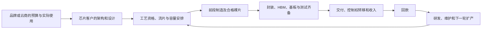

# 台积电（TSMC，NYSE：TSM；TWSE：2330）公司调研：制造平台的增长、收费权与资本回收

**研究截止日：2026-10-16，America/Los_Angeles。** 纳入截至本次检索可核验的公开资料，包括 2026-10-15 公布的第三季度业绩；经济期间截至 2026-09-30 的实际结果与其后的指引分开。财务基线统一采用公司季度披露的 **Taiwan-IFRSs／新台币合并口径**；美元经营收入采用公司当期公布值。前瞻模型以自然年、十亿美元为单位，**1 十亿美元＝10 亿美元**。未披露的节点价格、产量、单位成本、客户数量和概率均不作为历史事实。

标记：**F＝已披露事实；M＝管理层目标或产品主张；C＝直接计算；I＝研究推断、条件模型；U＝公开资料尚不能识别。** 条件范围没有统计置信水平。文内来源编号均可点击，末尾登记公开日期、经济期间和具体位置。

## 一、当前判断：台积电已经兑现需求，但下一轮价值取决于交付和资本效率

台积电出售的是**能够按客户设计、性能、可靠性和时间要求交付的制造服务**。它不拥有大多数客户芯片、模型、软件或终端预算，却通过工艺、设计生态、量产组织和封装协同，控制了把这些设计变成商业产品的重要入口。当前优势已经产生真实收入和现金；未来仍需要持续买设备、建厂、研发并承担爬坡风险。

**本研究更支持：2027 年继续显著增长，2028 年增长延续但利润率不必继续提高。** 在没有持续地域封锁或主要厂区毁损、旗舰客户继续采用新节点、N3 新厂及 N2 扩容按期形成合格交付、封装配套不过度落后这些前提下，工作路径的收入条件范围为 **2027 年 2,100 亿—2,400 亿美元、2028 年 2,450 亿—3,000 亿美元**。统一模型的代表算例为 2,309 亿、2,820 亿美元，营业利润约 1,386 亿、1,651 亿美元。它们是本研究工作路径内的算例，不是管理层指引、数学期望或订单统计；详细数量、价格、成本和资本责任在第七节集中列示。

决定这一判断的发现如下。

1. **先进节点的增长已超出“只有英伟达 GPU”的解释。** 2026Q3 收入为 467.2 亿美元，毛利率 66.4%、营业利润率 58.7%；晶圆收入中的 N2 已达 8%。苹果零售产品的台积电N2实物、MediaTek的N2P流片合作，以及两家Android平台厂的2nm发布，支持移动端进入新节点。Qualcomm原始公告未点名制造商，保留为行业采用信号；产品发布也不等于全部客户手机已经验收。[S01][S02][S11][S12][S13][S49][S50]
2. **增长主要来自先进产能、节点迁移和服务组合，不能全部称为涨价。** 第三季度 12 英寸等效晶圆出货同比只增加 9.6%，美元收入增加 41.2%；合并收入／等效出货量同比增加约 28.8%（C）。分子含封装、测试和其他收入，分母不衡量封装工作量。这个指标证明收入强度提升，不能证明同一晶圆规格提价 28.8%。[S03]
3. **N3 正在成为扩产业务，N2 正在成为规模业务；两者相互争夺工具和客户预算。** 最新路线包括新的台湾 N3 工厂、美国第二厂及日本第二厂，并预计 2027 年 N2 家族年产能超过 2026 年的两倍。量产目标不等于全年平均交付，N5 工具转换也不能同时计作 N5 与 N3 的新增能力。（[S04]，PDF 第5页）
4. **利润与现金的质量比表面净利增速更复杂。** 第二季度有世界先进投资的处置与非现金重估收益；第三季度现金增加含美国投资税额抵免。剔清这些项目后，制造业务仍然强，但它们不能重复作为日常生产利润或永久现金来源。[S05][S08]
5. **扩大封装选择可能帮助前段，封装竞争不等于前段客户流失。** 2026-10-08 的 GF 中介层制造协议是台积电向外采购、解除后台约束的具体动作；其 20 亿美元、多年金额属于采购安排，不是台积电新增销售订单。客户改用其他封装路线，也可能继续购买台积电计算裸片。[S15]
6. **海外制造具有商业价值，同时有可见成本。** 海外爬坡的集团毛利稀释，最新估计 2026 年接近 2 个百分点，以后数年可能扩大到 3—4 个百分点。地域供应保险只有在客户接受净价格、完整工艺链具备资格且利用率够高时，才会成为资本回报优势。（[S04]，PDF 第3页）

**最强相反解释**是：客户正提前锁定供给，新增系统尚未产生足够持续现金，效率提升又减少单位任务所需硅面积；到扩产兑现时，需求、净价与利用率一起转弱。这个解释受到客户实际收入、采购现金和已上市 N2 产品的挑战，不能解释为“现在没有真实需求”；但它完全可能解释 2028 年利润和新厂回报低于当前外推。

统一下行算例中，2028 年收入约 1,779 亿美元、营业利润约 787 亿美元，显著低于工作路径；在及时降低可选投资后，集团规范化自由现金流仍可约 458 亿美元。这说明**集团有能力承受一般周期下行，而新增资产仍可能赚不到足够资本回报**。反之，3,692 亿美元的突破收入算例，需要更快设备供给、更大封装工作量、客户现金兑现及收费保留共同成立，不能只把全部利好端点相加。

主要未解问题是：各客户的制造配额与取消／延期条款；N2 大裸片和先进封装的产品别良率；同规格净成交价；区域工厂回报；先进封装统计范围及客供料责任。事实可靠性高于这些参数的可识别性。第九节明确概率对象及可以区分路径的观察。

## 二、收入、控制权和合同：客户设计属于客户，制造平台的经济责任属于台积电

### 2.1 从设计到收款

Fabless、IDM 或自研芯片团队决定架构与功能，设计工程师选择工艺、PDK、IP、封装和测试方案，采购团队委托制造，终端品牌或云商提供最终预算。台积电通过直接客户关系进入流片、资格验证和量产排程。合同通常围绕晶圆加工、工程／光罩、封装和测试服务，而不是按终端 token、GPU 售价或云收入抽成。

晶圆是主要收费单位；具体合同可以对良率、验收、工程费用、材料和质量责任作不同安排，公开文件没有给出全部统一条款。收入通常在客户获得产品控制权、交付至指定地点时确认。客户预测、保留产能、投片、完成生产、交付确认与回款分别发生，不能把多年合作关系视作已确认收入。（[S07]，Item 5 及财务附注5）

上图中的串联关系不表示台积电每笔晶圆收入都必须等到最终服务器部署才确认。已交付晶圆可以先形成收入；下游长期未能封装或通电，随后才通过客户库存、后续采购和价格回传。台积电对最终工作负载的控制很有限。

### 2.2 客户多，但最终预算集中

2025 年前十大客户占收入约 78%，第一、第二大客户分别约 19%、17%；2023 年前十大约 70%。公司没有在该披露中公开对应客户姓名，本研究不把匿名财务客户直接命名为苹果或英伟达。（[S07]，Item 3，印刷第8页附近）

客户集中有双向作用：头部客户有资金、研发组织和长期路线图，能提高产线负载及技术学习；它们也有能力要求第二来源、跨地区价格、共同投资和更强条款。多个直接客户还可能共同依赖同一批 CSP 和模型公司。GPU、ASIC、网络和 CPU 同时增长，不意味着四份完全独立的最终预算。

2026Q3 的收入地域按**客户总部所在地**划分，北美 79%、中国 5%。这不是制造所在地，也不是最终使用地。因此不能以“中国直接客户收入只有5%”断言中国相关政策、北美客户对华销售或台湾生产受到限制只影响5%业务。（[S05]，PDF 第2页）

### 2.3 产能预付款不能等同不可撤销 backlog

2026Q2 详细财报的关键存量为：客户保留产能的暂收款 **NT$234.225bn**，其中流动 NT$141.853bn；合同负债 **NT$55.852bn**。2025 年末对应值为 NT$189.858bn、NT$49.954bn。暂收款可在合同条件满足后，经双方同意退款或抵应收款；合同负债主要来自付款与履约时点差异。（[S08]，附注20，印刷第32—33页）

这两种余额的性质和会计分类不同，也没有完整毛流入、退款、抵扣和取消对账。半年暂收款净增加 NT$44.367bn，不能称为新增不可撤销订单，更不能从余额减少推取消率。客户多年路线图提供可规划性，正式产品订单仍可能较晚才下达。

独立采购方的文件支持这一边界：英伟达截至 2026-07-26 的供应和产能承诺为 **2,790 亿美元**，覆盖多个财年，主要包括存储与制造设施；部分安排在正式订单前可取消、调整或重新排期，可能产生额外成本。它证明资源准备与资金责任，不能整笔当成台积电年度晶圆收入。（[S14]，PDF 第18页）

截至截止日，公司没有提供足以重建集团毛取消率、所有最低采购义务和各节点 backlog 的公开表。本研究不把“短缺”“已预订”转换为完全保证的多年利润。最新电话会还明确不允许一般性的产能转租或拍卖，极少数光罩许可合作例外也不构成可自由交易的晶圆容量市场。（[S04]，PDF 第10页）

### 2.4 证券、经营资产和利润归属

TSM 是普通股的美国存托证券，每单位 ADR 对应 **5 股普通股**；2026-09-30 普通股约 259.32 亿股。ADR 持有人通过存托安排取得相应经济权益与投票机制，美元交易载体不把公司的功能／报告币种变成美元。EPS、每 ADR 利润和每股股息必须保留换算口径。（[S02]，PDF 第2页）

台积电拥有或控制其制造设备、工艺知识、PDK、制造组织及自有封装平台，同时依赖设备商、EDA/IP 生态、材料、客户设计和外部封测伙伴。客户设计及其商业软件通常不属于台积电；能够制造某架构，不等于拥有该架构的终端利润。

区域权益也不相同：Arizona 为全资子公司；JASM 在 2026Q2 报表列示约73%的持有比例，2026年2月28日的精确披露为72.6%；ESMC 为70%。JASM、ESMC这类控股但有少数股东的子公司，以及全资工厂，都可以并表，利润最终仍须扣除少数股东份额。合并收入、工程控制、股东经济利益和可自由调动现金不能画等号。（[S07]，Item 4；[S08]，附注4）

世界先进在2026年5月处置部分持股后，台积电持股降至19%、丧失重大影响力，剩余投资改列 FVTOCI 金融资产。不能继续把此前28%的权益法关系或世界先进全部产能当成台积电经营资产。（[S08]，附注12）

## 三、可比财务基线：增长真实，净利和现金仍需拆清来源

### 3.1 最近五个季度

下表为合并 Taiwan-IFRSs 实际值。收入、利润与现金单位为 **NT$bn**，美元收入另列；出货为百万片12英寸等效晶圆。FCF＝经营现金流减现金购建固定资产，不扣分红、收购、利息／租赁融资现金或少数股东分配。

| 期间；业绩公开日 | 美元收入 USD bn | 新台币收入 | 毛利率 | 营业利润率 | 归母净利 | EPS NT$/普通股 | 晶圆等效出货 | 经营现金流 | 现金资本开支 | FCF（C） |
|---|---:|---:|---:|---:|---:|---:|---:|---:|---:|---:|
| 2025Q3；2025-10-16 | 33.10 | 989.918 | 59.5% | 50.6% | 452.302 | 17.44 | 4.085 | 426.829 | 287.452 | 139.377 |
| 2025Q4；2026-01-15 | 33.73 | 1,046.090 | 62.3% | 54.0% | 505.744 | 19.50 | 3.961 | 725.509 | 356.906 | 368.603 |
| 2026Q1；2026-04-16 | 35.90 | 1,134.103 | 66.2% | 58.1% | 572.480 | 22.08 | 4.174 | 698.976 | 350.763 | 348.213 |
| 2026Q2；2026-07-16 | 40.20 | 1,270.380 | 67.7% | 60.3% | 706.562 | 27.25 | 4.336 | 783.365 | 496.002 | 287.363 |
| 2026Q3；2026-10-15 | 46.72 | 1,494.243 | 66.4% | 58.7% | 763.064 | 29.43 | 4.476 | 919.776 | 443.206 | 476.570 |

出处为季度财报及简报；2025Q3、2026Q2比较值亦由最新报表复核。2025Q4现金流采用2026年2月财报及Q1比较栏的较新值，较1月简报有小额修订；Q2收入采用8月详细报表1,270.380bn，较7月简表少0.001bn。其余图表四舍五入也可使FCF尾数差0.01bn。[S02][S03][S06][S08][S09][S10][S51][S52] 2026Q3 财务报表为未审计简表；详细合同与补贴附注使用截至6月30日的中期报表，本次针对性检索未取得同等详细的Q3附注。

2026Q3 新台币收入同比增幅50.9%，美元为41.2%。季度平均 USD/NTD 从2025Q3的29.91变成31.98，不能把两个增长率差全部当作业务规模增长。最新资产负债表的美元方便换算用31.880，损益表用季度加权平均31.983，九个月损益／现金表用31.744；跨表直接相加美元金额可能产生差异。[S02]

**2025 年的美国20-F与台湾财报存在制度口径差异。** 台湾口径归母净利NT$1,717.883bn，年度详细报告稀释EPS66.26（1月业绩简报为66.25）；IASB口径为NT$1,697.604bn、65.47。公司2026-04-16的6-K说明主要差异是未分配盈余税的确认时点。收入和制造经营利润没有因此出现等额恶化。这不是在五季度序列中应混用的净利重述。[S17][S25] 同时，20-F年度美元数按年末31.37方便换算，与公司经营口径的全年美元收入122.42bn不同，本报告不把121.42bn与122.42bn串成增长序列。

### 3.2 哪些改善可以延续

按已公布平台比例计算，2026Q3 HPC收入约 **31.77bn美元**，上年同期约18.87bn；手机约9.81bn，上年约9.93bn。由于平台占比取整，这些是近似C，而不是额外分部审计数据。HPC扩张已兑现；手机虽然环比恢复，美元同比并没有同样增长。N2在旗舰手机中的价值增长与广义手机需求承压可以同时发生。[S05]

N2/N3/N5/N7分别占Q3晶圆收入8%/33%/28%/10%，合计79%；**分母为晶圆收入，不是合并收入**。2026Q2完整附注给出的晶圆收入为NT$1,073.707bn，占合并收入约84.5%；2025全年约86%。将79%直接乘467.2亿美元并称为实际先进晶圆收入，会混入后台及其他服务。[S05][S08][S07]

集团毛利改善可能来自更高有效负载、先进产品组合、工艺学习、跨节点生产效率、折旧批次和净价格；公开文件不能把这些贡献精确分成互不重叠的百分点。Q3收入和毛利额继续增长、毛利率却回落，符合新增N2资产先增加爬坡成本的机制。它既不是技术失败证据，也不是“N2必然与旧节点同毛利”的证据。

长期周期给出反证：2023年美元收入下降8.7%，FCF同比下降44.7%；2025年收入增长35.9%，FCF只增长15.2%，资本开支增长33.1%。制造平台的盈利缓冲较强，现金仍受周期和再投资约束。[S18][S06] 不能用最新季度利润乘四代替完整年度，更不能以一个高点毛利率替代下一轮资产回收。

### 3.3 一次性收益、税额抵免与营运资本

2026Q2世界先进处置及剩余权益重估产生NT$63.202bn收益，包含非现金重估；当季“其他收益和损失”为NT$67.430bn。Q3对应项目降至NT$1.424bn。Q2还记录2024年地震保险理赔，Q3不再重复。制造营业利润仍上升，但Q2净利率55.6%不能作为持续经营的固定税后利润率。（[S08]，附注12；[S05]，PDF 第3页）

Q3现金增加NT$487.676bn，并非全部来自FCF：经营现金919.776减资本开支443.206、减分红155.595，余320.975bn；另有投资、融资及汇率流量。管理报告将其他投资现金来源的主要部分解释为美国投资税额抵免，简表没有给出全部独立金额，不能把“其他投资流入”每一元都标成补贴。（[S02]，PDF 第4页；[S05]，PDF 第5页）

2026Q2附注已将Arizona合格投资抵免比例从2025规则的25%更新为2026年起35%。补助的合同条件、到账时点和资产扣减／减少折旧作用需分别处理；税额抵免降低净资本负担，不是晶圆同规格净价提高，也不应再把降低后的折旧税盾算一遍。（[S08]，附注28）

Q3应收账款NT$483.557bn、库存427.753bn；周转天数分别28天、82天，Q2为29、87天，去年同期25、74天。库存金额同比增加48.2%并没有超过新台币收入增幅，但库存天数仍高于去年；新节点WIP、产品转换及客户排程都可能解释，公开数据没有提供足够库龄、产品别报废和客户渠道库存来排除全部风险。（[S03]，PDF 第7页） 不能把公司生产库存当成最终服务器已经通电的证明。

截至9月30日，现金及流动金融资产约 **126.00bn美元**、有息债务约32.36bn，净现金约 **93.64bn（C）**；其中现金及等价物113.61bn。流动有息债务约6.69bn、已宣告应付股息约11.39bn、设备及工程应付款约9.37bn。净现金支持扩产与延期承受力，不代表这些现有责任消失。[S02][S05]

## 四、工艺与客户：为什么客户选择台积电，什么会改变单位硅价值

### 4.1 N3、N2和后继路线的经济差异

N3家族仍使用FinFET；N2改用栅极环绕的nanosheet，以更强栅控减轻短沟道效应和漏电，并通过片宽、标准单元、互连与供电协同优化性能／功耗。它不是仅把掩模图形按比例缩小。公开N2研究报告显示SRAM宏密度约38Mb/mm²，并给出工艺级性能、功耗与密度改善；这些是公司测试结构／工艺平台的证据，不是整颗客户SoC、所有工作负载或大裸片良率的独立测试。[S19]

核心商业差异有三项。

- **N3已经有规模负载、较成熟良率和不同折旧批次。** 客户可以选择更低成本、性能强化或汽车版本；使用成熟工艺复用IP并减少上市风险，也可能优于迁往最新节点。N3增长不应全部归因于晶体管缩小，部分是N5客户迁移及更大HPC设计。
- **N2已跨过可用与商业采用门槛，尚在跨过集团利润和长期回报门槛。** 小型移动SoC的量产不能单独证明大AI裸片具有相同良率、可靠性和成本。缺陷密度、参数分布、互连、SRAM、封装和客户时钟／电压要求决定可售良品；同样“2nm”，单位收入与损耗可明显不同。
- **背面供电是客户选择，不是所有产品的必然升级。** A16／后继SPR将供电网络移到背面，减少信号与电源争用、改善压降及布局，代价是额外工序、背面接触、薄化、设备和可靠性要求。它对密集HPC供电网络的价值可能高于手机；电网紧缺本身不强迫所有客户采用SPR。[S26]（[S04]，PDF 第16页）

N2P/A16的早期公司目标为2026年下半年就绪／量产；MediaTek的2025年9月原始公告已确认N2P流片合作和2026年末产品目标。流片与本次新产品发布增加采用证据，但截至本次，没有查到台积电单列这两条工艺已完成规模生产、收入或全部客户验收的结果。工艺ready、客户产品发布与2027放量是不同对象，本研究不把它们拼成统一已实现日期，也不把N2的8%收入全部叫作A16。模型把实际N2和条件性的N2P/A16/A14归在同一家族，并在节点内保留爬坡成本，未另加一份“背面供电收入”。[S21][S25][S50]

### 4.2 移动与客户端：升级可以抵消数量下降，但不是无限补偿

苹果2026-09-09发布采用2nm A20 Pro的iPhone 18 Pro系列，随后有零售上市；MediaTek于9月15日公布Dimensity 9600 Pro，Qualcomm于9月22日的Snapdragon Summit公布两款2nm平台。TechInsights公开初步实物分析明确将iPhone 18 Pro的A20 Pro识别为台积电N2，增加了来自分析机构的直接产品证据；该单个产品样本不能证明台积电全年良率或所有产品产量。MediaTek先前原始公告也明确了TSMC N2P流片合作。Qualcomm的上述原文及产品页没有点名代工厂，本次针对性检索未得到可公开核验的客户原文或实物分析来独立确认，因此其2nm发布只作为需求线索，不当成第三个TSMC N2量产事实。其余发布不能代替年度终端销量、所有OEM交付或台积电收入份额。[S11][S12][S13][S49][S50]

支付来源仍是手机、PC和其他设备销售。苹果截至6月27日季度收入109.4bn美元，同比增长16%，并披露iPhone、Mac收入双位数增长；它能承担旗舰芯片升级，但没有公开A20单位制造支出、N2销售量或台积电净价格。客户产品利润也受到存储、显示、关税和整机售价影响。[S22]

最强相反证据来自整个终端池：IDC于2026-08-26预测全年手机出货下降16.7%，PC在6月预测下降11.3%，都不是全年实绩。[S27] 高端占比、芯片面积和工艺收费可以上升，低端数量仍可下跌。苹果自研modem、无线芯片和更多设备功能还会改变芯片供应商之间的份额；只要继续委托同一代工平台，品牌利润重新分配不等于台积电失去同等业务。但整合成更少裸片、IP复用和更高良率可能减少单位设备所需晶圆。

**一项能改变采用判断的单位成本检验（I）**：用300mm晶圆和简单边缘损失近似，毛可切割裸片数

`G(a)=π×150²/a−π×300/√(2a)`，其中a为mm²。

假定相同功能由125mm²的N3变为100mm²的N2，N3良率90%、晶圆加工价27,000美元，N2良率85%、价34,000美元。分别约455、544颗良品，前段加工费约 **59.3、62.5美元／良品**；N2需约89.6%的良率才能仅在这项加工成本上打平。面积、价格和良率全为条件参数，未含光罩、研发、封装、内存和终端售价。

这说明：即使较新工艺缩小面积，客户仍可能因性能、续航、散热和上市窗口支付更高制造费；台积电能保留多少增值，取决于客户产品收益和替代方案。反过来，SRAM与模拟部分缩放较弱，实际整芯片面积若只减10%，上述“便宜”门槛会更难达到。工艺PPA优势不自动成为每颗成本优势，也不自动成为台积电全部收入的提价权。

### 4.3 HPC：已经发生的采购，与仍未识别的终端回报

| 采购链观察；公开日期／经济期间 | 已跨过的商业门槛 | 对台积电需求的支持和限制 |
|---|---|---|
| NVIDIA 2026-08-26；截至7月26日财季：收入96.2bn、数据中心89.0bn美元 | 芯片／系统销售已经形成收入，不是只有设计意向 | 需要真实制造与配套；数据中心包含网络、系统及多个代际，不能直接换算晶圆、GPU颗数或CoWoS收入。[S28] |
| Broadcom 2026-09-02；截至8月2日：AI半导体收入16.7bn、下一季目标21.7bn美元 | 定制计算和网络已形成规模销售，下一季仍为M | ASIC可以替代GPU品牌利润，却继续购买逻辑制造；网络与计算混在该口径中，不能把全部金额当作一种加速器。[S29] |
| AMD 2026-08-04；截至6月27日：数据中心收入6.7bn美元 | EPYC及Instinct已有持续商业收入；新机架开始部署 | 6.7bn同时包括CPU/GPU，不能全部标成GPU；Helios/MI400发布与客户GW合作不等于全部当年验收。[S30] |
| Microsoft 2026-07-29；截至6月30日：季度总CapEx约41bn（含融资租赁5.6bn），现金PPE35.8bn美元 | 现金采购、机房及业务扩张已经发生 | 约2/3 CapEx为CPU/GPU等短寿命资产；其余为机房等。租赁分类使自然年CapEx口径降至约175bn，而投资预期未变，不能当作减少芯片采购。[S31] |
| Alphabet 2026-07-22；Q2 Cloud收入24.768bn、现金PPE44.924bn美元 | 收入和设备付款同时增长 | Cloud开始包含TPU系统销售，增长不全部等于云负载；季度融资含普通／强制转换优先股约49.6bn及债券约20.3bn，采购并非只来自当期AI利润。[S23] |
| Amazon 2026-07-30；截至6月TTM经营现金161.4bn、FCF为-7.6bn美元 | AWS业务增长与巨大采购已经发生 | 自研Trainium也需要制造；FCF转负显示投入先于现金回收，不证明公司无支付能力，也不证明全部投入已有正回报。[S24] |

这些不同公司的原始披露，比仅看台积电订单更能反驳“没有真实客户采购”。它们又并非完全独立的需求样本：同一模型公司的预算可能通过多家云商、GPU厂和ASIC厂传递；英伟达参与客户及生态融资，也会提高共同依赖。不能把这些收入、CapEx及采购承诺相加为新的最终市场。

这项共同依赖有具体合同证据，而不只是猜测。英伟达8月26日10-Q披露，部分AI云合作若未把承诺容量售给第三方，英伟达同意购买这部分容量；另在8月为SB Energy的Ohio项目提供约4.25GW IT负载相关信用支持，担保上限105bn美元，九个数据中心预计自FY2029开始分期启用，依准备就绪条件生效、随OpenAI履约减少。它们帮助资金或信用较弱的采购方提前建设，也让部分硬件需求和客户融资共同依赖英伟达自身现金与信用；105bn不是已发生损失，更不是TSMC订单。（[S14]，附注10及MD&A Data Center Infrastructure段）

经济含义是：真实出货可以发生在最终外部使用和现金回报之前。合同支持可能使短期制造收入更稳定，不能消除长期利用率、支付和下一代采购风险。若终端使用能覆盖融资／设备更新，支持下一轮台积电D；若只是未售容量由供应商接回、外部付费不足，则资源准备强于独立终端验证，收入转弱可能延后而非消失。这是本研究保留2028量价与资本回报下行的一个公司特有传导机制。

**效率的净方向需要两个量相乘。** 假设任务数量增长60%、每任务所需设备资源下降25%，总设备资源仍增长20%（1.6×0.75−1）；若任务只增长20%，则下降10%。再考虑较大SRAM、HBM、网络、更新周期和旧设备利用率，新增晶圆订单会有另一个斜率。工作路径支持任务扩张吸收部分效率红利，但没有预设效率必然增加全部硅支出。

管理层的AI accelerator定义较窄，2025收入为high-teens比例，2026年1月给出的2024—2029收入CAGR目标为mid-to-high-50s。7月称比此前更强、10月称可能更高，但未给出新的正式数值；最新电话会又明确CPU未纳入这一狭义定义。**HPC的68%不是AI accelerator的68%，CPU机会也不是在HPC之外另加的一份收入。** 本研究将CPU／网络增长纳入相应节点，而不将管理层AI增长率套到集团全部收入。[S21][S48]（[S04]，PDF 第6、17页）

### 4.4 成熟、特种及汽车：现金底盘与局部增长并存

2026Q3晶圆收入中仍有21%来自大于7nm的工艺。它包含高压、混合信号、嵌入式存储、传感器等不同经济单元，不能统称“落后产能”。汽车资格、特定电压、长期供货和客户设计转换决定价值；大量普通成熟容量又会限制广义净价格。

N7A和N5A客户汽车产品分别于2023、2025进入量产；N3A在2026进入生产，超过10个规划产品说明设计入口，尚非公开订单颗数；N2A目标是2028完成AEC-Q100资格，跨过工艺资格后还需车厂产品验证和车型放量，不能直接当作2028全年收入。[S32][S20]

公司7月电话会提到AI相关0.18μm、90nm PMIC及部分传感器短缺，同时未称全部成熟工艺都短缺。4月又确认计划缩减Fab 2六英寸与Fab 5八英寸／GaN相关生产、优化场地，并称其他能力可以继续支持客户。把它概括成“退出全部成熟代工”或“所有成熟节点都提价”均过度。[S33][S48]

资本分配的经济理由是：把人员、场地和设备支持用于更高价值且有确定资格的需求，成熟业务不必追求最大晶圆数量。相反路径是客户需要的长期供货受到迁移扰动、特殊资格不能按时复制，损失收入和信任。N16HV、eMRAM／RRAM等升级可创造新产品内容，也可能缩小面积并蚕食旧工艺；本研究把这些贡献放在成熟／特种或相应先进节点，未叠加“汽车TAM”“机器人TAM”第二次。[S20][S25]

## 五、封装和开放机会：进入新的收费环节，不代表拥有整套系统价值

### 5.1 CoWoS、SoIC、InFO与材料责任

CoWoS把计算裸片、HBM及高密度互连组合；S／L／R等路线的硅中介层、局部桥接和RDL配置不同，分别改变面积、工序、良率和成本。SoIC提供更细的3D互连，能够减少数据搬运能耗或堆叠缓存／逻辑；InFO等扇出平台服务手机及其他高密度应用。它们共享部分工艺和客户生态，但不能按同一“月产几万片”衡量。

一个可交付封装需要前段良品、合格HBM、基板、键合／装配、测试及质量责任齐备。客户提供昂贵裸片或内存时，台积电不应把全部材料价值当作自有高毛利销售；具体转付、报废赔偿和返工条款未充分公开。多裸片组合的联合合格率也不是某一个步骤的展示良率。

2025公司先进封装相关收入“略高于10%”、2026目标low-teens，是公司会后纠正的口径，包含后台相关服务，不能全称纯CoWoS。资本预算中“先进封装、测试、光罩及其他”10%—20%的范围也不能全部划为CoWoS资本开支。（[S21]，PDF 第10页；[S48]，PDF 第3页）

**最适合研究的经济单位是合格封装及其资源强度。** 同样100万颗，较多计算裸片、HBM堆栈、更大互连面积及更长测试时间都会消耗更多资源。2026技术公告已说明5.5-reticle CoWoS生产状态，14-reticle版本以2028为目标；“可放10个大计算裸片、20个HBM堆栈”是设计能力，不是全部客户的实际配置。[S20]

第七节HPC封装算例中，2026每件收费1,100美元、平均资源面积代理3,000mm²，2028为1,400美元、4,000mm²。收费增加27%，资源面积增加33%，单位面积收费反而下降约4.5%。参数未公开，作用是检验更大封装与单位租金的区别；它不证明已签合同会按该路径变价。

### 5.2 外购与替代封装怎样影响台积电

GF于2026-10-08披露：向台积电CoWoS生态提供美国硅中介层，含深沟槽电容相关组件；初始协议五年、20亿美元，计划2028上半年在Malta开始量产爬坡。它增加地区配套并让台积电不必全部自建；款项是采购成本和资源安排，具体最低采购、退款、价格、工艺资格及年度支付曲线没有公开。[S15]

其经济结果可能是**前段和系统交付扩大、每套后台可保留利润降低、净自有资本负担下降**，三者并不矛盾。如果GF资格未通过，提前资本或客户安排仍可能付出代价；如果客户转用Intel EMIB等完整路线，台积电也可能只保留前段。竞争的判别证据应是已认证产品的重复交付、净价格和责任分配，而不是技术名称。

面板CoPoS和更大SoW也会改变几何面积成本，但设备到位后，还需全幅翘曲、RDL误差、良品组合、光罩、测试和可维修性成立。大面积报废会放大客供昂贵材料的风险。2025公告曾给出SoW-X的2027目标，2026公告对40-reticle SoW-X给出2029目标；两份公告的配置和能力表述不同，不能未经对齐认定同一产品整整延期两年，也不能把旧2027目标写成已兑现规模收入。[S20][S34]

### 5.3 HBM逻辑底座：真实新增外包，量级仍应受每颗制造费约束

SK hynix从HBM4开始采用与台积电合作的先进逻辑底座，其原始技术说明和2026年技术论坛更新支持合作机制；Micron亦披露台积电制造HBM4E标准及定制底座的合作。底座的控制、接口和供电功能增加，可以把原先在存储工艺中的任务移入外部逻辑代工。[S35][S36]

台积电获取的是底座制造及可能的协同服务，**不拥有整颗HBM售价或存储阵列利润**。三星内部代工底座、其他逻辑供应商、堆栈容量提高和每系统内存效率都会改变可获业务。

数量级算例：若某年已合格客户合计购买1亿—2亿颗底座，净前段加工费15—35美元／良品，则台积电相关制造收入约1.5bn—7bn美元（I）。这不是订单或已公开ASP，需以裸片面积、节点、良率和客户配额验证。相对于集团工作规模，它可能贡献不到1%至数个百分点；若更复杂定制底座持续迁往更先进节点，价值还有扩展路径。模型没有另加此范围，原有成熟／N5／N3行已经承担相应制造收入。

### 5.4 COUPE、晶圆级推理和远期研发

COUPE把电学与光子裸片集成，目标是降低高速数据搬运的接口损失与功耗；它依赖光纤耦合、光源、光学测试、可靠性和封装配套，台积电不会因此拥有整个光模块市场。2026公告计划COUPE-on-substrate开始生产；NVIDIA于5月31日称Spectrum-X Photonics进入生产。两家公司分别证明路线及产品阶段，仍没有公开台积电COUPE专属收入、外部部署量和可比现场失效率。[S20][S37]

有意义的规模门槛是：若客户购买100万套、每套台积电净制造及封装内容100—500美元，收入只是0.1bn—0.5bn；要超过集团2028工作收入的1%，在250美元内容量下需约1,130万套／年（I/C）。这说明为什么需要深挖采用、接口数及收费范围，也说明为何不能从“CPO很重要”直接得出集团级利润贡献。当前模型没有独立增加一份COUPE收入；普通网络裸片／后台已计入，突破贡献须按净新增重算。

晶圆级推理是另一条路线。Cerebras 2026Q2已披露GAAP总收入180.1百万美元、云及服务126.0百万美元，说明替代架构不只停留在实验；高额非现金客户激励和费用又使其GAAP／core口径不同，不能把所有云收入当作新处理器销量。[S38] 若这类架构或低延迟专用芯片替代部分HBM大封装，CoWoS资源需求会减小，但其晶圆制造仍可能留在台积电。真正决定集团方向的是每单位有效任务所需的外部硅面积、制造收费与负载，而不是GPU品牌份额。

A14、A13、A12和更远期CFET等研发维持平台延续性：A14目标2028量产；A13与A12目标2029，前者偏兼容缩小，后者强化背面供电。不是全部客户必须每年迁移，也没有把每条路线收入相加。[S20][S34]

A14已有比路线图更具体的公司测试观察：7月电话会称内部类产品载具的device performance及256Mb SRAM yield均接近90%，且客户设计流片活动推进。测试结构、样本／基准及外部客户完整良品率未在该发言中充分展开，不能改写成“大客户AI裸片量产良率90%”。它支持技术进展，风险生产、产品资格、持续付费与全线经济性仍是后续门槛。（[S48]，PDF 第6页）

ASML／台积电2026-09-08原始公告把三个阶段分开：台积电计划2030起采用High-NA；12英寸光罩试验线目标2031；相应完整系统用于先进节点生产目标2033。较早使用High-NA不自动等于更低每良品成本，较晚使用也不是无风险；工具吞吐、掩模、拼接、层数和成熟度决定比较。它们位于本模型之外，属于维持远期能力及潜在成本优势，不构成2028额外盈利。[S39]

### 5.5 Sony影像合资：新机会的控制权与现金不完全归台积电

2026-08-11，Sony与台积电从5月非约束MOU推进到具有法律约束力的最终协议，计划成立Advanced Vision Semiconductor Manufacturing，在Sony熊本已建厂区发展智能手机影像传感器制造，量产目标2029。Sony将单独控制并合并该公司；台积电计划分阶段现金投入 **2,820亿日元**，Sony拟投入4,650亿日元、包含现金及既有资产转移。额外计划能力还以日本政府支持为前提，交割需审批及其他条件。[S16]

它可扩大台积电工艺和Sony传感器技术的应用边界，却**不是JASM第二厂，也不能把未来合资全部销售并入台积电收入**。2,820/7,470≈37.8%仅是公布投入的比例，不是已披露股权类别、利润分配或投票权合同，本研究不将其当作确定持股事实。

条件资本检验：若最终经济权益约38%，台积电以2,820亿日元投入要求10%的年度税后资本回报，需其对应收益282亿日元、合资税后利润约742亿日元。若成熟净利率10%—20%，对应合资收入约3,710亿—7,420亿日元／年。全部为I，不是产品利润率或市场预测；补贴、许可收入、分期投入、资本追加及权益条款会改变门槛。

现阶段最关键门槛是审批、政府支持、工艺整合、客户传感器性能／良率、终端设计采用及分阶段出资。2029量产开始并不保证2029已覆盖全部固定成本。第七节只将一组Sony出资安排作为合并报表外的投资现金扣除，未给其提前销售或利润；若合作失败，可减少尚未承诺阶段的出资，已投入专用线和研发的回收能力仍有限。

## 六、有效供给、竞争和组织：厂房开工不能替代客户合格产出

### 6.1 最新扩产时序及资源争夺

| 生产对象 | 已取得的证据／阶段 | 后续公司目标 | 对全年交付及经济性的影响 |
|---|---|---|---|
| 台湾N2家族 | 2025Q4进入量产；两地多阶段爬坡，已有2026客户产品和收入 | 2027年产能超过2026两倍 | 工具安装、产品良率、工程师与配套决定平均可交付量；期末能力翻倍不等于当期出货翻倍。 |
| 台湾N3扩容 | 现有规模制造，工具转换继续 | 新台南厂2027上半年开始，另新增厂2028上半年开始 | 增量先经历设备、资格与良率；N5转换带来同组资源的减少。 |
| Arizona第二厂 | 厂房完成、工具移入／安装 | 2027Q3量产，早于此前安排 | 2027只贡献部分年度；需客户、材料、设备服务及后台配套，不能等同台湾产品即时可全部替代。 |
| 日本第二厂 | 施工及节点计划推进 | 3nm目标2028量产 | 较此前成熟／较先进节点布局升级，成本和客户组合须重新评估；没有公开完整新增月产量和全年良品数据。 |
| A14 | 容量准备，研发与客户设计阶段 | 2027风险生产、2028量产 | 风险生产首先降低技术不确定性，随后才验证价格、产品良率和收入。 |

时序集中取自2026Q3准备发言，不把旧年报或旧投资公告覆盖最新目标。（[S04]，PDF 第5页） 表中目标仍未发生。

独立供应商观察提供了扩产限制：ASML于2026-10-14称，按现有计划2027、2028供给仍不足以满足客户设备需求，正研究超过原计划的2028扩容；Q3新光刻设备销售113台，服务／升级收入3.289bn欧元。[S40] 台积电无法只凭资金就获得全部额外工具；同时，生产率升级能增加旧机产出。因此总CapEx金额变化既包含物理工具、建筑、设备涨价及工艺强度，也不等于同幅度晶圆产能增长。

2025年总能力约1,700万—1,800万片等效晶圆、出货约1,500万片，不能推出所有节点统一利用率约85%。一些合格先进节点紧张，普通成熟能力闲置；工具转换也有停机、工序差异和客户分配。第七节的S是**期内平均、已考虑资格和通常爬坡的条件可交付能力**，不是公告厂房名义产能，也没有再乘一次相同良率。[S25]

封装同样需要独立约束。用每片300mm载体有效面积50,000mm²、2028综合可交付折减82%、24百万件×4,000mm²条件需求，所需全年平均名义投入能力约 **19.5万片／月**（I/C）；突破情景32百万件×4,500mm²、折减84%则约 **28.6万片／月**。它们是达到模型收入的必要资源，不是已披露的台积电CoWoS实际能力。reticle、载体、CoW、WoS、代工给OSAT的工序和完整封装件数不可互换；公开证据仍不能证明这两个绝对能力已经获得。

### 6.2 竞争在哪一步能够拿走业务

| 对象／路线 | 截止日前的实质证据 | 可改变台积电的机制 | 不能由这些证据推出的结论 |
|---|---|---|---|
| Samsung Foundry | Q2称HBM底座和美国客户推动改善；第二代2nm移动、4nm LPU／底座继续推进 | 新一代设计、存储协同、本土制造和报价可分走订单、限制台积电重定价 | 未单列代工利润和可比良品产能；不能用集团存储盈利证明逻辑代工盈利。[S41] |
| Samsung与Broadcom | 7月25日MOU涉及存储、先进代工及封装，含2nm及以下、WBC等产品；宣称五年范围超过200bn美元 | 提供跨存储／逻辑的合作入口，促使客户多源开发 | 不是全额不可撤销晶圆采购，更不证明全部Broadcom XPU已经转出TSMC。范围含存储，不能把200bn列为台积电收入损失。[S42] |
| Intel Foundry | Q2外部收入293百万美元，主要增量来自Altera不再并表；18A-P风险生产、14A继续开发 | 内部CPU制造回流可减少TSMC外包；EMIB／Foveros后段获客可先于前段；本土资格可打开少数大项目 | 约5.8bn的分部收入主要内部交易，不能称为5.8bn外部代工份额；现有CPU出货不能替代外部新客户的规模验证。[S43] |
| OSAT、GF及其他专业平台 | 外部后台合作和实际制造协议；各自拥有材料／测试／地区资格 | 解除串联瓶颈，降低自有资本负担，或重新分配后台收费和责任 | 为台积电分包的同一批产品不是第二份独立终端交付。[S15][L3] |
| 客户自研、分解推理、复用旧节点 | ASIC和CPU已形成商业收入；新推理路线有付费业务 | 任务效率、面积、节点组合和替代采购改变每单位需求的TSMC内容 | 自研芯片不等于自建制造；一种软件架构胜出不必然使TSMC受损。[S29][S30][S38] |

最难复制的部分是制造知识、长期PDK/IP适配、良率学习、产品设计反馈与多代量产组织的共同积累，而不是一份先进节点命名。客户换厂须修改物理设计、IP、模拟接口、掩模及资格，并承担错过上市窗口的成本。这保护在生产中的产品；下一代设计的选择仍可重新打开，不能把转换成本称为永远没有竞争。

真正足以削弱当前优势的观察是：竞争厂在**同样性能、功耗、面积和客户资格**下，连续交付多个外部大产品、保持良率及净价格，并能同时提供后段。单个样片或签MOU只能提高进入可能性，不能证明已拿到可观持续利润。

### 6.3 执行记录、治理及事件核验

C.C. Wei兼任董事长和CEO，2025年报披露董事会10席中7席独立董事；国家发展基金持股约6.38%，CEO个人持股约0.03%。这是2026年2月附近口径，并非控股创始人结构。经营能力主要依赖研发、制造和客户组织连续性，董事长兼CEO提高决策集中度，也使董事会监督、接班及失败投资停止机制更重要。[S44]

激励既有利润分配，也有长期约束。年报披露季度现金奖金、年度利润分享及自2021年开始的限制性股票，强调变动薪酬，并设有业绩／归属条件和2023年建立的追回政策。它有助于留住关键工程与管理人才，不保证每个新厂的回报；利润和股东回报考核仍须与长期资格、研发及资本回收匹配。公司2025年底员工超过9万人，跨地区培训与产线纪律将决定扩张能否复制已有制造优势。（[S25]，Compensation Policy及Employee Restricted Stock Awards段）

可验证执行支持包括N2在原计划窗口进入生产、随后形成客户产品；新地区扩产仍需逐期证明，最新第二厂提前目标不能在未量产前计为已完成。研发金额持续增长：2026前九个月NT$229.882bn、同比增加26.6%，占收入5.9%；比例下降来自规模扩张，并不等于研发支出减少。（[S02]，PDF 第3页） 在近20座厂同时推进时，设备、人才、培训、供应商支持和跨地区管理是共用约束，不能把每个项目视为独立成功概率。

资本配置以研发和制造扩容为主，分红逐步增加；处置世界先进投资释放部分资产价值，但重估利益不复制为后续制造回报。2026Q2批准每股7元分红、2027年1月支付，是已确定现金责任，不能当作全部未来股息承诺。（[S03]，PDF 第11页）

两类法律事项已作阶段核验。年报中Longitude／Marlin的ITC专利调查，2026-09-08刊登的官方公告已说明基于和解终止调查，不能仍写成该ITC案可能马上实施未决禁令；和解金额和全部其他法院义务未公开，不估算为零。[S45] 台湾2026-04-27刑事判决确认涉及台积电秘密的非法复制等行为，证明内部权限与外部设备商合作存在真实保护问题；司法结果不证明竞争厂已经能够复制其整套量产能力，本次未取得可量化的台积电重大经营损失。[S46]

出口管制与政策要落实到两端：客户设计／最终用途是否合法可制造、设备能否进入特定厂区。BIS在2025年撤销部分中国境内外资厂免许可设备待遇，支持南京扩展受监管约束的方向；具体持续许可不能由旧豁免推定。[S47] 美国产地政策可能增加地域保险需求，也增加重复资本和成本。台海、能源和地震则共同影响产出、物流、客户支付及供应商维修，海外多厂布局尚不能提供全部台湾先进能力的即时替代。

最新Texas／Terafab讨论仍未形成确定合同、投资金额或产能，台积电强调需由自身运营；本研究只视为拓展选项，没有提前并入第七节收入或资产。（[S04]，PDF 第9页）

## 七、统一业务模型：先形成各业务的数量、价格和成本，再连接集团现金

### 7.1 模型边界及如何得到范围

本模型只计算台积电向客户收取的合并制造／服务收入；前段制造与后台服务是不同收费环节，不重复计入客供裸片及HBM售价。其他封装测试含InFO、非大尺寸HPC服务及部分3D服务，HPC封装不再加一份SoIC总额；HBM底座、CPU、网络、汽车的制造分散在节点行。Sony合资、Texas选项和独立COUPE突破收入没有提前并入。

2026全年锚点为已公布的三季美元收入122.82bn，加Q4指引52.3—54.3bn，得到 **175.12—177.12bn**；中点176.12bn是C+M桥梁，不是全年已实现结果。2026成本示例与实际九个月、Q4毛利／营业利润指引相容。2026各节点Q/P以及后台件数只是这项合并基数的一组**对账分解**，不是已披露分部历史序列。

前瞻依次处理三件事：

1. 客户产品采用与任务量形成条件需求D；已付费产品及客户采购给出基础，但公开资料不提供客户别精确晶圆配额。
2. 现有制造、工厂／工具／资格时间、N5转换及配套形成条件有效供给S；把期末名义能力改为期内可交付流量。
3. 对每行取Q＝min(D,S)，再计算数量×净价、变动成本和集团共用固定投入。必要时客户HBM、测试或部署约束还会使实际Q低于此简化上限。

需求如何获得现实约束：苹果和MediaTek已有指向台积电N2家族的实物或流片入口，Qualcomm的2nm发布则保留制造商识别缺口；2027手机数量、N2销售组合与PC迁移未公开。工作路径的0.95百万片N2，若其中60%用于移动、每片450—600颗良品，则意味着约2.57亿—3.42亿颗对应产品（I/C）；其余需要PC/HPC的裸片面积及有效负载。这个计算是**达到该产量需要什么**，不是这些客户已经订了相同数量。旗舰覆盖够宽、收入及复购保持，是这一路径的必要客户验证。

对N3，大计算裸片700—850mm²时，毛切割约60—76颗，若产品良率65%—85%，良品约39—65颗；一年1,000万套双裸片产品即可需要约0.31—0.51百万片晶圆（I/C）。手机／PC／CPU／网络及ASIC叠加后，工作路径对N3需求2.55百万片有机制基础；究竟多少客户使用该节点、每套裸片数及配额仍属U。因此没有用“AI总市场×固定份额”证明需求，也没有把供应端Q当作独立客户确认。

净价代表特定年份的节点家族／客户／地区／服务组合。2027先进P高于2026，部分来自新品与地区组合，不声称所有旧合同同时提高相同幅度。2028N7价格更温和、N5需求回落，反映迁移与竞争；成熟／特种工作路径由资格及产品内容支持小幅增长，下行则减少量价。后台单位价格和成本同时随面积、材料、测试变化，未假定规模自动降本。

**重要对照：** 10月10日行业报告的2028先进前段全行业代表点约198.1bn，而本公司工作算例的同口径先进前段为201.3bn，存在张力。[L1] 本报告没有把公司282.0bn与行业247.1bn直接比较，前者还有成熟工艺等；也没有把该行业代表点当硬统计上限。新增N3厂、最新N2扩容及2026收入上调支持重新检验旧点值，但两份模型都依赖未披露量价，不能相互算术闭合后称作独立确认。若行业原有需求／净价点更接近真实，公司的工作点须下调；这也是2028范围明显宽于2027、概率不作精确赋权的原因。

前部收入范围怎样形成：2027工作点中N2、N3、HPC封装合计122.75bn、其余108.115bn；若前三项的D与有效S共同较表内降低10%、组合净价降低5%，或量增加5%、组合净价增加2%，其余暂不变，得到约213.1bn—239.6bn。2028对应三项174.85bn、其余107.18bn；较低条件为量-15%、价-5%，较高条件为量+6%、价+3%，得到约248.4bn—298.1bn。前部用整数量级210—240、245—300表达这些工作范围（I/C），不是挑选区间中点得出代表路径，也不是所有未来的上下界。较高量需要同步增加有效供给与投资，较低量下固定支出不能等幅减少；经营利润和现金则由下文相容路径及扰动判断，不把同一利润率强套整个收入范围。偏离幅度是研究者对当前可识别误差的判断，没有统计抽样依据。

### 7.2 业务参数一次交付

前五行Q/D/S单位为**百万片300mm等效晶圆／年**；HPC封装与其他封装测试为**百万件／年**。P/V为**千美元／片或件**，例如其他封装P=0.015即15美元。V含条件材料、能源、正常损耗及变动工序成本，**不含全部固定制造、折旧和集团研发**；不能把P−V称为节点毛利率。D/S以及未披露参数均为I，S已含通常的资格／爬坡折减。

| 2026对账分解（I） | Q | P | V | 收入 USD bn | 变动成本后贡献 USD bn |
| --- | ---: | ---: | ---: | ---: | ---: |
| N2及后继 | 0.32 | 32 | 5 | 10.24 | 8.64 |
| N3族 | 1.75 | 27 | 2.4 | 47.25 | 43.05 |
| N5族 | 2.45 | 18 | 1.8 | 44.1 | 39.69 |
| N7族 | 1.75 | 9.2 | 1.2 | 16.1 | 14 |
| 成熟及特种 | 11 | 3 | 0.6 | 33 | 26.4 |
| HPC封装 | 16 | 1.1 | 0.5 | 17.6 | 9.6 |
| 其他封装测试 | 350 | 0.015 | 0.008 | 5.25 | 2.45 |

“其他光罩／服务”收入2.58bn是该2026分解的余额，不独立证明服务规模。2026晶圆等效出货示例17.27百万片，与前三季13.0百万片量级及Q4组合迁移相容；后台收入22.85bn约占13.0%，与low-teens目标相容。晶圆收入中成熟／特种约21.9%，相较Q1约26%、Q2约23%、Q3约21%的公开结构保留其现金规模，没有把全部年度增量强分给N2/N3。[S10][S52][S05] 相容性是约束，不是对件数或报价的验证；表中计算小数用于复核，不代表预测精度。

**工作路径参数（全部为I，收入为C）**

| 自然年 | 经济单元 | D | S | Q | P | V | 收入 USD bn |
| --- | --- | ---: | ---: | ---: | ---: | ---: | ---: |
| 2027 | N2及后继 | 1.05 | 0.95 | 0.95 | 34 | 4.8 | 32.3 |
| 2027 | N3族 | 2.55 | 2.3 | 2.3 | 29 | 2.5 | 66.7 |
| 2027 | N5族 | 2.55 | 2.65 | 2.55 | 19 | 1.9 | 48.45 |
| 2027 | N7族 | 1.65 | 1.85 | 1.65 | 9.5 | 1.25 | 15.675 |
| 2027 | 成熟及特种 | 11.1 | 12 | 11.1 | 3.1 | 0.65 | 34.41 |
| 2027 | HPC封装 | 20.5 | 19 | 19 | 1.25 | 0.58 | 23.75 |
| 2027 | 其他封装测试 | 380 | 420 | 380 | 0.016 | 0.0085 | 6.08 |
| 2028 | N2及后继 | 1.75 | 1.55 | 1.55 | 35 | 4.6 | 54.25 |
| 2028 | N3族 | 3.1 | 2.9 | 2.9 | 30 | 2.65 | 87 |
| 2028 | N5族 | 2.45 | 2.55 | 2.45 | 19 | 2 | 46.55 |
| 2028 | N7族 | 1.5 | 1.85 | 1.5 | 9 | 1.3 | 13.5 |
| 2028 | 成熟及特种 | 11.3 | 12.1 | 11.3 | 3.2 | 0.67 | 36.16 |
| 2028 | HPC封装 | 25.5 | 24 | 24 | 1.4 | 0.66 | 33.6 |
| 2028 | 其他封装测试 | 410 | 450 | 410 | 0.017 | 0.009 | 6.97 |

**下行路径参数（全部为I，收入为C）**

| 自然年 | 经济单元 | D | S | Q | P | V | 收入 USD bn |
| --- | --- | ---: | ---: | ---: | ---: | ---: | ---: |
| 2027 | N2及后继 | 0.7 | 0.85 | 0.7 | 32 | 6.5 | 22.4 |
| 2027 | N3族 | 2.1 | 2.3 | 2.1 | 27 | 2.6 | 56.7 |
| 2027 | N5族 | 2.4 | 2.65 | 2.4 | 18 | 2 | 43.2 |
| 2027 | N7族 | 1.6 | 1.85 | 1.6 | 9 | 1.3 | 14.4 |
| 2027 | 成熟及特种 | 10.6 | 12 | 10.6 | 3 | 0.65 | 31.8 |
| 2027 | HPC封装 | 17.5 | 19.5 | 17.5 | 1.1 | 0.65 | 19.25 |
| 2027 | 其他封装测试 | 340 | 420 | 340 | 0.014 | 0.009 | 4.76 |
| 2028 | N2及后继 | 0.8 | 1.4 | 0.8 | 31 | 6 | 24.8 |
| 2028 | N3族 | 2 | 2.9 | 2 | 25 | 2.5 | 50 |
| 2028 | N5族 | 2.25 | 2.55 | 2.25 | 17 | 1.9 | 38.25 |
| 2028 | N7族 | 1.45 | 1.85 | 1.45 | 8.5 | 1.3 | 12.325 |
| 2028 | 成熟及特种 | 10.2 | 12.1 | 10.2 | 2.8 | 0.63 | 28.56 |
| 2028 | HPC封装 | 16 | 24 | 16 | 1.05 | 0.58 | 16.8 |
| 2028 | 其他封装测试 | 320 | 450 | 320 | 0.013 | 0.0085 | 4.16 |

**突破路径参数（全部为I，收入为C）**

| 自然年 | 经济单元 | D | S | Q | P | V | 收入 USD bn |
| --- | --- | ---: | ---: | ---: | ---: | ---: | ---: |
| 2027 | N2及后继 | 1.3 | 1.15 | 1.15 | 35 | 4.8 | 40.25 |
| 2027 | N3族 | 2.9 | 2.6 | 2.6 | 31 | 2.6 | 80.6 |
| 2027 | N5族 | 2.8 | 2.8 | 2.8 | 19.5 | 1.9 | 54.6 |
| 2027 | N7族 | 1.75 | 1.85 | 1.75 | 10 | 1.25 | 17.5 |
| 2027 | 成熟及特种 | 11.5 | 12 | 11.5 | 3.2 | 0.65 | 36.8 |
| 2027 | HPC封装 | 25 | 23 | 23 | 1.4 | 0.62 | 32.2 |
| 2027 | 其他封装测试 | 400 | 440 | 400 | 0.017 | 0.009 | 6.8 |
| 2028 | N2及后继 | 2.4 | 2 | 2 | 38 | 4.8 | 76 |
| 2028 | N3族 | 3.8 | 3.4 | 3.4 | 33 | 2.8 | 112.2 |
| 2028 | N5族 | 2.9 | 2.9 | 2.9 | 20 | 2.05 | 58 |
| 2028 | N7族 | 1.6 | 1.8 | 1.6 | 9.8 | 1.3 | 15.68 |
| 2028 | 成熟及特种 | 11.9 | 12.3 | 11.9 | 3.4 | 0.68 | 40.46 |
| 2028 | HPC封装 | 36 | 32 | 32 | 1.7 | 0.75 | 54.4 |
| 2028 | 其他封装测试 | 440 | 480 | 440 | 0.018 | 0.0095 | 7.92 |

工作路径2026→2028晶圆等效出货增长约14.1%，合并收入增长60.1%。差异主要来自更多高价值节点、后台工作量和组合净价；如果节点迁移或者后台收费不能兑现，仅凭物理出货不足以支持该收入。突破路径要求更大的有效能力，不能保持工作路径相同的工具、面积、良率和资本预算。

### 7.3 固定投入、再投资和现金

以下为同一状态下的集团参数及结果，**金额单位均为USD bn**。公共制造固定现金F、制造折旧、集团费用Opex不是节点实际会计分摊；公开报表只能约束合计。Opex含共用研发、销售管理及相应折旧，研发折旧只在现金桥中加回一次。失去负载时固定成本仍承担，不能随收入等比例删除。

`R＝ΣQ×P＋其他收入`

`COGS＝ΣQ×V＋其他变动成本＋制造固定现金F＋制造折旧`

`OP＝R−COGS−Opex`

`规范化经营现金≈OP−max(OP,0)×现金税率＋全部D&A−净营运资本现金占用`

`规范化FCF＝上述经营现金−现金资本开支`

这个现金口径用于经营路径比较，未预测银行利息、单独政府投资抵免、外部融资和大额资产处置；亏损不假定即时退税。它不是逐项复制未来TIFRS现金流量表，也不等于全部归母股东可以立即提取的现金。正式计算股东现金还须处理融资利息、租赁、少数股东分配及区域限制。

| 自然年／路径 | 其他收入 | 其他变动成本 | 制造固定现金F | 制造折旧 | Opex | Opex内研发等折旧 | 现金税率 | 营运资本新增占现 |
| --- | ---: | ---: | ---: | ---: | ---: | ---: | ---: | ---: |
| 2026对账 | 2.58 | 1 | 6.35 | 21.7 | 14 | 4.3 | 17.5% | 4.5 |
| 2027工作 | 3.5 | 1.1 | 7.5 | 28 | 17 | 4.8 | 18.0% | 4.8 |
| 2028工作 | 4 | 1.2 | 9.5 | 37 | 20.5 | 5.5 | 18.5% | 5.1 |
| 2027下行 | 3.2 | 1.1 | 7.8 | 29 | 17.7 | 4.8 | 18.0% | 1.3 |
| 2028下行 | 3 | 1 | 9.8 | 35 | 19 | 5.5 | 18.5% | -1.2 |
| 2027突破 | 4 | 1.2 | 8.5 | 30 | 19.5 | 5 | 18.0% | 8 |
| 2028突破 | 4.5 | 1.3 | 11.5 | 44 | 26 | 6 | 19.0% | 9.5 |

| 自然年／路径 | 收入 | 毛利率 | 营业利润 | 营业利润率 | 规范经营现金 | 现金CapEx | 规范FCF | 股息现金 | Sony投资现金 | 两项后保留现金 |
| --- | ---: | ---: | ---: | ---: | ---: | ---: | ---: | ---: | ---: | ---: |
| 2026对账 | 176.12 | 66.6% | 103.36 | 58.7% | 106.772 | 62 | 44.772 | 19 | 0.3 | 25.472 |
| 2027工作 | 230.865 | 67.4% | 138.582 | 60.0% | 141.638 | 72 | 69.638 | 23 | 0.6 | 46.038 |
| 2028工作 | 282.03 | 65.8% | 165.064 | 58.5% | 171.927 | 80 | 91.927 | 26 | 0.6 | 65.327 |
| 2027下行 | 195.71 | 61.1% | 101.895 | 52.1% | 116.054 | 68 | 48.054 | 21 | 0.6 | 26.454 |
| 2028下行 | 177.895 | 54.9% | 78.709 | 44.2% | 105.848 | 60 | 45.848 | 21 | 0.3 | 24.548 |
| 2027突破 | 272.75 | 68.9% | 168.428 | 61.8% | 165.111 | 90 | 75.111 | 25 | 0.6 | 49.511 |
| 2028突破 | 369.16 | 67.4% | 222.943 | 60.4% | 221.084 | 105 | 116.084 | 30 | 0.6 | 85.484 |

2026—2028工作路径现金CapEx合计214bn；70%—80%先进制程、约10%特种、10%—20%后台／光罩／其他是2026管理层投资范围，不是本模型逐年固定比例。[S48][S04] 72bn、80bn的未来预算是I，体现N2／N3、多地区和后台继续扩容；若设备涨价而物理能力未达S，收入必须减少、单位资本效率也会下降。

Sony现金出资示例依次0.3／0.6／0.6bn，是按约150日元／美元的**建模汇率**和阶段安排做的资金占用参考，合计1.5bn、并未覆盖全部公告2,820亿日元。最终实际出资日期与权益条款未知；尚余阶段责任不能视为免除，也未把投资现金伪装为集团生产CapEx。原始投资承诺保留日元，不把建模美元当作实际汇兑值。

下行路径在2027仍承接大部分在途投入，2028才把可选现金投资减到60bn，因此折旧不随收入同步下降。维持性、已承诺成长和可选成长没有官方完整分拆；本研究估算集团年度维护／更新现金至少约15bn—25bn量级，另有完成现有项目和可选新模块。这个维护范围由设备五年折旧、技术转换／再利用与更新需求约束，不能用当年折旧26bn直接认定维护额恰好26bn。

### 7.4 有经济含义的扰动

以2028工作算例为参照，局部敏感性没有概率含义；量价联动另列，不能将所有独立扰动端点相加。

| 扰动及保持条件（I） | 营业利润变化 USD bn | 现金／经营含义 |
|---|---:|---|
| N3净价降低10%，Q和成本暂不变 | -8.70 | 收入273.33bn、规范FCF84.84bn；后续客户需求响应未计入这一局部检验。 |
| N2及后继合格交付少0.25百万片，固定投入保留 | -7.60 | 收入273.28bn、FCF85.73bn；若延迟带来更多报废／闲置，影响更大。 |
| 海外额外成本使毛利再低2个百分点，其他不变 | -5.64 | FCF约87.33bn；这是已经纳入成本路径之外的额外冲击，没有重复扣全部海外稀释。 |
| HPC封装面积代理增加25%、相同面积能力，Q降至19.2百万；每件价升至1,650、V升至820美元 | -1.82 | 后台收入仅小降但可交付件数少20%；另可能滞后一周期压低前段订单，不能只看收入增长。 |
| N2/N3可交付量均减20%、净价均减10%，必要固定投入仍在 | -36.59 | 收入242.48bn、FCF62.11bn；相比单纯量跌，价格和利用率共同改变回报。 |
| 应收天数增加10天；库存天数增加10天 | 不即时等额改变利润 | 稳态分别占现金约7.73bn、2.64bn，后者基于制造成本；不是每年重复同一笔占用。 |

封装面积扰动如果使后续N3需求少约0.15百万片，还会额外减少约4.1bn贡献利润及增加客户／生产库存压力。其时间与合同决定是否当期回传，不能将已确认晶圆收入机械冲回。模型对明确量价成本的算术较可靠，对这种跨环节时滞的证据较弱。

### 7.5 与管理层基线比较

10月15日管理层预计2026全年美元收入增长约44%。三季实际加Q4指引形成的43.0%—44.7%增长范围与之相容，176.12bn的对账点在这项近期指引内；这部分尚不构成独立上调预测。（[S04]，PDF 第4页） 2027的230.865bn、2028的282.03bn分别同比增长31.1%、22.2%，公司尚未公布同期间的完整收入数值指引，两年判断由前述客户、合格供给与量价成本条件形成。

1月15日管理层的集团长期目标为2024—2029接近25%美元收入CAGR，按2024收入90.08bn计算，隐含2029约274.9bn（C+M）；它不是每年都增长25%的承诺。本研究2028工作点已提前一年略超过这一旧基线，2024—2028对应CAGR约33.0%。7月及10月关于AI需求更强的表述支持继续检验上行，却没有替代成新的集团CAGR数值。因而工作点相对于**有日期的1月长期经营基线更积极**，需要新增工厂、终端复购和收费共同兑现；没有当前定价证据，不能据此称为市场“尚未计入”的收益。[S21][S48][S04]

## 八、资本回收及承受力：旧资产现金不能自动证明每个新厂值得建设

### 8.1 同一先进产线的完整周期检验

下面的独立条件算例是一座**每月50,000片、年名义600,000片**的新先进产线，不代表台积电具体厂区报价或已签合同。它用来检验：初期贡献为正、会计盈利和投资得到回报是不是同一件事。

所有路径保持同一边界：初始资本20bn，建设期三年支付4／10／6bn；运行十年；设备16bn按5年折旧、建筑4bn按20年；第5年末再支付8bn更新设备、按5年折旧；每年必要维护现金0.35bn；营运资本为收入8%；第10年税后净残值2.5bn并释放营运资本。固定制造及必要研发／管理现金首年1.7bn、每年增长2%，税率18%、不计亏损即时退款或结转抵税，无借款、补助或永续终值。小维护资本的额外折旧税盾未单列，属于保守简化。

参照首年净加工价27,000美元、变动成本6,000美元，分别每年下降2%；利用率30%→65%→87%→92%。新线变动成本高于前述节点族平均算例，代表特定新地区／爬坡损耗与直接成本条件；本算例另含分配给该资产的研发管理现金，不再从集团模型重复扣除。五年设备寿命与公司会计政策一致，但经济寿命、工具再利用、补贴和真实海外造价仍可能改变结果。（[S07]，附注5）

| 同一资产条件 | 无杠杆IRR（I/C） | 建设首年时点、10%折现NPV USD bn | 含义 |
|---|---:|---:|---|
| 参照 | 17.4% | 9.05 | 需要较快爬坡和大部分运营年高负载；不是集团或某真实厂的IRR。 |
| 各年利用率只为参照的80% | 11.3% | 1.46 | 接近模型资本门槛，仍可能会计盈利。 |
| 净价降低10%，其他不变 | 13.6% | 4.16 | 更低收费消耗回报缓冲。 |
| 利用率×80%且净价-10% | 7.6% | -2.45 | 两项普通偏差同时发生即可低于资本成本，不必假设技术完全失败。 |
| 初始建造成本增加25%，其余经营不变 | 13.5% | 4.92 | 高毛利不能完全抵消地域／工具成本。 |
| 首年净价31,000美元，其余保持参照 | 22.4% | 16.30 | 是客户愿意持续支付的条件结果，不能从性能领先直接认定。 |

参照年度现金保留如下；支出更新和退出回收发生在同一资产，没有藏到表外。收入、营业利润及现金单位USD bn。

| 年度／现金时点 | 利用率 | P 千美元／片 | 收入 | 折旧 | 营业利润 | 更新投资 | 营运资本增量 | 净项目现金 |
| --- | ---: | ---: | ---: | ---: | ---: | ---: | ---: | ---: |
| 建设1（t=0） | — | — | — | — | — | — | — | -4 |
| 建设2（t=1） | — | — | — | — | — | — | — | -10 |
| 建设3（t=2） | — | — | — | — | — | — | — | -6 |
| 投产1（t=3） | 30% | 27 | 4.86 | 3.4 | -1.32 | 0 | 0.389 | 1.341 |
| 投产2（t=4） | 65% | 26.46 | 10.319 | 3.4 | 2.892 | 0 | 0.437 | 4.985 |
| 投产3（t=5） | 87% | 25.931 | 13.536 | 3.4 | 5.359 | 0 | 0.257 | 7.187 |
| 投产4（t=6） | 92% | 25.412 | 14.028 | 3.4 | 5.706 | 0 | 0.039 | 7.69 |
| 投产5（t=7） | 92% | 24.904 | 13.747 | 3.4 | 5.452 | 8 | -0.022 | -0.457 |
| 投产6（t=8） | 92% | 24.406 | 13.472 | 1.8 | 6.801 | 0 | -0.022 | 7.049 |
| 投产7（t=9） | 92% | 23.918 | 13.203 | 1.8 | 6.554 | 0 | -0.022 | 6.846 |
| 投产8（t=10） | 92% | 23.439 | 12.939 | 1.8 | 6.311 | 0 | -0.021 | 6.646 |
| 投产9（t=11） | 92% | 22.971 | 12.68 | 1.8 | 6.07 | 0 | -0.021 | 6.448 |
| 投产10（t=12） | 92% | 22.511 | 12.426 | 1.8 | 5.833 | 0 | -0.02 | 9.748 |

第5年仍盈利而现金转负，来自更新设备；第6年折旧减少使营业利润跳升，不意味着现金工艺成本突然降低；第10年总现金含残值和营运资本释放，不能当作持续运行率。参照的完整周期10%回报门槛为首年净价约22,005美元／片（C），静态覆盖首轮折旧和固定费用的初年利用率门槛约40.5%，二者责任不同。

真实台积电项目可能因已用设备、学习复用、客户预付或补贴而更好，也可能因海外造价、停机、返工、资格失败、净价重置或更短经济寿命而更差。公司没有披露足以计算每个节点／厂区真实IRR的价格和成本，本研究用门槛和联合扰动判断，而不把集团毛利率分摊成所有新项目同样赚钱。

### 8.2 已有责任与一般下行

截至2025年末，20-F列示资本／其他采购义务约NT$1,534.575bn，未来一年部分NT$1,220.393bn；它们涵盖建厂、设备、原料及其他服务，不全是同一年的现金CapEx。暂收款、设备应付款及采购义务不能全部在经营成本和CapEx之外再扣一次。（[S07]，印刷第34页） 2026Q2在途PPE、付款与应付款变动也显示，投资新增和现金付款不总在同一季度。（[S08]，附注29）

同一2025年末口径长期债务本金NT$1,032.988bn，含流动部分136.926bn；银行／债券利率约2.1%—4.63%，剩余期限从不足一年到35年。含本金及利息的合同表，未来一年债务付款156.822bn、1—3年321.847bn、3—5年238.883bn、五年后512.307bn；租赁合同现金另为39.470bn、其中未来一年4.381bn。它与9月末债务余额、期初已支付现金不是同一时点，不应全部再叠到未来每年。债务有期限分散，正常周期下再融资不是最先触发的约束；更大风险是产能投入先行、客户现金及区域可用性同时转弱。（[S07]，Liquidity and Capital Resources；[S02]）

当前净现金与经营现金足以支持工作路径及一般延期。下行模型中，2027／2028分红和Sony示例出资后保留现金约26.5bn／24.5bn，尚未计融资利息、租赁和少数股东分配。这种下行不触及集团生存边界，可能主要损害新增资本效率和可分配现金增长；无需假设无成本融资才能走通。

这份承受力依赖两个判断：成熟／已折旧能力仍有正贡献；公司在需求变弱时降低**尚未承诺的后续模块**，而不是假定所有项目都按最大规模完工。削减投资又会降低以后有效供给，不能同时保留突破路径产能。客户暂收款约7bn美元量级也不是可自由花掉的永久资金。

### 8.3 更严重的现金路径及必要调整

集团高利润不应让地域停产／大规模订单调整从模型中消失。一个有意保守的**单年资本压力算例**为：收入90bn、变动制造25bn、固定制造10bn、制造折旧35bn、Opex19bn，营业利润仅1bn；全部D&A40.5bn、额外营运资本占用5bn、现金税0.185bn，规范经营现金约36.3bn。若现金CapEx65bn、分红21bn、另退款7.4bn，单年净资金消耗约 **57bn**，还未计专门事故损失、融资利息和现金可用地域限制（I）。

该组合不是战争概率预测，也不把所有中国、台湾和美国风险统一转换成一个折扣。它说明现有约93.6bn净现金在一场长时间中断里不是无限缓冲。两年原样延续会接近或跨过融资边界，因此不能把这条路径不调整地外推。

调整次序与代价是：先保留已经宣告的股息、债务、合法退款和维持安全生产的责任；推迟尚未锁定设备和新模块、减少后续可选出资及未宣告股息增长；与客户协商重排交付／预付款，与设备商协商交期；必要时使用流动金融资产和已有债务融资能力。出售专用设备或受损厂区难以按账面资本变现；暂停新节点会损失后续客户资格和收入，不能视作免费止损。灾害／地缘条件下，海外子公司现金、出口许可和供应链可能同时受限，集团净现金无法保证每地、每时点全部可用。

海外分散会减少某些损失，但新厂尚处爬坡、不同地区工艺及后台资格不完全可替代；多地区投资本身也提高固定成本。工作路径按正常持续经营建模，重大长期中断作为独立高损失分支保留，未以低概率乘平均利润来掩盖现金断点。

## 九、条件结果、发生可能性与证据：目前能够判断到哪一步

### 9.1 路径不是概率分布

工作、下行、突破算例回答给定条件能获得多少业务与现金；它们不是互斥并覆盖所有结果的三个统计状态。因此不把三个代表点赋随意权重再宣称数学期望，也不把各事件当作独立成功概率相乘。

较支持的方向来自已经上市的新节点产品、实际客户收入／采购、台积电现金与研发能力，以及明确工厂进度。较高规模不确定性来自未披露净价与客户配额、设备供给、有效良率、终端回报和资本时序。**证据主要改善的是不同变量的认识，不是一个统一“公司可信度分数”。**

下表概率为截至本次的主观研究范围，针对指定事件和期间，不是管理层概率、历史频率或置信区间；除特别说明外，以没有持续地域封锁／主要厂区毁损为共同前提。这些前提本身仍有风险，没有被设为已保证。

| 事件对象、时间与条件 | 发生可能性判断（I） | 为什么不能更低／为什么不能更高 | 支持该判断的证据可靠程度 |
|---|---|---|---|
| 2027自然年美元收入至少210bn | 约65%—80% | 现有2026基数、N2产品与N3扩容使完全不增长的解释偏弱；工具延迟、手机预算和客户库存又阻止接近确定性 | 实际财报和客户销售直接，收入驱动量价及下一年时序中等；概率为机制判断。 |
| N2家族2027可交付至少0.8百万片300mm晶圆 | 约65%—85% | 双地量产、客户实物、公司扩容目标支持；大裸片资格、真实ASP和期内产出未知，不能仅凭产能目标认定 | 已量产与实物证据较强；绝对晶圆数由研究分解，可靠程度中等偏低。 |
| A14在2028年内有至少两项持续付费量产客户产品 | 约60%—80% | 工艺迭代组织和已启动设计支持；需要风险生产、客户硅验证、产能与上市窗口串行通过 | 技术目标为公司一手，付费规模尚未发生；时间和客户数的概率仍主要为主观。 |
| 2028自然年收入至少250bn | 约50%—70% | 多条已建立需求入口支持；相比2027，多一轮资本释放、客户效率与竞争不确定性，且行业模型存在前述量价张力 | 方向中等、点值低至中等；不是“年限更远所以必然低概率”，而是额外门槛更多。 |
| 在2028收入至少250bn的条件下，营业利润率仍至少55% | 约50%—70%，条件概率 | 学习、负载及旧工具回收有支持；海外稀释、N2/A14爬坡、价格和设备折旧可能共同抵消 | 集团当前成本直接；节点／地区成本分配薄弱，不能把当前66.4%毛利直接换成该概率。 |
| COUPE相关台积电独立净内容在2028超过集团工作收入1% | 约20%—40% | 产品阶段已有支持；仍需多客户大规模采用、光学质量及足够收费内容，当前缺乏独立收入锚 | 技术及产品发布直接，商业数量／净价弱；未独立加入工作模型。 |
| Sony合资在2029年内开始持续商业量产，审批／资金按计划推进 | 约55%—75%，条件判断 | 最终协议、既有厂区和成熟客户需求支持；政府支持、技术整合与交割仍未全部验证 | 法律约束协议／投入强，未来产出和利润弱；启动量产不等于达到资本回报门槛。 |

这些范围不能与情景收入相乘后再次扣失败率，工作路径已经包含爬坡、成本和资源限制。区间较高端需要设备、客户资格和支付持续相互确认；较低端需要至少一项关键客户或供给门槛显著受阻。缺少同类项目统计样本，不声称百分数具有精确到个位数的经验基础。

对持续地缘封锁／战争无法可靠赋统一数值概率，本报告仍给出第八节现金与权益的非线性后果；没有将其影响设为零。**2028形成能够完整替代台湾先进制造和后台的海外冗余，现有工厂时间、节点和配套证据不支持，发生可能性很低。** 这一判断针对完整替代，不否认海外产出会增长。

### 9.2 关键验证要改变哪一个变量

| 观察窗口／对象 | 需要看到的经营证据 | 成功如何改变判断 | 不及预期及替代解释 |
|---|---|---|---|
| 2026Q4业绩；预计2027年1月 | 收入是否进入52.3—54.3bn指引、N2收入进一步增加，同时现金投资是否接近余下19.4—23.4bn预算 | 验证近期采用、爬坡和资本同步；支持2027起点，不能单季证明2028回报 | 收入强但毛利持续低于65%需要查良率／地区成本；一次付款时点差异不自动是缩减产能。 |
| 2026Q4—2027H1移动客户及CPU／ASIC项目 | 已发布设计转成终端销售、持续重复制造和多个真实客户量产；识别厂商而非只看到2nm宣传 | 扩大N2需求资格，减少单一产品依赖；相应提高D而不是无条件提高利润率 | 手机高端占比不足、存储缺货或旧工艺复用，可延迟新品量；不能把一次benchmark当作采购确认。 |
| 2027H1台南N3新厂、2027Q3Arizona第二厂 | 工具安装→首产→客户资格→持续出货，结合收入、出货及成本检查 | 提高期内S，并重新估计海外固定成本；A14风险生产只提高可行性 | 开幕但没有重复交付：S须后移，折旧、培训和现金仍可能先发生；不把期末能力充当全年流量。 |
| 2027H1—2028H1客户系统、封装与测试 | 同产品合格交付、交期、面积／测试负荷、HBM与基板齐套、同规格净价 | 区分资源短缺与排程／测试瓶颈；增加前段可兑现数量或重估后台收费 | 只见产线和载体数量增加、不见客户件数：可能新代际面积更大，不能宣称短缺已解除。 |
| 2028H1 GF中介层 | 制造资格和客户产品通过、连续量产爬坡、与台积电WoS／测试兼容 | 降低部分地区资源约束／自有资本，重新估计外购成本 | 量产推迟先影响后台S和地区完整性；20亿美元协议本身不能代替合格产出。 |
| 2027—2028云／芯片采购方 | 去除硬件转售、租赁分类和融资后的业务使用、采购现金、设备利用率、已交付系统兑现 | 支持D的持续性；不同直接客户共同预算须去重 | 若CapEx仍涨、终端净现金和利用率变弱，支持订单前置／回报不足；不把单一季度分类调整误判成砍单。 |
| 2027—2028集团财务 | 净价格／组合、有效出货、应收库存、D&A与CapEx共同检查，融资及补助分开 | 判断利润、现金和资本效率是否沿同一状态兑现 | 出货和利润强而现金弱，可来自设备付款、税／库存；同规格价格和负载一起弱才是更强周期反证。 |
| 2028—2029 Sony／A14／COUPE | 前者审批及出资后客户资格；后两者付费产量、良率、净收费、可靠性和复购 | 分别调整权益投资回报、先进节点或后台净增；不把机会相关性全部设为零 | 技术完成而没有付费，改善技术可行性但不应上调经营规模；必要时减少未承诺投入。 |

Q4余下预算用60—64bn减前三季40.64bn计算，属于C+M，不是已下设备采购金额。未来披露窗口按历年季度节奏估计，没有把尚未公布的公司正式日程写成确定公告日期。

### 9.3 最强反证与已经发生的判断更新

**假说A：当前全部增长只是空头预订。** 客户真实芯片／系统收入、现金设备采购、苹果N2实物及台积电制造现金都能反驳其极端版本。尚存的合理版本是：其中一部分采购提前于最终现金回报，后续增速会下降。真正区分它的是同批系统的使用／现金与下一轮订单，而不是今年收入再创高点。

**假说B：技术领先保证不断提价及毛利扩张。** N2爬坡造成毛利稀释、海外成本和客户多源选择已经反驳“保证”二字。合理版本是高价值制造有收费权，生产率和良率改善可以抵消部分新增成本；它需要同规格净价格、有效负载和资本回收支持。

**假说C：ASIC或其他封装赢得份额，所以台积电一定受损。** 博通已实现收入、GF制造协议及公司后台策略显示，设计品牌、后台利润和前段制造方向可以不同。强反证应是客户在另一前段完成同类产品并持续量产，或者每有效任务减少的制造资源无法由任务增长补偿。

本次实际改变判断的资料包括：10月15日N2收入及新N3厂目标，使旧的“新工艺只有路线图、N3不再扩容”观点不成立；Q2世界先进收益及Q3税额抵免，使净利／现金的持续性判断更审慎；独立A20实物分析把移动N2从厂商生产声明推进至消费者产品；Sony最终协议和GF五年安排把开放机会转为具体的资金／资源责任。它们分别改变阶段、数量、成本或现金，不被合并成一个模糊的利好分数。

**最终经营取舍：** 台积电处于已有高盈利现金平台、多个先进节点及后台同时扩张的阶段。近期增长的证据已充分，不必把全部业务留作待验证；2027—2028的具体量价、区域回报和新机会归属还不够精确。本研究选择有条件的增长工作路径，保留一般下行仍有现金的结果，也保留资金、地域和资格失败可能造成的大额损失；没有从股票涨跌、评级或目标价推导经营假设，也没有声称这些机会尚未被证券价格计入。

## 十、来源登记、输入边界与核算说明

### 10.1 原始来源及使用位置

以下链接是具体文档／页面；PDF页码按文件页次或注明的印刷页码。动态产品页按截止日核验状态使用，不能用网页最近抓取时间替代产品发生日期。同一公司、同一公告或其转载不作为独立确认。公司技术主张、客户产品确认和实物分析分别保留来源利益及代表性限制。

| 编号／原始资料 | 公开日期／快照 | 经济期间或对象 | 具体位置及支持主张 |
| --- | --- | --- | --- |
| [S01] TSMC 3Q26 Results | 2026-10-15 | 2026Q3及Q4指引 | 业绩正文：美元收入、毛利、营业利润及Q4指引。 |
| [S02] 3Q26 Financial Statements | 2026-10-15 | 截至2026-09-30；当季／九个月 | PDF第1—4页：资产负债、股数／ADR、季度及累计损益、现金流、换算汇率。 |
| [S03] 3Q26 Presentation | 2026-10-15 | 2026Q3及比较期间 | Revenue、Wafer Shipment、Balance Sheet Highlights及Cash Flow表；第7页周转、第11页股息。 |
| [S04] 3Q26 Earnings Call Transcript | 2026-10-15电话会 | 2026当前经营及2027—2028计划 | PDF第3—5页：成本、投资、N2及全球N3；第9—10页Texas及容量安排；后段问答：SPR、CPU、定价。 |
| [S05] 3Q26 Management Report | 2026-10-15 | 2026Q3及比较期间 | PDF第2页平台／节点／地区，第3页非营业项目，第5页现金及投资税额抵免，第6页资本开支。 |
| [S06] 4Q25 Presentation | 2026-01-15 | 2025Q4及2025全年 | 季度财务、Wafer Shipment及年度收入／CapEx／FCF比较；部分现金尾数以S51较新值为准。 |
| [S07] TSMC 2025 Form 20-F | 2026-04-16 SEC提交 | 2025全年；部分截至2026-02-28 | Item 3客户集中、Item 4制造／权益、Item 5经营及资金；印刷第34页合同义务；附注5收入／资产政策。IASB口径。 |
| [S08] 2Q26 Consolidated Financial Statements | 2026-08-14 SEC提交；业绩7/16 | 截至2026-06-30中期；Taiwan-IFRSs | 附注4子公司、12世界先进、20收入／合同／暂收款（印刷32—33页）、28政府补助／投资抵免、29投资现金。 |
| [S09] 1Q26 Financial Statements | 2026-04-16 | 2026Q1及2025Q4比较 | PDF第3—4页季度损益和现金流；复核Q1及较新的Q4比较值。 |
| [S10] 1Q26 Presentation | 2026-04-16 | 2026Q1 | 收入、Wafer Shipment、毛利／营业利润及现金流表。 |
| [S11] Apple iPhone 18 Pro／A20 Pro发布 | 2026-09-09 | 2026年新移动产品 | A20 Pro 2nm及产品上市安排；厂商产品主张，不提供TSMC净价及全年产量。 |
| [S12] MediaTek Dimensity 9600 Pro发布 | 2026-09-15 | Dimensity 9600 Pro产品阶段 | 2nm新平台与OEM进入路径；产品发布并非全部客户验收。 |
| [S13] Qualcomm双旗舰移动SoC发布 | 2026-09-22，官网日期 | 2026 Snapdragon Summit | Snapdragon 8 Elite Extreme Gen 6及Gen 6、2nm与后续OEM产品；不是年度终端销量。 |
| [S14] NVIDIA FY2027Q2 Form 10-Q | 2026-08-26 SEC提交；8月担保亦披露 | 截至2026-07-26；8月及跨年承诺 | 附注10 Supply and Capacity Commitments：279bn及条款；Additional Commitments及MD&A：AI云未售容量、4.25GW／105bn担保。 |
| [S15] GlobalFoundries与TSMC中介层协议 | 2026-10-08 | 五年协议；2028H1目标 | 原始协议公告：2bn、Malta、硅中介层／深沟槽电容、计划生产时序；GF是供给方。 |
| [S16] Sony与TSMC影像制造合资最终协议 | 2026-08-11 | 最终协议及2029量产目标 | 独立控制／并表主体、分期282bn日元现金、Sony 465bn日元投入、政府支持和交割条件。 |
| [S17] TSMC关于IASB与Taiwan-IFRSs差异的6-K | 2026-04-16 | 2025年度两套IFRS口径 | 未分配盈余税确认时点及净利／EPS差异；不是制造收入重述。 |
| [S18] 4Q23 Presentation | 2024-01-18 | 2023全年／周期下行 | 2023 Financial Results、CapEx及Free Cash Flow同比。 |
| [S19] TSMC N2 nanosheet原始技术研究 | 2024 IEDM研究；本次核验 | N2工艺测试及研发阶段 | 晶体管结构、工艺PPA及SRAM密度；工艺测试不是全部客户大裸片良率。 |
| [S20] TSMC 2026 Technology Symposium公告 | 2026-04-23；论坛4/22 | 2026—2029技术／商业阶段 | A13/A12/N2U、CoWoS／SoW／SoIC／COUPE、汽车N3A/N2A及N16HV；技术目标与已生产状态分别表述。 |
| [S21] 4Q25 Earnings Call Transcript | 2026-01-15电话会 | 2025实际及2026／2029目标 | PDF第10页先进封装口径纠正；AI accelerator定义、增长目标、N2P/A16时序。 |
| [S22] Apple第三财季业绩 | 2026-07-30 | Apple FY2026Q3，截至6/27 | 109.4bn收入、iPhone/Mac增长；客户付款基础，未单列N2采购量。 |
| [S23] Alphabet 2Q26 Earnings Release | 2026-07-22 | 2026Q2及H1 | PDF第2页融资，第8页Cloud／TPU系统说明，现金流表PPE；24.768bn Cloud及44.924bn现金PPE。 |
| [S24] Amazon 2Q26 Results | 2026-07-30 | 2026Q2及截至6月TTM | AWS增长、TTM经营现金161.4bn／FCF-7.6bn及设备支出；不等于全为TSMC采购。 |
| [S25] TSMC 2025 Annual Report（Taiwan口径） | 2026年公开的2025年报；未标独立上传日 | 2025实际、2026计划／治理快照 | Letter to Shareholders、Business Operations、Compensation Policy及Employee Restricted Stock Awards：产能、技术阶段、EPS及激励。 |
| [S26] TSMC A16／SPR原始技术公告 | 2024-04-24 | A16研发与2026目标 | 背面供电、适用HPC结构及相对N2P改善；不是实际客户利润证明。 |
| [S27] IDC手机与PC原始行业预测 | 2026-08-26；PC另文6/2 | 2026全年预测 | 手机-16.7%、PC-11.3%为预测；存储约束与提前购买解释。PC具体原文另列链接。 |
| [S28] NVIDIA第二财季业绩 | 2026-08-26 | FY2027Q2，截至7/26 | 96.2bn总收入、89.0bn数据中心；系统／网络口径不可全部换算为GPU颗数。 |
| [S29] Broadcom第三财季业绩 | 2026-09-02 | FY2026Q3，截至8/2 | 16.7bn AI半导体实际、21.7bn下一季目标；ASIC／网络商业基础。 |
| [S30] AMD第二季度业绩 | 2026-08-04 | 2026Q2，截至6/27 | 数据中心6.7bn，CPU／GPU及机架部署阶段。 |
| [S31] Microsoft第四财季业绩及电话会 | 2026-07-29 | FY2026Q4，截至6/30及CY2026计划 | CFO发言：CapEx、融资租赁与现金PPE、资产寿命／分类、CPU/GPU配置及自然年投资口径。 |
| [S32] TSMC Automotive Platform | 动态产品页；截至2026-10-16核验 | 汽车工艺生产／就绪阶段 | N7A/N5A的客户产品生产年份、N4A及汽车资格路径；不是车型总产量。 |
| [S33] 1Q26 Earnings Call Transcript | 2026-04-16电话会 | 成熟工艺调整／后续支持 | Fab 2／Fab 5产能缩减及场地优化问答；须与“退出全部成熟业务”区分。 |
| [S34] TSMC 2025 Technology Symposium公告 | 2025-04-23 | A14及SoW-X早期路线图 | A14 2028量产及旧SoW-X目标；与2026更大配置比较，不直接认定同产品延期。 |
| [S35] SK hynix与TSMC先进HBM逻辑底座合作 | 2024-04-19；2026论坛更新4/23 | HBM4／后继底座合作 | 原始合作范围与逻辑制造外包；2026论坛原文另列链接。 |
| [S36] Micron FY2025Q4 Prepared Remarks | 2025-09-23财季准备材料 | HBM4E后继规划 | PDF第13页：TSMC制造标准及定制逻辑底座；不是HBM全价归属。URL参数不作为公告日期。 |
| [S37] NVIDIA系统及光互连生产公告 | 2026-05-31 | Rubin及Spectrum-X Photonics阶段 | Spectrum-X Photonics产品阶段；未披露TSMC COUPE独立收入／现场良率。 |
| [S38] Cerebras第二季度业绩 | 2026-08-12 | 2026Q2 | GAAP 180.1m总收入／126.0m云收入，客户激励和core调整；说明替代架构已有商业基础。 |
| [S39] ASML与TSMC大光罩／High-NA合作 | 2026-09-08 | 2030／2031／2033分阶段目标 | TSMC High-NA采用、12英寸光罩试验线和完整生产系统三个不同时间。 |
| [S40] ASML第三季度业绩及供给评论 | 2026-10-14 | 2026Q3及2027—2028工具供给 | 113台新设备、3.289bn欧元服务／升级及扩大供给仍不足；是工具限制，不是TSMC合格晶圆统计。 |
| [S41] Samsung第二季度业绩 | 2026-07-30 | 2026Q2及后续工艺计划 | Foundry相关段落：HBM底座、第二代2nm移动／4nm等；未单列可比代工利润。 |
| [S42] Samsung与Broadcom战略合作MOU | 2026-07-25 | 五年合作范围，至2030 | 存储／代工／封装、200bn以上估计范围及2nm/WBC；非全额不可撤销晶圆采购。 |
| [S43] Intel 2Q26 Form 10-Q | 2026-07-24提交 | 2026Q2，截至6/27 | Foundry收入分部、外部293m及Altera出表；18A-P／14A阶段、分部亏损；内部收入不作外部份额。 |
| [S44] TSMC 2025年报治理原始页面 | 2026年公开；信息截至2/28 | 董事会及主要持股快照 | Board Members／股份表：董事长CEO、独立董事席次、国家发展基金及魏哲家持股。 |
| [S45] Federal Register：Longitude／Marlin调查终止 | 2026-09-08 | ITC调查终止的已发生程序 | 官方Notice及Order No.77：基于和解终止整个调查；未公开和解金额。 |
| [S46] 智慧财产及商业法院114年度刑国营诉字第2号 | 2026-04-27裁判 | 台湾营业秘密刑事案件 | 裁判事实与秘密复制／取用行为；不能推论整套竞争工艺已成功复制。 |
| [S47] BIS撤销中国外资厂相关设备待遇公告 | 2025-08-29 | 外资中国工厂设备许可待遇变化 | 设备许可规则及过渡安排；旧豁免不能作南京未来扩展保证。 |
| [S48] 2Q26 Earnings Call Transcript | 2026-07-16电话会；8月目录文本 | 2026经营及资本计划 | PDF第3页资本用途比例、第6页A14测试载具；后段PMIC／传感器及AI增长问答；管理层目标与未披露绝对能力。 |
| [S49] TechInsights Apple A20 Pro实物分析 | 页面未标独立发布日期；10/16核验 | iPhone 18 Pro消费者产品初步拆解 | Identifying the Apple A20 Pro及N2 nanosheet段：独立产品样本；不提供集团量产良率。 |
| [S50] MediaTek N2P／TSMC流片合作公告 | 2025-09-16 | N2P流片及2026年末目标 | 正文首段与N2P说明：已流片、未来量产／产品时间；不把目标写成已验收。 |
| [S51] 4Q25 Financial Statements较新版本 | 2026-02目录，未标上传日；S09于4/16再次复核 | 2025Q4及2025全年 | 现金流表Q4经营现金725.509bn、PPE付款356.906bn；收入／归母净利比较。 |
| [S52] 2Q26 Presentation | 2026-07-16 | 2026Q2 | Wafer Shipment、季度财务及现金流；收入小额修订按S08详细报表。 |

[S27]的PC原文：[IDC PC Market Enters Volatile Territory，2026-06-02](https://www.idc.com/resource-center/blog/pc-market-enters-volatile-territory-as-memory-shortage-persists-through-2027/)。[S35]的更新：[SK hynix TSMC Technology Symposium 2026，2026-04-23](https://news.skhynix.com/en/tsmc-technology-symposium-2026-5/)。SEC提交日复核：[TSMC中期6-K登记页，2026-08-14](https://www.sec.gov/Archives/edgar/data/1046179/000104617926000541/0001046179-26-000541-index.html)。

### 10.2 允许的本地上游与本研究的取舍

仅从你允许的正式结果目录读取研究输入；目录AGENTS规则用于执行边界。未读取既有TSM公司报告、公司排序、情景投资决策、金融资料或备份来形成经营假设。下载的外部原始文件、计算脚本及执行草稿只保存在公司调研tmp。

| 上游材料 | 使用机制及限制 |
|---|---|
| [L1] 先进逻辑晶圆代工和封装，2026-10-10 | 节点／前后段分母、有效供给及资本回收机制；其旧截止日前未公布Q3利润和最新厂计划，点值未直接沿用。 |
| [L2] 特种晶圆代工，2026-10-10 | 资格稀缺与广义成熟供给的差异；未把行业全部AI电源规模归给台积电。 |
| [L3] AI芯片先进封装，2026-10-10 | 面积、测试、客供料与转包去重；其全行业模型不是台积电实际件数。 |
| [L4] SEMICON Taiwan 2026会议，2026-10-10 | 光互连、面板、High-NA的进入路径及阶段线索；关键时序重新追到公司／设备商原文。 |
| [L5] 全球AI需求与Token经济框架，2026-10-10 | 工作量、付款、采购与基础设施回报的不同斜率；未直接把其全球付款或token点值用于TSMC收入。 |
| [L6] 头部AI芯片，2026-10-10 | 加速器、裸片、HBM和系统交付口径；未将其中推算出货冒充厂商披露。 |

深度主要投入先进前段、后台、客户支付及资本回收，因为它们能改变集团结果；成熟／特种、CPU／网络、HBM底座、Sony、CPO和远期技术保留独立机制，但未为每个SKU伪造分部利润。机器人／量子等用途未获得足够大的台积电独立付费锚，保留在适用工艺和开放路线，不单独创造集团TAM。

### 10.3 已完成检查与认识边界

业务模型已逐行检查D/S/Q、单位换算、集团收入与成本合并、研发折旧加回、投资现金与股息、一般下行和资本压力响应；新产线检查同一资产建设、更新、残值及营运资本时点。局部和联合扰动用于识别量级，没有把算术通过当作未来实现的证明。

当前可核验的是披露财务、合同存在及公布阶段；不可核验的关键部分是客户／产品／区域的真实量价成本、合格产能和毛取消。对这些问题已针对性查公司附注、电话会、客户、竞争厂及设备商材料；公开缺口保留U或I，没有以多个同源供应链数字补成假精度。报告中的条件收益范围与发生概率分别表达，集团现金与合资权益分别归属。

[S01]: https://pr.tsmc.com/english/news/3346
[S02]: https://investor.tsmc.com/english/encrypt/files/encrypt_file/reports/2026-10/3a94d1034b9e6b22446b674f7aaf3d088a12a193/FS.pdf
[S03]: https://investor.tsmc.com/english/encrypt/files/encrypt_file/reports/2026-10/9f58506f6f114f91cefbf86820cc63297b39b130/3Q26%20Presentation%20(E).pdf
[S04]: https://investor.tsmc.com/english/encrypt/files/encrypt_file/reports/2026-10/eba4fac72873bf546b669bd2b5d973df5c93215d/TSMC%203Q26%20Transcript.pdf
[S05]: https://investor.tsmc.com/english/encrypt/files/encrypt_file/qr/phase4_reports/2026-10/f53a64fd40fc0b453f94e077e5aba8cad506f27b/3Q26%20ManagementReport.pdf
[S06]: https://investor.tsmc.com/english/encrypt/files/encrypt_file/reports/2026-01/bb5dd5e3537d7661e694fa2588e7a29f7c0410e6/4Q25%20Presentation%20(E).pdf
[S07]: https://investor.tsmc.com/sites/ir/sec-filings/2025_20F%20Report.pdf
[S08]: https://www.sec.gov/Archives/edgar/data/1046179/000104617926000541/a2026q2consolidatedreport-.htm
[S09]: https://investor.tsmc.com/english/encrypt/files/encrypt_file/reports/2026-04/541d1d3dc007a3bbb1dc0e118019964aee9ef0b0/FS.pdf
[S10]: https://investor.tsmc.com/english/encrypt/files/encrypt_file/reports/2026-04/a7e3abe65a3fbc342aa55f9f53a5490dd621c1ac/1Q26%20Presentation%20(E).pdf
[S11]: https://www.apple.com/newsroom/2026/09/apple-debuts-iphone-18-pro-and-iphone-18-pro-max/
[S12]: https://www.mediatek.com/press-room/mediatek-dimensity-9600-pro-sets-new-standard-for-flagship-smartphone-chips
[S13]: https://www.qualcomm.com/news/releases/2026/09/snapdragon-leads-the-agentic-ai-age-with-two-of-the-world-s-fast
[S14]: https://investor.nvidia.com/files/doc_financials/2027/NVDA-2027-Q2-10Q-Final-including-exhibits.pdf
[S15]: https://gf.com/news-and-events/news/globalfoundries-reaches-agreement-to-establish-us-based-supply-of-silicon-interposers-for-advanced-ai-packaging/
[S16]: https://pr.tsmc.com/english/news/3333
[S17]: https://www.sec.gov/Archives/edgar/data/1046179/000104617926000201/tsm_20260416.htm
[S18]: https://www.sec.gov/Archives/edgar/data/1046179/000104617924000005/a4q23presentatione.htm
[S19]: https://research.tsmc.com/page/transistor-structure/59.html
[S20]: https://pr.tsmc.com/english/news/3302
[S21]: https://investor.tsmc.com/english/encrypt/files/encrypt_file/reports/2026-01/51d09df96cd89ac19d65af39032b038dc2896a24/TSMC%204Q25%20Transcript.pdf
[S22]: https://www.apple.com/newsroom/2026/07/apple-reports-third-quarter-results/
[S23]: https://s206.q4cdn.com/479360582/files/doc_financials/2026/q2/2026q2-alphabet-earnings-release.pdf
[S24]: https://www.aboutamazon.com/news/company-news/amazon-earnings-q2-2026-report
[S25]: https://investor.tsmc.com/sites/ir/annual-report/2025/2025%20Annual%20Report.E.pdf
[S26]: https://pr.tsmc.com/english/news/3136
[S27]: https://www.idc.com/resource-center/blog/smartphone-shipments-set-for-record-16-7-drop-in-2026-as-the-memory-crisis-hits-full-force/
[S28]: https://investor.nvidia.com/news/press-release-details/2026/NVIDIA-Announces-Financial-Results-for-Second-Quarter-Fiscal-2027/
[S29]: https://investors.broadcom.com/news-releases/news-release-details/broadcom-inc-announces-third-quarter-fiscal-year-2026-financial
[S30]: https://ir.amd.com/news-events/press-releases/detail/1295/amd-reports-second-quarter-2026-financial-results
[S31]: https://www.microsoft.com/en-us/investor/events/fy-2026/earnings-fy-2026-q4
[S32]: https://www.tsmc.com/english/dedicatedFoundry/technology/platform_automotive
[S33]: https://investor.tsmc.com/english/encrypt/files/encrypt_file/reports/2026-04/3cef85204275f94fd111485cfdf4adb3c0263c45/TSMC%201Q26%20Transcript.pdf
[S34]: https://pr.tsmc.com/english/news/3228
[S35]: https://news.skhynix.com/en/sk-hynix-partners-with-tsmc-to-strengthen-hbm-technological-leadership/
[S36]: https://investors.micron.com/static-files/5fb98d73-2134-4446-8d1b-0f90285f6c02?pubDate=20251218
[S37]: https://investor.nvidia.com/news/press-release-details/2026/NVIDIA-Vera-Rubin-Ramps-Into-Full-Production-to-Power-Agentic-AI-Factories-Worldwide/default.aspx
[S38]: https://investors.cerebras.ai/news-releases/news-release-details/cerebras-systems-fast-inference-cloud-business-nearly-quadruples
[S39]: https://www.investor.asml.com/news-releases/news-release-details/asml-and-tsmc-announce-initiative-pioneer-industry-transition-large-format-photomasks-high-na-euv
[S40]: https://www.investor.asml.com/news-releases/news-release-details/asml-reports-eu11.7-billion-total-net-sales-and-eu5.0-billion-net-income-q3-2026
[S41]: https://news.samsung.com/global/samsung-electronics-announces-second-quarter-2026-results
[S42]: https://semiconductor.samsung.com/news-events/news/samsung-electronics-and-broadcom-expand-strategic-collaboration-across-memory-and-foundry-technologies/
[S43]: https://www.sec.gov/Archives/edgar/data/50863/000005086326000157/intc-20260627.htm
[S44]: https://investor.tsmc.com/static/annualReports/2025/english/index.html
[S45]: https://public-inspection.federalregister.gov/2026-18260.pdf
[S46]: https://judgment.judicial.gov.tw/FJUD/printData.aspx?id=IPCM%2C114%2C%E5%88%91%E5%9C%8B%E7%87%9F%E8%A8%B4%2C2%2C20260427%2C1
[S47]: https://www.bis.gov/press-release/department-commerce-closes-export-controls-loophole-foreign-owned-semiconductor-fabs-china
[S48]: https://investor.tsmc.com/english/encrypt/files/encrypt_file/reports/2026-08/3e494f0c14dd0890f897aa044415e21d93486cc4/TSMC%202Q26%20Transcript.pdf
[S49]: https://techinsights.com/blog/apple-a20-pro-tsmc-2nm-processor-analysis
[S50]: https://www.mediatek.com/press-room/mediatek-develops-chip-utilizing-tsmcs-2nm-process-achieving-milestones-in-performance-andpower-efficiency
[S51]: https://investor.tsmc.com/english/encrypt/files/encrypt_file/reports/2026-02/cb73d5f4e019a8f6d7a494a0f8f6c6da2dfc4ee2/FS.pdf
[S52]: https://investor.tsmc.com/english/encrypt/files/encrypt_file/reports/2026-07/0e4d9625c9ef46521afd54002f835e45a9035043/2Q26%20Presentation%20(E).pdf
[L1]: </D:/investment/基本面/行业调研/结果/半导体与电子制造_设备_材料_测试/行业调研_先进逻辑晶圆代工和封装_2026-10-10.md>
[L2]: </D:/investment/基本面/行业调研/结果/半导体与电子制造_设备_材料_测试/行业调研_特种晶圆代工_2026-10-10.md>
[L3]: </D:/investment/基本面/行业调研/结果/AI服务器_存储_芯片/行业调研_AI芯片先进封装_2026-10-10.md>
[L4]: </D:/investment/基本面/产业背景/结果/会议调研_SEMICON_Taiwan_2026_2026-10-10.md>
[L5]: </D:/investment/基本面/产业背景/结果/全球AI需求与Token经济框架_2026-10-10.md>
[L6]: </D:/investment/基本面/产业背景/结果/头部AI芯片_2026-10-10.md>
