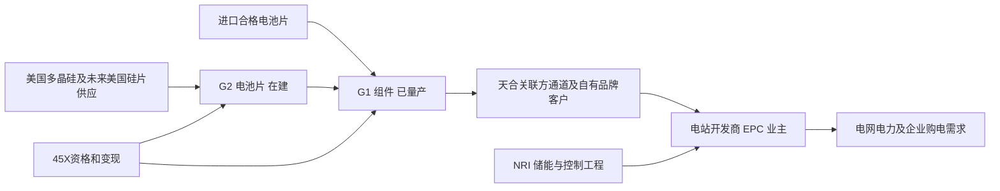

# T1能源（T1 Energy Inc.，NYSE：TE）公司调研

研究截止日：**2026年10月16日**。最新已公布完整财务期间为2026年第二季度；三季度虽已结束，本研究没有将尚未披露的三季度经营数据当作事实。已核对SEC申报清单至10月7日文件，以及截止日前公司、客户、供应商、竞争者和监管机构的新披露。金额除特别注明外均为**百万美元（USD million）**，财务依据美国会计准则；GW/MW用于太阳能时均指直流额定功率，储能的MW与MWh分开。

文中“披露”表示公司或相应机构公开陈述，不代表每项陈述均已被独立验证；“目标”为管理层前瞻；“计算”为公开数据的算术；“研究判断/条件模型”为本研究假设。概率为证据约束下的主观判断，区间不是统计置信区间。研究对象是经营能力及其向普通股股东的归属，不以股价、评级或目标价反推业务。

## 先读判断：有真实工厂和客户入口，尚在跨越独立经营、合规与融资三道门槛

**T1已经是有规模交付的美国组件制造商，但还不是现金自给的垂直一体化能源平台。** 其核心资产是5GW的G1_Dallas组件厂；决定下一阶段盈利的是2.1GW的G2_Austin电池片厂能否完成融资、建成并爬坡，获得符合税法要求的原料与商业安排，再把本土电池片的价值留在自身合同中。储能系统集成、专利许可和挪威数据中心属于经济机制不同的分支，不能把它们与现有工厂名义产能直接相加。[2026Q2 10-Q，业务概况、附注1/18及MD&A][S01]

最影响判断的发现如下。

1. **制造放量已经发生，独立客户经济尚未充分证明。** G1在2025Q4生产1.13GW、出库1.34GW；2026Q1/Q2生产638.3/935.3MW。可是2026上半年净销售427.8中，427.5来自天合相关方，约占99.94%。真实出货与对单一商业体系的依赖同时成立。Clearway的641MW合同、Treaty Oak三年最低900MW合同，是从关联方通道走向自有客户的重要进展，但尚未构成2027年全厂满产的已锁定订单。[S01] [S03] [S05] [S09] [S10]
2. **二季度的“盈利改善”主要不能作为持续利润外推。** 披露调整后EBITDA为10.657，包含24.4关税退款的成本冲减；剔除该项为**−13.743**。上半年对应为19.791减24.4，即**−4.609**。退款在期末主要体现为应收，确认收益不等于现金到账；45X抵免也已冲减销售成本，不能再加一次。[2026Q2业绩附表及10-Q附注8][S01] [S02]
3. **G2仍是大机会，时间和资金条件已经弱于早期路线图。** 一期资本预算由400—425升至510，首产由2026Q4推至2027Q1。7月120可转债、9月底新增50可转债安排仍被称为过桥；本研究没有找到截止日已完成综合融资的明确公告。9月文件预计9月30日交割，不能将预计交割与已核实到账混写。[S02] [S07] [S08]
4. **专利买断改善使用权和潜在费用，却不建立行业独占。** 135交易的原文披露：天合已获永久、全球、不可撤销、免版税且可再许可的许可；交易还披露两项专利在2026年4月受到不利PTAB决定。买入权利、能够制造、能排除竞争者、可以收取新许可收入，是四个不同问题。[IP购买协议序言、§1.1(m)、§4.2][S11] [S12]
5. **45X对经济性具有决定性作用，2025年成功出售抵免不足以证明2026年合规。** 假设5GW组件、2.1GW电池片全部符合条件，法定抵免面值合计434，按93%变现为403.6，已接近管理层375—450的整合业务年化EBITDA目标。这个比较不是说利润虚假，而是说明税收资格、客户让利和折价变现决定其商业模式。[S13] [S14] [S15]

本研究更支持的太阳能工作路径是：**2027年仍有爬坡，2028年才更接近一期稳定经营**。在后文明确的资金、合规、价格和成本条件下，代表点为2027年组件交付4.4GW、其中1.1GW使用G2自制电池片，太阳能净销售约1,302、调整后EBITDA近似值196；2028年对应4.7/1.8GW、净销售1,377、EBITDA近似值279。它们是可以复核的经营路径，**不是概率加权期望、已签订单预测或2027年必达结果**；暂不把NRI和挪威资产的未证实收益并入代表点。

这一路径要求G1的单位现金负担下降、自有品牌能够保留一部分本土溢价、G2顺利取得电池片抵免，同时还需要新增资金或显著改善现金周转。管理层375—450目标可以在较快爬坡、更好合同和更低成本下成立，但这是**年化运行水平**，不等于2027全年已具备同额利润。强劲EBITDA也可能被折旧摊销、利息、营运资金和建设支出大量吸收。

**最强反证**是：G1的质量和交付可以很好，但新增价值被合规原料成本、客户议价、天合商业协议及融资成本分走；G2投产时美国本土竞争供给同步增加，短缺溢价不足以补偿新增资本。反过来，Clearway等客户愿意为合格本土电池片锁供、G1减少外部服务费用、G2稳定良率并获得可变现抵免，则支持利润跳升。下一步最有辨别力的证据是**2026年抵免的实际交易条款、G2融资与剩余工程现金预算、自有品牌的真实交付/毛利、合格电池片的持续产出**，不是更多项目意向或产能口号。

## 一、公司、证券与资产的经济边界

### 1. 从电池创业项目转向太阳能制造

公司前身为FREYR Battery，曾推进挪威和美国电池制造。2024年12月23日收购天合美国制造资产后，经营基础转为美国组件厂，2025年2月更名T1 Energy。2024年全年只有2.9净销售，而2025年为755.3；这个增长首先是收购后完整经营期与工厂爬坡，不能解释为原有电池技术商业化。[2025年10-K，Item 1、财务报表及并购附注][S06]

2024年交易最终会计购买对价406.8，包含现金、股权、债务和反稀释权的公允价值；它既不是买一座空厂的现金价格，也不是公司已经付清全部历史义务的证明。收购带来的厂房改善、设备、库存、预付供应款、客户合同、融资和商业支持体系相互关联。[S06]（附注3）

| 经济单元 | 当前能力、收入与控制 | 本研究的合并边界 |
|---|---|---|
| G1_Dallas，Wilmer, Texas | 已运营5GW组件厂；七条组装线，约4.5GW公用事业规模、0.5GW工商业/住宅配置能力；现阶段收入核心 | 纳入太阳能业务；厂房主要为租赁，设备/经营资产与土地所有权分开 |
| G2_Austin，Rockdale/Milam County | 在建电池片厂，一期2.1GW；截至最新财报尚无商业电池片产量 | 自制片用于G1时，只计算替代外购、溢价和抵免带来的增量；不把内部电池片销售再加到集团收入 |
| Evervolt购入的IP | 2026年7月买入已许可技术、专利及相关权利 | 使用权、第三方许可和被诉风险分别判断；节省许可费已进入成本假设时不另加 |
| T1 NRI/KORE | 2026年7月1日完成收购；系统工程、BESS、控制软件及服务入口 | 形成独立业务分支；不视作已经拥有大规模美国电芯制造能力 |
| Talon PV SAFE | 2025年投入5取得未来股权权利；对方规划4.8GW电池片厂 | 无公开可确定持股比例和控制权，不并表其产能、收入或全部利润 |
| 欧洲遗留资产/Giga Arctic | 旧电池资产优化、潜在数据中心改造 | 不把已分配50MW或排队396MW变成现成机房收入；租赁、负债及合作方出资另算 |

来源：10-K Item 1、10-Q附注1/7/18及Talon公告。[S01] [S06] [S16]

TE是特拉华州公司的NYSE普通股，直接持有美国母公司剩余权益，**不是ADR，也没有ADR换股比例**。普通股位于银行担保债务、无担保可转债及可赎回优先股之后；子公司资产并表不意味着母公司可以不受债权约束地调拨所有现金。2026年7月旧公众/私募认股权证已经到期，不应继续把该批权证当成未来新增融资来源。[S01]（附注6/9/10）

### 2. 客户究竟向谁买什么

最终需求来自电站开发商、独立发电商、公用事业、工商业和住宅渠道；开发商/EPC与融资方决定产品能否进入项目，最终业主支付设备及项目款。公司出售的是组件额定瓦数及其质量、交付和长期保证，不出售电力或已接通的数据中心MW。

目前重要直接购货方仍是天合体系。其同时参与材料供应、运营支持、销售及旧品牌售后，帮助G1快速运行，也控制了重要商业接口。自有品牌直接进入Clearway等客户，可减少旧销售协议的费用，但公司也需自己承担保险、质保、销售与客户支持；这是商业能力迁移，不是改贴商标就能无成本完成的利润释放。

协议解释了为什么本土化收入不一定全留给T1：对带天合品牌的Covered Products，首1.5GW约定销售费用为进口片0.020美元/W、美国片0.035美元/W；之后部分包括售价2%、超过目标价部分的50%及特定EBITDA奖金，另有1%售后/质保服务费。运营支持协议还约定相关调整后EBITDA的5%及费用报销。200年度上限只涵盖约定佣金与特定许可费，并非全部原料、运营和售后成本上限。2025年底修订后，公司预期纯T1品牌不适用Covered Products的相应佣金，但要建立自己的保证体系；本研究不把旧品牌费率无差别施加于全部未来产品。[S06] [S41]



太阳能与储能可共用客户和销售入口，但组件厂的瓦数、BESS工程的MWh、购电合同及电网接入是不同经济对象；共同客户不构成多份独立终端需求。

## 二、技术与产品：成熟路线的本土复制，优势在交付和系统经济

### 1. TOPCon解决什么，不能证明什么

TOPCon采用超薄隧穿氧化层和掺杂多晶硅接触，降低表面复合并保持载流子传输；N型硅片有利于降低特定光致衰减。双面双玻、半片设计和良好封装可提高单位面积发电、可靠性及机械性能。其商业价值体现为土地、支架、线缆与安装成本在更多发电量上摊薄，以及长期发电收益，不等于相同比例提高组件净售价。

公司公开产品页列公用事业620/720W和住宅445W产品、最高23%组件效率、地面组件30年功率保证。这些属于公司规格陈述；没有披露足够统一的地点、布置、对照组件、温度和年度实际数据，不能把页面“每英亩多发电27%”直接用于客户回报或T1定价模型。**单块瓦数、组件效率、每亩系统发电量不是同一指标。**[S17]（Technology页，访问于截止日；页面未标明独立发布日期）

G1可配置PERC或TOPCon。PERC仍可能满足已定型客户、低成本和既有设计需求；TOPCon升级会影响电池片采购、串焊、封装和认证，不能假定原产线全部立即切换。G2所需湿法制绒/清洗、扩散、钝化接触、薄膜沉积、金属化、烧结及分选，比组件组装更依赖工艺窗口、洁净水、气体、良率和工程师。Laplace提供生产线设备，有助于降低系统集成负担，但设备到港不等于形成持续合格产量。[S03] [S05] [S06]

### 2. 实际质量证据与采用阶段

公司6月17日披露，Intertek CEA在4月23—24日对G1审核后给出A等级，涵盖生产能力、过程控制和质量管理，产品性能与Tier 1竞争者相当。这是支持G1成为合格供应商的有用外部技术意见；本研究获取的是公司公布的审核摘要，未获取完整底稿，不能将其称作IRS合规鉴证、长期现场失效率证明，或客户融资已经全部落实的证明。摘要也指出电池片供应商成熟度参差，供应分散与G2投产才可能进一步降低风险。[S18]

G1已跨过设备安装、生产验证和规模交付；自有品牌仍需积累独立质保和客户复购记录。G2目前处于建设与设备导入阶段，尚未跨过完整厂务运行、工艺良率、持续可靠性、客户资格与稳定收费。不能因为TOPCon在全球已成熟，就把T1的G2当作已认证产线；也不能因为G2尚无收入，就把集团当作无收入公司。

### 3. 技术迭代与研发边界

更薄硅片、降低银耗、优化钝化和金属化、降低碎片率及提高设备节拍，都会影响每W成本。更高效率可提高同一设备名义瓦产能，但降低每W材料耗用的收益可能被客户降价和设备更新分走。后续背接触、异质结、钙钛矿叠层等路线可能改变性能/成本前沿；截至截止日，本研究未找到T1在这些新路线取得付费规模订单或可核验自产良率的公开证据，故不赋予额外主营收入。

已购买的工艺知识和设备供应商支持，缩短了学习路径；下一代产品和本地工艺团队仍需持续投入。公司未单列足以还原G2研发费用、工艺人员或产品代际回报的分部数据。后文固定费用和投资已包含必要团队/研发支出，不能把“新建技术组织”当作无需支出的协同。

## 三、从买方与合同看可获得的业务

### 1. 真正的需求基础

美国电站需求有原始证据。EIA于2026年2月20日根据2025年12月项目调查披露，开发商计划2026年新增43.4GW公用事业太阳能和24GW电池储能；这是规划，不是当年已经投产，也不能将该AC发电口径直接与T1的DC组件瓦数比较。[S19]

买方侧更具体的证据来自Clearway：2026年1月15日披露与Google在2025年签下1.17GW长期PPA，项目在Missouri、Texas和West Virginia，拟于2027—2028年投运、投资超过2,400。这说明开发商存在可识别的购电方和项目预算；**没有文件把全部1.17GW指定给T1**，其中的风、光及其他配置也不能全部等同T1组件。[S20]

SEIA/Wood Mackenzie的2026Q3行业报告则提供相反约束：Q2新增太阳能11.4GWdc、公用事业9.6GWdc，但未来数年年度安装预期约44GWdc且趋平，本土组件名义制造能力约66GWdc。该机构是行业研究方，其预测不是订单；相同DC口径仍显示普通组件并非普遍缺产能。公司要扩大到5GW，需要继续赢得具体客户、替换供应商或高本土内容项目，不能仅依赖行业总量增长。[S21]

### 2. 商业进展应按期间和约束拆开

| 观察及公开日期 | 已能证明的进展 | 不能据此推出的结果 |
|---|---|---|
| 2025全年生产2.79GW，2026-03-31披露 | 已完成可观规模制造，基本兑现当年2.6—3.0GW产量计划 | 当年利润目标也已兑现，或全部产量都形成当年回款 |
| 2026全年3GW cost-plus/fixed-margin合同，3月及8月重申 | 为2026提供较强生产与毛利基础 | 2027同样有3GW，或成本加成能覆盖每项集团费用和所有税收风险 |
| Treaty Oak，2025-12-22 | 三年合同，最低900MW，要求G2美国电池片；买方由Macquarie体系支持但独立经营 | 每年900MW、不可取消、不受投产延期影响，或可将买方股东资金直接算作付款保证 |
| Clearway，2026-08-03 | 641MW国内电池片组件合同，包含采购负责人关于可靠性与国内供给的陈述 | 全额2027交付；完整价格、保证金、退出条款均已披露 |
| 2026Q2 10-Q，2026-08-12 | 6月30日未来组件合同量5.4GW：2026余期1.5、2027年1.3、以后至2029年2.6 | 合同池外全部意向已经转订单；不经重叠核对就另加Treaty Oak、3GW和Clearway |

来源：[S01] [S02] [S05] [S09] [S10]。Clearway公告包含买方采购负责人的直接引述，但托管方为供应商；不把公司与新闻转载计为多份独立验证。Clearway自身PPA公告另提供终端预算证据。

10-Q的合同安排通常按W收费并可调整结算：每季度开始前预付预计货款50%，转移控制权后余款一般30日支付；双方可协商改变数量和交货时间。这比纯意向强，也不等于无条件不可撤销。预付款能缓解资金占用，但须继续制造交付，不能当成可自由分配利润。[S01]（附注1 Revenue Recognition）

2027年合同池1.3GW只覆盖5GW名义能力约26%；本研究4.4GW工作交付意味着仍需约3.1GW补充订单或合同修改。Clearway新增订单是否全部在池外、交付年度如何分布，没有足够披露，故未进行机械相加。Treaty Oak最低900MW若仅作三年平均约300MW/年，仍与每年2.1GW电池片能力有明显距离；实际排期并未披露，这只是识别规模的计算。

公司称2027—2028高本土内容产品的意向需求超过预计产能。它支持继续销售调查，尚不能替代定价、预付、取消/延期责任和客户融资条件。没有同口径毛新增、取消及全部履约数据，本研究不计算取消率；合同存量的净变动残差也不等于取消。[S03]

### 3. 为什么客户可能支付本土溢价

价值来自减少贸易和供货不确定性、满足融资方质量与可追溯要求、帮助项目取得国内内容奖励，以及锁定投产窗口。项目层面的收益可能超过几美分/W，但客户会比较T1、Qcells、First Solar及进口合格产品的完整系统成本。若开发商原本已满足国内内容门槛，额外增加T1本土比例未必再产生税收收益；项目延误也可能使更贵的组件失去经济吸引力。

客户的支付能力最终取决于PPA、税收抵免、税收权益融资、项目贷款及开发资金。数据中心终端负荷上升是间接拉动，并不让T1成为全天候供电承包人。一个太阳能项目白天的额定瓦数无法自动解决夜间负荷、并网和容量责任；NRI储能增加调度能力，也没有消除充电能源和时长约束。

本地《数据中心电力与项目台账》《数据中心电力接入与高压变电》关于“接入申请、已通电与实际负荷分层”的机制适用于这里：公司8月材料引用ERCOT大量申请，只能支持市场线索，不能直接转为T1订单。研究没有沿用本地材料中的全球规模点值来计算TE销售。[L01] [L02]

## 四、可比财务：收入确认、持续利润与现金必须分开

### 1. 最近五个已公布季度

下表收入、毛利和经营损益为持续经营口径；经营现金流与现金购置固定资产为**合并现金流，包含未单独分离的终止经营现金流**。Q2/Q3/Q4单季现金数由累计数相减，资本开支不含非现金新增租赁和未付工程应付款；因此不能直接当作G2的工程完成金额。括号/负号均表示亏损或流出。

| 期间 | 净销售 | 毛利 | 毛利率 | 持续经营营业利润/亏损 | 经营现金流 | 现金资本开支 |
|---|---:|---:|---:|---:|---:|---:|
| 2025Q2 | 132.767 | 32.761 | 24.68% | −31.361 | +33.431 | 22.802 |
| 2025Q3 | 210.522 | 21.148 | 10.05% | −95.033 | +63.858 | 8.874 |
| 2025Q4 | 358.554 | −16.109 | −4.49% | −82.575 | +42.988 | 17.982 |
| 2026Q1 | 177.647 | 29.084 | 16.37% | −22.505 | −72.874 | 60.724 |
| 2026Q2 | 250.128 | 49.097 | 19.63% | −22.781 | −30.105 | 101.097 |

取数：2025Q2采用后续10-Q可比列；Q3收入/毛利与累计现金采用11月14日10-Q，Q4营业亏损采用年度业绩附表的单季数82.575。2025年底部分欧洲业务由终止经营回列持续经营，Q3营业亏损据全年234.567减Q4的82.575、再减最新可比H1的56.959，重构为95.033；不混用原Q3的94.723与后续季度口径。2026Q1/Q2采用相应10-Q。[S01] [S04] [S05] [S06] [S22] [S23]。全年勾稽：2025收入755.295、营业亏损234.567、经营现金流95.463、现金资本开支78.799；2026H1现金流−102.979、资本开支161.821。

2025Q3经营亏损包括较大客户合同相关无形资产减值，不能全当现金成本；但Q4出现收入最高、毛利反而为负，说明放量本身未建立稳定单位利润。公开资料可识别merchant组合、贸易成本、抵免变现折价及年末关联方重组等影响，缺乏将Q4毛利逐项拆平的充分产品数据，故不捏造完整价格/成本桥。2026Q1公司称改善主要来自cost-plus/fixed-margin交付占比提高和第三方费用下降，这与关联方服务费用从2025Q2的21.8降至2026Q2的10.1一致；二季度其他法律与专业服务支出又提高了费用。[S01] [S03] [S05] [S06]

### 2. 已发生的重述与两个会计陷阱

**2025Q1曾重述。** 2025年8月18日10-Q/A将收购客户合同的无形资产摊销从SG&A移至收入冲减，收入/毛利和费用表示发生变化，不意味着相同金额现金流失。本文历史净销售不拼接原版季度新闻稿的未重述收入。[S24]（Explanatory Note及附注1A）

该客户合同摊销在2026H1为22.7，预计2027/2028各45.4，仍冲减收入；2026Q2天合组件毛销售约261.5，扣摊销后相关方净销售250.1。故“净收入/生产瓦数”既混入交付时点，也混入非现金摊销，不能直接称成交ASP。后文先算销售发票经济额，再单独扣45.4以接近财报收入口径。[S01]（附注4/13）

**调整后EBITDA定义也变过。** 公司在2025Q4起进一步剔除某些交易费用。2026Q2初步业绩原拟排除退款影响，最终业绩又将24.4计入调整后EBITDA。本文采用最终披露，并另作剔除一次性退款的经营观察；没有将不同版本的非GAAP数字拼成一条无说明序列。[S02]（附表注1；S05非GAAP定义）

2026Q1持续经营净利润3.9还受认股权证/衍生负债公允价值收益影响；对应经营损益仍为−22.5。二季度毛利49.097剔除退款为24.697，毛利率约9.87%，低于一季度16.37%；这项计算比直接声称毛利率持续上升更接近可比经营表现，但仍包含45X。[S01] [S04]

### 3. 为什么现金比损益更紧

2026年6月底现金及受限现金156.4中，**非受限现金只有79.1**。库存由116.0增至228.8，绝大多数为原料225.6，成品仅2.0；因此主要问题不是已证实的成品卖不动，而是原料、安全备货和供应链资金占用。采购加大是否能在下半年顺利变成合格出货，仍要验证，不能将所有原料都视作可立即释放现金的资产。[S01]（资产负债表、附注2）

上半年库存增加占用112.7、政府补助应收增加59.0、应收增加14.2；递延收入增加93.7及应付款等增加25.6提供了部分融资。预付供应商仍为133.2。公司获得客户预付款后仍出现103.0经营流出，说明正常营运与建设正同时占用资金。[S01]（现金流量表）

年末2025经营现金流为正也不能证明长期自给：客户预付、供应商信用、费用延期和一次性税收抵免交易均可改善某期现金。反之，原料采购和建设导致短期流出不自动证明订单恶化。判断质量需要库存消耗、应收回款、抵免到账与新增应付款的同范围对账。

## 五、供给、产能与竞争：短板从组件组装向电池片和资格迁移

### 1. G1的物理能力与年度兑现

2025Q4实际生产1.13GW折合4.52GW年率，出库1.34GW则包括库存时点；单日纪录14.4MW折算约5.2GW年率，证明设备可以短时超过铭牌，不证明全年稳定超过5GW。2026H1生产合计1.5736GW；若全年达到4.2，H2需2.6264GW，即5.2528GW年率，已略超名义能力。达到3.8则要求H2约4.45GW年率，较接近已实现季度水平。[S02] [S03] [S05] [S23]

因此本研究对2026全年更支持**3.7—4.1GW的工作范围**，而非机械使用上端4.2。高端仍可实现，条件是合格电池片不断供、下半年节拍持续提高、停线和产品切换较少；没有三季度实际数据，不能把八月的管理层“高端”判断当作已兑现。产量也不等于全部收入确认，季度末物流和控制权转移仍会造成偏移。

### 2. G2的串行门槛

一期510预算含20%预备费，公司称与Texas数据中心建设造成的人工/材料紧张有关。预备费增加给风险留出空间，不是保证此后不会超支。8月12日披露厂房可进入内部MEP安装、关键设备已在海上或美国境内，洁净室长周期设备已订购；仍需厂务完工、设备安装调试、连续工艺、分选良率和客户验收。[S02]

新线可实现交付量应按“年内可运行时间×节拍×开机率×合格率×可销售比例”计算。2.1GW为年产能力，不是首产季度可以交付2.1GW。2027年合格片0.8—1.3GW的工作量级，对应名义能力38%—62%的全年兑现；1.7GW以上则需很早完成调试、较快爬坡且全年较少中断。工厂没有公开足够的良率、单耗、设备瓶颈及持续小时数据，本研究不将收入目标反推量冒充独立物理产量证明。

G2完整计划存在5.0/5.3GW口径差异：2025年末合同公告和10-K说明二期3.2GW、合计5.3；后续业绩指引按G1/G2各5GW计算，还曾提到远期最多8GW。可确认的当前执行单元是**一期2.1GW**。本文不把未统一、未融资的后续能力并入工作交付。[S06] [S10] [S02]

### 3. 竞争供给不能只数公告

| 对手/供应环节 | 原始披露及阶段 | 对T1的经济影响 |
|---|---|---|
| Qcells Cartersville | 2026-06-09宣布开始生产电池片；目标Q3达到3.3GW硅锭/硅片/电池片及约3.5GW组件，尚需区分首产与全部稳定输出 | 直接削弱“只有T1可以做美国硅基一体化”的叙事；其内部消化能力也意味着并非所有产量对外卖片 |
| First Solar | 9月自身公告称2027美国组件名义能力约17GW目标，采用CdTe薄膜 | 与T1竞争项目预算及本土内容价值，技术不同不能把全部17GW当TOPCon电池片供给 |
| Corning/Hemlock | 4月曾预告硅片厂Q2延长维护、转换永久供电并改造设备；7月Q2业绩确认维护和升级已完成，预期Q3利润改善 | 已完成检修是缓解证据，不能仍把停产当现状；T1所需规格、可交付数量/成本仍待验证，供应商同时有自身太阳能业务 |
| Nextpower钢框 | 2025-10-15与T1的多年框架目标超过75；2026又与Jinko美国签订1GW以上、可扩至3GW的协议 | 支持T1提高国内内容，也证明这种配套可供竞争者采用，不是T1专属壁垒 |
| Talon及其他新增美国电池片 | Talon的4.8GW仍是公司规划与T1少数股权选项；Silfab等项目亦有建设/许可和爬坡要求 | 可能提供替代合格片源，也可能压缩本土片溢价；本研究未将规划量全算为有效供给 |

来源：[S16] [S25] [S26] [S27] [S28] [S29] [S42]。没有取得截止日同规格、同客户资格的全行业有效产量清单，故不能精确断言2027有多少GW净短缺。

对T1更合理的供需判断是：**普通组件供给宽裕，具备资格的本土电池片及特定交付窗口可能偏紧，但稀缺程度随投产和政策变化。** 自己新增电池片既能降低外部依赖，也会与同行扩产共同消耗稀缺溢价。成功路径必须同时包含竞争响应。

## 六、政策与合规：生产激励、客户预算与贸易保护

### 1. 分清抵免、国内内容与贸易保护

| 项目 | 作用对象及关键口径 | 对T1的正确传导 |
|---|---|---|
| 45X生产抵免 | 符合条件的美国生产并销售组件7美分/W、电池片4美分/W；不是组件售价的一部分 | 作为成本冲减进入利润，变现折价和时点进入现金；不能再次加为收入 |
| PFE/FEOC材料限制 | 与非PFE直接材料成本比例、实体/债务/控制/IP安排有关；2026太阳能组件门槛50%，之后提高 | “美国组装”及供应商所在国均不能独自证明资格；资格和供应链追溯需具体证据 |
| 项目国内内容奖励 | 项目层面钢铁及制造产品成本结构；与开工年份和适用规则相关 | T1产品本土比例只是项目输入，不能直接等同业主必获奖励，也不能直接算T1利润 |
| 2027起集成组件销售规则 | 涉及同一制造设施与65%美国主要组件直接材料成本要求；关联方销售选择另有规则 | G2和G1分处不同地点，不能仅凭“垂直一体化”假定所有片抵免自动取得；需核清具体纳税主体、销售与选择方式 |

法定金额、2027规则及关联方选择见法条与IRS Form 7207说明；材料限制见IRS Notice 2026-15。**65%集成规则、非PFE比例与公司宣传的60%以上国内内容是不同分母。** 本研究未取得T1逐批MACR工作底稿、税务选择文件或2027年税务意见，因此将全部片抵免作为模型显式条件，并保留失效敏感性。[S13] [S14] [S15] [S30]

关联方选举和对外销售规则可能提供与简单内部领用不同的申领路径；“两厂不同地址所以必定没有4美分”同样超出了现有证据。这里需要具体安排证明，不能靠一体化宣传或简化法律推论消除不确定性。

### 2. 已兑现与仍待验证的45X

2025年抵免面值160按91%出售，对价145.6。2026Q2又处理剩余2025年面值39.1，SEC列对价36.4，即约93%。新闻稿“monetized … for 39.1”的表述易与现金混淆，本研究资金模型采用SEC的**36.4现金对价**。这证明2025年抵免具备真实买方和可变现价值；适用2026年新限制后的批次仍需自己的验证。[S06]（ Government Grants；S01 MD&A）

6月底政府补助净应收95.4，公司8月仅称2026年抵免交易处于早期磋商。本研究未找到截止日前明确完成2026批次交易的公司/监管公告，因此不把该应收当作当前现金，也不把2025买方尽调当成2026资格裁决。模型采用93%净额是参考最新交易的**假设**，不是未来承诺价格。

### 3. 做空线索、公司陈述和可确认事实

Fuzzy Panda于2026年6月10日发布报告，自披露持有TE空头及相关衍生品，称根据26张发票，Q1从天合采购电池片超过65，并据此估算MACR约19%、主张应撤回41.4抵免。它是有利益关系的调查线索，**不是监管裁决**。[S31]

本研究查看了其公开发票样张：所示卖方为Trina Solar (U.S.), Inc.，买方/收货方为G1，日期2026-02-11，品名包含N型TOPCon电池片，金额约1.373。样张支持“存在具体、值得核对的关联方电池片采购线索”，但没有完成真实性鉴证、全部26张逐张去重、完整采购/消耗台账和适用税法成本分母重建。不能由一张图证明全年全部产品不合规，也不能因为披露方做空就忽略它。

与之可对照的原始事实是：T1上半年披露向天合采购材料/部件428.1，但未在公开财报中分离全部电池片来源；公司在8月10-Q仍表示经尽调已采购部分供应商认证非PFE电池片，并在继续验证其余供应。供应商认证不是IRS裁决，汇总采购额也不等于当期用于申领抵免的PFE材料消耗。票据法人与实际制造控制、采购与库存消耗、逐批产品及安全港计算必须对齐。[S01]（附注13及MD&A；S14）

本研究的取舍是：**继续申领具有公司正式财报支持，但外部无法复核的合规缺口足以改变全部估值和融资能力，不能视为已经解除。** 没有发现IRS已否定2026资格的公开文件，也没有获得能够独立排除上述质疑的完整批次材料。公司披露的DOJ/SEC事项涉及2023年个人股票交易，并未说明它是45X调查，不能与做空指控拼接成“税收欺诈已被立案”的事实。

### 4. 232新规对卖价和投入的相反作用

8月6日总统公告规定自**2026年12月4日**实施多晶硅及衍生物最低进口价格：多晶硅21美元/kg、硅锭/片100美元/kg、片0.22美元/W、组件0.38美元/W，并有额外从价关税及具体例外/合同和原产地安排。进口申报、第一笔独立交易、差额征税和迁厂计划审批均有条件，故0.38不能当作T1国内组件保证售价。公司10-Q个别文字写12月3日，本研究采用公告法定生效时间12月4日。[S32]（条款1—6）

对T1有利的是进口成品竞争价格可能提高、本土片更值钱；不利的是G2前仍需进口电池片，设备、硅片及配套成本也可能上升。公告允许获批迁厂计划按投资进度取得特定232减免，但T1“将申请/对接”不等于已经获批。若原料税负先发生、本土产能后形成，保护政策反而扩大过桥资金需求；只有成本加成或重新议价足以覆盖时，收入提高才伴随利润改善。[S02] [S32]

### 5. 客户项目期限会改变交付节奏

客户侧45Y/48E与T1的45X有不同时间表。IRS Notice 2025-42明确：**2026年7月4日之后开工的适用风、光项目，若2027年12月31日后才投运，将受相关抵免终止规定约束**。在开工期限之前已符合要求、且满足持续建设等规定的项目，可以在2027年后交付；不能推论美国所有光伏需求都在2027年结束。开工通常需要符合实质性施工规则，适用例外和过渡安排须逐项目判断，普通库存组件的购买或预付款不自动证明已合资格开工；独立储能也不能直接套用同一期限。[S43]（第1、3—7节）

这使2027年赶工与2028年合资格存量项目消耗成为两个不同的需求来源。若T1的2027订单主要来自抢投运，而后续客户缺少合资格项目，G2投产成功仍可能遇到组件需求回落。工作2028的4.7GW交付因此以客户有可执行的合资格项目、融资和并网进度为条件，并未把2027赶工增长机械延续；后续应核对主要客户项目的开工资格、投运窗口及组件交付约定。PPA、供应框架和预付款各自提供部分商业证据，均不能独自证明全部税收资格或2028需求。

## 七、同一组数量、价格、成本下的单位经济与经营路径

### 1. 模型结构与财报连接

经济单位为**交付并具备销售/抵免资格的组件瓦数**，自制片瓦数另作为替代外购的子集。使用如下关系，GW换算后的金额为百万美元：

```text
Q = 对外组件交付GW；C = 其中来自G2的合格电池片GW，C ≤ Q且一期C ≤ 2.1
P = 普通/进口片基准组件的净发票价（美元/W，不含45X）
V = 使用外购片时的组件变动现金成本，含材料、变动制造、渠道、支持和质保
D = 使用国内片后每W实际保留的组件溢价
S = 同规格外购片到岸成本 − 自制片变动现金成本；可为负
FM = G1及共用公司固定现金费用；FC = G2新增固定现金费用
tm = 0.07 × 0.93 = 0.0651；tc = 0.04 × 0.93 = 0.0372

组件发票经济额 = 1000 × (Q×P + C×D)
近似财报太阳能净销售 = 发票经济额 − 客户合同摊销45.4（2027/2028）
G1基准EBITDA近似值 = 1000×Q×(P−V+tm) − FM
G2净增EBITDA近似值 = 1000×C×(D+S+tc) − FC
太阳能合计 = G1基准 + G2净增
```

这是接近公司调整后EBITDA的经营模型，未扣折旧摊销、股权激励、现金利息和税；其费用边界在所有状态内一致。进口片成本已在V中，自制后仅以S替换一次；D只加在自制片子集；G2内部销售不计集团收入；共享公司费用在FM中扣一次。93%净额已含抵免出售折价，不能在现金桥里再扣同一折价。

### 2. 这些参数受到什么证据约束

P的出发点是2026H1关联方毛销售与产量的量级，以及行业可比组件交易范围。以生产近似交付，仅作粗约束，Q1/Q2毛销售/生产约0.296/0.280美元/W；并非披露ASP，因为出库和收入期间可不同。未来0.285—0.310的普通产品价格，不默认能拿到232的0.38。

V和FM缺少产品成本明细，只能受历史总量约束。若用前述生产代理并假设93%抵免净额，Q1/Q2剔除退款的调整后EBITDA意味着包括固定费用的现金负担约0.347/0.359美元/W。工作路径2027为V 0.310，加FM在4.4GW上摊薄约0.025，合计0.335；2028对应约0.323。**成本改善是要验证的目标，尚不是公司披露成本。** 它要求更多产量、费用收敛、品牌迁移和供应链成熟，不能只靠会计加回。

D/S各几美分的范围反映本土供给、客户议价与自产爬坡的不同组合，没有公开证据可精确拆出G2单片利润。工作路径只保留D/S各0.020—0.025；快速路径需更高留存溢价及较好成本优势；延迟路径自制变动成本反而较进口贵0.020。G2新增固定现金费用25—32量级意味着在低产量下亏损，不能让小批量产品自动获得成熟利润率。

FM 105—120、FC 25—32是研究固定费用假设，不是已披露分部预算。IP许可费节省和部分天合服务费降低已体现在V/FM的改善，不另加25—40。没有公开独立研发分部利润、保修损失或全部客户分成数据，故不伪造完整BOM。

### 3. 联合状态的结果

下面列的是彼此相容的代表路径，不是概率全集，也没有取中点或将它们强行加权。延迟2028指融资后恢复但仍低利用率；快速路径仍只含一期，不偷加二期。

| 路径/年度 | Q / C，GW | P / V，美元/W | D / S，美元/W | FM / FC | 太阳能净销售 | G1基准EBITDA | G2净增 | 太阳能EBITDA合计 |
|---|---|---|---|---:|---:|---:|---:|---:|
| 延迟2027 | 3.3 / 0.25 | 0.285 / 0.330 | 0.010 / −0.020 | 120 / 25 | 897.6 | −53.7 | −18.2 | **−71.9** |
| 工作2027 | 4.4 / 1.1 | 0.300 / 0.310 | 0.025 / 0.025 | 110 / 32 | 1,302.1 | 132.4 | 63.9 | **196.4** |
| 较快2027 | 5.0 / 1.7 | 0.310 / 0.305 | 0.035 / 0.035 | 105 / 32 | 1,564.1 | 245.5 | 150.2 | **395.7** |
| 延迟后恢复2028 | 4.0 / 0.8 | 0.285 / 0.320 | 0.015 / 0 | 115 / 32 | 1,106.6 | 5.4 | 9.8 | **15.2** |
| 工作2028 | 4.7 / 1.8 | 0.295 / 0.300 | 0.020 / 0.020 | 110 / 32 | 1,377.1 | 172.5 | 107.0 | **279.4** |
| 较快2028 | 5.0 / 2.0 | 0.300 / 0.295 | 0.030 / 0.025 | 105 / 32 | 1,514.6 | 245.5 | 152.4 | **397.9** |

以上收入均不含NRI；对外许可收入和欧洲经营收益均未并入。集团可复核合并关系为：`太阳能净销售 + NRI对外确认收入 + 实际对外IP许可收入 + 其他持续经营收入 − 内部交易`；利润则加各分支扣除共享费用重叠后的净增。未披露NRI订单和收入基础时，不能把其管理层目标强行塞入一份看似完整的集团收入预测。

### 4. 成立门槛和有经济含义的敏感性

在工作2028状态，G1含抵免的每W贡献0.0601，覆盖FM 110约需**1.83GW**；不含抵免时P−V为负，单纯放量不能覆盖固定费用。G2每W净增贡献0.0772，覆盖FC 32约需**0.415GW**；若拿不到片抵免，每W仅D+S 0.040，门槛升至0.80GW。这个比较解释为什么投产、盈利与资本回报是不同里程碑。

在工作2027状态，组件净价或变动成本单独恶化1美分/W，EBITDA约下降44；G2溢价或成本差单独恶化1美分，下降11。若产量多0.5GW但为赢单将全部4.9GW产品降价1美分，新增数量约带来27.6贡献、全量降价损失49，合计反而减少约21.4，尚未计额外固定投入。

工作2028拿不到片抵免，太阳能EBITDA下降66.96至约212.5；若主体资格导致组件与片抵免同时失效，静态下降372.93至**−93.5**。这是保持原价/成本/产量不动的冲击测算，不能让它作为可无限融资的经营路径继续。相应收缩和融资断点见下一节。

### 5. 管理层目标需要多强的单位经济

管理层截至8月仍维持：G1 5GW配G2 2.1GW满产，年化调整后EBITDA375—450；G1/G2各5GW为650—700。[S02] [S15]

采用工作2027的P/V/FM，G1在5GW为165.5。要使一期合计达到375—450，G2在扣FC 32前需每W贡献约**0.115—0.151**；扣0.0372片抵免后，国内溢价与相对外购的成本优势合计需约**0.078—0.114/W**，高于工作假设0.050。若G1单位贡献本身提高，G2所需优势会下降。因此目标并非算术上不可能，但不能只由“有4美分抵免和2.1GW产能”推出。

一期510资本对应约0.243美元/年产能瓦。按工作2028增量107简单除算，税息和维护前回收约4.8年；但2030起抵免按现行安排降至75%、2031为50%、2032为25%，不能以107永续。若2027贡献63.9、2028—2029各107，之后保持不含抵免部分不变并逐步退坡，2027—2032累计增量约**498.3**，尚未覆盖510，且未扣税、利息、维护和时间价值。这个条件演算说明：G2可能盈利，而完整周期回报仍需要更低成本、更高溢价或更长期收入；集团G1利润不能全部记成G2投资回报。[S13]（退坡规则；其余为研究计算）

## 八、资本承受力：可转债换来了时间，尚未消除现金断点

### 1. 债务和优先权的实际结构

6月底债务本金583.4，包括天合剩余产能预订费65、G1担保银行贷款173.4、2025年发行的5.25%可转债161、2026年4月4%可转债184。加7月120及9月签署新增50，简单备考本金753.4；**这不是10月16日实测余额**，未扣期后还款、未调整KORE收购负债，也未独立核实9月新增款到账。[S01]（附注6；S07）[S08]

| 融资/义务 | 期限与经济约束 | 对经营的意义 |
|---|---|---|
| G1银行贷款 | 2029年底到期，SOFR+2.5%或基准+3.5%，G1大部分项目资产担保，需守偿债覆盖等契约 | 资金和资产主要服务G1，不能把其抵押品重复当作无限G2融资来源 |
| 天合预订费65 | 按计划付款可无息，违约余额可产生利息，2029到期 | 具有后续现金偿付义务，不是无偿商业支持 |
| 5.25%/4%/4.75%可转债 | 本金161/184/170（末项含拟新增50），2030/2031到期；初始转股价约6.93/6.80/4.46美元 | 低票息不等于无成本；低股价时仍是债，较好状态下可能稀释 |
| B/B-1优先股 | 清算面值合计66，6%现金股息；2027-12-23到期，未转换须赎回 | 2027除银行还本，还面临66赎回或约35.7—38.8百万股转换选择 |
| 租赁及遗留义务 | 6月底持续经营租赁负债约228.6；2027最低租金约25.7；终止经营负债62.0 | 租赁已包含在正常现金费用时不在FCF重复扣；退出旧项目也并非没有现金责任 |

来源：[S01]（附注6/7/10/16）[S07] [S08]。本金到期表：2026余期27.6、2027年51.6、2028年72.0、2029年87.2；优先股赎回另列，7月及拟9月可转债主要增加2031到期，不能混入6月本金表。

三批可转债在含9月安排下年票息合计约23.9，加银行利息约十余；若综合融资再增加较高成本债务，总现金利息可能达到45—60甚至更高。经营模型用55作为一个资金到位后的现金桥参数，不能一边假定新增贷款解决建设、一边沿用融资前利息。

### 2. 从6月现金出发能做多少事

6月底非受限现金79.1，加7月120、9月拟50，合计上限约249.1，尚未扣发行费用、7月后的运营/工程支出。再假设6月底净抵免应收95.4全部及时变现，可形成344.5；退款24.4若到账还可提供现金，但它已经在利润中确认，不能当成第二份收益。这些是**资源桥，不能称当前现金余额**。

G2在建工程期末余额180.6不是已付工程现金的精确累计，可能含应付和其他项目，而预付设备未必全在该余额内。因此不能用510−180.6精确宣布剩余329.4现金。本研究以**280—360剩余建设现金**作压力参数，待工程付款表验证；再加2026余期还本27.6、最低现金35—50、过渡期净营运/资金占用30—90，所需约373—528。过渡期净占用是模型假设，已包含相应正常租金和利息，不另重复扣。

与上述344.5资源比较，在这些假设下还需约**30—185**，加交易、收购和时点缓冲后，100—200量级的额外流动性仍有经济意义；若2026新抵免及时出售、客户预付增加或剩余工程低于参数，缺口会缩小；若9月款未交割或2026抵免不能变现，缺口扩大。**不是证明公司必定差某个精确金额，也不能由“225减120减50”宣布融资已经充足。** 225为5月旧预算和旧时点的资金需求，之后预算上升且继续支出。

2027即使实现工作EBITDA196.4，示例现金桥仍可能为：现金利息55、净营运资金增加50、现金资本开支110、现金税近零，FCF约**−18.6**；再还本51.6、支付优先股股息约4，现金继续减少约74。若优先股不转换，再增加66赎回。资本开支和营运资金可不同，但该算例清楚说明为何“几亿EBITDA”不等于当年可分配现金。

对应普通股利润也需折算。示例2028 EBITDA279.4，扣135折旧摊销、18股权激励、55利息，税前约71.4；按20%示例税负再扣4优先股股息，普通股收益约53.1。上述摊销、税和融资成本均为条件假设，尚无G2/IP正式购买价分摊和折旧政策的完整前瞻，不作为公司GAAP指引。

### 3. 若融资或抵免失效，公司必须改变路径

可以实施的调整有：暂停二期和可选研发/投资；以股票支付IP尾款；出售/引入合作方开发欧洲资产；增加客户预付或预售抵免；引进项目股权、担保贷款或进一步母公司股权。它们分别消耗未来利润、资产权益、抵免现金或普通股份额，并非等价的免费融资。

若G2仍未筹足资金，首先应保交付和客户资格，放慢设备/厂务开支；其后果是2027自制片量减少、本土溢价推迟和部分固定成本闲置，经营结果转向延迟状态。若G1的主体/材料资格导致抵免长期失效，而净价又无法补偿每W约6.5美分现金收益，继续满产可能扩大亏损；合理路径将是重新采购和定价、缩减班次/制造量、谈判债权与合同，必要时处置资产。没有这些调整或新增资本，现金断点可能演化为债务重整，普通股归属可大幅缩减，不能继续按满产模型计利润。

### 4. 已发生和未来可能的稀释

10月6日424B7披露，10月5日普通股已发行约299.499百万股。IP首笔60已用13.616百万股支付；第二笔25选择7.246百万股，其中9月30日已发5百万、2.246百万受持股比例限制暂缓发行。转售登记不向公司带来新融资，暂缓发行仍是待承担的经济支付。[S33]

10月15日到期30和10月30日到期18合计48；截至本研究可核文件，**10月15日款的最终现金/股票履约方式尚未确认**，不能写成未到期，也不能断言已现金支付。若48全部以15%折价于5日VWAP的公式发行，VWAP为3/4/6美元时需新增约18.82/14.12/9.41百万股；这些是价格敏感性，不是股价预测。[S11] [S15] [S33]

三批可转债按初始价格完全股转约88.4百万股，优先股约35.7—38.8百万股，另有已承诺暂缓IP股份、后续IP付款、激励和NRI或有对价。它们是**不同条件的潜在权益**，不能全按即期已发行相加成一个精确摊薄股本；转换也会消除相应债务或赎回义务。普通股股东获得的是扣完这些资金与权利后的经营剩余。

## 九、NRI：具有工程入口，目标利润尚需订单和项目经济证明

6月宣布收购KORE、7月1日完成，购买企业价值约32，包含现金、股权和债务承担；约9.6交割对价拟以股票支付，并有2026/2027合计9.6业绩对价，另有5.5与某项应收回款条件挂钩。交割前T1对KORE贷款已增至8.6，不能在收购价格之外既当可回收资产，又把取得KORE的经济成本当作只有9.6股票。[S01]（附注18；S34）

核心是NRI的系统设计、控制软件、交付安装与维护。公司称团队累计约1,100个BESS项目、服务政府、国家实验室和公用事业超过50年；这反映历史团队经验，未披露按年度去重的在役GWh、当前订单、续约和毛利。不能用1,100乘统一项目单价形成收入预测。[S35]

可追溯项目线索包括Scenic Hill在2023年3月21日发布的Producers Rice Mill微电网，计划20MW AC太阳能配41.2MWh储能，由CS Energy与KORE参与，客户称用于应对电力中断、提高用能稳定性。它支持团队确有工业微电网业务能力与客户任务；材料是当时建设公告，**不是2026年已确认运营收入或实际收益报告**，没有将它重新加作T1新订单。旧KORE案例网页在截止日访问已返回迁移/删除，本研究不把缓存摘要当当前交付证明。[S36]

其单位经济与G1不同：项目收入可以包含外购电池/变流器的大额转售，真正价值在控制、工程、交付风险和持续服务；软件自研不意味着全部工程具有软件利润率。大型项目需要消防/并网、性能保证、可用率与长期维护，合同验收和供应商预付款可能使EBITDA为正时现金仍负。

管理层目标为2026 EBITDA增厚、2027贡献15—20。以项目与服务混合EBITDA率8%—12%作**反推门槛**，需约125—250年度收入；这不是已披露收入。若是硬件转售比例更高或项目风险准备更多，所需收入还会增加。验证应包括有金额/范围的订单、项目验收、保修责任、预付款与毛利，而不是仅出现更多客户Logo。[S35]

本研究未取得足够NRI财务与合同数据为125—250赋予可重复销售基础，因此不把15—20全额纳入太阳能工作点。作为集团的独立条件分支：实现上述收入门槛且费用受控时，可增加15—20 EBITDA；部分项目转化可贡献0—10；订单/整合失利可能有数百万固定费用损失。三者不是统一折扣形成的数学期望。若全部以自有制造扩张而非集成为核心，资本负担需重新评估；现有资料不支持重启旧KOREPlex巨型电芯厂并计入产能。

本地《数据中心UPS与电池储能》强调毫秒/分钟保护与小时级调度的区别，适用于防止扩大NRI的可触达市场：工程储能系统不能自然替代机柜BBU和UPS；T1也未公开证明在这些产品拥有规模订单。[L03]

## 十、IP买断：最直接的价值是降低依赖，许可业务仍属待验证分支

135总对价含2现金期权费及133分期款。公司称可避免每年25—40许可费，并可能取得第三方许可收入及研发改进；后者尚无足够披露的客户数、有效合同、费率、最低采购或现金回款。[S11] [S15]

权利边界需要重视三点：

- 购买的是截至2025年12月29日已由天合转给Evervolt的特定IP和相关合同，不是天合此后全部研发成果；完整专利/技术清单和部分许可附件没有在取得的公开协议中完整展示。
- 协议序言确认天合获得永久、全球、免版税、不可撤销且可再许可的权利，产权转到T1不等于竞争者无法获得技术。新许可协议、既存第三方权利和例外会影响实际收费范围。
- §1.1(m)明确披露'104与'009相关PTAB不利决定，并提到拟上诉。原始'104决定于2026年4月15日认定受挑战权利要求1—11不具可专利性；不代表全部工艺知识无效，也不能把该两项当成已被无争议确认的排他资产。本研究没有核得截止日前推翻这一结论的最终上诉结果。[S11] [S12]

对“买断NPV为正”的管理层说法，还需核对反事实。宽松地假设可节省四个完整年度25—40、以12%作为**条件折现率**，现值约76—121，低于135；真实交易时点在2026年中，许可费时序、税盾、2029年后权利及合规价值可能改变结果。这个算例不证明买断必然不合理，而是说明公开的年度节省摘要不足以独立复算其“仅至2029也NPV为正”的主张。避免未来许可费的价值不能与模型已经降低的成本再次相加。

额外许可业务真正成立的门槛是：有效且可执行的权利、清晰不冲突的地域/产品授权、愿意付费而非取得其他许可的第三方，以及可收取的净费率。一次产权交易、一个技术标签或上游专利数量均不能证明这些条件已发生。当前保留其上行选项，工作预测中的新增外部许可收入为零，原因是缺乏收费证据，不是断言没有价值。

### 截止日前专利争议的新进展

T1在8月10-Q记载First Solar的'074专利地区法院和ITC争议，旧安排包括2027年2月听证。但First Solar在9月15日/16日新闻发布中已宣布**拟自愿撤回Section 337投诉、申请终止ITC调查并保留再次提出权利，同时继续地区法院诉讼**。[S26]

10月6日USITC的官方通知另确认Axitec相关被申请人缺席，**涉及的缺席裁定不是对T1侵权成立的认定**。截至本次取证，未取得足以确认整项调查已经正式终止的最终命令，因此也不把撤回意向写成法律程序全部结束。旧听证计划不再作为确定性验证日，后续重点转为终止命令、地区法院恢复程序、和解/许可及实质裁决。[S37]

购买天合相关IP并不能自动消除First Solar主张的第三方权利。可能后果包括法律费用、授权费、产品/来源调整及赔偿；停止进口与美国本土制造的风险传导不同，但国内制造不当然免于侵权责任。本研究没有凭案名估出胜诉率或将潜在最大索赔记作已确认负债。

## 十一、欧洲与Giga Arctic：从失败项目回收选择权，不是已经运营的数据中心

2026年8月27日公司披露Mo i Rana批准Giga Arctic约161,000平方英尺可改为工业/数据中心用途；公司持有50年场地租约并有延长选择。8月财报称已获50MW电网分配、总排队396MW，并与多方探讨资产出资合资等变现方式。[S02] [S38]

已获得的是用途和部分接入上的进展，不是完整建设、已通电IT负荷或租户付款。396MW不能与50MW直接相加，50MW也不是50MW IT。仅作物理条件算例，若设施功率50MW、PUE 1.25，可支持约40MW IT；这还未证明实际供电日期、冗余、光纤、冷却、租户和资金。公司未披露可用于形成可靠机房租金预测的完整客户/工程资料。

最有可能的近期经济模式是出售、租赁重组或以资产换取合资权益，由专业开发/运营方投入后续资本。若假设40MW IT后续每MW改造与机电投入6—10，则需240—400资本，且不含GPU；这里是识别资本量级的条件参数，**不是Giga Arctic正式工程报价**。它已足以说明T1无法把大规模自建数据中心视作不挤占G2资金的附赠业务。

合资股权的资产作价、少数股东权利、优先回收和追加资本义务，将决定T1能获得什么。贡献资产取得25%股权与立即收到同额现金是不同结果；没有成交条款，不能把潜在资产价值加入施工资金来源。该分支没有收入预测或任意“每MW估值”，但保留了可能改善流动性、降低旧资产负担的非对称上行。

6月底终止经营资产7.2、负债62.0，另外部分欧洲资产已改列持有使用，不能将7.2当作所有欧洲资产价值，也不能忽略环境、租赁、历史补助及退出费用。旧电池路线已有较大损失与资产重组记录；资产重新利用比继续重投旧路线更有经济理由，但并未证明回收额。[S01]（附注1/16；S06终止经营）

## 十二、管理层与组织：融资执行强于利润预测可验证性

CEO兼董事长Dan Barcelo的背景更偏能源金融、资本安排与战略；制造和技术执行还依赖COO、技术团队、设备商及外部支持。公司2025年末562名员工，另有116顾问/咨询人员和约618名G1派遣人员，组织边界明显大于直接员工数。由组件扩向电池片与BESS，需要更多工艺、质量、软件、项目和售后管理，而非只增加融资人员。[S06]（ Human Capital；S39）

| 可核承诺 | 后来已知结果 | 对判断的影响 |
|---|---|---|
| 2025年产量2.6—3.0GW | 实际2.79GW | 支持G1制造和产量规划能力 |
| 2025 EBITDA目标25—50，11月仍维持 | 年度调整后EBITDA最终−65.0，Q4为−50.5；定义与调整应另对齐 | 即使口径有差异，也存在方向性的大幅不兑现，不能把远期目标当成熟利润 |
| 2026年初称G2综合融资拟Q2初关闭，5月仍目标Q2 | 7月和9月继续过桥，截止日未取得综合融资完成证据 | 说明资金时间存在实质执行风险；不能由成功发可转债推定项目融资必然按期 |
| G2首产2026Q4、一期400—425 | 后续改为2027Q1、510 | 延期和成本上升需同时进入规模、利息与回收期 |
| KORE拟Q2完成 | 7月1日完成 | 仅轻微时点偏移；可确认交易完成，尚未证明2027目标利润 |

来源：[S02] [S03] [S05] [S23] [S35]。

资本配置有合理方面：停止重投入旧电池路线，利用已运行G1建立现金基础；分期G2减少一次建满的资金压力；为国内供给和品牌权利重构协议。代价是大量再融资、IP股权支付和平台扩张使资金分散，若G2需要资本时NRI/欧洲分支同时扩大投入，普通股承担的资本负担会上升。

2025年CEO披露薪酬总额约5.78，包含0.8工资、现金激励及股权授予估值；短期激励同时考虑公司和个人目标，委员会有调整权。这支持激励与股价/战略进展相关，尚不能证明与跨周期现金回报完全一致；股权授予价值不是同年现金支出。研究更看重上表可验证结果和未来费用收敛。[S39]（2026-04-30 10-K/A薪酬表及激励说明）

治理上，2026Q2披露收入与库存流程、Oracle一般IT控制仍有重大缺陷，管理层认为披露控制无效。它不自动证明财报错误，却使销售确认、库存和多项复杂交易值得更高证据要求。公司2025年已发生客户合同摊销重述，整改不能只靠宣布启动培训就视为完成。[S01]（ Item 4；S24）

DOJ大陪审团传票及SEC自愿文件请求，按披露针对2023年一位高管/董事个人股票质押相关销售；公司及当事人在配合，结果未知。RWE合同诉讼中，公司一方面被诉违约，另一方面寻求执行最高100的保证；**100是争议中的保证上限，不是已赚收入或当前可用资金**。CBP历史进口税单亦在申诉，公司认为有天合赔偿支持；赔偿权与实际可收回现金分别判断。[S01]（附注8）

## 十三、阶段、时间、发生可能性与验证

### 1. 发展路径的顺序

**2026余期：保G1合格交付，补足G2资金和厂务。** 有必要完成进口片来源尽调、2026抵免交易和自有品牌保修安排。资金是设备安装与调试的必要条件；更高单价和更低服务费用主要改善经济性。施工、供应商资格、客户合同可部分并行，但不能跳过最后持续产出与验收。

**2027：从首片到持续商业交付。** 本研究工作路径为上半年形成初始商业产出、全年0.8—1.3GW合格自制片、组件约4.0—4.6GW。这里的下/上端不是随意取中点，4.4/1.1代表点要求2027订单补充、G1接近高利用率和G2逐季爬坡。若Q1只完成实验首片，客户仍须继续验证，不能立即确认全年满产利润。

**2028：检验一期是否具备稳定回报。** 代表点自制片1.8GW相当于约86%名义能力，需证明良率、停机、原料、客户验收和资金周转连续稳定；同时本土竞争可能降低溢价，所以工作状态P/D/S较2027有所回落。后续二期应由新增可触达客户、合同净价、一期现金和融资方案决定，不先建满再用TAM填需求。

### 2. 事件概率与证据强度分别表达

| 判断对象及期间 | 本研究发生判断 | 条件与证据的限制 |
|---|---|---|
| G1 2026全年产量达到至少3.8GW | 约55%—70% | 有已实现季度节拍和管理层采购进度；H1基础偏低、H2仍未披露，不把高端目标当实际 |
| G2在2027Q1完成首片 | 当前信息下约40%—60%；若年末前关键资金与厂务全部到位，则条件概率约65%—80% | 在建和设备物流证据较直接，钱、洁净室、联机调试与良率仍未完成；首片不含稳定收入条件 |
| 2027年合格自制片交付至少1.0GW | 约50%—65% | 可以Q2以后较快爬坡而达到，不要求首片一定在Q1；与上一事件既非同一事件，也非独立 |
| 2028全年自制片达到至少1.7GW且维持可销售资格 | 约55%—70% | 时间增加给爬坡空间，但融资、合规、客户和竞争可能持续阻碍；不是时间经过就自动提高概率 |
| 2027年末一期整合业务达到375以上年化EBITDA | 约20%—35% | 需要接近满产和显著高于工作参数的单位利润；管理层目标准确记录的可靠性高，其实现可能性仍较低 |
| 2028年内G2扩到完整约5GW并有匹配交付 | 约10%—25% | 还需新一期资金、建设、认证和客户；现有一期工程与订单不足以证明二期全部兑现 |

这些为研究者主观范围，依据阶段与资本约束，不是基础率统计结果；没有可比样本支持把它们精确到个位数。无法用同一组可靠联合权重覆盖合规、融资、竞争、退出和资产出售的所有状态，因此**不计算伪精确的集团期望利润**。经营代表路径仍可以明确，资本断点和重要替代状态也保留。

证据最强的是已公布财务、实际生产、交易合同文本和官方程序裁定；相对较弱的是自产片成本、本土溢价、未来固定费用和概率。Clearway/Treaty Oak合同证明有意愿接受国内片，不证明G2良率；Intertek摘要支持G1制造资格，不证明税收资格；过桥发行支持融资渠道，不证明综合资金足够；IP转让证明权利取得，不证明第三方许可收入。

### 3. 真正改变判断的观察

| 观察窗口 | 应取得的具体证据 | 成功与不及预期如何改变路径 |
|---|---|---|
| 截止日后下一次季度披露，具体发布日未确认 | Q3产量、出库、收入，剔退款后利润；原料转化、成品、应收及预付款 | 若产量提高但单位利润继续差，主要下修P−V和费用假设；若供应不足，先下修Q而非只改利润率 |
| 2026Q4—2027Q1 | 2026年45X真实交易：覆盖年份/面值、净价、现金到账、追索与担保范围 | 按合理折价成交支持现金转换与买方信心；高追索或延期提高资金需求，不能以2025交易替代 |
| 2026余期 | 综合融资签署/关闭、净到账、利率/抵押/契约、还款和客户预付 | 解决资金缺口才支持施工节奏；如果是昂贵股债，分别上修利息/稀释而非只上调成功概率 |
| 2026Q4—2027H1 | MEP、洁净室、水/气/电运行、生产线联机与连续测试 | 厂务完成降低时间风险；首片后仍需良率和客户验收，不能立即使用2.1GW全年产量 |
| 2027逐季 | 合格片MW、效率分布、良率/废片、持续运行、客户接受与发货 | 稳定产量及成本共同支持S、FC和C；只有实验效率提高主要改善可行性，不证明盈利 |
| 2027合同季 | 自有品牌实际成交、预付、复购、质保保险与净毛利 | 证明减少天合商业依赖并保留D；如果佣金省下却保险/销售更贵，则回调V/FM |
| 2027—2028 | NRI可辨认订单、验收、净毛利和经营现金，非仅项目数量 | 取得收入门槛和项目利润后可单独加入集团；高转售收入但低利润不支持15—20目标 |
| 不定期，先看已发生程序 | ITC终止命令、地区法院实质进展、PTAB上诉/有效权利；欧洲项目的约束性交易和现金条款 | 撤回、程序裁定、胜负、和解分开；资产换股权不能直接改善现金，收现金才能进入资金桥 |

对已经过去的建设节点，本研究定向查过“8月19日封顶”、9月施工更新及截止日公告，未取得足以独立核实全部后续工程完成的正式材料；它们没有被伪装成未来尚待发生的已知事件。最新可引用工程状态仍为8月披露，随后状态属于公开证据缺口。

## 十四、反证后的当前经营判断与认识边界

**支持扩张的证据是实质的。** G1产量、真实组件销售、合同预付款、2025抵免交易、Clearway/Treaty Oak购货和质量审核，足以否定“只有概念而没有交付基础”的解释。美国合格本土电池片的客户收益和贸易框架也有清楚机制，G2不是凭空的TAM项目。

**反对直接外推高利润的证据同样强。** 2025产量达标而利润远低于目标；2026Q2剔退款后亏损；关联方交易几乎覆盖上半年收入；一期预算与时间上修；综合融资仍未获确认；国内竞争首产、IP权利限制与税收材料争议都直接影响净收益。单纯“太阳能便宜、AI需要电”不能解释T1能留住多少利润。

本研究的当前取舍是：把T1视作**有制造资产支撑、对资本与税收资格敏感的太阳能一体化爬坡企业**。2027年先形成约十几亿美元太阳能收入、数亿美元含抵免EBITDA，经营机制可以成立；能否转为稳定自由现金和普通股收益，仍取决于单位成本、合同留存、债务与再投资。达到更高年化目标的上行值得保留，延期、合规失效和权益重组也不能被均值掩盖。

对以下问题，进一步公开检索已难以缩小到可靠点值：逐批2026 MACR及完整供应商控制链、2027两厂间申领抵免的具体安排、G2工艺良率/单耗与逐项现金工程付款表、完整新客户价格/取消条款、NRI订单与历史利润、Giga Arctic成交作价和净权益。没有将未知填零：前两项以抵免开关和法律路径处理，成本/工程以条件范围处理，NRI与欧洲保留独立分支。

没有采用其他本地公司报告、评分、历史目标价或备份材料作为事实依据。行业与背景材料仅用于接入、储能任务和系统约束机制，未作为TE财务和商业规模的替代证据。模型的算术与财务勾稽已复核；它证明的是给定条件下的相容结果，未来是否实现必须由上述观察继续判断。

## 来源与定位

下表中的日期为公开/文件日期；网页无发布日期时注明访问日。SEC附注及章节名称可在原文直接检索。重复转载与公司合作方引述不被当作多份独立确认。

| 编号 | 来源、公开日期与经济期间 | 关键定位与支持主张 |
|---|---|---|
| S01 | [T1 2026Q2 Form 10-Q](https://www.sec.gov/Archives/edgar/data/1992243/000199224326000022/t1-20260630.htm)，2026-08-12；期间截至2026-06-30 | 报表pp.1—4；附注1收入/集中度、2库存、4摊销、6债务、7租赁、8争议、10优先股、13关联方、16终止经营、18期后事项；MD&A pp.24—29 |
| S02 | [2026Q2最终业绩及非GAAP附表](https://www.sec.gov/Archives/edgar/data/1992243/000121390026088022/ea030161501ex99-1.htm)，2026-08-12 | Headlines、Business Update、Annex非GAAP注1：24.4退款处理、预算510、首产2027Q1 |
| S03 | [2026Q1业绩与展望](https://www.sec.gov/Archives/edgar/data/1992243/000121390026054706/ea029027801ex99-1.htm)，2026-05-12 | 9.134 EBITDA、225旧融资需求、意向需求、采购与产品组合 |
| S04 | [2026Q1 Form 10-Q](https://www.sec.gov/Archives/edgar/data/1992243/000199224326000014/t1-20260331.htm)，2026-05-12 | 报表、现金流及关联方可比列；2026Q1财务基线 |
| S05 | [2025Q4及全年业绩](https://www.sec.gov/Archives/edgar/data/1992243/000121390026036817/ea028426801ex99-1.htm)，2026-03-31 | 2.79GW产量、1.13GW季度产量、全年−64.954 EBITDA、融资原时间表 |
| S06 | [2025 Form 10-K](https://www.sec.gov/Archives/edgar/data/1992243/000199224326000007/t1-20251231.htm)，2026-03-31 | Item 1 pp.1—8业务/商业协议/人员；Item 7；F-17并购对价、Government Grants、无形资产及终止经营 |
| S07 | [9月新增可转债8-K](https://www.sec.gov/Archives/edgar/data/1992243/000121390026104291/ea0306948-8k_t1energy.htm)，2026-09-29；协议9月28日 | Item 1.01：新增50、预计9月30日交割、过桥用途、4.75%及转股条款 |
| S08 | [7月可转债关闭8-K](https://www.sec.gov/Archives/edgar/data/1992243/000121390026084067/ea0299867-8k_t1energy.htm)，2026-07-31 | 120已完成发行、票息/到期与初始转股条件 |
| S09 | [Clearway供货公告](https://ir.t1energy.com/news-releases/news-release-details/t1-and-clearway-execute-strategic-offtake-deal)，2026-08-03 | 641MW、使用G2国内电池片、客户采购负责人陈述；未披露完整交付排期 |
| S10 | [Treaty Oak供货公告](https://ir.t1energy.com/news-releases/news-release-details/t1-and-treaty-oak-execute-strategic-partnership)，2025-12-22 | 三年最低900MW、5.3GW后续规划、客户需求及主体性质 |
| S11 | [IP购买协议及Call Option附件](https://www.sec.gov/Archives/edgar/data/1992243/000121390026081970/ea029940001ex10-1.htm)，2026-07-28 | 序言许可回授；§1.1(a)/(m)/(ll)、§4.2；附件H支付、折价和权利条件 |
| S12 | [PTAB IPR2025-00007原始决定，媒体托管副本](https://www.solarpowerworldonline.com/wp-content/uploads/2026/04/104-patent-decision.pdf)，2026-04-15 | pp.1—2、47：'104受挑战claims 1—11不具可专利性；不是全部IP结论 |
| S13 | [26 USC §45X现行法条及生效注，LII展示](https://www.law.cornell.edu/uscode/text/26/45X)，2025-07-04修法；截止日查阅 | (a)(3)关联销售选择、(b)(1)金额、(b)(3)退坡、(d)(4)集成与2027生效注 |
| S14 | [IRS Notice 2026-15原始PDF](https://www.irs.gov/pub/irs-drop/n-26-15.pdf)，2026-02-12；IRB日期2026-03-09 | §3—5及模块示例pp.75—77：材料成本比例、安全港、有效控制，不是对T1个案核准 |
| S15 | [T1 2026Q2演示稿](https://ir.t1energy.com/static-files/05f98323-310c-440b-bd74-16d6186060a7)，2026-08-12 | pp.5—9：政策、IP款项/25—40节省、工程、3GW合同和年化指引 |
| S16 | [Talon战略投资公告](https://ir.t1energy.com/news-releases/news-release-details/t1-energy-makes-strategic-investment-talon)，2025-10-10 | SAFE、对方4.8GW规划；投资金额/会计边界另见S01附注1 |
| S17 | [T1技术产品页](https://t1energy.com/technology/)，无可核发布日期；2026-10-16访问 | Utility/Residential、Efficiency、Durability：规格及营销声明边界 |
| S18 | [Intertek CEA评估的公司公告](https://ir.t1energy.com/news-releases/news-release-details/t1-energy-receives-grade-bankability-assessment-intertek-cea)，2026-06-17；审核4月23—24日 | 评级范围、供应商成熟度、不是税务鉴证；本次未取得完整审核报告 |
| S19 | [EIA 2026新增发电计划](https://www.eia.gov/todayinEnergy/detail.php?id=67205)，2026-02-20；基于2025-12调查 | 43.4GW太阳能、24GW储能是计划投运量；与DC组件口径分开 |
| S20 | [Clearway与Google PPA](https://www.clearwayenergygroup.com/press-releases/clearway-signs-portfolio-of-power-purchase-agreements-with-google-totaling-nearly-1-2-gw-across-three-states/)，2026-01-15；合同2025签署 | 1.17GW、2027—2028投运、项目预算和买方；未指定全部使用T1 |
| S21 | [SEIA/Wood Mackenzie Solar Market Insight Q3 2026](https://seia.org/research-resources/solar-market-insight-report-q3-2026/)，2026年9月；2026Q2实际与后续预测 | Key Figures、Manufacturing、Utility PV、Pricing：行业DC口径与供给约束 |
| S22 | [2025Q2 Form 10-Q](https://www.sec.gov/Archives/edgar/data/1992243/000199224325000033/t1-20250630.htm)，2025-08-19 | 2025H1现金流；后续S01可比列核对 |
| S23 | [2025Q3 Form 10-Q](https://www.sec.gov/Archives/edgar/data/1992243/000199224325000040/t1-20250930.htm)，2025-11-14；[对应业绩](https://www.sec.gov/Archives/edgar/data/1992243/000121390025110361/ea026571901ex99-1_t1energy.htm) | Q3收入、毛利、减值、九个月现金流；2025利润指引仍维持 |
| S24 | [2025Q1 Form 10-Q/A](https://www.sec.gov/Archives/edgar/data/1992243/000199224325000029/t1-20250331.htm)，2025-08-18 | Explanatory Note、附注1A：客户合同摊销列报重述及内控 |
| S25 | [Qcells Cartersville开始电池片制造](https://us.qcells.com/blog/qcells-begins-solar-cell-manufacturing-at-americas-first-and-only-vertically-integrated-solar-factory-in-cartersville-georgia/)，2026-06-09 | 已开始生产与Q3满产目标分别使用；3.3GW集成能力及自身消化 |
| S26 | [First Solar调整IP执法策略原始新闻稿](https://www.businesswire.com/news/home/20260915179005/en/First-Solar-Recalibrates-TOPCon-IP-Enforcement-Strategy-Following-Section-232-Action)，2026-09-15/16发布 | 拟撤回ITC、继续地区法院；2027美国17GW是其能力目标 |
| S27 | [Corning 2026Q1业绩](https://investor.corning.com/news-and-events/news/news-details/2026/Corning-Announces-Strong-First-Quarter-2026-Financial-Results-1/default.aspx)，2026-04-28；2026Q1及Q2展望 | 硅片厂延长维护、永久供电与设备改造，预计Q2额外30费用 |
| S28 | [Nextracker/Nextpower与T1钢框协议](https://investors.nextracker.com/news/news-details/2025/Nextracker-and-T1-Energy-Sign-Multi-Year-Agreement-for-Supply-of-Advanced-Solar-Panel-Frames-Engineered-and-Made-in-the-USA/default.aspx)，2025-10-15 | 多GW、75以上框架目标，产能与买方工程意见 |
| S29 | [Nextpower与Jinko美国钢框协议](https://investors.nextpower.com/news/news-details/2026/Nextpower-Enters-Multi-Year-Gigawatt-Scale-Steel-Frame-Supply-Agreement-with-Jinko-Solar-U-S--Industries-Inc--for-Advanced-Solar-Modules/default.aspx)，2026-02-17；首供目标2026年中 | 超过1GW、三年可至3GW，配套并非T1独享 |
| S30 | [IRS Form 7207说明，12/2025版](https://www.irs.gov/instructions/i7207)，2025-12版；截止日访问 | Special Rules中2027集成规则与Appendix B关联方选择证明 |
| S31 | [Fuzzy Panda原始发票报告](https://fuzzypandaresearch.com/t1-energy-te-whistleblower-series-part-1-the-solar-cell-invoices/)，2026-06-10 | 自披露做空利益、26张/65及MACR指控；样张Invoice 835330。主张未被当作裁决 |
| S32 | [总统232公告](https://www.whitehouse.gov/presidential-actions/2026/08/adjusting-imports-of-polysilicon-and-its-derivatives-into-the-united-states/)，2026-08-06 | clauses 1—6：MIP、12月4日生效、额外关税、附条件迁厂计划 |
| S33 | [2026-10-06 424B7](https://www.sec.gov/Archives/edgar/data/1992243/000121390026107285/ea0307695-424b7_t1energy.htm)；[同日8-K](https://www.sec.gov/Archives/edgar/data/1992243/000121390026107289/ea0307775-8k_t1energy.htm) | Supplement Summary与Selling Securityholder脚注：10月5日股数、第二笔IP股付及暂缓股、转售无公司收益 |
| S34 | [KORE收购8-K](https://www.sec.gov/Archives/edgar/data/1992243/000121390026065997/ea0293886-8k_t1energy.htm)，2026-06-08 | 32企业价值、股票支付及9.6/5.5或有对价；后续交割见S01 |
| S35 | [KORE/NRI收购公告](https://ir.t1energy.com/news-releases/T1_Energy_Enters_Battery_and_Data_Center_Infrastructure_Markets)，2026-06-03 | 约1,100历史项目、工程定位、2027 EBITDA目标15—20，不是已确认利润 |
| S36 | [Scenic Hill微电网项目原始公告](https://www.scenichillsolar.com/news/post/84/scenic-hill-solar-cs-energy-and-kore-power-constructing-solar-storage-microgrid-to-help-power-producers-rice-mill-in-arkansas)，2023-03-21 | 20MW AC及41.2MWh项目、客户任务与参与方；建设阶段证据 |
| S37 | [USITC 337-TA-1494官方通知](https://www.usitc.gov/sites/default/files/secretary/fed_reg_notices/337/337_1494_notice10062026sgl.pdf)，2026-10-06 | pp.2—3：Axitec缺席，不是T1实体侵权裁决，也不是全案终止命令 |
| S38 | [Giga Arctic用途批准公告](https://www.globenewswire.com/news-release/2026/08/27/3352091/0/en/t1-giga-arctic-approved-for-data-center-development.html)，2026-08-27 | 161,000平方英尺、50年租约、寻求变现；电网50/396MW另见S02 |
| S39 | [2025年10-K/A治理薪酬](https://www.sec.gov/Archives/edgar/data/1992243/000121390026049667/ea0288125-10ka1_t1energy.htm)，2026-04-30；[年度委托书](https://www.sec.gov/Archives/edgar/data/1992243/000121390026058457/ea0289524-02.htm)，2026-05-18 | 高管背景、激励、薪酬、董事会结构；董事和人员为披露时点 |
| S40 | [2026Q1演示稿](https://www.sec.gov/Archives/edgar/data/1992243/000121390026054706/ea029027801ex99-2.htm)，2026-05-12；[2025Q4演示稿](https://www.sec.gov/Archives/edgar/data/1992243/000121390026036817/ea028426801ex99-2.htm)，2026-03-31 | Production Status：638.3MW、2025Q4出库1.34GW；量/价代理边界 |
| S41 | [2025-12非IP商业协议修订原文](https://www.sec.gov/Archives/edgar/data/1992243/000121390025126306/ea027122201ex10-4_t1energy.htm)，2025-12-29/30 | §3品牌、销售/售后责任；§8有效控制意图；并非税务个案核准 |
| S42 | [Corning 2026Q2业绩](https://investor.corning.com/news-and-events/news/news-details/2026/Cornings-Strong-Second-Quarter-2026-Financial-Results1-Demonstrate-Progress-on-Recently-Upgraded-Springboard-Plan/default.aspx)，2026-07-28；2026Q2及Q3展望 | News Summary：硅片厂维护及设备升级已完成，Q3盈利改善仍是预期 |
| S43 | [IRS Notice 2025-42](https://www.irs.gov/pub/irs-drop/n-25-42.pdf)，2025-08；对应2026开工与2027投运期限 | 第1、3—7节：45Y/48E适用风光项目期限、实质性施工、持续建设、低功率设施例外与适用安排 |
| L01 | [本地《数据中心电力与项目台账》](../../../产业背景/结果/数据中心电力与项目台账_2026-10-10.md)，2026-10-10 | 第2节及第3.1节：申请、通电、实际负荷分层；仅取机制 |
| L02 | [本地《数据中心电力接入与高压变电》](../../../行业调研/结果/AI园区电力_机电_冷却/行业调研_数据中心电力接入与高压变电_2026-10-10.md)，2026-10-10 | 采购任务、单位和预算边界；未据其规模估计TE份额 |
| L03 | [本地《数据中心UPS与电池储能》](../../../行业调研/结果/AI园区电力_机电_冷却/行业调研_数据中心UPS与电池储能_2026-10-10.md)，2026-10-10 | 短时保护与小时级调度、验收与责任；用于限定NRI可触达用途 |

[S01]: https://www.sec.gov/Archives/edgar/data/1992243/000199224326000022/t1-20260630.htm
[S02]: https://www.sec.gov/Archives/edgar/data/1992243/000121390026088022/ea030161501ex99-1.htm
[S03]: https://www.sec.gov/Archives/edgar/data/1992243/000121390026054706/ea029027801ex99-1.htm
[S04]: https://www.sec.gov/Archives/edgar/data/1992243/000199224326000014/t1-20260331.htm
[S05]: https://www.sec.gov/Archives/edgar/data/1992243/000121390026036817/ea028426801ex99-1.htm
[S06]: https://www.sec.gov/Archives/edgar/data/1992243/000199224326000007/t1-20251231.htm
[S07]: https://www.sec.gov/Archives/edgar/data/1992243/000121390026104291/ea0306948-8k_t1energy.htm
[S08]: https://www.sec.gov/Archives/edgar/data/1992243/000121390026084067/ea0299867-8k_t1energy.htm
[S09]: https://ir.t1energy.com/news-releases/news-release-details/t1-and-clearway-execute-strategic-offtake-deal
[S10]: https://ir.t1energy.com/news-releases/news-release-details/t1-and-treaty-oak-execute-strategic-partnership
[S11]: https://www.sec.gov/Archives/edgar/data/1992243/000121390026081970/ea029940001ex10-1.htm
[S12]: https://www.solarpowerworldonline.com/wp-content/uploads/2026/04/104-patent-decision.pdf
[S13]: https://www.law.cornell.edu/uscode/text/26/45X
[S14]: https://www.irs.gov/pub/irs-drop/n-26-15.pdf
[S15]: https://ir.t1energy.com/static-files/05f98323-310c-440b-bd74-16d6186060a7
[S16]: https://ir.t1energy.com/news-releases/news-release-details/t1-energy-makes-strategic-investment-talon
[S17]: https://t1energy.com/technology/
[S18]: https://ir.t1energy.com/news-releases/news-release-details/t1-energy-receives-grade-bankability-assessment-intertek-cea
[S19]: https://www.eia.gov/todayinEnergy/detail.php?id=67205
[S20]: https://www.clearwayenergygroup.com/press-releases/clearway-signs-portfolio-of-power-purchase-agreements-with-google-totaling-nearly-1-2-gw-across-three-states/
[S21]: https://seia.org/research-resources/solar-market-insight-report-q3-2026/
[S22]: https://www.sec.gov/Archives/edgar/data/1992243/000199224325000033/t1-20250630.htm
[S23]: https://www.sec.gov/Archives/edgar/data/1992243/000199224325000040/t1-20250930.htm
[S24]: https://www.sec.gov/Archives/edgar/data/1992243/000199224325000029/t1-20250331.htm
[S25]: https://us.qcells.com/blog/qcells-begins-solar-cell-manufacturing-at-americas-first-and-only-vertically-integrated-solar-factory-in-cartersville-georgia/
[S26]: https://www.businesswire.com/news/home/20260915179005/en/First-Solar-Recalibrates-TOPCon-IP-Enforcement-Strategy-Following-Section-232-Action
[S27]: https://investor.corning.com/news-and-events/news/news-details/2026/Corning-Announces-Strong-First-Quarter-2026-Financial-Results-1/default.aspx
[S28]: https://investors.nextracker.com/news/news-details/2025/Nextracker-and-T1-Energy-Sign-Multi-Year-Agreement-for-Supply-of-Advanced-Solar-Panel-Frames-Engineered-and-Made-in-the-USA/default.aspx
[S29]: https://investors.nextpower.com/news/news-details/2026/Nextpower-Enters-Multi-Year-Gigawatt-Scale-Steel-Frame-Supply-Agreement-with-Jinko-Solar-U-S--Industries-Inc--for-Advanced-Solar-Modules/default.aspx
[S30]: https://www.irs.gov/instructions/i7207
[S31]: https://fuzzypandaresearch.com/t1-energy-te-whistleblower-series-part-1-the-solar-cell-invoices/
[S32]: https://www.whitehouse.gov/presidential-actions/2026/08/adjusting-imports-of-polysilicon-and-its-derivatives-into-the-united-states/
[S33]: https://www.sec.gov/Archives/edgar/data/1992243/000121390026107285/ea0307695-424b7_t1energy.htm
[S34]: https://www.sec.gov/Archives/edgar/data/1992243/000121390026065997/ea0293886-8k_t1energy.htm
[S35]: https://ir.t1energy.com/news-releases/T1_Energy_Enters_Battery_and_Data_Center_Infrastructure_Markets
[S36]: https://www.scenichillsolar.com/news/post/84/scenic-hill-solar-cs-energy-and-kore-power-constructing-solar-storage-microgrid-to-help-power-producers-rice-mill-in-arkansas
[S37]: https://www.usitc.gov/sites/default/files/secretary/fed_reg_notices/337/337_1494_notice10062026sgl.pdf
[S38]: https://www.globenewswire.com/news-release/2026/08/27/3352091/0/en/t1-giga-arctic-approved-for-data-center-development.html
[S39]: https://www.sec.gov/Archives/edgar/data/1992243/000121390026049667/ea0288125-10ka1_t1energy.htm
[S40]: https://www.sec.gov/Archives/edgar/data/1992243/000121390026054706/ea029027801ex99-2.htm
[S41]: https://www.sec.gov/Archives/edgar/data/1992243/000121390025126306/ea027122201ex10-4_t1energy.htm
[S42]: https://investor.corning.com/news-and-events/news/news-details/2026/Cornings-Strong-Second-Quarter-2026-Financial-Results1-Demonstrate-Progress-on-Recently-Upgraded-Springboard-Plan/default.aspx
[S43]: https://www.irs.gov/pub/irs-drop/n-25-42.pdf
[L01]: ../../../产业背景/结果/数据中心电力与项目台账_2026-10-10.md
[L02]: ../../../行业调研/结果/AI园区电力_机电_冷却/行业调研_数据中心电力接入与高压变电_2026-10-10.md
[L03]: ../../../行业调研/结果/AI园区电力_机电_冷却/行业调研_数据中心UPS与电池储能_2026-10-10.md
