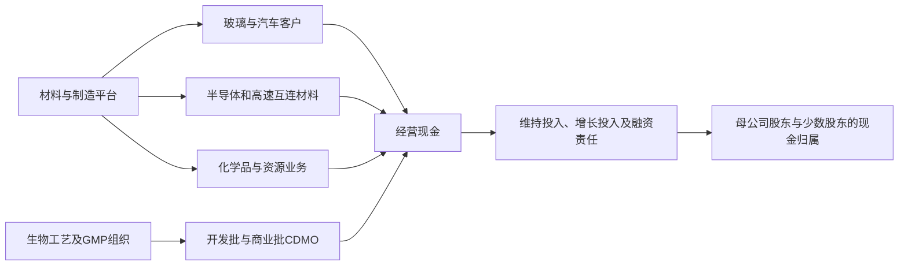

# AGC Inc.（AGC／原旭硝子，ASGLY；东京证券交易所 5201）公司调研

**研究截止：2026 年 10 月 14 日。** 财务事实截至 2026 年 6 月 30 日；纳入截止日已公开的公司、子公司、客户、竞争者及监管材料，包括 ASML 当日发布的三季报。AGC 三季报计划于 11 月 5 日发布，本文没有使用尚未公布的 AGC 三季度业绩。[S01](#s01)[S15](#s15)

除特别说明，金额单位均为**亿日元**，年度为自然年，财务口径为 AGC 合并 IFRS；销量、产能和现金流分别标明。美元算例采用 **155 日元／美元**这一模型汇率，不代表截止日即期汇率。披露事实、管理层目标、直接计算、研究估计与条件算例在文字中区分；预测范围和概率范围均不是统计置信区间。正文页码优先指 PDF 页序，印刷页码另注。

## 一、当前判断：增长资产确实存在，集团改善仍取决于老资产和新工厂能否同时挣到钱

AGC 的经济实质是一个拥有玻璃熔融、精密加工、氟化学、资源提取和受托制造能力的材料集团。它在若干客户认证严格、失败成本高的环节取得收费权，但大量资本仍留在建筑玻璃、汽车玻璃、显示玻璃、东南亚氯碱和生物药工厂中。**决定公司未来三年结果的，是高附加值材料增长、成熟业务生产效率恢复，以及 CDMO 既有投资转为现金这三件事的组合。**

本研究更支持的工作路径是：2026 年集团营业利润接近公司 **1,500 亿日元**指引；2027 年随生物药订单转交付、制造问题缓解而继续改善；到 2028 年，在下述经营门槛成立时，集团收入约 **2.3 万亿—2.45 万亿日元**、营业利润约 **1,850—2,250 亿日元**具有经营依据。用于复核的代表组合为收入 **23,700 亿**、营业利润约 **2,100 亿**。这是本研究的工作路径，**不是概率加权期望，也不是把最新季度年化**。若电子材料增长和低回报资产改善不能同时发生，收入上升仍可能伴随现金紧张；相容的受阻算例只有约 831 亿营业利润。完整合并关系见第九节。

最重要的发现如下。

1. **收入恢复已经发生，收益质量尚未全面恢复。** 2026 上半年收入 11,006.09 亿，同比增长 10.6%；其中公司披露汇率贡献约 679 亿、合并范围变化约 -16 亿，剔除这两项后的增量约 3.9%。集团营业利润 646.61 亿，同比增长 19.7%，但电子分部利润由约 244 亿降至 187 亿，汽车也下降。成本和生产执行仍能压过产品需求。[S02](#s02)[S03](#s03)
2. **半导体材料是一条有真实客户和量产基础的增长路径，其规模尚不足以独自重塑集团。** 公司称 2025 年相关销售约 1,000 亿，2030 年争取翻倍；前者约为集团收入的 4.9%。若新增 1,000 亿收入的贡献率为 30%—40%，新增固定费用、研发和折旧为 60—100 亿，则新增营业利润约 **200—340 亿**。这是条件计算；相对于 2025 年约 1,275 亿营业利润有意义，但不能替代集团其他资产的改善。[S09](#s09)[S10](#s10)
3. **EUV 光罩坯的当前商业证据比永久玻璃芯更成熟。** 2024 年销售曾达到 400 亿，2025 年因一名大客户需求下滑而回落；2026 年正在恢复。8 月公司明确称同规格价格通常随时间下降，更高规格产品提高收入单价也提高制造难度。计划中的光罩坯扩产约 30%，2028 年进入量产，后续扩产也已获内部批准。真实约束是合格片数、缺陷控制和客户份额，名义设备能力并不保证利润。[S04，Q7、Q11—14、Q24—25](#s04)[S10，PDF 第17、37页](#s10)
4. **横滨 CDMO 已跨过“只有厂房规划”的门槛，仍需跨过工艺验证和回报门槛。** 子公司 7 月公告披露了一个客户的五个生物药项目、每年至少 35 批，以及前两年四个工艺性能确认（PPQ）生产活动；公司称可支撑接近一半的利用率。18,000 L 单次装机容量、合同批次数和当年收入并不等价，客户仍需推进主要市场的制造及商业批准。约 500 亿总投资如何取得充分回报，不能仅凭“已签长期合同”回答。[S04，Q10](#s04)[S19](#s19)[S20](#s20)
5. **生命科学是近期集团利润修复的重要来源，也是最强失败路径。** 2026 年公司分部指引为亏损约 50 亿，较 2025 年亏损约 223 亿改善约 173 亿，约占集团指引利润增量 225 亿的 77%。上半年仍亏损约 61 亿，全年达标需要下半年转为小幅盈利。8 月时，下一年规划收入约一半获得确认订单支持，不能写成工厂已满单。[S03，第23页](#s03)[S04，Q2—3](#s04)
6. **碘业务是容易被集团分类遮住的独立经济单元。** 控股子公司伊势化学的 2025 年营业利润为 94.84 亿；2026 上半年利润降至 41.36 亿，生产量也下降。其与 Select Water 的新协议争取到 2030 年新增约 3,000 吨／年的碘，接近 2025 年全公司 4,291 吨产量的七成。首厂已决定建设、目标 2027 年投运；投资由伊势全额承担，水资源提供方收取 royalty。机会来自资源入口和提取能力，不能把新增收入全部归给 AGC 股东。[S26](#s26)[S27](#s27)[S28](#s28)[S29](#s29)
7. **“大型扩产结束”没有立即变成充裕的股东现金。** 2026 上半年经营现金流 1,048.91 亿，实际购买固定及无形资产支付 1,027.23 亿，两者差额只有 **21.68 亿**；公司定义的自由现金流约 100.60 亿还包含资产及金融资产处置等投资现金流。同期向母公司股东分红 222.98 亿、向少数股东分红 265.76 亿。现金、利润和股东归属必须一起看。[S02，第12页](#s02)

最强相反解释是：当前所谓复苏主要来自汇率、价格转嫁、季节性和退出亏损项目；电子材料新产能释放时，同规格降价和竞争扩产开始侵蚀回报，CDMO 则只是将低利用率从美国转移到日本。如果这个解释成立，半导体需求强劲和集团现金改善仍会脱钩。真正有辨别力的观察是：**合格出货增长能否伴随电子利润恢复，横滨及欧洲生物药项目能否完成 PPQ 后复购，以及经营现金能否覆盖现金资本开支、租赁本金和分红。**

本次研究尚不能可靠确定：EUV 各等级片数与客户份额、CCL 的实际成交面积和净价、横滨合同的年限与取消补偿、各 CDMO 站点完整成本、提碘项目的 royalty 和总建设预算、氢能膜新厂的实际合格产出。它们会影响下文的区间，而非被当作零或自动采用管理层目标。

## 二、公司如何收费，证券和资产究竟代表什么

### 2.1 业务入口、客户决策与收费单位

| 经济单元 | 客户购买的结果、决策与付款 | 经济单位及主要收费机制 | 收入和现金的关键差异 |
|---|---|---|---|
| 建筑玻璃 | 门窗、幕墙加工商、经销商、开发商及最终建筑业主；建筑规范和节能要求影响选型 | 原片／加工玻璃的面积、厚度、涂层和规格；部分安装工程按项目 | 大部分交货确认，安装工程按履约进度；能源附加费能否保留取决于供需和合同 |
| 汽车玻璃与车载显示盖板 | OEM 工程、采购、质量和整车平台团队；供货给 OEM 或其系统供应商 | 每车玻璃组合、单片功能件、车型定点与后续批量供货 | 定点先于量产数年；车型减产不等于供应商失去资格，生产不稳定却可能导致加急和报废 |
| 显示玻璃 | 面板厂按尺寸、世代、厚度、缺陷和良率采购 | 合格玻璃面积及净价 | 电视出货台数、面板面积和玻璃消耗不一一对应；币种错配会让日元折算收入与利润相反变化 |
| EUV 坯、石英／SiC、CMP | 光罩制造、晶圆厂及光刻设备供应链；材料和工艺团队认证，采购下单 | 光罩坯按合格片及等级，石英／SiC按合格构件，浆料按配方和用量 | 光罩可重复使用；CMP 是随实际工艺消耗的材料；新设备出货与材料耗用节奏不同 |
| CCL、树脂、薄膜、密封原料 | PCB／CCL 厂、密封加工商、设备厂及终端晶圆厂；终端批准材料组合 | 合格平方米、公斤、膜卷或牌号；由加工客户继续变为零件 | AGC 卖树脂不等于卖整只阀门或完整 PCB；集团内部材料交易须抵销 |
| 东南亚氯碱／PVC | 化工、氧化铝、镍加工、建材等企业；当地销售及物流网络 | 烧碱干吨、VCM／PVC 吨，合同与市价重定价 | 电解联产氯和烧碱，下游 PVC 消化氯；单一产品需求好不能保证整条链高利用率 |
| CDMO | 药企、生物技术公司及部分学术项目；CMC、质量、采购和监管共同决定 | 工艺开发、技术转移、验证批、商业批及阶段性服务 | 生物原药开发制造按履约进度、主要采用成本投入法确认；确认收入、开票、监管放行和最终药品销售不是同一天 |
| 碘及相关产品 | 医药、造影剂、电子材料等客户；高纯化合物有额外资格要求 | 碘／化合物重量、纯度、回收与加工服务 | 原料资源、提取率和国际价格共同决定利润；新资源项目还涉及许可、处理和权益分配 |

上述收入确认方式以 2025 Financial Review 的会计政策为准：大部分产品在交付、控制权转移时确认；建筑安装与生物原药开发制造按履约进度确认，价格扣除折扣、返利、退货等。[S08，PDF 第47—48页](#s08)

地区分布也有统计边界：2025年日本约6,521亿、亚洲约6,469亿、美洲约2,440亿、欧洲约5,158亿，分别约占31.7%、31.4%、11.9%、25.1%，披露依据是**集团公司所在地**，并非最终客户消费地。半导体、汽车和药物客户还可能跨境制造与销售。集团层面没有单一外部客户超过收入10%，但EUV单客户变化和横滨五项目同一客户说明产品／站点仍可高度集中；集团分散不能替代局部集中度分析。[S08，PDF 第51页](#s08)

集团共用玻璃配方、熔融和表面加工、氟聚合物合成、分析与模拟、制造工程和研发人才。电子材料与化学部门可以共同接触半导体客户，CMP 浆料与后清洗液可以共同开发。但生物药服务需要额外的活细胞工艺、GMP、项目管理和监管能力，玻璃或化学的工厂经验不能自动迁移。研发平台有协同，资本预算也有竞争。

### 2.2 ASGLY、控制权及少数股东

ASGLY 是美国 OTC 的**非公司发起 ADR**，对应日本 AGC 普通股；存托机构资料显示 **5 份 ADR 对应 1 股普通股**，即每份 ADR 代表 0.2 股。它不是电子材料子公司的独立权益。美元报价不改变底层日元经营风险；存托费用、汇兑和传递权利按对应存托条款执行。2026 年 6 月末普通股发行数 217,434,681 股、库存股 5,013,354 股，扣除后为 **212,421,327 股**；不能再将 ADR 数量加入股本。[S02，第2页](#s02)[S13](#s13)

集团拥有主要厂房、工艺诀窍和材料知识产权；个别客户工艺、药物知识产权和商业批准属于客户。CDMO 收取制造服务费，通常不拥有成功药物的销售权益。SWAN 临时载板也不代表 AGC 拥有最终封装平台的收费权。

部分重要现金资产并非全资：2025 年末 AGC 对 PT Asahimas Chemical 的持股为 52.5%、AGC Vinythai 为 65.0%；对伊势化学持股约 52.8%。伊势的表决权比率可受库存股影响，不能混用持股百分比和投票权百分比。相关子公司并表收入和利润全部进入集团，再扣除少数股东损益；资金还受当地公司治理、分红决议、税和运营需要约束。[S08，PDF 第89—90页](#s08)[S12，第15页](#s12)

因此，东南亚和碘业务的收入增长，不等于同等比例增加 AGC 普通股股东的现金。2026 上半年少数股东利润约 58.55 亿，而实际向其分红 265.76 亿，表明分红还可以动用历年积累；公开合并资料不足以将这笔现金逐家归因，本研究没有把它机械年化。[S02，第6、12页](#s02)

### 2.3 近期业务边界调整

2025 年公司决定退出化学强化用特殊玻璃业务，转让聚碳酸酯业务；生命科学关闭 Colorado 的 Boulder 和 Longmont 站点，并继续谈判出售。2026 年 7 月又签约将其持有的 AGC Polymer Material 全部股权，即该公司 50.72% 权益，转给 Saint-Gobain，预计 12 月前后交割，仍需满足条件。后者主营建筑防水与地坪材料，公司预计财务影响有限，不能把签约写成已交割。[S03，第15、38页](#s03)[S25](#s25)[S32](#s32)

这些变化会减少低回报资本占用，但“退出一种特殊玻璃”不能扩展为退出全部显示玻璃、全部车载盖板或全部精密光学。Colorado 停产已降低人工开支，尚有折旧、财产税和售前维护等责任；卖掉厂房的回款尚未全部实现。[S05，Q11](#s05)[S04，Q22—23](#s04)

## 三、可比财务基线：利润恢复、现金占用与会计项目分开看

### 3.1 最近五个完整季度

下表为**单季流量**。Q2、Q3、Q4 由同年度累计报表相减；金额统一为亿日元，保留两位只为计算可复核，不表示预测精度。现金资本开支指现金流量表“购买固定及无形资产”，不同于财报说明会的设备投资计入口径。[S02](#s02)[S05](#s05)[S06](#s06)[S07](#s07)[S08](#s08)

| 单季 | 2025Q2 | 2025Q3 | 2025Q4 | 2026Q1 | 2026Q2 |
|---|---:|---:|---:|---:|---:|
| 收入 | 4,958.90 | 5,166.67 | 5,466.91 | 5,379.65 | 5,626.44 |
| 毛利 | 1,193.48 | 1,329.31 | 1,316.13 | 1,304.10 | 1,313.28 |
| 毛利率 | 24.07% | 25.73% | 24.07% | 24.24% | 23.34% |
| 营业利润 | 281.82 | 408.16 | 326.27 | 384.72 | 261.89 |
| 营业利润率 | 5.68% | 7.90% | 5.97% | 7.15% | 4.65% |
| 归母净利润 | 72.60 | 255.83 | 296.74 | 228.44 | 126.68 |
| 经营现金流 | 721.57 | 476.10 | 1,097.27 | 426.05 | 622.86 |
| 现金资本开支 | 380.51 | 475.71 | 702.35 | 627.12 | 400.11 |
| 经营现金流减现金资本开支 | 341.06 | 0.39 | 394.92 | -201.07 | 222.75 |

最直观的矛盾出现在 2026Q2：收入环比增长，营业利润却比 Q1 下降约 123 亿。公司解释包括 Q1 合并范围调整等暂时性收益消失、Q2 一次性费用及存货估值损失、电子光学季节性以及汽车制造问题。由于公司未披露这些一次性项目的完整分部金额，本研究不填造“调整后季度利润”。[S04，Q1、Q4—6、Q20](#s04)

2026 年化学业务将日本基础化学与 Performance Chemicals 合为 Integrated Chemicals，将东南亚单列。公司已重列可比 2025 产品组数据，本文使用 8 月最新表，不直接连接旧的 Essential／Performance 两分法。显示业务的 2026Q1 汇总方法亦在半年报说明会中修改，采用更新后的显示收入约 469 亿，不沿用早期版本。[S03，第48—49页](#s03)[S14，PDF 第23页](#s14)

### 3.2 集团内的利润来源与规模差异

| 财报分部 | 2025全年收入／营业利润 | 2026上半年收入／营业利润，约数 | 经营含义 |
|---|---:|---:|---|
| 建筑玻璃 | 4,411／173 | 2,293／88 | 规模大，欧洲价格政策改善利润，销量仍弱 |
| 汽车 | 5,206／293 | 2,803／133 | 组合和交付带来收入，欧美生产问题限制利润 |
| 电子 | 3,551／475 | 1,744／187 | 显示与电子材料混合；收入增长没有避免成本压力 |
| 化学 | 5,842／530 | 3,320／282 | 高性能产品与东南亚基础化学经济性不同 |
| 生命科学 | 1,331／-223 | 723／-61 | 收入回升、关厂和欧洲生产改善，仍未覆盖固定投入 |
| 陶瓷及其他 | 599／26 | 243／15 | 包含陶瓷等；物流内部重组等使收入比较受影响 |
| 内部抵销 | -351／约1 | -120／约2 | 收入不可漏减，利润以报表为准 |
| 合并 | **20,588／1,275** | **11,006／647** | 分部约数之和存在舍入差异 |

来源为 2026 半年报说明会第7、23页。分部利润已分摊共同费用；另一些公司战略图展示的是**分摊共同费用前**的业务 ROCE，不能直接混用。[S03](#s03)

例如，公司称汽车业务 2025 年分摊前 ROCE 超过 10%，而分部表中的分摊后 ROCE 为 8.5%；电子分部为 8.2%，化学为 7.0%，生命科学为 -9.3%，集团仅 **5.6%**。集团约 **22,800 亿经营资产**需要约 2,280 亿营业利润才能达到 10% ROCE。在资产不减少的条件下，比 2025 年多约 1,005 亿；单靠半导体业务的上述 200—340 亿利润增量无法补足。[S03，第32、52页；直接计算](#s03)

### 3.3 收入、营业利润和归母利润的质量

2026 上半年汇率折算增量约占收入增量的 65%。建筑玻璃收入增加约 185 亿，汇率影响约 211 亿，剔除汇率后并没有同等幅度的业务扩大；汽车收入增加约 246 亿，汇率约 185 亿。电子材料收入约 831 亿，同比增长约 59 亿；其需求回升更直接，但没有单独披露产品毛利。[S03，第6、13—17页](#s03)

公司采用的“营业利润”还包括联营及合营企业权益法损益，不包括大部分汇兑、资产处置、减值和重组费用。2026 上半年权益法利润约 37.97 亿；营业利润 646.61 亿，加其他收入、减其他费用后，business profit 为 639.20 亿，再经融资和税得到归母利润。这一营业指标适合比较持续经营，但不能替代包括重组成本的完整股东收益。[S02，第6、13页](#s02)

2024 年归母亏损约 940 亿，并不代表当年全部业务无经营现金：当年存在大额生物药减值、俄罗斯业务退出等。2025 年归母恢复至约 692 亿，也不能全视为经营跃升：全年资产处置收益约 **262 亿**，其中东京江东区土地出售收益约 **169 亿**；营业利润只增长 1.3%。2025 年对 Colorado 再确认约 77 亿减值，反映前期投资回收预期继续下降。[S07，第21、24页](#s07)[S08](#s08)

较完整的周期能防止把恢复误认为自然回归：2021—2025营业利润依次约 **2,062、1,839、1,288、1,258、1,275亿**，利润率从12.1%降至6.2%。同期日元／美元年均汇率由109.8变为149.7，业务和投资组合也已变化。2028工作利润约2,100亿接近过去高点金额，并不等于相同实物销量、利润率或资本回报；化学周期、显示重组和新增生物药资产均需重新取得收益。[S03，第53页](#s03)

### 3.4 现金为何没有随利润同幅增长

2026 上半年经营现金流比上年减少约 122 亿，主要可识别因素是：应收变化从回收现金约 155 亿转为占用约 144 亿；存货占用由约 95 亿扩大至约 258 亿；现金税从约 186 亿增加至约 267 亿。存货账面由 4,654.15 亿升至 4,958.57 亿，其中还包含汇率等非现金变化，不能把账面差额全部当成本期经营占用。[S02，第5、12页](#s02)

以平均期初期末余额和半年成本粗算，2026 上半年存货约相当于 **104 天**销售成本，应收约 **55 天**收入。存货高占用与持续熔窑、化学品备料及跨境生产有关，但公开资料没有足够产品库龄、在途与可取消客户订单数据来排除错配。Q2 已有估值损失，因而不能仅把存货增加解释成未来交货保障。[S02；直接计算][S04，Q1](#s04)

公司 2025 年经营现金流 2,744.76 亿，减现金资本开支 2,095.45 亿为 **649.31 亿**；其定义的自由现金流为约 960.72 亿，区别主要来自处置等投资流入。2026 上半年对应数字为 21.68 亿和 100.60 亿。本文后续将“经营现金流减现金资本开支”作为可比经营投资后现金，再单列租赁本金、少数股东分红和母公司股东分红，防止把资产出售与子公司现金当作稳定股东回报。[S02](#s02)[S07](#s07)

2025 年末合同资产约 47.57 亿、合同负债约 365.77 亿，均为全集团数据。年报当时披露原始期限超过一年的重大剩余履约义务不显著，2026 年横滨的新长期合同属于此后新增信息。不能把此前合同负债和新合同预计总值相加成“确定 backlog”，也不能用合同负债减少推导取消率。[S08，PDF 第75页](#s08)[S19](#s19)

## 四、成熟玻璃业务：价值提升能否转为工厂利润

### 4.1 建筑玻璃：当地供给和净价比全球总需求更重要

浮法玻璃要持续维持熔窑温度，停窑、冷修、重启和良率恢复都有成本。可交付供给受当地炉线、厚度规格、加工能力和运输半径限制，全球平方米不能直接替代某地的 Low-E、夹层或真空玻璃。AGC 的客户关系、涂层与加工链条有价值，但 Saint-Gobain、NSG、Guardian 以及亚洲供应商同样具备相关能力。[S11，印刷第20—22页](#s11)

2026 上半年欧洲及美洲收入约 1,574 亿，亚洲约 712 亿。欧洲 2025 年部分季度提价幅度很大，2026Q1 同比仍在三成附近，Q2 已降至中个位数；同期欧洲出货量继续下降。亚洲则出现量增价降。公司 5 月问答还承认，成本上涨下继续提价可能进一步压制需求。因此，“涨价”需要与上年低基数、能源附加费、产能退出和实际出货一起解释。[S03，第13、51页](#s03)[S05，Q21—22](#s05)

以每 100 元销售额为观察单位：2025 年分部利润约 3.9 元，2026 上半年约 3.8 元。净价或能源成本变动 1 元，在数量和其他费用不变时，足以改变约四分之一的营业利润。这解释了为何一座低效熔窑的整改、区域价格或燃气采购条件，可能比几个百分点的终端面积增长更重要。

本研究的 2028 工作组合为收入约 4,900 亿、利润率 5%，即约 245 亿利润，要求：欧洲保留合理能源附加费和高性能加工组合，日本节能改造需求抵消新建疲软，亚洲不再通过低价扩量，工厂恢复稳定。相对 2026 指引，这主要是利润效率改善，并没有假定新一轮大规模扩炉。受阻组合收入 4,500 亿、利润率 2.5%，仍可维持经营，却难以提供充裕增长资金。

低碳玻璃存在真实的再投资需求。AGC 和 Saint-Gobain 于 2026 年 8 月宣布大型混合能源熔窑项目；这证明行业正在投入生产脱碳，不证明客户已愿意支付足够“绿色溢价”。节能收益、碳成本和更新炉体资本要共同计算。项目预算及 AGC 的完整分担未在本次取得足够明细，模型保留维护及环境投入，没有将减少扩产等同于维护资本开支归零。[S24](#s24)

### 4.2 汽车：车型内容量提供上行，内部生产问题决定兑现速度

汽车玻璃的收入可以写为：**供货车型产量 × 每车玻璃面积／件数 × 功能组合与净价**。全景天幕、隔音、Low-E、HUD、天线和车内大屏盖板增加内容量，也增加镀膜、弯曲、夹层、光学畸变和一致性交付难度。OEM 平台定点能带来连续数年的供货，但车型份额、终端销量和客户议价仍然变化，定点并非不可取消的固定收入。[S11，印刷第23—24页](#s11)

AGC 的技术和全球交付网络有竞争力，福耀、Saint-Gobain、NSG 等也在争取功能化内容。玻璃面积扩大不会自动提高 AGC 份额；本地化采购、整车平台和质量表现比全球“汽车玻璃龙头”称号更能解释单个项目的收入。公司没有披露足以复算的全球每车 ASP、特定车型配套数或新功能订单金额，本研究不填造这些数字。

2025 年汽车分部利润约 293 亿，比 2024 年约 139 亿明显改善，说明价格政策、组合与重组能够起作用。但 2026 上半年收入增加约 9.6%，利润下降约 12%；8 月问答将欧美制造成本上升明确归因于 **AGC 自身生产问题**，并没有给出已经解决的日期。该成本不是客户新增配置，未必能直接通过涨价收回。[S03，第14、52页](#s03)[S04，Q5—6](#s04)

2028 工作收入 5,450 亿、利润率 7%，对应约 382 亿利润。量和每车内容合计相对 2026 年约 5,100 亿指引只需温和增长，主要门槛是报废、加急、人员与设备效率改善，达到每 100 元销售额约多留 0.7—2 元。若欧美问题持续而 OEM 压价，5,000 亿收入、4% 利润率的组合只有 200 亿利润。强路径的 9% 利润率要求更高功能组合和稳定生产同时发生，不能只用电动车渗透率解释。

**验证窗口是 2026 下半年至 2027 年**：汽车利润率是否随出货恢复，而非只在汇率有利时改善；公司能否说明欧美异常制造成本收敛；下一轮车型定点是否保住净价。若只有收入上升、制造损失持续，应下调利润而不是继续提高成长率。

### 4.3 显示：寡头资格和高固定资产并存，日元贬值可以伤害利润

显示玻璃按合格面积计价，客户决定因素包括大尺寸玻璃的平整、缺陷、厚度、热稳定和后段面板良率。AGC、Corning、NEG 的客户认证与熔融能力构成进入壁垒；面板厂的量价、融资和产线世代又限制材料厂取价。OLED、LCD 和用于化学强化的特殊玻璃不能混成同一现金单元。[S11，印刷第25—26页](#s11)

2026 上半年显示收入约 900 亿，LCD 净价提高，特殊玻璃退出使其出货下降。公司同时指出日元贬值对显示利润有明显负面影响。这与日元折算海外收入增加并不矛盾：收入、生产成本和购买投入的功能货币结构不同。没有完整币种成本表，本研究不将集团销售汇率敏感性当作利润敏感性。[S03，第15页](#s03)[S04，Q15、Q18、Q20](#s04)

工作路径不靠大幅面积增长：2028 年收入约 1,750 亿、利润率约 8%，要求大尺寸集中、生产稳定和净价覆盖成本。对约 1,800 亿规模的业务，净价／成本差恶化 3 个百分点就约损失 54 亿利润。若面板厂减产、竞争降价与不利汇率同时发生，工作利润可迅速被压缩。退出亏损特殊玻璃有助于回报，却不能重复把已在分部指引中体现的改善再加一遍。

## 五、化学业务的三种经济性：基础化学、高性能材料与资源

### 5.1 东南亚氯碱：新增产量确定性高于新增利润

氯碱通过盐水电解联产氯、烧碱和氢；氯进入 VCM／PVC 等链条。计价应分别看烧碱干吨、PVC 吨及原料能源成本，不宜用“化学品平均吨价”解释。下游 PVC 对氯的消化能力、电力和乙烯采购、客户运输距离决定有效利用率。烧碱在氧化铝或镍加工中需求强，并不能解除 PVC 销售和氯平衡的约束。

独立设备供应商 thyssenkrupp nucera 于 2026 年 2 月确认，AGC Vinythai 扩建项目采用其电解设备，新增烧碱能力约 **22 万吨／年**，PVC 能力由约 **30 万吨／年提高到 70 万吨／年**。AGC 的口径是 2025Q3 启动、2026 年全面运营；两者描述投产和商业运行的不同阶段，并不矛盾，也都不代表全年平均能力已经等于年末能力。[S33](#s33)[S03，第21页](#s03)

公司 5 月承认 Q1 存在短期爬坡调整，预计 Q2 起高利用率；半年报说明会显示东南亚收入约 1,656 亿，同比增长约 277 亿。但分部图中东南亚仅贡献化学业务分摊共同费用前利润的约三成，说明放量还没有把新增资本充分变成回报。[S05，Q10](#s05)[S03，第16页](#s03)

价格传导有两面。公司称泰国可取得当地天然气路线乙烯，印尼增加北美来源，降低了对中东单一区域采购的依赖；能源、海运和终端需求仍可能受冲击。2026Q2 PVC 与乙烯价差改善，公司将其部分归因于原料涨价传导和中国出口增值税退税政策变化，但也强调不会线性改善。本文将这一政策因素保留为管理层归因，没有把它当成永久区域保护。[S05，Q3—9](#s05)[S04，Q8](#s04)

**新增项目的利润门槛可以用吨数说明。** 若新增 PVC 40 万吨、烧碱 22 万吨在成熟期各实现 80% 利用率，则对应年交付约 32 万吨和 17.6 万吨。PVC 每吨可保留价差每改善 50 美元，对年贡献约增加 24.8 亿日元；烧碱每吨贡献增加 50 美元，约增加 13.6 亿。两项合计约 38.4 亿，仍需覆盖新增折旧、人员、销售及物流等固定投入。这是增量条件算例，不是已披露的项目毛利，也没有把 PVC 价差当作扣除全部电力等成本后的利润。

集团给出的全年敏感性更能说明周期风险：烧碱国际市价每吨上涨 1 美元，营业利润影响约 **130 万美元**；PVC 价差每吨改善 1 美元，约 **170 万美元**。按模型汇率，50 美元的变动分别约为 **101 亿和132 亿**。这是公司全体相关业务的敏感性，不能与上述新增项目影响再加总，也不能在乙烯、PVC 和烧碱联动时把所有有利端点同时采用。[S03，第42页](#s03)

本研究 2028 东南亚工作组合为收入 3,600 亿、利润率 5%，即 180 亿利润；它要求新产能稳定交付、区域配送优势保住部分价差，但**没有假设回到短缺高峰**。弱路径即使收入 3,300 亿，1% 利润率也只有 33 亿；强路径需要区域供需、净价和工厂效率共同支持，才可能达到 9% 利润率。中国供给、当地新增装置及客户库存会影响这一取舍，公开资料没有足够按规格和地区统计的有效供给来确认整个东南亚持续短缺。

### 5.2 Integrated Chemicals：高性能产品的收费权来自特定工序

2026 新组织将日本氯碱、氨酯与高性能化学链条整合。2025 年按新分类的收入约 3,020 亿，而单列的战略业务 Performance Chemicals 销售为 **1,719 亿**；二者不是同一对象。后者按应用约 24% 为电子，绝大部分与半导体有关，但还包括能源、汽车和其他工业。不能把 Integrated Chemicals 全部视作高利润电子氟材料。[S03，第49页](#s03)[S09，第25页](#s09)

| 材料／能力 | 真实客户任务与收入入口 | 可保留的优势及关键限制 |
|---|---|---|
| FFKM 全氟弹性体原料 | 加工商制成密封件，再供设备厂与晶圆厂；维持刻蚀、沉积等恶劣环境的密封和洁净 | 配方、耐热／等离子体、颗粒和金属污染控制。公司称部分刻蚀应用约一季更换一次，不能外推所有设备；延长寿命也可能降低件数 |
| ETFE 半导体离型膜 | 树脂封装时置于模具与封装材料之间，按膜消耗收费 | 同时满足脱模、随形、强度和纯度；公司称已有 HBM 用途及全球领先份额，但没有公开 HBM 收入和客户分额 |
| CYTOP | 向薄膜制造商提供透明氟树脂，用于 ArF／KrF 光罩保护膜等 | 已有工艺兼容性和材料积累；**CYTOP 不透过 EUV 工作波长，不能写成 EUV pellicle 的收入机会** |
| 低介电氟树脂、树脂原料、硅填料 | 出售给多家 CCL 厂或其他加工商，改善高频损耗、填充与可靠性 | 可以受益于竞争 CCL 厂成长；部分已量产或评价，低介电填料仍在准备量产，产品阶段不同 |
| AMOLEA AF-164 热媒 | 用于半导体刻蚀、沉积等温控回路，面向设备及工艺客户 | 覆盖中温区、低 GWP 等为公司测试和产品主张；尚在开发，不能等同于数据中心直接液冷收入 |
| CMP 后清洗液 | 清除抛光残留颗粒与化学物，先经工艺验证 | 可结合 AGC 的 ceria 浆料知识；公司内部对照实验不代表独立客户量产验证 |
| 低 GWP 制冷剂、汽车和能源材料 | 替换高 GWP 产品，服务车辆空调、热管理、燃料电池及工业应用 | 收入受终端方案、认证、价格和监管影响，不能全部纳入半导体翻倍目标 |

产品边界及阶段主要来自 2026 半导体说明会与逐字稿。[S09，第25—35页](#s09)[S10，第22—32页](#s10)

氟树脂的客户收益不仅是节省几公斤材料，更可能是减少污染停机、降低误码或避免昂贵晶圆报废。AGC 仅能收取其中一部分收益，整机厂、密封加工商、CCL 厂和终端买方也保留价值。其链条优势是从基础原料到聚合、配方、成膜和客户支持的联合能力；并非每一种牌号都具有不可替代性。

千叶高性能氟化学扩产的原计划投资约 **350 亿**、2025Q2 开始运行；2026 说明会将新增能力纳入供给战略，但没有给出逐牌号有效吨数、利用率和成本。收入目标反推所需能力与真实合格供给仍需区分。公司需要在新设备折旧、清洁生产、客户支持和排放治理后保留利润，不能只使用材料加工前的高售价。[S34](#s34)[S10，第22页](#s10)

3M 已确认于 2025 年底退出 PFAS 制造，可能给 AGC 带来转单和新牌号导入机会；这也可能推动客户改用非氟路线。新来源必须通过客户工艺验证，不能把原供应商退出份额直接划给 AGC。ECHA 的广泛 PFAS 限制仍处科学意见和政策决策流程，2026 年底形成 SEAC 最终意见是当时计划，**截至研究日不能写成全面禁令已经实施，也不能声称半导体用途永久豁免**。低 GWP、无乳化剂、原料循环和“不属于 PFAS”是不同概念。[S31](#s31)[S35](#s35)

2028 集成化学工作收入约 3,650 亿、利润率 14%，利润约 511 亿，包含碘及日本基础化学，不是纯氟材料利润率。相对 2025 年收入，增量来自电子工艺材料、高功能牌号和温和净价／组合提升；约 1.5—3 个百分点的盈利改善要求新增厂房形成稳定销售、较高规格转化为收费，而不只是原料涨价。客户验证延期、合规成本和价格竞争可使 3,250 亿收入只留下约 341 亿利润。尚未认证的新产品不按成熟材料的贡献率直接计算。

### 5.3 碘：资源扩张比钙钛矿概念更能约束经济规模

伊势从含碘卤水提取碘，同时处理天然气及化合物业务。现有资源、抽取许可、井和管网、回收工艺与纯化能力决定其可供给数量；对医疗和电子用途，还要通过质量认证。伊势有独立上市公司和少数股东，集团控制不代表 AGC 可以无偿调走其所有现金。[S12，第15页](#s12)[S26](#s26)[S27](#s27)[S28](#s28)

2025 年伊势收入 **392.58 亿**、营业利润 **94.84 亿**，约为 AGC 集团营业利润的 7.4%，后者只是量级比较，未扣合并差异。2026 上半年收入 **192.37 亿**、营业利润 **41.36 亿**，分别同比 -0.2%、-14.4%。碘及天然气业务收入 167.37 亿、利润 41.75 亿；金属化合物业务小幅亏损。公司解释碘市价仍强，但部分客户销量减少，折旧、人工和原燃料上升。同期实际碘产量 **1,872 吨**，低于上年 2,122 吨；高市价没有保证产出和利润同步增加。[S26](#s26)[S27，第1、4页；补充说明第3页](#s27)

**新资源路径已经有正式协议和建设决定。** 2026 年 6 月伊势及其美国全资子公司 Woodward 与 Select Water 签订协议：初始期限 10 年，可由伊势选择延至最多 20 年；伊势负责全部提取设施投资，Select 提供伴生水来源、运输、储存、预处理及基础设施并收 royalty。双方目标到 2030 年新增约 3,000 吨／年。7 月补充说明已经披露首座 Texas 卫星工厂建设决定，目标 2027 年投运，之后逐地复制。这比“正在研究美国资源”更实质，也仍不是已实现的 3,000 吨产量。[S28](#s28)[S29](#s29)[S27，补充说明第5—6页](#s27)

它减少了自己开发卤水井所需时间，却把依赖转为 Select 的含碘水量、浓度、盐及有机杂质、预处理、运输和后段精炼。若按**研究假设**碘浓度 50—150 mg/L、回收率 60%—90%计算，年产 3,000 吨需要约 **6.1 万—27.4 万 m³／日**的适用进水，约合 **38 万—172 万桶／日**。这是全项目资源负荷，不能拿 Select 全网络处理能力直接证明其中存在相同质量的可用水。必须验证站点水质、长期水源和单位药剂／能耗。

按条件净价 50—90 美元／kg、满产 3,000 吨计算，新增收入约 **233—419 亿**；若扣 royalty、处理、运输、人工、折旧和支持后营业利润率 15%—30%，新增利润约 **35—126 亿**。这些价格和利润率是敏感性参数，不是公司报价或指引，项目实际 royalty、详细预算和售价尚未公开。若新供给压低伊势既有碘销售净价，新项目毛增量需要扣除旧业务损失；例如旧有约 300 亿相关销售净价下降 10%，收入少约 30 亿，利润影响可能较大。

归属也必须再折一层：在 AGC 约 52.8%权益和 30%税率的简化条件下，上述新项目营业利润对应 AGC 归母税后增量约 **13—47 亿**，还未扣融资、旧业务蚕食和其他合并差异。不能同时把伊势全部净利润和 AGC 已包含伊势的化学利润再加总。

资金不是空白支票。伊势 2026—2028 年计划累计经营现金流 290 亿、既有设备投资 126 亿、战略投资额度 100 亿、股东回报 64 亿，合计已用满规划现金。100 亿战略额度还覆盖灾害应对和其他资源项目，**不是全部 3,000 吨项目的已披露总造价**。若分期项目需要更多资金，只能通过后续经营现金、借款、调整分红或母公司追加资本等承担，代价应进入集团模型。[S27，补充说明第7页](#s27)

另一条线索是 2026 年 2 月与稀产金属的钙钛矿材料 MOU，合作方计划到 2027 年建立对应 1 GW 电池规模的碘化铅生产。MOU 不证明伊势拥有对方工厂，也不等于绑定 1 GW 已售终端电池。[S30](#s30)

从材料耗用看，若电池有效功率 200 W/m²、吸收层厚 0.5—1 μm、密度 4—4.5 g/cm³、碘质量占比约 50%—65%，1 GW 约需 500 万 m²、含碘约 **5—15 吨**；考虑制造损耗，条件投入约 6—30 吨，回收又会降低净消耗。这是物理量级算例，并非特定客户 BOM。按上述原碘价，仅约 **0.5—4 亿**原料销售；高纯化合物加工能增加价值，但没有可复核合同价。它可以改善伊势的高端客户入口，**单凭日本 1 GW 的原碘需求尚不足以解释集团数百亿利润机会**。本研究更关注美国资源项目的吨数、单位成本与权益，保留钙钛矿高纯化学品为未定价的相邻机会。

## 六、电子材料：既有耗材、224G 与先进封装处在不同阶段

### 6.1 EUV 光罩坯：有量产壁垒，也有客户集中和同规格降价

EUV 坯需要低热膨胀底材、超平整抛光、多层反射膜与吸收层及缺陷检测共同合格。AGC 的区别在于从底材到抛光、镀膜的内部一体化，允许联动解决缺陷和客户定制问题。它从 2003 年参与研发、2017 年开始量产，当前产品已用于公司所述 2 nm 逻辑和相应 DRAM 世代，High-NA 等下一代仍需继续开发与认证。[S09，第18—19页](#s09)[S10，第17页](#s10)

**需求单位不是晶圆片数的简单倍数。** 光罩可多次曝光，新增设计、掩模层数、研发试验、重制、替换和库存政策共同决定采购。先进节点扩产提高需求基础，吞吐提升也可能降低单位晶圆所需掩模库存。CMP 与光罩的需求敏感性因此不能混用。

2026 年 Intel 的原始获奖名单明确将 AGC 的奖项描述为 EUV 光罩坯技术合作，构成真实客户关系的独立确认；它不披露采购额和份额，也不能据此断言公司所称需求下滑的“大客户”就是 Intel。AGC 6 月称 2025 年该产品收入低于 2024 年 400 亿、正在恢复，8 月更明确表示 2026 仍是向 2024 水平恢复、2027 争取超过。本文采用较新的谨慎表述，不把 6 月对需求的积极描述当成已确认的 2026 全年销售。[S18](#s18)[S10，第37页](#s10)[S04，Q7、Q19](#s04)

外部证据显著支持需求方向：ASML 在 **2026-10-14** 披露客户持续提高短中期需求预测，预计原计划 2027—2028 供给不足，正在研究超出此前 2028 年再增 30%的供给方案。这支持 AGC 的高端材料需求，却仍是设备厂对客户预测和自身产能的判断，不独立证明 AGC 的份额、良率、光罩坯单价或最终 AI 项目的经济回报。[S15](#s15)

供给方面，AGC 8 月披露 EUV 坯、CMP 和光刻镜头材料扩产，项目能力增加约 20%—50%，2028 年开始量产；问答对 EUV 单独解释约 30%，相关项目总投资为数百亿日元量级。不能把三个项目的上限 50%统一填给 EUV。HOYA 则计划在新加坡投入约 420 亿日元的 EUV 毛坯新厂，目标 FY2028 运营，其财年与自然年不同。客户多源采购可能改善安全性，同时把部分价值留给客户。[S03，第34页](#s03)[S04，Q24—25](#s04)[S17](#s17)

本研究用已实现的 **2024 年 400 亿收入**作一个可复核的数量／价格锚，而非伪造 2025 年的产品点值：

| 2028 条件组合，相对2024 | 合格销售数量指数 | 净 ASP 指数，含组合 | 条件收入 | 对应机制 |
|---|---:|---:|---:|---|
| 受阻 | 1.10 | 0.85 | 374 亿 | 新产能延迟，部分客户份额或同级价格下滑 |
| 工作组合 | 1.50 | 0.98 | 588 亿 | 扩建和良率释放数量，高规格组合大致抵消同级降价 |
| 强组合 | 1.90 | 1.08 | 821 亿 | 多客户高规格采用、后续扩产及良率改善均顺利 |

指数是研究假设。工作数量 1.50 需要已公告约 30% 新扩产之外，既有投资、利用率或良率改善提供其余增量；没有公开物理片数，无法独立确认这一供给指数已经锁定。净价 0.98 可理解为同级累计降价约 12%、组合提升约 11%的联合结果，二者相乘约 0.98，不能把全部收入增长解释成涨价。

产品利润没有单独披露。若工作收入约 588 亿，扣除材料与变动制造后贡献率为 45%—55%，再承担约 120—180 亿固定制造、折旧、研发与支持，营业利润条件范围约 **85—203 亿**；约 150 亿可作为集团模型中的一个相容贡献，不是历史利润率事实。新等级价格提高但合格率下降，会同时提高收入单价和完全成本；高利润不是技术领先的自动结果。

更远的架构变化也值得保留。ASML 与 TSMC 于 9 月宣布向 12 英寸大格式光罩过渡的行业倡议，目标 2031 年试验线、2033 年先进生产系统就绪；High-NA 可先使用现有 6 英寸光罩。它增加 AGC 新底材和处理能力的机会，也带来新设备、检测和认证支出，不能据此把 2028 年现有格式扩产视为立即报废，亦不能认为现有资格自动延续。[S16](#s16)

### 6.2 CMP、石英／SiC 和 SWAN：不同的复购机制

Ceria CMP 浆料的作用是以可控速率和选择比平坦化晶圆，客户关注划伤、颗粒、残留、均匀性及后清洗兼容。AGC 自产磨粒到配方的能力有助于质量和定制；Resonac、Merck 等仍构成竞争。需求更接近**实际晶圆加工量 × 使用该浆料的工艺层数 × 每层耗用**，可以随先进制程增加，但提高抛光效率也会减少单位用量。公司 8 月称其随半导体产出稳步增加，较“客户资本开支”更接近真实消耗证据。[S10，第18页](#s10)[S04，Q7](#s04)

合成石英镜头材料主要服务 ArF、KrF、i-line 等光刻光学，不能将 EUV 反射光学系统全部称作“石英镜头需求”。其量取决于设备制造、光学配置、替换和加工合格率；SiC 耐热构件也有自己的更换与清洗周期。公司 6 月称镜头材料询价强、拟扩展 ArF 以外应用，但未公开构件价格、片数和客户份额，收入推断须受整个电子材料分部约束。[S10，第16页](#s10)

SWAN 是半导体封装**临时工艺载板**，在减薄、扇出、键合等过程中支撑晶圆或面板，之后解键合。客户付费对象是合格载板及相关加工，不是每颗芯片永久留下一片玻璃。若复用次数提高，同样封装通过量所需新板数会下降；清洗、边缘破损、TTV、翘曲及解键合兼容性影响复用。Corning 也提供先进封装载板，证明这已经是有产品供应的工序，但不是 AGC 独占平台。[S40](#s40)[S42](#s42)

这组业务的增长可比永久玻璃芯更早兑现。单位经济性主要来自客户已认证工艺中的复购与良率，而非新建玻璃熔窑的吨数。2028 电子材料工作模型保留约 **500 亿**的 CMP、石英／SiC、载板及其他既有半导体材料收入组合；该拆分是研究约束参数，未作为公司披露历史值。它要求实际产出增长和工艺内容量上升，若新设备订单增长但客户耗用未增长，应下调这一项。

### 6.3 CCL 和树脂：224G 的商业门槛是材料组合与设计采用

CCL 将树脂、玻纤和铜箔组合，PCB 厂进一步制造多层板。224 Gbps 级电信号使介质损耗、铜粗糙度、玻纤效应、吸湿和制造一致性更重要；客户采购的是经过可靠性和工艺验证的完整组合，不是最低的单项 Df。

2026 年 6 月公司披露：AI 相关路由器和交换机已有部分采用，224G 新树脂产品仍在供样和评价，期望 2027 年以后贡献。其 ELL 系列主张能用当前较低等级玻纤实现本来需要更高等级玻纤的性能。这个机制若成立，客户不仅得到低损耗，也可能节省玻纤成本并减轻供给约束。但未公开足够的对照板厚、铜箔、频率、吸湿与批量良率数据；问答中对于 ELL 树脂具体化学体系的问题也没有现场完整回答，本文不将其擅自标成 PTFE 或某种烃树脂。[S09，第21页](#s09)[S10，第19、34—36页](#s10)

8 月公司只确认客户评价与选型继续推进，未披露 224G 批量收入、终端客户名称或公司份额。不能从 NVIDIA 架构、PCB 公司高端板出货，倒推出 AGC 已进入特定一代服务器 BOM。当地材料支持、PCB 压合工艺、铜箔和玻纤齐套、终端多源采购与竞品认证，都会影响 AGC 可获面积和净价。[S04，Q7](#s04)

作为规模门槛：若新增 **100 亿**合格 CCL 年销售，假设净价为 **1.2 万—3 万日元／m²**，则需要约 **33 万—83 万 m²／年**实销面积。价格只是条件参数，未获得可核验成交报价，且这里不含完整 PCB。若贡献率 30%—40%、新增固定制造及客户支持 20—40 亿，对应营业利润约 **-10 至20 亿**；因此少量收入放量仍未必形成高回报。新厂良率和更多已认证面积才能改善这一结果。

集团内部还有一条相反但相容的路径：AGC 的化学部门把树脂卖给**其他 CCL 厂**。这些竞争者获单也可能带来树脂收入；若树脂转供集团自有 CCL，内部销售要抵销，只保留终端 CCL 外销收入及集团成本优势。公开资料无法拆开这两类流量，故公司约 1,000 亿“半导体相关业务”与 CCL、Performance Chemicals 不作机械相加。

2028 工作模型将 CCL 收入条件值设为约 **300 亿**，需要已有通信客户复购和部分 224G 设计转量产；这属于受电子材料总收入约束的研究估计，不是公司出货指引。玻璃芯改变封装基板，不会必然消灭主 PCB；光学近封装化、背板电缆化、系统密度提升和客户降低布线距离，则可能改变每单位带宽需要的高端板材面积。这比“带宽翻倍所以材料收入翻倍”更符合价值链。

### 6.4 精密光学并未消失，恢复节奏与 AI 材料不同

IR 截止滤光片、高折射率玻璃、DOE／扩散片、微透镜阵列和光学薄膜服务手机摄像、LiDAR、AR／MR 等应用。它们的收入由终端装机、每设备光学内容、设计采用和净价决定，既有手机周期与高功能化过渡，也有新形态设备的潜力。公司 6 月称电子材料内半导体与光学的收入及利润大致各半，未来半导体可能更大；这是近似描述，不是可审计的逐产品财务分拆。[S10，第34页](#s10)

2026Q1 光学有提前出货，Q2 下降，公司年度看法仍是过渡阶段、总体出货大致持平。本文不把每个新 AR 设计当成量产订单，也不把 CPO 光学供样并入手机光学历史收入。2028 工作模型的精密光学及相关存量收入约 **930 亿**，要求高功能产品和稳定设计份额带来温和恢复，未预设大规模 AR 爆款。[S05，Q1、Q17](#s05)[S04，Q20](#s04)

## 七、生命科学：先证明工厂和项目能够盈利，再讨论平台扩张

### 7.1 三类制造任务，三种经济边界

生命科学不能只用一个“CDMO 行业增长率”研究。

| 业务 | 客户、工艺与真实约束 | 商业证据和经济含义 |
|---|---|---|
| 小分子医药／农药 | 化学合成、纯化、放大与质量控制；项目通常较长，装置和化学路线有专用性 | 公司称长期盈利，日本医药工厂接近满负荷、农药业务为双位数营业利润率；西班牙新增产能仍需订单爬坡，不能用整个分部亏损否定这组资产 |
| 抗体、蛋白、微生物等生物药 | 细胞系／菌株、上游培养、下游纯化、检验和客户工艺转移；一次性反应器适合多品种中小批量 | 欧洲订单和交付恢复已有公司披露；Seattle 尚需改善。反应器容积只是一个环节，下游、人员、批次周期与合格放行可能先形成瓶颈 |
| 细胞、基因与 mRNA | 病毒载体、患者细胞处理、无菌操作、身份链及效力检测，部分产品每名患者一批 | Milan 有经监管材料确认的商业产品制造经历；横滨的新项目多在工艺开发阶段。药物获批、患者实际治疗、AGC 可收服务费和站点盈利仍是四个问题 |

依据为生命科学说明会、其问答及监管资料。[S21，Q7、Q10、Q14—21](#s21)[S22](#s22)[S38](#s38)

一次性反应器（SUB）可减少不同产品间的清洗验证、缩短切换，适合较小患者群和复杂产品；耗材采购、袋材供应、批间一致性及下游纯化仍然有成本。大规模不锈钢反应器（SUS）在稳定大品种、高利用率下可有不同的单位成本优势。AGC 从 Colorado 大规模 SUS 退出，选择既有 SUB 长处，属于重新选择客户与规模边界，不能解释成所有大体积工艺都没有经济性。退出还减少了承接超大品种的能力。[S21，Q1—2、Q17](#s21)

需求的付款方首先是药企或生物技术公司，未上市产品的制造预算来自研发资金、合作里程碑或融资，不直接来自患者销售。公司称接近一半生物药合同处于早期开发或临床阶段，通常签约后不久开工，约两年后结束或延长。因此，未来一年只有部分产能被预订可以符合正常销售周期；同时，客户融资受阻、临床失败或战略改变也会让在谈项目和续约消失。许多不同 Logo 仍可能共同依赖同一轮生物技术融资周期。[S21，Q10、Q15](#s21)

竞争壁垒来自特定工艺的可靠放大、检验、交付和监管记录，工艺转移失败或延期会使客户承担较大损失；这可以形成切换成本，却不阻止客户将新增品种给 Lonza、Fujifilm、Samsung 或其他 CDMO。具有不同规模、产品与资产结构的竞争者利润率，不能直接移植到 AGC。这里最需要的是 AGC 自己的站点产出和复购证据。

### 7.2 Waskyra 提供了有辨别力的外部验证，也暴露持续质量责任

FDA 于 **2025-12-09** 批准 Waskyra，申请和许可主体为 Fondazione Telethon ETS。更有价值的证据在 FDA 的审评文件：其第7—8页明确写到患者材料送至 **AGC Biologics 的 Bresso／Milan 工厂**进行制造及工艺验证；第12页记载 2023 年 11 月现场检查、问题已解决并被归为 VAI。AGC 2026 年 1 月公告的受托制造关系，因而获得了监管原文的独立支持，而非只有公司自述。[S38](#s38)[S39](#s39)

这证明公司在患者特异的细胞产品、病毒载体、身份追踪和放行体系上具备可获批产品的制造经验，能够改善争取相邻项目的资格。它**不证明药物销售额归 AGC、不证明当前患者量和制造收入很大，也不证明新横滨厂已取得相同产品的商业制造资格**。这种产品的一批通常服务一名患者，不能与抗体大罐的批次数或升数相加。

审评文件还保留了浸出物、工艺杂质及检测等上市后研究或承诺，并列有部分 2026 年底完成的安排。批准意味着监管认为可以上市，并不意味着所有后续质量工作结束。截至截止日，本研究没有取得所有这些承诺均已完成的公开确认；不能将其写成已失败，也不能把后续支持成本设为零。[S38，PDF 第9—10页](#s38)

2026 年 10 月 6 日横滨公告又披露多个外泌体、T 细胞等项目，且技术中心自 2025 年 7 月已提供工艺开发。其中包括 Institute of Science Tokyo 的病毒特异性 T 细胞项目，也包括从 Milan 转来的项目。它们支持“当地客户入口和开发服务已经启动”，尚不足以证明大规模治疗收费；内部迁移部分也不全是集团净新增收入。[S23](#s23)

### 7.3 横滨：35 批合同改善需求可见度，没有自动解决 500 亿回报

7 月公告对应的是**未具名国际药企、五个生物药项目、每年至少 35 批的多年安排**，预期总值为数亿美元／数百亿日元量级。总合同值跨多年，还含转移、放大、验证及未来商业生产，不能全算成每年收入。客户要推进 EMA、FDA、MHRA、PMDA 的相应批准，前两年安排四个 PPQ campaign，并非四个产品已经获批。[S19](#s19)[S20](#s20)

计划装置包括 4 台 2,000 L 和 2 台 5,000 L SUB、两条下游线；另外还有六个细胞洁净间及 mRNA 相关线。2026 年底建设完成、2027 年开始服务是最新计划。2023 年最初的 2026 年运行计划应据此更新；建筑完成之后仍有调试、工艺验证、客户批准、监管检查和批次交付，收入可逐步发生，充分利用需更长时间。[S20](#s20)[S43](#s43)

母公司称合同将支持接近 50% 利用率。由于不同产品占用的罐体、周期、下游与检验资源不同，**不能由 35 批直接推定厂房物理极限恰好为每年 70 批**。在相同项目组合的简化条件下，70 批可以作为敏感性参照；它不是独立验证的合格产能。

为了暴露回报门槛，以下采用一个完整标为**条件算例**的站点模型：每批净服务费 2 亿，其他开发／验证年收入 15 亿，变动成本后贡献率 50%，相关固定制造、质量、支持和折旧合计 55 亿／年。

- 35 批对应收入 85 亿、营业利润 **-12.5 亿**；约 48 批达到这组成本假设下的营业盈亏平衡。
- 70 批对应收入 155 亿、营业利润 **22.5 亿**，相对 500 亿投入仅为约 4.5%的简单营业回报。
- 若假设整个 500 亿仍全部作为经营资本、要求 10%营业回报，需要利润 50 亿；在 70 批及相同成本结构下，年收入需约 210 亿，即扣除开发收入后每批约 **2.79 亿**，或由其他细胞／mRNA 业务提供约 27.5 亿额外利润。

**这些批费、成本和固定投入分摊未公开，不是报价、实际利润或资本预算。** 500 亿是含不同技术平台的整个项目原计划投资，把它全部压给哺乳动物线会高估该线资本负担；完全忽略其他线尚需的运营投入则会低估集团负担。算例的意义是：合同可以显著降低闲置风险，但净价、额外客户、下游效率和资本分摊必须配合，才能证明回报充分。

该项目获日本疫苗生产双用途支持框架采用。公开入选资料不能确定最终净补助金额、到账时点及全部附带责任，本研究没有将 500 亿都当成尚待投入，也没有假设政府已承担全部资本。药企合同的 take-or-pay、取消补偿、失败批责任、净价重置与信用支持没有公开条款；“至少 35 批”的公告不自动等同于无条件不可撤销采购。[S20](#s20)[S43](#s43)

必要的串行门槛是厂房与公用工程合格、客户工艺转移、PPQ、相关许可和稳定交付；人员培训、其他客户签约可并行。若验证或客户批准延迟 6—12 个月，厂房折旧和核心团队费用未必同幅延后，已支出资产也不能按原值快速变现。首份合同由一个客户控制多个产品，分散了产品风险，尚未分散客户信用和谈判风险。

### 7.4 分部扭亏需要多少业务和效率

2026 年管理层收入／营业利润指引为约 **1,600／-50 亿**。其根据包括小分子下半年季节性出货、Copenhagen 和 Heidelberg 的 Q4 订单与生产率提升；当时称 Q4 之前扭亏较困难。2027 年要维持欧洲表现、改善 Seattle，下一年规划约一半已有确认订单。这比 2025 年还无法提供次年订单比例更具体，但仍未锁定全年收入。[S03，第23页](#s03)[S04，Q2—3](#s04)[S21，Q6](#s21)

以下不是公司披露的产品利润拆分，而是受分部总量约束的**研究经济模型**。小分子含医药和农药；“固定费用”含归属该业务的固定制造、折旧、研发、质量与销售管理，在集团中不再重复扣除。

| 期间与相容状态 | 小分子收入 × 贡献率 − 固定费用 | 生物药收入 × 贡献率 − 固定费用 | 分部收入／营业利润 |
|---|---:|---:|---:|
| 2026 指引可由这种结构解释 | 480 × 35% − 100 = 68 | 1,120 × 45% − 622 = -118 | 1,600／-50 |
| 2028 受阻 | 500 × 35% − 110 = 65 | 1,100 × 40% − 685 = -245 | 1,600／-180 |
| 2028 工作 | 580 × 35% − 110 = 93 | 1,320 × 48% − 575 = 58.6 | 1,900／151.6，合并取152 |
| 2028 扩张较顺利 | 650 × 38% − 120 = 127 | 1,650 × 50% − 602 = 223 | 2,300／350 |

工作状态要求：既有工厂少返工、提高可用工时和批次通过率，Colorado 停产费用下降，横滨新增费用受控；因此总收入增加 300 亿之余，生物药贡献率提高 3 个百分点、固定负担净下降约 47 亿。**只有收入增长而没有生产改善，达不到表中利润。** 这些成本结构并非已观测数据，未来站点披露可能要求重估。

以工作状态的 575 亿固定费用及 48%贡献率计算，生物药收入约 **1,198 亿**才覆盖其固定成本；2026 算例的门槛则约 1,382 亿，高于对应业务收入 1,120 亿。差别说明退出低效资产和稳定制造为何与获单同样重要。2028 工作模型的小分子盈利也在抵消生物药的风险，不能把分部 8%利润率误读为所有生物工厂都有 8%利润率。

西班牙原约 120 亿扩产、产能增加约 30%，2025 年 9 月举行开业仪式，当时计划 2026 年全面运行、2027 年逐渐贡献利润。结合日本接近满负荷，这是小分子增长的供给依据；本次没有取得可逐产品核对的 2026 年利用率，故不把 30%全部当作已售新增数量。[S21，Q19—21](#s21)[S22](#s22)

从 2025 年亏损 223 亿到 2028 工作盈利约 152 亿的 **375 亿改善**，占集团相对 2025 年利润增量约 825 亿的 45%。这是比“将来有多少细胞疗法产品”更直接的集团门槛。若订单仅在集团内部换站点、合格批次不增、客户不能续约，或每次增长都需要再建新厂，工作路径应向受阻状态移动，而不是继续给收入增量相同的利润率。

## 八、足以改变远期边界的路线：保留机会，逐条建立收费和制造门槛

### 8.1 永久玻璃芯／TGV：可能扩大价值量，量产时间已经后移

永久玻璃芯留在封装内，用细孔连接两面电路；低翘曲、尺寸稳定及较大封装尺寸可能改善高密度互连。它与第六节的可解键合 SWAN 载板是两项业务。AGC 的玻璃、精密加工与微孔能力有进入理由，但未因此拥有芯片封装全流程或所有加工收入。

公司产品资料列有 150／200／300 mm 晶圆及 510 × 515 mm 面板，厚度 0.1—1 mm、孔径 20—150 μm 等可选规格。它们代表可讨论的加工窗口，不意味着任一尺寸、最小孔径与最薄玻璃已经同时实现大批量良率。2026 年 6 月管理层把原来接近 2028 年的玻璃芯放量看法推至**约 2029 年**，预计客户从 2028 年起逐渐采用；这是相对原路线图的延期，不应沿用旧报告的更早时间。[S40](#s40)[S10，第36—40页](#s10)

竞争者材料也支持“仍在过关键门槛”：SKC 于 2026 年 9 月 22 日称 Absolics 的一种路线已进入可靠性测试，另一种正在供应商选型、准备年底前 PoC，并追加资本。它证明有竞争供给和资金投入，尚不能证明全行业已进入稳定大规模销售。各厂从卖玻璃、开孔、金属化到完整基板的边界不同，不能直接对比其美元产能。[S41](#s41)

真正的串行问题包括孔壁质量、金属附着和填充、铜与玻璃热膨胀差、叠层／RDL、切割、热循环、封装组装与系统可靠性。需要玻璃厂、金属化加工、基板厂、封装厂及终端共同认证。公司可能只取得其中的玻璃及 TGV 加工收费，后道伙伴保留相当一部分价值；客户也可能采用改良有机芯、不同中介层或其他互连方式，推迟永久玻璃芯。

一个量级算例能说明良率要求：若某芯板有 5 万个必须合格的孔，且每孔独立、任一失效都报废，要实现 95%整板通过率，每孔失败概率需约 **1 ppm**。真实缺陷有相关性、冗余和返修，不能将其当作已公布规格；它说明只展示若干好孔并不足以证明整板经济性。在同样投入下，60%而非90%的良率会使每片良品承担的前段成本高约 50%。

为避免把完整封装基板售价全算给 AGC，按**100 cm²／片合格玻璃芯及相应加工**作研究单位，假定 AGC 净收入 1,500—6,000 日元／片：年销 50 万—200 万片，收入约 **7.5—120 亿**；相应合格面积仅为 0.5 万—2 万 m²，却可能需要大量孔加工和后道认证。若面向多款高端芯片重复采用，2030 年以后年销 500 万—1,500 万片、净价 3,000—7,000 日元的大胆条件路径可达 **150—1,050 亿**。不同端点分别对应不同加工深度和客户组合，不是同一产品涨价预测，也不是已签订单。

后一路径必须证明足够的终端型号、每型出货与每芯片使用片数，建立合格开孔／金属化产线和客户复购，并在降价后保留利润。若贡献率 35%—50%，每年必须承担 50—100 亿固定制造、研发和客户支持，年收入约 **100—286 亿**才可能覆盖这组固定负担；投入回报还需扣除新增设备资本。AGC 尚无可复核的专项产线资本、片数或成交价，本研究不以竞品融资额替代 AGC 预算，也不强算净现值。

2028 工作组合仅在电子材料总收入里留出小额新产品收入，未纳入上述数百亿玻璃芯远期路径。若两年内出现具名客户量产型号、稳定合格出货、净价及重复订单，应同时提高可获数量、提前收入时点，并增加设备及营运资本；不能只给收入上调而不增加投入。反之，认证延期应减少新增投入或收缩成加工服务，保留已建立载板业务，而不是令整个电子材料归零。

### 8.2 CPO 光学：可服务新的耦合位置，不能按整个光互连市场收费

公司供样的微透镜阵列用于光束整形、耦合等，光波导也在开发。既有光学加工、薄膜与微结构能力可迁移；新的要求是封装温度、装配偏差、光损耗、可靠性和大批量一致性。AGC 提供光学部件或材料，并非自动拥有光源、硅光芯片、交换芯片或整个 CPO 模块的收入。

2026 年 6 月问答预期约 2028—2029 年开始起量、2030 年代扩大。现场关于数百亿日元量级的措辞随后被澄清为**参与该量级市场的一部分**，不宜改写成 AGC 已承诺数百亿公司收入。未找到能确认 AGC 已列入特定 NVIDIA 量产系统 BOM 的客户原始披露。[S10，第38—40页](#s10)

条件规模可以用“已采用的光引擎数量 × 每引擎 AGC 净光学内容”约束。例如，若 500 万个引擎实际采用、每个 AGC 净内容 300—1,000 日元，年收入约 **15—50 亿**；若做到 2,000 万个、每个 500—1,500 日元，则为 **100—300 亿**。二者均是数量与收费门槛，非出货预测。更高集成度也可能减少独立透镜或将价值转给代工／封装平台，必须用设计采用和客户净报价辨别。

达到数十亿收入可能仍不足以覆盖持续研发及专用模具、检测和客户支持，数百亿路径则需要多客户重复采用及有效制造投入。精密光学存量、CPO 与玻璃芯可能分享工程人才和资本；共用能力降低某些成本，不能假设所有路线同时拥有无限产能。2030 年“电子相关业务翻倍”主要依赖既有品种，新后道产品大多未纳入公司当时的主要增长计划；反之，Performance Chemicals 的翻倍已经包含部分新工艺化学品。这两个目标的包含范围不能互换。[S10，第33—40页](#s10)

### 8.3 FORBLUE 氢能膜／离聚物：技术采用已发生，大规模销量仍取决于下游项目

FORBLUE S 系列为 PEM 水电解膜，质子传导、气体阻隔、耐久与电流密度共同影响每公斤氢的能耗和系统寿命；i 系列离聚物用于电极结构，销售边界不同。与客户系统一起稳定运行才是关键，实验室导电性并不足以证明整机经济性。

2024 年公告提出约 **150 亿**新膜工厂投资，计划 2026 年 6 月启动；以进一步扩产为前提，争取 FY2030 S 系列销售 **300 亿**。针对性检索公司截至本研究日公告后，未取得新厂实际投运、客户合格产出和利用率的单独确认。本文保留为**执行状态未查到公开确认**，既不视为已经充分供货，也不据此断言延期。[S36](#s36)

更直接的应用证据是 2026 年 5 月公告：Toyota／Chiyoda 的 **5 MW PEM 示范设备**采用 i 系列，设备于 3 月安装。它支持离聚物的客户采用和系统测试，并不直接验证 S 系列膜每年 300 亿收入。装置的实际开机小时、寿命、净价和后续复购仍未披露。[S37](#s37)

用膜面积约束收入：假定电流密度 2—3 A/cm²、槽电压 1.8—2.0 V，1 GW 同期制造的电解设备需约 **1.67 万—2.78 万 m²**有效膜面积；若 AGC 膜净价为每 m² 2 万—5 万日元，对应约 **3.3—13.9 亿／GW**。因此，年销售 300 亿约要求 **22—90 GW／年**、使用 AGC 对应膜的设备交付等价量。这里用的是年度新供货，不是累计电解装机，也不把膜、离聚物与完整 MEA 售价叠加。单价、实际工作点、加工损耗和替换周期会改变门槛，均非公司披露的成交条件。

真正的需求来源是具备电力、购氢合同、补贴或其他经济支持且完成融资的电解项目；项目意向和设备工厂名义产能不足以证明采购。电价、可再生能源利用小时、铱等催化剂、设备可靠性、碱性和其他电解路线竞争共同限制可获需求。提高耐久会增强采用，却也延后替换收入，不能把初装与短寿命重复更换同时列作利好。

独立行业证据使这个门槛更清楚：IEA于2026年6月发布的统计称，2025年底全球电解装机累计超过 **4GW**，2026年计划投运的在建项目超过 **2.5GW**，项目融资决策放缓、设备制造开始整合。这里的4GW包含不同技术、属于累计装机，不能与AGC所需年度22—90GW直接计算市场份额；但它说明300亿目标需要下游部署显著加速、PEM取得适当份额且AGC捕获相当大膜面积，不能只由自己的膜工厂建成推导。高化石能源价格可能提高替代吸引力，也可能抬高项目融资与设备成本；IEA亦未认为短期价格波动足以自动解锁全部项目。[S48](#s48)

若 300 亿收入真正实现、贡献率 35%—50%、固定制造及支持 40—70 亿，条件营业利润约 **35—110 亿**，尚需验证进一步扩产的资本和回报。该路径能成为化学部门一项有意义的增量，尚不足以单独重塑集团。2028 工作路径没有额外再加 300 亿；已发生研发、折旧和前期费用在相应化学业务中保留，不能将机会估值全部额外加入而把成本留在集团之外。

其他新用途，如透明玻璃天线、车载／建筑集成和新型节能玻璃，可能增加每平方米内容量或进入新客户。收入仍应按材料、加工和项目收取，未见证据支持其变成通信网络订阅平台。本研究保留这些应用对成熟业务组合的改善，没有单独给出一个无法由订单、面积或净对价约束的大型平台收入。

## 九、把经营路径接到集团：利润、投入、现金和权益必须同时成立

### 9.1 2026—2028 年的工作路径和时间依赖

2026 公司指引为收入 **22,000 亿**、营业利润 **1,500 亿**、归母利润 **770 亿**。本研究的工作判断是全年营业利润约 **1,450—1,550 亿**，仍围绕指引，未因上半年超计划而直接上调。达到 1,500 亿意味着下半年营业利润 **853.39 亿**，较 2025 下半年的 734.43 亿增长 **16.2%**。这需要生命科学下半年约 11 亿盈利、电子旺季恢复和汽车制造改善；不是只靠上半年汇率有利就能达成。[S02](#s02)[S03](#s03)[S04，Q16](#s04)

公司半年报维持全年预算汇率美元155、欧元180日元，实际上半年约158.2、184.5；Dubai 原油全年假设从70提高到100美元／桶。汇率折算、显示成本、石化原料、玻璃能源和运费可能相反变化。下表使用美元155日元作为共同模型条件，没有把战争、油价、汇率的所有有利影响相加。[S03，第6、22页](#s03)

2027 年工作路径营业利润约 **1,650—1,900 亿**，主要来自现有工厂效率和订单转交付，而非把横滨全部 18,000 L 立即填满。Copenhagen、Seattle、西班牙和横滨的改善有不同起点；PPQ 与厂房认证使横滨当年收入偏向分阶段爬坡。若只宣布竣工、没有合格批次和后续收费，2027 盈利路径应下移。

2028 年半导体新设备开始合格交付、汽车生产恢复、小分子增加销售、生物药覆盖固定负担后，工作路径收敛到前述收入 **23,000—24,500 亿**、营业利润 **1,850—2,250 亿**。以下代表组合用于检查相容性。它要求成熟资产恢复和成长业务放量同时发生，尚不依赖永久玻璃芯、CPO 或氢能膜的大规模成功。2030 年的更大边界由第八节单独保留，没有因尚未计入而停止研究。

### 9.2 三个相容的 2028 经营组合

每格为“收入／营业利润”，单位亿日元；全部是研究条件结果。营业利润按分摊必要共同费用后的口径设置。三个组合代表有意义的偏离，不是互斥且穷尽的概率全集，未赋权相加成期望。

| 经济单元 | 受阻：需求、认证和执行同时承压 | 工作：存量恢复、已商业化材料增长 | 扩张较顺利：多客户放量和效率改善 |
|---|---:|---:|---:|
| 建筑玻璃 | 4,500／112.5 | 4,900／245.0 | 5,200／338.0 |
| 汽车 | 5,000／200.0 | 5,450／381.5 | 5,900／531.0 |
| 显示 | 1,600／48.0 | 1,750／140.0 | 1,850／185.0 |
| 电子材料 | 1,900／266.0 | 2,350／470.0 | 2,800／672.0 |
| 集成化学，含碘和日本基础化学 | 3,250／341.25 | 3,650／511.0 | 4,100／656.0 |
| 东南亚基础化学 | 3,300／33.0 | 3,600／180.0 | 4,000／360.0 |
| 生命科学 | 1,600／-180.0 | 1,900／152.0 | 2,300／350.0 |
| 陶瓷及其他 | 550／10.0 | 550／20.0 | 600／25.0 |
| 内部交易抵销 | -450／0 | -450／0 | -450／0 |
| **合并** | **21,250／830.75** | **23,700／2,099.5** | **26,300／3,117.0** |
| **营业利润率** | **3.91%** | **8.86%** | **11.85%** |

工作收入较 2025 年增加约15.1%，约相当于三年4.8%复合增长；利润增加约64.7%。利润速度快于收入主要是低利用率资产和亏损业务的恢复，并非所有产品取得更高净价。约2,100亿利润若对应约23,000亿经营资产，ROCE约 **9.1%**，仍不足以稳健声称集团已实现10%目标。较顺利组合约3,117亿利润接近并超过公司旧有2030目标量级，出现时间却更早，故需要比工作路径更强的实销和效率证据，不能将其当作必然均值回归。[S03，第32页](#s03)[S46，PDF 第23、27页](#s46)

电子材料工作收入的可复核拆分为：**EUV588＋其他既有半导体材料500＋CCL300＋精密光学及相关存量930＋小额新产品32＝2,350亿**。其中32亿为 TGV 试制、CPO 等新用途的合并占位估计，尚非逐项目订单。利润470亿约为20%，必须由合格出货、产品组合、利用率和必要费用共同支持；仅提高投入而没有改善可售产出，会低于此水平。这个拆分没有把化学部门的电子树脂再算入电子材料。

受阻组合不是让全部业务同时归零：小分子和部分高性能材料仍挣钱，电子材料收入仍高于2025部分水平，但新增工厂的固定费用、基础化学低价差、CDMO损失和玻璃制造负担共同压低集团回报。较顺利组合也不是每个价格端点最乐观相加，而是需求与利用率上升、更多已认证高规格产品交付，同时承担较高研发、设备和营运资本。

主要净增边界有五项：伊势利润已经在集成化学中；半导体跨部门约1,000亿不是再加一个分部；集团自供树脂等要抵销；Milan转横滨的项目只算净增收费和成本差；已计入分部的研发、折旧和亏损不在集团再扣一次。新路线也可能争夺工程人才和客户预算，强路径不能假设资源没有成本。

模型各业务按统一的交易前经济口径分配收入，集团内材料、产品与服务最终抵销450亿，接近2026指引500亿的量级；这也是研究参数，并非逐项内部交易预算。若未来外销与内部配套比例改变，应同时重列业务收入和抵销，不将抵销减少本身当作终端需求增长。

### 9.3 利润之外，还要支付哪些现金

2026年公司计划设备投资计入口径约 **1,900亿**、折旧摊销 **1,830亿**、研发 **620亿**，2025年分别约2,513、1,798和603亿。设备投资“计入”和现金付款不同，2025年实际现金资本开支约2,095亿；不能直接将计入减少613亿全当作2026年股东现金增量。[S03，第28页](#s03)[S07](#s07)

维持熔窑、设备合格状态、安全和环保是必要投入，EUV／CMP已批准扩产、横滨后续付款和部分资源项目具有承诺性质；更远的玻璃芯、CPO或氢能扩产可以按里程碑选择。公开资料没有可将每一笔分成维持与增长的完整资本预算。以下现金资本开支以集团历史、当期预算及路径需要约束，不伪造管理层的维持开支点值。

2028现金桥采用：**营业利润＋折旧摊销−现金利息−现金税−营运资本净增加−重组现金**。这是简化经营现金模型；权益法利润与相应股息、养老金及其他非现金差异净额暂按零，若这些项目显著须重做，故不是完整现金流量表或资产负债表预测。研发已在营业利润内，不再重复扣除。

| 2028现金项目，亿日元 | 受阻 | 工作 | 扩张较顺利 |
|---|---:|---:|---:|
| 营业利润 | 830.75 | 2,099.5 | 3,117 |
| 加：折旧摊销 | 1,850 | 1,900 | 2,050 |
| 减：现金利息／现金税 | 140／280 | 150／600 | 170／900 |
| 减：营运资本净增加／重组现金 | 100／100 | 150／50 | 350／25 |
| **模型经营现金流** | **2,060.75** | **3,049.5** | **3,722** |
| 减：现金资本开支 | 1,700 | 1,950 | 2,350 |
| **经营现金减现金资本开支** | **360.75** | **1,099.5** | **1,372** |
| 减：租赁本金 | 170 | 190 | 220 |
| 减：少数股东分红 | 80 | 120 | 170 |
| 减：母公司股东分红 | 445 | 445 | 445 |
| **其余条件相同时，可降债／留存现金** | **-334.25** | **344.5** | **537** |

少数股东分红按相应子公司盈利和积累设置，并非集团合并利润乘固定比例。母公司445亿仅是接近现有规模的研究假设，不代表未来已经宣告分红；同理较顺利状态不能默认所有剩余现金都用于回购。这里没有依赖资产出售来覆盖普通经营投入。

工作路径的财务含义是：集团可以逐步降债，但并非立即拥有巨额闲置资本。若五天额外应收占用发生在23,700亿收入上，约需 **325亿**现金，几乎用尽表中的344.5亿剩余；库存则应按成本而非收入计算。需要同时观察回款、库存和项目预付款，而不能仅观察利润。

受阻状态的负现金不能永久原样延续。一个可行但有代价的调整例子是：暂停尚未承诺的远期扩产，把现金资本开支从1,700降至1,500亿，同时把母公司分红从445降至300亿，可改善345亿、使上述持续差额接近零。它不能撤销必要检修、质量责任或已承诺项目，也可能推迟后续收入。调整需要董事会决策、时间和退出成本；若延迟一年，仍需约300—500亿过渡流动性或额外融资，不能假设管理层总能及时无成本调整。

### 9.4 哪些经营扰动足以改变结论

| 对工作组合的单项扰动 | 直接量级，均为条件敏感性 | 经济解释与限制 |
|---|---|---|
| EUV合格销售数量少20% | 收入少117.6亿，按45%—55%贡献率，利润少约53—65亿 | 新厂折旧未同步消失；若同时降价，损失更大，不能只用20%营业利润率计算 |
| 汽车制造成本相对销售额多1个百分点 | 营业利润约少54.5亿 | 反映返工、报废、人工和运输，不假设能立即转嫁给OEM |
| 全集团PVC价差每吨低50美元 | 公司敏感性折算约少132亿营业利润 | 不是新增泰国项目单独损失；原料和其他产品可能反向变化 |
| 生物药销售少100亿 | 按工作48%贡献率，利润约少48亿，未含新增关闭成本 | 不同项目混合、失败批与新厂费用会改变斜率 |
| 集团应收周转慢5天 | 约额外占用325亿现金 | 利润可暂时不变，不能再把相同应收损失重复列入现金 |
| 约6,000亿债务全部重定价提高1个百分点 | 每年利息约多60亿 | 实际要按固定利率期限逐步发生，不能当作次季立即全额冲击 |

这些冲击可能共同依赖AI资本开支、全球工业需求、能源和融资，不能将其视为独立事件乘概率。若终端AI项目收益不及预期，先影响新增设计与设备、再影响材料工艺消耗，时间也不同；CMP可能跟随实际产量，而EUV研发试验和既有新节点迁移未必同幅减少。反过来，能源冲击可能抬高化学品售价，却压低建筑和氢能项目经济性。联合情景必须重算数量、净价、利用率和现金。

## 十、组织、执行与资本承受力

### 10.1 专长能够迁移，执行记录要求对新目标保留折扣

CEO Yoshinori Hirai 具有集团材料与技术业务经验；2026年起 CFO 为 Yoshio Takegawa，曾参与汽车业务改革，代表董事变更经3月治理程序落实。公司将汽车业务过去的恢复归因于价格政策、人员与产能调整及高附加值组合共同实施，而非仅等待汽车周期。2026上半年欧美汽车内部制造问题仍未解决，说明既有成功方法尚未在所有站点复制。[S11，PDF 第38—39页](#s11)[S47](#s47)[S04，Q5—6](#s04)

对管理层可信度最有辨别力的是承诺与结果：2024年公布的2026营业利润目标 **2,300亿**，2025年降为 **1,800亿**，2026年实际指引又是 **1,500亿**；2025年初曾预期生命科学在2026盈利，目前延到2027。公司自己承认连续多年未达年初计划，2025年虽避免营业利润连续第四年下降，结果也只有1,275亿左右。本文不能将每次新目标按全部兑现直接输入模型。[S46，PDF 第6、23、27页](#s46)[S45](#s45)[S03](#s03)

原因应拆开。生物技术融资和大品种需求变化属于外部，Colorado资产和技术路线选择、扩张中人员流失、招聘与生产率则含内部责任。2025生命科学问答承认快速扩张的组织问题，2026综合报告也承认需要反省原Colorado投资判断。关停低效资产、重新选择SUB和增加订单披露有纠错意义，但出售完成、现金回收、其他站点利润均需另行验证。[S21，Q16—18](#s21)[S11，PDF 第38—40页](#s11)

核心人员依赖主要落在材料配方、缺陷分析、关键工艺、质量和客户共同开发团队。AGC可共享研究平台，仍需逐工厂的现场工程和质量组织。CDMO的返工、偏差调查和客户监管支持不能靠总部研发人数替代；半导体工厂新增设备也不能立刻补齐客户合格工程师。增长模型因此保留必要研发、客户支持和培训费用。

### 10.2 治理形式改善，激励仍要看实际约束

公司于2026年3月转为设审计监督委员会的架构，董事10人、独立外部董事6人，由独立董事担任董事会主席；不存在可据此识别的控股母公司。形式上有利于监督长期投资和退出决策，但不能单凭董事独立人数断言资本配置已经有效。[S12，第9、11页](#s12)

短期奖金依据ROCE、现金流及其他组织／个人事项；长期股票激励权重为ROE30%、EBITDA30%、相对TOPIX总回报20%、温室气体强度10%、员工参与10%。2025奖金考核调整后ROCE约5.4%，低于6.9%目标，最后在现金改善及特别评价等因素下仍按100%标准支付。它不是违规证据，却说明低资本回报没有自动触发奖金等比例下调。2026股票激励财务目标ROE至少8.4%、EBITDA至少4,410亿，与当年指引之间仍有明显距离。[S11，PDF 第85—86页](#s11)

这种制度可以鼓励长期研发，但也可能使“战略意义”和资产出售现金缓和经营回报不足的后果。未来应看新增投资是否受合格客户、阶段回报和退出规则约束，以及出售资产后是否真正减少低回报占用。不能把回购或每股分红维持本身当作长期能力改善。

当前股东回报政策以约3%的DOE稳定分红为基础，2026每普通股210日元；公司表示2027年起结合恢复程度考虑调整政策。分红没有与当年可自由支配现金严格同步，因而会与扩产、降债竞争；本研究未假设未来分红绝不会下降，也未将尚未决定的回购当成必需现金流。[S03，第22、29页](#s03)

### 10.3 有融资渠道，现金并非全部可自由使用

2026年6月末现金及等价物 **875.70亿**，有息债务 **6,731.54亿**，净债务约 **5,855.84亿**；总权益17,571.72亿，其中归母15,283.07亿、少数股东2,288.65亿。流动比率约1.38倍。债务包括短期借款1,050.29亿、一年内到期长期债务1,537.50亿及非流动债务4,143.75亿；不能只用长期债券考察融资需要。[S02，第5页](#s02)

2025年末债务账面6,464.64亿，已包括租赁负债 **793.01亿**，后者不能再加到有息债务上。该日披露的含利息合同现金到期分布为：一年内2,247.39亿、一至两年1,211.76亿、两至三年762.85亿、三至四年635.29亿、四至五年839.14亿、五年以上1,091.55亿。它是2025年末的到期结构，不能冒充2026年6月重新出具的计划；但足以表明持续再融资是正常经营的一部分。[S08，PDF 第80页](#s08)

公司2026年3月新发150亿、2031年到期债，票息1.846%；另250亿、2036年到期债，票息2.477%。2027年5月有200亿旧债到期。新债说明存在融资渠道，利率也高于部分旧债；利息预算应随滚动更新。发行人网页列有投资级评级，本研究不以发行人转列评级替代独立压力测试。[S44](#s44)

2026半年末已签固定资产购买承诺 **267.55亿**，低于2025年末383.55亿，不能因投资预算下降就假设全部设备开支可取消。2025年末没有披露向集团外公司的借款担保或重要质押资产，仍不等于没有经营、环保、质量或合同责任。横滨潜在补助、伊势项目资金及子公司现金均需按实际权利处理。[S14，PDF 第31页](#s14)[S08，PDF 第88页](#s08)

从当前证据看，AGC有能力承担工作路径的持续研发和已公布项目，近期风险更接近**回报不足、再融资和现金分配挤压**，尚无依据判断为即刻偿付危机。但875.7亿现金还要覆盖运营、季节波动和不同地区公司需要；不能全部抵扣未来到期债务。在受阻路径下，应先融资衔接、削减可选扩产和分红、处理低效资产，必要时再考虑引入子公司资本或出售业务。每一项都可能降低原股东未来利润份额，融资不是无代价的兜底。

PFAS、产品安全、GMP和环保问题的经济作用不同：可能限制牌号和地区、增加检测治理成本、造成批次停工或客户转单。针对性查看所用财务附注和监管资料后，未取得足以量化AGC全部历史PFAS责任的确定金额，也没有证据把其他厂商的和解损失直接归给AGC。本研究因此未虚构一次性巨额赔偿，但保留新法规、客户替代和具体已确认事项改变成本与可售范围的路径。

## 十一、发生可能性、证据强弱和下一次判断如何改变

### 11.1 对具体事件作判断，不把证据等级当作成功概率

下列是截至2026年10月14日的**研究者主观概率范围**，由技术难度、既有商业阶段、真实客户／批次进展、资金与组织条件，以及公司过去兑现情况约束。没有足够同质历史样本进行频率统计；范围不是由管理层信心或某个“证据分数”换算。各行的事件、时间和前提不同，可能相关，不能相加或连乘生成集团期望利润。

| 概率对象与期间 | 当前判断 | 支持与最强限制 | 与证据可靠程度的区别 |
|---|---:|---|---|
| EUV坯2027全年收入超过2024的400亿，同口径且无重大业务出售 | **75%—85%** | 已量产、真实客户和当前恢复，ASML需求支持方向；主要客户份额、缺陷与同规格降价仍可能抵消需求 | 2024销售锚、客户关系和扩产计划证据较直接；具体2027片数和净价仍由公司描述及研究推断约束 |
| 公司所称半导体相关业务2028全年收入至少1,500亿，维持2025约1,000亿的统计边界 | **65%—80%** | EUV、CMP、高性能化学品有复购和供给计划，不需全部新后道路线成功；认证、费用和客户多源限制利润兑现 | 2025约数和翻倍目标来自公司；跨部门细项及外部客户金额没有完整核对表，收入达标不等于高回报 |
| 224G相关新材料在2028形成至少100亿的可持续年销售，而非只有设计评价 | **45%—65%** | 性能需求和公司现有通信材料入口成立；缺少具名终端采用、合格面积、净价及重复采购披露 | 供样／评价阶段证据清楚，100亿门槛和可捕获面积主要是研究估计，可靠程度低于成熟EUV |
| 生命科学2027全年营业利润为正；另一个更严格事件为2028全年利润率至少10% | **55%—70%；35%—50%** | 欧洲交付、关厂降费、小分子与横滨合同改善可见度；Seattle、GMP爬坡和重复失约构成反证 | 历史亏损和合同事实可靠；逐站点成本、取消保护及生产效率没有完整公开数据，所以扭亏与充分回报分开判断 |
| 伊势美国新项目在2030全年实际新增产量至少2,000吨，而不只是年底名义年产能 | **45%—65%** | 已签10年协议、首厂建设决定、现有提碘经验；水质、站点复制、royalty和资本仍未知 | 双方公告独立确认合作边界，但没有实际新增产量；3,000吨为目标，不能当成已经达到的基础率 |
| AGC永久玻璃芯／TGV在2030全年外部收入至少100亿 | **20%—40%** | 既有加工能力和客户推进使其不只是实验室概念；公司放量时间后移，完整封装可靠性和收费份额未证实 | 产品规格和供样不能证明成交价、整板良率和持续采购；研究量级对加工边界高度敏感 |
| AGC的CPO相关光学在2029年底前形成重复商业出货，而非只交样品 | **30%—50%** | 光学能力与新的耦合需求相容；量产架构、独立部件价值和终端选型未定 | 公司供样和路线图较明确，具体客户BOM及收入尚缺外部确认；此事件也不要求立即达到数百亿收入 |
| FORBLUE S系列2030全年销售达到公司300亿目标 | **15%—30%** | 已有材料及相邻系统采用；达到目标需要很大的年度合格交付、客户项目融资和追加扩产 | 300亿是管理层目标，5MW采用的是i系列；S系列有效产出和净价缺乏当前直接证据，物理算例揭示门槛但不能证明失败 |

EUV若给出超过90%的概率，会低估已发生的大客户波动和新规格难度；低于约60%则需要忽略既有生产、当前客户及设备需求的一致方向。生命科学扭亏的概率明显高于达到双位数利润率，是因为小分子可以帮助集团分部越过零点，而较高回报要求生物药规模、质量和成本共同改善。玻璃芯和膜目标较低的概率来自具体资格、年供货和资本门槛，不能理解成“远期业务天然低概率”。这些判断会随新证据更新，不随日历自动上调。

集团层面更支持第九节的恢复路径，尚不足以可靠赋予完整联合状态权重。尤其汽车成本、基础化学价差、生物药交付和半导体需求之间并非同一驱动，代表性受阻／扩张组合也未覆盖全部中间状态。本研究因此交付可复核的经营范围和事件概率，没有强拼一个表面精确的概率加权每股利润。

### 11.2 下一项观察及其真正改变的假设

| 观察窗口 | 应取得的辨别性证据 | 若成功／若不及预期，应怎样改变判断 |
|---|---|---|
| 2026年11月5日计划中的AGC三季报及问答 | 电子和汽车制造成本是否恢复；电子出货增长能否转为利润；生命科学Q4交付可见度 | 成本恢复支持全年指引及2027利润桥；若只有汇率收入、成本持续超支，应下调利润而不是维持同样利润率 |
| 2026全年结果，预计2027年初；确切发布日以IR更新为准 | 生命科学Q4实际合格交付、全年亏损、Colorado出售及剩余费用；次年确认订单 | Q4盈利且不是主要靠结算／出售，支持2027扭亏；继续延期或订单未续，应提高受阻权重，检查新增横滨费用是否已完整包含 |
| 2026年底建设节点及2027年逐步运行 | 横滨完成调试、客户工艺转移、PPQ与相关许可，何时出现实际收费批 | 竣工只降低建设风险；PPQ和稳定批次才提高交付概率。若批准推迟6—12个月，应顺延收费并保留固定成本，不按合同总值年化 |
| 2027—2028半导体扩产及产品更新 | EUV可售合格出货、规格组合、同级净价；CMP实际耗用；224G评价转重复销售 | 数量增、利润同步改善才支持20%电子材料工作利润率；若收入全由规格提价而报废／折旧上升，重估完全成本与产能 |
| 2027首座美国提碘厂；之后至2030逐站点复制 | 适用水量与浓度、回收率、实际吨数、建设费与royalty后的盈利 | 首厂稳定运行可提高复制概率；若低浓度或运输／处理成本过高，应削减后续站点、减少融资，不能只推迟原3,000吨目标 |
| 2026—2027氟材料客户替换及监管进程 | 3M退出后的实际转单与净价、客户非氟替代、适用用途和过渡期细则 | 合格新牌号复购提高可获业务；新法规限制／替代应按具体牌号和地区调整收入及治理成本，不能一律给予“半导体豁免” |
| TGV客户计划约2028起、较明显放量约2029；日期仍是公司预期 | 具名系统／封装采用、整板和后道良率、合格出货与重复订单 | 客户量产与净价可把远期条件规模移入工作路径，同时增加设备投入；仅好孔样品或竞品融资不足以提高公司可获收入 |
| CPO约2028—2029及其后 | 终端架构、AGC部件实际内容量、装配可靠性及复购 | 新的耦合位置被采用才提高引擎数；若集成方案绕过独立部件，应下调每引擎内容而非沿用整个市场增速 |
| FORBLUE新厂实际节点未知；应在下一次化学业务披露核查 | S系列合格面积、客户项目FID／设备交付、净价和追加资本 | 新厂投运仅解决部分供给；客户实际年度GW交付与面积共同支持300亿。若项目取消或低负荷，应减少后续扩产，检验已投入资本回收 |
| 每次半年／年报 | 经营现金、应收和库存、现金资本开支、租赁本金、少数股东现金及债务到期 | 若利润增长而这些现金指标不改善，不能提高股东可支配现金；工作路径需用真实回款重新闭合 |

### 11.3 最强替代解释与本研究尚不能收敛之处

第一种替代解释是**复苏主要是外汇和低基数**。2026上半年约65%收入增量来自汇率，电子和汽车利润下滑，支持它；CMP随实际产出增长、EUV其他客户供货回升和小分子既有盈利，则说明并非所有恢复都是折算。后续剔汇率实销量与单位成本将区分两者。

第二种是**集团仍会把成熟业务现金投入低回报新厂**。Colorado的失败、横滨500亿与分部ROCE为负支持此忧虑；退出、减少总设备投资、签下可量化批次和更细订单披露提供相反证据。只有产出、利润和投资后现金一同改善，才能使资本纪律的判断实质转正，出售减值资产本身不够。

第三种是**高端材料需求持续，但公司捕获不到价值**。HOYA扩产、客户多源、同规格降价和下游加工商控制资格支持它；AGC一体化缺陷控制、已获客户技术认可、工艺耗材复购及交叉材料能力提供抵抗。下一步要验证高规格产量、净价与成本差，而不是再引用一次市场增长率。

认识边界分为四类处理：

- **针对性检索仍未公开的合同／成本细项：**横滨取消保护、批费和站点固定费，伊势royalty及总项目造价，产品级份额。使用条件门槛和敏感性，不能写为已披露事实。
- **当前执行状态尚未取得确认：**FORBLUE新厂有效投产、西班牙逐产品利用率、部分质量承诺完成状态。采用未确认状态，不将“没有找到公告”解释为失败。
- **来源措辞或统计范围变化：**EUV六月与八月恢复描述采用后者；CPO市场规模澄清、化学分类重列及显示Q1修订使用新范围。历史披露原文保留，不把旧口径串成伪连续序列。
- **未来本身不可知：**最终封装架构、客户临床成功、能源项目融资、净价与竞争反应。保留相容条件路径和可改变判断的观察，不能靠多搜几篇同源报道消除此类不确定性。

本研究的核心取舍已经明确：近期优先验证成熟资产的成本、既有半导体耗材的利润兑现和CDMO的投资后现金；远期保留TGV、CPO、氢能及资源复制，但不给尚未通过的门槛提前记入全部收入。AGC具备取得更多高价值业务的技术和客户基础；要使集团长期回报明显改善，还必须让新业务形成的利润超过旧资产负担、持续再投资及少数股东分配。

## 十二、来源、口径和计算复核说明

### 12.1 原始资料及其支持的主张

下列资料均在研究截止日前公开或为截止日访问的现行资料。一个来源证明的范围以正文限定为准：公司和子公司材料属于同一利益体系；客户、竞争者、监管和合同对方的资料用于核实不同环节，未当作对全部公司预测的独立确认。PDF页码按文件页序，网页按标题及对应小节定位。

**S01｜AGC IR Calendar**，2026-10-14访问。[公司财报日历](https://www.agc.com/en/ir/support/calendar/)。用于确认8月4日半年报及11月5日计划中的三季报，日历计划不等于已发布结果。

**S02｜AGC 2026半年财务结果**，2026-08-04发布，对应2026-01-01至06-30。[Consolidated Financial Results for the Six Months ended June 30, 2026](https://ssl4.eir-parts.net/doc/5201/tdnet/2861934/00.pdf)。第1—2页汇总与股本，第5页资产负债表，第6页利润，第12页现金流，第13页会计指标说明；构成最新基线。

**S03｜AGC 2026半年说明会材料**，2026-08-04。[Financial Results for the Six Months ended June 30, FY2026](https://ssl4.eir-parts.net/doc/5201/tdnet/2861953/00.pdf)。第6—18页收入桥和分部，第20—29页环境、指引与投资，第32—40页ROCE／扩产／横滨，第42页敏感性，第48—53页重列季度与经营资产。正文优先采用该版重列产品组。

**S04｜AGC 2026半年问答**，文件日期2026-08-04。[Minutes of Briefings on FY2026 Q2 Financial Results](https://ssl4.eir-parts.net/doc/5201/ir_material_for_fiscal_ym2/210210/00.pdf)。Q1—6成本和CDMO，Q7—14材料进展／价格／横滨，Q19恢复基准，Q22—25 Colorado及扩产。公司回复不等于客户采购金额的独立审计。

**S05｜AGC 2026一季度结果与问答**，2026-05-12。[一季度财务结果](https://ssl4.eir-parts.net/doc/5201/tdnet/2803393/00.pdf)、[一季度问答](https://ssl4.eir-parts.net/doc/5201/ir_material_for_fiscal_ym2/203828/00.pdf)。前者用于单季财务，后者用于原料采购、东南亚爬坡、Colorado费用及精密光学季节性；正文标Q号时指问答。

**S06｜AGC 2025期间累计财务结果**：[2025Q1，2025-05-12](https://ssl4.eir-parts.net/doc/5201/tdnet/2607946/00.pdf)、[2025上半年，2025-08-01](https://ssl4.eir-parts.net/doc/5201/tdnet/2663557/00.pdf)、[2025前三季，2025-11-05](https://ssl4.eir-parts.net/doc/5201/tdnet/2707136/00.pdf)。相邻累计差分构成2025Q2、Q3；全年减前三季得到Q4。

**S07｜AGC 2025全年财务结果**，2026-02-06，对应2025年度。[全年结果及附注](https://ssl4.eir-parts.net/doc/5201/tdnet/2751530/00.pdf)。用于收入、营业利润、归母收益、现金、资产出售与Colorado减值，兼有2024比较期。

**S08｜AGC Financial Review 2025**，2026年发布，对应截至2025-12-31的经审计合并报表。[完整财务及附注](https://www.agc.com/en/ir/library/financial/pdf/financial2025e.pdf)。第35—40页主表，第47—48页收入政策，第51页地区与客户，第64页租赁，第75页客户合同，第80页到期债务，第88页担保／质押，第89—90页少数股东及重要子公司；用于现金、权益和会计边界。

**S09｜AGC 半导体相关业务说明会材料**，2026-06-02。[Semiconductor-Related Business Briefing](https://www.agc.com/en/ir/library/bizbriefing/pdf/2026_0602esemiconductor.pdf)。现有产品、2025销售约数、电子材料和高性能化学品、产品性能与开发阶段。技术性能为公司所用条件下的主张，未全部获得独立终端测试。

**S10｜上述半导体说明会逐字稿**，2026-06-02。[说明与问答原文](https://www.agc.com/en/ir/library/bizbriefing/pdf/2026_0602esemiconductor_transcript.pdf)。第16—22页成熟电子材料，第22—32页化学品，第33—40页业务边界、EUV、224G、TGV和CPO；尤其用于澄清市场规模与AGC公司收入、前后道产品包含范围。

**S11｜AGC Integrated Report 2026**，2026年5月发布，主要基于2025经营资料。[综合报告](https://www.agc.com/en/sustainability/pdf/agc_report_en_2026.pdf)。业务介绍、管理层回顾、经营资产与资本配置；PDF第38—40页CFO讨论，第85—86页激励。预测叙述按后来的半年披露更新，未将其视为独立客户验证。

**S12｜AGC Corporate Governance Report**，更新于2026-03-27。[治理报告](https://ssl4.eir-parts.net/doc/5201/tdnet/2782379/00.pdf)。治理架构、董事及上市子公司关系；少数权益与财务附注对照。

**S13｜存托机构的ASGLY证券资料**，2026-10-14访问。[BNY：AGC Inc. ADR详情，CUSIP 00109C103](https://www.adrbny.com/directory/dr-details/_jcr_content/root/drDetailsComponent.overview.overview.00109C103.html)、[Citi：同CUSIP项目资料](https://depositaryreceipts.citi.com/adr/guides/pgm_dispdsfhist.aspx?cusip=00109C103&pageId=15&subpageID=192)。核实非公司发起ADR与5 DR对应1普通股；不用于底层经营质量判断。

**S14｜AGC 2026半期报告（日文）**，2026-08-06提交。[半期报告书 S100YUFX](https://ssl4.eir-parts.net/doc/5201/yuho_pdf/S100YUFX/00.pdf)。对应2026上半年，经期中审阅；第23页分部分类、第31页267.55亿固定资产承诺。

**S15｜ASML 2026Q3公告**，2026-10-14。[ASML Q3 2026 results及CEO outlook](https://investor.asml.com/news-releases/news-release-details/asml-reports-eu11.7-billion-total-net-sales-and-eu5.0-billion-net-income-q3-2026)。CEO段落及注2支持2027—2028供给与客户需求判断；与AGC份额、价格和材料利润不是同一对象。

**S16｜ASML／TSMC大格式光罩联合公告**，2026-09-08。[TSMC官网保存的联合原文](https://pr.cld.tsmc.com/english/news/3338)。支持先以6英寸采用High-NA、12英寸光罩试验线2031及系统2033目标；是路线图，不是AGC已获合同。

**S17｜HOYA Integrated Report 2026，Information Technology**，2026年9月发布。[LSI／Medium-Term Outlook](https://www.hoya.com/ir/2026/en/review/it.html)。新加坡EUV毛坯厂约420亿、FY28运行；不同于同页越南HDD玻璃约500亿投资。竞争者自估份额不当作独立市场统计。

**S18｜Intel 2026 EPIC Supplier Award**，2026-03-19。[Intel获奖名单及技术领域](https://www.intel.com/content/www/us/en/newsroom/news/corporate/intel-announces-2026-epic-supplier-award-recipients.html)。AGC对应EUV Mask Blanks技术合作，支持实际客户关系，不披露采购额和份额。

**S19｜AGC横滨生物药长期合同公告**，2026-07-28。[母公司公告PDF](https://www.agc.com/en/news/pdf/20260728e.pdf)。多年预计总值、服务范围和新站点商业准备；不按总值年化。

**S20｜AGC Biologics横滨详细合同公告**，2026-07-28。[Yokohama commercial manufacturing agreement](https://www.agcbio.com/news/agc-biologics-lands-commercial-manufacturing-agreement-for-yokohama-site-worth-hundreds-of-millions-of-dollars)。明确五产品、至少35批／年、前两年四个PPQ campaign、18,000L和其他技术平台、2027服务计划；属于签约方陈述，未公开合同全文。

**S21｜AGC生命科学业务问答**，2025-09-29。[Life Science Q&A](https://www.agc.com/en/ir/library/bizbriefing/pdf/2025_0929elifeQA.pdf)。早期合同、项目周期、SUB选择、站点差异、长期合同、小分子盈利和2028 ROCE愿景。之后的订单与时间更新以S04、S20为准。

**S22｜AGC生命科学业务说明会**，2025-09-29。[Life Science Presentation](https://www.agc.com/en/ir/library/bizbriefing/pdf/2025_0929elife.pdf)。站点、技术平台和投入布局，配合问答使用；目标不作为实际产量。

**S23｜AGC横滨细胞疗法新项目公告**，2026-10-06。[横滨新项目与工艺开发进展](https://www.agc.com/en/news/detail/1212354_2814.html)。区分开发服务、跨站点转移和未来GMP制造，不代表所有项目已商业批准。

**S24｜AGC／Saint-Gobain混合能源玻璃窑公告**，2026-08-31。[双方玻璃制造合作](https://www.agc.com/en/news/pdf/20260831e.pdf)。用于窑炉和减排技术的阶段、能源条件及约束，未将示范自动视为低成本普及。

**S25｜AGC Polymer Material股权转让公告**，2026-07-24。[股权出售协议](https://www.agc.com/en/news/pdf/20260724e_2.pdf)。50.72%权益、预计2026年末完成和业务边界；签约与交割分开。

**S26｜伊势化学2025全年结果**，2026-02-05，对应2025年度、日本准则。[2025年12月期决算短信](https://ssl4.eir-parts.net/doc/4107/tdnet/2751160/00.pdf)。独立上市子公司的收入、营业利润及比较期，不与AGC IFRS利润未经调整直接逐项相加。

**S27｜伊势化学2026半年结果及补充说明**，2026-07-30。[半年决算短信](https://ssl4.eir-parts.net/doc/4107/tdnet/2858320/00.pdf)、[补充说明](https://ssl4.eir-parts.net/doc/4107/tdnet/2858322/00.pdf)。前者收入利润；后者第3页碘产量，第5—6页美国项目／首厂，第7页2026—2028资本安排。

**S28｜伊势美国碘提取权协议公告**，2026-06-26。[米国におけるヨウ素抽出権取得に関する契約締結](https://ssl4.eir-parts.net/doc/4107/tdnet/2841876/00.pdf)。协议期限、投资责任和2030新增3,000吨目标；没有披露全部royalty／项目预算。

**S29｜Select Water协议对方公告**，2026-06-25。[Select／Ise definitive agreement](https://investors.selectwater.com/news-events/press-releases/detail/146/select-water-solutions-announces-definitive-agreement-with-ise-chemicals-corporation-providing-for-the-development-of-commercial-iodine-production-facilities-utilizing-produced-water-infrastructure-across-texas-new-mexico-and-oklahoma)。核对水处理网络、资本责任及royalty，属于另一签约方确认，仍不是项目实际吨数证明。

**S30｜伊势／稀产金属钙钛矿材料MOU**，2026-02-05。[MOU原始公告](https://www2.jpx.co.jp/disc/41070/140120260204547748.pdf)。2027对应1GW电池材料生产计划；不代表已售1GW电池或AGC拥有合作方资产。

**S31｜ECHA PFAS监管原始资料**，包括2026-03-26科学意见进展、2026-06-03咨询统计，截止日核查。[PFAS热点及流程](https://echa.europa.eu/hot-topics/perfluoroalkyl-chemicals-pfas)、[SEAC PFAS咨询资料](https://poisoncentres.echa.europa.eu/documents/d/guest/news_seac_pfas_cons_stats)。用于区分建议、咨询、最终意见及法律实施阶段，不构成AGC全部牌号适用结论。

**S32｜AGC聚碳酸酯业务转让公告**，2025-07-22。[业务转让决定](https://www.agc.com/en/news/detail/1209411_2814.html)。用于退出范围和集团重组，不扩展为所有高性能聚合物退出。

**S33｜thyssenkrupp nucera：AGC Vinythai扩建运行**，2026-02-19。[设备供应商公告（日文）](https://www.thyssenkrupp-nucera.com/jp/ニュースルーム/プレスリリース最新記事/agc-vinythai-commissions-chlor-alkali-plant-with-increased-capacity-and-e-bitac-electrolyzers-from-thyssenkrupp-nucera)。烧碱新增22万吨、PVC由30增至70万吨；设备能力不等于全年交付量。

**S34｜AGC千叶高性能氟化学扩产**，2023-03-23。[扩产投资原始公告](https://www.agc.com/en/news/pdf/20230323e.pdf)。约350亿、原2025Q2运行计划；有效牌号、利用率和成本不能仅由该公告推定。

**S35｜3M PFAS退出的实际状态**，2025年度披露及截止日访问。[3M PFAS operations](https://www.3m.com/3M/en_US/pfas-stewardship/operations-innovation/)、[3M FY2025 Form 10-K](https://investors.3m.com/financials/sec-filings/content/0000066740-26-000014/mmm-20251231.htm)。确认2025年底完成PFAS制造退出；其客户和法律责任不自动归于AGC。

**S36｜AGC FORBLUE S系列北九州新厂**，2024-01-30。[新厂投资及2030目标](https://www.agc.com/en/news/detail/1205904_2814.html)。150亿、2026年6月计划、进一步扩产后的300亿目标；未据旧计划认定实际产出。

**S37｜AGC FORBLUE i系列获PEM设备采用**，2026-05-19。[Toyota／Chiyoda示范采用公告](https://www.agc.com/en/news/detail/1211355_2814.html)。5MW、2026年3月安装；是i系列而非S系列收入验证。

**S38｜FDA Waskyra批准及审评**，2025-12-09。[FDA产品与批准资料页](https://www.fda.gov/vaccines-blood-biologics/waskyra)、[Summary Basis for Regulatory Action](https://www.fda.gov/media/190281/download?attachment=)。审评第7—8页制造和验证、第9—10页后续质量研究、第12页工厂检查；为AGC制造资格提供独立原文，同时保留持续义务。

**S39｜AGC Waskyra受托制造公告**，2026-01-19。[Milan制造与美国／欧盟授权](https://www.agc.com/en/news/detail/1210609_2814.html)。公司服务范围与S38交叉核验；本文未由许可推导患者量或AGC药物销售权益。

**S40｜AGC产品原始规格页**，网页未标统一发布日期，2026-10-14访问。[SWAN临时载板](https://www.agc.com/en/products/electoric/detail/swan.html)、[TGV玻璃芯及加工规格](https://www.agc.com/en/products/electoric/detail/tgv.html)。用于区分产品对象和规格窗口，不能证明大批量净价／整板良率。

**S41｜SKC／Absolics追加资本和认证进展**，2026-09-22。[SKC官方公告](https://skc.kr/m/eng/Conmmunication/pr/newsDetail.do?gubun=&seq=1746)。可靠性测试、供应商选型、PoC及分阶段投资；用于校准竞争与商业阶段，未当作AGC客户采用。

**S42｜Corning先进封装载板产品页**，2026-10-14访问。[Advanced Packaging Carriers](https://www.corning.com/worldwide/en/products/advanced-optics/product-materials/PrecisionGlassSolutions/advanced-packaging-carriers.html)。证明临时载板有其他供应者及不同产品规格，不支持永久玻璃芯已大规模取代。

**S43｜横滨原投资计划及双用途生产支持**：[AGC新站点公告，2023-12-21](https://www.agc.com/news/detail/1205658_2148.html)、[METI双用途生产设施入选材料，2024-08-19](https://www.meti.go.jp/press/2024/08/20240819002/20240819002-2r.pdf)。原500亿投资／2026计划及支持框架，最新商业运行时间以2026公告为准；未公开完整净补助额。

**S44｜AGC债券与评级资料**，2026-10-14访问。[Corporate Bond and Rating Information](https://www.agc.com/en/ir/stock/bound/)。2026年新债利率、到期日及发行人转列评级，用于融资渠道与再定价分析。

**S45｜AGC盈利改善措施**，2026-02-06。[Profitability Improvement材料](https://www.agc.com/en/news/pdf/20260206e.pdf)。PDF第2—3页、印刷第44—45页，年初指引连续未达及经营资产回报边界；与2025实际和2026最新指引对比。

**S46｜AGC Integrated Report 2025**，2025年发布。[2025综合报告](https://www.agc.com/en/sustainability/pdf/agc_report_en_2025.pdf)。PDF第6、23、27页保留2026目标由2,300降为1,800亿的历史版本及2026扭亏预期，只用于承诺回顾，未覆盖后来的新披露。

**S47｜AGC代表董事与CFO变更公告**，2025-12-09。[Change in the Representative Directors](https://ssl4.eir-parts.net/doc/5201/tdnet/2729114/00.pdf)。Yoshio Takegawa于2026年1月任CFO、3月治理程序的安排，并与2026治理和综合报告确认；不是CEO更换公告。

**S48｜IEA Global Hydrogen Review 2026**，2026-06-18发布。[报告及发布日期](https://www.iea.org/reports/global-hydrogen-review-2026)、[Production章节](https://www.iea.org/reports/global-hydrogen-review-2026/production)。2025实际累计装机、2026在建计划、项目融资与制造整合，用于约束氢能材料需求；既有全部技术累计值不代替AGC未来PEM年度可获供货。

### 12.2 本地上游材料的使用及边界

只从用户允许的两个正式结果目录读取相关上游研究。下列报告用于形成“载板与玻璃芯分开”“按合格工序与价值边界建模”“树脂、CCL、PCB收入嵌套”“客户资格不等于无限定价权”等问题；公司事实和当前路线图已另外用以上外部原始资料核查。没有读取既有公司报告、备份、临时研究或其他本地研究文件作为结论输入。

- [玻璃基板、TGV与玻璃检测，2026-10-10](/D:/investment/基本面/行业调研/结果/半导体与电子制造_设备_材料_测试/行业调研_玻璃基板、TGV与玻璃检测_2026-10-10.md)：临时载板、永久芯及后道良率边界，应用于第六、八节。
- [AI高多层PCB、低损耗覆铜板与铜箔，2026-10-10](/D:/investment/基本面/行业调研/结果/半导体与电子制造_设备_材料_测试/行业调研_AI高多层PCB、低损耗覆铜板与铜箔_2026-10-10.md)：组合认证、面积和上下游重复统计，应用于第六节。
- [高端光罩与先进封装掩模，2026-10-10](/D:/investment/基本面/行业调研/结果/半导体与电子制造_设备_材料_测试/行业调研_高端光罩与先进封装掩模_2026-10-10.md)：设计／层数与晶圆数量的差别，应用于EUV需求单位；2026年最新价格和扩产以公司原始披露更新。
- [高纯氟聚合物流体系统，2026-10-10](/D:/investment/基本面/行业调研/结果/半导体与电子制造_设备_材料_测试/行业调研_高纯氟聚合物流体系统_2026-10-10.md)：材料、加工件及整套流体系统的收费边界，应用于第五节；不将AGC原料收入扩成整系统收入。
- [SEMICON Taiwan 2026会议调研，2026-10-10](/D:/investment/基本面/产业背景/结果/会议调研_SEMICON_Taiwan_2026_2026-10-10.md)：作为先进封装、光互连和材料线索；展出、交流或样品不作为独立商业收入验证。

### 12.3 计算与可比性说明

单季利润及现金由原始累计报表相减；历史金额由百万元日元除以100转换为亿日元。收入和毛利采用相同会计期间，毛利率＝毛利／收入。模型在每个相容状态内先算业务收入与营业利润，再扣内部抵销；生命科学分拆与集团桥之间仅有0.4亿的展示舍入。条件指数、价格、贡献率、固定费用和资本开支是研究参数，未混入历史序列。

直接复核的关键闭合包括：2026上半年收入及利润等于两季度之和；五个单季差分与原累计一致；三个2028组合收入分别为21,250、23,700、26,300亿，营业利润分别为830.75、2,099.5、3,117亿；现金桥扣除资本、租赁和双方股东分红后分别为-334.25、344.5、537亿。碘水量／吨数／售价、TGV面积、膜电功率／面积和ADR比例均作独立单位换算；计算闭合只证明算术与边界相容，不证明未来达到这些状态。

对结论最有影响的未知集中在产品净价和合格产量、CDMO合同保护与工厂成本、项目净资本和权益归属。报告提供这些参数变化的经营后果，并保留未确认状态；不使用评级、目标股价或市场涨跌反推业务假设，也不声称未经当前定价分析的机会尚未被市场反映。
