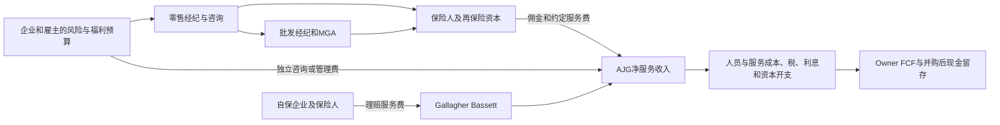

# Arthur J. Gallagher 加拉格尔（NYSE：AJG）公司调研：经纪入口、并购整合与每股现金的兑现

研究截止：**2026 年 11 月 4 日 15:36 PST（23:36 UTC）**。经营披露覆盖 2026 年第三季度；最近完整现金流量表覆盖 2026 年上半年。截至冻结时点，SEC 公司申报清单已有 11 月 4 日两份 Form 4，但尚无 2026Q3 10-Q。三季度新闻稿、资产负债表、CFO Commentary 和季度补充资料已经纳入，不能将“10-Q 尚未提交”写成“三季度业绩尚未披露”。[SEC 申报清单][S01]、[三季度结果][S02]

金额除特别标明外为**美元**；财务表使用**百万美元**，路径模型使用**十亿美元**，二者不混用。普通股为美国上市母公司普通股，非 ADR；每股数采用相应期间稀释股数或明确标明的期末股数。`事实`、`管理层目标`、`直接计算`、`研究估计`和`未知`分别表达。条件区间不具有统计置信区间含义，工作路径不等于数学期望。

## 一、当前判断：经营资产优质，兑现重点已经转向整合后的现金与资本回报

**AJG 拥有可持续的保险分销、咨询和理赔管理业务，当前属于成熟经营平台叠加大型并购整合阶段。最支持的路径是核心业务继续中个位数增长，AssuredPartners（下称 AP）协同逐步兑现，2027—2028 年现金改善；现有证据不足以把它视为依靠保险持续涨价、无限并购或 AI 独占利润而高速扩张的公司。**

公司出售的是风险诊断、保险安排、市场接入、雇员福利与赔案处理能力。保险人承担保单赔付，AJG 收取佣金、服务费及部分绩效报酬；保险费率下降会影响其收费基数，却不会直接产生承保亏损。客户关系、专业人员、牌照、保险人授权和数据流程共同构成经营资产。收购可以购买这些入口，同时带来客户流失、留人、合规、融资与摊薄负担。[2025 10-K，Business、Revenue Recognition][S03]

决定判断的发现如下。

| 发现与数字 | 当前经营判断 | 最强限制或反证 |
|---|---|---|
| 2026Q3 收入（报销前）**3,930**，同比约 **18.2%**；经纪有机增长披露为 **5%**，基础佣金及费用按原数计算的增速约 **4.39%** | 扩表贡献仍大于同范围业务增长，原有客户经营没有停滞 | 有机口径扣除了大量收购收入；AP 尚未完整进入该季度有机基数，不能据此证明 AP 留存良好。[S02][S04] |
| 福利经纪与咨询 Q3 有机增长 **−1%**；再保险 **+7%**，风险管理 **+10%** | 集团的分散结构确有作用，但“所有业务都强”不成立 | 福利业务下降究竟是项目推迟还是预算长期转移，还需要续约与项目兑现验证。[S04]（p.4） |
| Q3 经纪调整后 EBITDAC 率 **35.3%**；管理层桥接中的 AP 协同贡献约 **0.9 个百分点** | 成本整合已有财务表现，不能全部归为保险周期 | 桥接由管理层分配；AP 客户、生产人员留存和独立成本账没有完整披露。[S04]（p.7） |
| 2025 CFO **1,930**，资本开支 **145**；扣现金流表两类非现金薪酬 **197** 后，**Owner FCF 代理为 1,588**；截至 2026-06 的 TTM 为 **2,059** | 现金能力明显低于调整后 EBITDAC，且受并购付款、营运资本及现金税影响 | 代理并非完整SBC精确值，也不保证保守；若2025股票支付福利132均未被扣到，代理降至 **1,456**。融资租赁及重叠边界见第五节，Q3现金仍未知。[S03][S05] |
| 前九个月回购约 **580**、约 **270 万股**；9 月末股数 **256.415 百万股**，同比仅减少 **0.152%** | 回购产生了净缩股，但主要在抵销新增股份 | 不能把回购金额直接当成等额资本返还，也不能把所有发行都归为普通 SBC。[S02][S05][S06] |
| 9 月末公司借款面值约 **12,863**，另有保费融资借款 **228**；现金及等价物 **1,213**，受托现金 **7,596** | 能承担常规经营和整合，仍须约束大型收购与回购 | 受托资金不能用于偿债；1,213 也不能全部证明为自由可调动现金。[S02] |
| 独立采购及监管材料确认真实采用，也显示服务短板：WorkSafe Victoria 中 GB 管理 **22.3% 保单、26.9% 保费**；部分复工结果低于体系平均 | 理赔业务具备可验证规模，服务质量优势需要按指标检验 | 保费份额不是 GB 收入份额；个案和地区差异不能直接推成全球流失率。[S12] |
| DOJ 的 AP 相关 ACA 和解合计 **135**；公司声明 APSF 不在收购范围、相关金额已预留 | 这是必须穿透的治理案例，但不能再额外扣除 135 作为新损失 | 已预留不等于本期没有付款；法律责任、现金付款、购买价调整和集团费用须分开。[S18][S19][S20] |

**最支持的工作路径（研究估计）**：以 2026 年约 **16.30 十亿美元**报销前收入为衔接基数，不假设 2027 年以后新增大型收购，2027 年收入约 **17.23**、集团调整后 EBITDAC 约 **5.83**、Owner FCF 约 **3.56**；2028 年分别约 **18.09、6.26、4.01**。现金提升需要整合及留人成本下降、AP 没有明显客户损失、福利项目恢复和税收优惠按预期使用。它不是将三季度乘四，也没有把全部 AI 节省或未来并购加进收入。（模型及假设见第八节）

**最强反证**是：AP 成本削减损害客户服务与生产人员留存，福利咨询弱势持续，保险软化让佣金基数下降，管理层为维持增长重新加大高价并购；这样报表收入仍可能增长，但现金、净股数及资本回报改善不及预期。本报告的普通压力路径中，2028 年收入约 **16.61**，Owner FCF 约 **2.38**；另有重大网络事故、合规和资本市场受阻等更差尾部，不能把该代表值视为最坏结果。

最重要的未解量是 AP 的客户与生产人员毛流失、分业务净佣金率、合并后完整 SBC 现金替代成本、AP 实际累计协同的独立核算、最新逐笔债券成交及 YTW。它们限制了精确回报判断，尚未推翻核心经纪业务具有持续收费能力的结论。

## 二、公司经济边界：谁付款、什么能力属于 AJG

### 2.1 两个报告分部之下，至少存在五种不同的收费机制

2025 年经纪收入约 **12.19 十亿美元**，风险管理报销前收入 **1.585**。公司 2026 年 2 月材料给出的经纪业务结构为零售财险约 **54%**、零售福利 **22%**、批发 **13%**、再保险 **11%**；这是 2025 年范围，含 AP 并表后部分期间，不能拿它作为 2026 全年固定分配。按比例得到的约 6.6、2.7、1.6、1.3 十亿美元仅是经济规模定位，没有相应独立分支利润披露。[S03]（Segment Information）[S07]（pp.6–7）

| 经济分支 | 使用、采购和付款 | 收费与经济控制权 | 需求、供给与盈利的特别之处 |
|---|---|---|---|
| 零售财产责任险经纪 | 企业风险经理、CFO 与业主决策，贷款人或商业合同要求投保；保险人支付佣金或客户另付服务费 | 通常按保费比例或约定服务收费。掌握客户入口、风险信息、组塔和续约流程，但保险人决定是否承保 | 真实暴露、保额、保险费率、净佣金率和新客户共同作用；中型复杂客户比简单价格比较更需要专业服务 |
| 福利经纪与 HR、退休及精算咨询 | 雇主 HR/CFO 采购，员工使用；预算来自福利管理和咨询支出 | 保险佣金、按员工或计划收费、项目咨询费；Buck、Redington 等拓展退休和投资咨询能力 | 医疗费用上涨增加控费需求，同时挤压可选项目预算；养老金咨询与健康险经纪不能用一个增长率解释 |
| 批发、MGA/MGU 与专业险 | 零售经纪提交特殊风险，保险人授予市场接入或受托承保权限 | RPS、London Specialty、Pen 等在市场接入、风险选择与分销中取费；部分报酬与组合表现相关 | 受托承保权限和保险人资本可以撤回；E&S 交易增长不等于每单保费增长，MGA 保费不是 AJG 收入 |
| Gallagher Re | 保险公司、再保险采购负责人及资本管理团队采购 | 条约及临分安排、模型、资本与结构咨询；佣金或约定费用 | 1 月等集中续约带来季节性。再保价格下降可能降低佣金，也可能促使客户加购限额；对手是 Aon、Guy Carpenter、Howden 等专业组织 |
| Gallagher Bassett（GB）风险管理 | 自保企业、保险人、公共机构及其他经纪的客户采购；受伤员工、理赔人使用 | 赔案处理、医疗管理、风险服务；收费可基于赔案件数、期间服务、项目或绩效 | 人员、案件复杂度、处理周期、服务质量与信息系统是交付约束。赔款由客户或保险人承担，GB 不因此拥有保险浮存金 |

公司材料称经纪基础佣金及费用约 **75% 是佣金制、25% 是费用制**；GB 约 **95% 收入来自并非 AJG 经纪客户的对象**。两点都很关键：佣金制不代表全部集团收入跟随纯费率；GB 的独立市场入口是真实增长来源，不能把其全部收入当成经纪交叉销售。[S07]（p.6）

### 2.2 从客户保费到 AJG 收入，再到可用现金

图中保费只经过一次终端预算，批发与零售可能分享同一分销佣金。母公司合并要消除内部交易；AP 已有客户在 RPS 内部转单，并不自动创造另一份终端保费收入。能够增加的是原先外流的净收费或服务，仍需扣除新增成本和竞争性让利。

公司主要经纪服务约 **85% 的佣金及费用在保单生效日确认**，随后前三个月约 10%，其余约 5% 此后确认。保险人付款、分期保费和客户续约日期可能不同。因此，应收增长可能来自业务扩大与确认时点，不能只凭应收增加认定虚增；同样，收入已确认也不表示现金已到账。附加佣金按合同估计，或有佣金受组合承保结果、数量、留存等条件影响，后续可能修正。[S03]（Revenue Recognition and Contracts with Customers）

### 2.3 公司资产、实际控制与证券权益

普通股对应母公司在员工、债权人、税务及少数股东权益之后的剩余权益。集团绝大部分经营成果归属母公司股东，但并非每个海外牌照、信托账户和子公司现金都能自由上划。2026-09-30 少数股东权益 **33**、前三季度少数股东损益 **4**，相对集团小；这不取消各地客户资金、监管资本和分配限制。[S02]

AJG 主要拥有或控制客户续约关系、品牌、员工组织、经纪与理赔牌照、风险数据库和软件流程。保险人授予的承保权限、Lloyd's 接入、外部巨灾模型和 Microsoft 模型基础设施是合同或许可能力。客户数据涉及隐私、保单与理赔义务，其用途并非不受限制的通用训练资产。微软案例能证明平台与流程应用，不能证明 AJG 独占底层模型或能够对客户单独收取 AI 软件租金。[S03][S14]

在集团层面，没有重要工厂、库存或晶圆产能；研究重点放在专业人员与授权、数据质量、服务组织和资本，而不虚构实物产能。保险资本的增减通过报价可得性、保费、风险流向与受托权限传入 AJG；它不拥有这些承保资本所对应的全部利润。

## 三、需求与竞争：降价、风险复杂化和客户预算可以同时发生

### 3.1 保险周期传导到佣金，需要先拆产品和合同

CIAB 2026Q2 调查显示各账户规模平均保费变化 **−2.0%**，财产 **−6.3%**，伞式责任 **+5.3%**、商业汽车 **+4.5%**；财产容量增加与责任险容量收缩可以同时存在。问卷中的保费变化并未完全剔除暴露、保障及组合，不是 AJG 的净收费指数。[S08]（2026-08-18）

AJG 的财险经纪收入可概念化为：

`旧客户风险暴露 × 实际保障/转移比例 × 保险净价 × AJG净留存佣金率 + 独立服务费 + 新客户收入 − 流失`。

费率下降未必导致同幅收入下降：客户可用节省预算加购限额，部分业务按费用收费，伤亡责任与财产险的价格方向不同。但这也不是无周期模型。客户可以提高免赔额、减少保障、转回标准市场，保险人和采购方可以重谈佣金，生产人员可以要求更高分成。**更复杂的风险扩大顾问任务，不自动扩大客户可支付预算。**

把 100 单位经纪旧收入作为条件算例：若收入留存率为 **94%**，留下业务的暴露、价格和收费合计增长 **2%**，要实现总有机增长 5%，新增业务需贡献 `105−94×1.02=9.12`。若留下业务反而下降 2%，所需新增收入变为 **12.88**。94% 是研究算例，非公司披露的精确留存率；它说明在软化期维持同样增长需要更多销售产出，不能只说“客户黏性强”。

公司对单一客户依赖较低：2025 最大客户约占两个经营分部收入 **1%**、前十大约 **3%**。不过，不同客户仍共同暴露于美国企业工资、营收与就业、医疗成本、房地产及利率，客户分散不能消除宏观相关性。[S03]（Clients）

### 3.2 福利业务：医疗通胀带来需求，也会挤压咨询项目

KFF 2026 雇主调查覆盖 **1,937 家**非联邦公共及私人雇主，家庭医保年保费平均 **28,303 美元、同比约 5%**，高于工资增幅约 3.7%。这证明雇主控费压力，不证明其愿意按同样比例提高顾问费。[S09]（2026-10-22，Summary、Methods）

AJG 福利经纪与咨询的有机增速由 2025Q1 的 8% 降至此后 2%、1%、1%；2026 年前三季度依次 **4%、3%、−1%**。这些数据比“福利属于防御性业务”更能约束判断。公司的 2026 全年约 3% 目标需要 Q4 恢复到约 3%，但 AP 纳入有机范围会影响比较。[S04]（p.4）

管理层在10月29日电话会将Q3低于9月预估的部分，主要解释为或有佣金调整及几个咨询项目的时点，并称核心健康与福利业务仍符合预期。所读为电话会的非官方逐字稿，未逐字校对官方音频；这是一项具体、可检验的管理层解释，尚非项目已经回款或需求恢复的独立事实。Q4项目兑现、有机基础佣金和后续回款可以区分暂时时点与持续弱势。[S42]

可能的有利机制是雇主寻求 PBM 比较、自保安排、计划重设计、退休与员工沟通服务；相反机制是医疗及药物成本挤出薪酬、组织与其他可选项目，或顾问降费以保持关系。现有信息更支持低个位数恢复，尚不支持立刻回到 2023—2024 年 6%—7% 的增长。项目回流、客户预算和单客收入才是验证，单纯保险保费上涨不够。

### 3.3 批发、MGA 与再保险：结构机会必须通过净收费验证

复杂风险难以在标准市场找到完整保障，支持 RPS、London Specialty、Pen 与 Gallagher Re 的专业价值。但财产保险资本回流会压低单位保费，标准市场可抢回简单业务；MGA 若承保表现不佳，还可能丧失保险人授权。AJG 在这一链条的优势是把客户入口与多资本来源连接起来，弱点是并不独占任一资本方。

本地行业材料提出的“总资本充裕、具体风险仍难承保”适用于 AJG，是因为它决定找市场、分层和设计条款的服务需求；不能由此推导全集团佣金率上升。再保险分支 2026 前三季度有机增长 **8%、7%、7%**，确实强于财产险费率所暗示的简单模型，但没有独立披露足够的成交保费、限额和佣金率来准确分离加购、份额与重定价。[S04]

同行也挑战“只有 AJG 能增长”的解释。Aon 于 10 月 28 日披露 Q3 有机增长 **6%**；WTW 于 10 月 29 日披露 **4%**，其中 Health **6%**；Brown & Brown Q3 有机增长 **1.2%**。不同业务组合、收购和或有佣金处理使其不可直接排座次，但它们表明增长差异来自具体组合与执行，AI 和规模并非 AJG 独有。[S10][S11][S13]

## 四、财报外验证：实际客户、费用和服务表现

### 4.1 采购方材料说明了客户为何购买，也纠正了收入边界

| 公开日期、对象与原始位置 | 可以确认的商业事实 | 对规模与经济性的含义；不能推导的内容 |
|---|---|---|
| DuPage Water Commission，2026-02-19 委员会材料，PDF pp.35–38，R-12-26 | 财务部门建议经纪服务续约两年并带一年选择权，每年不超过 **30,385 美元**；称服务满意，AJG 同意不涨价 | 直接证明既有服务、续约意愿和采购压价。所读材料是建议及待签决议，不能当成已经到账的全期收入，也不代表集团普遍定价权。[S15] |
| Florida DFS，合同 **D2776**，2025-11-12 签署；截至读取日的公开账 | 服务交付项把经纪咨询与保险保费分开；FY2025–26 账内有三笔 **81,250** 经纪类付款记录，另有 **13,805,174** 超额财产保险支付 | 这是实际执行及付款证据。不能把经过经纪的 1,380 万美元保费当成 AJG 净收入，也不能把 FY2026–27 的预算上限当成已拨付、已确认服务收入。[S16]（Deliverables、Payments） |
| NMCIA，2026-03-18 会议包所载 **2026-01-19 会议纪要**，PDF p.13 附近 | Bernalillo County 在 2025 年 12 月中旬签 GB 理赔管理合同；保险经纪是 **HUB**。县方称小型风险部门缺乏内部处理能力 | 独立证明 GB 可服务竞争经纪的客户，以及自保和专业人力缺口的采购理由；未披露足够费用，不能估算这一客户收入或外推集团份额。[S17] |
| Williamson County，2026-08-11 官方会议录像及转录，事项 **57** | 委员会以 **5–0** 通过终止与 GB 的第三方理赔管理协议并授权发出通知 | 证明客户可以实际终止，反对“理赔关系无法替换”。未取得终止理由和损失金额，不能直接归因服务恶化或算成集团取消率。[S21] |

上述公共机构样本不代表 AJG 的全部商业客户。其价值在于从买方证明**签约、付款、固定服务费与终止能力**，不是拿几份小合同支撑十亿美元增长。

### 4.2 WorkSafe 提供了比客户 Logo 更强的规模与结果检验

WorkSafe Victoria 2025–26 年度资料列示，GBS 管理 **22.3% 的非豁免雇主保单、21.9% 的工资报酬基数、26.9% 的保费**。这些是同一体系不同分母。该代理代表 WorkSafe 签发保险、收取保费和管理赔案，收入为代理服务费及绩效报酬；不是其自行承担了 26.9% 的保费风险。[S12]（Market share、Agent fees）

结果并非单向领先：

- 本年度伤者一般服务指标 **84.4%**，高于 **83.5%** 目标；长期伤者服务 **74.0%**，低于 **74.5%** 目标；关键时刻调查 **59.1%**，低于 **60.0%** 目标。
- 13 周持续复工指标中，GBS 全伤情 **66.6%**，体系 **69.1%**；心理伤情 **36.2%**，体系 **42.8%**。该比较未对所有病例组合做因果调整，不能全归于服务质量。
- 决策质量 **96.3%**，体系 **96.6%**；页面披露的警告数由上年 **4** 增至 **10**，仍需结合具体类别及监管方法解释，不能换算为罚款金额。

这些数据支持“具有规模和合格交付能力”，同时削弱“技术与流程已使其在所有关键结果上领先”的强主张。绩效未达标会影响报酬、客户选择、监管信任及维护成本。2026–27 年考核又增加或扩展程序时效等要求，降本不能牺牲人审、复工和合规结果。[S12]（Return to Work、Service、Quality Decision Making、Warnings）

## 五、财务基线：规模增长、季节性与真实现金负担

### 5.1 最近五个季度，先保持口径一致

下表收入均为**报销前收入**，不会把风险管理代收报销当成高毛利服务。利润率是调整后 EBITDAC，非 GAAP 毛利率；GAAP 净利润使用归母口径。2025Q4 归母数约 150 为 2025 年报 **1,494** 减最新已取得前三季度比较数 **1,344** 的衔接计算，不能当成公司重新单列的精确季度值；收购计量期重分配和四舍五入使它与最初 Q4 新闻稿略有差异。其余数据采用最新相应比较披露，不把这种小额口径调整解释为业务变化。[S02][S03][S04][S05][S22]

| 百万美元，除比例 | 2025Q3 | 2025Q4 | 2026Q1 | 2026Q2 | 2026Q3 |
|---|---:|---:|---:|---:|---:|
| 集团报销前收入 | 3,325 | 3,586 | 4,716 | 3,955 | 3,930 |
| 经纪收入，GAAP | 2,922 | 3,169 | 4,293 | 3,502 | 3,473 |
| 风险管理收入，报销前 | 402 | 417 | 428 | 453 | 457 |
| 经纪有机增长，披露整数口径 | 5% | 5% | 5% | 5% | 5% |
| 风险管理有机增长 | 7% | 7% | 10% | 12% | 10% |
| 经纪调整后 EBITDAC 率 | 约33.3% | 32.2% | 40.1% | 33.3% | 35.3% |
| 风险管理调整后 EBITDAC 率 | 21.9% | 约21.6% | 约22.0%，金额直接计算 | 22.3% | 22.8% |
| 归母净利润 | 272 | 约150，衔接计算 | 822 | 324 | 403 |
| 经营现金流，当季 | 729 | 753 | 957 | 10 | 未披露完整现金流表 |

现金流季度值由累计流量相减：2025 前九个月 **1,177**、全年 **1,930**；2026Q1 **957**、上半年 **967**。2026Q2 只有 10 不代表季度没有利润，主要反映季节性收付、应收、人员薪酬及并购支付。反过来，Q1 高现金也不能直接乘四。[SEC companyfacts：NetCashProvidedByUsedInOperatingActivities][S23]

2026 前九个月集团报销前收入 **12,601**、归母净利润 **1,549**；总调整后 EBITDAC **4,204**，而调整前 EBITDAC **3,551**。两者都不是现金。归母与全部净利润相差少数股东数，不混用。Q3 归母 EPS **1.55**、调整后 EPS **3.00**；主要调节项包含无形资产摊销、整合、人员及租约终止和收购相关调整。[S02]

### 5.2 有机增长的质量：基础收入与附加收入需要分开

Q3 经纪有机基础佣金及费用为 **2,309 对 2,212**，约 **4.39%**；有机 supplemental 为 **124 对 109**；有机 contingent 为 **60 对 60**。合计 **2,493 对 2,381**，约 **4.70%**，四舍五入披露为 5%。基础客户经营贡献约 **97**，附加及或有部分净增约 **15**，不能把全部 5% 理解为客户数量或纯定价提升。[S02]（Organic Revenues）

同期报表经纪佣金、费用及附加/或有收入合计 **3,369**；公司从有机口径扣除收购、处置及其他 **876**。这些扣除不全等于本期新增收购收入，也不能把 876 再加到报表收入。AP 从 Q4 2026 开始纳入有机预测的完整可比范围，未来同比构成会变。[S02][S04]（p.4）

2025 前三季度含约 **363** 的 AP 募资现金利息，其中 Q3 约 **76**；资金投入收购后，这类利息消失。公司将其列在经纪分部，融资利息则主要列在 Corporate。故 2026 前九个月经纪调整率从比较值 37.9% 降至 36.5%，不等于基础效率下降 1.4 点；管理层估计利息、季节性和收购组合合计使同比约多下降 **2.2 点**。Q3 也不能把表观 2 点改善全部视作内生提效。[S02]

### 5.3 Owner FCF：可核算值、SBC 边界和融资租赁处理

定义以股东经济成本为目标：

`Owner FCF = CFO − 全部资本开支 − CFO中加回但需要现金替代的SBC − 融资租赁本金`。

融资租赁利息如已在 CFO 内，不再重复扣除；若不在 CFO，则另扣。经营租赁现金已在 CFO，不能再次扣整笔经营租赁。AJG 已取得披露的租赁表主要为经营租赁：2025 经营租赁现金 **155**。没有单列重大融资租赁本息，本文不凭空填一个额外支出；若后来披露了未包含的融资租赁本金，以下代理值须相应下修。[S03]（Leases）

**公司现金流表的“Stock-based and other noncash compensation”49，不是完整 SBC。** 2025 普通期权、RSU 和 PSU 费用分别约 **54、75、26**，可辨认常规合计 **155**；还存在递延薪酬、员工福利以股票支付、AP 诱因奖励及收购留人安排，公开表未提供可以无歧义直接拼成一项的全集团现金替代成本。AP 奖励授予价值也不能全记为当年费用。

为提供可复核的主表，本报告从 CFO **同时扣除“递延薪酬及限制性股票摊销”和“股票及其他非现金薪酬”两项**，称为 **Owner FCF 代理**。该方法扣除了比纯普通 SBC 更宽的非现金薪酬，可能包含将来以现金支付、或已通过其他现金变动反映的递延费用；另一方面，也不能保证已经逐笔识别所有以股份结算的员工福利。因此它既不是纯 SBC 精确值，也不能保证必然比真实Owner FCF保守。经济判断同时用净股数检验。只扣常规 155 会给出 2025 年 **1,630**，比主表高 42，不据较高值下结论。[S03]（Stock Option Plans、Deferred Compensation、Restricted Stock、Cash Flows）

必须另列的已知项目是：2025年401(k)配比缴款费用约 **115**、Supplemental Savings and Thrift Plan约 **17**，公司决定以本公司股票提供2025年度配比、于2026年2月落实；2026H1仅401(k)费用已达 **86**，上年同期 **60**。它们均有经济薪酬成本。公开现金流量表没有逐项说明其在非现金薪酬、应计薪酬变动及信托购股现金之间的完整映射，直接再扣132可能重叠，完全忽略也可能高估股东所得。**若132全未包含在主表扣项和相关现金变动中，2025代理由1,588降至1,456；若全部已包含，则不再扣。** 这是特定映射敏感性，不是已证明覆盖所有误差的完整区间，AP留人奖励仍需按实际费用而非授予总值勾稽。[S03]（Supplemental Cash Flow、Employee Benefit Plans）[S05]（Note 13）

| 百万美元，现金流量期间 | 2023 | 2024 | 2025 | 2025H1 | 2026H1 | TTM至2026-06 |
|---|---:|---:|---:|---:|---:|---:|
| CFO | 2,032 | 2,583 | 1,930 | 448 | 967 | 2,449 |
| 资本开支 | 194 | 142 | 145 | 68 | 87 | 164 |
| 递延薪酬及限制性股票摊销扣项 | 105 | 117 | 148 | 61 | 74 | 161 |
| 股票及其他非现金薪酬扣项 | 31 | 42 | 49 | 25 | 41 | 65 |
| **Owner FCF 代理** | **1,702** | **2,282** | **1,588** | **294** | **765** | **2,059** |
| 融资现金流内的收购 earnout，另扣于资本配置 | 98 | 143 | 442 | 350 | 206 | 298 |

三季度没有完整 CFO 与薪酬现金桥，**不提供伪精确的 2026Q3 或前三季度 Owner FCF**。2026H1 代理 765 与 2025H1 的 294 相比增加 471，其中 CFO 中超原估计 earnout 支付由 **480 降至 141**，减少 **339**，约占代理改善的 72%。其余也不是纯 AP 协同：收购范围、利润、应收和薪酬结算都在变化。[S05]（Cash Flows）

2025 Owner FCF 还包含 AP 募资现金临时利息的税后贡献，约 **0.27 十亿美元**；若只为观察持续现金能力粗略剔除，代理约 **1.32 十亿美元**，不是另一项已披露 FCF。TTM 至 2026-06 只残留大致 Q3 2025 的这类利息，税后约 0.06，使其比 2025 年值更接近新经营范围，仍非完整稳态。

### 5.4 并购付款与营运资本：资本轻不等于增长不用资本

2025 现金收购净支出 **15,766**，另有融资现金流内 earnout **442**；CFO 已包含超原估计 earnout **491**，不能再扣一次 491。按主表代理扣现金收购及融资 earnout，2025 约 **−14,620**，反映融资购入资产的年份，不代表原有服务业务本身每年耗这么多现金。

其中一个重要历史原因是，2025 年 4 月对 2021 年买入的 Willis Towers Watson 条约再保险经纪业务支付约 **750** earnout。它说明现金拖累不全来自新买的 AP，也说明并购付款可晚于最初确认收入多年。不能据2025异常高支付永久压低服务现金能力，也不能预设以后没有其他尾款。[S03]（Liquidity and Capital Resources）

2026H1 的相同计算为 `765−616−206=−57`，尚未扣股息 **359** 和回购 **480**。现金缺口通过借款、期初资金和其他流量解决；不能把 CFO 967 全部拿来宣布并购与回购都由内生现金覆盖。[S03][S05]

上半年应收增加对现金的拖累 **949**，上年同期 **681**，而递延收入增加分别提供 **67、58**。9 月末应收 **5,977**，较年末 **5,175** 增加 802，不能直接算成同口径现金支出，因为其中还含收购与汇率影响。公司没有按分支公开足够的应收账龄、毛坏账及客户续约数据，故将回款作为路径参数，不给一个未经分解的 DSO 改善故事。

资本开支低于折旧摊销，主要原因是大量客户关系无形资产摊销，不是 IT、员工与获客无需投入。已费用化的技术、培训与销售成本不能再在模型中作为独立“AI 投资”重复扣；维持客户关系需要持续人力支出，不能认为收购客户名单摊销全是无经济意义费用。

### 5.5 真实净稀释：回购多数仍在抵销发行

2024年末普通股约 **250.0百万股**，2025年末约 **257.0百万股**，年增约 **2.8%**；其中2025年1月的约 **4.6百万股**公开发行超额配售用于AP融资，不应与日常员工SBC混为一项。2024年为AP提前发行约 **30.4百万股**，也说明“大型收购以后收入和每股表现”必须使用已扩大的股本比较。[S03]（Stockholders' Equity、AssuredPartners Financing）

2026年上半年回购约 **2.3百万股、480百万美元**，Q3再回购约 **0.4百万股、100百万美元**，九个月合计约 **2.7百万股、580百万美元**。9月末流通股 **256.415百万股**，相对2025-09的 **256.805百万股**减少 **0.390百万股，即−0.152%**；相对2025年末约减少0.585百万股，即约 **−0.228%**。按期初、回购与期末勾稽，期间新增股约 **2.1百万股**，约抵销回购股数的 **78%**。因期初及回购披露有四舍五入，该比例是近似值；新发股还含员工计划、行权、收购及其他安排，不能全部当成同一类SBC。[S02][S05][S06]

因此，净缩股是真实但较小的结果，不宜用580百万回购金额直接代表同额净资本返还。Q3稀释加权平均 **259.369百万股**、前九个月 **259.325百万股**，与期末流通股不同；它们分别适用于EPS与时点稀释分析。[S02]

2026代理书列示未到期股权权利约 **9.38百万股**，未来计划尚可授予约 **14.63百万股**。它们是不同期限、行权条件与未来董事会选择的授权池，不能全部立即加入当前股数。2026H1未到期期权约 **7.4百万股**、平均行权价约193.15美元，行权所得现金、税款代扣与回购也会影响最终净稀释。AP长期留人股权能减少现金流失，却把一部分代价转给股东，评价留存效率时须把Owner FCF、实际回购与净股数放在一起。[S26]（p.22）[S05]（Stock Option Plans）

## 六、AssuredPartners：规模已经买到，回报需要客户、协同和投入一起检验

### 6.1 收购价格、实际基础和历史承诺

2024-12-09 公告的交易价格为 **13.45 十亿美元**、扣预计税项利益后约 **12.45**；当时 AP 的 2024 年 9 月止 TTM 收入约 **2.9**、EBITDAC **0.938**，14.3 倍为未计税益和协同前倍数。年报最终记录的收购对价约 **13.815**，其中包括 **0.300** escrow，取得现金约 **0.276**；它不是原始新闻稿价格，也不是扣尽未来税益的净经济成本。差额受合同调整和购买会计影响，不以一个新闻倍数替代实际投入。[S24][S03]（Business Combinations）

最初预期 2025Q1 完成，实际 **2025-08-18** 完成。2025Q2 10-Q 已披露美国 HSR 补充材料要求。交易最终关闭是执行成果，延后数月则证明监管与整合时钟并非管理层完全控制。延期期间产生的募资利息是时点收益，不能当作持续服务能力。[S24][S25]

| AP 调整口径，百万美元 | 2025Q3，仅8月18日后 | 2025Q4 | 2026Q1 | 2026Q2 | 2026Q3 |
|---|---:|---:|---:|---:|---:|
| 收入 | 306 | 704 | 839 | 701 | 773 |
| 调整后 EBITDAC | 62 | 215 | 320 | 222 | 285 |
| 对应比率，约 | 20% | 31% | 38% | 32% | 37% |

来源为 2026-10-29 CFO 材料 p.6。该表是公司提供的 AP 财务呈现；其预测脚注说明预测值在协同前，不能把这里全部实际数与协同表混成未经分配的单独审计利润。2025Q3 只有部分季度，2026Q1 有明显季节性，任何一个季度都不适合简单乘四。Q3 收入较 9 月预测 **785** 低 12，EBITDAC 同为 **285**，说明达到利润目标可以来自费用控制，并不证明收入目标也兑现。[S04]

### 6.2 协同可以量化，剩余收益不能重复计入

管理层目标为 **2026 年末年化协同 160**、**2028 年初年化 325**。2026Q3 经纪利润率桥中，AP 协同约贡献 **0.9 点**，乘调整后经纪收入 **3,460**，量级约 **31**；它是管理层桥接的直接算例，非独立核验的 AP 分部现金流。2026 前三季度桥接约 0.2、0.6、0.9 点，支持实际提效正在发生，但年末 160 的运行速率不能当成 2026 全年已实现 160。[S04]（pp.6–7）

主要路径是采购与地产合并、后台向 Centers of Excellence 转移、重复组织和系统整合、原来外部批发业务内部承接及部分交叉销售。成本协同比新客户销售更可控，风险是专业人员工作量、客户响应和本地经营自主权受损。当前表观利润提升与客户长期质量仍可能背离。

年报预计 AP 整合费用约 **575**、Woodruff Sawyer 约 **150**，均为三年累计估计。AP 另披露交割即归属诱因 RSU **100** 和随后两至五年归属奖励授予价值约 **215**。授予价值、费用与现金时点不同，也可能与收购留人/整合调节项交叉，不能把 575、315 和全部收购调整机械相加当成互不重叠的新现金支出。[S03]（Liquidity、Restricted Stock）

### 6.3 并购单位经济性与失效门槛

按 2026 前三季度实际收入 2.313，加 Q4 以 2025Q4 704 增长约 3% 的研究假设，AP 全年收入约 **3.04 十亿美元**。同法以前三季度 EBITDAC 827 加 Q4 约 221 得到约 **1.05**，只是季节性衔接算例，不是把 2026Q3 的 37% 利润率延伸全年。

若 2027—2028 年收入保持 3%—4% 增长、协同前效率大体保持、全额年化协同接近 325，则 AP 可支持约 **1.35—1.45 十亿美元**经营 EBITDAC 的条件量级。考虑维持 IT/销售投入、留人成本及正常现金税后，未计母公司融资的年股东经济现金贡献约 **0.9—1.1** 是更有意义的研究范围；相对约 13—14 的净资金投入，约为 **7%—9%** 现金回报。收购会计摊销与税盾使净利润、现金和投入资本口径不同，该回报不是公司披露 ROIC，也不意味着已超过股东要求回报。

失败不需要整个平台崩溃：假设 AP 约 3.04 的收入基础流失 10%，按 50% 边际贡献，经营损失约 **152**；这将吞掉 2026 之后剩余协同中很大一部分。50% 是客户流失时成本无法立即同比削减的研究敏感性，不是 AP 披露的边际利润率。若留人费用上升、数据迁移拖延与流失同时发生，协同节省必须与这些损失净额比较。

AP 的商誉约 **8.376**、客户续约关系等 expiration lists 约 **5.993**。其主要价值不是可随时拍卖回收的设备；失败后可出售业务和保留部分客户，但历史支付、留人费用和系统转换投入没有等额退出保障。商誉减值可以晚于客户经济损失出现，因此应先看有机增长、人员与现金，不能等减值才承认失败。

## 七、技术、组织治理与资本约束：什么能放大优势，什么会侵蚀股东所得

### 7.1 真正的交付能力是专业人员与流程，AI 先改变成本和服务速度

2026Q3 公司有 **74,614 名**员工，其中经纪约 **57,587**、风险管理约 **11,454**，其余为公司及其他支持人员。2026 年 2 月投资者材料称 Centers of Excellence 约有 **17,400** 人。它是集团服务组织，不能再与各分部员工机械相加。对经纪，能独立开发业务、理解行业风险并取得保险人报价的生产人员是稀缺资源；对 GB，理赔员、医疗管理人员、数据与法律流程决定可承接案件。员工数增长、牌照和承保授权只是交付条件，不等于已形成同等收费产能。[S02][S07]

在 2026Q3，每 100 美元调整后经纪收入，薪酬约 **51.3**、其他经营成本约 **13.4**、EBITDAC 约 **35.3**；风险管理相应为 **58.6、18.6、22.8**。这比虚构每张保单或每宗赔案平均利润更能约束成本：两类业务都靠人力交付，GB 的成本杠杆更依赖单位处理时间、复杂案件比例与客户合同是否允许调价。这些是分部平均数，不能替代 AP、福利项目或特定代理合同的贡献利润。[S02]（Segment Operating Results）

Microsoft 2026-05-07 客户案例确认 AJG 使用 Azure AI Foundry、Microsoft 365 Copilot 和 Copilot Studio，介绍理赔材料摘要、知识检索、保险文件与报价流程；部分过去需要一至两小时的材料处理可缩短至分钟级。约 7 万员工获得相关工具或支持的描述，不能转成 7 万日活用户，更不能转成相同数量岗位替代。案例来自平台供应商，未披露独立控制组、全成本、错误率、持续留存或客户愿付价格。[S14]

研究估计的合理顺序是：先在摘要、搜索、文件检查上节省时间，再以质量审查及数据权限约束扩大使用，最后看产能是否变成更多客户、更快响应或较低成本。若以约 **90 亿美元**量级的集团年薪酬作约束，20%—30% 工作可被有效辅助、节省其中 5%—10% 工时、公司最终保留 30%—60% 经济利益，毛节省量级约 **2,700 万—1.62 亿美元/年**；还应扣平台、治理、培训及错误成本。这是敏感性算例，不是公开节省额。生产人员可能将时间转向销售，也可能要求分享收益；客户可能压低服务费。因此不把它单独加到 AP 协同及既有利润率改善之上。

AI 也会压低简单报价与文件处理的差异化，增加隐私、错误建议和专业责任风险。AJG 的较强位置在复杂风险、关系组织、保险人市场接入与可追责交付；底层模型和基础自动化会被竞争者采用。现有证据支持“改善工具”，尚不足以支持独占软件利润。

新的 AI 风险保险值得保留，但规模尚未得到验证。独立 MGA **Testudo** 在 2026 年推出生成式 AI 责任险，披露 Lloyd's 保险人支持及约 **100 万—1,000 万美元**单项保障限额；这些限额不是保费，也不是 AJG 收入。Gallagher Re 与研究机构、相关市场参与者的研究合作能证明能力建设，不能证明 AJG 控制该 MGA 或已取得重大付费收入。[S36][S37]

可先求商业门槛：若 AJG 最终净保留已安排保费的 3%—10%，形成 **1,000 万美元**收入需要约 **1亿—3.33 亿美元**保费；达到约 2026 年集团收入 1% 的 **1.63 亿美元**，需要 **16.3亿—54.3 亿美元**。两项费率均为条件假设，实际取决于零售、批发、MGA 和再保之间的分成。公开资料尚不能支持这一保费规模，故工作路径中没有独立 AI 新险种收入；可能已有的咨询与安排费用留在原有有机增长中。

### 7.2 激励并非只奖规模，但仍缺少完整资本回报约束

2026-03-23 DEF 14A 的薪酬披露不能简化成“收入、利润各占 50%”。年度现金激励采用**调整后收入增长与调整后 EBITDAC 增长二维矩阵**决定最高支付机会；收入增长达到 10%、EBITDAC 达到 20% 时可到目标的 **200%**。委员会仍可根据有机增长、利润率、个人与分部表现下调。2025 年指标使列名高管均达到最高机会。[S26]（pp.28–30）

一个有利约束容易被忽略：**薪酬用 EBITDAC 与公司对外调整指标不同，原则上不剔除收购整合费用，仅有少量离职费用例外**。这使整合超支会影响激励。长期激励中，CEO 的 **75%**、其他列名高管的 **60%**为 PSU，其余主要为期权；PSU 与三年平均调整后 **EBITDAC 每股增长**挂钩。这比纯总规模目标更能约束发行股票买增长。[S26]（pp.29–30、A-1）

但 EBITDAC 每股仍不包含债务利息、收购资本成本和全部现金回报要求。低息借款买入 EBITDAC 可能满足指标，而投资回报尚不足。CFO 因 AP 交易谈判及融资完成，于 2026 年初获 **100 万美元**特别奖励，其他高管亦有交易奖励；这一奖励认可完成交易，不能代替其后数年的客户与现金验证。[S26]（pp.32–34）

董事长与 CEO 由同一人担任，家族成员在经营层及其他岗位任职，代理书列明亲属薪酬。长期关系和收购文化可能提高留人及交易执行，关联任职也增加继任、独立监督与绩效判断的要求；披露本身不能证明利益输送。不能沿用三月代理书的董事会名单：独立首席董事 David Johnson 于 **2026-07-22** 去世，次日董事会由九人减至八人，**Ralph Nicoletti** 接任独立首席董事。[S26]（pp.11–20）[S32]

会计团队也有重要变动：2026 年 8 月 8-K 披露 Thomas J. Cary 于 **9 月 30 日**卸任 Chief Accounting Officer，仍任会计副总裁并计划 2028 年退休；AP 前 CAO **Kyle G. Koreyva** 于 **10 月 1 日**接任。公司声明没有与公司分歧。这既引入 AP 财务经验，也使购买会计、整合费用和内控连续性成为可检验事项，不能把正常交接直接写成财务疑点。[S33]

### 7.3 内部人交易与大股东：已核实的信号很有限

本次将真实市场交易与期权行权 `M`、税款扣股 `F`、赠与 `G` 及预报 `144` 分开，并检查可取得的原始 XML。

| 交易对象、日期与证据 | 事实及计划属性 | 可作出的判断 |
|---|---|---|
| Mike Pesch，**2025-11-03**；Form 4 原始完整申报 XML | 四笔 `Code P` 合计 **4,000 股、约 98.85 万美元**；`<aff10b5One>0</aff10b5One>` | 确认一名经营高管自费买入。时间距截止日约一年，且不是多名高管同期集群，不能当成当前全面看多信号。[S29] |
| Thomas Cary，**2026-09-15**；9月17日申报 | `Code S` **1,000 股、约 25.29 万美元**；XML 中 `aff10b5One=0`，交易后直接持有约 **46,819 股** | 确认一次非 10b5-1 标记出售，规模相对剩余直接持股小；不能由一次出售证明会计交接有问题。[S30] |
| Scott Hudson，**2026-09-02**；Walter Bay，**2026-08-24** | 可读 SEC 展示页分别列示出售 **12,000 股、约 317 万美元**及 **12,000 股、约 324 万美元**；Hudson 同时行权。未成功取得两份原始 XML 以完整核对计划标签 | 保留为可核实的交易事实；计划属性未完成原始 XML 确认，故不与 Cary 拼成已确认的“非计划集中异常出售”。[S31a][S31b] |
| Howell、Mead，**11月4日新提交**的 Form 4，交易日在11月2日 | SEC 清单确认两份文件存在；可读二手转录分别显示出售约 **30,996 股、853 万美元**与 **7,590 股、212 万美元**，均涉及期权行权。原文与计划标签尚未完整取得 | 仅作为截止日最新待复核线索，未计入非计划抛售统计。同期 Form 144 是拟出售通知，不与 Form 4 再加一次。[S01][S34a][S34b] |

据此，当前没有足够依据认定近期存在高管自费买入集群，也没有足够原始 XML 证据认定完整的异常非计划抛售集群。`aff10b5One=0` 只支持该表未标为 10b5-1 计划交易，不能证明动机。

SEC 申报清单和持股文件核查未找到截至截止日的 2026 年 SC 13D 激进诉求；**Capital World Investors 2026-08-12 的 13G/A**披露 6 月 30 日持有 **12,769,747 股、5.0%**，含普通投资、非控制目的声明。不能将其当成要求分拆、董事席位或出售公司的 Item 4 行动。未发现与证明不存在并不等同，未来持股变化仍需跟踪。[S01][S35]

### 7.4 合同穿透：最重要的不是最低采购量，而是客户可终止、留人与债务定义

本次以 SEC 全文检索 `Gallagher Bassett`、`Arthur J. Gallagher`，并筛选跨主体披露：前者在 2016—截止日的 10-K、10-Q、8-K 检索约 44 项，后者在 2024—截止日约 268 项，检查其首批 100 项。可见命中多为 AJG 自身、子公司清单、ShiftPixy 提及其 TPA 和其他合作公告；未找到足以验证集团最低采购量、阶梯折让或不可撤销客户收入的重大跨主体 EX-10 原文。进一步指定 EX-10 的查询受到访问限制。因此这是**已执行、范围有限的核查**，不宣称穷尽 EDGAR，也不以无命中证明合同不存在。[S38a][S38b]

经济上，客户续约和服务人员比硬件式 NCNR 更重要。第四节采购方的续约选项、固定费用与终止决议，提供了直接合同约束证据。公司没有集团统一 backlog 或不可取消收入披露，不能用保单保障限额、经手保费、客户预算上限或预计收购年化收入替代。

AP 购买协议 EX-2.1 的 **§10.3—10.4**显示一般交割前责任解除及特定例外；`Specified Appeal Matter` 的有限赔偿仅依相应 escrow，保障期为交割后三年。具体事项与部分金额依保密附表定义。不能把年报中总 **300** escrow 理解成覆盖全部 ACA、客户及历史合规风险的无限保证，也不能由 DOJ 新闻倒推出保密事项就是同一案件。[S27]

具体地，DOJ **2026-04-07**披露，AP 及原南佛罗里达子公司 APSF 就 **2021年2月至2022年9月**的 ACA 不当登记及补贴事项达成合计 **135** 的安排：AP 民事和解约 **107.369**，APSF 认罪协议相关约 **27.631**。民事和解书还规定 AP 金额自2026-02-06起按4.25%计息；刑事款项与其中的赔偿安排有对应关系，不能再把全部赔偿另加一次。DOJ 对 AP 的民事说法是未经审判认定的指控，APSF 的刑事认罪也不等于 AJG 被刑事定罪。[S18][S19]

AJG 同日声明，尽调中已知此事，**APSF 被排除在交易之外，集团从未拥有它**，和解金额已足额预留、不影响所支付购买价格。这一原文改变了“集团新发生1.35亿美元罚款”的初步解释。仍不能由此断言集团没有任何付款：AP本身是民事协议当事方，负债预留、资金支付与收购价格承担不同；现有公开资料不能完整重建每笔资金的最终来源及赔偿归属。经营意义是大型平台收购必须审核客户获取、第三方代理与合规链条，不能只审财务协同；本模型不另加一次135损失，也不将未查清的赔偿假定为无限回收。[S20]

银行 EX-10.1 的约束更直接。2025-04-03 信贷协议 **§7.01、§7.02**规定 Cash Flow Leverage Ratio 不得高于 **3.50 倍**，Interest Coverage 不低于 **4.00 倍**；现金抵减只纳入规定范围内**非受限现金的 50%**。合约 EBITDA 允许规定的收购及费用调整，并对成交价不高于 **5,000 万美元**的小收购以“价款÷8.5”计入交割前拟制 EBITDA。这是一项信用合同算法，不能当作客户实际产生了该现金回报。[S28]（Definitions、§7.01–7.02）

### 7.5 债务、资金与表外负担：可以承受整合，无法同时无限并购和返还资本

2026-09-30 公司借款面值为公开债 **9,550**、私募票据 **2,683**及银行信贷 **630**，合计 **12,863**；账面公司借款 **12,743**，差异主要是发行费用及折价。另有保费融资借款 **228**，不能因为某些信用指标予以排除，就认定没有集团经济风险。[S02]（Debt）

同期现金及等价物 **1,213**，受托现金 **7,596**；受托资产与受托负债各约 **34,345**。客户保费及赔款资金不是偿债储备。最近完整注释在 6 月底列示现金约 **1,386**，其中非受限约 **1,137**、受限约 **249**；不据此假设 9 月底也全部可自由使用。名义 **25 亿美元**循环信贷至 2030-04-03，扣 9 月借款后的约 18.7 亿未提款额，还受信用证、契约、借款主体及提款条件约束；扩大到 30 亿需要银行同意，不能作为已承诺资金。[S05]（Cash、Debt）[S28]

| 到期或资金事项 | 金额与范围 | 经营和资本含义 |
|---|---:|---|
| **2027 年公司债本金** | 公开债 **750**、私募 **478**，合计 **1,228** | 可由现金留存、再融资或压低收购/回购解决；不能同时把这一现金分给所有用途 |
| 其中 **2027-01-30** 私募票据 | **30**，票息 **3.75%** | 未来半年明确本金锚点，量级不构成单独生存威胁；实际工作日支付依合同 |
| 2028、2029、2030 年票据 | 2028 私募约 **200**；2029 公开 **750**及私募 **350**；2030 私募约 **466** | 大部分债务并非一年内集中到期，期限分散可提供整合时间 |
| 澳新保费融资 | 设施到期 **2027-10-31**；Facility B 澳元额度 **2027-03-01 从3.90亿降至3.10亿澳元** | 三月是额度削减，非全部借款到期；需结合实际余额、保费应收与季节性判断余量。不能沿用旧评级材料的2026年到期日期 |
| 收购 earnout，2026-06-30 | 公允价值负债 **514**，最大条件金额 **1,233**；其中 **403**可由公司选择现金或股票，**111**必须现金 | 公允价值、最大名义额和实际当年现金不同；股票支付缓解现金时会增加稀释 |

来源：[S03]（Debt 表）[S05]（Business Combinations、Debt）。保费融资主要依保费应收及未赚保费支持，仍要检查流动性及抵押资产质量；并非保险承保赔款债务。

2025 年其他披露的信用证和财务担保合计约 **64**，不是零，但相对集团债务小。经营租赁现金已在 CFO 扣除，2025 年约 **155**；不在 Owner FCF 再扣一次。尚未发现决定集团资金边界的 Up-C、客户权证或巨额合资现金承诺；本次没有为不存在的制造、硬件或政府交付项目构造资金模型。[S03]（Commitments、Leases）

最近完整半年报将信用证及财务担保合计更新为约 **50**，主要为48财务担保及2信用证，进一步说明应按日期读取义务。经纪商还有自己的专业责任：2025年末E&O保险每宗先自留 **15**，更高赔付层另有规定的合计自留；公司并未因购买保险完全消除服务过失风险。AI摘要、保障建议或理赔错误若相关性提高，历史准备金经验未必适用。[S05]（Note 12）[S03]（Contingent Liabilities）

另一项不能混同ACA的事项是IRC 831(b) micro-captive顾问业务：公司披露IRS自2013年进行推广人调查，并有相关承保企业刑事调查；公司称已获告知自己不是该刑事调查目标、正在配合。2026H1仍保留这一披露，未给出可可靠计量的损失。它是持续监管不确定性，尚非已裁定逃税或已确认罚款；不以调查标题推导损失，也不假设无限免责。[S03][S05]（Litigation, Regulatory and Taxation Matters）

九月末商誉 **23,385**、无形资产 **10,202**，合计 **33,587**，高于母公司股东权益约 **24,071**。负有形权益反映多次收购，不是保险公司资本充足率；它同时说明失败时缺少与账面权益同额的可变现硬资产。减值本身通常非现金，客户流失、员工离开和再融资约束才会把它转成经营问题。[S02]

最新 CFO 材料列示税收抵免结转约 **615**，预计未来两至三年使用；可税前扣除的收购无形资产剩余税基约 **110 亿美元**，管理层认为未来几年现金税可约为 EBITDAC 的 **10%**。这有助偿债，但取决于应税利润、地区与税法，且抵免会耗尽。模型采用更高的 12%—18%现金税/EBITDAC，未把抵免当作永久利润率。[S04]（Corporate Segment）

信用方面，Fitch 2025-11-17 的机构原始评级说明为 **BBB+、稳定**，强调去杠杆、收购与现金流；S&P 2026-03-16周报p.5的评级行为表确认，于 **3月10日**由BBB/正面上调至 **BBB+/稳定**。这些是对应日期的信用意见，不是截止日债券交易价格。针对 FINRA/TRACE 及具体 CUSIP 的检索，未取得足以同时核对**成交日期、规模、净价、赎回安排与 YTW**的当前逐笔记录。二手报价存在时点和字段差异，未据此给出伪精确信用利差。故资本结论来自公开借款、现金和合同压力测试，**尚缺当前债券市场验证**，也不声称市场已经证明再融资无风险。[S39][S41]

按集团约 53亿—54 亿 EBITDAC 研究量级，面值债务/该指标约 **2.4 倍**，粗略净债/该指标约 **2.2 倍**；两者都不是协议正式比率。若 EBITDAC 下滑25%—35%、借款不降，契约余量会明显收窄，需要取得正式计算书判断是否触线。浮息信贷 630 的利率再上升 2 点约增加 **12.6** 年利息；2027 到期 1,228 若再融资成本增加2点，新增年利息约 **24.6**，不是全组合债务瞬时重定价。[直接计算]

若现金路径受压，管理层可以先停止可选回购、降低小收购，再延后部分整合/办公投入，必要时出售业务或发行股票。专业人员、客户服务和数据安全不能无限削减，否则会降低后续收入。股息并非法律上的刚性债务，但持续调整会有信誉成本。压力路径不能在继续所有用途的同时假设无成本举债。

## 八、发展路径与统一模型：从已买到的业务，走到可归属每股现金

### 8.1 阶段、门槛与可以承接的规模

AJG 已越过产品可用、客户付费和跨地区复制的门槛。现阶段的关键不是技术首次成功，而是**在软化保险周期保持真实新业务、AP 大规模组织整合不丢客户、GB 用服务能力承接更多赔案，并把资本支出少的业务转成扣薪酬与收购尾款后的现金**。

| 业务路径 | 当前阶段与条件 | 下一阶段投入和时间 | 可验证规模及失败含义 |
|---|---|---|---|
| 原有经纪，不含AP | 成熟收费网络；2026年多分支仍有4%—9%有机增长，福利较弱 | 持续招聘、行业专家、数据工具与渠道服务，大部分已在费用中；每个年度续约周期重新检验 | 工作路径2027/2028各约5%增长。软化期需更高新业务产出弥补收费基数压力；低于2%并持续两个以上季度会下调规模和利润杠杆 |
| AP | 已并表经营，成本桥显示协同；独立毛流失与留人未公开 | 系统、COE、品牌与客户交接；整合费用按三年计划发生。年末160、2028年初325年化协同为管理层目标 | 工作路径收入2027约3.14、2028约3.27十亿美元，2028含协同EBITDAC约1.44。失去关键团队时，不仅推迟协同，还可能永久失去客户 |
| GB | 多国持续收费，外部监管确认规模，服务结果不均衡 | 理赔员培训、专业案件能力、自动化和质量管理；产出受人力及合同验收约束 | 工作路径收入2027约1.92、2028约2.06，EBITDAC率23%—23.5%。若服务负荷过高，短期成本节省可能带来后续终止与绩效费损失 |
| AI内部应用及新险种 | 内部流程已有案例；独立AI险种的AJG收入规模未验证 | 数据治理和人工复核先行，新险种还需条款、承保容量及买方付费 | 效率包含在利润率，不再另加；独立新险种无单独预测。出现实质保费、净收费和赔付经验后才改变边界 |

表中投入共享集团 IT、销售和后台，未重复扣一次。没有给未披露分支伪造季度利润。

### 8.2 2026 年衔接基数与三种口径的约束

模型使用报销前/调整范围相近的服务收入，金额为**十亿美元**。2026 经纪约 **14.52**：前三季度调整后 11.240，加 Q4 约3.28；风险管理约 **1.782**，合计 **16.302**。经纪拆成 AP 约 **3.038**、原有经纪约 **11.482**。这是一套用已披露前三季度与合理Q4季节性形成的研究衔接，非已完成年度事实。假设公司净收益出售业务等不会再显著改变范围，集团公司收入近零。[S02][S04]

三种校准并列后，约束不是保险行业总保费：

1. **公司实绩及指引**：2026Q3经纪约5%、GB约10%，公司全年经纪目标约5%、GB约9%；Q4经纪约5%已包括AP进入同口径。模型原有经纪5%、AP3.5%、GB8%形成2027工作路径，不再在管理层含AP增长上额外添加AP收入。[S04]（pp.3–4）
2. **分支收入与竞争子池**：2025结构中福利约22%，其增长偏低；再保和批发增长较强，但占比不足以独自推动全集团两位数有机增长。约5%的经纪路径需要零售财险仍有中个位数新业务、福利回到低个位数，再保保持较强增长；仅再保价格反弹不能替代这些条件。Aon、WTW、Brown的结果限制了“行业都能自动增长”的推断。[S07][S10][S11][S13]
3. **客户钱包和交付能力**：雇主家庭医保保费+5%、财产险价格下降及采购方固定服务费，支持风险顾问任务持续、也约束收费。没有硬件物理瓶颈或可验证订单池；真正先约束的是有效生产人员、客户预算、授权及服务质量。WorkSafe 的份额和复工结果证明能交付规模，却不能给GB全球份额或单位赔案价。故不使用全球保费乘任意份额推收入。[S08][S09][S12][S15][S16][S17]

2027 额外计入 **0.10** 已完成小收购的年化结转，2028随原有业务增长；2027以后新增收购设为零。新并购是可选资本配置，不是免费基础增长。若额外花25亿美元、按约10.8倍EBITDAC购入业务，完整年度初始EBITDAC约2.31亿美元，税后经营贡献约1.7亿美元、半年度更少；同时必须扣25亿美元投资并计利息、留人及整合，不能只把收购收入加到增长上。10.8倍来自公司Q3小收购披露，不能外推AP或未来所有交易。[S02]（Acquisitions）

### 8.3 模型假设、利润及现金桥

三条路径是相容的代表性经营组合，**不是互斥且穷尽的概率全集**。各路径中规模、成本、税和资本条件联合变化。AP协同列为当年实际实现额，不是年末运行速率；2026已包含的协同约0.10不能再当作2027全新增。原有经纪利润率不含AP，AP利润率在协同前，故模型只加一次协同。

| 参数；斜线前后为2027/2028 | 普通压力 | 工作路径 | 较强执行 |
|---|---:|---:|---:|
| 原有经纪收入增长 | 1% / 1% | 5% / 5% | 7% / 7% |
| AP收入增长 | −3% / −2% | 3.5% / 4% | 6% / 6% |
| GB收入增长 | 4% / 3% | 8% / 7% | 12% / 10% |
| 原有经纪EBITDAC率 | 33.5% / 33.0% | 35.8% / 36.2% | 36.5% / 37.0% |
| AP协同前EBITDAC率 | 30.5% / 29.5% | 34.3% / 34.5% | 35.0% / 35.5% |
| AP当年实现协同 | 0.10 / 0.12 | 0.23 / 0.31 | 0.27 / 0.36 |
| GB EBITDAC率 | 21.0% / 20.5% | 23.0% / 23.5% | 24.0% / 25.0% |
| 公司费用，净EBITDAC扣项 | 0.27 / 0.28 | 0.27 / 0.28 | 0.28 / 0.30 |
| 非GAAP剔除项目的经济现金替代扣项 | 0.55 / 0.45 | 0.35 / 0.25 | 0.30 / 0.20 |
| 净利息扣项 | 0.75 / 0.80 | 0.65 / 0.60 | 0.62 / 0.53 |
| 现金税/集团EBITDAC | 14% / 18% | 12% / 14% | 12% / 15% |
| 资本开支 | 0.20 / 0.20 | 0.19 / 0.20 | 0.22 / 0.24 |
| 营运资本及其他经营现金吸收 | 0.10 / 0.05 | 0.18 / 0.17 | 0.25 / 0.28 |
| CFO内超原估计earnout现金 | 0.25 / 0.20 | 0.20 / 0.15 | 0.18 / 0.15 |
| 期末真实净股数变化/年 | +1% / +1% | 0% / 0% | −0.5% / −0.5% |

全部为研究假设。非GAAP经济扣项包括整合、留人和被调整剔除的股权奖励等持续或过渡性代价，不等同全部立即现金支出。**普通SBC本来已在分部调整后EBITDAC费用中，不再扣第二次**；被调整剔除的SBC则以经济替代成本保留。租赁经营支出也已在利润中；若新融资租赁出现，需补扣其偿付。营运资本用全年吸收量，未把Q1高现金流简单年化。

计算关系为：

`集团EBITDAC = 原有经纪收入×相应率 + AP收入×协同前率 + 当年AP协同 + GB收入×相应率 + 小收购结转贡献 − 公司费用`。

`预测Owner FCF = 集团EBITDAC − 非GAAP经济现金替代扣项 − 净利息 − 现金税 − 资本开支 − 营运资本/其他现金吸收 − CFO内超原估计earnout`。

工作路径2027的具体桥为：`5.827−0.350−0.650−0.699−0.190−0.180−0.200=3.558`。这与历史CFO减薪酬法在经济上对齐，但未来扣项是估计；不是已经实现的现金流，也不拿模型结果反证会计口径正确。

为使利润与现金可复核，另作**近似GAAP归母利润桥**：EBITDAC扣上述过渡性经济费用、净利息、折旧2027/28约0.24/0.25、收购无形摊销1.15/1.10及估计earnout公允价值费用0.04，再按25%会计税率扣税和约0.007少数股东权益。实际税收优惠、摊销购买价调整与费用分类会改变GAAP值，故它是研究利润估计，非逐项申报预测。现金不扣同一笔无形资产摊销；费用中的SBC不另加回。

### 8.4 条件结果及资本后果

| 路径、年度 | 收入 | 集团EBITDAC | 近似GAAP归母利润 | Owner FCF | Owner FCF/股，美元 | 扣股息与融资earnout后现金留存 |
|---|---:|---:|---:|---:|---:|---:|
| 普通压力2027 | 16.50 | 5.03 | 1.72 | 2.48 | 9.57 | 1.48 |
| 普通压力2028 | 16.61 | 4.98 | 1.75 | 2.38 | 9.11 | 1.38 |
| **工作路径2027** | **17.23** | **5.83** | **2.54** | **3.56** | **13.88** | **2.56** |
| **工作路径2028** | **18.09** | **6.26** | **3.01** | **4.01** | **15.64** | **3.01** |
| 较强执行2027 | 17.60 | 6.11 | 2.81 | 3.81 | 14.92 | 2.81 |
| 较强执行2028 | 18.86 | 6.72 | 3.44 | 4.31 | 16.97 | 3.31 |

金额十亿美元，除每股数外；Owner FCF/股采用模型年末净股数，起点为2026-09-30的256.415百万股，并非GAAP稀释EPS。现金留存统一另扣年股息约 **0.75**、融资现金流中的earnout约 **0.25**，这两个是资本配置假设，不保证实际股息或尾款如此。CFO内超原估计earnout已经在Owner FCF扣除，不能再全部扣。未来现金流中的常规股权薪酬以经济替代成本扣除，股数稳定或净减少仍可能需要高于该成本的实际回购支出；若实际反稀释回购更贵，应再减少可用现金，而不是宣称模型已覆盖任何股票价格下的回购。

工作路径2027留存约2.56，覆盖2027本金1.228后尚约1.33，尚需考虑现金地域、额度、可能额外反稀释及新收购。若再安排25亿收购与大额回购，就需要再融资、期初现金或其他资产配置，不能由这一现金留存同时全部满足。普通压力路径2027留存约1.48，仅略高于本金，管理层应明显放慢可选并购和回购；这就是资本约束会先于破产发挥作用的原因。

对更坏尾部，若大规模客户损失、法律或网络事故使EBITDAC降至约4.0，过渡性支出0.8、利息0.85、现金税0.65、资本开支0.2、经营现金吸收0.4及CFO earnout0.25，Owner FCF约0.85；按原股息与融资尾款几乎不留现金，无法再自行覆盖2027本金。必须缩减资本返还与收购、动用有效信贷或再融资；若同时失去信用市场接入，股权融资与资产出售会改变每股结果。此为资金断点算例，没有赋予可验证的尾部概率，也不让负现金路径无调整地延续。

### 8.5 哪些扰动真正改变判断

- 以2026经纪约14.52为基数，少 **1个百分点有机增长**、按40%边际贡献，少EBITDAC约 **5,800万美元**；少 **100个基点利润率**则少约 **1.45亿美元**。40%是敏感性假设。AP流失与人力成本偏差可能比费率一两点更重要。
- AP 10%收入流失、50%贡献敏感性约损失 **1.52亿美元**，不能与“全额协同完美兑现”独立相加；流失往往同时带来人员激励与系统投入延长。
- 工作路径2028现金税占EBITDAC每提高2点，Owner FCF约减少 **1.25亿美元**。抵免耗尽不是突然经营失败，但会降低可用于收购与偿债的现金。
- 若净股数每年增长1%，即使公司总现金不变，两年后每股值也约低2%。收购发行、员工股权、回购须统一在真实股数上检验，不能只看调整EPS。

这些扰动说明：收入增长率不是唯一决胜项，客户质量、人员成本、收购投入与税盾持续时间共同决定长期复利。工作路径中现金由TTM约2.06走向3.56—4.01，需要AP完整年度利润、整合留人现金负担和超估earnout下降共同兑现；仅利润率桥达到目标，仍不足以证明这一现金跃升已经发生。

## 九、可能性、反证与未来三至六个月的验证

### 9.1 对哪些事情更有把握，哪些仍主要靠判断

下列概率是**截至截止日、机制和已知进展约束下的研究者主观范围**，没有足够同类交易统计样本形成频率估计。对象和期间分别定义，不把它们相加，也不以证据等级直接换算概率。上一节三个代表路径没有被赋予权重，因此本报告没有一个伪精确的概率加权目标现金值。

| 可检验事件及期间 | 当前发生判断 | 为什么不更高或更低；证据可靠程度 |
|---|---|---|
| **2027全年经纪同范围有机增长至少4%，含AP** | 主观约 **60%—75%** | 原有多地区增长、再保及批发能力支持；AP完整进入基数、福利弱势和财产软化限制上端。历史季度和当前指引可核验，但2027客户预算、净佣金与毛流失缺少独立统计，概率依据中等 |
| **截至2028-03-31首次达到至少3亿美元AP年化协同运行速率** | 主观约 **55%—70%** | 已出现逐季协同桥，采购和后台成本有直接抓手；留人、客户、IT迁移可能抵销节省。公司325目标与0.9点桥来源同源，不能算两次独立确认；达到一次运行速率也不证明全年持续 |
| **2028完整年度Owner FCF至少35亿美元，且未再做大型收购改变范围** | 在所定义范围下约 **50%—65%** | 成熟收费、AP全年利润与过渡支出下降支持；从最近完整TTM现金到该值仍有实质跳升。税收抵免、earnout和股权奖励使误差大于收入预测，证据可靠性中等偏低。大型新交易发生时必须重估条件，不能沿用原概率 |
| **2027出现AP连续两个季度同范围有机增长不高于0%，且全年非GAAP经济扣项至少4.5亿美元** | 主观约 **15%—25%** | 大型整合及福利已出现弱项，故不能忽略；当前AP利润和核心分销持续增长又不支持其成为最可能路径。缺少AP毛流失、生产人员迁移与独立费用，联合事件的概率主要依赖机制判断，可靠性较低 |

较强执行需要新业务、GB交付效率、AP协同和费用下降同时较好，不能因为某一项已成功就视为全组合高概率。反过来，财产保险降价也不必然触发压力路径：若买方加购保障、人员效率和新客户抵销基数影响，仍可接近工作路径。

### 9.2 最强替代解释，以及哪些观察真正有辨别力

**“只是保险周期和买收入”**能解释部分报表增长，但不能完整解释GB独立客户、再保增长和AP费用协同。要区分，需看到AP进入同范围后有机增长、净客户和服务量改善；单纯报告总收入增长没有辨别力。

**“调整利润率提高已经证明整合成功”**也过早。它与减少人员、延后投入或提高服务负荷同时相容。WorkSafe 部分复工结果、真实终止和福利低增长使服务质量反证有经济意义。若毛流失、主要生产团队迁出或回款恶化伴随成本下降，应降低长期收入和协同净额，而非只延后现金。

**“2025现金差证明并购模式失效”**忽略了WTW历史earnout与AP交易时点；**“2026H1现金改善证明问题已解决”**又忽略了约72%的代理改善来自超估earnout付款减少。未来四个季度的滚动CFO、SBC、整合现金和全部收购尾款，能比单季调整EPS更好地区分两种解释。

本次有三项证据实质改变了判断：公司原文使ACA事件从“新增集团巨额罚款”改为“历史已知、范围和付款需拆分的责任”；采购方材料同时证实真实付费和可终止性，削弱完全不可替换的客户叙事；最新有机分支表显示福利下降，使集团成长不能只由医药通胀或行业防御性外推。

### 9.3 2026-11-04之后三至六个月的硬日期和观察窗口

| 日期或窗口；性质 | 需要看到的证据 | 对路径的具体调整 |
|---|---|---|
| **2026年11月上旬：Q3 10-Q待申报窗口**；截至冻结时尚无 | 前九个月CFO、两类非现金薪酬、融资租赁、earnout现金分类、AP或诉讼注释；把本报告现金代理更新为滚动四季 | 若利润增长未带来扣薪酬后现金、或应收持续吸收资金，下调2027现金并提高营运资本/整合扣项。不能用已公布损益代替这一步。[S01] |
| **2026-12-07登记、12-18支付**；10月27日已宣告 | 每股 **0.70美元**股息；按9月股数约 **1.795亿美元**现金需求，实际按登记股数 | 明确现金用途锚点，不把它视为新增经营利润。后续加息或回购需与债务及收购统筹。[S40] |
| **2026年末**；管理层AP运行速率目标 | 160百万年化协同的实际组成、累计实现额、整合现金与服务/人员留存；Q4 AP首次更完整进入有机口径 | 达标且客户稳健才支持2027实现230百万协同；只重申160目标、没有实际桥或留存，不提高概率。[S04] |
| **2027-01-01续约季及随后Q1确认**；行业确定窗口 | Gallagher Re实际限额、客户、新业务、净费与保费组合；财产降价和责任险报价分开 | 增长若靠客户加购或新业务可以抵销费率；只有名义保额增加而净费用不增，则不提高收入路径 |
| **2027-01-30**；私募合同到期 | 3.75%票据本金 **30百万美元**的兑付/再融资 | 核验资金管理与成本；该笔成功兑付本身不能证明全年1,228百万已解决。[S03]（Debt） |
| **2027年1月下旬—2月**；预计Q4/FY2026结果及10-K披露窗口，具体业绩日未获官方确认 | Q4经纪有机增长与 **33.6%—34.2%**调整利润率目标、GB增长及超过22%的利润率、AP与福利、全年Owner FCF及2027资本用途 | 收入、费用和现金一起符合才能提高工作路径权重。公司利润率桥若改变，应先区分FX、临时利息、AP范围和真正经营改善。[S04] |
| **2027-03-01**；保费融资合同额度变化 | Facility B澳元额度 **3.90亿→3.10亿澳元**，对应实际提款、保费应收及替代资金 | 如余额逼近削减后额度，提高流动性占用；有足够余量则该事件影响有限。不是全部设施到期。[S05]（Debt） |
| **2027-03-01**；2024年PSU业绩归属 | 2024授予目标约 **58,000单位**、最高200%的实际归属及Form4，净股数是否被抵销 | 极端按116,000股约占9月股数 **0.045%**，不是巨量解禁；授予、归属、代扣税和出售不得重复计。AP两至五年留人奖励的大部分窗口从2027年8月以后，不冒充未来半年全部解禁。[S03]（Share-Based Compensation）[S26]（p.30） |
| **2027年4月下旬—5月初**；预计Q1结果窗口，日期未获官方确认 | 1月续约后的实际确认及回款，福利项目是否恢复、AP收入留存、GB交付成本 | 用新证据重新判断2027同一年度，而非因时间过去自动提高成功概率 |

更远但需现在规划的是2027全年 **1,228百万美元**公司本金和10月保费融资设施续期。没有查到未来半年足以构成重大公司级影响的客户权证行权阶梯、可转债到期或大额限售解禁；不以一般事件模板添加不存在的催化。

## 十、证据边界与可复核来源

### 10.1 仍未收敛的量，以及对结论的影响

| 未知类型 | 本次处理与影响 |
|---|---|
| **截止时尚未披露**：Q3完整CFO、最新季度SBC及租赁细分 | 使用最近完整2026H1与TTM现金；没有伪造前三季度Owner FCF。现金预测可靠性因此低于收入基线 |
| **针对性检索后仍无足够公开量**：AP毛客户/生产人员流失、各分支净佣金、GB同质赔案件数与价格 | 以财务总量、真实采购及监管结果约束范围；不把研究留存率、贡献利润或收费假设写成历史事实 |
| **原始材料获取不全**：部分Form4原始XML、最新债券逐笔交易及YTW、跨主体EX-10完整筛选 | 明列已核实/未核实，未用二手转录认定非计划交易，未以历史评级替代实时信用价格。这是取证限制，非证明没有风险 |
| **来源口径不一致**：Q1风险管理94/428计算约22.0%，CFO摘要打印21.7%；部分补充表合并页有公式错误 | 以金额与直接计算为主，保留来源差异；不据小数点差异制造趋势。2025Q4比较值按更新年报及九个月差额标注约数 |
| **未来本身未知**：保险人价格、客户预算、薪酬竞争、税法和重大事故 | 通过相容路径及敏感性处理，不以单一概率消除这些变量 |

现有证据足以支持“成熟分销与理赔服务平台、AP协同已启动、每股现金回报尚需兑现”的判断；不足以证明精确AP长期ROIC、当前债券市场完全无压力或AI将带来独立巨额收入。本报告未研究股票现价隐含回报与目标价，经营工作路径不自动构成买入结论。

### 10.2 允许的本地上游材料及适用边界

既有本地研究输入仅选取以下正式结果，未使用公司旧报告、备份或临时目录作为既有研究来源。它们用于提出“财产软化与责任险紧张并存、再保险资本和实际风险需求分离”等机制假设，AJG事实另以原始资料核查：

- `基本面/行业调研/结果/保险_财产险_特色险_再保险/行业调研_财产责任保险、经纪与风险服务_2026-10-28.md`：分销、服务收费及保险周期机制。
- `基本面/行业调研/结果/保险_财产险_特色险_再保险/行业调研_特色险、超额剩余险与全球再保险_2026-10-22.md`：E&S、MGA授权与再保供给分层。
- `基本面/产业背景/结果/会议调研_Rendez-Vous_de_Septembre_Monte_Carlo_2026_2026-10-10.md`：2027续约讨论及资本、限额与价格的待核验关系。

本次联网原始资料副本和可复算模型保存在研究临时目录 `基本面/公司调研/tmp/AJG_20261104/`；它们是本次执行材料，不是第二份正式报告。可复算主模型为该目录中的 `model.py`、`model_results.json`。即使临时目录以后清理，正文保留关键公式、假设、结果与原始链接，研究判断不依赖无法看到的私有表格。

### 10.3 一手来源与必要的有限二手线索

下列文件的公开日期与经济期间不同，按各条说明使用。SEC附件网络访问受限时，使用相同accession及文档名的公开SEC原文镜像核对内容；引用仍指向原始EDGAR位置。没有把镜像当作独立第二来源。

- **S01**：[SEC，AJG公司申报清单][S01]，CIK 0000354190，读取冻结于2026-11-04。用于最新10-Q、Form4/144及13D/G文件覆盖检查，不能单凭清单判断交易条款。
- **S02**：[AJG，2026Q3 Financial Results][S02]，2026-10-29，季度截至9月30日；Segment Operating Results、Organic Revenue、Acquisitions、Balance Sheet、Debt。支持本季收入利润、股数、债务与资产边界。
- **S03**：[AJG，2025 Form 10-K][S03]，2026-02-17提交，年度截至2025-12-31；Business、Revenue Recognition、Segment Information、Cash Flows、Business Combinations、Debt、Share-Based Compensation、Commitments、Leases。支持收费、历史现金及长期义务。
- **S04**：[AJG，CFO Commentary，2026-10-29][S04]，尤其pp.3–4分支有机增速和指引、p.6 AP、p.7利润率桥、p.9季度调节及Corporate相关页。公司目标、管理层分配和研究估计在正文分别标注。
- **S05**：[AJG，2026Q2 Form 10-Q][S05]，2026-08-05提交，半年截至6月30日；Cash Flows、Notes 3/6/9及现金注释。支持最新完整现金、尾款、融资和股权安排。
- **S06**：[AJG，2026Q3 Supplemental Financial Exhibits][S06]，2026-10-29版本；Brokerage、Risk Management、Notes页。合并工作表存在`#REF!`的区域未用于推算，分部数与发布稿核对。
- **S07**：[AJG，February 2026 IR Presentation][S07]，2026-02-27，pp.6–7及组织、COE相关页。支持2025业务混合、佣金/费用模式及服务组织。
- **S08**：[CIAB，2026Q2 P/C Market Survey][S08]，2026-08-18发布，对应Q2经纪会员调查。用于保险产品及账户规模的保费方向，不是AJG自身价格指数。
- **S09**：[KFF，2026 Employer Health Benefits Survey][S09]，2026-10-22，Summary、Premiums、Methods；2026年1—7月调查。支持买方医保预算、样本及支付压力。
- **S10**：[Aon，2026Q3结果][S10]，2026-10-28，季度截至9月30日。用于同业有机增长交叉检查，非AJG估值或排名依据。
- **S11**：[WTW，2026Q3结果][S11]，2026-10-29，季度截至9月30日；Organic Revenue、HWC及Health。支持福利需求存在业务差异。
- **S12**：[WorkSafe Victoria，Agent performance 2025–26][S12]，2025–26考核期，网页未见统一初次发布日期，2026-11-04前公开；Market share、Service、Return to Work、Decision Quality、Warnings、Agent fees。不同年份表与普通/持续复工指标分别读取。
- **S13**：[Brown & Brown，2026Q3结果PDF][S13]，2026-10-26，Organic Revenue及Non-GAAP调节。用于有机增长及组合差异验证。
- **S14**：[Microsoft，Gallagher客户案例][S14]，2026-05-07；Foundry、Copilot及claims workflow段。平台供应商材料，属于产品实际使用证据，非独立ROI审计。
- **S15**：[DuPage Water Commission，2026-02-19会议包][S15]，PDF pp.35–38、R-12-26及财务说明。支持年度30,385美元续约建议、选择权及不涨价；未把建议当作已支付。
- **S16**：[Florida DFS FACTS，合同D2776][S16]，2025-11-12签署，Deliverables、Budget、Payments为持续更新记录。支持经纪服务付款与保险保费分开；财政年度不是自然季度。
- **S17**：[NMCIA，2026-03-18会议包][S17]，内含2026-01-19纪要、PDF p.13附近。支持Bernalillo County采购GB及HUB经纪的独立关系。
- **S18**：[美国司法部，AP与原子公司和解公告][S18]，2026-04-07，4月10日更新；AP、APSF、2021—2022经济行为及不同法律责任。指控、民事和解与认罪范围分开。
- **S19**：[DOJ，AP民事和解协议原文][S19]，2026年4月公布，尤其付款及利息条款；支持107.369与27.631的付款安排和避免重复计损。
- **S20**：[AJG，就APSF和解发表的声明][S20]，2026-04-07。支持交易排除APSF、尽调知情、预留和购买价格陈述；为公司立场，不是独立审计结论。
- **S21**：[Williamson County，2026-08-11会议原始录像/转录][S21]，事项57，5–0终止GB协议；页面访问有限时读取搜索返回的官方转录。未取得原因及费用。
- **S22**：[AJG，2025Q4及全年结果][S22]，2026-01-29；季度原始发布版。用于季节性和历史调节，差异以随后年报与最新比较值说明。
- **S23**：[SEC，AJG XBRL Company Facts][S23]，截至截止日版本；CFO、Capex、股数及期间标签与10-K/10-Q对照。由累计数推单季时保留期间和申报版本。
- **S24**：[AJG，签署AP收购协议公告][S24]，2024-12-09；13.45交易价、税益及2024-09 TTM收入/EBITDAC。属于交易时原始假设，非最终购买会计。
- **S25**：[AJG，2025Q2 Form 10-Q][S25]，2025-08提交，Business Combinations，披露HSR补充要求及当时交易状态。用于原定与实际交割时间核验。
- **S26**：[AJG，2026 DEF 14A][S26]，2026-03-23；pp.11–22治理/持股/股权池、pp.28–34激励矩阵和交易奖励、p.30 PSU、A-1指标定义。不能以三月名单覆盖七月董事变更。
- **S27**：[AP收购协议EX-2.1，2024-12-07签署][S27]，随2024-12-09的8-K公开，Definitions及§10.3–10.4；保密附表没有公开，不推定其中具体赔偿事项。
- **S28**：[2025-04-03 Credit Agreement，EX-10.1][S28]，Definitions、§7.01–7.02及合规证明附件；支持50%现金抵减、3.50/4.00门槛及小收购拟制EBITDA。未取得最新正式合规计算书。
- **S29**：[Pesch，2025-11-03交易的Form4完整申报][S29]，原始XML中`aff10b5One`及四笔`P`。金额为逐笔数量乘价直接计算。
- **S30**：[Cary，2026-09-15交易的Form4完整申报][S30]，2026-09-17提交；原始XML、`S`、计划标签及持股。用于已核实非10b5-1标记交易。
- **S31**：[Hudson，2026-09-02交易的SEC Form4][S31a]及[Bay，2026-08-24交易的SEC Form4][S31b]。金额、行权与持股可读；原始XML计划标签确认受限，不纳入已确认非计划集群。
- **S32**：[AJG，2026-07-22事项的8-K][S32]，2026-07-29提交，董事去世、减席及独立首席董事任命。
- **S33**：[AJG，2026-08-24事项的8-K][S33]，2026年8月提交，Cary/Koreyva会计职务交接。交接生效日与退休日分开。
- **S34**：[Howell Form4二手完整转录][S34a]及[Mead Form4二手线索][S34b]，均2026-11-04；accession分别为0000354190-26-000218、0000354190-26-000216。仅作最新线索，SEC清单确认文件存在，不替代原始XML验证。
- **S35**：[Capital World Investors，SC13G/A][S35]，2026-08-12提交，对应2026-06-30，Item4持股及Item10非控制声明。未发现公开激进Item4诉求。
- **S36**：[Testudo，生成式AI责任险发布][S36]，2026-01-21，2026-09-17更新。支持产品、承保容量与保障限额，不能证明AJG净收入。
- **S37**：[Gallagher Re，Global InsurTech Report 2026Q1：AI & Digital Risks][S37]，2026年5月路径，尤其AI风险与Testudo材料约p.21。为本公司及参与方材料，合作不等于控制权或独立客户需求。
- **S38**：[SEC全文搜索接口，Gallagher Bassett][S38a]及[Arthur J. Gallagher][S38b]；检索范围、命中和受限情况见7.4。搜索入口用于说明核查边界，不作为营业合同条款证据。
- **S39**：[Fitch机构原始评级说明，经Reuters/TradingView转载][S39]，2025-11-17，BBB+、稳定及现金/杠杆关注。属于历史信用意见，没有用于替代2026-11-04成交价和YTW。
- **S40**：[AJG，第四季度股息公告][S40]，2026-10-27，12月7日登记、12月18日支付及每股0.70美元。用于未来现金日期锚点。
- **S41**：[S&P Global Ratings，This Week In Credit，2026-03-16][S41]，p.5 Table 1，表内评级行为日为3月10日。数据核自该期周报的PDF表格，链接指向标普官方发布页。
- **S42**：[AJG 2026Q3电话会非官方逐字转录][S42]，2026-10-29；CFO讲解p.4时的福利增长说明。公司发言的转载，未逐字对照官方音频，不作为独立客户需求验证。

[S01]: https://data.sec.gov/submissions/CIK0000354190.json
[S02]: https://investor.ajg.com/news/news-details/2026/Arthur-J--Gallagher--Co--Announces-Third-Quarter-2026-Financial-Results/default.aspx
[S03]: https://www.sec.gov/Archives/edgar/data/354190/000162828026008662/ajg-20251231.htm
[S04]: https://s28.q4cdn.com/872121257/files/content_files/CFO-Commentary-Q3-2026-Earnings.pdf
[S05]: https://www.sec.gov/Archives/edgar/data/354190/000162828026053489/ajg-20260630.htm
[S06]: https://s28.q4cdn.com/872121257/files/content_files/Final-3rd-Qtr-2026-Supplemental-Financial-Exhibits.xlsx
[S07]: https://s28.q4cdn.com/872121257/files/doc_presentations/2026/Feb/27/February-2026-IR-Presentation-FINAL.pdf
[S08]: https://www.ciab.com/resources/q2-2026-pc-market-survey
[S09]: https://www.kff.org/health-costs/2026-employer-health-benefits-survey/
[S10]: https://aon.mediaroom.com/2026-10-28-Aon-Reports-Third-Quarter-2026-Results
[S11]: https://investors.wtwco.com/news-releases/news-release-details/wtw-reports-third-quarter-2026-earnings
[S12]: https://www.worksafe.vic.gov.au/agent-performance-2025-26
[S13]: https://investor.bbrown.com/node/23106/pdf
[S14]: https://www.microsoft.com/en/customers/story/26479-gallagher-microsoft-foundry/
[S15]: https://dpwc.org/wp-content/uploads/2026/02/2026-02-19-Reg-Committee-Meeting-Packet.pdf
[S16]: https://facts.fldfs.com/Search/ContractDetail.aspx?AgencyId=430000&ContractId=D2776
[S17]: https://www.nmcounties.org/wp-content/uploads/2026/03/3.18.26-NMCIA-Board-Meeting-Book.pdf
[S18]: https://www.justice.gov/opa/pr/national-partnership-insurance-brokers-and-its-former-subsidiary-agree-pay-over-135-million
[S19]: https://www.justice.gov/opa/media/1435391/dl
[S20]: https://investor.ajg.com/news/news-details/2026/Gallagher-Issues-Statement-on-AssuredPartners-of-South-Florida-Settlement/default.aspx
[S21]: https://williamsoncountytx.new.swagit.com/videos/395807
[S22]: https://investor.ajg.com/news/news-details/2026/Arthur-J--Gallagher--Co--Announces-Fourth-Quarter-and-Full-Year-2025-Financial-Results/default.aspx
[S23]: https://data.sec.gov/api/xbrl/companyfacts/CIK0000354190.json
[S24]: https://investor.ajg.com/news/news-details/2024/Arthur-J.-Gallagher--Co.-Signs-Agreement-to-Acquire-AssuredPartners/default.aspx
[S25]: https://www.sec.gov/Archives/edgar/data/354190/000035419025000011/ajg-20250630.htm
[S26]: https://www.sec.gov/Archives/edgar/data/354190/000035419026000101/ajg-20260323.htm
[S27]: https://www.sec.gov/Archives/edgar/data/354190/000119312524272811/d885381dex21.htm
[S28]: https://www.sec.gov/Archives/edgar/data/354190/000119312525073495/d813689dex101.htm
[S29]: https://www.sec.gov/Archives/edgar/data/354190/000035419025000041/0000354190-25-000041.txt
[S30]: https://www.sec.gov/Archives/edgar/data/354190/000035419026000209/0000354190-26-000209.txt
[S31a]: https://www.sec.gov/Archives/edgar/data/354190/000035419026000203/xslF345X06/form4.xml
[S31b]: https://www.sec.gov/Archives/edgar/data/354190/000035419026000199/xslF345X06/form4.xml
[S32]: https://www.sec.gov/Archives/edgar/data/354190/000035419026000184/ajg-20260722.htm
[S33]: https://www.sec.gov/Archives/edgar/data/354190/000035419026000197/ajg-20260824.htm
[S34a]: https://www.filingexplorer.com/insider-trades/0000354190-26-000218
[S34b]: https://whalewisdom.com/filing/mead-christopher-e-4-2026-11-04-165429-0500-ajg
[S35]: https://www.sec.gov/Archives/edgar/data/354190/000142284926000144/xslSCHEDULE_13G_X02/primary_doc.xml
[S36]: https://www.testudo.co/insights/testudo-launches-new-insurance-coverage-for-liability-risks-created-by-generative-ai-systems
[S37]: https://www.ajg.com/gallagherre/-/media/files/gallagher/gallagherre/news-and-insights/2026/may/global-insurtech-report-2026-q1-ai-digital-risks.pdf
[S38a]: https://efts.sec.gov/LATEST/search-index?q=%22Gallagher%20Bassett%22&dateRange=custom&startdt=2016-01-01&enddt=2026-11-04&forms=10-K,10-Q,8-K&from=0&size=100
[S38b]: https://efts.sec.gov/LATEST/search-index?q=%22Arthur%20J.%20Gallagher%22&dateRange=custom&startdt=2024-01-01&enddt=2026-11-04&forms=10-K,10-Q,8-K&from=0&size=100
[S39]: https://es.tradingview.com/news/reuters.com,2025-11-17:newsml_FIT7fKqvT:0-fitch-affirms-arthur-j-gallagher-s-idr-at-bbb-stable-outlook/
[S40]: https://investor.ajg.com/news/news-details/2026/Arthur-J--Gallagher--Co--Announces-Regular-Fourth-Quarter-Dividend/default.aspx
[S41]: https://www.spglobal.com/ratings/en/regulatory/article/this-week-in-credit-downgrades-outnumber-upgrades-for-fifth-week-march-16-2026-s101675384
[S42]: https://stockanalysis.com/stocks/ajg/transcripts/720328-q3-2026/

