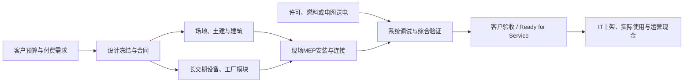

# 数据中心土建、MEP与预制化交付：增长、履约能力与价值分配研究

**研究截止：2026年10月10日。** 主要观察期为2025年、2026年截至已公布的月度/季度资料；前瞻重点为2027—2028年，2030年用于检验长期建设路径。金额保留来源币种；模型统一用**十亿美元（US$bn）**，1十亿美元=10亿美元。容量均注明是否为IT负载、在建存量、全年施工工作量或可验收交付量。

**证据标识：**【事实】政府统计、财报或已发生事项；【目标】管理层指引、路线图及机构预测；【计算】对原始数值进行直接运算；【推断】本报告的机制判断或条件模型；【未知】现有公开资料不能识别。模型区间均为**参数条件范围**，不是统计置信区间，情景代表值不是概率分布。

本次独立联网研究。本地研究输入限于 `基本面/产业背景/结果/` 内资料，主要以《数据中心建设规模_2026-10-10》及相关电力、建设约束背景作为待核验线索；目录规则仅用于确定工作边界。本文没有把本地其他公司报告、行业调研或排序作为证据。主要结论追到外部原始披露。

## 1. 核心发现与判断边界

**行业正处于建设工作量显著增长、系统交付能力重新分工的阶段。最有证据的机会是能够按客户标准交付高密度电气、液冷管网和完整模块的组织能力；持续利润取决于合同责任、重复设计、人员效率和付款条件。** 现场施工繁忙、设备重要、客户缺容量，均不足以单独证明每家承包商会扩大利润。

决定这一判断的证据及数值边界如下。

| 核心发现 | 决定性证据及性质 | 经济含义与主要限制 |
|---|---|---|
| 美国建设需求已兑现为实物工作量，而非只停留在园区公告 | 【事实】2026年1—8月私人数据中心建设支出45.226十亿美元，2025年同期31.920十亿美元，增长41.7%；8月季调年率84.950十亿美元。公开于2026-10-01 | 安装施工收入基础扩张；季调年率不是全年实际收入，施工支出也不是已通电IT容量 |
| 大型客户承诺与现有供给仍存在结构性错位 | 【事实】CBRE美国八大市场2026H1在建7,481.1MW，80.4%预租；现有库存10,903MW、空置率1.4% | 约6,014.8MW在建已有承诺，但期限、信用、送电和验收条件仍决定兑现。样本不覆盖全部自建园区 |
| 高密度化改变分池，不能统一套用“AI支出增长率” | 【事实】T&T同IT容量的美国项目比较显示液冷AI建设造价溢价7%—10%；【推断】本报告成本结构模型显示机械投入增加明显，土建占比下降 | 液冷工程、洁净管网与调试受益；单位MW建筑面积和部分传统电气内容可能下降。成本分池参数比政府统计的可信度低 |
| 承包商利润方向已经分化 | 【事实】EMCOR 2026Q2电气分部经营利润率13.9%，上年11.8%；机械分部12.5%，上年13.6% | 机械收入增长同时利润率下降，披露原因包括低毛利的总承包/施工管理及GMP成本加成合同组合变化 |
| 预制化已有合同、工厂和现场采用，行业占比仍不能直接识别 | 【事实】Comfort Systems德州模块业务在手订单同比增量1.87十亿美元；2026H1为模块扩张购置建筑物188.9百万美元。Mercury德国厂2026年4月开业；中建安装已向马来西亚发出冷源输配方舱 | 可付费采用与资本投入得到确认；工厂面积、宣传节省比例、单家公司模块收入均不能当作全球年交付MW或行业利润 |
| 客户提前付款可以改善供应商融资，但不能重复计作经营收益 | 【事实】Comfort Systems 2026H1经营现金流1.528254十亿美元；现金流表中超额开票及递延收入贡献1.061506十亿美元 | 订单快速增长时现金可以先于交付进入；增速放缓、合同取消或客户付款条件改变时，现金表现可能逆转 |

出处：[Census未季调表](https://www.census.gov/construction/c30/pdf/priv.pdf)、[季调表](https://www.census.gov/construction/c30/pdf/privsa.pdf)、[CBRE H1 2026](https://www.cbre.com/insights/books/north-america-data-center-trends-h1-2026)、[T&T原始新闻稿，2025-11-05](https://www.turnerandtownsend.com/news-old/ai-data-centre-rush-raises-alarm-over-construction-supply-chain/)、[EMCOR Q2披露](https://emcorgroup.com/investor-relations/press-releases/2026-news/emcor-group-inc-reports-second-quarter-2026-results)、[Comfort Systems Q2 10-Q，现金流表及MD&A](https://www.sec.gov/Archives/edgar/data/1035983/000110465926086258/fix-20260630x10q.htm)。

**规模结论。** 美国2026全年已安装建设支出，本报告按年内实绩和剩余月份估算为**74.0—81.2十亿美元**，代表值78.8十亿美元。全球同类设施建设与交付支出的条件估算为**127.6—213.8十亿美元**，代表值167.7十亿美元；全球外推最敏感的参数是美国支出占比，不能将这一数字称为全球统计实绩。基准路径下2027、2028年全球建设支出代表值分别为198.7、236.8十亿美元；相应参数范围149.6—252.8、153.0—332.2十亿美元。悲观与乐观路径、机械/电气/土建和预制子池均保留在第7节及附录A，不能只引用基准代表值。

按明确扣除可辨认成套OEM设备转售的边界，2026全球MEP施工、材料加工与系统集成净收入池代表值约46.7十亿美元，工厂预制净收入子池约8.4十亿美元。后者的条件极值为2.4—20.7十亿美元，**不是已测得的行业规模上下界**：客户自购、承包商转售及OEM一体化交付的公开分类不完整，采用率亦没有全球普查。这一缺口影响供应商市场份额和利润池精度，不改变“预制化进入真实采购、但其节省未必全部归供应商”的方向判断。

**增长成立的必要条件：** 既有预算持续释放；实际开工和送电在同一区域形成连续项目；客户冻结可重复的模块接口；工厂、持证现场人员及系统调试团队同步扩张；付款与变更管理覆盖新增库存、返工和质保风险。利润扩张还要求中标价增速不低于全成本增速、工厂利用率提高、客户没有拿走全部效率收益。放量条件和利润条件并不相同。

**最强反面解释：** 当前繁荣可能主要是有限大客户的抢建及会计确认前移。建筑完成速度、芯片效率和标准化交付提高后，容量短缺会缓解，单位施工含量下降；高在手订单和现金流可能先达到峰值，工厂折旧与工程质保责任却继续存在。支持此解释的证据包括Microsoft部署周期改善、EMCOR机械分部利润率下降、Sterling收购后业务组合稀释利润率，以及客户直接采购工厂组件。反对证据是美国实际施工支出、已预租在建容量和跨地区原始合同增长。第9节给出区分这些解释的观察，而非把短缺视为永久状态。

## 2. 行业边界：客户购买的是可验收的设施功能

### 2.1 可加总的总池与嵌套子池

主责范围是数据中心园区内的场地、基础、建筑壳体、机械/电气/管道系统的建设与安装，及这些系统在工厂预制后的运输、安装、集成和交付。覆盖新建、扩建和资本性改造，涵盖云、AI、托管、企业自用及主权算力设施。训练园区是重要增量，传统云、企业迁移、区域推理与存量改造同样属于客户任务。

| 层级/统计对象 | 本报告处理 | 可否与建设总池相加 |
|---|---|---|
| 场地与土建、结构和建筑装修 | 园区内土方、基础、结构、壳体、道路/场地工程，计入总池B | 作为不重叠分项可加 |
| 电气安装包 | 建筑内及园区服务于数据中心的配电、备用电源安装、线缆/母线、控制与电气调试；包含包内OEM设备时保留毛包口径 | 与土建、机械等不重叠工项可加 |
| 机械与管道包 | 冷却设施安装、液冷二次管网、泵/阀/换热、消防、给排水、控制与调试 | 与电气等不重叠工项可加 |
| 总包现场管理、临设、设计协调与费用 | 模型单列费用池；含现场开销，绝非全部利润 | 可加；不能另把总包整份合同收入再次加上 |
| 扣成套OEM转售后的MEP净施工/集成池N | 从电气、机械包中剔除可辨认成套设备成本；保留施工材料、劳务、工程设计/加工及利润 | 是MEP毛包的子集，不能另加B |
| 工厂预制净收入池P | N中转移到工厂的设计、加工、装配、测试及模块集成 | 是N的子集；不能把P+N当成两项独立需求 |
| 开关柜、UPS、发电机、制冷机、CDU等OEM制造收入 | 本专题分析接口、交期及合同影响；制造产值和OEM利润由设备专题主责 | 包内已计入B的部分不得重复相加 |
| GPU/CPU、服务器、存储与网络设备 | 仅用于解释设施负载、预算挤占与接口变化 | 不属于本专题建设总池 |
| 场外发电、电网主干输变电、燃料供给 | 解释送电门槛和自备电源的项目责任；仅园区设施工程进入主池 | 不能将整个能源投资额并入本专题 |
| 土地交易、收购已建资产、债务再融资、多年租金资本化 | 区分资产转移、融资与新建实物工作量 | 不直接作为新增施工支出 |

【事实】Census建设支出“value put in place”按当期安装工作计量，含安装材料、劳务、承包利润以及部分设计、业主费用、建设期利息税费，排除土地、日常维护、服务器/机架等。它比部分造价基准的范围宽，也不等于供应商收款。因此本报告美国总池采用Census可审计边界；全球工程模型对场地及费用差异留出参数范围，**没有把不同口径调成一个精确相同的数**。[Census定义](https://www.census.gov/construction/c30/definitions.html)。

### 2.2 支付来源和失败成本

客户付钱是为了在指定地点、指定时间获得能够连续运行和通过验收的电力、热排放、空间、安全及可维护性。客户的真实经济单位是“符合设计和验收条件的IT MW × 可投入使用的日期 × 可服务的工作负载”，也可能是既有厅房能接纳多少个新密度机架。平方米、钢材吨数、施工人时是生产单位，不能脱离机架功率与系统规格成为最终需求单位。

超大规模云厂商由自身现金流、融资和资本预算支付自建；也会租赁第三方设施。开发商先投入建造，再通过长期租约和资产融资回收；客户的融资租赁资本支出可能与开发商建设预算对应同一栋楼。企业及主权客户可能购买新设施、改造存量或迁移到云。后一种迁移可能减少企业自建，同时增加第三方建造，不能将两端原预算都记成新增行业需求。

采购方通常是业主的全球建设/采购组织，使用方是设施运营与算力运营团队，验收还包括业主标准、调试代理、当地主管部门与设备厂商接口。停机、泄漏、误保护动作或晚交付的损失通常大于某个部件差价，但合同可能把一部分损失、工期违约金、性能保证和质保移交给集成商。负责系统风险的公司可以获得高于普通劳务队的议价能力；若责任边界和变更定价不清，也可能承受不对称损失。

## 3. 需求：实物施工、客户资本预算与采用必须同时看

### 3.1 美国数据是当前最可靠的需求锚点

【事实】2026-10-01发布的Census表中，1—8月累计45,226百万美元，相比2025年同期31,920百万美元；8月未季调单月7,535百万美元。同期季调年率从4月61,859百万美元升至8月84,950百万美元，上年8月为49,052百万美元。后者同比73.2%与前八个月累计41.7%描述不同时间窗口，不互相替代。[Census累计与月度原表，第1页](https://www.census.gov/construction/c30/pdf/priv.pdf)、[季调原表，第1页](https://www.census.gov/construction/c30/pdf/privsa.pdf)。

【推断】按9—12月平均每月7.2—9.0十亿美元，全年为45.226+4×(7.2—9.0)=74.026—81.226十亿美元。代表值使用8.4十亿美元/月，得到78.826十亿美元。区间受已发生八个月约束；没有把8月84.950十亿美元的年率直接当成2026收入，也没有假定四季度一定继续月度加速。若后续统计修订或单月施工骤降，须更新全年值。

【事实】2026H1美国八大托管市场在建7,481.1MW，预租80.4%；【计算】预租约6,014.8MW、未预租约1,466.3MW。80.4%不是兑现概率：合同信用、RFS时间和取消补偿没有逐项公开。CBRE的八大市场覆盖Northern Virginia、Atlanta、Dallas-Ft. Worth、Chicago、Silicon Valley、Phoenix、Hillsboro、New York Tri-State；不代表美国全部数据中心。[CBRE，2026-08-27，2026H1](https://www.cbre.com/insights/books/north-america-data-center-trends-h1-2026)。

JLL对2025年末北美更广区域的调研包括40多个前沿市场，披露35GW建设管线、64%位于成熟市场以外。该口径与CBRE八大市场在建量不同，不相减来计算“遗漏市场”，也不把35GW当成一年可以验收的供给。[JLL北美2025年末报告新闻稿，页面日期2026-02-17](https://www.jll.com/en-us/newsroom/jll-north-america-data-center-report-year-end-2025)。

### 3.2 客户预算很大，设施工程只是其中一部分

| 客户与原始披露 | 经济期间及公开日 | 保留原值 | 本专题的解释 |
|---|---|---|---|
| Microsoft FY2026Q4电话会 | 截至2026-06-30季度；2026-07-29 | 【事实】季度资本支出41十亿美元，约三分之二是CPU/GPU等短寿命资产；【目标】2026自然年口径约175十亿美元，受到融资租赁向经营租赁转换影响 | 总capex不能全部映射成工程订单；会计分类改变也不能自动解释为物理投资缩减 |
| Alphabet Q2电话会 | 2026Q2；2026-07-22 | 【事实】季度capex44.9十亿美元；技术设施投资约60%服务器、40%数据中心及网络；【目标】2026全年195—205十亿美元 | 40%仍含网络设备；数据中心建筑与MEP份额低于或不同于该合计 |
| Meta Q2财报 | 2026Q2；2026-07-29 | 【目标】2026 capex含融资租赁本金130—145十亿美元，原指引125—145 | 新范围保留原值；不能再自行改写为“预测110—160” |
| Amazon Q2财报 | 2026H1及截至6月TTM；2026-07-30 | 【事实】H1现金购置物业及设备98.411十亿美元，出售/激励2.101十亿美元；TTM自由现金流为流出7.6十亿美元 | 含AWS之外设施及设备。使用现金实绩作资金压力锚点；未将媒体转述的最新capex总额作为本模型的原始确定值 |
| GDS Q2财报 | 中国持续经营业务；2026-08-13 | 【目标】2026 capex由约人民币90亿元增至约100亿元 | 单一开发商建设预算；与中国IT服务器采购、标准机架统计不能直接相加 |

来源：[Microsoft FY26Q4](https://www.microsoft.com/en-us/investor/events/fy-2026/earnings-fy-2026-q4)、[Alphabet官方Q2全文，第10、13页](https://s206.q4cdn.com/479360582/files/doc_events/2026/Jul/22/2026_Q2_Earnings_Transcript.pdf)、[Meta Q2](https://investor.atmeta.com/investor-news/press-release-details/2026/Meta-Reports-Second-Quarter-2026-Results/)、[Amazon Q2现金流表](https://ir.aboutamazon.com/news-release/news-release-details/2026/Amazon-com-Announces-Second-Quarter-Results/default.aspx)、[GDS Q2，业务展望](https://www.sec.gov/Archives/edgar/data/1526125/000110465926095498/tm2621440d1_ex99-1.htm)。

【计算】前三家公司自然年指引相加为500—525十亿美元，仍是公司总资本支出，不是建设市场。附录预算模型给其他买方留出独立条件参数；对融资租赁与开发商实体建设的重叠作扣减。融资来源真实且资金量大，支持当前基准继续施工的判断，但不能据此确认所有多GW园区都将在同一年开工或验收。

AI需求可以通过模型效率、芯片效率与使用量变化发生两条相反传导。单位任务计算需求下降、已有芯片利用率上升、存量机房液冷改造增加，都能降低每单位新增收入需要的新建MW。更低成本也可能打开视频、推理、代理及企业自动化需求，增加总体任务强度和地域部署。已观察到建设增长并不证明长期反弹效应必然压倒效率；需要同时看客户支付、利用率、收入兑现和新增容量采购，而非Token数量单项。

### 3.3 全球及地区证据支持“分化增长”，不支持一张统一短缺地图

【目标/估计】JLL于2026-01-05预计2025—2030增加97GW、2030达到200GW，隐含2025基数103GW；这是机构估计与预测，非政府核验的全球IT铭牌存量。其五年“约3万亿美元”包含约1.2万亿美元房地产资产价值及租户1—2万亿美元IT投入，不是本专题施工收入。[JLL全球展望](https://www.jll.com/en-us/insights/market-outlook/data-center-outlook)。

CBRE全球报告显示2026Q1欧洲四大市场空置率7.3%，APAC四大市场约7%，香港18%，Querétaro从上年0.9%升至10.6%。这些市场可以同时存在总体空置、某地点的大块连续电力稀缺以及不适用新AI规格的存量空间。不能拿美国八大市场1.4%空置推导整个全球无闲置。本次发现CBRE全球页称四大北美市场Q1吸纳2,236.2MW，而八大美国市场H1页为1,456.2MW，按通常同口径解释无法衔接。可能存在期间定义、覆盖、修订或页面错误，原文未足以澄清；本报告不拼接这两列做全球季度增长模型，供需检验采用范围明确的H1序列并保留这一证据缺口。[CBRE全球报告，2026-06-17，Q1地域样本](https://www.cbre.com/insights/reports/global-data-center-trends-2026)。

中国《全国数据资源调查报告（2025年）》披露截至2025年末已建成标准机架超过1,373万架。标准机架不等于高密度实体机架，更不等于已使用IT MW；不能与美欧MW相加。GDS 2026Q2在用面积利用率79.2%，在建面积170,355平方米、预承诺率89.2%，说明承诺和实际上架存在时差。本报告没有用平方米乘一个固定功率来伪造中国建设MW。[国家数据局报告，封面2026年5月、6月公开](https://www.nda.gov.cn/sjj/swdt/xwfb/0608/ff808081-9e81e648-019e-a78ceae4-00c3.pdf)、[GDS运营指标](https://www.sec.gov/Archives/edgar/data/1526125/000110465926095498/tm2621440d1_ex99-1.htm)。

【事实/目标】IEA 2026-04-16披露全球数据中心2025耗电485TWh、同比17%，2030中央预测950TWh。485TWh对应全年平均设施取电55.4GW，不能直接当作已建IT容量；还需PUE和平均IT利用率。若与JLL隐含103GW基数、PUE=1.2作诊断比较，平均IT利用率约44.8%，而非103GW全部满载。这只是口径兼容性检查，不是利用率实测，更不据此倒推出施工金额。[IEA报告执行摘要](https://www.iea.org/reports/key-questions-on-energy-and-ai/executive-summary)。

## 4. 技术与交付路径：从现场安装转向可重复的系统制造

### 4.1 高密度液冷：增量主要发生在接口、管路质量和系统责任

机架功率提高可以减少每MW白空间面积，但楼面荷载、地基、抗震/风洪设计、室外电力设施及存量加固又可能增加土建投入。本报告不把面积减少视为每个项目土建成本必降；场地条件另留宽范围。

液冷的经济影响不止增加CDU数量。设计需要定义设施水与技术冷却回路的边界、温度/流量/压降、冷却液与材料兼容、泄漏检测、控制、清洗、维护和故障工况。设备性能合格后，现场管路、控制与冷却负载仍可能成为不合格系统。能协调OEM、客户设施与IT验收的公司，获得的是系统责任和工程组织溢价。

【事实】OCP冷却二次管网预调试白皮书要求水压试验、清洁/冲洗、灌注准备及记录管理；文档范围并不包含全部CDU和机架调试。它强调施工后等待、积水与污染控制，较长闲置期间需要保存措施。【推断】当电网迟迟不能送电，已做好的液冷回路也可能需要维护、再清洗或再验证：早完成工厂模块，未必等于早取得可验收设施。冷却调试应与送电和IT上架排程联动，否则“提前施工”可以增加重复成本。[OCP白皮书，封面2025-01-27、版本1.0记录2025-03-17，第10—12、27—29页](https://www.opencompute.org/documents/ocp-document-submission-guidelines-for-pre-commission-preparation-of-technology-cooling-system-tcs-row-manifolds-revq-pdf-1)。

不同客户路线也不唯一。【事实】Meta在2025-09-29介绍Catalina GB200约140kW计算机架，并以两个计算机架配四个AALC冷却机架构成六机架单元，支持缺少设施级液冷的既有环境。【推断】这种方案保留部分既有建筑和空气侧设施，可能替代一次性全楼液冷改造；代价是占用更多空间及空气热排放能力。它说明高密度IT采用不必一律先建设完全相同的液冷园区。[Meta工程原文](https://engineering.fb.com/2025/09/29/data-infrastructure/metas-infrastructure-evolution-and-the-advent-of-ai/)。

### 4.2 预制化不是一种同质产品

| 路线与客户任务 | 采用与商业证据 | 能改变的经济变量 | 关键边界 |
|---|---|---|---|
| 支吊架、线缆/母线、管段与机电架预装 | 成熟工程方法；DPR、M.C. Dean等在真实项目和制造体系中采用 | 减少现场人时、拥挤与变异，提高重复项目效率 | 原料和部件仍需采购，最终连接与系统测试无法省略 |
| 电力房、冷源输配、泵/换热模块 | 中建安装2026-05-14披露首台出口；另7台当时在制造中；Mercury德国工厂4月开业 | 工厂与土建平行作业、可前置测试，跨区域共享制造人员 | 航运、超限运输、当地电气/消防规则、接口与质保责任 |
| 白空间/机架服务组件 | Compass与Schneider于2025-09-09推出预制白空间模块；Meta大型项目直接采购MOFE组件 | 采购入口可能转到业主及OEM联合设计，减少多层转售 | 产品发布不等于整个园区已缩短周期，收入归属随合同变化 |
| 集成功率、冷却和数字编排的大模块 | Vertiv OneCore与Hut 8合作，2026-02-26发布 | 系统设计、数字孪生和工厂测试更集中；缩短部分现场路径 | 宣称节省还缺多客户同规格完工审计、年度产能和净利润验证 |
| 园区全过程工业化交付 | DPR大型园区设计—采购—工厂—现场协作已有案例 | 有机会减少设计释放与现场接口等待，突破当地施工队规模 | 总工期受电力、审批、地基、天气和验收影响，模块比例不能等同总工期节省 |

来源：[DPR设计到交付，2026-01-21，更新02-13](https://www.dpr.com/media/blog/design-to-delivery-integrated-strategies-power-mega-projects)、[M.C. Dean精益制造](https://www.mcdean.com/standardizing-manufacturing-for-rapid-modular-delivery/)、[中建安装方舱原始披露](https://inco.cscec.com/xwzx_new_41667/gsyw/202605/3943732.html)、[Mercury工厂，2026-04-08](https://www.mercuryeng.com/2026/04/08/mercury-scales-delivery-across-europe-with-opening-of-e25-million-offsite-manufacturing-facility-in-schonebeck-germany/)、[Schneider/Compass公告](https://www.se.com/us/en/about-us/newsroom/news/press-releases/compass-datacenters-and-schneider-electric-announce-prefabricated-white-space-module-to-accelerate-data-center-delivery-timelines-68af2d56cbd7ebbcda05501d/)、[Vertiv/Hut 8公告](https://www.vertiv.com/en-in/about/news-and-events/news-releases/2026/vertiv-industrializes-ai-deployment-with-digitally-orchestrated-infrastructure-collaborates-with-hut-8-to-scale/)。

中建安装披露其方舱工厂预制率≥95%，现场工期缩短60%—90%，单套现场人工从15—20人天下降至5—8人天，单台制冷成本下降15%。这些是供应商针对该方舱的性能与工程效果主张，缺少客户独立审计；没有外推为全部数据中心工程降低15%或工期降低90%。同样，Vertiv关于时间最高减少50%、TCO最高下降25%的产品主张，本文列为待验证目标，没有进入全行业基准节省率。

【事实】DPR Abilene项目约400万平方英尺、八栋建筑，披露高峰现场约8,500人；钢结构从设计释放至到场约六周，对照其所称传统十二周。其Meta项目同时存在业主直接签约的工厂MEP组件。【推断】设计释放与规模采购能改善交付，但六周对十二周只是该钢结构环节，不代表整个园区工期减半。客户直接控制设计与模块采购，说明生产率改善的一部分价值可能被客户内化，而非由现场承包商永久保有。[同一DPR项目原文](https://www.dpr.com/media/blog/design-to-delivery-integrated-strategies-power-mega-projects)。

### 4.3 800V DC：新增工程机会与传统内容替代可以同时出现

【目标】NVIDIA 2026-08-11更新的800V路线区分2026H2混合式MGX电力机架、2027年行级电力中心及更长期原生800V/固态变压器路径。混合方案旨在与现有AC环境兼容，不能写成2026年所有新楼必须重建为原生800V。[NVIDIA官方路线图](https://blogs.nvidia.com/blog/800-vdc-power-architecture-ai-factory/)。

【推断】减少转换级数、改变交流配电拓扑，可能降低部分传统UPS/AC配电内容，却增加直流保护、隔离、接地、线缆、控制与验证工程。对OEM制造收入与施工收入的影响也不同。开放接口能扩大合格供应商集合、压低客户切换成本；更高系统集成度也可能让平台厂商掌握设计认证与总责任。基准情景采用“兼容方案逐步进入”，没有预设原生800V在2028已获得全面规模交付。第7.4节另列工业化突破子路径。

### 4.4 应检验的是净关键路径和全成本

工厂预制的客户回报来自减少现场施工占用、降低返工、抢在需求窗口前完成交付及提高部署确定性。施工并行化只有当现场环节位于关键路径、接口冻结和送电也具备时，才转化为较早上线。

Microsoft FY26Q4称最大区域GPU dock-to-live周期在该财年改善接近50%。这是GPU到站到可用的部署指标，不能当成土建工期减半；它又是“交付效率已在改善”的强反证，说明产能会对需求作出反应。[Microsoft，2026-07-29](https://www.microsoft.com/en-us/investor/events/fy-2026/earnings-fy-2026-q4)。

另一条高信息价值前沿是低碳采购。Schneider 2026-10-08对代表性5MW电力房与模块作生命周期示例，认为模块方案建造隐含碳显著减少。【推断】在客户用隐含碳筛选供应商时，可重复模块可能获得采购优势；材料边界、模块寿命及更换次数决定效果，不能将电力房示例扩为全园区运行碳或成本下降。当前没有据此增加建设预算或供应商利润。[Schneider生命周期分析](https://www.se.com/ww/en/insights/ai-and-technology/artificial-intelligence/can-prefabricated-data-centers-cut-construction-carbon/)。


## 5. 有效供给：施工工作量与可验收容量是两条供给曲线

### 5.1 组织能力比名义人数更重要

承包供给包括区域持证施工队、设计/BIM与协调团队、采购与物流、工厂装配、项目经理、设备厂商支持、调试代理和本地验收能力。某厂年产模块数量不等于能在指定州安装同等IT MW；某承包商在手订单也不等于客户不能取消、供应商有能力同时执行全部项目。

【事实】BLS截至2026-08-27更新的职业资料给出2025年美国电工就业821,000人，其中66%在电气承包商；【计算】相应约541,860人。典型学徒期4—5年，年度职位空缺包含退休及转岗替代，不应记为全部净新增电工。[BLS Electricians，2025就业基数](https://www.bls.gov/ooh/construction-and-extraction/electricians.htm)。

【事实】AGC/NCCER于2026-09-03发布对1,830家企业的夏季调查；28%过去12个月承接数据中心，其中58%感到招聘竞争、49%感到工资压力，37%认为数据中心是当地人力短缺最大原因。该调查支持区域争夺熟练工的判断，但不是按MW加权的产能普查。[AGC/NCCER原始调查摘要](https://www.agc.org/news/2026/09/03/construction-workforce-shortages-remain-acute-despite-soft-market-conditions-data-centers-strain)。

【推断】新增持证工人培养慢，其他建筑领域人员重新分配、跨地区施工和工厂预制可更快提升供应。与此同时，增加夜班、外来工住宿、差旅与管理跨度，会提高每个合格工时的成本。供给反应可以表现为工时效率提升和模块化，而非仅增加就业人数。

附录A用独立于客户预算的电工资源模型估算可承担的全年电气工作量。2026基准条件为行业承包商电工的9.5%可用于数据中心、每年1,600有效人时、每MW需12,000电气现场人时，对应6.86GW施工等效能力。7%—12%调配份额、1,500—1,700人时、9,000—14,000人时/MW的条件极值是4.06—12.28GW，区间很宽。**后两项没有行业公开普查，不是已确认的DC供给。** 它的价值是给出需求兑现所需的人力阈值，不能据其与施工支出“接近”反过来证明模型正确。

2027基准建设收入需要约7.29GW美国施工等效工作量，按底表生产率条件要求约9.1%的调整后承包商电工资源；2028基准需要8.21GW，对应约8.7%。因此基准路径并不必须依赖全国电工就业超常增长，关键是合格人员调配与现场工时下降是否实现。乐观2028需要12.02GW；若每MW工时仍为12,000而非9,000，其他乐观参数不变，条件电气能力从15.48GW降至11.61GW，开始不足。机械管路、控制和调试还要分别合格，不能拿这项电工能力代替完整系统能力。

### 5.2 项目关键路径：送电、系统合格和客户接受必须重合



图中的工厂与场地施工可并行；最后一道门不是“模块出厂”，而是电力、安装、测试和客户接受同时完成。项目电网延迟可以有三种经济后果：仍继续施工、承包商确认工作收入但客户尚未获容量；推迟后段MEP采购或安装，减少承包收入；或增设自备电源，将一部分支出转入电源设备与能源工程。不能统一写成“缺电对所有供应商利好”。

【目标/事实分类】IEA 2026年报告认为可靠自备燃气供电可能需30%—70%的容量冗余，所跟踪自备电源项目仅约五分之一处于场地清理或建设阶段。它对2030现场燃气15—27GW的区间是预测，不是2026可交付资源。本报告没有用公告燃气GW抵消当前送电缺口，也没有把SMR写入2027—2028基准供给。[IEA执行摘要](https://www.iea.org/reports/key-questions-on-energy-and-ai/executive-summary)。

### 5.3 美国八大市场的独立供需检验

需求侧从实际吸纳和预租承诺出发，供给侧从已在建群和其送电/验收比例出发，单位统一为**当年可接受/吸纳的新增IT MW**。这是可核验区域子市场，不是全美国或全球容量预测。

2026H1已发生吸纳1.4562GW；全年需求参照取2.6—3.4GW，中心约2.9GW。该年度范围是有季节性余量的研究外推，并非机械将上半年乘二后的统计实绩。2027—2028需求区间体现租赁预算、AI/云采用与部分效率替代；供给区间的转换率均是条件参数，需要项目清单验证。

| 目标年/路径 | 需求侧年度新增吸纳要求，GW | 供给侧独立条件与年度可验收量，GW | 联合判断与价格方向 |
|---|---:|---|---|
| 2027 悲观：预算放缓 | 2.4—3.0 | 2026H1在建7.4811GW中当年完成25%—40%，另0—0.2GW较晚开工项目：1.9—3.2 | 总量可能平衡，地点/规格仍有缺口；空闲施工队和未预租项目会承受压价 |
| 2027 基准：承诺兑现、局部延迟 | 3.2—4.0 | 原在建群当年完成38%—55%，另0—0.4GW：2.8—4.5 | 区间重叠，不支持断言全面过剩或全面短缺；低端转换率意味着租赁与RFS继续紧张 |
| 2027 乐观：采用加快、供给同时扩张 | 4.2—5.3 | 原在建群当年完成50%—70%，另0—0.6GW：3.7—5.8 | 需要高转换率和少量新群交付；施工设备/工资可以上涨，租户也可能获得更好的供给选择 |
| 2028 悲观：需求回落、在建消化 | 2.0—2.8 | 假设2027末独立在建库存6—8GW，2028兑现30%—45%：1.8—3.6 | 个别地点紧张与部分设施闲置并存；重复投标和工厂低利用率风险上升 |
| 2028 基准：平台化交付形成 | 3.8—5.0 | 假设2027末在建9—12GW，兑现35%—50%：3.2—6.0 | 客户可获得更多新增容量；供应商高利润需要效率而非只依赖短缺 |
| 2028 乐观：持续扩建、基础设施释放 | 5.5—7.5 | 假设2027末在建13—17GW，兑现40%—55%：5.2—9.4 | 年度交付可能追上需求，边际租赁涨价会减弱；较大工程工作量仍可支持收入增长 |

2027对原在建群的比例是该群在目标自然年内的流量，不是累计完成比例；另须给2026H2交付留出15%—25%等条件余量，极端组合不能使累计交付超过该群7.4811GW。2028用独立期末在建库存接续，**不把原群再次完整计入供给**。期末在建库存本身是低信度的新增开工/项目推进条件，未从目标吸纳量倒推出来。

【计算】不计新群，2027基准需求3.2—4.0GW需要原群在这一年完成42.8%—53.5%。若只能完成35%，原群贡献2.62GW，对应0.58—1.38GW需求缺口；即使全国施工人数增加也不能补偿未送电项目。这个比例是本报告研究阈值，不是行业规范或项目验收标准。

当前最有根据的联合结论是：**可用容量在美国主要市场仍紧张，安装工作量的全国供给则能够响应，约束具有地点和阶段差异。** 2027现有在建群转为RFS的速率，比再公布多少GW园区规划更能决定客户缺口和价值分配。全球没有统一的合格交付台账；本报告不声称已独立计算全世界的RFS供给总数，非美国地区的这一缺口是全球支出兑现率范围较宽的主要原因。

### 5.4 价格与成本：短缺需要经过合同才变成利润

【事实】T&T 2025调查显示传统数据中心建设造价平均通胀5.5%；同容量美国AI液冷溢价7%—10%。其2025城市基准为Tokyo 15.2、Singapore 14.5、Silicon Valley 13.3、London 12.0、Frankfurt 11.6美元/W；数值等价于百万美元/MW，地域、规格和边界并不完全相同。[T&T原始发布](https://www.turnerandtownsend.com/news-old/ai-data-centre-rush-raises-alarm-over-construction-supply-chain/)。

【目标】JLL从2025全球平均10.7百万美元/MW预测2026为11.3百万美元/MW，列为shell-and-core并将IT fit-out另列。因此它是造价锚点，不是可直接覆盖全部场地、业主费用及IT的成交价。[JLL造价说明](https://www.jll.com/en-us/insights/market-outlook/data-center-outlook)。本报告美国混合设施工程价格12.3百万美元/MW、全球12.0百万美元/MW是补充场地范围后的工作参数；不是另一条已披露均价。

CBRE租金上涨数据是规定容量和冗余条件的**asking rent**，不能证明承包商已取得同幅度中标价上涨，也不能替代折扣、免租、通电条件和保底利用条款后的净租金。[CBRE定价口径](https://www.cbre.com/insights/books/north-america-data-center-trends-h1-2026)。

合同定价传导依次经过设计锁定、投标/采购、合同签订、变更、进度确认和最终结算，时间通常跨季度，大型群跨年度。固定价合同可保留材料采购和工时节省，也承受工资、关税、规格反复和返工；成本加成/GMP合同更能分担成本波动，但管理费率或毛利率可能较低。存量高价订单继续确认收入时，新投标已可能降价；同样，成本已上涨但既有固定合同无法即时转嫁。第7节价格/成本指数是同规格、同地域的**情景参数**，没有用综合造价变化冒充可比成交价变化。

## 6. 价值捕获：系统责任、现金条件与制造效率共同决定

### 6.1 实际企业数据已经否定统一利润率假设

| 企业/边界 | 披露经济期间与日期 | 原始经营证据 | 可以支持与不能支持的结论 |
|---|---|---|---|
| EMCOR，美国电气/机械分部，含其他行业 | 2026Q2；2026-07-30 | 电气收入1.662501十亿美元、经营利润率13.9%；机械2.300873十亿美元、12.5%。上年利润率分别11.8%、13.6% | 电气与机械利润走势分化；数据中心并非全部分部业务，不能称行业平均 |
| Comfort Systems，全公司MEP及其他项目 | 2026Q2；2026-07-23 | 收入3.265656十亿美元、毛利率25.9%，上年2.173319十亿美元、23.5%；同店收入增长43.8%；在手订单14.06十亿美元 | 收入与毛利率扩张已有兑现；毛利率不等于经营利润率；收购与同店分别观察 |
| Sterling，E-Infrastructure分部 | 2026Q2；2026-08-03 | 收入0.905001十亿美元，同比增长192%；GAAP经营利润率23.3%，上年27.0%；全公司新增收购收入250.8百万美元 | 原有场地业务扩张与收购机电后的业务组合同时影响结果，不把192%当成同规格土建需求增长 |
| Turner/ACS，总包及综合交付 | FY2025公告2026-03-03；Q1 2026公告05-12 | Turner 2025收入29.2十亿美元、在手订单44.3十亿美元，约37%订单为数据中心；2026Q1 EBITDA率3.9% | 大总包拥有采购、设计与现场组织入口；EBITDA率、其他公司的EBIT率、工项管理费率不可直接排序 |

来源：[EMCOR Q2](https://emcorgroup.com/investor-relations/press-releases/2026-news/emcor-group-inc-reports-second-quarter-2026-results)、[Comfort Systems Q2公告](https://www.sec.gov/Archives/edgar/data/1035983/000110465926086255/fix-20260723xex99d1.htm)、[Sterling Q2公告](https://www.strlco.com/news/sterling-reports-record-second-quarter-results-and-raises-full-year-2026-guidance/)、[Turner 2025公告](https://www.turnerconstruction.com/insights/turner-achieves-record-revenue-and-backlog-in-2025)、[ACS Q1公告](https://pressroom.grupoacs.com/en/news/acs-group-increased-its-net-profit-by-21-5-to-232-million)。

EMCOR的机械分部明确把利润率下降部分归因于更多总承包/施工管理，以及新地域和变化范围采用的GMP成本加成合同。其截至2026-06-30美国电气、机械RPO合计15.638556十亿美元，其中未来一年部分11.663457十亿美元，约74.6%。RPO确认期是工程收入窗口，不是电力或IT上线窗口；订单也不是不可取消的永久收入。[EMCOR 10-Q，分部和RPO](https://www.sec.gov/Archives/edgar/data/105634/000010563426000110/eme-20260630.htm)。

Sterling将有签约的在手订单4.3336十亿美元与包含约1.28十亿美元未签约项目的combined backlog分开。本报告只把前者作为较强承诺证据，未签部分保持原性质。其mission-critical订单也包含半导体等工业项目，不等于纯数据中心收入。[Sterling原始披露](https://www.strlco.com/news/sterling-reports-record-second-quarter-results-and-raises-full-year-2026-guidance/)。

### 6.2 三条能够解释利润分化的机制

**施工专业化与总责任的交换。** 专业承包商对高难度系统熟练，可享受人员复用和工程经验；升级成总包后收入可能大幅增加，但更多收入只是转售设备及其他分包，同时承担更广工期、库存和违约风险。技术重要性上升，不保证每一美元综合收入有更高利润。

**工业化把劳动从现场转到工厂，但并非自动消灭成本。** 工厂可以统一工装、检验和材料采购；需要建筑物、设备、产品工程、数字BOM及连续订单。厂房面积只证明固定资产增加。客户改型、地区规范和运输约束仍可能使每个模块成为半定制工程；若订单暂停，原先按高利用率测算的成本立即失效。M.C. Dean 2025-09-29披露其模块园区近年投入超过100百万美元、约700名现场员工；Mercury 2026-04-08披露25百万欧元工厂投资、13,000平方米生产空间。均未给出同规格IT MW年产量，本文不据此构造“全球模块产能已经翻倍”。[M.C. Dean原始公告](https://www.mcdean.com/m-c-dean-announced-first-director-of-product-engineering/)、[Mercury原始公告](https://www.mercuryeng.com/2026/04/08/mercury-scales-delivery-across-europe-with-opening-of-e25-million-offsite-manufacturing-facility-in-schonebeck-germany/)。

**采购入口可以绕过原有工程层级。** 大客户自定设计、直接向工厂采购，再委托现场安装，能够拿走标准化收益、减少转售加价。综合OEM以性能保证、成套认证和数字平台捆绑模块，可能控制接口和更大包件。承包商要保留价值，需要掌握跨OEM系统责任、现场闭环和多项目交付，而非只拥有一座装配厂。DPR的MOFE案例支持这一采购变化，并不证明所有客户都将改为相同模式。

### 6.3 现金增长有真实价值，也有时间属性

Comfort Systems 2026H1全公司经营现金流1.528254十亿美元、购置固定资产0.288837十亿美元、出售固定资产0.002132十亿美元，按公司定义自由现金流1.241549十亿美元。现金流表中超额开票及递延收入流入1.061506十亿美元，已排除收购处置的现金流影响；它与资产负债表合同负债从2.120262增至3.231104十亿美元的差额不是同一个口径。[公司Q2公告现金流表](https://www.sec.gov/Archives/edgar/data/1035983/000110465926086255/fix-20260723xex99d1.htm)、[10-Q现金流表及合同资产负债](https://www.sec.gov/Archives/edgar/data/1035983/000110465926086258/fix-20260630x10q.htm)。

【计算】仅移除上述1.061506十亿美元时点流入，1.241549−1.061506=0.180043十亿美元。**这不是“真实自由现金流”或标准化利润**：同期应收等还占用了现金，其他营运项目也受项目周期影响。这个压力演示说明，不应把预付款重复视为利润，亦不应把它认定为没有价值——客户融资减少供应商资金占用，确实提高有序扩张的可行性。

同一10-Q披露2026Q2以往已部分履约合同估计变化正向影响收入7.7%，上年4.4%。该比例是累计追认性质的收入调整，不能写成当季涨价7.7%、利润率增加7.7个百分点，或直接全部删除为不经常利润。应观察后续项目最终结算及反向调整，而非把某季高利润率直接长期外推。

增量经营现金可表达为：
`税后经营收益 + 非现金折旧 − 必要再投资 − 应收/存货/预付款增加 + 合同负债增加`。
扩厂、跨地区进场与长交期设备预付会占用资金；业主预付款、设备客户自购和按月支付能缓解。第7节用固定口径模拟现金传导，附录B对同一座工厂保留爬坡、折旧、更新、寿命和残值。没有用合并公司的高毛利率直接估全行业ROIC。

## 7. 联合模型与情景：增长路径可以把利润交给不同参与者

### 7.1 数值如何得到

模型采取三个相互约束但未混同的入口：

1. **当前施工实绩锚点。** 美国Census年内实绩外推2026全年；美国占全球设施施工金额的条件份额38%—58%，代表47%，得到全球B。份额参考JLL所描述美国约占全球容量45%的数量级，并允许建设增长、地区单价和存量/流量不同；**没有公开全球金额份额实测**。
2. **前瞻需求预算。** `D=K×ρ+E−L`。K为大买方年度可比较资本预算，ρ为其中本专题设施工程份额，E为未计入K的开发商及企业实体施工投入，L扣除融资租赁与业主/开发商同资产重叠。全部参数保留范围；未来K并非已发布公司指引。
3. **履约与价格。** `B=D×e`，e为预算与当年实物施工的转换系数，包含既有合同释放、支出排程与工期影响，不是项目通电率。存量在建释放时可以略大于1。单位造价从同边界基准、液冷组合及各工项投标价变化计算。美国全国人力模型与八大市场RFS转换门槛独立检查该路径能否实现。

2026财务侧宽区间检验取K=650—850、ρ=15%—25%、E=25—50、L=5—30十亿美元，D=92.5—257.5十亿美元；代表K=735、ρ=22%、E=35、L=15得到181.7。它与由美国实物工作外推的127.6—213.8有重叠，但宽到不能证明“全球已平衡”。它没有用于倒填美国工人份额或在建转化率。

**重要边界：** 全球B包括设备已安装的价值；N/P剔除可辨认成套OEM转售，仍包含管材、线缆及加工等投入，所以“净收入池”也不是增加值。所得经营利润是明确成本假设下的条件计算，非全行业会计统计。总包整单、专业分包收入、OEM设备制造、模块收入不能互相独立相加。

### 7.2 总池、价格和工作量的年度结果

金额为十亿美元；c为百万美元/IT MW；F是**全年施工等效IT GW**，`F=B/c`，不代表新建、通电或满载的新增GW。


| 年份/路径 | 全球可发包需求D | 全球已安装建设B：代表值〔条件范围〕 | 美国B代表值 | 全球/美国c代表值 | 全球F/美国F代表值，GW |
|---|---:|---:|---:|---:|---:|
| 2026 当前估算 | 另作宽区间检验 | 167.7〔127.6—213.8〕 | 78.8 | 12.00 / 12.30 | 13.98 / 6.41 |
| 2027 悲观 | 156.5 | 154.9〔113.0—205.4〕 | 74.4 | 11.97 / 12.27 | 12.94 / 6.06 |
| 2027 基准 | 211.4 | 198.7〔149.6—252.8〕 | 95.4 | 12.76 / 13.08 | 15.58 / 7.29 |
| 2027 乐观 | 272.2 | 245.0〔183.7—325.4〕 | 122.5 | 13.28 / 13.61 | 18.45 / 9.00 |
| 2028 悲观 | 110.8 | 97.5〔54.0—142.5〕 | 42.9 | 11.48 / 11.76 | 8.50 / 3.65 |
| 2028 基准 | 254.6 | 236.8〔153.0—332.2〕 | 111.3 | 13.22 / 13.55 | 17.91 / 8.21 |
| 2028 乐观 | 362.5 | 340.8〔241.7—441.0〕 | 167.0 | 13.55 / 13.89 | 25.15 / 12.02 |


表中建设金额是年度流量；复合项目横跨年份，F既包含新建工作，也包含资本性改造，因此**不能将F逐年累加到JLL容量存量**。2027/2028参数极值允许相当幅度延迟或效率替代，未为了使基准显得精确而缩窄。

### 7.3 细分池、单位价格、成本与经营兑现

下表仍以十亿美元计。S+电气毛包+机械毛包+费用池=B；N和P均为嵌套子池。括号内是同一组参数的条件极值，**不同列的极值不能同时相加**。这些范围比基准代表值宽得多，反映全球口径、工项组合及设备自购方式的不确定性。


| 年份/路径 | 场地/土建/建筑S | 电气毛包 | 机械毛包 | 总包管理/费用 | MEP净施工/集成N | 预制净收入P（N的子集） |
|---|---:|---:|---:|---:|---:|---:|
| 2026 当前估算 | 30.6〔17.3—51.1〕 | 80.1〔56.4—108.8〕 | 41.4〔27.7—58.8〕 | 15.6〔11.1—20.8〕 | 46.7〔24.3—79.6〕 | 8.4〔2.4—20.7〕 |
| 2027 悲观 | 28.0〔14.6—51.5〕 | 73.5〔47.7—107.9〕 | 39.1〔23.5—60.2〕 | 14.3〔9.2—21.1〕 | 43.3〔21.1—77.8〕 | 7.8〔2.1—19.5〕 |
| 2027 基准 | 34.7〔18.2—61.5〕 | 93.4〔62.4—131.4〕 | 52.4〔32.7—78.2〕 | 18.2〔12.1—25.8〕 | 57.7〔29.4—99.1〕 | 14.4〔5.3—31.7〕 |
| 2027 乐观 | 40.6〔20.9—75.9〕 | 113.2〔75.4—166.1〕 | 69.0〔43.3—106.5〕 | 22.2〔14.8—32.8〕 | 69.5〔34.8—125.3〕 | 20.9〔7.7—50.1〕 |
| 2028 悲观 | 17.5〔6.7—36.0〕 | 45.7〔22.3—74.6〕 | 25.3〔11.2—43.8〕 | 9.0〔4.4—14.8〕 | 28.1〔10.4—55.6〕 | 5.6〔1.0—15.6〕 |
| 2028 基准 | 39.8〔17.7—79.2〕 | 110.1〔63.2—171.6〕 | 65.4〔34.6—107.0〕 | 21.5〔12.3—33.5〕 | 72.1〔31.7—135.3〕 | 23.1〔7.0—56.8〕 |
| 2028 乐观 | 55.1〔26.6—101.1〕 | 153.8〔96.8—219.9〕 | 100.8〔60.1—150.9〕 | 31.1〔19.6—44.7〕 | 95.6〔44.9—168.4〕 | 38.2〔13.5—84.2〕 |


价格与成本以2026同规格、同地域=100。施工单位为同一工程规格的IT MW/相应包件工作量；预制单位为同一工厂集成工作包。价格是净中标/变现的假设，成本包括劳务、材料、项目管理和摊销；预制成本还受工厂利用率影响。**本次未取得可比真实合同报价序列，不能把这些指数称为实测价格预测。** 范围及公式列于附录A。


| 年份/路径 | 土建：价/成本 | 电气净施工：价/成本 | 机械净施工：价/成本 | 工厂预制：价/全成本 | 费用池：价/成本 |
|---|---:|---:|---:|---:|---:|
| 2026 当前估算 | 100/100 | 100/100 | 100/100 | 100/100 | 100/100 |
| 2027 悲观 | 99/102 | 99/104 | 102/106 | 96/110 | 99/103 |
| 2027 基准 | 104/103 | 105/104 | 108/106 | 102/100 | 104/103 |
| 2027 乐观 | 106/108 | 108/110 | 112/113 | 103/105 | 106/108 |
| 2028 悲观 | 95/100 | 94/101 | 98/103 | 90/120 | 95/101 |
| 2028 基准 | 106/104 | 108/106 | 112/109 | 101/98 | 106/104 |
| 2028 乐观 | 108/112 | 108/114 | 115/118 | 99/102 | 108/111 |


全成本与价格分别改变，体现收入扩大但利润收缩的可能。取2026常规土建/电气净施工/机械净施工/工厂预制的经营利润率工作参数8%/20%/18%/22%，以后按 `m=1−(1−m₀)×成本指数/价格指数` 计算，而非给每个情景统一套增长倍率。模型净收入比公开分部收入少了成套OEM转售，所以不能把其利润率与公司毛利率、总包EBITDA率直接比较。

以下“利润”和“现金”全部是**条件模型结果**，不是统计实绩或已发布业绩指引；范围缺口尤其大，不适合直接给公司估值。土建利润未包含总包或MEP利润；MEP利润包含P，不能再加一次预制利润。总包费用池利润因现场临设、采购代理和责任分配差异不单独推全行业值。


| 年份/路径 | 土建经营利润率/条件利润 | 常规电气/机械净施工利润率 | 预制利润率/条件利润 | MEP净经营利润（已含预制） | 净营运资本增加 | MEP现金条件结果 |
|---|---:|---:|---:|---:|---:|---:|
| 2026 当前估算 | 8.0% / 2.4 | 20.0% / 18.0% | 22.0% / 1.8 | 9.2 | 当前行业余额未知 | Δ营运资本未知；不估统计FCF |
| 2027 悲观 | 5.2% / 1.5 | 16.0% / 14.8% | 10.6% / 0.8 | 6.3 | 1.8 | 2.3 |
| 2027 基准 | 8.9% / 3.1 | 20.8% / 19.5% | 23.5% / 3.4 | 12.2 | 1.1 | 6.3 |
| 2027 乐观 | 6.3% / 2.5 | 18.5% / 17.3% | 20.5% / 4.3 | 13.0 | 3.7 | 3.0 |
| 2028 悲观 | 3.2% / 0.6 | 14.0% / 13.8% | -4.0% / -0.2 | 2.9 | -0.9 | 2.8 |
| 2028 基准 | 9.7% / 3.9 | 21.5% / 20.2% | 24.3% / 5.6 | 15.9 | 1.4 | 8.3 |
| 2028 乐观 | 4.6% / 2.5 | 15.6% / 15.9% | 19.6% / 7.5 | 16.5 | 3.1 | 5.0 |


现金口径为 `0.75×MEP经营利润+1.5%×N−必要资本开支−Δ净营运资本`。税率25%、折旧占N的1.5%及净营运资本率都是工作参数；没有把客户新增预付款额外塞入模型。2027/2028同一路径连续滚动，具体参数在附录。2026净营运资本变化缺乏行业统计，不给虚假的当前FCF。

该模型的辨别力在于：2028乐观路径N为95.6，比基准72.1高约32%；MEP经营利润16.5与基准15.9相近，而条件现金5.0低于基准8.3。解释来自更高全成本、客户让利、更大扩厂投入和资金占用，**不是说行业增长越快就必然坏**。若实际预付款充分、工厂可以高效复用、工资压力小，乐观现金亦可能超过基准；敏感性底表允许这种反证。

悲观路径即使全球建设金额下降，预制占N比例仍可从18%提高到20%，但绝对预制净收入由8.4降至5.6，2028预制利润在代表参数下转负。技术渗透率上升和企业赚钱不能等同。

### 7.4 三条主路径及一个额外突破分支

**悲观：效率替代与资金纪律加强。** 客户在2027下半年起减少尚未安装的资本预算，利用已购芯片、存量改造和区域租赁满足任务；2028仍有在建收尾，但新工程补充不足。安装工作量下降，老合同收入延迟体现拐点，工资和固定成本下降更慢；工厂预制仍替代部分现场劳动，却可能低利用率。价值转向有可用现房、灵活人员和现金充足的买方；过早扩厂、重设备库存、缺少取消补偿的交付方承压。判别证据是同口径新增订单转弱、未安装设备退订、投标折价与预付款减少同时发生。

**基准：预算继续、交付渐进释放。** 高信用买方履行建设承诺，液冷项目比例增加；设计及工厂模块能够重复，送电与验收仍分地区延迟。产能响应使部分现场压力缓解，施工单价适度上涨但效率抵消部分成本。收入、利润与现金逐步增长，优势落在客户入口稳定、合同责任清楚、系统验收能力成熟的工程/模块团队。该路径由当前施工实绩、预租和真实承包合同最支持，绝非上下限平均。

**乐观：采用加速与供给释放共振。** 持续付费负载、融资和客户预算显著增加，电力、地区审批及跨区域人才/工厂响应同步改善。单位安装收入可以因标准化缓慢增长，物理工作量较大；加班工资、跨地区费用、厂房投入及客户议价又使单位利润受压。技术/工程量增长由供应商、劳务、OEM与业主分配，客户提前上线的收益不一定变成承包商长期溢价。

**突破分支：跨客户标准化的全过程模块交付。** 可跨越基准和乐观路径。成立须同时满足：至少两个独立大客户重复采用冻结接口；多个≥100MW项目有客户可核验的设计—工厂—现场—系统验收记录；提前交付发生于真实关键路径；OEM采购、当地审批和送电也可复制；返工/泄漏/保护验证没有抵消节省。某个模块供应商发布“最高节省”或一个案例成功，均不足以确认行业突破。

在2028基准物理工作量基础上作额外条件演示：若同规格设施总造价下降4%—7%、付费施工等效工作量再增10%—20%，全球B为**242.2—272.8十亿美元**，而非自动再提高建设单价。若MEP净工程单位收入下降8%—12%，N为69.8—79.6；工厂预制取得N的40%—50%，P为27.9—39.8十亿美元。若净MEP综合经营利润率仍为18%—25%，条件经营利润约12.6—19.9十亿美元，可能低于或高于基准15.9。

这些是额外参数条件范围，不是统计置信区间。仅把管段挪进工厂，无法支持全设施4%—7%节省；需要同时减少OEM接口/采购重复、现场返工和关键路径相关附加成本。若只是现场人时下降，总建筑收入甚至可减少，工厂业务增加亦不等于新增终端需求。

2030不再给伪精确的全细分金额预测。当前关键检验是2026—2030新增可用容量能否达到机构预测的约100GW数量级，以及其设施单位支出究竟被高密度技术抬升还是被工业化与效率压低。JLL的200GW容量与IEA的950TWh能源路径可作独立参照；任何超越这一路径的建设预测，都还需要新的付费采用、供电及连续项目证据。

## 8. 竞争地图：控制设计、资格与交付责任的人掌握入口

本图覆盖重要上市承包商、综合交付方、私营工程制造方、设备平台、买方及替代路线，未声称覆盖全球所有区域施工企业。没有可审计份额数据，不据项目名单制造市场份额排名。

| 位置/参与者 | 技术与经济位置 | 价值捕获机制、发展条件与未知 |
|---|---|---|
| Microsoft、Amazon、Alphabet、Meta；云与主权买方 | 资本预算、算力任务、设施标准及自建/租赁选择 | 标准化、自购设备和工程采购集中度可内化效率；实际AI回报与设施预算份额不完全披露 |
| Compass、QTS、Digital Realty、Equinix、GDS/DayOne等开发/运营方 | 土地/电力位置、客户租约、融资与扩建 | 获得更早RFS与较好设施利用率的收益；承担建设期资本、租户信用和残值风险，承诺不等于实际上架 |
| Turner/ACS、DPR | 设计协调、总包、采购、工厂和现场组织 | 跨项目执行平台、客户标准与供应链入口；高整单收入含分包/设备，系统责任扩大可能压低利润率 |
| EMCOR、Comfort Systems/TAS | MEP专业施工、系统集成、工厂模块、多区域团队 | 稀缺熟练组织、客户复购、变更管理与现金条件；分部/客户分类含非DC，不能用全公司数据测行业份额 |
| Sterling/CEC | 场地开发叠加电气与预制能力 | 能较早进入大型园区、服务连续项目；收购扩大可承接范围，也改变利润基数和资本结构 |
| Rosendin、Southland Industries等私营合作方 | 大型项目电气/机械专业交付；见DPR合作案例 | 专业人才、预制与现场闭环；缺少可比财务和跨客户产能公开数据 |
| M.C. Dean / Modular Mission Critical | 电力/控制工程、产品工程及模块制造 | 把复杂系统形成可重复产品；公开厂房投入不等于DC收入或交付MW，需要验证利用率和接口复用 |
| Exyte、Mercury、Winthrop等欧洲交付方 | 高技术设施设计/EPC、MEP及跨国现场组织 | 资格、地区规范、重复客户和制造枢纽；订单额、同时在建项目与年度完成额不同 |
| 中建科工、中建安装及相关中国区域承包方 | 中国园区土建/配套及机电，部分向东南亚输出模块 | 本地资质、场地与机电协同、属地履约和模块出口；海外验收、运输与工程责任仍需闭环 |
| Schneider Electric/Compass、Vertiv/Hut 8 | OEM设备与预制集成平台、白空间及完整基础设施模块 | 成套认证、系统保证、设备标准和数字平台；可能挤压独立设备转售/装配，性能宣传需完工验证 |
| NVIDIA MGX/800V体系及OCP接口生态 | 算力平台牵引设施规格、开放接口与资格路线 | 平台可影响投资去向和转换级数；OEM、客户与承包商共同承担保护和系统兼容验证 |
| 存量改造、AALC、分布式/企业推理部署 | 用已有设施或不同地域满足任务 | 新建土建被替代，局部MEP与改造增加；空间、电力、空气热排放、停机窗口决定可替代范围 |

对欧洲及中国的独立核验例子：【事实】Exyte于2026-06-11披露Frankfurt三项客户项目2026订单合计接近7.5亿欧元，非当年全部收入；Winthrop公开在建项目包括多个72MW、96MW建筑，未在本报告加总成一年交付能力。中建科工2026-08-04披露中国移动芜湖园区EPC开工，含机房楼、油机平台和110kV变电站，建筑面积约61,930平方米；未将其换算为IT MW。[Exyte合同原文](https://www.exyte.net/Newsroom/Exyte-secures-three-major-AI-driven-data-center-projects-near-Frankfurt)、[Winthrop在建项目](https://winthrop.ie/portfolio-category/current/)、[中建科工项目公告](https://www.cscec.com/xwzx_new/zqydt_new/202608/3954203.html)。

本图中的开发商信息见CBRE/JLL及GDS原始运营披露；DPR、Rosendin和Southland为同一项目合作链，不能算三条独立需求确认；Schneider与Compass、Vertiv与Hut 8各是联合发布，亦不重复加权。设备OEM的整机利润和区域小型分包份额未纳入利润模型，覆盖缺口明确保留。

## 9. 演进节奏、反证与概率判断

### 9.1 阶段有先后，不能用路线图跳过采用门槛

| 时间/阶段 | 可观察进展 | 仍要满足的下一道门 | 收入、利润和现金传导 |
|---|---|---|---|
| 2026：高在建与高预算、模块真实采购 | 已安装支出、正式订单、工厂投资及个别客户组件交付 | 送电、系统验证和连续付费使用 | 工程收入与预付款先形成；客户设施运营收益可能更晚 |
| 2027：设计冻结、供给爬坡与存量订单确认 | 同规格重复BOM、区域施工效率、原在建群完成率；混合800V路线进入工程验证 | 多地区验收、换代兼容、订单补充与员工技能 | 旧高价合同与新合同混合，利润率变化滞后；模块资本开支可以先压现金 |
| 2028：工业化与新定价方式可区分 | 工厂利用率、多客户重复交付、返工/漏液事件、单位现场工时与净价 | 实际关键路径缩短、长期复购、付款与质保匹配 | 效率可扩工作量，也可让采购方压低净价；订单放缓暴露固定成本 |
| 2029—2030：容量路径与任务回报检验 | 实际新增可用容量、利用率、租赁与客户回报 | 能源及地区布局可持续、替代架构兑现 | 短缺溢价可能消退；持续利润来自服务和制造效率，或转向平台/OEM/客户 |

这些时间是经济检验窗口，不是宣布行业必然在某季度出现拐点。某公司的钢结构交期改善、一个模块首发或一次整厅测试成功，只代表相应环节进展。

### 9.2 最强竞争性解释及区分证据

| 假说 | 支持它的现有证据 | 反对或限制 | 能区分假说的后续观察 |
|---|---|---|---|
| H1：主要是持续付费采用驱动的建设扩张 | Census实际施工、已预租在建、大客户capex和公开工程订单 | 客户回报与利用率不完全披露，签约不等于使用 | 同口径2027实物施工、新增订单及客户使用收入继续提高；区域RFS增加后仍被吸纳 |
| H2：抢建/预算前置，当前增速不能持续 | 资本支出压力、设备/场地提前布局、预收现金和估计追认 | 当期施工是已经发生的工作，不能用未知未来否定当前实绩 | 新开工/设备采购减少、订单补充低于结转、预付款停止增长，随后投标和工厂利用率下降 |
| H3：效率与预制缓解供给，利润转向客户 | Microsoft部署改善、业主MOFE、兼容存量路线、工厂制造投资 | 区域送电和高级调试仍不足；同量效率成果尚缺多项目审计 | 同规格人时与全成本下降、工厂出货增加，但净工程收入/MW或投标加价下降 |
| H4：高密度提高系统责任，工程溢价长期存在 | 液冷洁净/接口复杂、故障成本、资格与系统验收门槛 | 开放标准、客户自研与OEM整合能降低替换成本 | 高难度项目仍有复购和较好全成本差额，且工期/质量损失没有侵蚀现金 |
| H5：边缘/存量部署减少大园区土建，重塑需求 | AALC与改造可用、区域推理的经济动机 | 地点、网络、空气热排放与电力限制；新负载规模未确定 | 改造新增接纳功率、区域部署与大园区新建之间出现可比替代，客户单位任务设施支出下降 |

单看总订单或某家高利润公司无法区分这些假说。需要相同客户、产品、地域和期间的工作量、净价、全成本与现金同时变化。

### 9.3 概率只给可辨认事件，不制造三情景权重

以下是研究者的宽主观概率区间，不是统计估计；没有足够历史样本支持小数精度。三条代表路径可能在不同地区/参与者交叉发生，未设置合计100%的路径权重，也未把相关事件相乘。

| 事件、成功标准及目标期 | 概率性质与判断 | 依据、主要未知及更新条件 |
|---|---|---|
| 美国2027全年私人DC已安装施工支出比2026实际全年高至少10%，以Census后续同口径年度数据检验 | **无条件事件概率60%—75%** | 当前施工增长、正式订单与客户预算支持；工期与统计修订存在不确定性。若2027上半年累计下降、同店新增订单转负且预付款同步减弱，下调；若送电和在建兑现改善且新增承诺继续增长，上调 |
| 2028年底出现多客户、多个≥100MW项目的全过程模块交付，取得客户核验的同规格总设施成本下降至少4%、关键路径缩短至少20%，并有重复付费采用 | **给定预算延续、送电条件具备、客户接口冻结后的成功概率35%—55%** | 已有模块/大型项目合作提供可行线索，缺少多项目最终成本和质量审计。该条件概率不是行业无条件渗透概率；条件发生概率无法独立识别，故不换算为无条件概率 |
| 到2028，至少两个主要美国地区同规格MEP净投标价比2026低≥5%，同时该地区实际施工等效工作量高≥20% | **无条件事件概率25%—40%** | 标准化、工厂响应与集中采购可能造成量增价降；当前工资、系统复杂度和送电压力反对快速降价。需取得合同净报价和范围一致性，无法用asking rent或综合造价指数代验 |

第二项检验的是“重复工程与可验证经济结果”，不是“至少一个产品案例成功”；也不代表P达到全球N的40%—50%。行业规模渗透与供应商利润兑现分别检验。突破跨越基准/乐观机制，未给母情景权重，因此没有把它错误写成一个可与主路径权重相加的独立情景。

## 10. 尚未识别的关键问题及其具体影响

- **全球支出与合格产能没有统一台账。** 当前美国份额和非美国预算的条件外推可能偏离真实值；这使全球总池范围宽，不影响美国实绩本身。若取得按同IT容量、同设备边界的国家投资流量，应优先替换份额参数。
- **预制化采购分类不完整。** 同一电力房可计入OEM、总包、MEP或客户自购；净P当前占比是工作假设，无法据此给公司市场份额。报价净设备、交付地点和责任包件是最有效的补充资料。
- **单位人时及认证人才不足以全国统一量化。** 电工模型给出可实现门槛，不给“全国缺X万人”的结论；高级调试和当地持证限制可能使区域缺口大于全国汇总显示。
- **同规格真实成交价与单位成本缺失。** 造价基准与公司利润分化支持机制判断；价格指数、利润率及现金结果保持条件性，不能将它们写成已验证的行业ASP、行业利润或ROIC。
- **高密度技术的工程含量仍会变化。** AALC、混合/原生DC供电及未来芯片效率可能同时增加工作量、减少每MW内容，或更改设备/工程收入归属。需要按完整系统边界观察，不能只跟某个器件出货。
- **客户经济回报、租户信用和项目取消条件不完全可见。** 它们决定多年预算能否兑现，尤其是独立AI租户与自备电源园区；签约、预租和RPO各自保留限定，不被升级成确定现金。

研究判断应随这些可辨认证据更新：本报告支持当前建设扩张和更强系统交付需求；对于全球规模、长期溢价和模块制造利润，保留可复算的宽条件范围。将技术成果、付费采用、实际交付、经营利润与现金按时间连接，才能判断增长究竟由谁取得。


## 附录A：来源锚点、模型底表与复算方法

### A1. 现实基数与主观参数分开

| 参数 | 现实锚点/工作值 | 来源与可信度 | 主要敏感性和覆盖缺口 |
|---|---|---|---|
| 美国2026年1—8月已安装施工 | 45.226十亿美元；同期2025为31.920 | Census，2026-10-01；高，仍可能修订 | 不含土地/IT，不代表交付MW；目前不是全年 |
| 美国2026全年 | 74.026—81.226；代表78.826 | 本报告：45.226+4×(7.2—9.0)，代表后四个月8.4/月 | 冬季、项目节奏和统计修订；没有取8月SAAR当全年 |
| 美国占全球年度同类施工金额s | 38%—58%，代表47% | 本报告假设；JLL美国容量约全球50%×90%=45%提供数量级线索，金额份额未披露 | 每下降5个百分点，按当前美国代表值全球外推增加约20十亿美元；存量容量与年度施工不同 |
| 全球2026B | 127.631—213.753，代表167.715 | `美国施工金额/s`；条件估算，中低信度 | 美国以外大部分金额是外推；不制造地区分项精确统计 |
| 2026全设施工程价格c₀ | 全球12.0、美国12.3百万美元/MW | 工作参数；JLL全球11.3（预测）及T&T城市造价提供锚点，补充场地边界 | 基准来源不是相同国家/规格实际净价；全球9—15、美国9.5—16可作额外敏感性，不是报价范围统计 |
| 2026大买方预算K | 650—850；代表735十亿美元 | 三家已披露指引合计500—525，加其他买方量级与Amazon现金实绩约束；其余份额为假设 | 总公司预算、自然年/财年及租赁会计不完全可比；没有冒充已披露总额 |
| 预算设施份额ρ | 15%—25%，代表22% | MS短寿命/长寿命和Alphabet服务器/设施网络分解为线索；设施工程份额未独立披露 | 芯片/存储价格上升会挤压ρ，即使总capex上升 |
| 非重复施工E、重叠扣减L | 2026分别25—50、5—30；代表35、15 | 条件参数，非公开全球台账；只对实体新建/资本改造及同资产租赁重叠处理 | 无法逐项目识别租赁重叠；不能把债务再融资加入E |
| AI/液冷同IT容量成本溢价u | 7%—10%，代表8.5% | T&T原始新闻稿，同IT容量美国比较，2025-11-05 | 非所有地区、密度和土壤条件统一溢价；不加到IT fit-out |
| 液冷份额a、成套设备扣除φ、预制份额z | 见A3 | 工作假设；商业案例确认路线，未确认全球份额 | 这是细分池最弱输入，给宽条件范围，不报告为已测渗透率 |
| 全国电工供应基数 | 821,000×66%=541,860人（2025） | BLS，2026-08-27更新，高于未识别的人时假设可信度 | 不都是持相同地域资格的DC熟练工，不含其他MEP工种 |
| RFS在建群 | 美国八大市场2026H1 7.4811GW | CBRE，2026-08-27 | 多期存量；转换率与新开工/送电需另外验证 |

源链接及经济期间见正文相关事实和附录C。表中“高/中低”是证据性质说明，不是统一评分体系。

### A2. 需求预算与全年安装转换

代表参数（金额十亿美元）：


| 年份/路径 | K | ρ | E | L | e | 美国B占比s |
|---|---:|---:|---:|---:|---:|---:|
| 2027 悲观 | 650 | 21% | 35 | 15 | 0.99 | 48% |
| 2027 基准 | 870 | 22% | 40 | 20 | 0.94 | 48% |
| 2027 乐观 | 1030 | 24% | 50 | 25 | 0.90 | 50% |
| 2028 悲观 | 560 | 18% | 25 | 15 | 0.88 | 44% |
| 2028 基准 | 1020 | 23% | 45 | 25 | 0.93 | 47% |
| 2028 乐观 | 1350 | 25% | 65 | 40 | 0.94 | 49% |


对应参数范围如下。K×ρ只形成大买方设施预算条件值；E为其他实体施工，L扣同资产融资租赁/开发商重叠。2027悲观保留存量在建护航，e上沿可略大于1；到2028存量订单消化后，新增工程不足更明显。


| 年份/路径 | K范围 | ρ范围 | E范围 | L范围 | e范围 | s范围 |
|---|---:|---:|---:|---:|---:|---:|
| 2027 悲观 | 580—720 | 19—23% | 30—40 | 10—20 | 0.94—1.05 | 42—54% |
| 2027 基准 | 800—950 | 20—24% | 35—45 | 15—25 | 0.88—0.98 | 44—54% |
| 2027 乐观 | 950—1150 | 22—26% | 45—60 | 20—30 | 0.82—0.96 | 46—56% |
| 2028 悲观 | 450—650 | 16—20% | 20—30 | 10—20 | 0.75—0.95 | 38—50% |
| 2028 基准 | 900—1150 | 20—26% | 35—55 | 15—35 | 0.85—0.98 | 43—53% |
| 2028 乐观 | 1200—1500 | 23—27% | 55—75 | 30—50 | 0.86—0.98 | 45—55% |


`D_low=K_low×ρ_low+E_low−L_high`；`D_high=K_high×ρ_high+E_high−L_low`；
`B_low=D_low×e_low`；`B_high=D_high×e_high`；代表值采用代表参数，不取极值均值。

例如2027基准：`D=870×22%+40−20=211.4`，`B=211.4×94%=198.716`。2028基准：`D=1020×23%+45−25=254.6`，`B=254.6×93%=236.778`。这些未来预算与转换率为研究假设，没有将尚未公布的2027/2028公司指引当成事实。

美国未来B取全球B×s，其代表值与全国人力能力对照；它不是独立美国预算普查。非美国池为B−美国B，不能再加回总量。各极值相乘提供条件边界，并非各参数独立的概率分布；区域施工、人员与送电不足时，e/区间上沿必须下调。尤其高预算、低造价形成的最高工作量端点，还须满足更高人员和多区域验收阈值，**并未得到当前供给数据完整验证**。

### A3. 工项、液冷组合与净收入归属

以下空气/液冷工项拆分是**本报告采用的造价工作假设，不列为已核实披露事实**。可检索到的T&T 2025工项缓存与这组比例一致，但本次官方工项网址及其镜像均重定向到其他报告；稳定核验到的官方资料只足以确认7%—10%AI溢价和城市造价，不能确认全部工项表。保留原网址便于后续复核：[原工项页面](https://reports.turnerandtownsend.com/data-centre-construction-cost-index-2025/data-centre-cost-trends)。不以搜索摘要或同源转述作多源确认。

| 相同IT容量的标准造价工作结构 | 场地增项之前的建筑壳体 | 电气毛包（含OEM） | 机械毛包（含OEM） | 管理/现场费用 |
|---|---:|---:|---:|---:|
| 空气冷却工作参数w_air | 14% | 54% | 22% | 10% |
| 液冷工作参数w_liquid | 9% | 48% | 33% | 10% |

空气工程基准成本按1计，液冷为1+u。另加园区场地/土建外作业参数x=0.08（范围0.03—0.15），进入S；这项是相对空气基准造价的增项，不是对Census已安装金额再加一次费用。管理池包括临设、现场组织和费用，不等于纯利润。模型没有把土地和IT装机算进去。业主设计、建设期利息税费等Census与造价口径差异不能逐项识别，s及价格额外敏感性承担该误差，不能宣称精确对齐。

液冷技术组合与收入归属参数：


| 年份/路径 | 液冷工作量份额a：代表〔范围〕 | 电气净留存φE：代表〔范围〕 | 机械净留存φM：代表〔范围〕 | 预制占N的z：代表〔范围〕 |
|---|---:|---:|---:|---:|
| 2026 当前估算 | 40%〔25—55%〕 | 35%〔25—45%〕 | 45%〔35—55%〕 | 18%〔10—26%〕 |
| 2027 悲观 | 40%〔25—50%〕 | 35%〔25—45%〕 | 45%〔35—55%〕 | 18%〔10—25%〕 |
| 2027 基准 | 50%〔35—65%〕 | 36%〔26—46%〕 | 46%〔36—56%〕 | 25%〔18—32%〕 |
| 2027 乐观 | 65%〔50—80%〕 | 34%〔24—44%〕 | 45%〔35—55%〕 | 30%〔22—40%〕 |
| 2028 悲观 | 45%〔25—60%〕 | 36%〔26—46%〕 | 46%〔36—56%〕 | 20%〔10—28%〕 |
| 2028 基准 | 60%〔40—75%〕 | 37%〔27—47%〕 | 48%〔38—58%〕 | 32%〔22—42%〕 |
| 2028 乐观 | 75%〔60—90%〕 | 32%〔22—42%〕 | 46%〔36—56%〕 | 40%〔30—50%〕 |


a表示全年施工等效IT工作量中液冷项目的份额，不是全球AI工作负载份额，更不是已安装机架占比。φE/φM为扣除可辨认成套OEM后电气/机械毛包留在净施工、材料加工和集成的比例；成套设备剔除并未剔除全部原材料，所以N≠增加值。z是N中预制化设计/加工/测试的份额，现场连接与调试留在其余N。项目由现场转为工厂后没有创建第二份终端支出。

实际公司“模块收入”常含成套设备采购，且客户/非DC业务不分离，故不能拿Comfort Systems或OEM毛模块收入直接除以P来计算市场份额。这里宽范围是基于假设的条件分池，**不是从公开销售额反推已验证的全球P**。

工项价格指数见正文。代表情景将电气/机械毛包报价指数与其净施工变现指数取相同数值作简化；现实中设备与施工可以分离，须独立验证。净留存φ及净施工价格/成本范围允许不同归属，不将OEM报价变化视作劳务价同幅度变化。

复算定义（i分别为S、电气、机械、费用）：

```text
q_i = (1−a)×w_air_i + a×(1+u)×w_liquid_i + [i=S]×x
v_i = q_i × 毛包价格指数_i / 100
T = Σ v_i
B_i = B × v_i / T
c_US = 12.3 × T / (1+u×0.40+0.08)
c_global = 12.0 × T / (1+u×0.40+0.08)
F_US = (B×s) / c_US ; F_global = B / c_global
N_E = B_电气 × φE ; N_M = B_机械 × φM
N = N_E+N_M ; P = N×z
```

分母使用同一u下的2026代表a=0.40和x=0.08；代表u=0.085时分母1.114。一个百万美元/MW乘一个GW为一个十亿美元，单位相消，不需再乘一千。

例如2026电气原权重为`0.6×0.54+0.4×1.085×0.48=0.53232`，机械0.27522、建筑与场地0.20306、费用0.10340，合计1.114。全球167.7149×各权重/1.114，得到S30.5711、电气80.1418、机械41.4349、费用15.5671；N=80.1418×35%+41.4349×45%=46.6953；P=N×18%=8.4052。

**成本结构推论的限定。** 若上述拆分成立，空气转液冷且其他条件相同时：机械绝对投入比为`(1+u)×33/22`，增幅60.5%—65%；电气为`(1+u)×48/54`，下降约2.2%—4.9%；建筑壳体为`(1+u)×9/14`，下降约29.3%—31.2%。这是一组工程参数的推论，**不是本次取得的同规格实际分项成交统计**。主要含义是系统组合可改变子池；若核验后的结构比例不同，精确增幅必须更换。

子池范围采用B、u、a、x、φ、z的上下端点与价格扰动枚举。未来土建/电气/机械/费用毛包价指数分别允许代表值±3/4/5/3；预制净价允许±5。2026价格指数为固定归一化100，工项份额参数仍变化。各子池下沿/上沿由不同参数组合取得，不能把所有下沿或上沿当作同一个项目。

工项拆分本身缺少稳定官方核验，因此再保留结构敏感性：把任一毛包份额从另一包转移5个百分点，167.7十亿美元总池对应约8.4十亿美元工项重分配；其对N的影响约为转入/转出两包φ差额×8.4，而不是总池增加8.4。P还需再乘z。第7节的精确端点是在既定w结构下的范围，**结构重分配、严重履约损失及来源误差可能使真实值落在其外**。

全球造价锚点9—15百万美元/MW的额外敏感性，在其他量不变时使2026代表施工等效F变成11.2—18.6GW；合并总池端点则为8.5—23.8GW。它仍不等于新增投运量。物理供给检验优先使用美国和具体在建群，不把该等效量当全球验收总量。

### A4. 人力与验收供给的可审查门槛

`S_electric(GW)=541,860×J×α×h/ℓ/1000`。
J为承包商电工总资源相对2025的变化；α为其中可动员合格DC份额；h为有效生产人时，排除非生产时间；ℓ为每IT MW的现场电气施工人时。预制化及重复设计降低ℓ，工厂人员和资本另列；不把减少的现场人时与工厂总工时降低等同。


| 年份/路径 | J相对2025承包商电工基数 | DC可动员份额α | 有效人时h/年 | 电气人时ℓ/MW | 条件电气施工能力，GW | 对照需要的美国施工等效GW |
|---|---:|---:|---:|---:|---:|---:|
| 2026 条件底表 | 1.000 | 9.5% | 1600 | 12000 | 6.86 | 6.41 |
| 2027 悲观 | 1.000 | 10.0% | 1600 | 12400 | 6.99 | 6.06 |
| 2027 基准 | 1.025 | 11.0% | 1620 | 11200 | 8.84 | 7.29 |
| 2027 乐观 | 1.035 | 12.0% | 1650 | 10500 | 10.58 | 9.00 |
| 2028 悲观 | 1.000 | 9.5% | 1550 | 12000 | 6.65 | 3.65 |
| 2028 基准 | 1.055 | 12.0% | 1650 | 10000 | 11.32 | 8.21 |
| 2028 乐观 | 1.080 | 14.0% | 1700 | 9000 | 15.48 | 12.02 |


只有541,860的就业基数来自BLS；其余参数为条件假设，无已披露全国DC合格人时普查。它们必须由承包商项目工时、培训、持证调配和工厂替代效果验证。2026下/上条件采用α=7%/12%、h=1,500/1,700、ℓ=14,000/9,000，得到4.06/12.28GW，而不是宣称美国真实电工供给就在此已测区间。

对任一需求工作量F，必要门槛为`α_required=F×1000×ℓ/(541,860×J×h)`。这提供可行动的反证：2028乐观要实现12.02GW且ℓ仍为12,000时，α需约14.5%，高于该路径采用的14%；若只可调配10%，供给更不足。机械合格工、调试团队、运输和当地规范须另外过关。

八大市场RFS模型的现实初始群只有7.4811GW；2027转换率、少量新群及2027末在建量均是明确的条件输入，见第5.3节。价涨、毛合同金额增加或厂房面积增加均不能替代物理RFS供给。全国施工能力与该托管区域容量边界不同，不合计、不直接相减。

### A5. 利润、现金及主要敏感性

2026工作利润率m₀为土建8%、常规电气净施工20%、常规机械净施工18%、工厂预制22%；各自额外敏感性为4%—12%、12%—28%、10%—26%、12%—32%。它们用于检验同规格经营机制，**没有全球利润普查校准**。美国公开分部盈利提供正常优质履约的参照，但跨国、客户自购/转售及净收入边界不同，不能直接替换m₀。

`m_y=1−(1−m₀)×净施工全成本指数/净变现价格指数`；
`OP_N=(1−z)×(N_E×m_E+N_M×m_M)+P×m_P`；
`OP_S=S×m_S`。常规MEP与预制互不重复。

价格和成本范围可独立取值：土建成本±3、电气±4、机械±5、预制±8；价格范围见A3。若m₀偏低、成本上沿且价格下沿，利润可远低于代表值甚至转负；不能把代表值当成行业盈利保证。超出正常履约的事故、未获批变更、客户违约等尾部成本没有可识别的行业上界。

现金参数（N的口径不变）：


| 年份/路径 | 净营运资本/N | 必要资本开支/N | 折旧/N | 所得税率 |
|---|---:|---:|---:|---:|
| 2026 当前估算 | 10% | 3.5% | 1.5% | 25% |
| 2027 悲观 | 15% | 3.0% | 1.5% | 25% |
| 2027 基准 | 10% | 4.5% | 1.5% | 25% |
| 2027 乐观 | 12% | 6.0% | 1.5% | 25% |
| 2028 悲观 | 20% | 2.5% | 1.5% | 25% |
| 2028 基准 | 10% | 4.5% | 1.5% | 25% |
| 2028 乐观 | 12% | 6.0% | 1.5% | 25% |


2026营运资本余额工作值为10%×46.6953=4.6695十亿美元，只是滚动模型起点，不是行业资产负债表实绩。2027 ΔWC=w₂₀₂₇×N₂₀₂₇−4.6695；2028 ΔWC取同一路径前一年余额差。必要再投资κ包含制造设施、设备和更新，未另外重复添加工厂例子的支出。模型现金为 `0.75×OP_N+0.015×N−κ×N−ΔWC`，不包括并购、融资或股东分配；无统一行业FCF定义。

例如2028基准：OP_N=15.8754，N=72.1332，ΔWC=1.4398，现金=15.8754×75%+72.1332×1.5%−72.1332×4.5%−1.4398=8.3027十亿美元。

关键敏感性：

| 改变 | 同边界经济影响 | 如何验证 |
|---|---|---|
| 2028基准K上/下10% | ρ、E、L、e不变，B约上/下21.8十亿美元 | 大客户实际预算、项目现金与实物进度，剔除芯片价格导致的增长 |
| 2028基准ρ改变±3个百分点 | B改变约±28.5十亿美元 | 公司长寿命/服务器/网络拆分和工程采购，避免将总capex等同建筑 |
| 2028基准e改变±5个百分点 | B改变约±12.7十亿美元 | 安装进度与采购时点；不以项目通电率代替 |
| 2026全球外推s由47%变42%/52% | 同美国实绩，全球B约187.7/151.6十亿美元 | 获得其他国家同口径年度建设流量 |
| 2028基准预制z改变±10个百分点 | P改变约±7.2十亿美元，N和B不自动增长 | 客户采购包件与实际工厂工作归属；不是新终端支出 |
| 2028基准净营运资本率提高10个百分点，其他不变 | 多占用约7.2十亿美元现金，接近模型8.3的年度现金结果 | 应收、设备预付、付款周期、合同负债及质保保留金 |
| 2028乐观ℓ为12,000而非9,000人时/MW | 条件电气能力从15.48降至11.61GW | 同规格实测工时，不能用厂房面积或订单美元数替代 |
| 2027八大市场原在建群年完成比例仅35% | 原群贡献2.62GW，低于基准需求3.2—4.0 | 逐站送电/验收，确认日期而非公告开园年份 |

两类模型可以挑战彼此：预算增加但施工转化下降，需求未必成为当年收入；施工产能提升但新订单减少，供给也不证明需求会增长。模型没有以一方反推另一方来宣告平衡。


## 附录B：单位经济与同一资产现金回收

### B1. 100MW客户项目：提前交付价值不等于承包商可拿走的价值

本例均为工作假设，不是已披露项目合同。客户为出租设施业主，不混入GPU服务收入：100MW IT、设施工程12百万美元/MW，建设预算1.2十亿美元；按2026代表结构，MEP净施工/集成工作约334百万美元。假设其中90百万美元适合本项目工厂预制；该项目采用率高于全球代表18%，不可直接外推。

如果90百万美元包件降低10%—15%全成本，节省9—13.5百万美元，只占设施工程0.75%—1.13%。这解释了为何“模块节省15%”不能写成“园区省15%”。

业主另假设净设施租金120—180美元/kW/月、交付时可收费使用率80%、扣新增运行成本后的贡献率65%；上述租金是本例假设，不是把CBRE小容量asking rent转换成100MW成交价。提前三个月且确实位于关键路径，增量经营贡献为：
`100,000kW×(120—180)×3个月×80%×65%=18.72—28.08百万美元`。
仅是提前期贡献，未计融资、税和整个资产终身回收；若IT、客户需求或电力仍未具备，提前期贡献可为零。

供应商若通过合同取得这一时间价值的10%—25%，对应额外1.87—7.02百万美元；剩余归客户或其他参与者。这不是行业费率，也不能同时把全部客户收益记为供应商利润。规模桥梁是每100MW订单对应这些工作包，年度行业能交付多少重复100MW、多少真正提前，决定价值总量；单个成功项目不能证明全行业所有MW均有该回报。

### B2. 工厂资本回收：同一生产能力、同一资产边界

构造一座未命名的工厂/工程资产，用来检验“订单连续性是否决定工业化利润”。不复原M.C. Dean、Comfort Systems或Mercury的财务；公开扩厂金额仅提供投资量级线索，年产净收入和贡献率均为假设。计价为**百万美元**，区别于正文十亿美元。

共同条件：

- 2026年末初投100；满利用率年度净施工/集成收入300，剔除成套OEM转售，包含自产加工材料与工作。
- 经济寿命10年，经营期2027—2036；最初资产按10年直线折旧10/年。第5年另投入20更新工装、测试及产品工程，第6—10年新增折旧4/年。
- 每年必要维护资本开支4，每笔按5年直线折旧、次年开始，维护折旧由第1年的0逐步升至第6年的4/年。固定现金经营成本及贡献率分情景，见下表。
- 净营运资本为收入15%，第一年建立、随收入增加；第10年假设全部收回。终期资产出售10；初投与第5年更新资产折旧归零，未折完的维护资产账面余额12，出售形成2的账面损失，可在终年有正应税收益时抵税。
- 税率25%，只对正EBIT当期缴税；负亏损不假定即时退税。无杠杆，折现率10%；不计收购、债务和股东分配。

`R=300×利用率`；
`EBIT=R×贡献率−固定现金费用−折旧`；
`CF=EBIT−25%×max(EBIT,0)+折旧−维护资本开支−更新资本开支−ΔWC`；
终期另收回WC及10出售收入，终年税款按EBIT−2计且不低于零。贡献率不是毛包毛利率或全行业利润率，必须保持净收入边界。


| 指标/同一工厂（金额百万美元） | 悲观：订单不连续 | 基准：连续重复订单 | 乐观：更快爬坡、让利/加班 |
|---|---:|---:|---:|
| 第1/2/3年及以后利用率 | 30%/45%/55% | 50%/75%/90% | 70%/90%/95% |
| 扣直接变动成本后的贡献率 | 25% | 40% | 36% |
| 固定现金经营成本/年 | 25 | 25 | 28 |
| 成熟年度净工程收入 | 165 | 270 | 285 |
| 第6—9年年度EBIT | -1.75 | 65.00 | 56.60 |
| 第6—9年年度经营/投资后现金 | 12.25 | 62.75 | 56.45 |
| 10%折现率净现值（扣初投） | -70.2 | 207.9 | 189.2 |
| 无杠杆现金IRR | -1.8% | 36.4% | 35.4% |
| 未折现累计回收初投 | 10年内未回收 | 第4年 | 第4年 |


完整年现金如下，可复算NPV与IRR（最后一年已含WC回收、出售收入和相应税款）：


| 年份（2026投资，2027开始经营） | 悲观CF | 基准CF | 乐观CF |
|---|---:|---:|---:|
| 2026 / 第0年 | -100.000 | -100.000 | -100.000 |
| 2027 / 第1年 | -20.000 | 2.250 | 2.700 |
| 2028 / 第2年 | -2.000 | 36.200 | 41.600 |
| 2029 / 第3年 | 6.588 | 54.400 | 52.600 |
| 2030 / 第4年 | 11.287 | 61.350 | 55.050 |
| 2031 / 第5年 | -8.512 | 41.550 | 35.250 |
| 2032 / 第6年 | 12.250 | 62.750 | 56.450 |
| 2033 / 第7年 | 12.250 | 62.750 | 56.450 |
| 2034 / 第8年 | 12.250 | 62.750 | 56.450 |
| 2035 / 第9年 | 12.250 | 62.750 | 56.450 |
| 2036 / 第10年 | 47.000 | 113.750 | 109.700 |


该例显示：更快爬坡的路径可以有更高收入，却因让利、直接成本和固定费用高于基准，得到较低稳态现金与净现值；悲观路径在第3—5年仍可呈现正EBIT，必要更新及维护折旧增加后转负；10年现金仍不能收回初投。利润为正与资本回收是不同判断。

40%基准贡献率与90%持续利用率是强条件，不是公司实际指引；如果贡献率只25%或订单不能重复，结果大幅改变。残值和营运资本收回亦有信用风险。表中IRR不是行业ROIC；经济寿命、必要更新、现金爬坡和资产边界均已保留，不能据此宣称模块厂普遍有35%回报。


## 附录C：重要来源、公开日与经济期间

下列来源按原始主体列示；同一新闻、10-Q与公司电话会的重复转载不增加独立证据权重。事实按其经济期间使用，管理层指引及技术产品指标保持目标性质。动态PDF/网页可能继续更新；本文记录的是截至2026-10-10查得的数值和版本，不自动引用日后更新内容。

| 编号/原始主体与文件 | 公开日/版本 | 对应经济期间与本文用途 |
|---|---|---|
| C01 [Census私人建设未季调表](https://www.census.gov/construction/c30/pdf/priv.pdf) | 2026-10-01发布的2026年8月数据；第1页，滚动URL | 2026年1—8月、8月单月与2025同期；实物安装支出 |
| C02 [Census私人建设季调表](https://www.census.gov/construction/c30/pdf/privsa.pdf) | 同上；第1页，滚动URL | 2026年4—8月及2025年8月年率；不当作全年实绩 |
| C03 [Census建设支出定义](https://www.census.gov/construction/c30/definitions.html) | 网页未提供单一公开日，截止日查验 | Value put in place含/排除边界 |
| C04 [CBRE North America H1 2026](https://www.cbre.com/insights/books/north-america-data-center-trends-h1-2026) | 2026-08-27 | 八大美国市场2026H1库存、吸纳、在建、预租；asking rent的限定 |
| C05 [CBRE Global Trends 2026](https://www.cbre.com/insights/reports/global-data-center-trends-2026) | 2026-06-17 | 2026Q1各地区限定市场，地区空置与分化；未将不衔接的吸纳序列拼接 |
| C06 [JLL全球2026展望](https://www.jll.com/en-us/insights/market-outlook/data-center-outlook) | 2026-01-05 | 2025估计与2026/2030预测；成本、容量及IT/房地产价值分开 |
| C07 [JLL北美2025年末新闻稿](https://www.jll.com/en-us/newsroom/jll-north-america-data-center-report-year-end-2025) | 页面标题日期2026-02-17；正文末尾有2025年字样的不一致 | 年末2025，较广区域在建/建设管线范围；不与八大市场相减 |
| C08 [T&T Data Centre Construction Cost Index新闻稿](https://www.turnerandtownsend.com/news-old/ai-data-centre-rush-raises-alarm-over-construction-supply-chain/) | 2025-11-05 | 2025—2026版本；2025城市成本、传统成本通胀与同IT容量AI溢价 |
| C09 [T&T原工项页](https://reports.turnerandtownsend.com/data-centre-construction-cost-index-2025/data-centre-cost-trends) | 2025报告目录；本次原页及镜像重定向 | 工项缓存仅作线索，A3比例列为本报告工作假设，未升级为已复核事实 |
| C10 [Microsoft FY26Q4电话会](https://www.microsoft.com/en-us/investor/events/fy-2026/earnings-fy-2026-q4) | 2026-07-29 | 财年Q4截至2026-06-30；自然年预算、资本构成、dock-to-live指标 |
| C11 [Alphabet官方Q2电话会PDF](https://s206.q4cdn.com/479360582/files/doc_events/2026/Jul/22/2026_Q2_Earnings_Transcript.pdf) | 2026-07-22；第10、13页 | 2026Q2实际capex及2026全年原指引范围；服务器/设施网络拆分 |
| C12 [Meta Q2业绩公告](https://investor.atmeta.com/investor-news/press-release-details/2026/Meta-Reports-Second-Quarter-2026-Results/) | 2026-07-29 | 2026Q2及2026年度capex含融资租赁本金指引 |
| C13 [Amazon Q2业绩及现金流](https://ir.aboutamazon.com/news-release/news-release-details/2026/Amazon-com-Announces-Second-Quarter-Results/default.aspx) | 2026-07-30 | H1及TTM截至2026-06-30，物业设备支出与现金约束 |
| C14 [IEA Key Questions on Energy and AI](https://www.iea.org/reports/key-questions-on-energy-and-ai/executive-summary) | 2026-04-16 | 2025耗电与2030中央预测；自备燃气的冗余/推进与预测边界 |
| C15 [BLS Electricians](https://www.bls.gov/ooh/construction-and-extraction/electricians.htm) | 2026-08-27页面更新 | 2025就业及承包商比例；培训时间和空缺不能视为全部新增 |
| C16 [AGC/NCCER调查原始摘要](https://www.agc.org/news/2026/09/03/construction-workforce-shortages-remain-acute-despite-soft-market-conditions-data-centers-strain) | 2026-09-03 | 2026夏季调查，1,830家企业；不是合格MW普查 |
| C17 [EMCOR Q2公司公告](https://emcorgroup.com/investor-relations/press-releases/2026-news/emcor-group-inc-reports-second-quarter-2026-results) | 2026-07-30 | 2026Q2财报和分部，含其他行业 |
| C18 [EMCOR Q2 10-Q](https://www.sec.gov/Archives/edgar/data/105634/000010563426000110/eme-20260630.htm) | 2026-07-30提交 | Q2/H1、RPO及分部合同组合；机械利润率下降原因 |
| C19 [Comfort Systems Q2 SEC业绩公告](https://www.sec.gov/Archives/edgar/data/1035983/000110465926086255/fix-20260723xex99d1.htm) | 2026-07-23 | 2026Q2/H1实际收入、毛利及现金流；不当作纯DC |
| C20 [Comfort Systems Q2 10-Q](https://www.sec.gov/Archives/edgar/data/1035983/000110465926086258/fix-20260630x10q.htm) | 2026-07-23提交；现金流第5页、收入与MD&A | H1、6月末、订单变化、模块扩厂、估计追认及营运资金；不同口径保持分开 |
| C21 [Sterling Q2公告](https://www.strlco.com/news/sterling-reports-record-second-quarter-results-and-raises-full-year-2026-guidance/) | 2026-08-03 | Q2/H1，收购、GAAP利润率、已签与未签在手订单分开 |
| C22 [Turner FY2025公告](https://www.turnerconstruction.com/insights/turner-achieves-record-revenue-and-backlog-in-2025) | 2026-03-03 | 全年2025总公司，不将DC订单比例套当收入比例 |
| C23 [ACS Q1原始公告](https://pressroom.grupoacs.com/en/news/acs-group-increased-its-net-profit-by-21-5-to-232-million) | 2026-05-12 | 2026Q1；Turner EBITDA率与EBIT口径区别 |
| C24 [DPR Design to Delivery](https://www.dpr.com/media/blog/design-to-delivery-integrated-strategies-power-mega-projects) | 2026-01-21，更新2026-02-13 | Abilene/Meta真实工程组织、某环节交期与业主采购；案例主体自述 |
| C25 [M.C. Dean模块产品工程公告](https://www.mcdean.com/m-c-dean-announced-first-director-of-product-engineering/) | 2025-09-29 | 当时模块园区投资与员工规模；不是年度MW产能 |
| C26 [M.C. Dean精益模块制造](https://www.mcdean.com/standardizing-manufacturing-for-rapid-modular-delivery/) | 页面未稳定标明公开日，截止日前可查 | 制造标准化方法线索；不据无日期内容做增长率比较 |
| C27 [Mercury德国OSM开业公告](https://www.mercuryeng.com/2026/04/08/mercury-scales-delivery-across-europe-with-opening-of-e25-million-offsite-manufacturing-facility-in-schonebeck-germany/) | 2026-04-08；开业活动04-02 | 当时工厂投资、空间与交付组织，非实际年产能 |
| C28 [Exyte Frankfurt三项合同](https://www.exyte.net/Newsroom/Exyte-secures-three-major-AI-driven-data-center-projects-near-Frankfurt) | 2026-06-11 | 2026订单接近7.5亿欧元，不等于当年收入 |
| C29 [Winthrop当前项目](https://winthrop.ie/portfolio-category/current/) | 动态项目页面，截止日查验 | 各项目MW属在建/项目能力，不加总为全年交付 |
| C30 [中建科工芜湖EPC开工](https://www.cscec.com/xwzx_new/zqydt_new/202608/3954203.html) | 2026-08-04 | 土建/室外/变电站范围及建筑面积，未换算IT功率 |
| C31 [中建安装冷源输配方舱](https://inco.cscec.com/xwzx_new_41667/gsyw/202605/3943732.html) | 2026-05-14 | 首台发货、另7台当时制造；节省比例为供应商指标，未核验全园区效果 |
| C32 [Schneider/Compass白空间模块](https://www.se.com/us/en/about-us/newsroom/news/press-releases/compass-datacenters-and-schneider-electric-announce-prefabricated-white-space-module-to-accelerate-data-center-delivery-timelines-68af2d56cbd7ebbcda05501d/) | 2025-09-09 | 联合产品发布与合作采购路线，非独立两条确认 |
| C33 [Vertiv/Hut 8 OneCore](https://www.vertiv.com/en-in/about/news-and-events/news-releases/2026/vertiv-industrializes-ai-deployment-with-digitally-orchestrated-infrastructure-collaborates-with-hut-8-to-scale/) | 2026-02-26 | 集成产品与初始合作、最高节省主张，未直接进入基准 |
| C34 [NVIDIA 800V官方更新](https://blogs.nvidia.com/blog/800-vdc-power-architecture-ai-factory/) | 2026-08-11 | 混合2026H2/行级2027/更长期路线，目标不当作规模产能 |
| C35 [OCP TCS预调试白皮书](https://www.opencompute.org/documents/ocp-document-submission-guidelines-for-pre-commission-preparation-of-technology-cooling-system-tcs-row-manifolds-revq-pdf-1) | 封面2025-01-27；版本表1.0为03-17 | 二次管网清洗、保存和验证，非全部CDU/机架调试标准 |
| C36 [Meta基础设施工程原文](https://engineering.fb.com/2025/09/29/data-infrastructure/metas-infrastructure-evolution-and-the-advent-of-ai/) | 2025-09-29 | Catalina/AALC路线及项目计划；计划容量不视为已交付 |
| C37 [Schneider预制隐含碳研究](https://www.se.com/ww/en/insights/ai-and-technology/artificial-intelligence/can-prefabricated-data-centers-cut-construction-carbon/) | 2026-10-08 | 代表性电力房生命周期模型；非全园区实际碳/成本收益 |
| C38 [国家数据局2025数据资源调查PDF](https://www.nda.gov.cn/sjj/swdt/xwfb/0608/ff808081-9e81e648-019e-a78ceae4-00c3.pdf) | 封面2026年5月，官网2026-06-08文件路径 | 年末2025标准机架等；不与实体机架或IT MW直接换算 |
| C39 [GDS 2026Q2 SEC公告](https://www.sec.gov/Archives/edgar/data/1526125/000110465926095498/tm2621440d1_ex99-1.htm) | 2026-08-13 | Q2/6月末中国持续经营口径及全年capex指引；原币人民币 |

**换汇与归属。** 本文未把欧元或人民币合同直接混入美元全球模型。GDS公告用于方便阅读的汇率为2026-06-30人民币6.7851/美元，属于该文件指定时点，不充当本报告未来换汇率；中国100亿元capex保留人民币原值。全球B外推的区域币种/成本误差纳入s和单价敏感性，而非伪造统一现汇。净施工池剔除OEM是模型归属调整，不能修改公司原披露收入。

**模型校验口径。** 本报告的代表值按未四舍五入参数复算，S+电气+机械+费用=B，P≤N≤电气+机械。价格、利润和现金分别由底表推导；输出表的四舍五入可产生微小合计差。事实、目标、直接运算、条件推断及未识别事项在正文保留，不把任何一类未知改成零。
