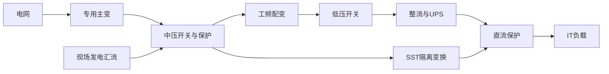

# 数据中心开关设备与变压器行业调研：交付能力、架构迁移与价值分配

研究截止日期：**2026年10月10日**。主要经营证据截至2026年二季度／上半年；2026全年仍是估计，2027–2030是条件情景。覆盖全球数据中心，供给核验偏重北美、欧洲及中国可出口厂商。金额预测统一用当期名义美元，财报保留原币；没有把加元、人民币、欧元披露按随意汇率并入市场。

**证据标记**：F＝公开披露或可定位的技术／监管事实；T＝厂商目标、路线图或产品主张；C＝直接计算；I＝本报告推断／模型；U＝尚不可识别。预测范围是参数条件范围或情景范围，均不是统计置信区间。金额表保留两位小数只为复算，精度并没有达到千万美元。

## 一、核心判断：建设增长成立，普遍且持久的短缺租金尚未成立

本行业最有解释力的单位是**在某个时间窗口内必须交付的合格电力容量和保护系统**。电量、GPU金额、园区远期规划MW都不能直接替代这一单位。客户购买的是按期通电、故障隔离、可维护性和可用容量；设备价格通常只是无法按时上线的损失的一小部分。

**第一，2026–2028需求有实物建设支撑，但应把大型专用主变、场内配变、中压系统与低压柜分开。** 客户容量披露和已经开工的项目比笼统AI资本支出更接近采购。供应商高积压支持工程复杂产品的交付紧张，不能证明所有标准配变、所有地区和所有低压产品都缺货。决定交付的约束还包括工人、试验位、客户认证和上游专用部件，面积及投资金额只是中间指标。证据和冲突集中在第三、四节。

**第二，数据中心增长不等于每MW设备支出持续上升。** 大园区提高专用高压主变的覆盖率；较大供电块、冗余优化和架构简化又能减少每MW的某些低压功能节。800V直流先进入机架／行级，往往保留原有交流上游。原生直流也能采用工频变压器加整流器，因而800V采用率不能当作固态变压器（SST）采用率。[S27·NVIDIA 800V直流架构更新](https://blogs.nvidia.com/blog/800-vdc-power-architecture-ai-factory/), [S28·OCP低压直流配电白皮书v1.0](https://www.opencompute.org/documents/dcf-power-distribution-lvdc-white-paper-version-1-0-final-pdf-1)

**第三，绕过电网接入可能增加中压保护和集成工程需求。** 现场发电需要发电机汇流、同步、保护、故障选择性和电压稳定。Powell的逾4亿美元数据中心大单明确涉及表后现场发电设计，代表一条新增商业路径；它不等于4亿美元当年标准机房开关柜收入。[S08·Powell FY2026 Q3结果](https://powellindustriesinc.gcs-web.com/news-releases/news-release-details/powell-industries-announces-third-quarter-fiscal-2026-results) 电网瓶颈因此有两种相反作用：压低通电项目数，或推动更复杂的园区电气系统。后一种路径还须通过燃料、排放许可、发电设备与运维能力的检验。

**第四，供给改善可以与订单、收入继续增长同时发生。** HPS积压同比很高却环比下降，Powell毛利率同比基本持平，说明不能仅用积压同比增长推导价格和利润加速。GE Vernova的Prolec并表、Eaton的Boyd Thermal并表又明显改变美元收入边界。铜成本、扩产库存、认证及质保开支，可能吞掉部分量增收益。具体原值在第四节一次列出。[S09·Hammond Power Solutions Q2 2026完整发布稿](https://emea.hammondpowersolutions.com/-/media/Project/HPS/shared/Investor-Relations/2026-YEAR-ITEMS/Q2-2026/Q2-2026-Financial-Results-Press-Release---073026.pdf), [S08·Powell FY2026 Q3结果](https://powellindustriesinc.gcs-web.com/news-releases/news-release-details/powell-industries-announces-third-quarter-fiscal-2026-results), [S07·GE Vernova Q2 2026结果／SEC附件](https://www.sec.gov/Archives/edgar/data/1996810/000199681026000147/gevpressrelease2q26.htm), [S06·Eaton Q2 2026结果／SEC附件](https://www.sec.gov/Archives/edgar/data/1551182/000155118226000027/etn06302026exhibit99.htm)

**规模判断（I）**：按第五节及附录的同任务设备边界，2026基准采购需求约**96.5亿美元**，在既定建设路径下，仅改变配置和基期单价便得到**41–228亿美元**的条件范围。2030悲观／基准／乐观代表值约**51／106／232亿美元**。基准IT容量继续增长，但低压净价、单位设备量及SST替代令本专题金额增速显著慢于IT容量。乐观金额必须满足合格供给及履约门槛；目前不能把它当成已经证明可实现的厂商收入。四个传统设备池加SST本体的各期三情景数据、净价、成本、毛利和供给阈值均可在附录复算。

最强反证是：**交付短缺可能部分来自重复预订、提前占位和采购配置过多，扩产成熟后客户会集中采购、标准化并去除部分冗余。** 如果交付时间缩短、设备收货仍增长、积压连续下降、同规格净价同步回落，这个解释比“需求崩溃”更有力。反过来，若新增项目真正验收通电，仍持续占满高规格产线，而扩产后的质保、测试与营运资本保持可控，短缺租金会更持久。当前证据更接近“主变与复杂工程偏紧、标准品局部缓解”，而非统一行业方向。

最重要的未解量是全球分产品合格年产出、数据中心真实成交价及SST在客户现场的长期故障数据。对前两项，本报告交付有约束的工程规模估计及供给增长阈值；对SST，保留小规模基准和有额外条件的突破分支。

## 二、边界与客户经济：同一MW不能沿供电链重复加总

### 2.1 可加设备池与不可加相邻池

本专题主责是园区进线至机房主要配电层的**变压与故障保护设备**，包含设备厂嵌入的设计、保护控制和出厂测试。包括AI与传统云、托管和企业数据中心；不是只统计AI设备。

| 设备池 | 纳入内容及经济单位 | 主要付款／验收方 | 与相邻专题的边界 |
|---|---|---|---|
| 园区专用主变HV | 高压／中压专用电力变压器，通常数十至数百MVA；MVA、台及交付窗口 | 园区业主或提供专用接入的公用事业；电力工程团队、运营方 | 若公用事业持有但只服务本园区，按设备价值记一次；共用输配电网升级不计入本池 |
| 场内配变DT | 中压至低压干式／液浸配变、设备中可分解的变压部分；MVA | 云商、托管商或EPC；电气及运维团队 | PDU中的变压部分若计入，不能再把整个PDU金额加一次；本模型不加入整套PDU |
| 中高压开关MV | 进线、馈线、母联、发电汇流、切换、计量与保护系统；功能节／工程工时 | 园区、EPC、公用事业界面方；系统保护及运维团队 | 含现场发电相关电气开关部分；发电机、燃气轮机、燃料系统和同步调相机本体不计入 |
| 低压开关LV | 主配电板、开关柜、ATS及转向直流后的相应保护设备；功能节与额定参数 | 园区或模块集成商；电气、IT电源及安全团队 | UPS功率变换、蓄电池、母线槽、电缆、机架PDU／RPP整机、冷却及末端服务器电源不计入 |
| SST隔离变换本体 | 替代工频中压至低压变压任务的隔离变换和必要控制；合格输出MW | 云商／模块集成商；含IT电源、保护、可靠性团队 | 一体化柜中的BBU、UPS附加任务及现场服务分出。对整机收入采用宽分摊，不把整机和被替代设备相加 |

五个池按上述拆分可以相加，构成本报告**核心设备池**。E-house、预制电力模块或“grid-to-chip”合同可能跨越多个池以及UPS、储能、机架、冷却和EPC；必须逐项拆分，只有新增集成价值可以另列。零部件厂向设备厂的销售已包含在设备价值内，不能作为另一份终端需求。维修、软件订阅和驻场服务具有意义，但本报告没有足够数据形成其全球收入池，因此没有通过任意比例把它们塞入总量。

预算来源以新增园区、分期扩建和少量供电改造为主。服务器更新不必同步更换寿命更长、可继续满足额定负载的主变和配电。客户自建与托管租赁只是支出由谁支付、何时支付的变化；云商租用第三方容量时，不能将云商与托管商公告的同一站点MW重复加总。

### 2.2 一个100MW IT园区如何成为设备订单

以下是**工程示例I，不是已核验项目报价**：IT峰值100MW；设施峰值系数1.20；功率因数0.98。所需设施有功120MW，对应约122.4MVA。选择三台75MVA专用主变，任失一台后可用150MVA；225MVA安装铭牌还含冗余和扩建余量，不能说园区拥有225MW可售IT容量。

场内若用40台4MVA配变，分成8组、每组5台且允许失去1台，总安装160MVA、可用128MVA；这是分布式备用示例。相邻级变压器的225MVA与160MVA**不能相加成为385MVA终端需求**，但两个不同设备层产生的销售可以分别计入。

| 同一园区的设备 | 示例数量／额定容量 | 示例工厂混合单价 | 工厂价值（百万美元，C） |
|---|---:|---:|---:|
| 专用主变 | 225MVA | 35,000美元/MVA | 7.875 |
| 场内配变 | 160MVA | 85,000美元/MVA | 13.600 |
| 中压功能节 | 100节 | 90,000美元/节 | 9.000 |
| 低压功能节 | 320节 | 45,000美元/节 | 14.400 |
| 合计 | 同一100MW IT项目 | 不含安装、UPS、电缆、发电本体 | **44.875** |

约44.9万美元/IT MW只是此配置的设备价格。主柜与馈线柜采用混合价，不能理解为每个6000A主柜都只值4.5万美元。2N供电、更多小电力块、更高短路等级、抗电弧、地震或专用进线可明显提高支出；采用较大标准块、共享接入或保留存量设施又可降低支出。用“每机架售价×机架数”估上游市场，容易把密度提高误认为上游柜数必须同比提高。

全球模型没有将这个专用大园区代表所有站点。其2025主变配置只有0.9MVA/IT MW，反映并非每个站点都需要一套归属于园区的高压主变；部分由共享电网供电。配变与MV/LV功能节另设参数，价格亦为全球混合假设。附录列出这一桥梁及边界误差。

### 2.3 采购权与失败成本决定价值分配

云商制定参考架构、选择合格厂商并签框架采购；托管业主承担站点建设、融资与租户验收；EPC负责接口、施工和投运；公用事业控制进线电压、保护配合和并网条件。厂商承担设计、器件追溯、测试、质保及长期备件责任。更便宜的设备若需要重新做短路、继电保护、消防或现场验收，省下的采购价可能小于延期损失。

稳定供应关系因此能获得溢价，但客户仍掌握架构和采购入口。标准化产品、第二来源、共用备件和分期交付会降低替换成本。掌握完整系统责任的厂商更容易保留集成价值；只卖可替换的箱体、通用导体或功率器件，重要性未必对应持续高利润。

## 三、需求：从可形成的电力容量出发，保留融资与交付约束

### 3.1 现实锚点与规划的区别

IEA在2026-04-16公开的模型给出：全球IT安装容量2023／2024／2025年分别57／68／82GW，2030基准174GW；总设施容量2025为114GW、2030为226GW。2025全球电量485TWh，2030约945TWh；容量口径与电量之间还受负载率及PUE影响。上述为机构估计／预测，不是设备厂订单。[S01·IEA《Key Questions on Energy and AI》](https://iea.blob.core.windows.net/assets/3179f7f8-01f6-4dd6-bffa-c9f7b73f1dc9/KeyQuestionsonEnergyandAI.pdf)

由IT存量直接计算，2025净增加14GW。它还不是变压器交付流量：退役／重新利用、提前建设的电力外壳、改造和库存占位都会产生差异。PUE是期间能耗比，不能未经校正就当作峰值变压器选型系数。

客户原始证据提供两种不同的验证：

| 客户／市场、公开日期 | 原披露F／T | 对设备需求的解释与限制I |
|---|---|---|
| Microsoft，2026-07-29 | FY2026Q4增加1GW数据中心容量；未来两年总容量翻倍是管理层目标 [S02·Microsoft FY2026 Q4电话会](https://www.microsoft.com/en-us/investor/events/fy-2026/earnings-fy-2026-q4) | 提供已建容量锚点，但未在该表述中统一解释IT与设施MW、全部所有权和外租边界；不能把单季度机械乘4 |
| CoreWeave，2026-08-11 | Q2 active power增加近500MW至1.5GW；contracted power为3.7GW [S03·CoreWeave Q2 2026结果](https://investors.coreweave.com/news/news-details/2026/CoreWeave-Reports-Strong-Second-Quarter-2026-Results/default.aspx) | “已运行”比签约容量更接近兑现；两者不是两个可加市场。云商与其客户合同还可能重叠 |
| CBRE，2026-08-27 | 北美八个主要市场在建7481MW，H1增长24.8%，预租超过80% [S04·CBRE北美H1 2026调查](https://www.cbre.com/press-releases/north-american-data-center-demand-continues-to-outpace-supply-despite-record-construction-activity) | 已开工比宣布规划更强；仍是样本在建存量，不是全北美当年交付，也不是全体自建云园区 |
| Oracle，2026-09-10 | FY2027Q1资本支出28.499十亿美元；客户预付款融资11.363十亿美元；短期融资租赁融资0.830十亿美元；披露净资本现金支出17.966十亿美元 [S05·Oracle FY2027 Q1结果](https://investor.oracle.com/investor-news/news-details/2026/Oracle-Announces-Q1-Results-Driven-by-Triple-Digit-Growth-in-Cloud-Infrastructure-Revenues/default.aspx) | 28.499+0.830−11.363=17.966（C）。预付款转移融资负担；不能另加11.363作为新增终端支出，更不能把全部资本支出当开关设备订单 |

CBRE稿正文将总存量写为“10.9 MW”，与同稿八市场逐项表合计10,902.9MW不一致；本报告只用无冲突的在建数和预租比例，不依赖这个总存量文字。[S04·CBRE北美H1 2026调查](https://www.cbre.com/press-releases/north-american-data-center-demand-continues-to-outpace-supply-despite-record-construction-activity) 这种校验也说明，即使原始出处也要检查单位。

这些证据支持需求增长，却不能证明所有排队项目都有资金、土地、光纤、可用进线和客户验收。设备已交付而电网未接入，会形成库存及阶段性现金压力；高预租也不消除建设方融资风险。AI效率改善同时存在：同样业务量可能用更少IT MW，收益提高又可能刺激更多部署。本模型直接估电力容量，避免把Token或AI收入按固定倍数传给设备。

### 3.2 年度容量路径及采购提前量

本报告以2025净增14GW为锚，设2025新增／扩建电力容量**15GW**、退役约1GW作为推算基数。这个毛新增桥梁尚无全球逐项目核验，允许14–17GW；不是把净增事实改写为确定的15GW。

| 路径I | 2026 | 2027 | 2028 | 2029 | 2030 | 2026–2030累计新建／扩建 | 同期退役假设 | 2030 IT存量，C |
|---|---:|---:|---:|---:|---:|---:|---:|---:|
| P：预算放缓、项目取消与扩产出清 | 15 | 14 | 14 | 13 | 13 | 69 | 11 | 140 |
| B：持续建设、接入与融资逐步兑现 | 18 | 20 | 21 | 22 | 22 | 103 | 9.3 | 175.7 |
| O：园区加速、替代电源与资金顺利 | 20 | 25 | 30 | 34 | 38 | 147 | 5 | 224 |

单位均为全球IT GW；每列为自然年流量，最后一列为年末存量。G代表客户目标期需要形成、通过资金及采用筛选的容量，**仍须满足供给和通电门槛**。2026三条路径是截至10月10日的全年估计，并非把已发生季度事实重新预测成不同历史。

基准不是上下限平均：其2030存量接近IEA的174GW，且近期客户、施工和供应商订单支持从2025净增14GW提高到18–22GW毛新增。悲观也没有假设数字业务消失，而是新增项目回落、原有供电资产继续使用。乐观需要比基准多约44GW的2026–2030毛新增建设，不只是更高GPU价格。

设备交付可以早于上电。附录采用主变0／1／2年提前窗口权重25%／50%／25%，配变及MV为70%当年、30%次年，LV为85%当年、15%次年；另加小额改造等价工作量。这是“哪个年份收货”的模型，不是采购订单转收入的法定规则。长周期主变的订单可能更早签下，但订单金额不能全部进签约年度收入。若需求预期突然下降，提前采购与新厂投产将使设备市场回落早于电量。


## 四、有效供给与价格：瓶颈在合格交付组合，正在出现分化

### 4.1 制造流程与不能互换的产能

工频变压器的关键链条为电磁设计、铁芯及绕组、绝缘／干燥、总装、注液或浇注、耐压／冲击／温升等测试、运输及现场验收。大主变的绕组、绝缘和试验位不能由普通低压干式变压器产线直接替代。开关设备则主要依赖合格断路器、母排与钣金、保护工程、机械和电气组装、短路／电弧验证、工厂及现场联调。不同工厂的“节/年”必须对应相同电压、额定电流、短路等级与配置才能比较。

研究上的有效供给应写成：

`可交付能力 = 关键工序中最小的合格处理能力 × 首次通过率 × 规格匹配 × 可用人员/班次 × 客户与地域准入`

设备已经设计出来，厂房已经建好，甚至型式试验已经通过，都还不意味着每个客户、每种故障工况和每个地区都可以付费验收。新厂需要认证首件、供应商质量稳定、熟练工人和售后；大型主变还要安排超限运输。2026资本支出不能直接变成2026物理产出。

NLR 2026-05报告图2的**2023美国全用途LPT**图示约为制造能力65GVA、产出50GVA、需求175GVA（C：读图约数，容许约±5–10GVA）。它给出了独立于数据中心MW的物理锚点，但不是2026数据，也不包含较小配变；进口和专用认证对当地交付十分重要。175−50不能作为未满足需求，因为进口属于有效供给。该报告的历史长交期与部件访谈支持结构性脆弱，访谈时点不统一，不能直接称为2026-10成交交期。[S11·NLR大型电力变压器补充报告／DOE OSTI公开档案](https://www.osti.gov/servlets/purl/3363379)

另一个原始参照来自Siemens Energy 2025-11资本市场日：第7页按**欧洲＋北美、中型与大型电力变压器、全用途GVA**建模。将FY2023制造能力设100，读图FY2025／FY2028／FY2030约为116／168／187；市场量约161／193／210。公司标注的约40%与约10%缺口未披露完整分母定义，不宜写成“40%客户收不到货”。这也是厂商内部预测，而非第三方独立审计的全球供需表。[S12·Siemens Energy Grid Technologies资本市场日](https://assets.siemens-energy.com/dam/d8d5d849-a7a9-4b19-a969-b39b004f6c26/251120_CMD-2025_Grid_Technologies_FINAL-pdf_Original%20file.pdf)

本报告独立需求模型不使用该图倒推数据中心容量。它只用于判断扩产需要多年、主变相对更紧，以及检验“宣布扩产即可立即消除短缺”的说法。

### 4.2 扩产时间表：承诺、完工、资格与产出分开

| 产品／公司 | 已披露投资或物理变化（原币原值） | 截止日的状态与最早经济意义 | 尚缺什么 |
|---|---|---|---|
| Siemens Energy，纽伦堡主变 | €220m、目标产能增加50% [S13·Siemens Energy纽伦堡扩产](https://www.siemens-energy.com/de/de/home/press-releases/siemens-energy-invests--220-million.html) | T：新空间2028形成；不能算进2026交付 | 扩产后规格、合格年产MVA与测试吞吐 |
| Hitachi Energy，South Boston | $457m大型主变项目 [S14·Hitachi Energy South Boston新厂开工](https://www.hitachienergy.com/news-and-events/press-releases/2026/06/hitachi-energy-breaks-ground-on-the-nation-s-largest-facility-for-the-production-of-large-power-transformers-in-south-boston-virginia) | F：2026-06-29开工；2028另厂计划见NLR表1 [S11·NLR大型电力变压器补充报告／DOE OSTI公开档案](https://www.osti.gov/servlets/purl/3363379) | 原公告未量化年MVA；开工与满产之间有爬坡 |
| Hitachi Energy，Gallman Mississippi | $528m、现有Crystal Springs产能超过翻倍目标 [S15·Hitachi Energy Mississippi新厂](https://www.hitachienergy.com/news-and-events/press-releases/2026/09/hitachi-deepens-commitment-to-u-s-manufacturing-with-528-million-mississippi-transformer-factory) | T：2026年底建设、2029生产；现厂生产将转移 | 搬迁后净新增不能按旧厂＋新厂简单相加；准入与净产出未知 |
| Hyosung，Memphis | 新增$157m，2028产能增加超过50%；总投资$300m [S16·Hyosung Memphis扩产公告](https://www.prnewswire.com/news-releases/hyosung-chairman-cho-hyun-joon-announces-major-expansion-of-memphis-power-transformer-plant-302639733.html) | T：同一项目的新增与累计金额，不相加 | 公司单厂比例不等于全美国或全球比例 |
| Eaton，Jonesville SC配变 | $340m第三座美国三相变压器厂 [S17·Eaton South Carolina变压器新厂](https://www.eaton.com/us/en-us/company/news-insights/news-releases/2025/eaton-invests-in-new-south-carolina-transformer-manufacturing.html) | T：2027开始生产 | 首年产能、产品组合、数据中心分配未知 |
| WEG，Missouri配变 | $77m；1–10MVA、至46.5kV，产能＋50% [S22·WEG Missouri扩产／客户Ameren披露](https://www.ameren.com/resource-center/dev-weg-transformers) | T：2028完成；客户Ameren的直接披露 | 不是100MVA以上LPT扩产；单厂与行业要区分 |
| Eaton，Bellevue Nebraska MV | 超$30m；370,000平方英尺 [S18·Eaton Nebraska开关设备新厂](https://www.eaton.com/us/en-us/company/news-insights/news-releases/2026/eaton-expands-operations-in-nebraska-with-new-manufacturing-facility.html) | T：2027上半年制造AIS／GIS | 功能节、认证产出未披露 |
| Siemens AG，Fort Worth LV | $190m工厂、500,000平方英尺 [S19·Siemens AG Fort Worth新厂开业](https://news.siemens.com/vi-vn/siemens-opens-190m-ft-worth-mfg-hub-ai-infrastructure/) | F：2025-03-06开业；与Siemens Energy主变业务分开 | 没有数据中心专用节/年；旧计划金额不再加一次 |
| IEM，San Antonio MV/LV／集成 | $200m、1百万平方英尺 [S20·IEM San Antonio制造投资](https://www.iemfg.com/news-stories/iem-announces-200-million-manufacturing-facility-in-san-antonio-creating-jobs-and-expanding-us-production-capacity-to-support-business-growth/) | T：2026-08公告分期开发，施工招聘时间将另行公布 | 不能假定2027年初即满产；工程与测试人员需同步 |
| ABB，欧洲MV | 约$200m、未来三年投入 [S23·ABB Q2 2026结果](https://new.abb.com/news/detail/137496/q2-2026-results) | T：增加制造及下一代技术能力 | 不应将集团订单美元增长转换为物理节数 |
| Schneider，美国多产品 | 超$700m、至2027投资 [S24·Schneider美国制造投资](https://www.se.com/us/en/about-us/newsroom/news/press-releases/schneider-electric-plans-to-invest-over-700-million-in-the-u-s-supporting-energy-ai-sectors-and-job-growth-67bdeb3ee4475a5955011b6a/) | T：广泛电力及自动化制造投资 | 未拆出DC开关设备份额，不全部计本专题供给 |
| Hitachi Energy，Alamo部件 | $106m扩产高压AC／HVDC干式套管 [S25·Hitachi Energy Alamo套管扩产](https://www.hitachienergy.com/news-and-events/press-releases/2025/08/hitachi-energy-invests-106-million-usd-to-expand-transformer-component-manufacturing-capacity-at-facility-in-alamo-tennessee) | T：2027年中运行，补上游约束 | 最终主变能否同步扩大测试及绕组能力 |
| Reinhausen，OLTC与测试相关 | 2025-10新7,200m²厂房已开放；全球2030翻倍目标 [S26·Reinhausen厂商刊物扩产与交付评论](https://onload.reinhausen.com/en/12-2025/future-factory-expansions-at-reinhausen-worldwide/) | F／T：部分先行落地，后续大建设阶段2028完成 | 厂商销售负责人称多数产品已满足希望交期；不能同时假设所有分接开关永远短缺 |

金盘在美国弗吉尼亚新厂于上半年投产、海外345kV液浸产品进入批量交付，为中国供应商“工程可行→地域准入→真实交付”的案例；SST仍处不同阶段，见第六节。[S10·金盘科技2026半年报](https://static.cninfo.com.cn/finalpage/2026-08-21/1225486537.PDF)

截至2026-10-10的后续证据也有不同意义。Eaton 10月1日宣布Austria Schrems扩建完成，增加自动MCB生产和低压系统组装，不能据此推导数据中心大型柜产能翻倍。[S43·Eaton Austria工厂扩建完成](https://www.eaton.com/us/en-us/company/news-insights/news-releases/2026/eaton-strengthens-european-manufacturing-facility-in-austria.html) 9月2日Fibrebond Arkansas超$242m项目目标把电气模块外壳业务产能翻倍，扩大的是预制集成环节，不能等同断路器或主变产出翻倍。[S44·Eaton Fibrebond Arkansas投资](https://www.eaton.com/us/en-us/company/news-insights/news-releases/2026/eaton-expands-manufacturing-for-modular-electrical-enclosures.html) 9月25日拟以€810m企业价值收购COL，€250m的2027销售为预测、交割目标2027Q1；收购改客户入口和所有权，不能在签约日算成行业新增物理供给。[S42·Eaton拟收购COL Group](https://www.eaton.com/us/en-us/company/news-insights/news-releases/2026/eaton-signs-agreement-to-acquire-col-group.html)

这些项目足以否定供给永不响应的假说，却不足以构成完整全球厂表。项目的累计计划与子项目金额不相加，面积不乘统一美元产出系数；后续交付指数使用明确的受影响份额、爬坡、资格和劳动假设，见附录A.5。

### 4.3 原料与资格：材料总量和合格可用性要分别判断

铜、铝、取向电工钢（GOES）、连续换位导线、绝缘材料、套管、分接开关、真空灭弧室与保护器件的重要性不同。买到金属吨位不等于买到客户指定损耗等级、短路强度、绝缘及已认证部件。改变绕组材质和牌号还可能触发重新设计、损耗测试与客户审批，供应切换有经济时滞。

相反证据应同时保留：欧委会2025报告引用2024调查，预计至2026厂商产能约＋10%、至2030最高约＋30%，且近半受访变压器厂有缺工造成的闲置能力。它与个别厂商翻倍计划口径不同——调查年代、全产品／特定主变、基期、地域和实际受影响厂份额都不同，不能择取较高数字作为全球供应预测。[S36·欧委会清洁能源技术竞争力报告](https://data.consilium.europa.eu/doc/document/ST-6600-2025-INIT/en/pdf)

欧委会2026-09-18推出GOES临时保障措施，包含关税配额及价格门槛，并涉及叠片、铁芯及已经嵌入变压器的铁芯。其理由是全球过剩和进口压力对欧洲生产商的威胁，而非“全球所有电工钢无法买到”。[S35·欧委会GOES临时保障措施](https://policy.trade.ec.europa.eu/news/commission-imposes-provisional-safeguard-measures-imports-grain-oriented-electrical-steel-2026-09-18_en) 因此，本报告的判断是：**材料总量、优质牌号与地域可用性、专用部件和合格制造工序可以同时处于不同供需状态**。政策可能抬高欧洲落地成本、改变整机进口路线及供应资格；有更多名义吨位也未必马上缓解采购。

试验能力本身也能增供给。IEM 2026-08-03获得CSA SMTC资格，可在内部完成监管测试后提交CSA审核，减少外部见证排期；它没有取消第三方认证。这种组织改进可以先于新厂释放有效交付能力。[S21·IEM加入CSA SMTC认证测试项目](https://www.iemfg.com/news-stories/iem-qualifies-for-csa-smtc-program-accelerating-new-product-time-to-market/)

### 4.4 当前经营证据：数量、价格、混合与会计各归其位

| 原始披露、期间与公开日 | 关键数字F（不改变原披露口径） | 可以支持与不能支持的结论I |
|---|---|---|
| Eaton，2026Q2，07-31 | Electrical Americas收入$4.0bn、有机＋18%；营业利润$1.1bn、利润率27.5%；滚动12个月订单有机＋41%，积压同比＋33%。Electrical Global增44%由有机18%、Boyd Thermal25%、汇率1%组成 [S06·Eaton Q2 2026结果／SEC附件](https://www.sec.gov/Archives/edgar/data/1551182/000155118226000027/etn06302026exhibit99.htm) | 厂商规模与入口强、需求旺；不同分部并表和冷却业务使收入／积压不能作为DC开关设备物理量 |
| GE Vernova，2026Q2，07-22 | Electrification收入$3,637m、报告＋68%、有机＋29%；其中并购收入$860m；分部EBITDA$671m、18.4%。设备积压$40.6bn包含Prolec $5bn [S07·GE Vernova Q2 2026结果／SEC附件](https://www.sec.gov/Archives/edgar/data/1996810/000199681026000147/gevpressrelease2q26.htm) | 原始增长与有机增长必须并列；不能将＋68%称为变压器物理产能＋68% |
| Powell，FY2026Q3截至06-30，08-03 | 收入$311.740m，毛利率30.6%（去年30.7%），新单$934m，积压$2.4bn；逾$400m DC订单涉及表后现场发电。九个月资本支出$10.386m、收入$859.539m [S08·Powell FY2026 Q3结果](https://powellindustriesinc.gcs-web.com/news-releases/news-release-details/powell-industries-announces-third-quarter-fiscal-2026-results) | 大单与系统工程相关且多期交付；订单猛增不等于同期毛利率扩张。九个月资本支出/收入约1.21%（C），体现此类组装工程业务与大型主变新厂的资本差别 |
| HPS，Q2截至06-27，07-30；**CAD** | 收入CAD324.802m、＋44.7%，毛利率31.5%；营业利润CAD22.990m；调整EBITDA CAD53.247m、16.4%；经营现金CAD−6.400m；积压同比＋96.9%、环比−6.9%；营运资本/销售17.7% [S09·Hammond Power Solutions Q2 2026完整发布稿](https://emea.hammondpowersolutions.com/-/media/Project/HPS/shared/Investor-Relations/2026-YEAR-ITEMS/Q2-2026/Q2-2026-Financial-Results-Press-Release---073026.pdf) | 出货已跑赢新单、供给部分释放；调整EBITDA高于报表经营利润，不能作为全部资本持有人的现金。AEG 06-29交割尚未进Q2收入，Q3再改变边界 |
| 金盘科技，2026H1，08-21；**RMB** | 收入3,555,743,162.95元、＋12.73%；DC新签38.69亿元、＋336.25%，AIDC积压50.92亿元；毛利率27.41%；铜均价10.18万元/吨、＋31.03%；归母净利302,666,839.27元，经营现金−23,762,688.51元、存货增加651,551,319.72元 [S10·金盘科技2026半年报](https://static.cninfo.com.cn/finalpage/2026-08-21/1225486537.PDF) | DC订单不是当期DC收入；毛利改善亦含结构、数字制造及CBP退税因素，不全是持续提价。净利润增长与现金消耗可同时发生 |

GE Vernova 2026-02-02以$5.275bn收购Prolec余下50%股权；该企业由合营边界进入完整合并，原有厂房不是在并表日新建。[S41·GE Vernova完成Prolec收购](https://www.gevernova.com/news/press-releases/ge-vernova-completes-prolec-ge-acquisition) 类似地，HPS将股份支付、并购等剔出的调整EBITDA与报表利润差异具有真实经济含义，不能用统一行业“净利率”消除它。

### 4.5 定价、成本与传导时滞

NLR给出的美国LPT约$15,000–$21,000/MVA并非一组2026真实中标价：下端来自2011 DOE成本按PPI调整至2024，上端来自2024进口总价值／数量再假设每台100MVA；定制物流场景可更高。该换算还将MVA与kW近似等同，实际要考虑功率因数。[S11·NLR大型电力变压器补充报告／DOE OSTI公开档案](https://www.osti.gov/servlets/purl/3363379) 本模型因此没有使用该范围作为确定ASP，也没有反过来把无来源的高价当事实。

BLS/FRED的变压器PPI在2026-07为381.783、1999-12＝100，2026-08-13更新；它是美国多用途产品组合指数，不能证明某个数据中心同规格合同涨了多少。[S37·BLS变压器PPI／FRED WPU117409](https://fred.stlouisfed.org/series/WPU117409) 当前真正可核验的是厂商披露的综合价格实现、材料冲击及盈利，**全球同规格净价时序仍不可识别**。附录给出的ASP和未来净价指数全部标记I。

DOE在2026-08-10称关键电网设备常面临两年以上交期、部分变压器五年价格上涨4–9倍，同时指出过度定制和进口依赖。[S46·美国DOE电网供应链评论](https://www.energy.gov/oe/articles/strengthening-americas-grid-supply-chain) 这是当前部门观察，未列出同规格交易样本；不能对所有DC配变使用4–9倍提价。采购方原始文件给出更有约束、也更分化的参照：

| 采购原始参照F／T，非数据中心报价 | 原金额、规格与期间 | 可支持的推断及限制 |
|---|---|---|
| Tacoma，2026-01-14会议 | 推荐采购一台230/115kV、300/400/500MVA自耦主变，$7,710,000另加税；该规格设计制造约三年 [S48·Tacoma Public Utilities U-11574采购文件](https://www.mytpu.org/wp-content/uploads/U-11574.pdf) | 按500MVA最高冷却额定约$15,420/MVA，按300MVA自然冷却额定约$25,700/MVA（C）；同一台设备采用不同分母即产生差别，不能拿最高强冷额定推算任意DC主变价格 |
| Fayetteville PWC，2025-06-26开标 | 67kV至13.09kV、24/35.8/44.8MVA带LTC主变，八家投标单位价$2,037,010–$3,184,000；报出交货由30–40周到210–220周，并有日历日期报价 [S49·Fayetteville PWC2425077主变投标表](https://www.faypwc.com/wp-content/uploads/2025/08/PWC2425077-Bid-Tab.pdf) | 按44.8MVA约$45,469–$71,071/MVA；按24MVA约$84,875–$132,667/MVA（C）。是未完成资格审查的投标价与计划交期，不是全部有效供给；同规格也有显著厂商差异 |
| Fayetteville PWC，2025-09-09开标 | 2.5MVA、12.47/24.94kV至480Y/277V箱式配变，单位报价$41,200.25–$101,253；全表报出交期约10–35周 [S50·Fayetteville PWC2526016配变投标表](https://www.faypwc.com/wp-content/uploads/2025/09/PWC2526016-Bid-Tab-rv-9.19.25.pdf) | 约$16,480–$40,501/MVA（C）。标准公用事业产品不能直接代表DC干式、损耗、抗谐波及客户资格，但要求模型保留较低价格与较快交付的替代路线 |
| Riverside，2025-05-12会议、1月开标 | 15kV金属铠装整列开关四份报价$2,254,387.50–$3,205,870.61；推荐单台主变报价$3,124,956.06。两者目标2027Q4交付 [S47·Riverside Public Utilities采购备忘录](https://riversideca.legistar.com/View.ashx?GUID=D347AEAD-6F5A-4591-9C93-5E5658372E23&ID=14126724&M=F) | 原稿没有足够功能节及额定容量，不能制造$/节或$/MVA；外部采购与施工、设计和预备金分别预算，不能把预备金当设备成交价 |

这些锚点支持附录的主变混合单价35千美元/MVA、场内配变60千美元/MVA作为**I中心值**，但不是统计均价；上下界保留规格、地域与资格差异。配变中心值允许标准箱式产品与较高规格干式产品并存，DC内部的实际加权比例未知。MV/LV单节价格更缺乏可比原始报价，收入区间因此很宽。Fayetteville主变表中最低单位价乘三与其列示总额存在小额不一致，本报告只保留原单位价，不据此重算授标总额。[S49·Fayetteville PWC2425077主变投标表](https://www.faypwc.com/wp-content/uploads/2025/08/PWC2425077-Bid-Tab.pdf)

短缺可以表现为更长交期、客户预付款、较少折扣或保留高利润项目，不必立即涨标价。旧积压的收入确认通常滞后新报价；铜、关税与人工也先进入采购成本，再通过金属联动、重定价或下一轮谈判传导。若固定价合同缺少保护，量增会首先增加存货和现金占用。

对本模型单位制造成本，铜／电工钢等可变投入、劳动、测试、运输至厂门、制造折旧与合理质保均在成本内；现场安装、客户融资与整机收购价分列。简单灵敏度是：若进口部分占制造成本40%、其落地税费增加10个百分点，而完全不能转嫁，制造成本先增约4%，初始毛利30%的产品毛利约损失2.8个百分点（C）。这不是某国实际税率，而是合同风险的可审查传导。

**当前判断**：北美及欧洲大主变／高规格园区系统更接近交付偏紧；配变与MV总体需求强，但标准化、出口认证和新厂已有局部缓解；标准LV与库存配变更有弹性。Maddox提供新造、翻新和租赁库存路线，证明不是所有变压器都必须等待同样长时间；它的营销库存不证明任意高规格新主变现货充足。[S38·Maddox产品与库存FAQ](https://www.maddox.com/resources/faqs) 2027–2028先看标准配变、低压板与制造组织效率改善，2028–2030再看大型主变与上游新厂的稳定产出。


## 五、联合情景：放量、利润扩张与价值流失有不同条件

### 5.1 全球核心设备池的年度量、价与经营结果

附录A.1–A.6公开全部输入与公式。市场金额来自容量需求×独立配置×净价，不用供应商积压金额倒算容量；供给增长来自已披露工厂／部件项目、爬坡和资格假设，不从需求额倒推产能。四个传统设备池分别计算，SST隔离变换本体另加；UPS／BBU等相邻整机任务不全额加入。

**下表是采购需求金额及在满足交付条件时的工厂收入估计。** 全球没有可靠、统一的分产品产出／客户准入数据库，因此不能声称已测得每年供需比。附录给出满足每条路径必须具备的初始供给比和合格增长范围；若条件未满足，当年金额会变成待交付需求、延期或取消，不能照表确认为营收。

单位：IT容量为GW；收入、毛利为**十亿美元／自然年**。本体SST已纳入核心池，发电相关开关是MV子项。GP为制造毛利标杆，未扣集团销售研发管理及资本支出，不能当行业净利润或现金。所有金额与2025基数为I/C。

| 时期/路径 | 当年毛新增IT G / 年末IT存量 | 核心设备R：中心（参数条件范围） | 制造毛利额 / 模型毛利率 | 已含的发电汇流MV子项R |
|---|---:|---:|---:|---:|
| 2025推算基数 | 15 / 82（存量为IEA估计） | 7.79（3.31–18.36） | 2.36 / 30.3% | 未分解，已经包含MV平均配置 |
| 2026/P | 15.0 / 95.5 | 7.50（3.20–17.62） | 1.94 / 25.9% | 0.15 |
| 2026/B | 18.0 / 98.5 | 9.65（4.08–22.82） | 2.89 / 29.9% | 0.30 |
| 2026/O | 20.0 / 101.0 | 11.76（4.96–27.95） | 3.60 / 30.6% | 0.47 |
| 2027/P | 14.0 / 107.5 | 6.74（2.85–15.94） | 1.39 / 20.6% | 0.14 |
| 2027/B | 20.0 / 116.8 | 10.69（4.51–25.32） | 3.18 / 29.7% | 0.45 |
| 2027/O | 25.0 / 125.0 | 15.81（6.63–37.60） | 4.92 / 31.1% | 0.94 |
| 2028/P | 14.0 / 119.0 | 5.95（2.51–14.14） | 0.77 / 12.9% | 0.10 |
| 2028/B | 21.0 / 135.9 | 10.95（4.61–26.02） | 3.11 / 28.4% | 0.58 |
| 2028/O | 30.0 / 154.0 | 19.70（8.20–47.10） | 6.31 / 32.0% | 1.59 |
| 2029/P | 13.0 / 129.5 | 5.40（2.27–12.83） | 0.63 / 11.6% | 0.07 |
| 2029/B | 22.0 / 155.9 | 10.89（4.57–25.90） | 3.00 / 27.6% | 0.63 |
| 2029/O | 34.0 / 187.0 | 21.68（8.98–51.98） | 6.17 / 28.5% | 1.93 |
| 2030/P | 13.0 / 140.0 | 5.12（2.16–12.19） | 0.53 / 10.3% | 0.05 |
| 2030/B | 22.0 / 175.7 | 10.56（4.42–25.21） | 2.83 / 26.8% | 0.68 |
| 2030/O | 38.0 / 224.0 | 23.20（9.56–55.91） | 5.88 / 25.3% | 2.26 |

基准的2028与2030金额没有跟随IT存量翻倍。原因包括：交付对应年度新增而非全部存量；采购提前量逐步回归；较大供电块降低单位功能节；部分SST替代；配变、LV供给成熟后净价回落。模型中2030基准的传统主变／配变／MV／LV分别约11.0／21.8／29.7／38.1亿美元，SST本体约4.9亿美元；它们的增长方向和经营条件并不相同。

参数上下界变化大于部分路径点值差异，这是目前公开成交数据不足的实际结果。表中没有替这个缺口选择单边乐观或悲观价格。**绝对市场规模可信度中低；需求实物增长、产品分化及时间顺序的可信度更高。** 未来验证应先缩小同规格报价与每MW配置范围，再提高金额预测精度。

### 5.2 独立供给的交叉比较与履约门槛

用2025为基期，定义各产品制造工作量需求增长D和可面向数据中心的合格交付能力增长S。开关设备需求按额定／保护复杂度转换成2025工程工作量。设未观察到的2025初始供给／需求比为ρ₀，则：

`S/D的实际水平 = ρ₀ × S增长指数 / D增长指数`

全部当期履约需要`ρ₀ ≥ ρ* = D增长指数/S增长指数`。两个指数各设100仅用于同比，**没有把基期绝对供给设成绝对需求**。A.5给出每个设备池、每个年份和三个情景的D、S范围以及ρ*。

在基准中，2027主变的ρ*约1.16，MV约0.99、配变0.88、LV0.85。若2025相关产线已接近满负荷且缺乏可迅速转出的其他用途产能，主变较难在2027消除积压；配变和LV则可能率先松动。2030基准主变ρ*约0.95，但供给范围很宽，因此只能判断新产能**有机会**追上，不能保证所有规格和地区平衡。

乐观2030主变ρ*约1.80、MV约1.17，即使合格产能增长采用较快假设，大园区计划仍要求更多进口、从其他用途重新分配、降低冗余或延长项目周期。配变／LV对应ρ*约0.73／0.63，AI建设加速仍可能同时发生局部标准品价格竞争。数据中心采购优先权会把一部分紧张移给电网和工业用户，不会凭空增加全球产能。

一个可复核的履约压力测试（I/C）：2028乐观主变需要48.58GVA；若ρ₀＝1、2025同配置基期16.425GVA、供给指数161.46，则当年供给约26.52GVA，只能覆盖约55%的需求。约22GVA或约10亿美元的当期主变价值需要延期、调配或取消。这是**给定初始供给假设的阈值示例，不是已测得的全球缺口**。设备可以提前入库而未上电，项目和设备收入还可能出现不同节奏。

更完整的滚动账应按实物写为`期末待交付量=期初待交付量+新增需要量−实际交付量−取消量`，实际交付受当年合格供给限制；延期后按新合同条件重估价格。本报告没有获得全行业期初积压的实物及可取消结构，故未捏造一个确定滚动库存余额。供给门槛未满足时，表中高增长点不应直接进入企业收入预测。

### 5.3 三条路径的经济机制与判别

| 路径与关键时期 | 需求与有效供给 | 净价、成本与规模 | 谁捕获价值、谁可能损失 | 成立与否的判别 |
|---|---|---|---|---|
| P，2026–2027先放缓，2028–2030出清 | 客户建设资金／回报不足，毛新增IT容量回落；已承诺产能仍陆续进入，后续扩产放慢 | 同规格竞争压价先发生于标准配变／LV；人员、厂房和质保成本较黏；核心需求由约75亿美元降至约51亿美元代表值 | 现金强、能跨用途调产或做改造服务的厂商较稳；新建同质产线、固定价高材料库存者受损；客户采购成本下降 | 高预租项目仍取消；多厂订单／出货比低于1、积压连续下降且折扣加大；若电网投资充分吸收新产能，出清程度应下调 |
| B，2026–2028建设继续，2028–2030供给分化 | 18→22GW年度建设路径；2027主变仍紧，标准配变／LV及组织效率较快增供 | 旧高价合同延迟确认，LV先重定价；主变利润较稳，单位成本下降幅度小于部分产品净价跌幅；核心金额约96.5→110→106亿美元 | 成熟厂商以出货、跨产品集成和售后维持利润；标准品短缺租金减弱；采购方获交期与预算弹性 | 新厂由完工进入多客户重复交付；新增MW与设备收货增长、积压增速却下降，质量和现金保持可控 |
| O，2026–2028加速，2029–2030大园区／架构迁移 | 毛新增20→38GW；专用高压覆盖率、表后发电和新DC保护上升；强需求诱发追加扩产与调配 | 主变及复杂MV保有溢价；配变／LV即使量增也受标准化、SST和新增供给竞争；核心金额2030约232亿美元条件值 | 有电网／发电工程和系统责任的供应商优先受益；SST把部分价值移向隔离变换、控制和备援；低压同质厂不必同向获利 | 资金、许可、气源、电力与客户验收同步兑现；主变/MV的A.5门槛须解决，SST合格输出还须达A.6规模 |

这三条是机制明确的代表路径，**不是互斥且完备的概率分布，也没有任意凑出100%权重**。供给缓解、SST突破或材料冲击可以跨路径发生。指标阈值为研究观察规则，不是行业标准。

### 5.4 收入增长怎样变成现金

出货增长要转成毛利扩张，还需要净价保持、产品组合合理、材料可转嫁、试验／返工及质保可控，且新厂固定成本得到摊薄。再转成现金，需要客户预付款和收款匹配、存货周转、扩产投资与售后长期负担可控。上述财报的现金与调整利润差异表明这两步不能合并。

以下是**同一家假设工厂、百万美元单位的资本模型I/C**，不是行业财报：毛利包含制造折旧，经营费用包含销售、研发和管理；工厂自有厂房设备，收购商誉和债务融资另列。供给增长没有靠设备单价抬高来充当物理扩产。

| 同一工厂边界 | 稳态年 | 增长年：销量＋30%、净价不变 | 增长年且毛利率少5个百分点 |
|---|---:|---:|---:|
| 收入／毛利率 | 100 / 30% | 130 / 30% | 130 / 25% |
| 销售研发管理费用／EBIT | 12 / 18 | 15 / 24 | 15 / 17.5 |
| 税率／税后经营利润 | 25% / 13.5 | 25% / 18 | 25% / 13.125 |
| 制造折旧（已含成本） | 3 | 4 | 4 |
| 维持资本支出／扩张资本支出 | 3 / 0 | 4 / 12 | 4 / 12 |
| 营运资本占收入／当年增加 | 18% / 0 | 18% / 5.4 | 18% / 5.4 |
| 投资后自由现金流 | 13.5 | **0.6** | **−4.275** |
| 期末净厂房设备＋营运资本 | 35+18=53 | 47+23.4=70.4 | 同左 |
| ROIC（同边界） | 13.5/53=25.5% | 18/平均资本61.7=29.2% | 13.125/61.7=21.3% |

假设18%的营运资本比例与HPS披露量级相近，只作为标杆；并未将其当整个行业事实。增长年的盈利和ROIC可以上升，而现金几乎消失；较小毛利冲击即需融资。若厂房建成后再经历1–2年低利用率，回报进一步延后。实际低压组装厂、大型主变厂与SST电子制造的投入结构不同，本表不能作为通用企业估值模型。

## 六、技术前沿：800V先改变配电层，SST兑现要跨过系统责任

### 6.1 三条不同采用路径



图为任务与可选支路，不代表每个项目都串联全部元件。整流／UPS及发电本体属于相邻任务；上游专用主变不会仅因机架采用800V就消失。

| 技术路径 | 截止日阶段与原始依据 | 对本专题需求的影响I | 经济兑现条件 |
|---|---|---|---|
| 存量AC设施＋800V电源机架 | NVIDIA 2026-08介绍的兼容既有AC方案，2026下半年目标交付 [S27·NVIDIA 800V直流架构更新](https://blogs.nvidia.com/blog/800-vdc-power-architecture-ai-factory/) | 保留主变、配变及大量AC配电；变化先在机架电源、直流保护和线缆 | 热、安全、保护、机架空间及服务器接口验证；实际交付不能只看发布会 |
| 工频变压器＋整流器的原生LVDC | OCP 2026-03白皮书明确允许MV/LV工频变压器加AC/DC转换 [S28·OCP低压直流配电白皮书v1.0](https://www.opencompute.org/documents/dcf-power-distribution-lvdc-white-paper-version-1-0-final-pdf-1) | 可能简化某些低压层，但保留工频磁性设备；800V可增长而SST仍小 | 可复用成熟认证、模块化整流与备援；取得足够系统效率和可用率 |
| MV直接至800V的SST | OCP v0.3规范、厂商样机及厂房／试点计划 [S29·OCP SST设计规范v0.3](https://www.opencompute.org/documents/ocp-sst-design-specification-v0-3-final-pdf), [S10·金盘科技2026半年报](https://static.cninfo.com.cn/finalpage/2026-08-21/1225486537.PDF), [S30·Heron Power–RWE试点协议](https://heronpower.com/news-stories/heron-power-and-rwe-sign-pilot-agreement) | 替代部分场内工频配变、AC开关及UPS任务，新增隔离变换、功率控制和DC保护；主变主要保留 | 规模化可靠性、故障选择性、地域认证、多来源、维修备件和真实净成本 |

NVIDIA路线图包含2027年行级最高2MW电力中心；路线图是T，不是已经部署的产业规模。[S27·NVIDIA 800V直流架构更新](https://blogs.nvidia.com/blog/800-vdc-power-architecture-ai-factory/) OCP SST v0.3封面生效日2026-06-22，公开发布时间见NVIDIA 7月说明；规定13.8kV输入5MW、34.5kV输入5／10MW与800V单极输出，但多个短路持续时间、接地及动态响应条目仍待定，规格文件不等于产品获证。[S29·OCP SST设计规范v0.3](https://www.opencompute.org/documents/ocp-sst-design-specification-v0-3-final-pdf)

按理想直流计算，1MW负载在800V需1250A，在54V需约18,519A。这个C解释末端低压铜路的困难，却不能将800/54的比值当全设施电耗降低：480V三相、功率因数1时同样1MW的线电流约1203A；导体布局、并联支路、绝缘和转换链不同。支付来源是线缆／空间、转换损耗、施工与可用性的联合变化。

SST仍需隔离磁性器件。取消部分50/60Hz变压器，会把价值转向高频隔离、电力电子、封装散热和控制，不能理解为所有变压器材料消失。金盘半年报已披露13.8kV SST样机完成厂内测试并在海外测试，以及功率单元高频变压器的设计迭代；同时345kV液浸产品已进入海外批交。两个产品处于不同商业阶段。[S10·金盘科技2026半年报](https://static.cninfo.com.cn/finalpage/2026-08-21/1225486537.PDF)

DC故障没有AC自然过零条件；SST的主动限流／故障供电行为改变传统保护配合。系统要验证故障隔离、重启动、接地、短路能量、BBU续流与单元更换，不能用峰值转换效率替代可用率。OCP白皮书特别讨论不同SST故障模式和产业级可靠性／效率尚需验证。[S28·OCP低压直流配电白皮书v1.0](https://www.opencompute.org/documents/dcf-power-distribution-lvdc-white-paper-version-1-0-final-pdf-1) 训练、推理和其他业务的中断代价及检查点策略不同，冗余可以重新设计，但由谁承担失败损失仍要进入采购合同。

### 6.2 竞争者阶段及有效SST供给

Heron的数据中心产品页标称34.5kVAC输入、4.2MW模块、800VDC输出，集成SuperBBU，效率98.5%与占地减少70%均为厂商T，尚不能作为独立验收结果。[S31·Heron数据中心产品页](https://heronpower.com/product/data-centers) 其2026-09-21 RWE协议是风电场配套BESS试点，目标2027-04安装；潜在每年最低500MW保留量须最终采购协议。它不是500MW数据中心订单。[S30·Heron Power–RWE试点协议](https://heronpower.com/news-stories/heron-power-and-rwe-sign-pilot-agreement)

同一公告披露Morgan Hill工厂规划：超过40GW年产能力、10,000台级HeronLink、投资超$100m，量产目标2027年底。[S30·Heron Power–RWE试点协议](https://heronpower.com/news-stories/heron-power-and-rwe-sign-pilot-agreement) 这是满产运行率目标，不是2027期间收入或可面向DC的合格供给。制造场景、客户资格、配套部件、保修能力以及产能分配都要扣除。

本报告按独立的供给转化假设I估计Heron例示：2028年采用40GW名义能力×10%–30%期间爬坡×20%–40%数据中心分配×40%–70%合格交付，得到约**0.32–3.36GW**。其他厂商可能再提供约0.1–1GW；同口径约0.4–4.4GW。下限反映晚启动／慢认证，上限需快速班次、部件与多客户准入，不能因“40GW”就认为全行业供应充足。

| SST有效输出供给假设I，全球但覆盖不全 | 2027 | 2028 | 2029 | 2030 |
|---|---:|---:|---:|---:|
| P：研发、准入及回报不理想 | 0.02–0.15GW | 0.2–0.8GW | 0.5–1.5GW | 0.8–3GW |
| B：主厂爬坡与少量多来源 | 0.05–0.35GW | 0.4–2GW | 1–4GW | 2–6GW |
| O：客户资格快速完成、多厂交付 | 0.2–1.2GW | 2–5GW | 5–10GW | 8–16GW |

各范围是当年可交付的直流额定输出GW；交流输入MVA需另考虑功率因数、谐波和额定条件。它们并非已测得公司产能合计。2026没有核实行业规模商业收入；情景中近零规模不代表已证明没有任何销售。基准2027／2028／2030采用新IT容量0.5%／3%／8% SST，需要约0.144／0.907／2.534GW合格输出；乐观对应1.08／4.32／13.68GW，要求接近较快供给范围。附录A.6同时列全部年份三路径的整机售价、成本、本体分摊和规模。

Eaton–Resilient并购公告在2025年将既有商业基础主要指向EV快充、把DC列作未来机会；既有商业应用可以降低器件和制造风险，但不能消除数据中心可靠性、系统保护和服务资格的差别。[S32·Eaton收购Resilient公告](https://www.eaton.com/us/en-us/company/news-insights/news-releases/2025/eaton-signs-agreement-to-acquire-resilient-power-systems-inc-.html) ABB HiPerGuard 34.5kV中压UPS则是另一种系统整合路径，可能减少部分电压转换、整合微网，但不能当作本报告SST份额已经实现。[S23·ABB Q2 2026结果](https://new.abb.com/news/detail/137496/q2-2026-results)

### 6.3 客户经济：净节能不足时，价值必须来自其他任务

对同一个100MW峰值IT园区，假设稳态年平均IT负载率75%、期间PUE1.20、电价70美元/MWh。稳态整个设施平均输入90MW；某架构相对少用2%设施电耗，稳态年节省1.104百万美元。首年IT负载率40%、次年65%、第3–10年75%，对应前两年仅节省0.589／0.957百万美元。这是I/C示例，既不是SST已实测节能，也没有把厂商TCO主张等同全园区现金节约。

比较资产服务期均为10年，增量投资按已经扣掉避免购买的AC设备后计**8百万美元**，每年额外维护0.1百万，第5年备援必要更新的增量成本0.6百万，期末旧AC方案可回收2百万而新方案残值0，折现率10%。该设定保留老AC设备较长寿命造成的残值差，未把旧系统的剩余价值抹掉。

`增量NPV = −8 + Σ[第t年节能−0.1]/(1.1^t) − 0.6/(1.1^5) − 2/(1.1^10) ≈ −3.57百万美元`

因此客户还需至少约3.57百万美元现值的空间、建设提前、可售算力、运维或风险收益，或者降低净增量资本。若只靠能耗，允许的增量投资约4.43百万美元；若第一年就达到75%负载率、不经历爬坡，这一上限才约5.02百万美元。反之，若它能避免已无法在机架尺度施工的导体／空间约束，即使简单节能回收未通过，也可能有支付理由；必须证实被解锁的容量可以出售和按期运行。供应商能否收费取决于掌握哪一项任务，而非“新技术更高效”本身。

### 6.4 突破分支及利润边界

额外突破分支I：到2030年SST覆盖全球新增IT容量的35%–50%，同时至少两家独立厂商通过规模客户资格、故障及可维修性验证，净系统成本较可比AC方案降低至少15%，服务网络能够处理园区故障。这里15%是研究判别阈值，非行业标准；它必须包含必要备援、质保、更新与损失，而不只比较裸变换器标价。

若G处于22–38GW，该分支需要**11.1–27.4GW**合格输出，远高于“一个试点成功”；按2030整机ASP0.22–0.60百万美元/输出MW，对应整机约**24–164亿美元**、隔离变换本体分摊约**9–123亿美元**的参数包络。这不是可直接加到主情景核心池的增量：需重算被替代的配变及AC开关、留下的机械负载和新DC保护，且35%–75%的本体分摊仍未知。

这条突破可以在需求放缓或需求加速时发生，属于跨路径技术事件，没有被列为某个总需求路径的独立权重。放量需要合格输出与采用，利润兑现还需要功率器件成本、良率、质保／返修和服务责任。A.6的SST毛利率是厂群成本假设，公开证据不能确定行业毛利；若长期现场可靠性失效或维护成本高，规模与利润方向会分离。


## 七、竞争地图：资格、系统责任与客户架构共同决定收益

### 7.1 分层竞争及非上市参与者

下表描述已核实的产品／工程位置和经济机制，不是市场份额排名。公司同时进入多个池时，集团收入不能每池全额记一次；当地合格厂、客户准入和交付时段比集团总厂数更有意义。

| 任务与代表参与者 | 已核实的技术／商业位置 | 价值捕获与竞争条件I | 重要未知 |
|---|---|---|---|
| 专用主变：Hitachi Energy、Siemens Energy、GE Vernova／Prolec、Hyosung、HD Hyundai、WEG | 大型主变制造、工程、扩产和区域客户关系；项目与规格见4.2及NLR厂表 [S11·NLR大型电力变压器补充报告／DOE OSTI公开档案](https://www.osti.gov/servlets/purl/3363379), [S13·Siemens Energy纽伦堡扩产](https://www.siemens-energy.com/de/de/home/press-releases/siemens-energy-invests--220-million.html), [S14·Hitachi Energy South Boston新厂开工](https://www.hitachienergy.com/news-and-events/press-releases/2026/06/hitachi-energy-breaks-ground-on-the-nation-s-largest-facility-for-the-production-of-large-power-transformers-in-south-boston-virginia), [S15·Hitachi Energy Mississippi新厂](https://www.hitachienergy.com/news-and-events/press-releases/2026/09/hitachi-deepens-commitment-to-u-s-manufacturing-with-528-million-mississippi-transformer-factory), [S16·Hyosung Memphis扩产公告](https://www.prnewswire.com/news-releases/hyosung-chairman-cho-hyun-joon-announces-major-expansion-of-memphis-power-transformer-plant-302639733.html), [S41·GE Vernova完成Prolec收购](https://www.gevernova.com/news/press-releases/ge-vernova-completes-prolec-ge-acquisition) | 熟练绕组／绝缘工序、试验位、超限物流和故障响应形成交付优势；跨电网和工业用途可调配能力，合格客户多则议价更稳 | 全球DC份额、相同规格年产MVA和净报价均未披露；扩产的可交付比例未知 |
| 非上市主变：Virginia Transformer、Delta Star、Pennsylvania Transformer、Niagara；区域与进口商Iljin、LS Power Solution等 | NLR及公用事业投标名单可识别；实际投标显示既有较短也有很长交货提案 [S11·NLR大型电力变压器补充报告／DOE OSTI公开档案](https://www.osti.gov/servlets/purl/3363379), [S48·Tacoma Public Utilities U-11574采购文件](https://www.mytpu.org/wp-content/uploads/U-11574.pdf), [S49·Fayetteville PWC2425077主变投标表](https://www.faypwc.com/wp-content/uploads/2025/08/PWC2425077-Bid-Tab.pdf) | 专用制造和客户历史可缩短替换路径；私营、区域和进口竞争可能先消除局部租金，无须等待全球最大厂扩完 | 投标不代表客户资格通过；许多产能、财务和售后数据不公开；未建立完整全球名单 |
| 配变：Eaton、HPS、金盘、WEG及其他区域干式／箱式厂 | 三相配变新厂、干式与多用途产品、海外客户批交；HPS／金盘经营证据见4.4 [S17·Eaton South Carolina变压器新厂](https://www.eaton.com/us/en-us/company/news-insights/news-releases/2025/eaton-invests-in-new-south-carolina-transformer-manufacturing.html), [S09·Hammond Power Solutions Q2 2026完整发布稿](https://emea.hammondpowersolutions.com/-/media/Project/HPS/shared/Investor-Relations/2026-YEAR-ITEMS/Q2-2026/Q2-2026-Financial-Results-Press-Release---073026.pdf), [S10·金盘科技2026半年报](https://static.cninfo.com.cn/finalpage/2026-08-21/1225486537.PDF), [S22·WEG Missouri扩产／客户Ameren披露](https://www.ameren.com/resource-center/dev-weg-transformers) | 损耗、绝缘／热性能、抗谐波、尺寸和认证决定能否替代；数字制造和同系列规模化可降工时，较大电力块可能减少台数 | DC收入、干式／液浸实际混合、订单取消权、相同规格提价未统一披露 |
| 标准品、库存和复用：Maddox及箱式配变投标商 | 新造、翻新、租赁与库存路线；公用事业投标亦包括多家美国、亚洲制造及渠道商 [S38·Maddox产品与库存FAQ](https://www.maddox.com/resources/faqs), [S50·Fayetteville PWC2526016配变投标表](https://www.faypwc.com/wp-content/uploads/2025/09/PWC2526016-Bid-Tab-rv-9.19.25.pdf) | 缺货时客户用临时设备保项目时间；供给改善后标准品利润更受库存折扣、残值和渠道竞争影响 | 不能保证任意DC核心主变可复用；客户资格、质保、效率与剩余寿命可能阻止替换 |
| MV/LV与成套工程：Eaton、Schneider、ABB、Siemens AG、Powell、IEM | 配电、保护、模组与系统工程；Powell表后发电订单、IEM自主测试和数据中心解决方案为不同入口 [S08·Powell FY2026 Q3结果](https://powellindustriesinc.gcs-web.com/news-releases/news-release-details/powell-industries-announces-third-quarter-fiscal-2026-results), [S21·IEM加入CSA SMTC认证测试项目](https://www.iemfg.com/news-stories/iem-qualifies-for-csa-smtc-program-accelerating-new-product-time-to-market/), [S39·IEM数据中心解决方案](https://www.iemfg.com/industry-solutions/technology-data-centers/) | OEM断路器／保护基础加系统设计、测试和现场责任，较易收费；客户参考架构与第二来源又抑制长期加价 | 不同公司口径含UPS、冷却、母线或箱体，无法用集团收入算本专题份额；缺少全球功能节产量 |
| 相邻配电路线：G&W Electric、S&C等区域产品厂 | G&W目录包括配电开关和固体绝缘产品；它们可覆盖部分进线／环网任务 [S40·G&W Electric美国产品目录](https://www.gwelectric.com/wp-content/uploads/2026/01/GW14-2026-Domestic-Product-Guide.pdf) | 标准环网、重合器或户外开关在特定任务上替代复杂柜，减少定制费用和见证排期 | 环网开关不是任意高电流、抗电弧的整列金属铠装柜；适用短路、运维和地域标准须逐项确认 |
| SST及功率转换：Heron、Eaton／Resilient、金盘，及大型电气厂的其他整合路径 | Heron处工厂／试点计划阶段；金盘样机测试；Resilient有EV基础；ABB MV UPS另成一条路线 [S30·Heron Power–RWE试点协议](https://heronpower.com/news-stories/heron-power-and-rwe-sign-pilot-agreement), [S32·Eaton收购Resilient公告](https://www.eaton.com/us/en-us/company/news-insights/news-releases/2025/eaton-signs-agreement-to-acquire-resilient-power-systems-inc-.html), [S10·金盘科技2026半年报](https://static.cninfo.com.cn/finalpage/2026-08-21/1225486537.PDF), [S23·ABB Q2 2026结果](https://new.abb.com/news/detail/137496/q2-2026-results) | 高频隔离、半导体、控制、故障保护、备援和可维修性的联合设计；软件与服务收入需有合同验证，不能默认高毛利订阅 | DC付费规模、长期现场故障、责任分摊、可替换模块和成本率未知；行业尚无已核实份额表 |
| 专用上游：Reinhausen OLTC、Hitachi Alamo套管及其他绝缘／断路器供应商 | 前述扩产和交付评论显示约束按部件而异 [S25·Hitachi Energy Alamo套管扩产](https://www.hitachienergy.com/news-and-events/press-releases/2025/08/hitachi-energy-invests-106-million-usd-to-expand-transformer-component-manufacturing-capacity-at-facility-in-alamo-tennessee), [S26·Reinhausen厂商刊物扩产与交付评论](https://onload.reinhausen.com/en/12-2025/future-factory-expansions-at-reinhausen-worldwide/) | 少数高等级认证部件能限制整机交付；长客户验证与备件责任可能保留利润；整机厂也可增加第二来源 | 部件自身利润、DC归属及不同牌号交期未知，部件收入已含整机价值，不另加终端池 |

中国供给不是一个统一的低价替代项。金盘的出口批交、美国工厂及已有产品资格支持进入高规格市场；标准箱式采购也出现中国／亚洲厂与渠道，但投标资格、损耗和客户接受仍未全部验证。[S10·金盘科技2026半年报](https://static.cninfo.com.cn/finalpage/2026-08-21/1225486537.PDF), [S50·Fayetteville PWC2526016配变投标表](https://www.faypwc.com/wp-content/uploads/2025/09/PWC2526016-Bid-Tab-rv-9.19.25.pdf) 在价格有利却无法按期通过地区与客户准入时，它不构成有效竞争；通过资格后又可能显著缩短短缺持续时间。对中国其他主变、柜厂及日本、印度、中东、拉美地区厂商，本报告未完成逐厂产出和客户认证调查，不能据覆盖名单推导行业集中度。

### 7.2 客户自研首先内化架构价值

Microsoft、Google与NVIDIA参与OCP电源参考设计／接口讨论，厂商按这些架构供货。[S28·OCP低压直流配电白皮书v1.0](https://www.opencompute.org/documents/dcf-power-distribution-lvdc-white-paper-version-1-0-final-pdf-1), [S27·NVIDIA 800V直流架构更新](https://blogs.nvidia.com/blog/800-vdc-power-architecture-ai-factory/) 客户自研在这里首先指电压、冗余、模块接口、保护策略及参考设计，不是已经自建大型主变工厂。它有两种经济结果：开放接口扩大合格厂数量、降低议价溢价；系统架构标准化又可能让能承担完整责任的少数厂商得到更大订单。

云商、CoreWeave、Oracle、托管业主、公用事业及EPC不承担同样的资金和责任。客户预付款能减轻建设方资本负担，但对应未来服务义务；设备厂可能仍先垫铜、部件、存货与质保。公用事业按电网可靠性验收、云商按IT业务连续性验收，SST若无法满足两端接口，峰值效率再高也难进入大规模采购。

Eaton与Siemens Energy的2025合作提出500MW标准化现场发电方案及最多提前两年的交付主张（T），不是已经证明所有项目可提前两年。[S45·Eaton–Siemens Energy现场发电合作](https://www.eaton.com/us/en-us/company/news-insights/news-releases/2025/eaton-and-siemens-energy-join-forces-to-provide-power-and-technology.html) ABB与VoltaGrid的同步调相机、飞轮和e-house路径，则表明电压稳定和动态负载响应正在成为采购任务。[S23·ABB Q2 2026结果](https://new.abb.com/news/detail/137496/q2-2026-results) 这可能把控制入口从单个变压器或柜移向整套可用电力包。由于燃气轮机、发电、储能和稳定装置属于其他收入池，完整包收入不能全部划入开关设备与变压器。

### 7.3 监管促成新SKU与资格迁移，不能机械增加存量替换市场

欧盟Regulation 2024/573 Article 13(9)对**新投入使用**、使用或依赖含氟温室气体绝缘／开断介质的开关设备分期设限：≤24kV中压自2026年、>24至≤52kV自2030年；>52至≤145kV且≤50kA高压自2028年，更高电压或短路等级自2032年，后两类对应介质GWP≥1，存在采购可用性及特定条件的豁免。[S33·欧盟F-gas Regulation 2024/573](https://eur-lex.europa.eu/legal-content/EN/ALL/?uri=CELEX%3A32024R0573), [S34·欧委会开关设备F-gas FAQ](https://climate.ec.europa.eu/document/download/cfe52d31-9203-435d-b043-62f74900fd96_en?filename=policy_f-gases_stakeholders_switchgear_faq_en.pdf) 高压下限按2025-03-24勘误为“超过52kV”，不能沿用原文未修正的52kV重叠口径。[S51·欧盟2024/573勘误2025/90271](https://eur-lex.europa.eu/legal-content/EN/TXT/?uri=celex%3A32024R0573R%2805%29) 它不要求把现有全部开关设备立即报废换新。具体采购应按条文和项目条件核对，本报告不将其转成一个虚构的全球强制更换池。

对行业的影响I主要是无SF₆产品的设计、型式试验、部件和客户资格迁移。自然空气／真空或其他绝缘方案仍要完成同样的开断、保护、尺寸及安全任务。旧产品名义产能不能全额视为新SKU合格供给；合格厂商可能暂时保有配置溢价，但新竞争者及COL等产品能力也会扩大来源。材料和关税政策的现金影响通过落地成本、库存、豁免与再认证传导，见4.3–4.5，不能归结为统一价格方向。

## 八、演进顺序、概率与最强反面解释

### 8.1 先交付、再重定价；先验证、再架构迁移

| 观察窗口 | 产业阶段及必要条件I | 哪些事实会改变规模／利润判断 |
|---|---|---|
| 2026至2027上半年 | 已在运AC架构采购仍是主体；改善人员、测试排期和库存配置先于多数大主变新厂。既有高价积压转收入，新增报价可以先转弱 | 比较同规格新报价与旧合同确认价；实物收货、客户投运、订单／出货、退订和现金要同时看。高积压单独不能证明提价继续 |
| 2027至2028 | Eaton配变／MV、套管扩产按各自目标进入生产；大主变车间及部件仍需爬坡和客户首件。兼容AC的800V先扩大，原生SST应跨付费验收门槛 | 已完工厂房需连续重复交付而非单个首件；区分年末运行率和全年产出。SST需公开额定负载、保护、热及维护结果 |
| 2028至2029 | 主变与部件扩产有机会改变交期；Hitachi Gallman是2029投产与搬迁目标。供给逐步释放会提高出货，也可能让新报价低于旧积压 | 同规格交期缩短且订单／出货低于1，通常先影响新价格，随后影响混合利润；测试合格率、维修及运输能力决定反应速度 |
| 2029至2030及以后 | 新厂成熟、客户第二来源与架构标准化共同决定短缺租金寿命。SST若达规模，可迁移部分传统任务；主变仍主要由园区接入和建设驱动 | 场内配变／LV每IT MW采购金额、实际SST占比与系统成本；必须同时验证量、净价和质保现金。单个展示项目不等于行业渗透 |

以上是有条件的顺序，不是必须按时发生的拐点。主变长制造周期可能使2026–2027签下的价格在2028–2029仍影响利润；项目暂停时，旧积压可维持报表收入而新采购已经转弱。相反，客户只延迟上电、仍接收设备时，设备收入会领先业务收益和项目现金。

### 8.2 重要事件的主观概率

以下区间均为**截止2026-10-10的无条件事件概率I**，不是情景权重，不是统计频率推算，也不代表金额表的置信区间。公开信息缺乏足够的同类完整失败／成功样本，因此采用宽区间，依据是已开工制造项目、当前规格／试点阶段、采购资料和客户行为；相关事件共享资金、工程及资格条件，不能按独立事件相乘。

| 事件、成功标准与目标期 | 主观概率范围 | 支持、反对和主要未知 | 上调／下调证据 |
|---|---:|---|---|
| 至2027年底，北美50–200MVA定制园区主变仍有显著交付约束：至少三家可比合格供应商的新报价中位交期超过18个月 | 55%–75% | 主变扩产多在2028后、历史及当前公用事业长交期支持；个别投标短交期、进口及客户优先权反对。18个月为研究观察阈值，缺少当前DC同规格报价面板 | 上调：新厂延期、测试和关键部件仍堵；下调：多客户同规格报价稳定低于一年且准时验收。不能用某个小配变交期代替 |
| 至2028年底，至少一个≥5MW原生MV→DC SST项目，经数据中心客户付费验收，实际带IT负载运行至少六个月 | 55%–75% | 规范、样机、厂房与试点提高技术完成可能；已知RWE试点并非DC、长期系统保护／维修尚未证实。六个月仅为可观察商业门槛，不能证明全寿命可靠 | 上调：具名DC客户、付款、额定负载及运行记录；下调：仅有工厂演示、产品参数或签约保留量，持续延期／保护故障 |
| 2030自然年原生SST服务至少10%的全球毛新增IT MW，且按合格输出交付；不是全部800V采用 | 30%–50% | 技术商业案例可能早于规模供应和多地区资格；基准8%、乐观25%的分化体现爬坡未知。全球客户混合、分配、维修及系统回报决定能否跨10% | 上调：两家以上重复交付、多客户现场数据和数GW实际年出货；下调：800V主要由工频变压器＋整流器实现，合格工厂主要供应非DC |
| 2030达到6.4的35%–50%SST突破渗透，同时两来源合格与净系统成本至少降低15% | 10%–20% | 需要11–27GW级合格输出及成本／维护同时通过，多条件比一个案例严格得多；名义40GW工厂规划不能证明它 | 上调：充分额定可靠性、可维护性、降成本和客户批量迁移证据；下调：BBU／质保吞掉节省、产线或客户资格集中于单一来源 |

后两项存在包含关系：满足严格突破标准通常会满足10%渗透事件，但突破事件并非某个P／B／O总需求路径的子权重。此处直接给无条件概率，没有把10%–20%与某条路径相乘。概率范围只反映主观判断精度；若要求统计校准，现有资料不足以提供。

### 8.3 用竞争性解释约束结论

| 竞争性解释 | 支持与反对证据 | 能够区分的观察与模型含义 |
|---|---|---|
| 高订单主要是重复预订、占位和并表，真实终端需求没那么强 | 提前采购、并表增长与融资压力支持；Microsoft已建容量、CoreWeave active power和CBRE已开工反对“全部虚假”。当前无法估全球重复订购率 | 对齐项目站点、客户收货、取消权与设备编号；若取消和延期提高但客户实际新增MW放缓，降低G及改造量，不能把每家积压加成终端池 |
| AI效率和高密度减少物理需求，使电力设备市场比IT增长弱得多 | 算法／服务器效率、资产复用和更大供电块支持；可售算力需求与高密度对可用电力、接入和保护的要求反对简单按效率同比缩总池 | 用交付IT MW、每MW配置q及真实利用率分别检验。基准已允许LV量价下降；若G也下降，则更接近P。Token增速不能直接反驳 |
| 扩产迅速、标准化和第二来源会让短缺利润消失 | 新厂、部件改善、标准箱式投标和HPS积压环降支持；大主变与复杂系统资格、长周期及跨用途竞争反对同步全面松动 | 同规格新单净价先于报表毛利观察；同时记录交期、返修、工资、存货与资本开支。容量增加但无法合格交付仍不是过剩 |
| 800V将很快消灭工频配变和交流柜 | 原生SST在结构上支持局部替代；OCP明确保留工频变压器＋整流器、兼容AC机架路线、存量寿命和保护责任反对全量替代 | 区分h800与pSST；记录DC上游拓扑、被避免采购的具体设备和新DC保护成本。即使SST高渗透，主变也不自然消失 |
| 上游材料总量短缺决定设备持续暴利 | 高铜成本、特定套管／分接开关／牌号支持局部传导；MR多数产品交期满足、欧委会GOES过剩背景反对统一材料短缺 | 按牌号、规格与地域追踪有效供给，不以全球钢吨位解释所有主变；成本无法转嫁时，短缺反而损害整机厂毛利 |

有信息价值的前沿不只有SST。表后电源的动态稳定、内部测试资格、无SF₆新SKU、临时／翻新设备保交期，以及大园区专用主变占比提高，都可能在没有单一技术“突破”的情况下改变支付与利润。这些机制的共同检验是：是否减少客户延期或故障损失，是否扩大可交付的合格容量，供应商是否能在扣掉资本与责任成本后收费。

### 8.4 覆盖缺口与研究结论的有效边界

本报告支持全球需求的数量级和关键产品的条件判断，供给现实证据主要覆盖北美、欧洲、中国可出口厂商及SST前沿，未形成逐厂全球生产、台数与合格年MVA普查。东亚其他供应商及非上市企业的真实产出、分配和市场份额仍缺口明显。未把名单长度当覆盖完整性。

最影响金额的缺口是DC真实同规格报价、干式／液浸组合、开关功能节与短路等级；最影响供需的缺口是2025绝对合格供给、期初积压实物与取消权；最影响SST的是全负载故障、必要备援、维修、寿命与系统成本。它们分别对应附录的宽参数范围、ρ*履约阈值和技术／现金门槛。当前更有依据的方向是：**建设量仍增长，主变及复杂MV约束更黏，标准品先缓解；利润和现金结果将按产品、合同和资本结构分化。**

## 附录A：可复算模型、条件范围与敏感性

### A.1 对象、基期与计算关系

模型单位为全球自然年，2025推算基数、2026全年估计、2027–2030前瞻。价格是当期名义美元、厂门设备价值，不含税、现场EPC、共享电网和相邻整机任务。P／B／O为机制路径，逐年参数表示当年完成制造交付所需的工作量；本模型没有按期末年化运行率估全年收入。

`G_t`为新增／扩建IT GW；`K_{k,t}`为改造等价IT GW工作量；`q_{k,t}`为MVA/IT MW或功能节/IT MW；`p_t`为新架构SST比例，`h_t`为800V采用比例；`f_t`为新增电力容量中采用现场发电汇流的比例。所有这些采用率按MW加权，不是客户家数、站点数或电量占比。

交付窗口：

```
W_HV,t = 0.25 G_t + 0.50 G_(t+1) + 0.25 G_(t+2)
W_DT,t = W_MV,t = 0.70 G_t + 0.30 G_(t+1)
W_LV,t = 0.85 G_t + 0.15 G_(t+1)

Q_HV,t = (W_HV,t + K_HV,t) q_HV,t
Q_DT,t = [W_DT,t (1 − 0.85 p_t) + K_DT,t] q_DT,t
Q_MV,t = (W_MV,t + K_MV,t) (q_MV,t − f_t) + W_MV,t f_t
Q_LV,t = [W_LV,t (1 − 0.50 p_t) + K_LV,t] q_LV,t

ASP_k,t = P0_k × 净价指数_k,t/100 × m_k,t
C_k,t = P0_k × (1 − GM0_k) × 成本指数_k,t/100 × m_k,t
R_k,t = Q_k,t × ASP_k,t/1000
GP_k,t = R_k,t − Q_k,t × C_k,t/1000
GM_k,t = 1 − C_k,t/ASP_k,t
```

Q单位为GVA或千功能节，ASP和C为千美元/MVA或千美元/节，R及GP为十亿美元。MV式中的`f×1节/IT MW`代表新增发电汇流任务，已经包含在q总量中，不重复增加；存量改造不自动增加现场发电。这一子项在主表单列金额但属于MV池，不可再相加。

`m`是规格／保护复杂度组合系数；价格端和成本端采用同一m，避免将结构升级全算成纯提价。开关设备的制造工作量以Q×m计，变压器仍以额定GVA比较，不能把美元增加叫物理扩产。对变压器不同测试、绝缘与额定条件，本模型仍缺精确工时，供给范围用于容纳匹配误差。

SST替代系数0.85表示留下15%的机械／其他AC负载，LV净减少系数0.50已经扣除新增DC保护任务，两者都是I。采用p_t简化代表当年交付的新架构组合，而非完整项目逐年采购批次；提前交付和随后改变架构会使两者出现偏差。SST本体交付取当年G_t，无机械使用长主变提前期。0.85可在0.60–0.95、0.50可在0.20–0.80作敏感性，见A.7。

```
SST所需合格直流输出GW = G_t × p_t × 峰值设施系数1.20 × 配置冗余1.20
整机R（十亿美元） = 输出GW × 整机ASP（百万美元/输出MW）
核心本体R = β × 整机R；β中心55%，条件35%–75%
核心本体GP = β × 整机R × 整机模型毛利率
```

本体盈利按同一β分摊整机收入及成本，只是模型方法；若备援、质保和服务承担成本不同，实际本体毛利不能按整机比例分解。公开披露没有验证β及独立本体利润率。

当前可比基期：G_2025=15、后续窗口采用2026B=18、2027B=20，K为0.5/1/1/2，q为0.9/1.8/1.2/3.5。于是2025 HV／DT／MV／LV含改造W分别18.25／16.90／16.90／17.45，Q分别16.425GVA／30.420GVA／20.280千节／61.075千节。基数是固定推算采购窗口，不是官方2025行业收入；它包含当时为随后上电项目制造的设备，不能只用15GW×当年同一价替代。

2030主变提前窗口需要2031／2032边界：P为13／13GW、B为23／23GW、O为40／42GW。它们仅是交付窗口假设，不代表本报告完整预测至2032。各路径2026–2030退役量逐年为P：1.5/2/2.5/2.5/2.5；B：1.5/1.7/1.9/2/2.2；O：1/1/1/1/1GW，IT存量公式为82GW＋累计G−累计退役。

### A.2 基期参数、来源、上下界的约束

| 参数及适用产品 | 采用的中心值 | 条件上下界／未知 | 独立依据与限制 |
|---|---|---|---|
| 2025新增／扩建G | 15 IT GW | 14–17GW，未全量逐项目核验 | IEA2024至2025净增14GW为锚，加约1GW退役；改造、提前设备和容量复用另算 [S01·IEA《Key Questions on Energy and AI》](https://iea.blob.core.windows.net/assets/3179f7f8-01f6-4dd6-bffa-c9f7b73f1dc9/KeyQuestionsonEnergyandAI.pdf) |
| 主变q0 | 0.90 MVA/IT MW | 0.65–1.20 | 峰值设施系数1.20×冗余1.50÷PF0.98≈1.84MVA/IT MW，再乘约49%的新增容量需专用主变。其覆盖比例35%–65%是I，不是现场调查 |
| 场内配变q0 | 1.80 MVA/IT MW | 1.50–2.20 | PUE不能直接选铭牌；峰值1.20÷PF0.98、分区N+1／2N和负载分布产生约1.5–2.2装机比。机械与其他AC剩余任务要保留 |
| MV q0 | 1.20功能节/IT MW | 0.90–1.50 | 1.5–2.5MW分配块、双路径、进线／母联及发电任务的工程组合；非单一柜型台数调查。不得将所有环网开关等价高电流主柜 |
| LV q0 | 3.50功能节/IT MW | 2.80–4.30 | 约1.5–2.5MW块、多馈线及N+1／2N系统的混合功能节；全2N小块、更多末端柜会高于范围。机架PDU／RPP不计此池 |
| 主变P0 | 35千美元/MVA | 15–90千美元/MVA | 公用事业高容量自耦与较小带LTC主变的投标锚点跨较大范围；型号、冷却分母、税和FOB边界不同 [S48·Tacoma Public Utilities U-11574采购文件](https://www.mytpu.org/wp-content/uploads/U-11574.pdf), [S49·Fayetteville PWC2425077主变投标表](https://www.faypwc.com/wp-content/uploads/2025/08/PWC2425077-Bid-Tab.pdf)。本值为全球组合I；高定制单项目可以超范围 |
| 场内配变P0 | 60千美元/MVA | 20–150千美元/MVA | 标准2.5MVA箱式原始投标约16.5–40.5千美元/MVA提供低端约束 [S50·Fayetteville PWC2526016配变投标表](https://www.faypwc.com/wp-content/uploads/2025/09/PWC2526016-Bid-Tab-rv-9.19.25.pdf)；DC干式、损耗／尺寸／客户资格有额外任务，但公开资料未约束其全球净价和比例。中心并非把所有产品都当高端 |
| MV P0 | 100千美元/功能节 | 60–160千美元/节 | 成套整列报价存在百万美元级锚点 [S47·Riverside Public Utilities采购备忘录](https://riversideca.legistar.com/View.ashx?GUID=D347AEAD-6F5A-4591-9C93-5E5658372E23&ID=14126724&M=F)；功能节数未披露，不能据此“算出”单节均价。该上下界是I压力范围，强证据不足 |
| LV P0 | 55千美元/功能节 | 35–90千美元/节 | 主柜与馈线、ATS和DC保护混合；本次未核验足够同规格成交样本，是关键U。高度集成、抗电弧或更高额定产品可超边界 |
| 基期制造毛利GM0，HV/DT/MV/LV | 28%/28%/32%/31% | 反映成熟厂群的标杆；不是DC行业毛利调查，A.7另做制造成本±15%压力 | HPS31.5%、金盘27.41%、Powell30.6%提供异质公司锚点 [S09·Hammond Power Solutions Q2 2026完整发布稿](https://emea.hammondpowersolutions.com/-/media/Project/HPS/shared/Investor-Relations/2026-YEAR-ITEMS/Q2-2026/Q2-2026-Financial-Results-Press-Release---073026.pdf), [S10·金盘科技2026半年报](https://static.cninfo.com.cn/finalpage/2026-08-21/1225486537.PDF), [S08·Powell FY2026 Q3结果](https://powellindustriesinc.gcs-web.com/news-releases/news-release-details/powell-industries-announces-third-quarter-fiscal-2026-results)；Eaton营业利润与GEV EBITDA不能混作毛利 |
| 现场发电汇流强度 | 1功能节/相关IT MW | 项目复杂度0.5–2节可变；不是发电机台数 | Powell真实大单与ABB表后稳定系统证明任务存在 [S08·Powell FY2026 Q3结果](https://powellindustriesinc.gcs-web.com/news-releases/news-release-details/powell-industries-announces-third-quarter-fiscal-2026-results), [S23·ABB Q2 2026结果](https://new.abb.com/news/detail/137496/q2-2026-results)；f采用率及单节ASP仍是I |
| SST输出配置 | 1.20设施峰值×1.20冗余 | 更强备援或机械残余会变化；不是厂商可用率保证 | IT峰值与设施峰值、冗余分开；OCP额定要求和厂商4.2MW整机只约束数量级 [S29·OCP SST设计规范v0.3](https://www.opencompute.org/documents/ocp-sst-design-specification-v0-3-final-pdf), [S31·Heron数据中心产品页](https://heronpower.com/product/data-centers) |
| SST整机ASP、成本、β | 逐年见A.6；β55% | 2030整机0.22–0.60百万美元/输出MW，β35%–75% | 未核实DC真实整机报价；包含备援等相邻任务，是宽条件参数而非观测售价。成本率随研发／质保／爬坡变化；NPV另保同客户边界 |

配置／单价上下界为采用的产品组合压力范围，不是所有个体产品的硬极值。先固定某条G、q趋势、未来净价与成本路径，再令各设备池基期配置和ASP移动：

`R低 = R中心 × (q0低/q0中心) × (P0低/P0中心)`

`R高 = R中心 × (q0高/q0中心) × (P0高/P0中心)`

本体范围另用整机ASP与β的组合上下界；合计为可加设备池上下界之和。没有将这些端点解释成各参数独立发生的概率。它们不同时覆盖G、退役、供给延误、未来净价、成本、替代系数及汇率的全部误差。模型中央值只是便于比较的代表配置，数值区间宽正是证据不足所需。

### A.3 逐年参数底表

向量均按**HV／DT／MV／LV**排列。q单位为MVA/IT MW或功能节/IT MW，K为改造等价IT GW工作量；m为规格工作量／价格组合系数。h800与pSST、f现场发电均按新增容量MW加权。2029的q、K、m、采用率、价／成本及供给原始因子采用2028、2030的线性中间参数；G_2029单独设定，供给中心指数再按乘式计算，上下界线性取中间值。该插值只是渐进迁移假设，不能证明新厂于2029年初均已满产。

| 时期/路径 | q，HV/DT/MV/LV | K，HV/DT/MV/LV | m，HV/DT/MV/LV | 现场发电f | 原生SST p | 800V h |
|---|---|---|---|---:|---:|---:|
| 2026/P | 0.95/1.8/1.2/3.5 | 0.5/1/1/2 | 1/1/1.01/1.01 | 10.0% | 0.00% | 0.5% |
| 2026/B | 0.98/1.8/1.23/3.45 | 0.5/1/1/2 | 1/1/1.02/1.01 | 15.0% | 0.00% | 1.0% |
| 2026/O | 1.05/1.85/1.3/3.5 | 0.5/1/1/2 | 1/1/1.02/1.02 | 20.0% | 0.10% | 2.0% |
| 2027/P | 0.94/1.82/1.18/3.45 | 0.5/1/1/2 | 1/1/1.02/1.02 | 10.0% | 0.20% | 4.0% |
| 2027/B | 1.05/1.75/1.25/3.35 | 0.55/1.1/1.1/2.2 | 1/1/1.04/1.04 | 20.0% | 0.50% | 10.0% |
| 2027/O | 1.2/1.85/1.4/3.4 | 0.6/1.2/1.2/2.4 | 1/1/1.06/1.06 | 30.0% | 3.00% | 15.0% |
| 2028/P | 0.92/1.85/1.14/3.4 | 0.5/1/1/2 | 1/1/1.03/1.03 | 8.0% | 1.00% | 10.0% |
| 2028/B | 1.12/1.7/1.27/3.2 | 0.6/1.2/1.2/2.4 | 1/1/1.06/1.07 | 25.0% | 3.00% | 20.0% |
| 2028/O | 1.4/1.85/1.45/3.15 | 0.7/1.4/1.4/2.8 | 1/1/1.1/1.1 | 40.0% | 10.00% | 30.0% |
| 2029/P | 0.91/1.85/1.095/3.3 | 0.5/1.05/1.05/2.1 | 1/1/1.035/1.035 | 6.5% | 3.00% | 17.5% |
| 2029/B | 1.16/1.675/1.26/3.05 | 0.65/1.35/1.35/2.7 | 1/1/1.07/1.095 | 27.5% | 5.50% | 30.0% |
| 2029/O | 1.475/1.85/1.45/2.95 | 0.8/1.6/1.6/3.2 | 1/1/1.125/1.15 | 42.5% | 17.50% | 45.0% |
| 2030/P | 0.9/1.85/1.05/3.2 | 0.5/1.1/1.1/2.2 | 1/1/1.04/1.04 | 5.0% | 5.00% | 25.0% |
| 2030/B | 1.2/1.65/1.25/2.9 | 0.7/1.5/1.5/3 | 1/1/1.08/1.12 | 30.0% | 8.00% | 40.0% |
| 2030/O | 1.55/1.85/1.45/2.75 | 0.9/1.8/1.8/3.6 | 1/1/1.15/1.2 | 45.0% | 25.00% | 60.0% |

净价与制造成本指数在相同配置下均以2025＝100。净价是实际可变现价的模型代理，不是厂商标价；制造成本包含折旧／质保，扩产资本支出及营运资本增量另见5.4。未来金属、工资、贸易和良率尚不可预测到单点，指数表达各路径的传导机制，不是直接读取PPI作保证。

| 时期/路径 | 同配置净价指数，HV/DT/MV/LV | 单位制造成本指数，HV/DT/MV/LV |
|---|---|---|
| 2026/P | 105/103/102/101 | 109/110/108/108 |
| 2026/B | 108/108/105/104 | 107/109/105/105 |
| 2026/O | 110/110/108/107 | 108/110/107/107 |
| 2027/P | 105/100/96/93 | 109/110/109/110 |
| 2027/B | 114/110/106/102 | 109/108/106/106 |
| 2027/O | 120/116/112/108 | 111/111/110/110 |
| 2028/P | 98/92/87/82 | 107/108/108/109 |
| 2028/B | 118/108/102/97 | 110/106/105/104 |
| 2028/O | 132/120/116/108 | 115/114/112/111 |
| 2029/P | 95/87/82.5/80 | 103.5/105.5/106.5/106 |
| 2029/B | 115/103.5/98/92.5 | 109/102.5/102/101 |
| 2029/O | 136/114.5/114.5/99 | 120/116/114.5/113 |
| 2030/P | 92/82/78/78 | 100/103/105/103 |
| 2030/B | 112/99/94/88 | 108/99/99/98 |
| 2030/O | 140/109/113/90 | 125/118/117/115 |

主变q从0.9提高到B2030的1.2，相当于同样峰值／冗余约1.84倍下专用接入容量比例由约49%提高到65%；O2030 q=1.55对应约84%。这是按容量权重的大园区化假设，不是客户数量份额。DT在B下降到1.65、LV下降到2.9，反映较大供电块／冗余优化；O因更高可靠性和更多专用线路，MV q上升，而LV仍下降，避免统一增长倍率。

同配置净价与制造成本分开：B2030配变净价99、成本99基本平移；LV净价88、成本98，其模型毛利下降，量增不会自动扩利。O2030主变净价140、成本125，有利润扩张条件；配变与LV新增供给、规格和SST压力令它们没有同样的净价路径。各具体金额、成本、毛利见A.4。

### A.4 四个设备池的完整情景计算

数量为当年交付窗口内所需的新建、扩建及改造设备；主变、配变单位 GVA，开关设备单位千功能节。ASP 与成本单位分别为千美元/MVA 或千美元/功能节；金额为十亿美元。区间只变化 A.2 的基期配置和价格，不包含全部未来误差。GM 是厂群标杆模型毛利率。2025 是推算基数。

#### 园区专用主变

| 时期/路径 | 数量 Q | ASP / 单位制造成本 | 条件收入 R（参数范围） | 模型毛利率 / 毛利额 |
|---|---:|---:|---:|---:|
| 2025推算基数 | 16.4 | 35.0 / 25.2 | 0.57（0.18–1.97） | 28.0% / 0.16 |
| 2026/P | 14.0 | 36.8 / 27.5 | 0.51（0.16–1.77） | 25.3% / 0.13 |
| 2026/B | 19.8 | 37.8 / 27.0 | 0.75（0.23–2.57） | 28.7% / 0.22 |
| 2026/O | 26.8 | 38.5 / 27.2 | 1.03（0.32–3.53） | 29.3% / 0.30 |
| 2027/P | 13.4 | 36.8 / 27.5 | 0.49（0.15–1.69） | 25.3% / 0.12 |
| 2027/B | 22.6 | 39.9 / 27.5 | 0.90（0.28–3.10） | 31.2% / 0.28 |
| 2027/O | 36.4 | 42.0 / 28.0 | 1.53（0.47–5.24） | 33.4% / 0.51 |
| 2028/P | 12.7 | 34.3 / 27.0 | 0.43（0.13–1.49） | 21.4% / 0.09 |
| 2028/B | 25.0 | 41.3 / 27.7 | 1.03（0.32–3.54） | 32.9% / 0.34 |
| 2028/O | 48.6 | 46.2 / 29.0 | 2.24（0.69–7.70） | 37.3% / 0.84 |
| 2029/P | 12.3 | 33.2 / 26.1 | 0.41（0.13–1.40） | 21.6% / 0.09 |
| 2029/B | 26.6 | 40.2 / 27.5 | 1.07（0.33–3.67） | 31.8% / 0.34 |
| 2029/O | 56.5 | 47.6 / 30.2 | 2.69（0.83–9.22） | 36.5% / 0.98 |
| 2030/P | 12.2 | 32.2 / 25.2 | 0.39（0.12–1.34） | 21.7% / 0.09 |
| 2030/B | 28.1 | 39.2 / 27.2 | 1.10（0.34–3.78） | 30.6% / 0.34 |
| 2030/O | 63.4 | 49.0 / 31.5 | 3.11（0.96–10.65） | 35.7% / 1.11 |

#### 场内配电变压器

| 时期/路径 | 数量 Q | ASP / 单位制造成本 | 条件收入 R（参数范围） | 模型毛利率 / 毛利额 |
|---|---:|---:|---:|---:|
| 2025推算基数 | 30.4 | 60.0 / 43.2 | 1.83（0.51–5.58） | 28.0% / 0.51 |
| 2026/P | 28.3 | 61.8 / 47.5 | 1.75（0.49–5.34） | 23.1% / 0.40 |
| 2026/B | 35.3 | 64.8 / 47.1 | 2.29（0.64–6.99） | 27.3% / 0.62 |
| 2026/O | 41.6 | 66.0 / 47.5 | 2.75（0.76–8.39） | 28.0% / 0.77 |
| 2027/P | 27.3 | 60.0 / 47.5 | 1.64（0.45–5.00） | 20.8% / 0.34 |
| 2027/B | 37.3 | 66.0 / 46.7 | 2.46（0.68–7.52） | 29.3% / 0.72 |
| 2027/O | 50.0 | 69.6 / 48.0 | 3.48（0.97–10.63） | 31.1% / 1.08 |
| 2028/P | 27.0 | 55.2 / 46.7 | 1.49（0.41–4.55） | 15.5% / 0.23 |
| 2028/B | 37.3 | 64.8 / 45.8 | 2.42（0.67–7.39） | 29.3% / 0.71 |
| 2028/O | 55.4 | 72.0 / 49.2 | 3.99（1.11–12.19） | 31.6% / 1.26 |
| 2029/P | 25.4 | 52.2 / 45.6 | 1.32（0.37–4.05） | 12.7% / 0.17 |
| 2029/B | 37.4 | 62.1 / 44.3 | 2.32（0.64–7.09） | 28.7% / 0.67 |
| 2029/O | 58.4 | 68.7 / 50.1 | 4.01（1.11–12.26） | 27.1% / 1.09 |
| 2030/P | 25.1 | 49.2 / 44.5 | 1.23（0.34–3.77） | 9.6% / 0.12 |
| 2030/B | 36.8 | 59.4 / 42.8 | 2.18（0.61–6.67） | 28.0% / 0.61 |
| 2030/O | 59.6 | 65.4 / 51.0 | 3.90（1.08–11.90） | 22.1% / 0.86 |

#### 中高压开关设备

| 时期/路径 | 数量 Q | ASP / 单位制造成本 | 条件收入 R（参数范围） | 模型毛利率 / 毛利额 |
|---|---:|---:|---:|---:|
| 2025推算基数 | 20.3 | 100.0 / 68.0 | 2.03（0.91–4.06） | 32.0% / 0.65 |
| 2026/P | 18.7 | 103.0 / 74.2 | 1.93（0.87–3.86） | 28.0% / 0.54 |
| 2026/B | 24.0 | 107.1 / 72.8 | 2.57（1.15–5.13） | 32.0% / 0.82 |
| 2026/O | 29.1 | 110.2 / 74.2 | 3.20（1.44–6.40） | 32.6% / 1.04 |
| 2027/P | 17.6 | 97.9 / 75.6 | 1.72（0.78–3.45） | 22.8% / 0.39 |
| 2027/B | 26.5 | 110.2 / 75.0 | 2.92（1.32–5.85） | 32.0% / 0.94 |
| 2027/O | 38.4 | 118.7 / 79.3 | 4.56（2.05–9.12） | 33.2% / 1.51 |
| 2028/P | 16.7 | 89.6 / 75.6 | 1.49（0.67–2.99） | 15.6% / 0.23 |
| 2028/B | 28.3 | 108.1 / 75.7 | 3.06（1.38–6.11） | 30.0% / 0.92 |
| 2028/O | 46.7 | 127.6 / 83.8 | 5.96（2.68–11.92） | 34.3% / 2.05 |
| 2029/P | 15.3 | 85.4 / 75.0 | 1.31（0.59–2.62） | 12.2% / 0.16 |
| 2029/B | 29.0 | 104.9 / 74.2 | 3.05（1.37–6.09） | 29.2% / 0.89 |
| 2029/O | 52.7 | 128.8 / 87.6 | 6.79（3.05–13.57） | 32.0% / 2.17 |
| 2030/P | 14.8 | 81.1 / 74.3 | 1.20（0.54–2.39） | 8.5% / 0.10 |
| 2030/B | 29.3 | 101.5 / 72.7 | 2.97（1.34–5.95） | 28.4% / 0.84 |
| 2030/O | 57.8 | 129.9 / 91.5 | 7.51（3.38–15.01） | 29.6% / 2.22 |

#### 低压交流及直流开关设备

| 时期/路径 | 数量 Q | ASP / 单位制造成本 | 条件收入 R（参数范围） | 模型毛利率 / 毛利额 |
|---|---:|---:|---:|---:|
| 2025推算基数 | 61.1 | 55.0 / 37.9 | 3.36（1.71–6.75） | 31.0% / 1.04 |
| 2026/P | 59.0 | 56.1 / 41.4 | 3.31（1.68–6.65） | 26.2% / 0.87 |
| 2026/B | 70.0 | 57.8 / 40.2 | 4.05（2.06–8.13） | 30.3% / 1.23 |
| 2026/O | 79.6 | 60.0 / 41.4 | 4.78（2.43–9.60） | 31.0% / 1.48 |
| 2027/P | 55.2 | 52.2 / 42.6 | 2.88（1.46–5.78） | 18.4% / 0.53 |
| 2027/B | 74.7 | 58.3 / 41.8 | 4.36（2.22–8.76） | 28.3% / 1.23 |
| 2027/O | 94.4 | 63.0 / 44.2 | 5.94（3.03–11.95） | 29.7% / 1.77 |
| 2028/P | 53.7 | 46.5 / 42.6 | 2.49（1.27–5.01） | 8.3% / 0.21 |
| 2028/B | 74.3 | 57.1 / 42.2 | 4.24（2.16–8.53） | 26.0% / 1.10 |
| 2028/O | 100.4 | 65.3 / 46.3 | 6.56（3.34–13.19） | 29.1% / 1.91 |
| 2029/P | 49.2 | 45.5 / 41.6 | 2.24（1.14–4.50） | 8.6% / 0.19 |
| 2029/B | 73.5 | 55.7 / 42.0 | 4.09（2.08–8.23） | 24.7% / 1.01 |
| 2029/O | 102.6 | 62.6 / 49.3 | 6.42（3.27–12.91） | 21.2% / 1.36 |
| 2030/P | 47.6 | 44.6 / 40.7 | 2.12（1.08–4.27） | 8.9% / 0.19 |
| 2030/B | 70.4 | 54.2 / 41.7 | 3.81（1.94–7.67） | 23.2% / 0.88 |
| 2030/O | 102.1 | 59.4 / 52.4 | 6.06（3.09–12.19） | 11.8% / 0.72 |

### A.5 独立供给假设及交叉比较

D为所需合格制造工作量指数，S为可面向数据中心的有效交付能力增长指数，2025各自=100；二者的绝对水平并未被设为相等。开关设备D乘规格工作量系数m。ρ*为实现全部当年交付所必需的2025初始供给/需求比；区间由供给增长上下界计算。若实际ρ₀低于ρ*，交付需推迟、重新分配其他用途产能或增加进口。

供给原始因子按HV／DT／MV／LV排列，分别从产线及制造项目建立，不使用G、需求Q或积压金额反解：

`S中心,t = 100 × [1 + w × (N_t−1)] × L_t × F_t`

`w`为至2030受已披露扩产／技改覆盖的2025合格制造基础份额，采用55%／60%／60%／65%。该份额不是逐厂普查事实，相关厂的真实权重未知，可用30%–80%挑战。`N`为这些受影响产线相对2025的**期间平均**名义处理能力倍数，内含投产月份、班次和物理爬坡；`L`为可用熟练人员／班次折扣；`F`为首次通过、规格与地域／客户资格匹配、数据中心分配变化的合成相对因子。F大于1不是通过率超过100%，而是合格产品与DC可用配置／分配比基期增加。

N的2027前变化主要来自已开业厂、技改及组织改善；2028后再纳入较多新厂与测试／部件扩产。原始约束见4.2项目，典型单厂新增50%或超过翻倍，以及4.3的缺工、资格与2024调查。调查没有提供所有新增厂相同单位产出，所以N、w和F均是低至中低可信的条件假设，不能冒充实测全球产能。更快的DC合格能力还可能依赖向DC转配其他用途供给。

| 时期/路径 | 受影响产线N，HV/DT/MV/LV | 可用劳动L，HV/DT/MV/LV | 合格匹配／分配F，HV/DT/MV/LV |
|---|---|---|---|
| 2026/P | 1.15/1.3/1.25/1.35 | 1/1.01/1/1.02 | 1.02/1/1.01/1 |
| 2026/B | 1.15/1.3/1.25/1.35 | 1/1.01/1/1.02 | 1.02/1/1.01/1 |
| 2026/O | 1.15/1.3/1.25/1.35 | 1/1.01/1/1.02 | 1.02/1/1.01/1 |
| 2027/P | 1.3/1.6/1.55/1.7 | 1/1.02/1.03/1.03 | 1.02/1/1/1 |
| 2027/B | 1.3/1.6/1.55/1.7 | 1/1.02/1.03/1.03 | 1.02/1/1/1 |
| 2027/O | 1.3/1.6/1.55/1.7 | 1/1.02/1.03/1.03 | 1.02/1/1/1 |
| 2028/P | 1.45/1.6/1.55/1.8 | 0.97/0.97/0.96/0.96 | 1.06/1.06/1.07/1.03 |
| 2028/B | 1.6/1.8/1.8/2 | 0.98/1.02/1.03/1.05 | 1.09/1.06/1.05/1.07 |
| 2028/O | 1.9/2.2/2.2/2.4 | 1/1.04/1.05/1.06 | 1.08/1.07/1.07/1.08 |
| 2029/P | 1.55/1.75/1.7/1.9 | 0.96/0.96/0.96/0.95 | 1.08/1.04/1.07/1.05 |
| 2029/B | 1.9/1.95/2/2.2 | 0.98/1.025/1.04/1.05 | 1.1/1.16/1.135/1.16 |
| 2029/O | 2.25/2.5/2.55/2.7 | 1.01/1.05/1.065/1.08 | 1.1/1.1475/1.14/1.17 |
| 2030/P | 1.65/1.9/1.85/2 | 0.95/0.95/0.96/0.94 | 1.1/1.02/1.07/1.07 |
| 2030/B | 2.2/2.1/2.2/2.4 | 0.98/1.03/1.05/1.05 | 1.11/1.26/1.22/1.25 |
| 2030/O | 2.6/2.8/2.9/3 | 1.02/1.06/1.08/1.1 | 1.12/1.225/1.21/1.26 |

例如B2030，主变为`100×(1+0.55×1.20)×0.98×1.11=180.57`；配变为`100×(1+0.60×1.10)×1.03×1.26=215.43`。它们是物理／合格工作量增长，不是ASP驱动的美元收入能力。下表S上下界另保留项目晚投产、缺工、再认证、其他用途竞争与更快班次／匹配的组合范围；没有把参数全部视为独立，也没有声称范围已覆盖所有未披露厂。

一个竞争性供给模型是沿用2024调查的**全用途至2030约+30%**，且假设不扩大面向DC的匹配和分配。若各池S2030只到130，B2030所需ρ*会分别约为1.32／0.93／1.20／0.99，比本报告中心供给明显紧。[S36·欧委会清洁能源技术竞争力报告](https://data.consilium.europa.eu/doc/document/ST-6600-2025-INIT/en/pdf) 两模型差异来自新建厂覆盖、调查年代及DC合格供给份额，并非同一物理事实出现矛盾。在全部用途新厂进展慢、客户资格不顺或电网竞争更强时，应向这个慢供给模型移动；若多厂连续合格交付、DC优先配额兑现，则中心值更有依据。

初始ρ₀没有公开全球实测值。当前主变长交期、客户真实项目和扩产尚未稳定支持相关高规格产线缺少充足闲置，较难假设ρ₀远高于1；标准配变／LV和部分部件已有较短交货或缓解证据，不能同样假定其ρ₀远低于1。以下阈值是给定规格、地区和期间的审查办法，不是已确认的全球短缺百分比。

| 时期/路径 | 主变 D / S范围 / ρ* | 配变 D / S范围 / ρ* | 中高压开关 D / S范围 / ρ* | 低压开关 D / S范围 / ρ* |
|---|---|---|---|---|
| 2026/P | 85.3 / 110.4（106.0–114.0） / 0.77（0.75–0.80） | 92.9 / 119.2（110.0–125.0） / 0.78（0.74–0.84） | 93.3 / 116.1（108.0–125.0） / 0.80（0.75–0.86） | 97.5 / 125.2（112.0–132.0） / 0.78（0.74–0.87） |
| 2026/B | 120.8 / 110.4（106.0–114.0） / 1.09（1.06–1.14） | 116.0 / 119.2（110.0–125.0） / 0.97（0.93–1.05） | 120.5 / 116.1（108.0–125.0） / 1.04（0.96–1.12） | 115.8 / 125.2（112.0–132.0） / 0.93（0.88–1.03） |
| 2026/O | 163.0 / 110.4（106.0–114.0） / 1.48（1.43–1.54） | 136.7 / 119.2（110.0–125.0） / 1.15（1.09–1.24） | 146.1 / 116.1（108.0–125.0） / 1.26（1.17–1.35） | 132.9 / 125.2（112.0–132.0） / 1.06（1.01–1.19） |
| 2027/P | 81.6 / 118.8（110.0–132.0） / 0.69（0.62–0.74） | 89.6 / 138.7（120.0–153.0） / 0.65（0.59–0.75） | 88.5 / 137.0（115.0–155.0） / 0.65（0.57–0.77） | 92.1 / 149.9（130.0–175.0） / 0.61（0.53–0.71） |
| 2027/B | 137.8 / 118.8（110.0–132.0） / 1.16（1.04–1.25） | 122.6 / 138.7（120.0–153.0） / 0.88（0.80–1.02） | 136.1 / 137.0（115.0–155.0） / 0.99（0.88–1.18） | 127.2 / 149.9（130.0–175.0） / 0.85（0.73–0.98） |
| 2027/O | 221.7 / 118.8（110.0–132.0） / 1.87（1.68–2.02） | 164.3 / 138.7（120.0–153.0） / 1.18（1.07–1.37） | 200.8 / 137.0（115.0–155.0） / 1.47（1.30–1.75） | 163.8 / 149.9（130.0–175.0） / 1.09（0.94–1.26） |
| 2028/P | 77.0 / 128.3（110.0–150.0） / 0.60（0.51–0.70） | 88.7 / 139.8（115.0–175.0） / 0.63（0.51–0.77） | 84.7 / 136.6（110.0–175.0） / 0.62（0.48–0.77） | 90.5 / 150.3（125.0–200.0） / 0.60（0.45–0.72） |
| 2028/B | 152.4 / 142.1（110.0–165.0） / 1.07（0.92–1.39） | 122.7 / 160.0（120.0–190.0） / 0.77（0.65–1.02） | 147.8 / 160.1（120.0–195.0） / 0.92（0.76–1.23） | 130.2 / 185.4（130.0–225.0） / 0.70（0.58–1.00） |
| 2028/O | 295.8 / 161.5（130.0–195.0） / 1.83（1.52–2.28） | 182.1 / 191.4（150.0–245.0） / 0.95（0.74–1.21） | 253.4 / 193.2（150.0–245.0） / 1.31（1.03–1.69） | 180.8 / 218.7（175.0–290.0） / 0.83（0.62–1.03） |
| 2029/P | 74.8 / 135.0（115.0–160.0） / 0.55（0.47–0.65） | 83.4 / 144.8（117.5–187.5） / 0.58（0.44–0.71） | 78.2 / 145.9（117.5–192.5） / 0.54（0.41–0.67） | 83.4 / 158.1（130.0–215.0） / 0.53（0.39–0.64） |
| 2029/B | 161.7 / 161.2（115.0–192.5） / 1.00（0.84–1.41） | 122.9 / 186.7（125.0–232.5） / 0.66（0.53–0.98） | 153.3 / 188.9（130.0–237.5） / 0.81（0.65–1.18） | 131.8 / 216.8（145.0–275.0） / 0.61（0.48–0.91） |
| 2029/O | 343.9 / 187.5（145.0–230.0） / 1.83（1.50–2.37） | 192.0 / 228.9（175.0–302.5） / 0.84（0.63–1.10） | 292.2 / 234.3（180.0–307.5） / 1.25（0.95–1.62） | 193.1 / 266.0（207.5–355.0） / 0.73（0.54–0.93） |
| 2030/P | 74.0 / 141.9（120.0–170.0） / 0.52（0.44–0.62） | 82.4 / 149.2（120.0–200.0） / 0.55（0.41–0.69） | 75.6 / 155.1（125.0–210.0） / 0.49（0.36–0.61） | 81.1 / 166.0（135.0–230.0） / 0.49（0.35–0.60） |
| 2030/B | 171.3 / 180.6（120.0–220.0） / 0.95（0.78–1.43） | 120.9 / 215.4（130.0–275.0） / 0.56（0.44–0.93） | 156.0 / 220.3（140.0–280.0） / 0.71（0.56–1.11） | 129.0 / 250.7（160.0–325.0） / 0.51（0.40–0.81） |
| 2030/O | 386.0 / 214.8（160.0–265.0） / 1.80（1.46–2.41） | 195.8 / 270.1（200.0–360.0） / 0.72（0.54–0.98） | 327.6 / 279.7（210.0–370.0） / 1.17（0.89–1.56） | 200.5 / 318.8（240.0–420.0） / 0.63（0.48–0.84） |

### A.6 固态变压器本体子池与相邻整机池

以当年新增IT GW×SST比例×1.2峰值设施系数×1.2配置冗余折算所需合格输出GW。整机包含隔离变换本体、备援等，本体分摊系数β=55%（35%–75%）纳入同任务核心池，其余属于相邻池；整机不能与A.4全额相加。分摊系数未获得厂商报价验证，利润率是研发、质保成本情景，未核实实际毛利。2026金额为近零规模的情景，未核实对应商业收入。

SST价格和成本率底表全部为I；成本率为制造成本/整机中心ASP。成本包含制造折旧、合理质保与调试负担，额外集团研发费用、营运资本和扩产资本另计，未核验完整行业成本。

| 自然年 | 中心ASP（百万美元/输出MW） | 条件ASP下限–上限 | 制造成本率P / B / O |
|---|---:|---:|---:|
| 2026 | 0.550 | 0.350–0.900 | 105% / 105% / 105% |
| 2027 | 0.500 | 0.300–0.800 | 102% / 90% / 85% |
| 2028 | 0.400 | 0.250–0.650 | 90% / 78% / 73% |
| 2029 | 0.375 | 0.235–0.625 | 85% / 73% / 68% |
| 2030 | 0.350 | 0.220–0.600 | 80% / 68% / 63% |

2026全球DC合格商业供给未能实测。若要兑现O2026近零初始路径，至少需28.8MW合格输出；截至截止日尚未核实该门槛已满足。2027–2030各路径有效输出供给范围见6.2，其上限也不是厂商已交付量。

| 时期/路径 | SST / 800V采用比例 | 必需合格输出GW | 整机ASP / 制造成本（百万美元/输出MW） | 整机收入十亿美元（范围） | 核心本体收入十亿美元（范围） | 例示毛利率 |
|---|---:|---:|---:|---:|---:|---:|
| 2025可比基数 | 实际份额未披露；模型0 / 0 | 模型0 | 无可比成交价 | 无已核实行业规模；模型0 | 模型0 | 不适用 |
| 2026/P | 0.0% / 0.5% | 0.0000 | 0.550 / 0.5775 | 0.00（0.00–0.00） | 0.00（0.00–0.00） | 无规模，不适用 |
| 2026/B | 0.0% / 1.0% | 0.0000 | 0.550 / 0.5775 | 0.00（0.00–0.00） | 0.00（0.00–0.00） | 无规模，不适用 |
| 2026/O | 0.1% / 2.0% | 0.0288 | 0.550 / 0.5775 | 0.02（0.01–0.03） | 0.01（0.00–0.02） | -5% |
| 2027/P | 0.2% / 4.0% | 0.0403 | 0.500 / 0.5100 | 0.02（0.01–0.03） | 0.01（0.00–0.02） | -2% |
| 2027/B | 0.5% / 10.0% | 0.1440 | 0.500 / 0.4500 | 0.07（0.04–0.12） | 0.04（0.02–0.09） | 10% |
| 2027/O | 3.0% / 15.0% | 1.0800 | 0.500 / 0.4250 | 0.54（0.32–0.86） | 0.30（0.11–0.65） | 15% |
| 2028/P | 1.0% / 10.0% | 0.2016 | 0.400 / 0.3600 | 0.08（0.05–0.13） | 0.04（0.02–0.10） | 10% |
| 2028/B | 3.0% / 20.0% | 0.9072 | 0.400 / 0.3120 | 0.36（0.23–0.59） | 0.20（0.08–0.44） | 22% |
| 2028/O | 10.0% / 30.0% | 4.3200 | 0.400 / 0.2920 | 1.73（1.08–2.81） | 0.95（0.38–2.11） | 27% |
| 2029/P | 3.0% / 17.5% | 0.5616 | 0.375 / 0.3187 | 0.21（0.13–0.35） | 0.12（0.05–0.26） | 15% |
| 2029/B | 5.5% / 30.0% | 1.7424 | 0.375 / 0.2737 | 0.65（0.41–1.09） | 0.36（0.14–0.82） | 27% |
| 2029/O | 17.5% / 45.0% | 8.5680 | 0.375 / 0.2550 | 3.21（2.01–5.35） | 1.77（0.70–4.02） | 32% |
| 2030/P | 5.0% / 25.0% | 0.9360 | 0.350 / 0.2800 | 0.33（0.21–0.56） | 0.18（0.07–0.42） | 20% |
| 2030/B | 8.0% / 40.0% | 2.5344 | 0.350 / 0.2380 | 0.89（0.56–1.52） | 0.49（0.20–1.14） | 32% |
| 2030/O | 25.0% / 60.0% | 13.6800 | 0.350 / 0.2205 | 4.79（3.01–8.21） | 2.63（1.05–6.16） | 37% |


### A.7 主要敏感性与经营结果的可识别程度

金额表的宽参数范围、不同机制路径和下列单独压力测试是三种不同对象，不能当一个完整联合概率分布。以下计算均固定未指定的其他参数，不代表多个最坏因素必须一起发生。

| 单独变化的条件I | 可复算结果C | 经济含义 |
|---|---|---|
| 各交付窗口涉及的年度G持续增加1 IT GW，配置、净价和采用率不变 | B2026核心约＋0.485十亿美元，B2030约＋0.438十亿美元 | 只加当年G会按提前窗口权重分散到收货年份；先提高需求金额，再验证合格供给 |
| B2026新增容量需园区专用主变的比例增加10个百分点，其他不变 | 新建HV需求约＋0.137十亿美元；Δq约0.184MVA/IT MW | 大园区／专用接入改变主变覆盖，不能按同样比例扩大配变和LV |
| 同一产品初始毛利30%，净价降低10%、制造成本不变 | 毛利变为(0.30−0.10)/0.90＝22.2%；若只制造成本增加10%，毛利为23% | 供给缓解和成本转嫁滞后可以令量增而利润压缩；不是某厂商已发生的合同变化 |
| B2030 SST采用再增加10个百分点，传统配置与价格不变 | 传统DT＋LV约−0.360十亿美元；SST本体中心＋0.610，本体宽价／分摊范围＋0.244–1.426；核心合计约-0.116至+1.066十亿美元 | 技术替代的金额方向取决于新任务净价和β，可能价值流失也可能迁移；不能把整套SST收入全加到原AC市场 |
| B2030的DT替代系数0.85改为0.60–0.95，LV系数0.50改为0.20–0.80 | DT收入相对中心约-0.017至+0.044；LV约-0.084至+0.084十亿美元 | 残余AC负载和新DC保护必须实测；p越高，对边界／替代参数越敏感 |
| 同一功能节制造复杂度与ASP组合m不同比变化，工程工作量比模型高20% | 开关设备D及ρ*提高20%，S不因此增加；收入在报价保持时不变 | Q×m把价格组合近似为工时代理，是U；型号工时数据可能改变供需判断而不同比改变TAM |
| 2026各路径制造成本单独±15%，售价、量和β保持不变 | 模型制造毛利额范围，十亿美元：P：1.11–2.78；B：1.87–3.90；O：2.37–4.82 | 材料、良率、工资、折旧和质保尚未精确识别；这是额外成本压力范围，未与R的全部价格／配置端点交叉 |
| 2028各路径制造成本单独±15%，售价、量和β保持不变 | 模型制造毛利额范围，十亿美元：P：-0.01–1.55；B：1.94–4.29；O：4.30–8.32 | 材料、良率、工资、折旧和质保尚未精确识别；这是额外成本压力范围，未与R的全部价格／配置端点交叉 |
| 2030各路径制造成本单独±15%，售价、量和β保持不变 | 模型制造毛利额范围，十亿美元：P：-0.16–1.22；B：1.67–3.99；O：3.28–8.48 | 材料、良率、工资、折旧和质保尚未精确识别；这是额外成本压力范围，未与R的全部价格／配置端点交叉 |

整个行业的真实净利润、ROIC和自由现金流**不能从公开分部利润直接识别**：DC产品归属、内部交易、收购商誉、未分配费用、扩产与质保结构均不一致。A.4／A.6完整保留每年三路径的数量、价格、制造成本和毛利；5.4保留单一资产／公司边界的现金与资本模型，6.3保留同一客户边界的爬坡、使用寿命、更新和残值。这些可以审查放量与利润扩张的条件，但不能成为一组伪精确的行业净利率。

### A.8 基准参数与结论如何被新证据推翻

若未来多家客户同规格报价显示混合配变P0接近标准箱式低端，应直接重估配变池，不能以“AI溢价”维护60千美元中心。若每MW功能节比模型更少，LV及MV的规模须随q下调；若全2N、小供电块和高故障电流成为实际主流，需上调配置及工时，不能只涨ASP。

若新厂只建好而合格测试产出不提高，应下调N的期间爬坡或F，不能用美元出货增长替代。若SST规模交付开始但客户仍保留大量AC设备，则0.85／0.50替代系数偏高；若只是演示产品无现金，则p及相应本体收入都须延后。若新的云园区资金和通电资料证明G高于基准，先通过A.5的主变／MV阈值再提高可确认收入。

## 附录B：原始证据索引与使用边界

本次独立联网展开。允许的本地产业背景报告只用于发现线索与待核验主张，关键事实和模型锚点追到下列原始外部出处；未以其他本地公司／行业研究作为输入。表内日期与经济期间保持分开；同一发布稿的网页、SEC附件和转载不视为多个独立证据。厂商新闻、产品页和管理层前瞻须按正文F／T区分，公用事业投标表也不自动代表资格审查或最终授标。

| 编号／原始出处 | 公开日期／版本日期 | 对应期间、定位与限定 |
|---|---|---|
| [S01·IEA《Key Questions on Energy and AI》](https://iea.blob.core.windows.net/assets/3179f7f8-01f6-4dd6-bffa-c9f7b73f1dc9/KeyQuestionsonEnergyandAI.pdf) | 2026-04-16 | 2023–2025估计、2030预测；印刷页109表A.2/A.3 |
| [S02·Microsoft FY2026 Q4电话会](https://www.microsoft.com/en-us/investor/events/fy-2026/earnings-fy-2026-q4) | 2026-07-29 | 截至2026-06-30季度；容量建设评论 |
| [S03·CoreWeave Q2 2026结果](https://investors.coreweave.com/news/news-details/2026/CoreWeave-Reports-Strong-Second-Quarter-2026-Results/default.aspx) | 2026-08-11 | 截至2026-06-30季度；active/contracted power |
| [S04·CBRE北美H1 2026调查](https://www.cbre.com/press-releases/north-american-data-center-demand-continues-to-outpace-supply-despite-record-construction-activity) | 2026-08-27 | 八个主要市场；在建存量和预租 |
| [S05·Oracle FY2027 Q1结果](https://investor.oracle.com/investor-news/news-details/2026/Oracle-Announces-Q1-Results-Driven-by-Triple-Digit-Growth-in-Cloud-Infrastructure-Revenues/default.aspx) | 2026-09-10 | 截至2026-08-31季度；现金流和净资本支出桥 |
| [S06·Eaton Q2 2026结果／SEC附件](https://www.sec.gov/Archives/edgar/data/1551182/000155118226000027/etn06302026exhibit99.htm) | 2026-07-31 | 截至2026-06-30季度；分部增长和盈利 |
| [S07·GE Vernova Q2 2026结果／SEC附件](https://www.sec.gov/Archives/edgar/data/1996810/000199681026000147/gevpressrelease2q26.htm) | 2026-07-22 | 截至2026-06-30季度；第3、6页分部及有机桥 |
| [S08·Powell FY2026 Q3结果](https://powellindustriesinc.gcs-web.com/news-releases/news-release-details/powell-industries-announces-third-quarter-fiscal-2026-results) | 2026-08-03 | 截至2026-06-30季度及九个月；订单与财务表 |
| [S09·Hammond Power Solutions Q2 2026完整发布稿](https://emea.hammondpowersolutions.com/-/media/Project/HPS/shared/Investor-Relations/2026-YEAR-ITEMS/Q2-2026/Q2-2026-Financial-Results-Press-Release---073026.pdf) | 2026-07-30 | 截至2026-06-27季度；全篇加元，除非另注明 |
| [S10·金盘科技2026半年报](https://static.cninfo.com.cn/finalpage/2026-08-21/1225486537.PDF) | 2026-08-21 | 2026-01-01至06-30；印刷页11、32–33、215 |
| [S11·NLR大型电力变压器补充报告／DOE OSTI公开档案](https://www.osti.gov/servlets/purl/3363379) | 2026-05 | 历史贸易、成本及访谈；印刷页5、10–12、16，报告96742 |
| [S12·Siemens Energy Grid Technologies资本市场日](https://assets.siemens-energy.com/dam/d8d5d849-a7a9-4b19-a969-b39b004f6c26/251120_CMD-2025_Grid_Technologies_FINAL-pdf_Original%20file.pdf) | 2025-11-20 | FY2023–2030；第7页欧洲及北美市场GVA模型 |
| [S13·Siemens Energy纽伦堡扩产](https://www.siemens-energy.com/de/de/home/press-releases/siemens-energy-invests--220-million.html) | 2025-09-05 | 2028起新增车间目标 |
| [S14·Hitachi Energy South Boston新厂开工](https://www.hitachienergy.com/news-and-events/press-releases/2026/06/hitachi-energy-breaks-ground-on-the-nation-s-largest-facility-for-the-production-of-large-power-transformers-in-south-boston-virginia) | 2026-06-29 | 大型电力变压器；开工状态 |
| [S15·Hitachi Energy Mississippi新厂](https://www.hitachienergy.com/news-and-events/press-releases/2026/09/hitachi-deepens-commitment-to-u-s-manufacturing-with-528-million-mississippi-transformer-factory) | 2026-09-15 | 2029投产目标；搬迁与扩产口径 |
| [S16·Hyosung Memphis扩产公告](https://www.prnewswire.com/news-releases/hyosung-chairman-cho-hyun-joon-announces-major-expansion-of-memphis-power-transformer-plant-302639733.html) | 2025-12-12 | 公司经PRNewswire发布；2028产能目标 |
| [S17·Eaton South Carolina变压器新厂](https://www.eaton.com/us/en-us/company/news-insights/news-releases/2025/eaton-invests-in-new-south-carolina-transformer-manufacturing.html) | 2025-02-12 | 2027生产目标 |
| [S18·Eaton Nebraska开关设备新厂](https://www.eaton.com/us/en-us/company/news-insights/news-releases/2026/eaton-expands-operations-in-nebraska-with-new-manufacturing-facility.html) | 2026-04-08 | 2027上半年生产目标 |
| [S19·Siemens AG Fort Worth新厂开业](https://news.siemens.com/vi-vn/siemens-opens-190m-ft-worth-mfg-hub-ai-infrastructure/) | 2025-03-06 | 低压配电板制造；已开业 |
| [S20·IEM San Antonio制造投资](https://www.iemfg.com/news-stories/iem-announces-200-million-manufacturing-facility-in-san-antonio-creating-jobs-and-expanding-us-production-capacity-to-support-business-growth/) | 2026-08-25 | 分期开发；施工招聘时间尚待公布 |
| [S21·IEM加入CSA SMTC认证测试项目](https://www.iemfg.com/news-stories/iem-qualifies-for-csa-smtc-program-accelerating-new-product-time-to-market/) | 2026-08-03 | 内部测试资格及第三方认证流程 |
| [S22·WEG Missouri扩产／客户Ameren披露](https://www.ameren.com/resource-center/dev-weg-transformers) | 2025-10-10 | 1–10MVA、至46.5kV；2028完成目标 |
| [S23·ABB Q2 2026结果](https://new.abb.com/news/detail/137496/q2-2026-results) | 2026-07-16 | 截至2026-06-30季度；MV UPS、表后系统、扩产计划 |
| [S24·Schneider美国制造投资](https://www.se.com/us/en/about-us/newsroom/news/press-releases/schneider-electric-plans-to-invest-over-700-million-in-the-u-s-supporting-energy-ai-sectors-and-job-growth-67bdeb3ee4475a5955011b6a/) | 2025-03-25 | 至2027投资计划；多业务口径 |
| [S25·Hitachi Energy Alamo套管扩产](https://www.hitachienergy.com/news-and-events/press-releases/2025/08/hitachi-energy-invests-106-million-usd-to-expand-transformer-component-manufacturing-capacity-at-facility-in-alamo-tennessee) | 2025-08-20 | 2027年中运行目标 |
| [S26·Reinhausen厂商刊物扩产与交付评论](https://onload.reinhausen.com/en/12-2025/future-factory-expansions-at-reinhausen-worldwide/) | 2025-12 | 2025已完工阶段、2028/2030计划及销售负责人说法 |
| [S27·NVIDIA 800V直流架构更新](https://blogs.nvidia.com/blog/800-vdc-power-architecture-ai-factory/) | 2026-08-11 | 2026下半年兼容AC、2027行级设备路线图 |
| [S28·OCP低压直流配电白皮书v1.0](https://www.opencompute.org/documents/dcf-power-distribution-lvdc-white-paper-version-1-0-final-pdf-1) | 2026-03-30 | 第26–27、111–112页；可用工频变压器、SST保护约束 |
| [S29·OCP SST设计规范v0.3](https://www.opencompute.org/documents/ocp-sst-design-specification-v0-3-final-pdf) | 生效2026-06-22 | 封面版本日期；5/10MW规格和未定测试条目，7月公开发布见S27 |
| [S30·Heron Power–RWE试点协议](https://heronpower.com/news-stories/heron-power-and-rwe-sign-pilot-agreement) | 2026-09-21 | 2027试点安装、生产及有条件采购安排 |
| [S31·Heron数据中心产品页](https://heronpower.com/product/data-centers) | 未标日期；截至2026-10-10核验 | 厂商产品参数及集成方案主张；不作商业验收证明 |
| [S32·Eaton收购Resilient公告](https://www.eaton.com/us/en-us/company/news-insights/news-releases/2025/eaton-signs-agreement-to-acquire-resilient-power-systems-inc-.html) | 2025-07-16 | 签约时商业阶段；EV充电与未来DC应用 |
| [S33·欧盟F-gas Regulation 2024/573](https://eur-lex.europa.eu/legal-content/EN/ALL/?uri=CELEX%3A32024R0573) | 2024-02-20公开 | Article 13(9)及豁免；新投用设备的分期要求；>52kV勘误另见S51 |
| [S34·欧委会开关设备F-gas FAQ](https://climate.ec.europa.eu/document/download/cfe52d31-9203-435d-b043-62f74900fd96_en?filename=policy_f-gases_stakeholders_switchgear_faq_en.pdf) | 2025-11-19 | 设备投用与采购可用性豁免释义 |
| [S35·欧委会GOES临时保障措施](https://policy.trade.ec.europa.eu/news/commission-imposes-provisional-safeguard-measures-imports-grain-oriented-electrical-steel-2026-09-18_en) | 2026-09-18 | 关税配额与价格门槛；含叠片、铁芯及嵌入变压器的铁芯 |
| [S36·欧委会清洁能源技术竞争力报告](https://data.consilium.europa.eu/doc/document/ST-6600-2025-INIT/en/pdf) | 2025-02-26；理事会转送02-27 | 印刷页35；扩产和缺工资料引用2024调查 |
| [S37·BLS变压器PPI／FRED WPU117409](https://fred.stlouisfed.org/series/WPU117409) | 2026-08-13更新 | 2026-07月指数；非季调，1999-12=100 |
| [S38·Maddox产品与库存FAQ](https://www.maddox.com/resources/faqs) | 未标日期；截至2026-10-10核验 | 新造、翻新、租赁和标准库存；厂商营销口径 |
| [S39·IEM数据中心解决方案](https://www.iemfg.com/industry-solutions/technology-data-centers/) | 未标日期；截至2026-10-10核验 | 定制配电、PDU及客户入口；不证明市场份额 |
| [S40·G&W Electric美国产品目录](https://www.gwelectric.com/wp-content/uploads/2026/01/GW14-2026-Domestic-Product-Guide.pdf) | 文件路径2026-01 | 2026目录；配电开关及固体绝缘产品 |
| [S41·GE Vernova完成Prolec收购](https://www.gevernova.com/news/press-releases/ge-vernova-completes-prolec-ge-acquisition) | 2026-02-02 | 收购余下50%及合并边界 |
| [S42·Eaton拟收购COL Group](https://www.eaton.com/us/en-us/company/news-insights/news-releases/2026/eaton-signs-agreement-to-acquire-col-group.html) | 2026-09-25 | 2027Q1交割目标、2027销售预测，不是交割事实 |
| [S43·Eaton Austria工厂扩建完成](https://www.eaton.com/us/en-us/company/news-insights/news-releases/2026/eaton-strengthens-european-manufacturing-facility-in-austria.html) | 2026-10-01 | MCB及低压系统组装扩建；不等于大型柜产能倍增 |
| [S44·Eaton Fibrebond Arkansas投资](https://www.eaton.com/us/en-us/company/news-insights/news-releases/2026/eaton-expands-manufacturing-for-modular-electrical-enclosures.html) | 2026-09-02 | 电气模块外壳业务产能翻倍目标 |
| [S45·Eaton–Siemens Energy现场发电合作](https://www.eaton.com/us/en-us/company/news-insights/news-releases/2025/eaton-and-siemens-energy-join-forces-to-provide-power-and-technology.html) | 2025-06-03 | 500MW标准化方案及交付时间主张 |
| [S46·美国DOE电网供应链评论](https://www.energy.gov/oe/articles/strengthening-americas-grid-supply-chain) | 2026-08-10 | 全用途关键电网设备；交期、定制与部分价格变化的部门观察 |
| [S47·Riverside Public Utilities采购备忘录](https://riversideca.legistar.com/View.ashx?GUID=D347AEAD-6F5A-4591-9C93-5E5658372E23&ID=14126724&M=F) | 2025-05-12会议；投标2025-01 | PDF第5–6页；SUB-875/876推荐中标价、预算与交货目标 |
| [S48·Tacoma Public Utilities U-11574采购文件](https://www.mytpu.org/wp-content/uploads/U-11574.pdf) | 2026-01-14会议；备忘录2025-11-24 | PDF第3页；230/115kV、300/400/500MVA、推荐中标价与约三年交期 |
| [S49·Fayetteville PWC2425077主变投标表](https://www.faypwc.com/wp-content/uploads/2025/08/PWC2425077-Bid-Tab.pdf) | 开标2025-06-26；文件公开于2025-08路径 | PDF全部3页；67kV、24/35.8/44.8MVA、单台投标价与报出交期 |
| [S50·Fayetteville PWC2526016配变投标表](https://www.faypwc.com/wp-content/uploads/2025/09/PWC2526016-Bid-Tab-rv-9.19.25.pdf) | 开标2025-09-09；修订文件2025-09-19 | PDF第1–2页；2.5MVA箱式配变投标单位价；投标不代表资格或授标 |
| [S51·欧盟2024/573勘误2025/90271](https://eur-lex.europa.eu/legal-content/EN/TXT/?uri=celex%3A32024R0573R%2805%29) | 2025-03-24 | 第6项修正Article 13(9)(c)：高压下限为more than 52kV |

可复算性说明：正文公式、A.2基期上下界、A.3全部逐年参数、A.5供给原始因子及范围、A.6整机／本体分摊已包含模型所用输入，读者不需要其他本地文件。少量四舍五入差异来自表格显示；按未舍入的公式与参数计算。工程和经营假设的限定是结果的一部分，不能删去限定只保留中央金额。
