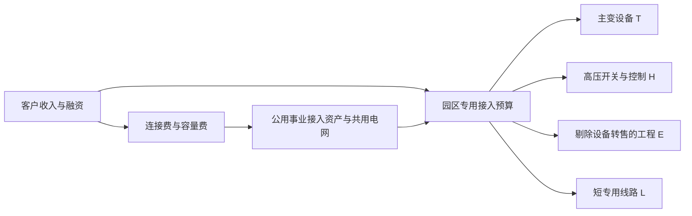

# 数据中心电力接入与高压变电：从“申请兆瓦”到可交付容量与可回收现金
研究截止日期：2026年10月10日。金额模型采用自然年、名义美元；“十亿美元”即USD bn，1十亿美元＝10亿美元。中国、韩国及欧洲企业披露保留人民币、韩元和欧元原值，不以未经确认的汇率拼接收入。2026全年仍是估算，已披露季度与全年预测严格分开。

本报告标记：**F＝披露事实或原机构历史估算，M＝管理层目标/机构预测，C＝直接计算，A＝本报告推断或条件模型，U＝当前无法识别**。F不意味着已经审计或没有测量误差。表内模型点均为可复算的机制代表值；区间另注明条件，均不是统计置信区间。项目内只使用允许的产业背景结果寻找线索，决定性事实独立追到外部原始材料，没有读取项目内其他公司报告、行业报告或评分作为研究输入。

**当前判断：需求正在从可撤回的接入申请，转为有担保的工程承诺；美国合格大主变的交付仍偏紧，但不应把这种紧张推广到全球所有变压器、所有电压和整个十年。** 客户真正买的是特定节点、指定日期、满足故障和动态运行条件的容量。工厂有产能、电网有电量、开发商有合同，各自都不足以保证这个任务完成。

决定判断的五点如下。

1. **订单增长有直接证据，申请规模却远高于可兑现需求。** GE Vernova披露2026上半年数据中心Electrification订单超过50亿美元，但其中包含比本报告更宽的产品范围，而且订单不等于当年收入。AEP Ohio同一批项目从30,000 MW意向，收敛到13,022.7 MW付费研究，再到5,642 MW签约和担保；后者只有初始量的18.8%。两者同时成立：合格项目采购在加速，不能兑现的“兆瓦”也很多。[GEV 2026Q2电话会，2026-07-22，S08](https://www.gevernova.com/sites/default/files/gev_webcast_transcript_07222026.pdf)，[AEP披露，2026-02-13，S03](https://www.aepohio.com/company/news/view?releaseID=10753)
2. **容量先建、负荷后爬坡，是行业的经济核心。** Dominion的实际经验是平均约五年爬坡，成熟后需量/合同容量约63%；这不是年电量负荷率。设备商可能先取得收入，公用事业却要面对园区长期未充分使用、客户减容和再融资风险。最低需量收费保护部分投资回收，不保证整个电力系统或数据中心资本回报。[Dominion向PJM提交材料，2026-09-29，S04](https://www.pjm.com/-/media/DotCom/committees-groups/subcommittees/las/2026/20260929/20260929-item-5ai---dominion_energy.pdf)
3. **技术前沿已从“再大一点的变压器”扩展到动态接入资格。** PJM披露2026年7月22日北弗吉尼亚约4,000 MW数据中心突然退出负荷；客户备用电源维持了本地服务，却给电网造成过电压/频率风险。保护、穿越控制、负荷模型与验收责任的价值可能上升，而单纯增加冗余设备未必解决问题。[PJM，2026-09-10，S15](https://insidelines.pjm.com/reliability-standards-to-manage-large-load-disconnection-events-proposed-by-pjm/)
4. **规模与利润不能同方向外推。** 本报告核心市场只含专用高压接入、主变、高压开关保护、站内工程和短专用线路。2026模型代表值约**151亿美元**，2028悲观/基准/乐观代表值约**121/245/369亿美元**，2030约**125/293/504亿美元**。这些是附录参数下的年度执行支出，不是已统计市场规模。2026全参数角点范围为**62—315亿美元**，揭示基数识别仍很弱；它比三条路径的代表点范围更宽。附录A同时保留按设备装入节奏建站的竞争模型，2026—2030年均约**71亿美元**，显著低于提前建站模型；这个五年平均不能与2026点值直接比较，但说明绝对规模高度依赖工程预留和建站时差。基准2030收入池继续放大，经营利润模型却从2028的约35亿美元回落到约25亿美元，来自净价、配置和成本变化，并非需求逆转。
5. **最强反证不是“AI没有增长”，而是客户先消化已有接入余量、效率改善和共享设计削减新增设备，恰好叠加扩产兑现。** 在这条路径上，用电仍可增长，专用高压新建设支出和制造商利润却可能停滞。尚不能识别的关键数包括全球同规格合格产能、数据中心实际分配到的生产槽位、地区工程存量，以及园区建设与IT设备装入之间的时差。报告以供给阈值和宽参数边界处理这些缺口，未把未知默认为乐观。

## 一、客户任务、边界与钱从哪里来

### 1. 从电网节点到园区中压母线

核心对象是大型数据中心园区的**专用高压接入资产**：通常美国69 kV及以上、中国110 kV及以上，直到主变输出的10—35 kV母线。电压是统计边界，不是判断所有项目都必须采用同一方案。一个园区可能以110/138/230/345 kV接入，也可能先用中压过渡，或连接共享变电站。

客户任务分为四件：取得有约束力的供电日期和允许需量；在N-1等故障条件下持续服务；通过稳态、短路、谐波、暂态和保护协调验收；以可接受的资本、容量费和违约责任锁定长期供电。这里的可靠容量是**地点×时间×电气规格×运行条件×合同责任**的组合，不能通过买一台变压器跨地区自由搬移。

| 池及责任边界 | 本报告处理 | 能否与核心子池相加 |
|---|---|---|
| T：高压/中压主变，含必要备用配置，按出厂设备价值 | 核心设备子池；与数据中心建筑内大量配电变压器分开 | 可以 |
| H：高压AIS/GIS、断路器、互感器及站级保护控制、验收所需动态控制 | 核心设备子池；主变价值不再计入 | 可以 |
| E：专用站设计、土建、安装、调试和项目服务 | 只计剔除T/H采购转售后的工程收入；不是整个EPC合同额 | 可以 |
| L：短距离专用架空线/电缆及其施工 | 线路内材料与工程计一次，不重复计站内设备 | 可以 |
| 区域共用输电网扩建、跨区HVDC、发电、储能 | 影响能否接入；单独讨论增量和成本分配 | 不直接相加，归因和共享比例未知 |
| 园区中低压配电、UPS、BBU、800 VDC、机柜供电及冷却 | 邻接专题；分析替代/新增范围，不纳入本模型总额 | 不相加 |
| 电量采购、PPA、容量电价、连接费及融资 | 解释支付和回收；不能全部当设备市场收入 | 不相加 |

最终资金来自云服务、托管或企业IT客户的收入、股东资金和债务。云公司自建时由资本预算付款；托管商可能先负债建站，再用客户预租承诺融资；公用事业建站时可能使用自有资金，随后由连接费、客户出资和受监管费率回收。设备与电力资产采购多属新增投入，但升级已有变电站、利用园区预留容量、将原本公用事业承担的建设费转给客户，都存在替代或内部转移。

采购者、使用者和验收者不总是同一主体。云公司或园区开发商选择设计和设备，输配电公司/RTO批准接入与运行条件，OEM负责设备保证，EPC负责工程接口，最终停电损失主要由园区和云客户承担；系统失稳、共享电网闲置和交叉补贴风险还可能落到其他用户。客户掌握IT任务是否可迁移，公用事业掌握本地入口，两者共同决定可采用的商业路线。

图中的连接费是资产融资/回收路径；同一资产的建设支出和后续回收费不能再次加成两个设备需求池。实际行业收入还会在材料商、OEM和EPC间多次流转，本报告不把这些周转额当作互不相关的终端需求。

### 2. MW、MVA、IT负荷与电量必须分别计量

本报告的工程需求Q采用“**年度完整接入包的设施设计GW折算工作量**”：各项目按本年完成工作折算，包含分期园区的提前建站、扩建和改造。它不是当年新增已通电GW，不是合同队列总GW，也不是IT装机GW。主变、高压设备、土建和线路的年度进度可能不同，附录用γ分别表达。

主变物理需求＝Q×γ_T×λ；λ为每设施MW对应的已配置主变MVA，含备用/分期配置。功率因数是有功/视在功率关系，N-1是故障后的剩余能力，PUE是设施能耗/IT能耗，年度负荷率是平均/峰值负荷，合同容量利用率又是另一项。把它们合并为一个“利用率”会重复计算冗余或虚增电量。

例如三台63 MVA主变在N-1下剩126 MVA；若功率因数0.98，对应约123.5 MW有功能力，而安装量189 MVA不能直接称为189 MW可用负荷。这个例子是工程计算，不代表行业统一配置。

## 二、需求的独立证据：先筛合同，再看爬坡

### 1. 两套能源预测不能拼成一个市场总数

| 对象与期间 | 原值与性质 | 与本专题的关系及限制 |
|---|---|---|
| 全球数据中心2025→2030 | IEA：485 TWh历史估算；摘要2030约950 TWh预测 | 能耗总锚点；不是设备投资额 |
| 全球设施安装容量2025→2030 | IEA附表：114→226 GW；美国52→100、欧洲17→27、中国28→67，其他地区约17→32 GW | 含已装入设备的设施功率；原报告明确小于最大设计容量，可约束Q与实际装入的关系 |
| 美国2024、2028、2030 | LBNL 2026更新：192、464、649 TWh；后两项为Reference Case预测，2030复合参数范围521—843 TWh | 原模型没有直接加入电网/现场供电约束；不是可保证交付的负荷 |
| 中国2025、2030 | NEA网站转载公开材料：2025约1,700亿kWh；2030约8,000亿kWh为展望 | “算力中心/数据中心”表述与IEA边界、模型不同；2030不能当预算或合同 |

IEA报告于2026-04-16发布。其当前PDF附表A.1/A.4仍列2030 **945 TWh**，摘要列约**950 TWh**；本报告保留这5 TWh差异，视为近似总量/表文差异，不用它制造增长。更实质的冲突是同年度同地区：IEA美国2030为426 TWh、LBNL为649 TWh；IEA中国2025为117 TWh、中国公开材料约170 TWh。可见差异涉及统计识别、服务器出货及使用假设，不能只以换汇或四舍五入解释。未取得完整口径桥梁，因此不将中国800与美国649相加去“证明”全球950错误，也不把一个来源的高预测套到另一个来源的低基数。[IEA报告及附表A，S01](https://www.iea.org/reports/key-questions-on-energy-and-ai)，[LBNL/DOE，2026年6月，S02](https://www.energy.gov/documents/united-states-data-center-energy-usage-report-2025-update)，[NEA转载材料，2026-06-01，S05](https://prpq.nea.gov.cn/hyzx/13899.html)

LBNL给出了一个可复算的美国需求桥梁：2030参考电量649 TWh，按平均接入容量利用率50%，需要约148 GW接入容量，2024—2030平均每年增加17.4 GW。若只改变未来利用率为65%或35%，2030对应约114或212 GW；以原模型2024约43.7 GW为起点，年均新增变为约11.7—28.0 GW。这个范围是单参数压力测试，不能称为LBNL原预测区间。

进一步设新增容量中75%—90%使用本报告的高压边界、提前建站和改造工作折算系数1.2—1.5，得到美国年均约**10.5—37.8 GW**专用高压包工作需求的条件范围。比例和提前系数是A，尚无全国统一实测；底层电量和50%换算来自S02。它足以排除“每一GW申请都会采购”的做法，却不能精确确定某一年收入。附录美国2026基准20 GW、2028 29 GW位于这个宽范围内，2030 36 GW反映晚期交付与提前建下一批园区；仍需签约和供给条件支持。

### 2. 申请、担保、施工和实际需量是不同经济阶段

AEP同一批意向的收敛过程，说明研究费筛掉一批，真正约束资本的合同与担保再筛掉一批。5,642/13,022.7＝43.3%，不能将18.8%或43.3%外推为所有国家、所有年代的固定转换率。AEP另有旧合同12,219 MW，合计17,861 MW，计划逐步上线至2035；不能全部写成2026新增用电。新制度还要求取消或目标通电日前延迟超过12个月的客户补偿建设费用。[S03](https://www.aepohio.com/company/news/view?releaseID=10753)，[AEP现行费率说明，S06](https://www.aepohio.com/company/about/rates/data-center-tariff/)

Dominion提供了更接近实际运营的检验。2026年8月计费峰值约4.8 GW，9月提交的预测同时列容量与需量：

| 自然年 | 预测容量MW（存量） | 预测需量MW（存量） | C：需量/容量 |
|---|---:|---:|---:|
| 2027 | 11,590 | 5,075 | 43.8% |
| 2028 | 12,946 | 5,871 | 45.3% |
| 2029 | 15,122 | 6,661 | 44.0% |
| 2030 | 17,570 | 7,777 | 44.3% |

这些是公用事业的前瞻存量，不是当年新增量，也不是年均用电功率。ELOA工程授权、CLOA施工授权和ESA供电协议约54 GW合计横跨多年和不同确定性，不能再加到上述预测上。该来源以合同、历史爬坡和实际负荷构建预测，因此比裸申请更适合估计兑现；同时只覆盖一个重要地区，不能作为全球平均。[S04，PDF第5、6、10页](https://www.pjm.com/-/media/DotCom/committees-groups/subcommittees/las/2026/20260929/20260929-item-5ai---dominion_energy.pdf)

得州显示另一种筛选。ERCOT于2026-04-15发布2032初步峰值367,790 MW，明确表示高于预期、不代表全部会建成；2026-08-03州长要求审查超过474 GW申请，其中约90%与数据中心有关。年度、覆盖范围和审查阶段不同，两个数字不能做同口径增长计算；审查、设备和燃料网络都可能使有效需求下降。[ERCOT，S07a](https://www.ercot.com/news/release/04152026-ercot-releases-preliminary)，[得州政府审查指令，S07b](https://gov.texas.gov/news/post/governor-abbott-directs-comprehensive-data-center-audit)

欧洲同样需要区分增长与接入资格。爱尔兰CSO统计2025数据中心电量7,663 GWh，较2024的6,973 GWh增长10%，占全国表计电量23%；这是用电事实，不是欧洲高压设备订单。EirGrid目前要求20 MVA及以上需求向输电运营商申请，并有新的数据中心接入流程。其网站版本页未提供足以确认所有条款在截止日执行情况的完整日期链，本报告不把网页当前版本机械写成已在全欧洲实施。[CSO，2026-07-07统计评论，S24](https://www.cso.ie/en/releasesandpublications/ep/p-dcmec/datacentresmeteredelectricityconsumption2025/keyfindings/?trk=article-ssr-frontend-pulse_little-text-block)，[EirGrid申请规则，S25](https://www.eirgrid.ie/industry/becoming-customer/demand-connections)

### 3. 工作负载为什么会扩需求，也可能削减单位投入

本行业对AI的敞口通过**设施最大需量、上线日期、园区规模和可靠性条件**传导，不通过Token数直接传导。简单任务的效率提升会降低每次计算能耗；视频、长推理、代理和实时服务采用可能增加任务次数、运行时长与峰值。训练任务还可能跨时间/地域迁移，实时推理更受时延约束。因此同样的算力收入增长，既可能更多使用已有容量，也可能建设更多园区。

判断需求的优先证据依次是：有信用支撑的容量合同与租约、获批接入方案和关键设备定金、实际施工/调试、计费需量与电量爬坡。公司“资本开支”可能含IT、土地、融资租赁与冷却，不能固定乘一个比例当成高压接入需求。管理层的超大型园区目标只能生成候选项目，不等于本年可交付工作。

当土地、线路或电网先成瓶颈时，继续涨价买主变不能提前整个项目。客户可能将工作负载搬到已有容量地区、提高旧园区利用率、接受可中断合同，或转为现场发电。每种选择都会改变T/H/E/L的数量和价值，而不必改变最终AI任务增长。

## 三、工程前沿：哪些路线已进入付费采用

| 对象 | 截止日阶段及证据 | 影响需求/价格/利润的机制 | 仍需跨过的条件 |
|---|---|---|---|
| 传统油浸大主变、AIS/GIS专用站 | 成熟商业交付；客户仍采购 | 可靠性、短路耐受、损耗和交期；配置简化可降低MVA/MW | 指定工厂资格、运输、站内验收 |
| 无SF6/低GWP高压开关 | 商用产品与法规采用窗口并存 | 更换绝缘/灭弧技术、认证和备件体系；可能带来组合溢价 | 精确电压、开断电流、GWP、豁免及工厂产能 |
| AI负荷穿越、动态模型、站级协调 | 已发生系统事件；PJM正在提出规则 | 取得接入资格，避免共同模式跳闸；价值向控制和系统责任转移 | 最终规则、客户验证、UPS/保护之间的协调 |
| 可调负荷/有条件接入 | Google已签商业需求响应合同 | 更高既有网络利用率，减少或推迟新站/线路；让一部分价值留给客户和公用事业 | 真实可调用容量、违约处罚、负荷恢复与客户SLA |
| 800 VDC与中压SST | 开放规范、原型、产品路线图；规模现金贡献未证实 | 简化中低压变换级数，改变园区下游电气供应商份额 | 大功率可靠性、故障隔离、维修、效率及多供应商互通 |
| 现场发电、发电侧共址、孤网 | 多路线采用阶段不同；共址监管已有动作 | 可绕过某段网络；仍可能需要高压设备、燃料、同步和后备接入 | 燃料/排放、机组交期、备用、网络费用和系统稳定 |

### 1. 可靠性目标正在改变产品责任

PJM的4 GW负荷退出事件至少提出一个新问题：各园区独立保护得越快，同时退出的总负荷可能越大。电网为突然失去负荷准备的调频和控制能力，与为增加负荷准备的变电容量不同。S15披露这是两年内第三次可测的大型事件，并提出电压/频率穿越和负荷爬坡要求，计划11月向FERC提交；**截至本报告日是提案，没有写成已生效标准**。

2026-10-06的更新方案进一步限定大型计算负荷：设施总需量至少50 MW，且至少25 MW最大负荷经电力电子设备供电，关注设施规模而非仅看接入电压。示例要求1.10—1.20 pu过电压维持1秒，符合规定的低压事件恢复后默认2秒内恢复至少90%原负荷；方案强调负荷本身穿越，临时用其他资源代替其耗电不自动合规，须证明技术不可行并获PJM及输电业主书面批准。拟议新项目日期为2027-01-16，过渡设施为2028-01-16与投运后一年中较晚者，均不是截止日已生效义务。**客户“算力不断电”和电网“负荷不突退”有不同验收目标**，MV-UPS、储能或备用机组的产品宣传须经接入点试验验证。[PJM更新提案第3—4、8—9、13页，2026-10-06，S31](https://www.pjm.com/-/media/DotCom/committees-groups/committees/pc/2026/20261006/20261006-item-07-b---1-lcl-ride-through-requirements-solution---presentation.pdf)

A：由此可能出现的价值迁移，是OEM/工程商提供真实负荷模型、保护定值协调、同步验收和在线控制，而不是只卖更高铭牌容量。系统责任同时带来赔偿与验证成本；控制收入高毛利不能忽略责任准备和软件维护。共同保护逻辑、相同固件或同一运行触发条件，都可能形成客户分散却系统相关的风险。

### 2. SF6政策造成规格性缺口，而非整个高压市场同时更换

欧盟Regulation (EU) 2024/573于2024-02-07制定、2月20日刊登。Article 13规定52—145 kV且不超过50 kA的一部分高压开关，从**2028-01-01**起禁止投运使用GWP不低于1的绝缘/开断介质；超过145 kV或超过50 kA的相应窗口是**2032-01-01**。中压还有更早/不同日期，并有采购可得性等例外；这不意味着2026所有既有设备立即退役。[欧盟法规原文，S16](https://eur-lex.europa.eu/eli/reg/2024/573/oj)

经济上，145 kV以下新站可能先出现合格替代设备溢价、测试及项目改版成本；230 kV主干接入的法规节奏又不同。“SF6-free”不自动等于所有GWP门槛合规，须查具体介质。客户可选择AIS、不同电压或变电站占地方案，导致设备价格、土地与土建成本互换。因此本报告H池既有价格指数，也有每GW间隔/配置密度变化，未只用一项ASP代表所有变化。

### 3. 800 VDC改变下游转换，不能代替高压接入

NVIDIA在2026-08-11披露与Google、Microsoft经OCP发布的800 VDC路线：2026年3月白皮书、7月SST规范v0.3；混合电源柜可在已有AC设施内采用，支持最高2 MW/排的电源中心预期2027可用。这是规格与产品路线，不能等同全行业已交付。GEV的5 MW SST原型拟于2026年稍后交首个客户，电话会明确上半年没有SST订单，最早订单展望在2027。[NVIDIA，S17](https://blogs.nvidia.com/blog/800-vdc-power-architecture-ai-factory/)，[GEV电话会第5及13页，S08](https://www.gevernova.com/sites/default/files/gev_webcast_transcript_07222026.pdf)

另一个采用阶段须单独识别：GEV于2026-08-24推出MV-UPS，将缓冲和保护置于设施中压网络；管理层预计2027年中开始发运、首个项目2027年底通电。9月16日仍预计首发订单在2026下半年，SST订单机会则更多在2027。产品推出、客户下单、发运和通电之间仍有阶段差，不能将潜在新增范围当成2026现金贡献；MV-UPS也不能仅凭缓冲功能宣称已满足上述PJM提案。[GEV产品公告，S08c](https://www.gevernova.com/news/press-releases/ge-vernova-introduces-medium-voltage-ups-help-accelerate-buildout-ai-factories)，[GEV 2026-09-16投资者会议第2、7页，S08d](https://www.gevernova.com/sites/default/files/ge-vernova-morgan-stanley-laguna-conference-2026-transcript.pdf)

A：13.8/34.5 kV到800 VDC的转换优化，可以减少下游变压、整流和UPS环节，却不能直接完成230/345 kV电网到园区中压的接入任务。机柜功率密度上涨也不等于设施总MW同步上涨。GEV所述当前约3亿美元/GW的可供范围，以及新产品使范围扩大2—3倍的潜力，是**单厂商、更宽范围、管理层展望**；不能用作本专题全市场单价，尤其不能将转录中分析师的“每MW”口误放大1,000倍。

### 4. 灵活性已经越过概念阶段，但尚未证明普遍替代新建站

Google于2026-03-19宣布与五家公用事业合计签署约1 GW需求响应能力，嵌入长期供电合同。这是商业协议，不是1 GW全年减载，亦不是全部设施已接受逐时调用。EPRI的2026年1月Win-Win Watts研究提出在少数紧张时段调整负荷可推迟电网投入；收益是否落到园区，取决于电价、容量费、调度权和违约条款。[Google，S18](https://blog.google/innovation-and-ai/infrastructure-and-cloud/global-network/demand-response-data-center-milestone/)，[EPRI研究，S19](https://restservice.epri.com/publicdownload/000000003002034619/0/Product)

一个高信息价值的前沿发现来自2026-10-04预印本：在IEEE 123节点衍生的116节点配电模型中，网络重构等电网侧措施使指定节点可承载IT容量提高约42.5%—45%，数据中心侧灵活性单独约2.1%—5.4%。它提示在某些位置，先优化网络可能比要求客户大量停算更有效。但这是约10 MW量级、单节点、模拟结果，未经高压大园区现场证明，不能写成全球高压需求将下降45%。[Fatima与Li，S20](https://arxiv.org/abs/2610.05502)

共址和现场供电也不意味着免费后备。FERC于2025-12-18要求PJM为共址负荷建立透明输电服务规则并保护其他用户；后备、调节和系统费用不能因为机组“在围墙内”就归零。现场路线可降低某些专用线路需求，也可能新增升降压、同步、继电保护和储能设备。[FERC原说明，S21](https://www.ferc.gov/news-events/news/fact-sheet-ferc-directs-nations-largest-grid-operator-create-new-rules-embrace)

## 四、有效供给：缺的常常是获批工厂的交付槽位

### 1. 供给单位必须比“投资多少亿美元”更物理

主变应按指定电压/短路/损耗要求的MVA或等效台数、合格试验槽位和可运输交期分析；高压开关按指定电压和开断电流的间隔/断路器及资格；工程按合格设计、施工、保护调试和验收资源；线路还需要路权、通道与停电施工窗口。工厂美元收入会受价格和组合影响，不能直接当作物理产能。

约束链包括取向硅钢、铜、绝缘、套管、分接开关，绕制和真空干燥、试验系统、熟练人员、运输和现场调试。一个环节多出产能，并不意味着整机同幅增产。更大MVA单台或自动化可能提高产出，却也可能占用更多试验与运输资源。公用事业对工厂和设计的资格认可有长期可靠性意义；客户换供应商必须重新承担设备失效和接口风险。

NLR于2026-07-16发布的水电大主变供应链研究概述，给出典型100 MVA设备采购约2.5—3年，超高压可至5年，单台可能达到1,000万美元。其水电升压用途、位置与运输成本不能直接当数据中心统一报价；报告“2025涨约80%”的累计/同比措辞不够清晰，本研究不用它计算2025同比ASP。[NLR，S12](https://www.nlr.gov/news/detail/program/2026/us-hydropower-faces-supply-chain-challenges-with-large-power-transformers)

IEA 2025输电研究更适合作历史同口径方向锚点：2019—2024变压器实际价格约上涨75%，大主变采购最长约四年。它覆盖所有输电用途，不是2026数据中心成交价指数。现有证据支持美国合格大主变交期偏紧，不足以证明每一个中国110 kV规格都短缺。[IEA输电研究，S13](https://www.iea.org/reports/building-the-future-transmission-grid/executive-summary)

### 2. 已公告扩产要扣除替代、认证和爬坡

| 公司/项目；公开日期 | 披露原值与经济期间 | 对2026—2030有效供给的判断 |
|---|---|---|
| Siemens Energy Grid，2025-11-20 CMD | FY23—25约6亿欧元投入，约20%新增能力；FY26以后约2倍能力计划，至FY28进一步约20亿欧元工厂投入 | 同时含变压器、开关及地产；不能把金额转成数据中心专用GVA。更多依靠既有工厂，较早释放有依据，全部兑现未知 |
| Hitachi Energy Gallman，2026-09-15 | 5.28亿美元，替换Crystal Springs旧厂，目标新厂能力超过旧厂两倍，2029开始生产 | 2026开工不会缓解当年缺口；旧厂迁入，不能按“旧厂＋两倍新厂”计三倍 |
| Hitachi South Boston，2026-06-29 | 4.57亿美元大型主变设施破土，计划825个新岗位 | 破土是执行进展；本次公告没有足以确认完整年度产量的数字 |
| Hyosung Memphis，2025-11-12 | 1.57亿美元扩建，目标2028能力增加超过50% | 与早前翻倍计划可能有基数重叠；本次不能再写成“2028翻倍” |
| Virginia Transformer Rincon，2025-11-20 | 2026年1月起约一年扩建，目标约70%增产、400个岗位，产品30—500 MVA/最高525 kV | 私营对手有真实增供方向；总台数/GVA、按规格分布和资格未披露 |
| GEV现有AIS工厂，2026-07-22 | 2025发货约9,000单位，2026计划约10,500单位 | 计划增幅16.7%；是开关设备单位，不是主变台数，也不是完整变电站数 |

来源：[Siemens CMD第7页，S10](https://assets.siemens-energy.com/dam/d8d5d849-a7a9-4b19-a969-b39b004f6c26/251120_CMD-2025_Grid_Technologies_FINAL-pdf_Original%20file.pdf)，[Hitachi Gallman，S11a](https://www.hitachienergy.com/news-and-events/press-releases/2026/09/hitachi-deepens-commitment-to-u-s-manufacturing-with-528-million-mississippi-transformer-factory)，[Hitachi South Boston，S11b](https://www.hitachienergy.com/us/en/news-and-events/press-releases/2026/06/hitachi-energy-breaks-ground-on-the-nation-s-largest-facility-for-the-production-of-large-power-transformers-in-south-boston-virginia)，[Hyosung发行人公告，S14](https://www.prnewswire.com/news-releases/hyosung-chairman-cho-hyun-joon-announces-major-expansion-of-memphis-power-transformer-plant-302639733.html)，[Virginia Transformer，S23](https://www.vatransformer.com/expand-georgia-transformer-plant-in-rincon/)，[GEV电话会，S08](https://www.gevernova.com/sites/default/files/gev_webcast_transcript_07222026.pdf)。

A：2026—2027更可能由加班、流程改善、进口调配和既有工厂扩建增加交付；2028开始出现较明显新增能力，2029—2030才有更多新厂产出。开关和主变的供给反应可以不同。缺口缓解让客户得到更低价格、更少等待，OEM却可能失去溢价；EPC则可能同时受益于更易获得设备、受损于劳工工资和固定价履约。

### 3. 地缘政策直接改变合格供给集合

美国2026-08-26行政命令覆盖大电力系统相关设备及软件、固件、维护和远程访问。其禁止机制涉及被覆盖外国实体关联和能源部长风险认定，并要求120天内制定实施规则；定义包括69 kV及以上输电，不包括当地配电。**截至截止日，不能写成所有外国或所有中国变压器已被全面禁用。**[白宫原文，S22](https://www.whitehouse.gov/presidential-actions/2026/08/declaring-a-national-emergency-to-secure-the-united-states-bulk-power-system/)

A：政策若缩小可用工厂/关键部件名单，全球总MVA即使足够，美国合格交付能力也可能下降。现有当地工厂、可验证控制系统和跨工厂资格渠道会取得更多订单；客户可能为本地来源多付费，设备商却承担重新采购、审查和库存成本。软件与远程维护也可能形成新增认证壁垒。模型以“合格系数”处理这种变化，没有把尚未出台的细则当既定产能损失。

## 五、价格、利润与资本：谁真正留下价值

### 1. 项目预算说明单价的分母可以制造假增长

Dominion于2026-04-07提交两项专用接入工程预算：

| 项目与当时状态 | 设施负荷/配置 | 公布工程预算原值 | C：对未来设施负荷的比值 |
|---|---|---|---|
| Auto World，概念阶段 | 初始夏季26 MW；2030夏季282.6 MW；230 kV GIS六断路器环网 | 总3,180万美元：线路830万，站2,350万；客户GIS额外设施费不含 | 约11.25万美元/MW；若除初始26 MW则122.3万美元/MW |
| Firehouse，工程阶段 | 初始209 MW，2030 234 MW；230 kV四断路器环网 | 总6,430万美元：线路2,360万，站4,070万 | 约27.48万美元/MW |

日期也改变：Auto World要求上线时间从2026-06-15调整至2027-12-17；Firehouse从2028-01-31调整至2030-12-31。预算是当时估算，未证明已经按该成本完工；客户侧全部主变等是否包含不能默认。它们适合约束部分工程成本，不是全球平均全包价。[Dominion TEAC，S09，PDF第9—12页](https://www.pjm.com/-/media/DotCom/committees-groups/committees/teac/2026/20260407/20260407-item-09---dom-supplemental-projects.pdf)

A：Auto World用初始负荷或远期负荷作分母，单价会相差约10.9倍，设备和工程却没有因此涨跌10.9倍。园区放大、先建预留、利用既有通道，都会改变美元/MW。成交价比较必须保持额定规格、范围、交期、贸易责任和付款条件相同。客户支付的“加急价”还可能是额外库存、备用设备或风险转移，并非OEM同一台设备的净价上涨。

附录美国2026模型全包约43.2万美元/设施MW，主变约10.2万、高压设备7万、站内工程18万、专用线路8万。它高于上述部分公用事业预算但包含更完整的客户/站内范围；对地下长线路、超高压主干或少量初始负荷可能仍低估，因此参数角点刻意保留宽度。

### 2. 企业利润证据支持结构分化

| 企业/披露；对应经济期间 | 收入、利润及原口径 | 能证明与不能证明的事 |
|---|---|---|
| GEV；2026Q2，2026-07-22发布 | Electrification收入36.37亿美元，报告增长68%、有机增长29%；EBITDA 6.71亿美元、18.4%；Prolec季度收入约8.60亿美元 | 有机经营改善真实，但并购/组合占部分增长；全板块不是数据中心高压净利润 |
| Siemens Energy；FY2026Q3即2026年4—6月，2026-08-05发布 | Grid Technologies收入36.24亿欧元，特殊项前利润7.22亿欧元、19.9%；订单53.67亿欧元 | 已出现较强经营杠杆；利润定义与GEV EBITDA不同，不能直接排序ROIC |
| 思源电气；2026H1，2026-08-15发布 | 开关收入4,330,395,746.48元、毛利率39.06%，+3.67pp；变压器2,260,573,136.03元、36.36%，+0.93pp | 设备改善支持产品/效率/组合机制，AI收入占比未知 |
| 同一思源EPC及海外 | EPC收入1,117,365,345.83元，+38.42%，毛利率10.88%，-1.82pp；海外收入3,183,105,281.33元，毛利率33.39%，-2.30pp | **增长和出海不自动扩利润**；海外与产品分类有重叠，不能相加 |

来源：[GEV SEC业绩附件，S08b](https://www.sec.gov/Archives/edgar/data/1996810/000199681026000147/gevpressrelease2q26.htm)，[Siemens业绩文件，S10b](https://assets.siemens-energy.com/dam/30018eed-275d-4e73-811e-b49d004cdc3d/2026-08-05-Earnings_Release_Q3_FY26_EN-pdf_Original%20file.pdf)，[思源半年报第10—11页，S26](https://static.cninfo.com.cn/finalpage/2026-08-15/1225473691.PDF)。

2026-09-16，GEV CEO补充：2025数据中心Electrification订单约20亿美元，2026上半年超过50亿美元，但订单集中、具有波动性；上半年约占板块订单40%，预计Q3/Q4更接近20%，不大可能保持上半年的约25亿美元季度节奏，仍预计积压增长。这是管理层预期，不是Q3/Q4实际结果。A：合格需求增长与订单阶段性降速可以同时成立，不能把H1金额机械乘二，也不能把订单占比下降直接解释成终端需求衰退。[GEV会议全文第6—7页，S08d](https://www.gevernova.com/sites/default/files/ge-vernova-morgan-stanley-laguna-conference-2026-transcript.pdf)

价格通过旧订单交付和新订单重定价分批进入损益，不会在短缺出现当天全量传导。固定价OEM订单承担铜、钢和人工上涨；原材料公式、预付款、变更单和延期条款可转移部分风险。EPC有设备到货、土建、接口和竣工赔偿责任，设备转售放大收入而未必放大增加值。思源设备按控制权转移、部分工程按履约进度确认，进一步说明工程收入与收款/最终通电不同步。

GEV本期收购Prolec也增加全球工厂向美国供货的能力：上半年约8亿美元美国变压器订单由全球工厂履行。A：资格、客户渠道和系统责任可以把原有物理产能变成新的**有效**供给，价值不必全部来自新建厂房。后续回报仍需扣除收购资本，不能把“订单渠道增加”理解成无成本产能增长。

### 3. 100 MW接入资产的同边界现金检验

AEP宣传常概括为“85%最低付款”，实际文件是分段最低计费需量：25—75 MW段为15＋85%×(K−25)；超过75 MW为57.5＋(K−75)，合同部分上限85%×K；还要与过去11个月计费需量的85%等比较。由合同公式，50 MW的下限为36.25 MW、100 MW为82.5 MW、300 MW受上限约束为255 MW。它是容量/需量收费规则，不能写成未用电量也必须按85%的MWh支付。[S06](https://www.aepohio.com/company/about/rates/data-center-tariff/)

下面只测**专用接入资产**，不测整个AI园区回报，也不假装复现AEP账单。假设100 MW资产建造费4,320万美元，年维护费1.5%即64.8万美元，寿命30年、名义税前贴现率8%；第15/25年各更新控制设备200万美元，第30年残值432万美元。模拟需量为首四年20/35/50/60 MW，之后63 MW；63仅用于压力检验，不表示所有客户相同。假定资产回收费5美元/kW/月，**不是AEP实际费率，更不含能源、发电容量及全部共享网络费**。

保护例按最低爬坡合同容量50/65/80/90 MW对应合同公式，计费需量为36.25/49/62.5/72.5 MW，随后82.5 MW。实际合同可能选择更高爬坡容量和计费棘轮。本例“12年后减容”假定依规则提前通知、获得合法减容，不表示合同届时自动终止。

| 模型安排 | 资产业主初始净投入（百万美元） | 30年税前NPV（百万美元） | 令NPV＝0的资产费（美元/kW/月） |
|---|---:|---:|---:|
| 完全按实际需量回收 | 43.20 | -13.01 | 6.71 |
| 爬坡＋前12年最低需量，随后依法减容 | 43.20 | -5.30 | 5.58 |
| 最低需量保持30年 | 43.20 | -0.95 | 5.09 |
| 前12年保护＋客户预付20%建造费 | 34.56 | 3.34 | 4.63 |

C：收费保护使NPV从约-1,301万美元改善至-530万美元，却仍未在这些假设下覆盖长期成本；长期保持最低需量或客户建设出资才进一步改善。预付20%并不减少全系统成本，它把864万美元初始资金转给客户。降息、复用资产和更高实际负荷可提升回报，延期、追加线路和失去接续客户则使回报恶化。年金法忽略爬坡会高估早期回收，资产残值也不能当确定现金。

客户愿意为交期付款还有一个独立逻辑。假设已安装20亿美元IT资产因接入推迟半年、资金成本8%，单是资金占用约8,000万美元；同一100 MW例子主变成本约1,020万美元。A：提高主变付款以抢交期可能有经济合理性，但这只有在主变确实位于项目关键路径、提前交付可实际提前上线时成立。OEM不能自动捕获全部等待损失。

### 4. 高利润与高资本回报之间还有库存和再投资

制造商要先投工厂、材料、在制品及试验能力；工程商要投施工资源、担保和应收款；公用事业则把资本锁定在长寿命、地点专属资产。客户预付款可以降低净营运资本，订单取消时却可能须退款、重排生产或持有定制库存。设备收入确认和最低需量收费也不保证现金已收。

A：一个纯示例制造业务年收入100、EBIT 22、税率25%，NOPAT为16.5；若投入资本100，ROIC为16.5%，投入资本200则仅8.25%。相同经营利润率可以有完全不同资本回报。并购商誉、扩产期间未达产资产、质保和预付款负债必须按一致边界处理。本报告不使用GEV/Siemens分部利润除以不匹配的资产去报“数据中心ROIC”。

行业现金估计目前不能与经营利润一一对应。以每新增10亿美元执行支出为例，若净营运资本占新增支出10%—25%，需要额外1亿—2.5亿美元；若取得预付款，现金压力会减少或反向。该占比仅为融资敏感性，不能当行业实测。资本开支、税、营运资本与预付款变化不足以全行业识别，故附录利润池没有伪装成自由现金流。

## 六、竞争地图与价值捕获条件

| 参与者/代表公司 | 技术与经济位置 | 可能留住的价值 | 放量、利润与资本的不同条件 |
|---|---|---|---|
| 公用事业/RTO：Dominion、AEP、ERCOT/PJM，以及各地输配电运营商 | 控制节点、接入研究、系统验收和运行条件；RTO本身不等于设备业主 | 合同、连接费和获准计费的资产回收 | 须得到监管成本回收、客户信用与实际需求；投得多不保证所有投资计入费率 |
| 云客户/自建设计方：Google、Microsoft、Amazon、Meta；托管/园区开发商 | 控制预算、工作负载、园区设计与供应商集中采购 | 旧容量复用、标准化和批量议价；采用灵活性后可保留节省 | 新项目须有客户采用和融资；SLA、地域约束和违约责任限制灵活性 |
| 大型系统OEM：Hitachi Energy、Siemens Energy、GEV/Prolec | 主变、开关、站级集成与全球工厂资格 | 合格交期、系统保证、既有设备和服务网络 | 订单必须可交付、价格保护高于投入成本、工厂爬坡与客户预付覆盖再投资 |
| 韩国、日本设备商：Hyosung/HICO、HD Hyundai Electric、Mitsubishi Electric及Toshiba系 | 指定高压设备与跨区域制造；各公司电压、工厂和产品不同 | 当地工厂、长期可靠性、产品与客户资格 | 总制造能力不等于美国可用能力；原产地/部件、运输和售后决定可交付份额 |
| 中国设备商：特变电工、思源电气、中国西电/平高等 | 主变、GIS、保护与工程，具备不同电压/区域的产业链能力 | 国内电网/工业入口、工程协同、合格出口 | 数据中心占比和美国可采购范围不透明；产能可转移不等于客户可直接替换 |
| 私营/非上市：Virginia Transformer、Delta Star及区域厂商 | 主变、移动站、维修与区域快速响应 | 规格灵活、熟悉客户现场和维护需求 | 扩建、工厂资格、关键部件和熟练人员；最大单机MVA不能当年产GVA |
| EPC/集成：Quanta及地区公用事业承包商 | 设计、线路、站安装、调试、项目责任；Quanta还含变压器制造业务 | 项目接口、可兑现工期、资源调度和风险定价 | 不能只比较总合同收入；设备转售、固定价赔偿和现金占用可能吞掉增量利润 |
| 核心部件与材料：分接开关、套管、绝缘、铜与取向硅钢厂商 | 影响可靠性、试验及整机节拍；不是全部终端需求 | 当合格部件难替换时有局部议价力 | 标准化、双供认证与OEM采购规模可压缩利润；不能把全部上游涨价都归因AI |
| 下游/替代生态：Schneider、Eaton、UPS/SST及开放硬件参与者 | 中低压、功率变换和园区架构；与本专题存在接口 | 新架构系统份额、服务与管理能力 | 800 VDC商业交付可改变份额，不能假设已替代上游主变；标准开放也可能降低独占性 |

这是一张责任和竞争机制地图，不是市占率排名；没有足够数据提供截止日全球同规格份额。Quanta的2025年10-K（2026-02-19发布）直接描述数据中心高压站、主变和输电接入以及低压关键路径服务，并披露变压器制造设施。因此“EPC只赚施工费”的分类也过于粗糙，合并报表需重新拆边界。[Quanta 10-K，S28](https://investors.quantaservices.com/sec-filings/all-sec-filings/content/0001050915-26-000006/pwr-20251231.htm)

HD Hyundai官网2026-07-28披露Q2收入1.1418万亿韩元、营业利润2,870亿韩元，C：约25.1%营业利润率；7月2日披露与全球科技客户最大1.1212万亿韩元电力基础设施合同。前者是全公司，后者“最大金额”须保留限定，均不是本报告高压子池实际收入。[发行人新闻，S27](https://www.hd-hyundaielectric.com/elect/ko/PR/newsList.jsp) 特变电工的官网列35—500 kV站用变压器及数据中心用电侧方案；三菱官方电力系统产品页列变压器和高压开关。产品目录证明技术覆盖，不证明指定客户采购资格或AI收入。[特变电工，S29](https://www.tbea.com/transformation/1.html)，[三菱产品页，S30](https://www.mitsubishielectric.com/eig/energysystems/products/transmission/)

规模尚小的改变者未必是新型主变OEM。移动变电、重用退役电力资产、承接整套通电责任的开发商，以及把计算调度与电网运行共同优化的软件团队，都可能缩短交付或降低每GW新设备量。开放规范让客户更易多供，也可能把收益交还给客户。截止日这些新模式缺少足以量化全球收入的独立数据，本报告给出机制与验证门槛，未编造份额。

## 七、联合情景：增长、供给释放和利润回落可以同时发生

### 1. 情景的含义与可比性

P（悲观）：客户回报/融资转弱，消化既有容量，标准化减少冗余与新间隔；扩产按较顺利路径释放，新订单竞争压价。电量仍增长，设备新建投资可停滞。固定资产、人员及在制品不会同步消失。

B（基准）：已签合同逐步兑现，训练/推理采用继续增长，全球能源基准约束规模；2026—2028有积压订单，既有工厂与部分新厂提高产出；2029—2030交期缓解、配置效率和竞争降低每GW硬件变现，而人工与线路成本较难回落。这最符合当前合同、订单和扩产证据，**不是P与O的算术平均**。

O（乐观）：高能耗任务的付费采用与融资更强，大园区更快推进；供给也扩张，但需求抢占合格槽位，可靠性及法规组合使设备净价较高。工程劳工、运输和投产成本同步上涨，E/L利润率没有随T/H一同跃升。若高压上游、发电或许可未能同步释放，O中的需求会留在订单而不是收入。

三条是有解释力的代表路径，未列全每种冲击组合，也没有赋予相加100%的完整概率权重。例如“弱需求但扩产也失败”和“强用电但极高效率”可以落在表外。参数表足以独立改动这些变量。

| 自然年/性质 | Q：完整包GW，P / B / O | 主变物理GVA，P / B / O | 核心执行支出，P / B / O（十亿美元） | 经营利润模型，P / B / O（十亿美元） |
|---|---:|---:|---:|---:|
| 2025，同口径历史模型A | 30.00 | 56.68 | 9.53 | U，不反推历史利润 |
| 2026，全年估算 | 37.50 / 43.00 / 51.00 | 70.76 / 81.12 / 96.25 | 13.16 / 15.15 / 17.85 | 1.68 / 2.13 / 2.74 |
| 2027，前瞻A | 38.50 / 53.00 / 66.00 | 69.11 / 96.38 / 125.36 | 13.11 / 19.92 / 26.43 | 1.06 / 2.88 / 4.60 |
| 2028，前瞻A | 37.00 / 62.00 / 83.00 | 61.88 / 106.60 / 155.64 | 12.08 / 24.46 / 36.86 | 0.27 / 3.53 / 7.02 |
| 2029，前瞻A | 39.00 / 70.25 / 98.50 | 60.89 / 114.86 / 180.67 | 12.30 / 26.94 / 43.64 | 0.19 / 3.12 / 7.48 |
| 2030，前瞻A | 41.00 / 78.50 / 114.00 | 59.60 / 121.90 / 204.45 | 12.52 / 29.29 / 50.45 | 0.10 / 2.54 / 7.70 |

**统计边界：全球全部数据中心，专用高压接入T＋H＋E＋L；表中每年均为流量，金额为工程执行价值。** 分期进度和收入确认使它与当年终端现金付款、公司合并收入有差异；γ只是显式近似，不能声称已完成逐合同收入对账。2025也是同口径研究模型，不能冒充历史统计事实。2030 P/B/O是情景代表点，未来不确定性不限于这三个点。

2026同价格配置下P/B/O只改变全年Q，故金额约132/151/178亿美元。附录全参数角点则为62—315亿美元，可能同时改变Q、主变配置、报价和线路长度。这个较宽区间不附概率、不是“95%覆盖”；宏观数据缺少园区工程存量导致范围无法合理收窄。

### 2. 重要子市场保留全部路径

金额均为十亿美元；经营利润是附录经营成本模型，包含固定经营费和折旧预算，未扣利息/税，也未扣资本开支。2019—2024价格涨幅没有直接套入未来表。

| 子市场 | 2025历史模型R；2026基准R / 利润 | 年份 | R：悲观 / 基准 / 乐观 | 经营利润：悲观 / 基准 / 乐观 | 对应经营利润率：悲观 / 基准 / 乐观 |
|---|---:|---:|---:|---:|---:|
| T主变 | 2.39；3.92 / 0.86 | 2027 | 3.15 / 4.94 / 7.04 | 0.38 / 1.11 / 2.01 | 11.9% / 22.5% / 28.6% |
| T主变 | 2.39；3.92 / 0.86 | 2028 | 2.64 / 5.75 / 9.90 | 0.01 / 1.29 / 3.19 | 0.5% / 22.4% / 32.2% |
| T主变 | 2.39；3.92 / 0.86 | 2029 | 2.48 / 5.96 / 11.26 | -0.03 / 1.17 / 3.26 | -1.0% / 19.5% / 29.0% |
| T主变 | 2.39；3.92 / 0.86 | 2030 | 2.32 / 6.09 / 12.48 | -0.07 / 0.99 / 3.20 | -2.8% / 16.3% / 25.6% |
| H高压开关及保护 | 1.78；2.80 / 0.56 | 2027 | 2.33 / 3.58 / 4.97 | 0.30 / 0.77 / 1.27 | 12.8% / 21.5% / 25.6% |
| H高压开关及保护 | 1.78；2.80 / 0.56 | 2028 | 2.06 / 4.27 / 7.01 | 0.12 / 0.96 / 2.00 | 5.7% / 22.5% / 28.6% |
| H高压开关及保护 | 1.78；2.80 / 0.56 | 2029 | 1.98 / 4.45 / 8.01 | 0.06 / 0.88 / 2.06 | 3.2% / 19.7% / 25.7% |
| H高压开关及保护 | 1.78；2.80 / 0.56 | 2030 | 1.89 / 4.56 / 8.93 | 0.01 / 0.76 / 2.02 | 0.4% / 16.5% / 22.6% |
| E站内工程服务 | 3.52；5.53 / 0.44 | 2027 | 5.03 / 7.51 / 9.47 | 0.25 / 0.62 / 0.82 | 5.0% / 8.2% / 8.7% |
| E站内工程服务 | 3.52；5.53 / 0.44 | 2028 | 4.91 / 9.58 / 13.13 | 0.11 / 0.78 / 1.14 | 2.3% / 8.2% / 8.7% |
| E站内工程服务 | 3.52；5.53 / 0.44 | 2029 | 5.25 / 11.00 / 16.11 | 0.13 / 0.69 / 1.37 | 2.5% / 6.3% / 8.5% |
| E站内工程服务 | 3.52；5.53 / 0.44 | 2030 | 5.60 / 12.47 / 19.28 | 0.16 / 0.54 / 1.61 | 2.8% / 4.4% / 8.3% |
| L专用接入线路 | 1.84；2.89 / 0.26 | 2027 | 2.59 / 3.88 / 4.95 | 0.13 / 0.38 / 0.49 | 4.9% / 9.7% / 10.0% |
| L专用接入线路 | 1.84；2.89 / 0.26 | 2028 | 2.47 / 4.87 / 6.82 | 0.02 / 0.49 / 0.69 | 0.9% / 10.1% / 10.1% |
| L专用接入线路 | 1.84；2.89 / 0.26 | 2029 | 2.59 / 5.52 / 8.26 | 0.02 / 0.39 / 0.79 | 0.6% / 7.1% / 9.6% |
| L专用接入线路 | 1.84；2.89 / 0.26 | 2030 | 2.71 / 6.18 / 9.76 | 0.01 / 0.25 / 0.88 | 0.3% / 4.0% / 9.0% |

负利润是特定固定投入和价格条件下的模型结果，不表示所有OEM都会亏损；领先企业可保留资格、服务、成本优势或转向其他客户。汇总利润也不是全球已披露公司的净利之和。

B路径2028→2030：T的MVA/GW降低、单MVA净价指数1.10降到1.02，H的每GW间隔配置下降，工程与线路投入成本继续上升。数量摊薄固定费用能维持收入增长，却不足以完全抵消单位贡献压缩。因此“更多GW＝更高利润率”在模型中被直接检验，而没有被默认。

### 3. 供给独立建模与同口径交叉检验

公开扩产材料没有提供各OEM按电压/客户资格划分的绝对GVA，不能直接报一个全球“有效供给X GW”。本报告采用两个相互约束的量：**实际项目需求对应的GVA交付门槛**，以及**欧洲＋北美大中型电力变压器全用途合格供给指数**。指数不是数据中心独占产能，也不包含全球所有配电变压器。

供给模型的起点为2025合格年交付能力＝100。按既有厂扩建、新厂建设时点、测试/人员爬坡和资格可用性独立估计新增比例，附录列出全部参数。需求模型另用客户工程量、主变配置和非数据中心电网需求增长推导；未用需求倒算厂商扩产来“证明平衡”。

为演示初始紧张程度，取2025全用途需求指数D0＝120、其中数据中心GVA占20%。这两项是**未获行业统计确认的条件锚点**，不是Siemens市场图或订单金额的直接换算；敏感性使用D0＝110—145、份额15%—30%。非数据中心全用途GVA增长P/B/O分别2%/4%/6%每年。将地区、MVA和期间统一后，有：

| 路径/时期 | 同规格全用途需求指数D | 合格交付指数C | (D−C)/C | 更符合的含义 |
|---|---:|---:|---:|---|
| P弱采用＋扩产顺利，2028 | 129.2 | 176.0 | -26.6% | 新流量可覆盖需求，旧积压仍须消化 |
| P弱采用＋扩产顺利，2030 | 132.3 | 218.8 | -39.5% | 新流量可覆盖需求，旧积压仍须消化 |
| B合同兑现＋扩产爬坡，2028 | 160.6 | 161.0 | -0.3% | 新流量可覆盖需求，旧积压仍须消化 |
| B合同兑现＋扩产爬坡，2030 | 176.4 | 202.5 | -12.9% | 新流量可覆盖需求，旧积压仍须消化 |
| O强采用＋扩产顺利，2028 | 190.3 | 176.0 | 8.1% | 新流量仍有缺口，排队/价格压力 |
| O强采用＋扩产顺利，2030 | 226.9 | 218.8 | 3.7% | 新流量仍有缺口，排队/价格压力 |

正值表示同年新工作需求超过有效能力，负值表示流量有余量；不能称为实测缺口。B在2028接近流量平衡，但仍有旧积压；2030增加的能力可用于消化积压。若供给仅按缓慢路径到2028指数123.3，而需求仍为B的160.6，则约23%请求工作不能按期完成；价格上升不能把这些未交付设备变成收入，市场执行值应下修或递延。

B的2028平衡条件为D0不超过约120.3；2030为约137.7。若D0和数据中心份额取敏感性范围，B需求指数2028约141—209、2030约155—232，对比供给161/202.5后，仍可落在短缺或有余量两侧。因此“2030一定过剩”没有证据支持。更可靠的判断是：**2026—2027美国指定主变槽位偏紧；2028—2030供给反应有实质机会改变新单定价，实际转折取决于合格产出与旧积压，而非公告投资额。**

其他子池的供给不能共用这张主变指数表：

| 子市场 | 2026基准年度需求/执行工作 | 2028 P/B/O所需年度交付或履约门槛 | 2030 P/B/O门槛 | 供给侧可观察证据和未识别处 |
|---|---|---|---|---|
| T主变 | 81.1 GVA全球；其中美国37.4 GVA | 61.9 / 106.6 / 155.6 GVA | 59.6 / 121.9 / 204.5 GVA | 需扣除公用事业、发电与其他工业已占槽位；基准2026约541台150 MVA等效台，不是541座站 |
| H高压开关/保护 | 45.15 GW完整包等效设备工作 | 37.74 / 63.24 / 84.66 GW | 41 / 78.5 / 114 GW | 用间隔/电压和动态控制资格约束；GEV AIS单位增供不能直接转换成全球包数 |
| E站内工程服务 | 38.7 GW工程包等效工作 | 36.26 / 60.76 / 81.34 GW | 41 / 78.5 / 114 GW | 相对2026分别约0.94/1.57/2.10倍工作；基准需增加人员有效产出约57%，不是仅涨收费；实际授权调试团队总量U |
| L专用线路 | 40.85 GW工程包等效工作 | 37 / 62 / 83 GW | 41 / 78.5 / 114 GW | 线路长度/地下化随选址变；路权与停电窗口可能使设备到货也不能通电；没有全行业可加的km/GW |

这些门槛是收入模型成立所需的能力，不是由收入倒推的供给“证据”。H/E/L的行业绝对能力仍未知；真实项目延期、公司现有工厂产出和人员投入分别构成方向证据。O对E/L要求尤其高，若工资、资质人员或许可不支持，不能只兑现T/H销量便宣称整座园区已可运营。

积压也有独立时钟：B_t＝B_{t-1}＋新订单−交付−取消。即使某年新订单＝交付，旧积压也未消失。一个产出100、年新需求100、旧积压150的示例，仍有约1.5年工作排队；新订单价回落与旧订单利润入账可以同时出现。以未来期末生产运行率替代全年交付，会进一步高估市场规模。

### 4. 额外分支：用电放量，而新增高压价值减少

“灵活接入＋大园区共享配置”的突破是B的可选子分支，不是把增速换得更高。以2028 B为母路径，在采用已证明可调用的负荷灵活性、接入合同明确、旧网络有可复用余量条件下，假设新建包Q减少10%、主变配置再降10%，每GW控制/保护内容增加10%，工程和线路单价/变动成本各降6%，固定预算暂不下降。

C：该分支的核心执行值约**211亿美元**，低于母路径245亿美元；主变约**86.3 GVA**，低于106.6；经营利润模型约**28.5亿美元**，低于35.3。同时假设已投运园区利用提升，使可供计算服务/实际负荷相对母路径增加10%。这10%是采用条件，不能把它称为已观测效率收益，电量与服务收入也不自动同比增加。

价值分配由此改变：客户和公用事业节省新建资本、提高旧资产使用；控制/验收服务份额增加；新增主变和线路的收入减少。若只是把可调用合同写在纸上、频繁调用导致客户付费业务损失，或故障场景下仍需全部新增设备，这条突破就不能成立。它不依赖SST在2028全面商业化，亦不把配电模型45%增容外推到高压系统。

## 八、演进节奏、可证伪判断与概率

### 1. 阶段不由单次公告决定

| 时间/阶段 | 从进展到产业规模须满足什么 | 领先指标与滞后结果 |
|---|---|---|
| 2026—2027：合同筛选与旧订单交付 | 已融资客户、可接受供电日期、设备定金及接入研究完成 | 担保ESA、施工授权、取消率；之后才是设备出货/工程确认，最终才是用电爬坡 |
| 2027—2028：扩建、法规和动态运行验证 | 既有厂测试/人员产出提高，低GWP规格合格，新的负荷要求可验收 | 同工厂同规格产出、客户替换和新单净价；更宽设备产品路线可能先带来研发成本 |
| 2029—2030：新厂、旧积压与再定价 | 新厂良率/资格达到可用水平，旧合同完成，订单再签足以利用新能力 | 新单报价/取消、库存和在制品；损益可能仍反映两三年前较高价格 |
| 2030以后：资产回收与架构替代 | 园区持续付费、依法续约/减容、资产可复用；新电气架构达到寿命可靠性 | 现金、客户流失、设备替代和维护贡献；期末名义产能不能当全年收入 |

更大的主变或多一个备用回路只证明产品/工程进展；建站、通电、装入计算设备、付费负荷和现金贡献必须逐阶段确认。现场发电、共址与更低PUE可能改变其中某些环节，但不会同时解除路权、保护协调和融资约束。

### 2. 最强反面解释与区分证据

**反面解释H0：现在的设备订单主要是提前建设与防御性占槽位，未来负荷可通过填满旧园区、效率提升和共享变电设施兑现；工厂扩产在需求尚未充分爬坡时就削弱新单价格。**

支持H0的证据是AEP大幅过滤申请、Dominion长爬坡和容量/需量差距、客户灵活性商业合同、多个厂家扩建，以及设备/工程利润已经不同方向变化。反对H0的证据是有担保合同仍有实质规模、GEV数据中心订单加速、Siemens的变压器需求与现有产出增长、现有长交期与实际网络接入延期。两边都是真实经济机制，不能用“AI会增长”一次性否定H0。

| 可观察量 | 支持需求兑现/持续溢价 | 支持H0/价值流失 | 阈值的性质 |
|---|---|---|---|
| 同一批有担保项目12个月内取消/延期 | 较低且现场施工进展；实际需量按客户路径提高 | 取消、减容与延期同时上升 | 研究预警可暂取>20%工程量延期，不是行业标准；需剔除一次性政策冲击 |
| 主变新单同规格、同贸易条款交期 | 仍>24个月且厂家合格产出未明显增加 | 连续两个季度交期<18个月，同时净价下调 | 18/24个月是研究判别窗，不能把少量加急现货推广成中位数 |
| 新订单与旧积压 | 量增、定金/取消约束有力，旧积压有序交付 | 预付款减弱、在制品增加、闲置产线 | 须按MVA/规格核对；订单美元增加可能只是提价 |
| 园区合同容量与装入/实际需量 | 使用增加且新增合同仍强 | 使用增加但新高压包/GW显著下降 | 若同边界T/H单位内容累计降20%以上，会下修设备池；20%为模型敏感性阈值 |
| 工程毛利与现金 | 变更单/人工转嫁，应收与现金不恶化 | 收入增、利润和现金转弱 | 应同合同范围比较，不把采购转售增长当工程生产率 |
| 可调负荷 | 确实调用，SLA达标，获准减少建设或提前接入 | 只有签约量，仍需完整后备投资 | 衡量实调用、恢复斜率和避免的建设费；1 GW宣布量不等于1 GW容量释放 |

### 3. 概率只用于可界定事件

以下均为本报告主观研究判断，缺少可训练的行业频率样本；给宽范围，依据来自现有合同、厂商扩建时滞与商用采用阶段。它们不是统计置信度，且彼此相关，**不得直接相乘或加总**。

| 事件/成功标准及期限 | 概率类型与判断 | 依据、未知及上调/下调条件 |
|---|---|---|
| 至2028年底，美国/欧洲常见100—300 MVA、145—245 kV新采购项目，代表性合格订单交期仍超过24个月 | 无条件事件概率60%—80% | 今日长交期、旧积压与2029新厂支持；若多个合格工厂连续季度产出明显超计划、取消增多、新单普遍<18个月，则下调。当前没有行业交期中位数普查 |
| 2030全球本报告核心年度执行值比2026同口径高至少30% | 无条件事件概率55%—75% | 能源/容量增长与已签约支持；配置下降、旧容量消化和竞争压价反对；2026基数自身未知使概率宽。应以同一边界修订两年基数，不能选择高低不同版本 |
| 2028至少10%的新增≥100 MW园区接入容量采用可执行的灵活/有条件合同，并有调用与SLA证据 | 无条件事件概率20%—40% | 已有Google商业合同，但跨公用事业复制、实时业务可迁移和实际避免资本未知；若合同授予可量化提前接入并披露实调用则上调 |
| 上节“少建高压设备、更多利用已投运园区”的行业分支按给定2028量级兑现 | **P(突破分支｜B母路径)约20%—35%** | 额外要求可复用电网余量、可执行调度、共享可靠性与收费激励；不是仅有一个案例成功。未给P(B)完整权重，因此不换算无条件概率 |
| SST对本报告上游大主变市场产生行业规模替代 | 截至2030低可能性，未给精确百分比 | 截止日原型针对中压下游转换，未证明230/345 kV主变替代；下游产品收入成功也不是本事件成功 |

若高负荷采用与供给顺利释放同时发生，它们共享融资、能源与施工条件；不能按独立事件相乘。H0也可能与强用电增长同时发生。模型的三个点用于比较经济机制，不是完整未来分布。

## 附录A：可复算的需求、价格、成本与经营模型

### A1. 参数的来源强弱与区域工作量

现实锚点为S01/S02的电量与容量、S03/S04的合同筛选和爬坡、S09的实际项目范围及预算；供给锚点为S10—S14/S23的扩产时点和S12的采购周期。**下面的Q、λ、净价、成本和固定费都是本报告研究参数，未从厂家披露获得全国普查值。** 2025与2026地区工作量由新增设施、提前建站和改造的可能规模构成，不能引用为“官方统计”。

Q的范围约束：美国用LBNL接入桥梁和高压份额/提前系数检验；欧洲用IEA区域存量、集中地区约束及采购范围检验；中国用IEA安装容量与中国公开用电口径作两个不合并的锚点；其他地区用IEA剩余容量和跨地区建设阶段给数量级。欧洲及其他地区缺乏与美国同质量的合同样本，故识别更弱。客户宣布的IT投资没有被机械套入Q。

| 自然年/路径 | 美国 | 欧洲 | 中国 | 其他地区 | 合计GW |
|---|---:|---:|---:|---:|---:|
| 2025历史模型 | 12.00 | 3.50 | 7.00 | 7.50 | 30.00 |
| 2026 P | 17.00 | 4.50 | 8.00 | 8.00 | 37.50 |
| 2026 B | 20.00 | 5.00 | 9.00 | 9.00 | 43.00 |
| 2026 O | 23.00 | 6.00 | 11.00 | 11.00 | 51.00 |
| 2027 P | 17.00 | 4.50 | 8.00 | 9.00 | 38.50 |
| 2027 B | 25.00 | 6.50 | 10.50 | 11.00 | 53.00 |
| 2027 O | 31.00 | 8.00 | 13.00 | 14.00 | 66.00 |
| 2028 P | 15.00 | 5.00 | 8.00 | 9.00 | 37.00 |
| 2028 B | 29.00 | 8.00 | 12.00 | 13.00 | 62.00 |
| 2028 O | 38.00 | 11.00 | 16.00 | 18.00 | 83.00 |
| 2029 P | 15.50 | 5.50 | 8.50 | 9.50 | 39.00 |
| 2029 B | 32.50 | 9.25 | 13.50 | 15.00 | 70.25 |
| 2029 O | 44.50 | 13.00 | 19.00 | 22.00 | 98.50 |
| 2030 P | 16.00 | 6.00 | 9.00 | 10.00 | 41.00 |
| 2030 B | 36.00 | 10.50 | 15.00 | 17.00 | 78.50 |
| 2030 O | 51.00 | 15.00 | 22.00 | 26.00 | 114.00 |

P/B/O的差异来自不同采用、旧容量消化、融资和建设节奏。2029是2028与2030的地区参数线性中间值，并非额外独立预测；2027工作量单列，价格/成本/配置参数取2026—2028中点。只有金额模型需要这些插值，真实项目不会均匀上线。

Q向实际安装容量转换的反向约束：2026—2030 B累计包工作量，美国142.5、欧洲39.25、中国60、其他65 GW，总306.75 GW。若与IEA2025—2030新增安装容量48/10/39/15 GW一致，所需“新安装容量/累计设计包工作”比率分别约**33.7%/25.5%/65.0%/23.1%**，全球约36.5%。这不是测得的兑现率：包含预留、改造、建设领先于设备装入与2030后分期园区。**若真实工程预留和提前建设远少于这些隐含关系，Q与市场规模必须下修，不能借低负荷率将它合理化。** 主变备用λ已另列，不能再拿同一冗余解释全部差额。

### A2. 一个更低支出的竞争模型

为挑战本报告的施工/提前采购模型，直接用IEA新增已安装设施容量112 GW/五年，按地区高压覆盖美国80%、欧洲70%、中国85%、其他70%，再设提前/改造系数仅1.2。得到2026—2030平均年度完整包约美国9.216、欧洲1.680、中国7.956、其他2.520 GW；按A3的2026价格和完整范围，约**7.07十亿美元/年，即71亿美元/年**。这是较稳定的建设/装入同步模型，不含长周期抢槽和大规模超前建站；不是2026当年实测值。

相较之下，B的2026—2030平均年度执行值约232亿美元，并含未来价格与进度差异。两模型的主要分歧是**园区设计容量何时建设、何时装入IT和多大比例须新建专用高压**，不是数学四舍五入。AEP/Dominion容量预留、长爬坡和厂家订单支持短期采购高于稳态；目前证据不足以确认全球所有地区都能长时间维持B的超前程度。故本报告对“增长方向”和“美国合格交期偏紧”判断强于绝对市场金额，全球基数保留宽范围。若较低模型得到施工台账支持，将把B绝对值向下修订，不能仅把它归入需求崩溃。

### A3. 地区成本与设备含量底表

| 2026地区参数A | 美国 | 欧洲 | 中国 | 其他地区 |
|---|---:|---:|---:|---:|
| 主变MVA/设施MW：λ | 1.70 | 1.65 | 1.80 | 1.70 |
| 主变美元/kVA | 60 | 58 | 25 | 42 |
| T主变，十亿美元/GW完整包 | 0.1020 | 0.0957 | 0.0450 | 0.0714 |
| H高压开关及保护，十亿美元/GW完整包 | 0.0700 | 0.0850 | 0.0360 | 0.0580 |
| E站内工程服务，十亿美元/GW完整包 | 0.1800 | 0.1850 | 0.0750 | 0.1050 |
| L专用接入线路，十亿美元/GW完整包 | 0.0800 | 0.0900 | 0.0400 | 0.0700 |
| 完整包合计，十亿美元/GW，未乘γ | 0.4320 | 0.4557 | 0.1960 | 0.3044 |

1 GW＝1,000 MW。主变T单位值＝λ×美元/kVA÷1,000（十亿美元/GW）；例如美国1.70×60÷1,000＝0.102。中国参数在美元模型中是本报告对成本数量级的假设，不是对某个人民币披露的现汇换算。

λ 1.4—2.05的范围覆盖多台N-1、备用/分期和共享设计，不能代替具体短路和故障校核。T的45—85美元/kVA等区间参考S12的100 MVA高价实例与额定规模差异，未称为成交均价。H/E/L用S09部分高压站/线路预算约束数量级，额外客户主变、土建、安装和线路差异由本报告补入；欧洲和中国缺少可比全包项目，范围相应宽。GIS占地、地下线路或异常路权可使单项目越过上界。

E不含T/H采购转售，包含土建结构、工程辅材、设计安装调试和管理；L含专用线路材料/施工，不重复站内工程。混合EPC合同在现实账务中可能仍含全部设备，本表是研究拆分，不能照搬供应商报表项目。

### A4. 工程时点与计价/成本参数

| 年份 | γT | γH | γE | γL |
|---|---:|---:|---:|---:|
| 2025 | 1.10 | 1.05 | 0.90 | 0.95 |
| 2026 | 1.10 | 1.05 | 0.90 | 0.95 |
| 2027 | 1.08 | 1.04 | 0.94 | 0.98 |
| 2028 | 1.04 | 1.02 | 0.98 | 1.00 |
| 2029 | 1.02 | 1.01 | 0.99 | 1.00 |
| 2030 | 1.00 | 1.00 | 1.00 | 1.00 |

γ大于1表示该部件工作比完整包当年平均进度领先；小于1表示现场履约尚未同步。它不是可售容量利用率。2025 T/H/E/L价指数相对2026分别为0.90/0.93/0.95/0.93，其他地区单位内容与2026保持一致，以提供相同范围历史模型。没有足够证据反推2025成本与利润，因此历史利润留U。

| 路径/年份 | λ：美国/欧洲/中国/其他，MVA/MW | H内容密度ρ | T/H/E/L净价指数p | T/H/E/L变动投入成本指数a | T/H/E/L固定费预算倍数F |
|---|---|---:|---|---|---|
| 全部2026 | 1.70/1.65/1.80/1.70 | 1.00 | 1/1/1/1 | 1/1/1/1 | 1/1/1/1 |
| P 2028 | 1.60/1.50/1.70/1.60 | 0.92 | 0.90/0.96/0.97/0.95 | 1.03/1.03/1.02/1.02 | 1.30/1.20/1.15/1.15 |
| B 2028 | 1.65/1.60/1.70/1.65 | 0.95 | 1.10/1.13/1.09/1.10 | 1.08/1.09/1.10/1.10 | 1.55/1.50/1.30/1.30 |
| O 2028 | 1.80/1.75/1.85/1.80 | 1.03 | 1.30/1.28/1.12/1.15 | 1.18/1.20/1.13/1.16 | 1.70/1.75/1.50/1.50 |
| P 2030 | 1.45/1.40/1.50/1.45 | 0.83 | 0.82/0.90/0.98/0.94 | 0.95/1.01/1.03/1.02 | 1.25/1.20/1.20/1.20 |
| B 2030 | 1.55/1.50/1.60/1.55 | 0.88 | 1.02/1.05/1.10/1.10 | 1.07/1.08/1.16/1.18 | 1.85/1.80/1.60/1.60 |
| O 2030 | 1.80/1.75/1.80/1.80 | 1.00 | 1.25/1.25/1.18/1.20 | 1.25/1.28/1.20/1.23 | 2.30/2.30/1.90/1.90 |

λ是物理主变量，ρ是H等效间隔/保护控制内容/GW，不是厂家台数；p是等效规格包的净成交变现指数，a是变动投入成本指数，F是固定经营费用预算倍数。规格/控制内容变化与净价分开，但H的“等效内容”仍含组合误差，无法还原某一断路器真实ASP。

- P：T新单降价10%至18%，简化配置；成本下降更慢，固定资产不能随需求立即退出；H也被多供竞争和共享设计压价。E/L人工费用仍略增，因此最差路径利润接近零。
- B：2028旧积压与交付提高带来较高价，2030主变和开关净价竞争加剧；园区更大、共享设计降低λ/ρ，工程人工/通道成本未同幅下降。
- O：设备供给有增长但需求更强，T/H的价格和可靠性配置较高；材料、人工、加急运输、认证、投产和固定费用同样上升。没有把所有成本按同一通胀率变化。
- 上述p不含“每MW市场金额变动”的全部因素；后者还受λ/ρ、地域组合和Q影响。实际旧订单价何时进入收入以交付为准，不能当成当期全市场新单报价。

2026变动成本占单位基准价值v，固定费占2026 B子池收入f：

| 子池 | v变动投入比例 | f固定经营费比例 | 2026 B模型利润率 | 合理性与限制 |
|---|---:|---:|---:|---|
| T | 0.65 | 0.13 | 22% | 设备有规模/资格利润；不是某厂商披露毛利或EBITDA |
| H | 0.65 | 0.15 | 20% | 研发、认证和控制成本较高；高低GWP产品差异未知 |
| E | 0.88 | 0.04 | 8% | 剔除设备转售后的工程经营口径；工资和工期风险较大 |
| L | 0.86 | 0.05 | 9% | 线路材料与施工；地形/地下化使混合均值很不稳定 |

以上是经营利润敏感性预算。设备成本/固定费合计不是材料商的独立收入池；固定经营预算包含折旧及管理/研发的一阶近似，未来资本开支与现金不能由它唯一识别。利润参数缺少全行业会计数据，其可信度低于订单/交期方向。

### A5. 公式与复算例子

地区r、子池j、年度t，令：

1. q_{r,j,t}＝Q_{r,t}×γ_{j,t}。
2. 内容系数k：T为λ_{r,t}/λ_{r,2026}，H为ρ_t，E/L为1。
3. 基准实物内容价值B_{j,t}＝Σ_r q_{r,j,t}×u_{r,j,2026}×k_{r,j,t}。
4. R_{j,t}＝B_{j,t}×p_{j,t}。
5. VC_{j,t}＝B_{j,t}×v_j×a_{j,t}。
6. FC_{j,t}＝R_{j,2026,B}×f_j×F_{j,t}。
7. 经营利润Π_{j,t}＝R−VC−FC；核心R及Π分别加总T/H/E/L。

例如2026 B主变：
R_T＝1.10×(20×0.102＋5×0.0957＋9×0.045＋9×0.0714)＝3.922710十亿美元；
物理GVA＝1.10×(20×1.70＋5×1.65＋9×1.80＋9×1.70)＝81.125；
Π_T＝R_T×(1−0.65−0.13)＝0.862996十亿美元。

2028 B主变：
B_T＝1.04×(29×0.102×1.65/1.70＋8×0.0957×1.60/1.65＋12×0.045×1.70/1.80＋13×0.0714×1.65/1.70)＝5.225272；
R_T＝5.225272×1.10＝5.747799；
Π_T＝5.747799−5.225272×0.65×1.08−3.922710×0.13×1.55＝1.289232十亿美元。

这些计算只能证明参数与结果一致，不能将假设变成披露事实。表内保留两位小数是方便复算，结论只使用相称的数量级。

### A6. 当前基数的范围与敏感性

| 2026参数范围A，地区顺序美国/欧洲/中国/其他 | 下界 | 上界 |
|---|---|---|
| Q，GW | 14/3.5/6/6 | 25/7/13/13 |
| λ，MVA/MW | 各地1.40 | 各地2.05 |
| T净价，美元/kVA | 45/45/18/30 | 85/80/35/60 |
| H高压开关及保护，十亿美元/GW | 0.045/0.055/0.022/0.035 | 0.100/0.120/0.052/0.085 |
| E站内工程服务，十亿美元/GW | 0.130/0.130/0.045/0.070 | 0.240/0.260/0.115/0.155 |
| L专用接入线路，十亿美元/GW | 0.025/0.030/0.015/0.030 | 0.150/0.170/0.075/0.120 |

采用γ2026不变，对所有下界/所有上界取角点：

| 子池 | 2026下界（十亿美元） | 2026上界（十亿美元） | 限制 |
|---|---:|---:|---|
| T主变 | 1.66 | 8.84 | 多参数同时取端点，不附概率 |
| H高压开关及保护 | 1.22 | 5.38 | 多参数同时取端点，不附概率 |
| E站内工程服务 | 2.67 | 10.20 | 多参数同时取端点，不附概率 |
| L专用接入线路 | 0.69 | 7.10 | 多参数同时取端点，不附概率 |
| 核心合计 | 6.24 | 31.51 | 约62—315亿美元；不能把端点平均称为基准 |

这不是将已披露金额人为改为范围。F金额仍保留原值；范围来自Q、配置和未披露报价/工程范围，反映识别不足。它也不意味着最极端参数会同时发生；没有统计依赖结构，无法给出可信区间。

主要敏感性：

- 2026美国Q改变5 GW，其他不变，核心R改变约21.2亿美元；中国Q改变5 GW约9.6亿美元。地域组合本身就能使收入/GW不同。
- 2026全球λ下降15%、H/E/L不变，T收入下降约5.9亿美元、模型利润减少约2.1亿美元；可靠性和备用需求能否保持是前提。
- 2030 B的T净价下降额外10%、成本不变，核心利润约减少6.1亿美元，即约24%；收入只减少约2.1%。资格利润对净价非常敏感。
- 100 MW资产每增加1美元/kW/月回收费，NPV变化取决于计费需量和期限；没有最低保护与30年保护的盈亏平衡费率分别约6.71和5.09美元/kW/月。建设费、寿命/利率和续约均比“85%”一句话更能决定回报。
- H/E/L供应短板导致工程进度递延时，应移动γ和相关年度Q，不能只提高ASP来填回收入。若T提前交付、土建延后，现金、收入与通电会进一步分离。

## 附录B：独立供给指数与能耗交叉约束

### B1. 指定市场的有效能力

欧洲＋北美大中型电力变压器，全用途，2025合格年交付能力＝100：
C_t＝100×[1＋p_t＋b_t×q_b＋n_t×q_n]。

这里p为既有基数上生产率的净增，b是扩建新增名义能力占原基数比例，n是扣除迁移/替代旧厂后的新厂净增，q是已实现人员、测试、良率和客户资格的可用比例。p不再包含b/n的同一新增设备，避免重复。若贸易限制减少合格集合，应进一步扣减已不可用能力，不能仅加价。

| 年份/供给路径 | 生产率净增p | 既有厂新增名义能力b | 既有增量合格/可用率q_b | 新厂净新增名义能力n | 新厂合格爬坡率q_n | C有效能力指数 |
|---|---:|---:|---:|---:|---:|---:|
| 2028 缓慢 | 0.05 | 0.25 | 0.65 | 0.10 | 0.20 | 123.25 |
| 2028 基准 | 0.08 | 0.50 | 0.90 | 0.20 | 0.40 | 161.00 |
| 2028 顺利 | 0.10 | 0.55 | 0.95 | 0.25 | 0.55 | 176.00 |
| 2030 缓慢 | 0.08 | 0.35 | 0.80 | 0.30 | 0.65 | 155.50 |
| 2030 基准 | 0.12 | 0.55 | 0.95 | 0.45 | 0.85 | 202.50 |
| 2030 顺利 | 0.15 | 0.60 | 0.98 | 0.50 | 0.90 | 218.80 |

上述比例是根据多厂扩建/新厂时点设置的条件范围，不是把公告投入金额按某个美元/GVA换算。既有厂增量25%—55%与个别厂50%/70%/约2倍目标相容，但全市场加权权重和绝对基数U；新厂2028可用率低于2030，反映S11等投产时点及后续资格。没有完整市场权重时，不能把一个厂70%直接当全行业70%。

Siemens 2025 CMD中“市场/能力缺口”图属于公司内部评估，覆盖欧洲＋北美大中型电力变压器GVA、全部用途；不是全球数据中心短缺普查。本文没有将其约40%标注机械当成当前D0或实际缺口；指数D0选择和敏感性已另列。

### B2. 需求指数独立来源与比较关系

2025美国＋欧洲DC主变物理工作G0＝28.7925 GVA，由A1工程需求和A3配置得到。t年同地区G_t按其当年Q/λ/γT计算。全用途需求：
D_t＝D0×[(1−s)×(1＋g_other)^{t−2025}＋s×G_t/G0]。

D0＝120仅为情景条件；s＝20%，g_other取P/B/O的2%/4%/6%。供给参数从厂商扩产与资格时滞构建，与D_t公式独立；若未来取得2025全用途实际GVA，应同时校准D0/s/G0，保持同一地区和规格。

全球T需求门槛与欧洲＋北美指数不能直接相除。中国/其他地区的绝对合格能力、产能可互换性与本地非DC需求目前缺少同口径数据；不得用指数结论称“全球供需平衡”。目前最有依据的是美国合格大主变短期偏紧、2028以后新增产出对报价有压力；中国110 kV及其他地区仍需本地规格、投产和采购验证。

模型的市场金额以P/B/O列示的工作**能够履行**为条件。若有资格/测试、工程或网络约束未跨过，则需把未履行工作递延，表中结果是条件上限而非已确保收入。在供给顺利但需求弱的P中，降低价格/内容和固定成本负担已经进入利润，未预设稀缺永久存在。

### B3. 用电检验不等于收入验证

以2025全球485 TWh＝平均55.37 GW为起点，旧设施负荷每年增加3%（本报告假设）；令G_t＝η×Q_t为本年形成的新增实际安装设施容量，按投运年龄给年度平均利用率18%/32%/42%/50%/55%，更成熟时60%。每个参数均为A，年龄利用率包含首年部分运行和负荷爬坡，不能与Dominion的63%需量/合同容量等同。

平均负荷L_t＝(485/8.76)×1.03^{t−2025}＋Σ_{c≤t}G_c×u_{t−c}；
年电量E_t＝8.76×L_t（TWh）。

| η条件及路径 | 2028电量TWh | 2030电量TWh | 解释 |
|---|---:|---:|---|
| B，η＝25% | 631 | 809 | 工程/园区预留多、实际安装较慢 |
| B，η＝40% | 692 | 957 | 与IEA约950总量接近；相容性检查，不能称独立证明 |
| B，η＝65% | 793 | 1,205 | 相同Q下更快装入，超出IEA中央路径，需更强采用/供电证据 |
| P，η＝40% | 652 | 826 | 电量仍增，新增工程和价格却较弱 |
| O，η＝40% | 731 | 1,081 | 更多项目和较强采用；不是LBNL/IEA官方全球乐观情景 |

η＝40%时，B在五年形成约122.7 GW新增安装容量，略高于IEA的112 GW；地域必要比率见A1，并非各地同40%。电量模型只作总量压力测试，尚未逐地区校准。η、旧容量填充和爬坡可互相补偿，因此957接近950**不识别唯一工程规模**；同时这也揭示如果提高利用率就能满足客户工作，设备市场可能比电量增长慢得多。

## 附录C：原始来源与公开日期台账

日期指公开/发布，不把访问日期当发表日期；经济期间另列。PDF页码优先采用文件内标页，网站解析页与印刷页差一页时以章节/表名定位。同公司电话会、业绩附件、新闻转述属同一披露链，不重复加权。

| ID | 原始文件/直接链接 | 公开日期；对应期间 | 用途与适用边界 |
|---|---|---|---|
| S01 | [IEA：Key Questions on Energy and AI](https://www.iea.org/reports/key-questions-on-energy-and-ai)；[实际下载PDF](https://iea.blob.core.windows.net/assets/3179f7f8-01f6-4dd6-bffa-c9f7b73f1dc9/KeyQuestionsonEnergyandAI.pdf) | 2026-04-16；2025估算、2030预测 | 摘要及A.1—A.4，安装容量定义；表文945/约950差异保留 |
| S02 | [DOE/LBNL：United States Data Center Energy Usage Report: 2025 Update](https://www.energy.gov/documents/united-states-data-center-energy-usage-report-2025-update) | 2026年6月；2024历史、2028/2030预测 | Reference Case、参数范围、正文第9—10页接入换算；报告名的2025不是公开年份 |
| S03 | [AEP Ohio：Tariff合同更新](https://www.aepohio.com/company/news/view?releaseID=10753) | 2026-02-13；截至02-12合同、多年至2035 | 同批筛选与新/旧合同分开 |
| S04 | [Dominion：PJM LSE 20-Year Data Center Forecast](https://www.pjm.com/-/media/DotCom/committees-groups/subcommittees/las/2026/20260929/20260929-item-5ai---dominion_energy.pdf) | 2026-09-29；2026观察、2027—2047预测 | 爬坡、需量/合同容量、第10页容量/需量表 |
| S05 | [NEA派出机构网站转载算力材料](https://prpq.nea.gov.cn/hyzx/13899.html)；[NEA另一转载](https://www.nea.gov.cn/20260717/6ba0fac6398740758e0f0de19ef8d27e/c.html) | 2026-06-01/07-17；2025估算、2030展望 | 官方网站承载的媒体转述，未取得底层统计原表；两个渠道不算独立确认 |
| S06 | [AEP：Data Center Tariff现行条款说明](https://www.aepohio.com/company/about/rates/data-center-tariff/) | 2025-07-09获批、07-23生效；含2026申请批次说明 | 最低需量分段、爬坡、担保、退出与分配；不能化约为85%未用MWh |
| S07a | [ERCOT初步长期负荷预测](https://www.ercot.com/news/release/04152026-ercot-releases-preliminary) | 2026-04-15；2032初步预测 | 大负荷不全是DC，且并非建成承诺 |
| S07b | [Texas Governor：数据中心审查指令](https://gov.texas.gov/news/post/governor-abbott-directs-comprehensive-data-center-audit) | 2026-08-03；当时申请池 | 申请真实性、接入审查；非已签合同 |
| S08 | [GEV：2026Q2电话会全文](https://www.gevernova.com/sites/default/files/gev_webcast_transcript_07222026.pdf) | 2026-07-22；2026Q2/H1与前瞻 | 数据中心订单、范围/GW、原型和AIS产出；管理层前瞻单列 |
| S08b | [GEV：SEC业绩附件](https://www.sec.gov/Archives/edgar/data/1996810/000199681026000147/gevpressrelease2q26.htm) | 2026-07-22；季度截至06-30 | 报告/有机增长、Prolec与EBITDA；包含更宽终端用途 |
| S08c | [GEV：MV-UPS产品发布](https://www.gevernova.com/news/press-releases/ge-vernova-introduces-medium-voltage-ups-help-accelerate-buildout-ai-factories) | 2026-08-24；2027发运/首项目通电目标 | 产品推出不等于交付；供应商对性能与进度有利益关系 |
| S08d | [GEV：Morgan Stanley Laguna会议全文](https://www.gevernova.com/sites/default/files/ge-vernova-morgan-stanley-laguna-conference-2026-transcript.pdf) | 2026-09-16；2025、2026H1与H2/2027预期 | 订单集中与下半年节奏、MV-UPS/SST阶段；与Q2披露同源，未将预期当实际 |
| S09 | [Dominion TEAC专用接入方案](https://www.pjm.com/-/media/DotCom/committees-groups/committees/teac/2026/20260407/20260407-item-09---dom-supplemental-projects.pdf) | 2026-04-07；概念/工程预算，至2030负荷 | Auto World/Firehouse预算和延期；不是全部客户设施竣工成本 |
| S10 | [Siemens Energy Grid CMD](https://assets.siemens-energy.com/dam/d8d5d849-a7a9-4b19-a969-b39b004f6c26/251120_CMD-2025_Grid_Technologies_FINAL-pdf_Original%20file.pdf) | 2025-11-20；FY23—25与FY26—28计划 | 第7页扩产和内部GVA图；包含开关/地产 |
| S10b | [Siemens FY2026Q3业绩](https://assets.siemens-energy.com/dam/30018eed-275d-4e73-811e-b49d004cdc3d/2026-08-05-Earnings_Release_Q3_FY26_EN-pdf_Original%20file.pdf) | 2026-08-05；2026年4—6月 | 第3页Grid分部与利润定义；不同于自然年Q3 |
| S11a | [Hitachi Gallman新厂](https://www.hitachienergy.com/news-and-events/press-releases/2026/09/hitachi-deepens-commitment-to-u-s-manufacturing-with-528-million-mississippi-transformer-factory) | 2026-09-15；2026开工、2029生产目标 | 旧厂替换、投资及能力目标，未给绝对年GVA |
| S11b | [Hitachi South Boston破土](https://www.hitachienergy.com/us/en/news-and-events/press-releases/2026/06/hitachi-energy-breaks-ground-on-the-nation-s-largest-facility-for-the-production-of-large-power-transformers-in-south-boston-virginia) | 2026-06-29；建设阶段 | 投入和岗位；不是已投产能力 |
| S12 | [NLR：大主变供应链研究概述](https://www.nlr.gov/news/detail/program/2026/us-hydropower-faces-supply-chain-challenges-with-large-power-transformers) | 2026-07-16；当时采购周期/成本调查 | 水电用途为主，不能等同DC型号或2025同比涨价 |
| S13 | [IEA：Building the Future Transmission Grid摘要](https://www.iea.org/reports/building-the-future-transmission-grid/executive-summary) | 2025年；2019—2024实际价格及采购调查 | 全用途输电，非AI专用单价或本模型市场总额 |
| S14 | [Hyosung发行人发布Memphis扩建](https://www.prnewswire.com/news-releases/hyosung-chairman-cho-hyun-joon-announces-major-expansion-of-memphis-power-transformer-plant-302639733.html) | 2025-11-12；至2028目标 | 公司新闻经发行渠道发布，利益关系为供应商；并非第三方产能审计 |
| S15 | [PJM：负荷退出与拟议可靠性要求](https://insidelines.pjm.com/reliability-standards-to-manage-large-load-disconnection-events-proposed-by-pjm/) | 2026-09-10；2026-07-22事件与未来规则 | 系统运行方，事件/提案分开 |
| S16 | [EU Regulation 2024/573](https://eur-lex.europa.eu/eli/reg/2024/573/oj) | 2024-02-07制定/02-20刊登；2026/2028/2030/2032门槛 | Article 13；按电压、电流、GWP和例外，不推广成全面退役 |
| S17 | [NVIDIA：800 VDC架构](https://blogs.nvidia.com/blog/800-vdc-power-architecture-ai-factory/) | 2026-08-11；2026规范与2027产品展望 | 架构提出方有产品利益关系，未证明高压上游替代 |
| S18 | [Google：1 GW需求响应合同](https://blog.google/innovation-and-ai/infrastructure-and-cloud/global-network/demand-response-data-center-milestone/) | 2026-03-19；已签约与未来执行 | 采购/使用方披露，需区分签约量、实际调用和避免资本 |
| S19 | [EPRI：Win-Win Watts](https://restservice.epri.com/publicdownload/000000003002034619/0/Product) | 2026年1月；模型/商业机制研究 | 特定紧张时段灵活性；不是全球节省额统计 |
| S20 | [Fatima/Li预印本](https://arxiv.org/abs/2610.05502) | 2026-10-04；数值模拟 | 116节点、单受限配电节点、约10 MW；不是现场或高压园区验证 |
| S21 | [FERC：PJM共址规则说明](https://www.ferc.gov/news-events/news/fact-sheet-ferc-directs-nations-largest-grid-operator-create-new-rules-embrace) | 2025-12-18；规则建立要求 | 新输电服务与保护消费者；不等于所有共址项目获批 |
| S22 | [美国大电力系统安全行政命令](https://www.whitehouse.gov/presidential-actions/2026/08/declaring-a-national-emergency-to-secure-the-united-states-bulk-power-system/) | 2026-08-26；实施规则待后续 | Sec.2/5的认定、资格与定义；不预设全部进口禁令 |
| S23 | [Virginia Transformer：Rincon扩建](https://www.vatransformer.com/expand-georgia-transformer-plant-in-rincon/) | 2025-11-20；2026起约一年目标 | 私营供应商计划；未披露绝对产量 |
| S24 | [CSO：2025数据中心表计电量](https://www.cso.ie/en/releasesandpublications/ep/p-dcmec/datacentresmeteredelectricityconsumption2025/keyfindings/?trk=article-ssr-frontend-pulse_little-text-block) | 统计评论写2026-07-07；2025统计 | 页面标题处年份另写2025，存在模板日期冲突；用评论及数据期间区分，不将访问日期替代公开日 |
| S25 | [EirGrid：Demand Connections](https://www.eirgrid.ie/industry/becoming-customer/demand-connections) | 版本页公开日U；截止日研究可见 | 20 MVA申请边界；不以无日期页面确认全部新政策生效时间 |
| S26 | [思源电气2026半年报](https://static.cninfo.com.cn/finalpage/2026-08-15/1225473691.PDF) | 2026-08-15；2026-01-01至06-30 | 第10—11页产品/地区毛利，第89页左右收入确认；AI归属U |
| S27 | [HD Hyundai Electric发行人新闻目录](https://www.hd-hyundaielectric.com/elect/ko/PR/newsList.jsp) | 2026-07-02/07-28；合同及2026Q2 | 韩元原值及“最大”限定；新闻标题用于对应披露，不推断详细合同份额 |
| S28 | [Quanta 2025 10-K](https://investors.quantaservices.com/sec-filings/all-sec-filings/content/0001050915-26-000006/pwr-20251231.htm) | 2026-02-19；FY2025及业务描述 | 高压接入、低压、发电与制造跨池；不是纯工程收入 |
| S29 | [特变电工电气装备产品/场景](https://www.tbea.com/transformation/1.html) | 产品页公开日U；当前产品覆盖 | 技术能力证据，不证明订单、产能/资格或市场份额 |
| S30 | [Mitsubishi Electric输配电产品](https://www.mitsubishielectric.com/eig/energysystems/products/transmission/) | 产品页公开日U；产品覆盖 | 主变/高压开关技术位置，不作为当期规模依据 |
| S31 | [PJM：LCL Ride-Through更新方案](https://www.pjm.com/-/media/DotCom/committees-groups/committees/pc/2026/20261006/20261006-item-07-b---1-lcl-ride-through-requirements-solution---presentation.pdf) | 2026-10-06；拟议2027—2028适用窗口 | 第3—4、8—9、13页：定义、性能、过渡与替代资源限制；截止日仍为提案 |

允许的项目内背景线索为《数据中心电力与项目台账_2026-10-10》《数据中心建设规模_2026-10-10》及产业链口径/瓶颈背景；其预测未作为外部事实直接沿用。没有将同一公告的新闻转载、电话会和本地转述当作多个独立确认。

## 附录D：识别缺口与结论边界

- **绝对市场基数**：没有全球逐站完工、采购范围和合同收入数据库。Q、单位造价与供应商转售剔除均有误差；因此现有证据可支持条件规模和机制，不能支持高精度市场份额或2026已实现总收入。
- **合格物理供给**：厂商通常披露投资、相对能力或美元积压，不披露全电压、客户资格和用途分配的年度GVA。新厂迁移、内部调配、并购和贸易资格必须逐项去重；不能累加投资公告推算可交付MW。
- **价格**：缺乏同规格、同付款和贸易责任的真实成交数据库。本报告净价指数是情景参数；2019—2024实际价格、当前单位预算和未来报价不能混成一条同比曲线。
- **全球/区域一致性**：IEA、LBNL和中国公开材料在边界及假设上冲突。表文差异和数据识别缺口保留；不同机构预测既不能硬加，也不能通过一个全球因子全部缩放。
- **利润和现金**：分部报表含非DC、并购和不同会计定义，工程有采购转售，利润模型只用于判断经营机制。最终自由现金、ROIC和资产回收须有同一资产资本/营运资本与合同数据；没有这些数据时不报告伪精确行业回报率。
- **突破规模**：一份规范、一个原型或一个案例成功，不等于行业渗透和利润兑现。灵活性、无SF6、动态控制与SST分别处于不同采用阶段，可能同时扩用电、降上游硬件含量、增验证成本并转移价值。

本报告最可执行的产业判断是：观察有担保容量向实际工程和需量的转化、按工厂资格的GVA交付、同规格新单净价，以及现场动态验收和现金回收。只有这些变量共同走通，技术重要性和名义需求才转化为可持续企业利润。
