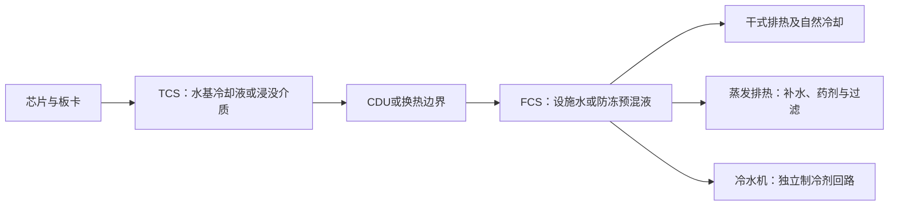

# 冷却液、水处理、过滤与制冷剂行业调研：介质存量、可靠性复购与制冷剂配额的不同经济机制

研究截止日期：2026-10-10。金额除明确标注外为名义金额，美元与人民币分别保留，不换汇合并。2025年是主要历史比较期，2026年全年数字仍含估计，前瞻重点为2027年与2030年；美国HFC另保留2029年配额阶跃。公开日期与经济期间分别标注。本文的参数范围和情景范围均不是统计置信区间。

本次仅将项目内`基本面/产业背景/结果/`中的产业背景资料用于术语、边界和核验线索；未使用其他本地研究报告、公司档案或排序作为研究输入。产业规模、公司事实和技术判断另行检索外部原始资料。政府及公司原文件优先；部分发行人公告通过公告全文镜像读取，注明载体，不把媒体观点当作发行人披露。

## 核心判断与可审查边界

**本行业没有一个可以直接相加的“AI冷却材料大市场”。** 冷板回路中的水/乙二醇/丙二醇是反复循环的存量介质；冷却塔的补水和药剂是运行流量；滤芯是按污染负荷、压差和维修事件复购的耗材；制冷剂则是按首次充注、泄漏、设备替换及回收率形成的需求。决定经营结果的单位分别是升、处理立方米、滤芯更换次数和公斤，不能统一乘以服务器功率增长率。

本报告最支持以下判断：

1. **液冷采用确实扩大，但介质首次充装与系统设备收入相差很大，复购也有时滞。** Dow对管理良好的直冷回路给出约5—7年后可能冲洗换液的规划假设，并要求以化验和实际工况判断。这支持“长寿命、低损耗、先充装后运维”的模型，不支持把全部液体存量每年买一遍。出处为[Dow数据中心冷却技术问答](https://www.dow.com/en-us/market/mkt-electronics/sub-elec-data-center-cooling.html)，网页未列公开日期，按截止日检索版本使用，属于供应商经验而非全行业寿命统计。

2. **保护客户资产、减少停机、管理水质和承担系统责任，比基础液体的化学稀缺性更可能形成持续价值。** NVIDIA的一款液冷交换机明确指定Recochem OAT PG25，支持25—50微米过滤，并规定充装程序。这是实际适配约束，不是“任何PG25均可替换”。同时，Dynalene在2026年8月获得OCP Accepted，表明供应商集合仍在扩大。认证可以提高切换成本，也能通过共同规范降低原有供应商的封闭优势。[NVIDIA Q3450-LD规范，更新2026-08-21](https://networking-docs.nvidia.com/xdrswitcheshw/q3450-ld-liquid-cooling-system)、[OCP Dynalene产品记录](https://www.opencompute.org/products/789/dynalene-pg-d25-propylene-glycol-based-data-center-dtc-heat-transfer-fluid-pg-25)。

3. **水处理收入与耗水量可以反向变化。** 微软披露2025年平均WUE为0.27升/千瓦时，已有约90%的自有数据中心组合采用低耗水或零耗水冷却，新设计继续转向闭式芯片直冷。客户可能少买补水和药剂，却多买检测、清洁、监测和责任服务；也可能将这些工作内化。因而节水、液冷、药剂销售和供应商利润不是同方向变量。[微软客户材料，2026-06-24，经济期间2025年及后续设计](https://blogs.microsoft.com/blog/2026/06/24/inside-microsofts-two-decade-push-to-cut-water-intensity-while-scaling-for-growth/)。

4. **可建模的数据中心核心池，2025年代表基数约8.25亿美元，2030年基准约18.93亿美元；效率替代路径约5.42亿美元，采用及服务收费增强路径约46.74亿美元。** 这些是本报告工程及合同模型结果，非已披露市场规模、非市场调查统计。2025年因充装量、全球水强度和合同净价未知，合理条件范围约4—16亿美元。这个池包括商售水基预混液、非氟单相浸没介质、水处理药剂及相关检测/运维服务、过滤耗材和数据中心冷水机制冷剂；不含CDU、冷板、机组、管道、一般建筑工程、公用事业水费，且没有把无法约束的全球PFPE/HFE专用电子液体市场强行装入总数。完整计算见附录A。悲观情景中2030年用电仍高于2025年，但单位支出和供应商收入下降，属于真实的竞争性路径。

5. **中国大宗HFC价格和利润的支撑主要来自配额及传统制冷用途，而非AI用量。** 官方2026年年初R32、R125、R134a生产配额相加为660,664吨；叠加本次核实的年中调整为662,489吨。两者都是许可上限，不是实际产量。永和披露这三种产品2026年上半年均价分别为5.86、5.84、5.41万元/吨，2025年分别为4.92、4.12、4.58万元/吨，显示同品种收入变化可以与数量增长脱钩。全国平均成交价仍未知，不能把一家公司的均价直接命名为全国均价。[生态环境部2026核发表，2025-12-30公开](https://www.mee.gov.cn/xxgk2018/xxgk/xxgk05/202512/W020251230595804836415.pdf)、[年中调整附件，2026-07公开](https://www.mee.gov.cn/xxgk2018/xxgk/sthjbsh/202607/W020260703512575395148.pdf)、[永和2026-10-10问询回复，公告全文镜像，第7-1-91页](https://money.finance.sina.com.cn/corp/view/vCB_AllBulletinDetail.php?id=12635846&stockid=605020)。

6. **低GWP替代扩大销售，并不保证利润扩张。** Chemours在2026年8月披露北美Opteon混配冷媒售后渠道库存偏高，源于2025年中首次渠道充货；Solstice披露2025年第四季度冷媒收入增长20%，但包含其他业务的RAS分部调整后EBITDA下降25%。新产品导入、旧品退出、库存、工厂利用率和成本转嫁都可能吞掉增长。[Chemours 2026-08-04二季度结果与三季度指引](https://www.chemours.com/en/news-media-center/all-news/press-releases/2026/the-chemours-company-reports-second-quarter-results)、[Solstice 2026-02-11财报，经济期间2025年第四季度](https://www.solstice.com/us/en/news-events/press-releases/2026/02/solstice-advanced-materials-reports-fourth-quarter-2025-results)。

美国的公开库存是上述判断的重要限定。EPA于2026-09-24更新的2025台账，逐行合计年末HFC库存约278.94 MMTEVe；2029年中央模型相对当期许可的23.2缺口，约为这笔毛库存的8.3%。库存并不全部适配、合格或愿意出售，仍足以反驳“许可减半必然导致现货普遍短缺”。正文四及附录C检验库存留存和可释放条件。[EPA HFC Data Hub及其官方数据仓库](https://www.epa.gov/hfcs/hfc-data-hub)。

**最强反面解释**是：大客户以标准化PG25或自处理水、长寿命闭式循环、干式排热和集中采购，消除耗材供应商本来被期待的溢价；液冷设备商或客户自己保留责任、数据和客户入口。技术采用仍可高速增长，基础液体价值却转移至设备、客户和工程集成。本报告认为这一解释对“纯冷却液量价齐升”的约束很强，对成熟水处理和可靠性服务则取决于客户愿意外包多少工作。尚未解决的核心问题是全球真实充装升数、分年度存量年龄、合同价格、故障归因与赔付边界，以及各OEM已认证的剩余交付能力。

## 一、客户在购买什么：把预算、收入与物理回路对齐

### 1. 三种回路及其相邻池

技术冷却系统TCS把芯片热量送至CDU或其他换热边界；设施冷却系统FCS把热量送至园区排热设备。两者的水质、材料、压力、最低温度和责任方不同。冷水机内的制冷剂又是独立的密闭相变回路，不是TCS里的PG25。浸没介质直接接触电子组件，其电绝缘、材料浸出、维修和残液问题与水基冷板回路不同。

这是一张功能图，不表示每个园区都同时安装三种排热方案。干式方案也可能保留机械制冷备用；闭式机房回路的存在并不能证明园区不用蒸发冷却，反之“零蒸发冷却”也不等于没有任何生活、建设或上游发电用水。

| 本专题经济对象 | 采购、使用与验收 | 支付来源与复购驱动 | 计入本报告的收入 | 不可加相邻收入 |
|---|---|---|---|---|
| TCS/FCS商售预混液 | OEM指定配方，集成商/承包商充装，业主或运营方验收 | 首次建设/改造资本预算；补液与符合条件的换液进入运维 | 配方供应商的预混液净销售额 | 原料PG/EG再销售额、CDU整体价格、现场施工重复收入 |
| 浸没介质 | 服务器、芯片及浸没系统共同认证；运营方维护 | 首次装槽、污染/流失补充、硬件换代带来的处置与再充装 | 本模型的非氟单相介质净收入；氟液另论 | 浸没槽、服务器、换热器、同一公斤基础油的上游重复销售 |
| 水处理药剂、检测与运维 | 业主/设施运营采购，现场人员执行，水质与系统可靠性验收 | 处理运行负荷、当地水质、合同服务范围；节水可减少药剂 | 化学品和与其相关的实验室、监测、现场服务；合同内化学品只计一次 | 自来水/再生水费、污水公用事业收费、供水厂与芯片厂UPW建设 |
| 过滤耗材 | OEM/机组商规定参数；运营方依据压差、污染和检修更换 | 首次冲洗及经常性滤芯、膜/树脂更新 | 耗材供货价 | 壳体、过滤撬、RO设备、风机、一般机房设备 |
| 机组制冷剂及再生服务 | 机组OEM首次充注；有资质维保方回收补充；业主承担最终停机风险 | 初装、泄漏、设备替换、旧机维修；回收减少原生需求 | 机组用冷媒净销售额；再生的经济机制单独分析 | 冷水机整机及安装价格、同一混配冷媒与其组分重复计数 |

总池A—E可以在上述分类内相加，代表同一类终端冷却任务中被拆出的材料/相关服务销售。它不是完整的业主总支出：经销商加价、税费、建筑及系统设备尚在池外。中国三种HFC的生产端市场和美国HFC配额篮子与数据中心制冷剂池存在产品、贸易和地域交叉，**不能继续加到A—E之上**。

### 2. 边界外的需求不能被AI叙事掩盖

工业换热、石化、食品、纸业、汽车发动机与电池热管理、冷链、商用空调，仍是基础水处理、乙/丙二醇及制冷剂的重要任务来源。成熟流程的存量大、替代缓慢，主要经济单位常是被处理水量、设备运行小时、生产线吨产品或车/空调充注公斤数。AI园区的特殊性更多在资产损失、局部热通量、洁净度和交付速度，而不是所有介质都出现一种全新的化学反应。

本报告对非AI冷媒给出中国三种主要受控HFC的物量及量价模型，对水处理采用实际公司业务边界检验“AI占全部收入”的错误。Veolia水技术业务2025年收入为**49.54亿欧元**，2024年为49.73亿欧元，但2025年有机增长3.6%；设备、服务、汇率和业务范围都影响可比，不能把名义减少当成纯水处理需求下降，更不能把整个业务认作数据中心耗材。[Veolia 2026-02-26全年结果演示，经济期间2025年](https://www.veolia.com/sites/g/files/dvc4206/files/document/2026/02/Finance_Veolia_Presentation_full_year_results_2025_0.pdf)。

全球所有工业水处理药剂、汽车防冻液、空气过滤和电子氟液的统一净收入、跨厂商转售消除与最终使用量，本次未取得足够资料约束。因此没有发布虚假的“全行业TAM”。缺口主要影响大集团的AI收入占比与投资敏感性，不应反过来改变已支持的工程机制和子市场判断。

## 二、技术进步怎样形成采用，又怎样压低单位支出

### 1. 水基冷板：PG25是适配起点，配方、清洁与责任才是交付内容

水的比热、导热和黏度有利；加入乙/丙二醇可增加防冻和材料管理能力，但提高泵送负担。抑制剂、离子及颗粒控制、密封件相容性和维护记录，会决定一桶“看起来相同”的液体能否安全投入指定系统。PG25不意味着可以混用不同厂商的抑制剂，也不意味着可以沿用汽车冷却液中的任意添加物。

NVIDIA Q3450-LD规范中的410毫升是**一台指定交换机的液体体积**，不是机架或园区充装量。该文件还要求供液充装过滤和完全充满后再通电。可以从中确认采购有真实的性能、质保和程序约束，不能把其中的25微米或PG25浓度扩成全行业唯一标准。OCP另有水基及丙二醇回路指南，说明路线并非只有一种。[NVIDIA规范](https://networking-docs.nvidia.com/xdrswitcheshw/q3450-ld-liquid-cooling-system)、[OCP冷板工作组文件入口，水基指南2024年7月发布](https://www.opencompute.org/projects/cooling-environments/cold-plate/)。

Dynalene的PG-D25技术表列示40°C下密度1,015千克/立方米、比热4.014千焦/千克·K、动力黏度1.38毫帕·秒；这是供应商特定产品数据。[Dynalene技术表，文件标注2025年8月](https://www.dynalene.com/wp-content/uploads/2025/09/Dynalene-PG-D-Series-TDS-02_2025.pdf)。由热平衡直接计算，在10K温差下搬运1MW热量需要约：

`流量 = 1,000kJ/s ÷ (4.014kJ/kg/K × 10K × 1.015kg/L) = 24.55L/s ≈ 1,473L/min。`

这个循环流量一年通过约7.74亿升液体，绝不意味着每年购买7.74亿升。一个假设充装1,000升、年补液3%的1MW回路，年度补充仅30升；换液须按合格存量年龄和实际污染事件另算。

工程上存在两个相反的作用：更高热通量可能增加对质量、过滤和监测的付费意愿；更高机架密度、缩短管路和更少储液量，又可能减少升/MW。NVIDIA在2024年公开的GB200 NVL72参考设计有120kW冷却能力，证明高密度液冷已进入具体系统设计，但这个热容量不能直接推成全球付费部署量。[NVIDIA OCP参考设计，2024-10-15](https://developer.nvidia.com/blog/?p=90182)。

**采用阶梯**应按“配方性能→多材料长期测试→设备/OEM认可→批次质量与现场冲洗→客户有偿验收→存量运行→复购现金”识别。实验室测试和OCP Accepted不能替代特定OEM认可；具备CPU相关资质，也不能自动扩展到整套GPU、网卡、光模块和连接器。

### 2. 过滤：客户买的是合格通量与污染控制，微米数字不能独立定价

颗粒可堵塞微通道，腐蚀或维修产生的新颗粒又会改变过滤负荷。过滤效率、额定粒径是否为绝对值、旁通密封、材料浸出、流量和压差都影响实际保护效果。过细过滤会增加泵功、缩短更换周期，并可能让旁通或操作失误成为新的失败来源。

Donaldson的数据中心产品包含PP100-HF滤芯与相关过滤撬，强调褶式滤芯的容量和减少袋式旁通风险；其冷板技术文讨论了约100微米量级微通道的污染问题。两者支持可靠性任务和耗材复购机制，没有给出全球滤芯年销售额。[Donaldson数据中心产品页，日期未标注](https://info.donaldson.com/en-amer-data-centers.html)、[Donaldson冷板过滤技术文，日期未标注](https://www.donaldson.com/en/resources/technical-articles/supporting-cold-plate-performance/)。

不能把1MW的循环流量乘以耗水型滤芯收费，也不能假设每台GPU都必须拥有独立滤芯。集中CDU可能减少滤芯/MW；更细通道、较差冲洗或水源杂质则增加更换频率。空气过滤仍服务残余风冷、供电电子设备和腐蚀控制，但液冷可以减少对应空气流量；空气过滤收入不会必然随GPU数量同比例增加。[Camfil数据中心应用页，原始创建日期2022-10-20](https://www.camfil.com/en-gb/industries/electronics-optics/data-centers)。

溶解盐不能靠普通颗粒滤芯去掉。RO、离子交换、软化和药剂控制有各自经济单位；采用更优预处理可能提高膜/树脂服务收入，也可能减少后续药剂和清洗。滤芯本体、过滤撬和水处理设备必须分开，否则“过滤市场”会不断扩大统计边界。

### 3. 蒸发水处理：节约水费、保持热效率与许可容量，价值来源不同

对蒸发冷却塔，近似稳定热平衡为：

`蒸发水Ew ≈ 蒸发承担的热量 ÷ 水汽化潜热。`

使用约2,440kJ/kg的近似汽化潜热，每千瓦时蒸发排热约对应1.48升蒸发水。忽略漂水、污水回流和雨水时，浓缩倍数为C：

`补水M = Ew × C/(C−1)；排污B = Ew/(C−1)。`

把C从3提高到6，补水从1.5Ew降到1.2Ew，约少20%；排污从0.5Ew降到0.2Ew，约少60%。这只在结垢、腐蚀、生物控制和排放要求允许时成立，不能无条件提高浓缩倍数。药剂量也不能按补水下降20%机械减少20%，因为配方、循环水浓度和微生物控制改变了投加方式。[美国DOE冷却塔管理](https://www.energy.gov/cmei/femp/best-management-practice-10-cooling-tower-management)、[DOE数据中心冷却水效率](https://www.energy.gov/cmei/femp/cooling-water-efficiency-opportunities-federal-data-centers)，网页未列明确初始公开日期。

一个值得保留的反证是旁流过滤或先进控制会减少清洗、水和药剂，价值可能移向设备商和运营方。[DOE旁流过滤技术评估](https://www.energy.gov/cmei/femp/water-efficient-technology-opportunity-side-stream-filtration-cooling-towers)、[DOE先进冷却塔控制](https://www.energy.gov/cmei/femp/water-efficient-technology-opportunity-advanced-cooling-tower-controls)。电化学等少药剂路线也有原始示范材料，但个别试验不能证明不同水质、全年生物风险和大型园区均已适配。[DOE/NREL冷却塔处理示范](https://betterbuildingssolutioncenter.energy.gov/solutions-at-a-glance/saving-water-and-money-chemical-free-treatment-technology-cooling-towers)。

Digital Realty的2026代理声明仍将35个数据中心项目表述为，随方案扩展，预计可减少**最多15%**用水、每年避免**最多1.26亿加仑**饮用水取水。这是客户的条件上限，不是已审计的全年实现值。Ecolab于2025-06-05发表的付费项目文章，则将相同数字表述为试点结果；作者为供应商CEO，存在销售利益，而且是同一项目的转述，不能算第二次独立确认。本报告采用客户较保守的口径。[Digital Realty 2026代理声明，第90页](https://www.sec.gov/Archives/edgar/data/1297996/000130817926000296/dlr015307-def14a.htm)、[Ecolab原文与付费项目说明](https://www.ecolab.com/en-us/media-center/expert-blog/ai-water-and-the-future-of-business)。

直接计算：1.26亿美制加仑约47.70万立方米/年。若每立方米可避免的水与排污费用为3—6美元，整个35站组合的纯公用事业费节约上限约143万—286万美元/年。价格是假设，不是该客户账单；也不能把“最多”均摊后写成所有数据中心的典型收益。保护许可容量、节能、避免腐蚀停机可能有更大价值，但未披露的收益不能伪装成已支付服务收入。

### 4. 浸没介质：认证进步是真实的，向GPU规模扩张仍需跨越商业条件

Shell在2025-05-13披露非PFAS浸没液通过Intel相关认证；Intel客户侧材料说明特定第四、第五代Xeon、Submer浸没系统和Supermicro服务器的质保附录。它把采用阶段推进至指定组合的工程/质保认可，不能外推为全部AI服务器已可直接浸没或已贡献大量GPU介质收入。[Shell认证公告](https://www.shell.com/business-customers/industrial-lubricants-and-specialty-fluids-for-business/news-and-media-releases/2025/shell-cooling-fluids-certified-by-intel-for-use-in-data-centres-worldwide-an-industry-first.html)、[Intel客户侧认证范围](https://newsroom.intel.com/data-center/intel-shell-advance-immersion-cooling-xeon-based-data-centers)。

单相烃类、酯类、硅基液体的议价基础，是黏度、闪点、电性能、氧化稳定性、材料兼容和可维护性。ExxonMobil已有具体产品规格，可见供给路线并不只有一家。[ExxonMobil数据中心浸没介质产品页，未标初始日期](https://www.exxonmobilchemical.com/en/industries/industrial-applications/data-center-immersion-fluids)。其失效成本包括材料吸胀、污染、元件液体残留、维修人员流程、消防和处置；低售价不能单独消除这些限制。

本报告B池只建模非氟单相介质。氟化PFPE/HFE材料可服务半导体设备温控、测漏、润滑和数据中心，但不能把一条通用电子液体产线全部计为AI浸没收入。巨化2025年报披露“巨芯”规划5,000吨/年、一期1,000吨/年已运行，产品包含多个系列和用途；数据中心合格交付率及分用途销量未披露。[巨化2025年报，2026-04-23公开，第79页](https://static.cninfo.com.cn/finalpage/2026-04-23/1225147997.PDF)。

3M在2025年底完成PFAS制造退出，是特定供应商供给变化，既促使客户重新认证，也增加替代品机会；不意味着所有PFAS材料已被全球禁用。[3M 2025年10-K，2026年公开](https://investors.3m.com/financials/sec-filings/content/0000066740-26-000014/mmm-20251231.htm)。欧盟PFAS限制流程与F-gas/GWP法规应分开看：ECHA在2026年推进科学意见及咨询，最终科学意见与立法实施仍有后续步骤；低GWP也不能自动证明某分子不属于PFAS定义。[ECHA PFAS限制进度](https://echa.europa.eu/en-GB/hot-topics/perfluoroalkyl-chemicals-pfas)，按截至2026-10-10的公开进度判断。

### 5. 前沿分支：微流道、两相浸没与两相芯片直冷

微软2025-09-23披露与Corintis开展芯片内微流道研究，实验比较最高约三倍的冷板散热能力，仍在探索用于自身芯片的后续阶段。它可能改变热阻位置、通道洁净度、封装制造和系统责任，不证明三倍算力、三倍收入或规模部署已经发生。[微软原始研究材料](https://news.microsoft.com/source/features/innovation/microfluidics-liquid-cooling-ai-chips/)。

微流道可能出现一种反直觉结果：液体体积/MW下降，检测、过滤和缺陷控制价值/MW上升。其商业边界取决于芯片/封装制造良率、维修与漏液责任、流动压降和OEM保修；仅证明高热通量不足以完成这条链。

Chemours的Opteon 2P50在截止日所检索产品页仍标为**开发中、待监管批准**，称沸点49°C、GWP为10（AR6口径）。公司此前H1 2026商业化目标属于路线图；本次未确认大规模付费交付与具体收入，网页状态也不足以单独证明项目已失败。[Opteon 2P50产品页](https://www.opteon.com/en/products/liquid-cooling/2p50)、[Chemours原先商业化时间目标，2023年度材料](https://investors.chemours.com/static-files/7b687f85-05aa-4ed3-af37-dae6192c8184)。

两相系统中蒸汽经冷凝回收，并不是每蒸发一公斤就消耗一公斤。低沸点增加密封、维护挥发和回收要求；同一材料通过环保审批，也不代表通过服务器平台验证。附录D给出独立突破分支，保留充装量、补充损耗、质量产能和认证条件，不把它叠加成必然兑现的第四条高增长线。

还有一个不能被“水基冷板/整机浸没”二分掩盖的方向：**两相芯片直冷**。Arkema的Forane HTS 1233zd页面称其用于冷水机和两相直冷，并称已有若干OEM采用；没有披露这些OEM的身份、验收MW或商业收入，故只计为供应商采用主张。Arkema的2025年度材料另外确认，Calvert City原R134a产线经过6,000万美元投资，2025年投产15,000吨/年1233zd装置，涵盖发泡剂和热管理；其中非浸没直冷仍列为发展中的应用。它为供给形成提供了真实工业锚，却不能把15,000吨全部算成数据中心合格供给。[Arkema产品说明，未标初始日期](https://forane.arkema.com/en/markets-and-applications/data-center-cooling/)、[Arkema 2025年度材料，2026年公开，印刷第18—21页](https://www.arkema.com/files/live/sites/shared_arkema/files/downloads/corporate-documentations/Annual%20reports%20-%20EN/2025-arkema-annual-report.pdf)。

经济意义在于：制冷工质可以进入靠近芯片的闭式回路，未必需要把整个服务器浸入大槽；两相浸没的高储液量和客户资本回收障碍不能原样套过来。它会替代部分A池水基液体，同时新增特定工质、压力管理、密封和回收任务；不是在原水基冷板数量上再加一份冷媒。两相直冷还须按具体系统区分带压缩循环与泵驱相变，避免把相变自动等同于传统机械制冷。附录D5给出一个可判别的采购阈值，当前因缺少全平台可靠性、质量供给分配和付费规模，不纳入主表。

## 三、当前规模与前瞻：先建需求，再检验供给和价格

### 1. 从IT工作负荷到材料需求的桥梁

IEA于2026-04-16估算全球数据中心2025年用电485TWh，并在中央路径预测2030年约950TWh。这是IEA估算及预测，不是本报告量价模型的市场销售统计；AI设施是其中的重要增量，整个数据中心口径还包括非AI任务。[IEA 2026报告执行摘要](https://www.iea.org/reports/key-questions-on-energy-and-ai/executive-summary)。

本报告将全年园区总用电E除以PUE得到IT用电；再除以8.76TWh/GW年及平均实际负荷率u，得到**全年平均运行/可用IT容量P**。P不是公告容量，也不是年末容量。建设、改造及设备替换的当年首次充装容量N另列；年新增充装可以包含旧站改造、旧机组替换，不能拿它和P的净增量强行相等。

模型中2027年基准E为675TWh、2030年为950TWh。前者是研究条件假设，后者沿用IEA中央路径锚点；PUE、负荷率、液冷采用、水强度和费用均为本报告参数。不能因此把全部参数都标为“IEA预测”。

主要公式和完整参数集中在附录A，下面只给可还原的结果。金额单位为**百万美元/自然年**；“毛利贡献”扣除参数表中的直接制造、耗材及服务交付成本，尚未扣公司研发、销售管理、失败赔付、收购融资、税、增量资本开支和营运资本，不是预测净利润。

| 时期/情景 | A水基预混液 | B非氟单相浸没液 | C药剂与相关服务 | D过滤耗材 | E机组冷媒 | 合计收入 | 毛利贡献合计 |
|---|---:|---:|---:|---:|---:|---:|---:|
| 2025/估算基数 | 89.9 | 23.5 | 461.1 | 180.6 | 69.7 | 824.7 | 372.1 |
| 2026/悲观 | 66.3 | 18.9 | 456.7 | 179.8 | 60.5 | 782.3 | 284.5 |
| 2026/基准 | 125.3 | 35.3 | 566.1 | 243.9 | 96.5 | 1067.1 | 443.3 |
| 2026/乐观 | 252.0 | 84.5 | 708.4 | 343.8 | 157.1 | 1545.8 | 704.4 |
| 2027/悲观 | 50.5 | 15.2 | 400.9 | 176.3 | 50.0 | 692.8 | 222.9 |
| 2027/基准 | 140.0 | 42.6 | 700.1 | 301.1 | 110.9 | 1294.7 | 556.2 |
| 2027/乐观 | 361.5 | 153.0 | 1002.5 | 542.2 | 230.2 | 2289.5 | 1077.8 |
| 2030/悲观 | 27.3 | 13.8 | 321.6 | 139.1 | 40.5 | 542.4 | 135.9 |
| 2030/基准 | 154.3 | 77.8 | 1097.1 | 413.1 | 150.9 | 1893.1 | 814.9 |
| 2030/乐观 | 691.6 | 486.0 | 1966.2 | 1100.1 | 429.8 | 4673.7 | 2327.5 |

2025估算基数中，A池的TCS预混液收入约1,887万美元，其余主要来自设施回路的防冻液。到2030年基准，A池约1.54亿美元，水处理相关C池约10.97亿美元，过滤D池约4.13亿美元。数值的经济含义在于：**更多的液冷容量不等于更大的基础液体销售额，可靠性和运行服务占据更大的可支付池。**

### 2. 三条路径的机制及实现条件

**悲观：效率替代、内部运维与标准化压价。** 2027年及2030年IT负荷仍扩张，但每MW储液下降、自处理水份额上升、蒸发排热减少、集中CDU降低滤芯数、客户内部维护替代外包。大宗流体合格供给释放，净价下降比单位成本更快。放量可以存在，利润却收缩；这是对纯耗材供应商的悲观路径，对客户可能是更好的成本路径。

**基准：冷板扩大、服务复购逐步形成、规模采购降低材料溢价。** 2026—2027年以首次充装、冲洗、测试和监测签约为先；2030年前后较早冷板回路才进入换液窗口。新站水强度降低但IT运行规模扩张，外包覆盖率和服务范围增加，抵消药剂单位用量下降。设施预混液与空气过滤的单位支出受到温水、管路简化和剩余风冷减少的制约。这个路径最符合“技术采用增加、商品化同时发生”的当前证据，但数值可信度仍受全球合同与充装记录缺口限制。

**乐观：采用加速且客户为更严格适配、过滤和责任范围持续付费。** 不是只把基准增长率放大：需要更多付费液冷改造，较高非氟浸没渗透，更频繁硬件改代造成重充装，较复杂水质/回收水任务，以及供应商保留检测数据与合同入口。成本也升高；供应商净价维持的关键是服务验收与责任能力，而不是宣称PG本身不可扩产。如果客户规范开放、数据可迁移及责任留在OEM，乐观定价条件将被推翻。

这些是有代表性的参数路径，不是互斥且穷尽的概率分布。当前存在的净价和工程量未知，不能靠三条路径平均数获得“准确基准”。

### 3. 需求侧与供给侧独立比较

水基预混液的需求由附录A计算。供给侧没有公开的全球“已通过指定OEM认证且尚可承诺交付的升/年”数据库。不能把大化工公司的全球PG产能当成合格冷却液产能，也不能把理论可生产量写成已签约交付。

本报告用**独立工程能力压力测试**约束规模：一个假设调配单元，50立方米/批、1批/日、220日/年、合格及可供率80%，有效量约880万升/年。参数不是任何厂商已披露产能；仅用于判断完成需求需要多大的工业工作量。Dynalene技术表列出最高5,000美制加仑罐车包装，约18,927升，支持以批次及物流单位检查订单，但不证明该厂商年产量。

| 时期/情景 | A需求：百万升/年 | 至少所需等效调配单元 | 平均发出罐车：车/日 |
|---|---:|---:|---:|
| 2026/悲观 | 26.1 | 3 | 6.3 |
| 2026/基准 | 43.0 | 5 | 10.3 |
| 2026/乐观 | 75.5 | 9 | 18.1 |
| 2027/悲观 | 22.0 | 3 | 5.3 |
| 2027/基准 | 49.4 | 6 | 11.9 |
| 2027/乐观 | 100.4 | 12 | 24.1 |
| 2030/悲观 | 13.4 | 2 | 3.2 |
| 2030/基准 | 56.8 | 7 | 13.6 |
| 2030/乐观 | 171.5 | 20 | 41.2 |

罐车按220个交付日平均，未反映集中上线和地区错配。A池升数为成品预混液当量，表中物流压力假设全部按预混液运输；若以浓缩液交付、现场合格调配，实际运输车次会减少，同时增加现场水质和调配责任。单元数量是满足需求的阈值，不是已经存在的产能，也没有用该阈值反推供给充足。

表中把TCS/FCS合并换算是压力测试，实际需要按配方、洁净要求、OEM、地域和批次重新分配。2027年基准TCS自身约1,130万升，约两个上述单元的量级；生产流程不存在与先进芯片相同的制程约束。结合多家已商业化产品和新进入者获得认可，本报告判断：**基础水基材料更接近“物量可扩、局部认证和交付可能短缺”，尚无证据支持全球基础PG长期物理短缺溢价。** 不能由此断言每个园区都有现货，尤其是指定配方的突发调换和集中上线。

非氟浸没需求到2030年基准约1,296万升/年，乐观为5,400万升/年。基础油与配方调配有较强跨行业供给基础，但客户整个平台资格、消防、储运和服务流程成为更重要的可交付限制。对特种含氟两相液体，一般调配单元不能替代专用合成、提纯和审批；巨化的一期吨数也不能替代Chemours目标分子的产能。

水处理服务需要真实人员和实验室，不只是药剂吨数。独立工作量示例为：一个4人服务单元组成两组、每组每年180个有效现场日，每站年12次访问、每站10MW，则每单元约覆盖30站、300MW。2030年基准P×外包覆盖率约111GW，需要约370个这样的服务单元。人员数、访问频率和10MW站当量都是模型假设，不能称为行业标准或现有员工数量。Ecolab公开超过1,000个数据中心客户，证明已有现场网络；没有披露完整站容量和服务边界，仍不能证明全球需求已被其承接。[Ecolab收购公告，2026-03-20](https://investor.ecolab.com/news/news-details/2026/Ecolab-to-Acquire-CoolIT-Systems-a-Global-Leader-in-Advanced-Liquid-Cooling-for-Next-Gen-AI-Data-Centers/default.aspx)。

过滤没有可核实的全球合格滤芯产能。本模型的TCS年度交付工作量在2027年基准为82万支，2030年基准约147万支，具体型号不可互换。原料及一般滤芯制造更可能不是全行业约束；OEM适配、密封件/滤材洁净性、现场备用库存和更换程序才可能产生区域缺口。若特定供应商无法满足测试，不应通过“全球过滤行业产能很大”把它抹去。普通过滤设备与滤芯企业已有多应用生产体系，是这个方向判断的依据；未把其全部销售额当作本专题供给。

水源则是另一层供给。模型2030年基准补水约2.92亿立方米/年是全球分布的条件估计，不能用全球水资源总量证明当地可取水。项目的再生水合同、排污许可、最大日补水和热浪设计工况决定局部履约，干式排热与节水可以缓解这些约束，并减少药剂收入。这种瓶颈的收益首先可能归业主和提供解决方案的设备/服务商。

## 四、制冷剂：真正的配额约束、渠道周期和替代方向

### 1. 数据中心机组需求只是较小子池，冷板不一定取消制冷剂

Carrier美国30XF机组采用R513A，产品容量约1,400—1,758kW；Daikin欧洲EWWH-DZXE规格列示R1234ze，不同机型约242—1,417kW、充注130—470kg。按同一机型直接计算，充注约0.26—0.54kg/kW；因工况、结构和冗余不同，不应取机型最大充注除以另一机型最大容量。[Carrier技术规格，页面2026年版本](https://www.carrier.com/us/en/commercial/chillers/30xf/technical-specifications/)、[Daikin型号逐项规格表，日期未标注](https://www.daikin.eu/en_us/products/product.table.html/EWWH-DZXE.html)。

附录A的基准充注采用0.25—0.30kg/kW热容量；更低路径需更低充注设计及自然冷却，更高路径含较大冗余或较高充注结构。设备安装量按MW热容量，不能当MW电力。泄漏率采用0.6%—2.5%等条件值，美国EPA模型中不同冷水机类别约0.67%或2.07%/年的假设提供量级参考，不能套用商超制冷更高的泄漏率。[EPA 2026年7月分析草案，附录B](https://www.epa.gov/system/files/documents/2026-07/analysis-of-2022-2025-hfc-allocation-program-data-report_0.pdf)。

温水液冷有利于增加自然冷却小时，可能减少机械制冷运行电量，却不必同比例减少备用机组初装公斤数。在炎热地区，零蒸发方案可能更多依赖空气冷凝冷水机。2026-08-10 Chemours发布用于商业设备的Opteon ZE与515B，说明低GWP机组产品与仍开发中的2P50应分开核算。[Chemours机组冷媒公告](https://www.chemours.com/en/news-media-center/all-news/press-releases/2026/chemours-launches-opteon-ze-and-opteon-515b-refrigerants)。

### 2. 中国HFC：配额上限、有效能力和出货量分开

全国许可表提供了比“名义化工产能”更有解释力的上限。2025年年初配额与2026年年初配额采用相同品种、吨单位；年中转移会改变主体或品种，不能当成新增终端需求。

| 品种 | 2025年初生产配额：吨 | 2026年初生产配额：吨 | 已核实年中调整净额：吨 | 2026修订生产配额：吨 | 2026修订内用生产配额：吨 |
|---|---:|---:|---:|---:|---:|
| R32 | 280,349 | 281,520 | +1,242 | 282,762 | 186,066 |
| R125 | 167,282 | 167,633 | +583 | 168,216 | 61,406 |
| R134a | 208,269 | 211,511 | +0 | 211,511 | 81,633 |
| 合计 | 655,900 | 660,664 | +1,825 | 662,489 | 329,105 |

来源及期间：[2025年度官方年初核发表，2025-01公开](https://www.mee.gov.cn/xxgk2018/xxgk/xxgk05/202501/W020250106342729702074.pdf)、[2026年度年初核发表，2025-12-30公开](https://www.mee.gov.cn/xxgk2018/xxgk/xxgk05/202512/W020251230595804836415.pdf)、[2026年中调整附件，函署2026-06-16、7月网页公开](https://www.mee.gov.cn/xxgk2018/xxgk/sthjbsh/202607/W020260703512575395148.pdf)。数字为逐行直接求和，保留原吨数。2025列未重建全年所有调整；2026修订列纳入本次核实的调整，未声称是监管机关提供的截止日完整合并台账。

2026年全部18种HFC年初生产配额797,845吨、内用生产配额394,082吨；三种产品占年初物理配额约82.8%。全部HFC里还有发泡、气雾剂、电子特气等用途，不能全部称为冷媒吨数。内用生产配额为用途约束的上限，生产配额减内用配额**不是实际出口量**；出口还受客户需求、国别准入、物流和实际内用量影响。

供给侧本报告将许可配额乘以假设可交付率，再考虑条件性的跨品种转移，不从需求倒推出供给。2026年基准三种产品可交付能力约64.8万吨；2027年基准66.3万吨需适度转移至R32及正常生产；2030年基准61.5万吨对应进一步降低高GWP品种、提高R32相对份额。公开全国实际利用率、库存与合格出货量不足，因此这些是供给条件估计，不是事实产量。

生态环境部2026年度方案允许符合条件的跨品种调整，总二氧化碳当量不得增加；2026年8月公开的2027年度方案仍为征求意见稿，不能写成已核发的2027年许可。中国2029年HFC受控生产/使用量降低基线10%已在国家方案中明确；汽车新申请公告M1类车辆自2029-07-01起不使用GWP大于150的冷媒，改变R134a新车任务，存量维修仍会延续。[2026年度方案，2025-10-24](https://www.mee.gov.cn/xxgk2018/xxgk/xxgk05/202510/W020251024653086234356.pdf)、[2027征求意见稿，2026-08-24](https://www.mee.gov.cn/xxgk2018/xxgk/xxgk06/202608/W020260824732187731963.pdf)、[国家方案监管答问，2025-04-23](https://www.mee.gov.cn/ywdt/zbft/202504/t20250423_1117446.shtml)。

**按二氧化碳当量削减，不等于每种产品按物理吨数同比例削减。** 用许可常用因子R32=675、R125=3,500、R134a=1,430作可行性核对：100吨R125转成同等当量R32，理论物量可变为约519吨，但还需要逐企业调整许可、反应设备、原料和客户需求，不能据此写成可自由兑换的商品。R32替代R410A可使R125需求减少，同时使R32物量需求与可许可物量增加。

### 3. 中国需求侧：传统设备与出口的独立桥梁

国家统计局2026-02-28公布2025年房间空气调节器产量**26,697.5万台**、汽车**3,477.8万辆**、民用汽车保有量**36,611万辆**。它们是工业产量/保有量，不是国内零售；汽车口径也不能和其他协会数字混用。[国家统计局2025年统计公报](https://www.stats.gov.cn/xxgk/sjfb/zxfb2020/202602/t20260228_1962662.html)。

需求计算使用两个不重复的出口口径：在中国制造并已充注冷媒的出口设备，包含在中国设备首次充注；只把另行出口的散装/包装冷媒作为第二个需求源。混配厂购买R32/R125后产生的R410A，不再加一遍混配吨数。

2026年代表需求桥梁（本报告假设，不是海关统计）为：

- 房间空调充注设备当量：在上述产量上用0.65—0.95调整产品统计与充注机组对应，乘0.65—0.95kg/台、受控三品种份额80%—95%，得到约9.0万—22.9万吨；基准取约15.5万吨。宽范围反映机型、内外机统计和冷媒组合未被完整识别，未用全国配额倒推该参数。
- 大型商用、工业和冷链新装、固定设备维修、汽车首次充注/维修及其他受控用途，合计条件量约13.5万—20.5万吨。汽车首次充注以约3,500万辆×0.5—0.7kg×70%—90%约1.2万—2.2万吨约束；汽车维修以保有量、适用份额、充注量、泄漏/维修事件及回收率估算约1万—3万吨，不把整辆车存量每年重新充一遍。
- 散装及包装三种冷媒出口需求取28万—36万吨的条件范围；全国可比海关品种实物量本次未核实，**这是最大弱项**，不能把生产配额与内用配额之差当作已核实出口数据。基准三种合计约33.1万吨，配方、出口目的地和渠道库存可能明显改变它。
- 合并宽条件范围约50.5万—79.4万吨，不是概率区间。年度情景再按一致的设备、替代和出口条件取值；2026基准64.9万吨中，国内制造/运行使用约31.8万吨，散装/包装出口约33.1万吨。品种配置约束见附录B，避免将单台工程示例冒充全行业。

当前判断不是“已证实全国短缺”：实际同品种均价上涨、许可物量增长有限，加上存量维修和出口需求，支持市场比配额制度前更紧；但全国库存、出口量和实际生产仍未知。基准为总量接近平衡、品种结构可能局部偏紧，供给调配、库存释放和替代足以使价格方向改变。

出口需求还受到目的地制度和竞争约束。商务部贸易救济调查局译介的印度2025-12-24第36/2025-Customs(ADD)号公告，对中国R134a实施五年反倾销措施，按生产商采用4,423—5,251美元/吨最低限价，低于该价时征差额；cGMP医药级产品不在该调查范围。这个限定价格基于印度进口落地口径，**不能换算成中国出厂均价或全部出口的统一税率**。它可以降低进口商可接受的中国净报价、将订单转向印度或其他产地，并影响出口渠道资金与库存。SRF是该案申请方，也是值得纳入竞争地图的当地产业方；不由申请身份推断其有效产能。印度原公报本次无法直接访问，以上依赖官方译介，不声称已读取原公报全文。[商务部官方译介及原公报链接，经济事件2025-12-24](https://cacs.mofcom.gov.cn/article/ajycs/ckys/202512/186691.html)。

### 4. 成交价格、成本和利润必须使用同一口径

巨化2026-07-11的上半年主要经营数据披露，制冷剂外销量155,993.79吨、同比增长0.91%，均价45,521.40元/吨、同比增长15.62%，经营数据收入710,105.54万元、同比增长16.67%。直接计算`1.0091×1.1562−1≈16.67%`，显示收入变化几乎都来自价格/组合。这里仍是多产品组合均价，不是同一规格净价涨幅。[巨化临2026-38公告，经济期间2026年1—6月](https://static.cninfo.com.cn/finalpage/2026-07-11/1225418588.PDF)。

重要口径冲突不能隐藏：巨化2026半年报财务附注的制冷剂收入为**6,745,833,754.89元**，低于上述经营公告的**7,101,055,400元**，差额约3.55亿元。本报告未取得公司明确调节表，可能解释包括预披露修订、合并抵销或产品统计范围，但未确认。不能用较高经营收入乘财务毛利率，也不能未经调节就混用销量与财务收入。[巨化2026半年报，2026-08-26公开，公告全文镜像，“营业收入和营业成本”产品分类](https://money.finance.sina.com.cn/corp/view/vCB_AllBulletinDetail.php?id=12535328&stockid=600160)。

2025年财务报告的制冷剂收入12,870,867,662.16元、成本6,330,627,838.21元（约128.71亿元与63.31亿元）、毛利率50.81%，是已披露业务整体数据；不是全国三种单质冷媒的毛利率。单位成本模型因此只取较宽制造成本条件，保留按品种差异，而不将这一个毛利率复制到每条路径。[巨化2025年报，第57、245页](https://static.cninfo.com.cn/finalpage/2026-04-23/1225147997.PDF)。

成本不能假定全面下降。上述2026经营公告中，无水氢氟酸采购均价11,550.24元/吨、同比上涨16.45%，硫磺4,793.24元/吨、上涨153.49%，98%硫酸1,300.12元/吨、上涨173.11%；萤石粉则下降8.18%。有自供或一体化原料的公司与外购公司不同，涨价、成本和利润不能用同一个统一倍率。

全国市场模型结果如下；金额为**亿元人民币/自然年**，物量为**千吨/年**，按新产原生料、三种单质组分制造端计算。2025吨数与全国金额是可比条件基数，不是全国出货事实；2025价格锚是永和已披露同品种年度成交均价。全年前瞻净价、制造成本与可交付率均为研究参数。完整各品种底表在附录B。

| 时期/情景 | 原生料需求 | 可交付能力 | 可满足新产销量 | 收入 | 制造端模型毛利 |
|---|---:|---:|---:|---:|---:|
| 2025/估算基数 | 610 | 632 | 610 | 281.09 | 148.19 |
| 2026/悲观 | 609 | 627 | 609 | 327.58 | 185.38 |
| 2026/基准 | 649 | 648 | 645 | 379.18 | 225.08 |
| 2026/乐观 | 686 | 656 | 656 | 423.34 | 258.64 |
| 2027/悲观 | 585 | 623 | 585 | 285.30 | 150.40 |
| 2027/基准 | 683 | 663 | 663 | 428.87 | 270.76 |
| 2027/乐观 | 738 | 676 | 676 | 519.26 | 339.29 |
| 2030/悲观 | 480 | 581 | 480 | 160.90 | 54.55 |
| 2030/基准 | 645 | 615 | 615 | 405.00 | 262.05 |
| 2030/乐观 | 710 | 631 | 631 | 544.25 | 378.25 |

基准2026合计需求649千吨、可交付能力648千吨，但逐品种可满足量只有645千吨：R32余量不能无条件替代R134a缺口。2027基准缺口约20千吨，可能由既有库存、延迟补充、增加回收和型号替代补足；若未补足，它才有机会传到成交价。价格假设的兑现还需要OEM/经销商合同重定价，而非只看交易商报价。

2030基准物量615千吨低于2027，但高GWP旧机维修和许可约束仍可能支持价值；悲观路径中低GWP替代、回收及出口转弱更快，高价格无法延续。乐观路径则要求传统维修和出口需求韧性、替代进度较慢，以及供应商保持配额纪律，客户成本压力会更大。毛利不是自由现金：新HFO装置、原料配套和渠道融资可能消耗现金。

### 5. 美国与欧洲：2029年是配额阶跃，不是“所有冷媒短缺”的同义词

美国AIM原生HFC消费许可上限在2024—2028年为**181.5 MMTEVe**，2029—2033年降至**90.8 MMTEVe**；这里是百万吨交换值当量，近似按法定因子加权的二氧化碳当量，**不是百万物理吨**。生产许可上限另为229.5与114.8，不能把未使用生产许可当作突破消费许可的办法。[EPA HFC削减问答与法定配额表，截止日版本](https://www.epa.gov/hfcs/frequent-questions-phasedown-hydrofluorocarbons)。

EPA 2026年7月草案给出的2025初步消费为170.1 MMTEVe；**2026-09-24更新台账已将2025原生许可消费列为172.73296558 MMTEVe**，2024同口径为171.80974469，直接计算约增长0.54%。这是生产加进口减出口的监管消费，不是设备实际使用或终端销售。EPA保留核验修订可能，且提醒总量可能受约2%许可限额的舍入/核验变化影响；本报告采用更新数作现实锚。[EPA Data Hub，报告数据截至2026-08-31](https://www.epa.gov/hfcs/hfc-data-hub)、[EPA官方仓库固定版本的消费序列，2026-09-24提交](https://raw.githubusercontent.com/USEPA/spd-hfc-data-hub/51572fcbf1962143d93ebb4a56b014c01601822c/2025_data/Data_Hub_View_Cons_Stepdown.csv)。

七月草案中央模型的原生需求为2027年146、2029年114、2030年102 MMTEVe，已含一定回收/再用假设，不可再机械减去全部再生量。2029年模型需求比简化许可上限高约23.2、2030年高约11.2。EPA强调库存、更低GWP选择、额外回收、减少泄漏、进口预充设备或延迟维修会改变结果；2024—2025模型也曾高于配额，而实际消费仍在限额内，不能把模型缺口写成已经发生或不可避免的现货短缺。[EPA分析草案，第79—81页及附录A22](https://www.epa.gov/system/files/documents/2026-07/analysis-of-2022-2025-hfc-allocation-program-data-report_0.pdf)。

更强的现实反证是，2025年底申报主体HFC库存逐行合计约278.94 MMTEVe，其中R125约154.06、R134a约33.51、R32约20.02、R143a约57.56；库存的品种结构与任务有关。仅需要2025毛库存中约8.3%仍然合格、适配并在2029年可释放，就可覆盖中央模型该年总当量缺口。这个比值不能证明实际可售库存足够，却使“2029全面现货短缺”不是最有依据的基准；更接近当期新原生约束、跨期材料缓冲与局部品种压力并存。详细原值、跨年消耗及可释放阈值见附录C4。[EPA官方库存数据固定版本，2026-09-24提交，经济时点2025-12-31](https://raw.githubusercontent.com/USEPA/spd-hfc-data-hub/51572fcbf1962143d93ebb4a56b014c01601822c/2025_data/Data_Hub_View_EOY_Inventory.csv)。

附录C用需求路径与独立的许可/可执行进口生产能力比较。基准更接近2027年总量有余量、2029年需要跨期库存或额外适应，但毛库存给出显著材料缓冲；品种缺口、库存释放意愿和再生认证仍可改变交易条件。新机使用低GWP产品不会马上消灭旧设备维修需求，旧机仍可能购买高GWP冷媒或改造；因此原生配额持有人和合格再生服务者可能获益，整机采购方则承担切换、维护和融资成本。

美国2026-05-26又修改部分Technology Transitions时间要求，例如远置冷凝机组合规期限调整至2032年，说明不能沿用旧的全部禁用日期。法规延后延长部分旧产品初装/维修任务，也会改变低GWP渠道备货。[Federal Register 2026-05-26最终规则](https://www.govinfo.gov/content/pkg/FR-2026-05-26/pdf/2026-10387.pdf)。

欧盟F-gas对新投放的固定式冷水机中大于12kW机型，2027年起原则上限制GWP≥750的产品，存在安全条件例外；不能把分体空调的其他年份/阈值套给冷水机。由此R513A或R1234ze与旧高GWP产品的路径不同。具体禁用范围、设备用途及安全例外决定需求，而不是一个笼统“欧洲禁氟”的标签。[欧盟委员会空调及冷水机替代说明](https://climate.ec.europa.eu/areas-action/fluorinated-greenhouse-gases/climate-friendly-alternatives-f-gases/air-conditioning_en)、[EU 2024/573原文，2024-02通过](https://eur-lex.europa.eu/eli/reg/2024/573/2024-02-20/eng/pdf)。

## 五、价值捕获与资本：重要性可以高，材料收入和回报未必高

### 1. 谁控制客户入口、标准和责任

| 参与者及技术/经济位置 | 已核实的竞争支点 | 价值捕获条件 | 容易流失的价值及未知 |
|---|---|---|---|
| NVIDIA、Intel、服务器OEM与大型云客户 | 平台适配规范、CPU相关质保、客户冷却设计；前述原始材料 | 掌握材料清单、验收和质保，可要求多源及价格约束 | 不等于承担所有现场责任；缺少事故责任分配与采购合同 |
| Dow、Recochem、Dynalene及其他预混液厂商 | PG25产品、指定设备适配、OCP记录、检测网络 | 配方一致性、批次追溯、OEM资格、服务和快速交付 | 基础调配可扩；公开规范降低切换成本；OEM认可不能自动跨平台 |
| Ecolab/Nalco Water与CoolIT | 水化学、监测/现场网络及设备平台整合 | 可覆盖设施至芯片，提高签约效率和系统责任能力 | 大客户可拆标；设备增长并非全部复购；收购资本负担显著 |
| Veolia、Kurita等水处理/服务企业 | 水处理设备、化学、长期服务及工业客户入口；[Kurita应用页](https://asean.kurita-water.com/en/by-industries/data-center-2/)列具体膜/药剂/监测产品 | 再生水、膜/树脂维护、现场合同、区域许可知识 | 芯片制造UPW与数据中心耗材边界不同；设备项目与经常收入要拆 |
| Solenis/Chem-Aqua（非上市）与Dow服务网络 | 2026-06-10原始公告确认加入Coolant Care Network | 材料与独立服务合作，可覆盖长期流体监测而不必收购设备商 | 公告没有客户合同、份额或DC独立收入；网络合作可能促进竞争 |
| Donaldson、Pall等液体过滤；Camfil等空气过滤 | 滤材、密封、效率与应用适配；多行业供给 | 清洁度要求及可靠性验证，滤芯寿命管理 | 过滤集中化与可洗部件减少耗材；空气/液体过滤单位不同 |
| Shell、ExxonMobil等非氟浸没介质；Submer等浸没系统方 | 特定Xeon组合认证、产品性能与系统设计 | 全平台适配、维修流程、消防/处置、规模服务 | 系统方可能控制液体采购和更换；GPU付费规模未披露 |
| Chemours、Solstice、巨化、三美、东岳、永和及其他冷媒企业 | HFC许可、原料/工艺、HFO商业产品或建设项目 | 合规配额、低成本制造、专利/质量、渠道与客户转换 | HFO新产线并不受同一HFC物量约束；旧品退出、渠道去库存及成本上升 |
| Arkema与印度SRF等区域/专用工质竞争者 | Arkema已投产1233zd工业线并探索两相直冷；SRF参与印度贸易救济案件 | 专用工质/工艺及客户资格，产地和贸易壁垒影响订单分配 | 工业总能力不等于DC合格吨数；贸易保护不证明低成本或高回报 |
| Corintis、独立流体/过滤企业及浸没系统初创方 | 微流道原始研究、专业适配、开放生态 | 局部高价值工艺、较快试验与OEM合作 | 尚无足够规模收入证据；融资、责任和标准能否扩大仍未知 |
| 客户内部设施团队、第三方本地维保与再生经营者 | 内部预算、现场设备和故障数据，能够减少泄漏或回收 | 可靠服务、合格再生、数据/责任闭环 | 可能将化学服务变成内部成本；可追溯纯度和物质混合影响成交 |

这是关键任务的竞争地图，不是无限覆盖名单。小规模独立企业、非上市系统商和客户自研均在边界内；没有用上市公司市值代替有效能力。水处理产业中的独立配方、地方运维与膜/树脂渠道仍可能改变分工，未取得可比份额时不编造CR3。

### 2. 收购规模揭示了“设备+介质+服务”之差，也揭示资本负担

Ecolab 2026-03-20宣布以**47.5亿美元现金**收购CoolIT，披露其未来12个月销售预计约**5.5亿美元**，估值约未来12个月调整后EBITDA的29倍、2027年预计值的24倍。CoolIT主要是冷板、CDU和相关系统，不能当作5.5亿美元冷却液收入。由估值直接计算隐含EBITDA约1.64亿美元及1.98亿美元；这是交易估值中采用的管理层预测，不是已实现业绩，更不等于交易ROIC。[Ecolab收购公告及预测限定](https://investor.ecolab.com/news/news-details/2026/Ecolab-to-Acquire-CoolIT-Systems-a-Global-Leader-in-Advanced-Liquid-Cooling-for-Next-Gen-AI-Data-Centers/default.aspx)。

2026-07-02公司宣布完成收购，称高科技业务2026年**年化运行率接近15亿美元**，目标2030年年收入40亿美元及营业利润率25%，包含CoolIT、Ovivo及原有业务。年化运行率不是2026自然年收入，2030目标也不是本报告预测。这个整合可以增强系统入口，却不能把设备与芯片厂水处理全部转成数据中心重复耗材。[Ecolab完成收购公告，2026-07-02](https://investor.ecolab.com/news/news-details/2026/Ecolab-Closes-CoolIT-Acquisition-and-Expands-AI-Cooling-Platform-as-Global-High-Tech-Business-Targets-4-Billion-by-2030/default.aspx)。

能否通过“冷却即服务”捕获价值，取决于谁对水质、设备、漏液、清洁度和停机承担有边界的合同责任，以及跨设备客户是否接受单一平台。分析供应商时应把新设备毛利、化学/耗材复购、现场服务、软件/传感器和并购影响拆开。[Ecolab设施至芯片的服务方案，2025-11-14](https://www.ecolab.com/en-us/media-center/news/ecolab-strengthens-integrated-cooling-program-for-data-centers)。

与收购整合并行，**材料商与独立水处理服务商合作**也已发生。Solenis于2026-06-10宣布，通过Chem-Aqua加入Dow Coolant Care Network，为DOWFROST LC/HD直冷回路提供监测、预防维护和现场/远程服务。这是真实的商业合作公告，尚未披露相应客户收入或续约净价；它支持“材料+长期管理”的客户任务，也说明该价值未必由某一家设备整合平台独占。客户可以选择多家公司合作的服务网络，竞争会在品牌液体、诊断能力和合同责任之间重新分配。[Solenis原始公告，2026-06-10](https://www.solenis.com/en/resources/news-releases/2026/solenis-joins-dows-coolant-care-network-for-data-centers/)。

### 3. 价格传导有事实锚，但不能把宣布涨价当成成交实现

Ecolab于2026-03-12宣布，自4月1日起实施全球10%—14%能源附加费，依据当地市场条件，覆盖产品和服务，并可随市场调整。公司将其归因于原料、制造和运输成本上升。这是**收费政策**，不是所有客户净价都提高同一百分比的事实；折扣、合同豁免、组合和传导时间会改变实际利润。[Ecolab能源附加费原始公告](https://www.ecolab.com/en-us/media-center/news/ecolab-announces-global-10-14-energy-surcharge)。

水基预混液通常含较大水分；原料醇成本下降未必使客户报价等幅下降，因为包装、清洁制备、检测、物流和资格成本仍存在。基础料短缺也不必令固定合同即时重价。冷媒生产中HF、氯/碳原料、能耗、废物处理和关键反应步骤各有投入；HFO产品卖得更多却增加爬坡、资本和渠道库存，利润可能先下降。

Solstice 2025年销售38.86亿美元、调整后独立EBITDA9.57亿美元、资本开支4.08亿美元；EBITDA减资本开支5.49亿美元仍不是真正自由现金，因为还未处理营运资本、利息、税和其他调整。它的冷媒增长与RAS利润下降并存，不能由某个子业务收入增幅断言全公司利润兑现。[Solstice 2025结果](https://www.solstice.com/us/en/news-events/press-releases/2026/02/solstice-advanced-materials-reports-fourth-quarter-2025-results)。巨化2026上半年经营现金净流入2,330,548,347.76元（约23.31亿元）、同比下降12.57%，公司解释含应收账款和票据增加；即使制冷剂毛利改善，回款和投资仍会改变现金。[巨化2026半年报现金流及变动说明](https://money.finance.sina.com.cn/corp/view/vCB_AllBulletinDetail.php?id=12535328&stockid=600160)。

### 4. 同一客户边界的经济示例：耗材省钱与服务赚钱不是同一件事

**客户TCS介质例子，全部为条件假设：** 一个稳定运行的10MW PG25回路，首次充装1,000L/MW，净价4.5美元/L，初装4.5万美元；每年补充3%为1,350美元；第6年一次全量换液4.5万美元；旧液收集处置按1美元/L为1万美元；这里是10年持续运行观察窗口，年末液体不计残值抵扣，尚未假定关闭回路；若窗口末终止并按同价再次处置，须另加1万美元。窗口内液体及处置现金支出合计约**11.35万美元**。另按200支/年、140美元/支，过滤28万美元；首轮额外冲洗耗材2.8万美元；检测/监测20万美元，合计约**62.15万美元/10年**。未含CDU、冷板、泵电、设备更换和事故损失。该例不能当整个园区TCO，但能说明长寿命介质下服务和滤芯可以比液体更大。

**供应商合同例子，边界固定为一个10MW客户的5年水处理/相关监测服务，不含设备和A/B/D/E商品再销售：** 负荷率64%，IT用电56.064GWh/年；补水强度0.4L/kWh，处理补水22,425.6m³/年；药剂净收费1.1美元/m³、直接成本0.55美元/m³；年固定服务费7万美元、直接交付成本4.5万美元。年度收入约9.467万美元，直接成本约5.733万美元，毛利贡献约3.733万美元。再扣地区管理和例行更新1.5万美元/年、初始分摊实验室资产2.5万美元的5年折旧（残值0.5万美元，年折旧0.4万美元），经营利润约1.833万美元/年。

同一合同初始投入还包括3万美元启动/培训费用和1.5万美元营运资本，即初始现金7万美元。稳定年度经营现金约2.233万美元；第5年终止合同并回收1.5万美元营运资本、出售资产得0.5万美元，5年累计净现金约**6.17万美元**，简单现金回收约3.1年。若继续履约，必须对第6年以后必要资产更新另建预算，不能同时拿终止残值和永久经营现金。以上未计税、融资及额外失败赔偿，不是任何公司的披露回报。

在同样成本和资产边界下，全部净收费下降20%，年度经营利润约转为**亏损600美元**，5年净现金约**负3.30万美元**。这说明放量和高表面毛利并不足以保证资本回收：启动成本、服务承诺及买方压价足以改变结果。将一次性设备销售混入服务收入，或漏掉启动成本，会显著高估回报。

## 六、演进、概率、最强反证与可区分的观察

### 1. 演进不是按日历自动兑现

| 阶段与时间范围 | 需要完成的机制 | 本专题的先后关系 | 与实际规模的差别 |
|---|---|---|---|
| 2026—2027：冷板回路扩大与批次交付 | OEM/材料认可、管路冲洗、实验室质控、现场验收 | 先认证和初装，再出现存量化验与服务合同；个别替换可能重新认证 | 订单/路线图不是全年验收MW或耗材收入 |
| 2027—2029：规范开放、运维竞争与冷媒渠道消化 | 多源资格、故障数据库、低GWP设备采用、旧货去库存 | 药剂/滤芯采购随实际运行，价格按合同重定价；新冷媒首次备货先于稳定售后 | 供应商出货可能先于真实消耗，渠道补库会逆转 |
| 2029—2030：配额阶跃与早期液冷存量年龄 | 美国原生HFC适应、中国品种重配、回收、合格再生与旧机维修 | 库存和泄漏控制可先缓冲；较早液冷回路才逐步达到换液窗口 | 不是所有2026新回路都在2030全量更换 |
| 2030前后及以后：微流道/两相等分支 | 封装/平台工艺、审批、寿命验证、低维护损耗、量产与客户服务 | 单项性能突破先于资格、付费部署与现金回收 | 一例成功不能证明1GW级或行业渗透率 |

认证、扩产和切换时长没有统一行业统计。本报告把一般新配方/系统的6—18个月评估、特殊介质合成及新平台的2—4年完整路径作为**规划条件**，不称为所有厂商平均值。紧急换液、已批准配方重复下单和新型氟液第一次量产，其周期明显不同。

### 2. 概率是可更新的研究判断，不是情景表的精密权重

| 事件、成功标准与目标期 | 概率性质与判断 | 支持与限制 | 使判断上调/下调的证据 |
|---|---|---|---|
| 2027年水基预混液无持续全球基础料短缺；即合格常规配方可以满足主要市场的年度物量，不要求每个地区即期现货 | 无条件事件概率60%—80%，主观宽区间 | 多产品商业化、开放规范及调配工作量；缺少厂商剩余资格产能，局部短缺仍可发生 | 上调：多OEM批准第二来源、批次准交率；下调：同配方跨厂无法交付、原料/物流系统中断 |
| 2030年本报告A—E边界年收入在12亿—30亿美元 | 无条件结果事件概率约45%—65%，不是对18.93亿美元点估计的置信度 | 基准电力扩张与服务签约能成立；水强度、内部运维、单价和充装量均不透明 | 上调：按验收MW披露合同及复购；下调：容量延期、显著自处理水替代、服务净价下跌 |
| 2030年商业非挖矿数据中心的两相浸没付费验收容量至少1GW | 无条件事件概率15%—30%，跨多条主路径的分支 | 可行热物理和开发产品；审批、GPU全平台资格、材料、维护与供给尚待证实 | 上调：两家独立平台批准、连续运行并披露回收损耗、明确付费验收；下调：审批拖延、失效/泄漏或平台退出 |
| 2027年中国三种HFC的可比制造端加权净价仍高于2025锚定水平 | 无条件事件概率60%—75%，价格事件，不能等同销量或净利润事件 | 已披露同品种上半年价格与配额纪律支持；出口、库存、调配和原料价格未知 | 上调：长约真实重价、实物出口及库存持续支持；下调：配额调配放大、库存去化失败、替代加速 |

这些事件相互关联，不能乘起来获得某公司成功率；概率范围依靠技术成熟度、已有商业认可、监管路径和本报告供需约束的主观判断，并无足够可比样本支撑更细精度。两相事件与A—E收入事件可能同时发生，表中概率不合计100%。也没有将“至少一个试点成功”替换成行业规模成功。

### 3. 四个足以推翻主判断的竞争性解释

**反证一：平台方已经把可靠性内化，耗材企业只能卖桶和滤芯。** 支持证据是明确OEM配方、客户自建冷却设计、开放的OCP规范；反对证据是需要现场诊断、批次追溯及跨材料失效归因，现有专业服务网络有实际客户。区分观察是采购合同：能否单独收取监测、实验室与响应费，故障数据能否迁移，服务续约净价是否下降。若外包覆盖率停留在约60%以下、净服务费下降，附录A的基准和乐观C池将过高；这是研究阈值，不是行业标准。

**反证二：更少的水、更少的液体和更集中的过滤，足以抵消更大计算负荷。** 微软低WUE和闭式设计支持这个解释；更高污染敏感性、再生水难度和客户可靠性要求可能增加服务价值。区分观察是同一站、同一IT运行负荷下补水m³/MWh、首次充装L/MW、过滤支数/MW年与独立服务费。仅看到总体耗水上升，无法区分新增负荷与水强度恶化。

**反证三：HFC紧平衡只是库存与备货周期，不是长期稀缺。** Chemours2026渠道库存指引是强支持；中国同品种实际均价和许可约束是反向证据。区分观察是净出口实物量、分品种生产、经销商库存、再生供给和OEM成交长约。美国2025毛库存已显著大于2029年23.2MMTEVe中央模型缺口；若其中足够比例留存、适配并释放，阶跃可较平稳；若中国R125需求下降快于许可收缩，配额制度也不必带来更高净价。

**反证四：两相、微流道或其他架构不是增量，而是替代现有耗材。** 2P50的开发产品和微软原始研究使它值得跟踪；缺少审批、全平台付费规模与长期维护资料限制结论。应观察净替代MW、L/MW、年度损失率、泵电/维护成本和合格供给，而不是发布会数量。即使特种液体毛利较高，昂贵充装、回收设备及停机维护也可能让客户改回水基路线。

本报告因此不把“液冷渗透率上升”“低GWP占比上升”直接写成行业盈利结论。最有依据的联合判断是：2026—2027年水基介质物量可扩、资格与现场交付局部偏紧，基础液体长期价格更受竞争约束；服务和过滤的复购机会取决于责任与客户外包。中国主要HFC更接近受配额约束的品种结构性紧平衡；美国2029年新原生许可阶跃，但公开毛库存提供显著缓冲，当前证据不足以支持普遍现货短缺；合格库存的留存/释放、回收与替代决定真实压力，原生许可与物理材料充足程度并不等价。最终价值在客户、设备、介质、运维和合格再生方之间迁移，而不是沿所有环节均匀增加。

## 附录A：数据中心核心池的完整参数、结果与敏感性

### A1. 统计边界与全部计算式

对象为全球数据中心的商售材料和与其相关的水/流体检测运维，不主动叠加挖矿。各年均为自然年流量；容量S与P为全年平均存量，N为当年首次或改造充装工作量，不是期末运行率。模型量纲如下：

- E为园区总用电TWh/年；`P = E/(8.76×PUE×u)`，单位GW。
- A：`L_T = (N_T + S_T×r_T)×h×v_T/1000`；`L_F = (N_F + P×r_F)×q_F×v_F/1000`；L单位百万升/年；`R_A = L_T×p_T + L_F×p_F`，单位百万美元/年。
- B：`L_B = (N_B + S_B×r_B)×v_B/1000`；`R_B = L_B×p_B`。
- C：`Q = E/PUE×w`，单位百万m³/年；`R_C = Q×p_c + P×覆盖率×服务费a/1000`。
- D：`K = (S_T×f + 2N_T)×n/1000`，单位百万支/年；`R_D = K×p_D + P×空气耗材费/1000 + Q×水媒体费`。2N_T表示新/改造冷板回路初始冲洗额外需要两套滤芯的工作量假设，日常更换另算。
- E冷媒：`M_E = (N_E + S_E×r_E)×v_E/1000`，单位百万kg/年；`R_E = M_E×p_E`。这里v_E为kg/MW**热容量**，不是冷媒电耗或机组电功率。
- 各池毛利贡献为上述对应销量乘`净价−直接单位成本`，C、D分别保留药剂/服务及不同滤材的成本。总收入、总贡献为五池相加，结果已在正文集中列示。

A含商售浓缩液时按最终预混液使用量折算成品升及净收入，不能再加原料醇销售额；h也反映自处理水等不购买该类商售配方的份额。自处理水的药剂与检测归C，不把内部用水本身认成销售。N已经表示需要新购介质的充装任务；可重复使用的旧液不应重复计入N，r只含仍在运营回路的补充及符合年龄/状态条件的换液，避免把同一次设备改造又计入N又计入r。

B排除氟化PFPE/HFE和两相液体。D技术滤芯单独模型只覆盖冷板，浸没旁流等未取得足够台账，未额外添加；大规模浸没可能使D偏低。水媒体费含替换膜、树脂和水侧过滤耗材的条件平均，不含水处理设备初始售价；服务费不再含这些耗材的销售额。空气费不包括风机和一般设备。E的r_E是需新购原生冷媒的等效补充率，回收再生利用不再重复减少一次。

下列净价不是网上标价。费用不含税、一般工程安装及事故赔偿；直接成本不替代集团全部成本。贡献数值用于识别经营弹性，不提供统一ROIC或净利率。

### A2. 运行规模与采用参数

| 时期/情景 | E：TWh/年 | PUE | 负荷率u | P：年平均IT容量GW | N_F：年充装GW | N_T：年充装GW | S_T：年平均冷板GW |
|---|---|---|---|---|---|---|---|
| 2025/估算基数 | 485 | 1.45 | 62% | 61.59 | 15 | 5 | 8 |
| 2026/悲观 | 580 | 1.42 | 62% | 75.2 | 14 | 8 | 14 |
| 2026/基准 | 590 | 1.42 | 64% | 74.11 | 18 | 10 | 16 |
| 2026/乐观 | 620 | 1.44 | 65% | 75.62 | 21 | 13 | 18 |
| 2027/悲观 | 610 | 1.38 | 62% | 81.39 | 14 | 9 | 22 |
| 2027/基准 | 675 | 1.37 | 64% | 87.88 | 20 | 13 | 28 |
| 2027/乐观 | 750 | 1.38 | 65% | 95.45 | 26 | 18 | 33 |
| 2030/悲观 | 720 | 1.25 | 66% | 99.63 | 18 | 12 | 50 |
| 2030/基准 | 950 | 1.3 | 64% | 130.35 | 28 | 22 | 70 |
| 2030/乐观 | 1220 | 1.33 | 66% | 158.66 | 40 | 35 | 100 |

E的2025年485和2030年基准950来自IEA；其他E为条件情景。PUE/u及N、S全部为研究参数，没有把卫星/公告容量改名为验收容量。2026E的路径相对接近，材料收入差异较大，主要反映工程配置、外包和定价未知，不是同年全球计算需求差一倍。2027/2030宏观方向分别是采用放慢但效率提升、中央扩张、采用加速且更高冷却/服务支出。

本报告没有公开证据支持精确全球冷板存量或充装MW；这些参数可信度低于E。2025冷板初装2—7GW、平均存量5—12GW可形成下文基数条件边界。以整体充装15GW量级和高密度/传统HPC份额作反向合理性约束，不把该份额当成已测量事实。前瞻S_T≤P，S_T+S_B≤P，避免同一存量同时当冷板和浸没；设备改造的首次充装与总容量净增量不同。

### A3. A池：技术与设施回路分别给升数、价格和成本

**TCS：**

| 时期/情景 | 商售份额h | v_T：L/MW | r_T：补充/合格换液率 | 净价/直接成本：美元/L | 需求L_T：百万L |
|---|---|---|---|---|---|
| 2025/估算基数 | 80% | 1000 | 3% | 4.5/2.2 | 4.19 |
| 2026/悲观 | 75% | 900 | 2.5% | 3.8/2.2 | 5.64 |
| 2026/基准 | 85% | 1000 | 3% | 4.5/2.3 | 8.91 |
| 2026/乐观 | 90% | 1200 | 5% | 5.5/2.6 | 15.01 |
| 2027/悲观 | 65% | 800 | 2.5% | 3.3/2.1 | 4.97 |
| 2027/基准 | 80% | 1000 | 4% | 4.3/2.2 | 11.3 |
| 2027/乐观 | 90% | 1200 | 6% | 5.8/2.7 | 21.58 |
| 2030/悲观 | 40% | 600 | 2.5% | 2.8/1.8 | 3.18 |
| 2030/基准 | 70% | 900 | 10% | 3.8/2 | 18.27 |
| 2030/乐观 | 85% | 1200 | 15% | 6/2.8 | 51 |

**FCS：**

| 时期/情景 | 商售防冻液份额q_F | v_F：L/MW | r_F：补充/换液率 | 净价/直接成本：美元/L | 需求L_F：百万L |
|---|---|---|---|---|---|
| 2025/估算基数 | 35% | 5000 | 2% | 2.5/1.2 | 28.41 |
| 2026/悲观 | 30% | 4500 | 1.5% | 2.2/1.25 | 20.42 |
| 2026/基准 | 35% | 5000 | 2% | 2.5/1.3 | 34.09 |
| 2026/乐观 | 40% | 6500 | 3% | 2.8/1.4 | 60.5 |
| 2027/悲观 | 28% | 4000 | 1.5% | 2/1.2 | 17.05 |
| 2027/基准 | 35% | 5000 | 2% | 2.4/1.25 | 38.08 |
| 2027/乐观 | 42% | 6500 | 3% | 3/1.5 | 78.8 |
| 2030/悲观 | 15% | 3500 | 1.5% | 1.8/1.05 | 10.23 |
| 2030/基准 | 28% | 4500 | 2% | 2.2/1.1 | 38.56 |
| 2030/乐观 | 40% | 6500 | 4% | 3.2/1.5 | 120.5 |

TCS储液量的工程依据是管路、冷板、CDU和储液罐相加，不是循环流量乘时间。实例：100m内径30mm管路约70.7L，200m内径50mm约392.7L，另加设备、机架和储液，600—2,000L/MW是可用的条件量级。nVent一款125kW CDU页面给出15.6L的二次侧体积，折算约125L/MW，仅是CDU自身；不能把它当全回路。参见[nVent CDU产品说明](https://www.nvent.com/en-by/data-solutions/coolant-distribution-unit)，日期未标注，公开规格作为单部件参照。

设施回路200m内径150mm主管约3,534L，再加末端及储液，约5,000L/MW可以成立；紧凑温水设计低于它，长距离、多设备回路高于它。6500L等代表另一工程配置，不是所有园区统一额定值。主体需有实际BOM和充装记录才可收窄。

净价校验仅取得零售锚：[ChemWorld JeffCool ISF25](https://www.chemworld.com/JeffCool-ISF-Data-Center-Glycol-s/4273582.htm)，截止日页面55美制加仑促销标价1,999.99美元，折算约9.61美元/L；含美国配送条件，未列初始公开日期。它证明小包装、品牌化液体可以有较高报价，**不证明大客户出厂净价**，也不证明2025年该报价。本表TCS的2.8—6美元/L及基准4.5为规模采购、渠道折扣和合同范围的条件估计；实际若大幅不同，应直接重算。

制造成本包括原料、水处理、抑制剂、清洁调配、批次检测、包装及普通物流等条件成本。PG含量只是部分成本，不能以25%的醇乘纯醇价格代表整桶成本。现有批次制造流程和零售锚约束量级，缺少客户合同则保留显著敏感性，不把模型成本当某厂商已披露COGS。

r_T在2026—2027年以损耗/污染补充为主。2030基准10%不是“寿命10年”的倒数：代表约2%补充加约8%的合格旧存量换液；乐观15%需要更高的早期存量/硬件换代换液，而非所有新回路都按五年平均折旧。设施回路较长寿命，r_F较低。当前年龄结构未公开，是预测2030复购的实质缺口。

### A4. B池：非氟单相浸没介质

| 时期/情景 | N_B：GW/年 | S_B：年平均GW | v_B：L/MW | r_B | 净价/成本：美元/L | L_B：百万L |
|---|---|---|---|---|---|---|
| 2025/估算基数 | 0.2 | 0.8 | 15000 | 3% | 7/3.5 | 3.36 |
| 2026/悲观 | 0.2 | 1 | 14000 | 2.5% | 6/3.4 | 3.15 |
| 2026/基准 | 0.3 | 1.2 | 15000 | 3% | 7/3.5 | 5.04 |
| 2026/乐观 | 0.6 | 1.5 | 16000 | 4% | 8/3.8 | 10.56 |
| 2027/悲观 | 0.2 | 1.2 | 12000 | 2.5% | 5.5/3.1 | 2.76 |
| 2027/基准 | 0.4 | 1.6 | 14000 | 3% | 6.8/3.5 | 6.27 |
| 2027/乐观 | 1 | 2.5 | 16000 | 5% | 8.5/4 | 18 |
| 2030/悲观 | 0.3 | 2 | 9000 | 2% | 4.5/2.7 | 3.06 |
| 2030/基准 | 0.9 | 4.5 | 12000 | 4% | 6/3.2 | 12.96 |
| 2030/乐观 | 3 | 10 | 15000 | 6% | 9/4.2 | 54 |

2025估计极不透明，公开指定系统认证只能支持路线可采用，不能验证0.8GW存量。价格与成本考虑烃、酯、硅基产品及交付组合，非PFPE氟液。8,000—20,000L/MW量级可以由约1,000—2,000L槽体和100—200kW负荷的几何设计形成，本次未取得覆盖全市场的实际槽体/实测功率台账，因此作为条件估计，不称行业平均。提高每槽计算密度会降低L/MW；把低密度试验槽体直接乘高密度GPU功率会明显高估需求。

基准2030存量4.5GW、年充装0.9GW，明显小于冷板；乐观需要全平台资格和维修流程明显扩展，年充装3GW、存量10GW。r_B含维修和污染补充，不假设所有液体每年全换。

### A5. C池：水强度、化学收费与服务范围

| 时期/情景 | 补水强度w：L/kWh_IT | Q：百万m³/年 | 药剂净价/成本：美元/m³ | 付费外包覆盖率 | 服务费/直接成本：美元/MW年 |
|---|---|---|---|---|---|
| 2025/估算基数 | 0.55 | 183.97 | 1/0.5 | 75% | 6000/4000 |
| 2026/悲观 | 0.43 | 175.63 | 0.85/0.5 | 73% | 5600/4100 |
| 2026/基准 | 0.5 | 207.75 | 1/0.55 | 78% | 6200/4300 |
| 2026/乐观 | 0.6 | 258.33 | 1.15/0.6 | 80% | 6800/4400 |
| 2027/悲观 | 0.35 | 154.71 | 0.75/0.45 | 70% | 5000/3900 |
| 2027/基准 | 0.47 | 231.57 | 1.05/0.55 | 80% | 6500/4300 |
| 2027/乐观 | 0.58 | 315.22 | 1.25/0.65 | 85% | 7500/4500 |
| 2030/悲观 | 0.18 | 103.68 | 0.6/0.4 | 62% | 4200/3500 |
| 2030/基准 | 0.4 | 292.31 | 1.1/0.55 | 85% | 7000/4500 |
| 2030/乐观 | 0.55 | 504.51 | 1.35/0.65 | 90% | 9000/5000 |

**w为模型采购补水强度，不把它直接称为微软WUE。** 公布的WUE可能使用净水耗或特定运营边界；补水含排污，具体应先调节浓缩倍数、漂水、回用和水来源。模型2025补水约1.84亿m³并非IEA水预测。微软0.27L/kWh及LBNL美国历史数据支持检查量级/路线差异，而不自动证明全球w。参见[LBNL 2024年12月美国数据中心能源报告，历史水量对应2023年](https://eta-publications.lbl.gov/sites/default/files/2024-12/lbnl-2024-united-states-data-center-energy-usage-report.pdf)；美国样本不能直接覆盖全球，更不能与未来换边界数据比较成增长率。

药剂费0.6—1.35美元/m³是组合条件，不是水价；假设约25—200g/m³成品药剂、成品价约3—8美元/kg，形成约0.08—1.6美元/m³的宽工程范围，具体受浓缩、杀菌、酸碱、清洗、原水和回用要求影响。常规低复杂度冷却塔可能低于本表，不能用节约公用事业费用反推出药剂售价。

固定服务费覆盖水/流体检测、现场水化学管理、监测和响应，按平均容量与签约范围计；本模型没有给全部运行容量都强行出售一份合同。4,200—9,000美元/MW年及直接交付成本是合同模型假设，正文10MW合同保留其成本与现金桥梁。它不包括设备折旧、系统设备销售、A/B介质和D耗材，也不把客户内部人员薪酬当供应商收入。

### A6. D池：滤芯次数、空气及水媒体耗材分别计算

| 时期/情景 | n：滤芯/MW | f：换次/年 | 技术滤芯净价/成本：美元/支 | 空气耗材净价/成本：美元/MW年 | 水媒体净价/成本：美元/m³ | 技术回路K：百万支/年 |
|---|---|---|---|---|---|---|
| 2025/估算基数 | 10 | 2 | 150/75 | 2000/900 | 0.1/0.06 | 0.26 |
| 2026/悲观 | 6 | 1.5 | 120/70 | 1850/1050 | 0.08/0.06 | 0.22 |
| 2026/基准 | 10 | 2 | 140/75 | 2000/1050 | 0.11/0.07 | 0.52 |
| 2026/乐观 | 12 | 2.5 | 160/85 | 2300/1200 | 0.13/0.07 | 0.85 |
| 2027/悲观 | 6 | 1.5 | 110/70 | 1600/1000 | 0.08/0.05 | 0.31 |
| 2027/基准 | 10 | 2 | 135/70 | 1850/1000 | 0.12/0.07 | 0.82 |
| 2027/乐观 | 12 | 3 | 170/85 | 2300/1300 | 0.15/0.08 | 1.62 |
| 2030/悲观 | 5 | 1 | 90/60 | 1000/750 | 0.06/0.04 | 0.37 |
| 2030/基准 | 8 | 2 | 120/60 | 1500/900 | 0.14/0.08 | 1.47 |
| 2030/乐观 | 10 | 3 | 180/90 | 2100/1150 | 0.2/0.1 | 3.7 |

n、f和初始冲洗套数均为工程任务参数；不同CDU流量、滤材和旁通规格会改变n。技术滤芯价格与制造成本没有公开统一成交表，故为条件参数。商售水回路采用减少不一定减少液体过滤，因为自处理水同样需要清洁。悲观路径体现集中式CDU和标准化压价，乐观路径要求更高洁净要求且合格产品净价维持。

空气费可理解为约40—100个滤材当量/MW、约1次/年、每件约20—35美元的条件组合，但必须按进风设计复核；闭式循环风与新风比例不同，不能把微处理器发热量直接换成外气滤芯消耗。水媒体费按吞吐量归一化，涵盖条件性的更新/清洗材料成本；膜寿命未取得行业同口径统计，不人为强制统一三年更换。

### A7. E池：设备充注与新购补充，保留混合产品净价

| 时期/情景 | N_E：新充GW热/年 | S_E：年平均GW热 | 充注kg/MW热 | 原生补充率r_E | 净价/成本：美元/kg | 需求：百万kg |
|---|---|---|---|---|---|---|
| 2025/估算基数 | 12 | 60 | 300 | 1.5% | 18/9 | 3.87 |
| 2026/悲观 | 13 | 68 | 260 | 1% | 17/9 | 3.56 |
| 2026/基准 | 15 | 72 | 300 | 1.5% | 20/10 | 4.82 |
| 2026/乐观 | 18 | 76 | 350 | 2% | 23/11 | 6.83 |
| 2027/悲观 | 13 | 74 | 230 | 0.8% | 16/9 | 3.13 |
| 2027/基准 | 17 | 84 | 280 | 1.2% | 22/10.5 | 5.04 |
| 2027/乐观 | 23 | 92 | 350 | 2.5% | 26/12 | 8.86 |
| 2030/悲观 | 12 | 85 | 180 | 0.6% | 18/10 | 2.25 |
| 2030/基准 | 23 | 115 | 250 | 1% | 25/11.5 | 6.04 |
| 2030/乐观 | 35 | 135 | 350 | 2.5% | 32/14 | 13.43 |

冷媒需求量为百万kg，即千吨；2026基准4.82百万kg、2030基准6.04百万kg，是全球数据中心机组新产冷媒的条件量级。它与中国三种产品年度数十万吨的边界、贸易及成分交叉，不相加。新装热容量已涵盖条件性的冗余/机组替换；年度机械制冷电量不能代替这项初装能力。

全球混合冷媒净价与成本为估计，10—40美元/kg可作为重要压力范围，表中18—32等为代表取值。低GWP比例、专利、包装、渠道、地域和合同变化使平均价变化；不是假定同一分子每年必涨。生产商净收入与维修小钢瓶零售价不能混用。既有机组采用合格再生产品增加时，原生销量应减少，模型的r_E已作净新购解释。

### A8. 各子池的贡献及供给条件

单位：百万美元/自然年。

| 时期/情景 | A毛利贡献 | B毛利贡献 | C毛利贡献 | D毛利贡献 | E毛利贡献 |
|---|---|---|---|---|---|
| 2025/估算基数 | 46.6 | 11.8 | 184.4 | 94.6 | 34.8 |
| 2026/悲观 | 28.4 | 8.2 | 143.8 | 75.7 | 28.5 |
| 2026/基准 | 60.5 | 17.6 | 203.3 | 113.6 | 48.2 |
| 2026/乐观 | 128.2 | 44.4 | 287.3 | 162.6 | 82 |
| 2027/悲观 | 19.6 | 6.6 | 109.1 | 65.7 | 21.9 |
| 2027/基准 | 67.5 | 20.7 | 270.5 | 139.6 | 58 |
| 2027/乐观 | 185.1 | 81 | 432.5 | 255.2 | 124 |
| 2030/悲观 | 10.9 | 5.5 | 64 | 37.6 | 18 |
| 2030/基准 | 75.3 | 36.3 | 437.8 | 184.1 | 81.5 |
| 2030/乐观 | 368.1 | 259.2 | 924.3 | 534.2 | 241.8 |

结果需对应有偿客户需求、合格物料交付和合同收费成立。水基、非氟浸没、过滤及服务的全球实际剩余合格能力未公开，正文提供独立工作量阈值和供给方向判断。若现实的指定配方、滤芯或服务人员能力低于阈值，表内收入不能全部兑现；短缺是否转价还取决于合同、替换资格和客户延期。没有用“产能正好等于需求”冒充供给预测。

### A9. 2025条件基数的下界与上界如何生成

当前4—16亿美元仅是以下两组可复算参数生成并取整的**条件范围**，不是全行业硬上下限；缺少的实际合同或充装记录可能使结果超出。两组均使用E=485TWh，负荷率由给定P与PUE一致计算。

| 参数或结果 | 较低支出条件 | 较高支出条件 |
|---|---|---|
| P/PUE/u | 55GW/1.55/约64.95% | 70GW/1.40/约56.50% |
| TCS：N_T/S_T/h/v_T/r_T/净价 | 2/5GW，60%，600L/MW，2%，3.5美元/L | 7/12GW，90%，1500L/MW，5%，6美元/L |
| FCS：N_F/q_F/v_F/r_F/净价 | 12GW，20%，3500L/MW，1.5%，2美元/L | 18GW，45%，6500L/MW，3%，2.8美元/L |
| B：N_B/S_B/v_B/r_B/净价 | 0.1/0.5GW，10000L/MW，2%，5美元/L | 0.4/2GW，16000L/MW，4%，9美元/L |
| C：w/药剂价/覆盖率/服务费 | 0.30，0.7美元/m³，65%，5000美元/MW年 | 0.70，1.3美元/m³，80%，8000美元/MW年 |
| D：n/f/滤芯价/空气费/水媒体费 | 8/1/120美元/1400美元/MW年/0.08美元/m³ | 12/3/170美元/2300美元/MW年/0.15美元/m³ |
| E冷媒：N_E/S_E/v_E/r_E/净价 | 10/50GW热，250kg/MW热，1%，15美元/kg | 15/70GW热，350kg/MW热，2%，25美元/kg |
| 由公式生成A/B/C/D/E收入：百万美元 | 20.6/5.5/244.5/93.1/39.4 | 226.2/69.1/763.3/299.4/143.5 |
| 合计 | 约403.1百万美元 | 约1501.4百万美元 |

上下组合不是独立参数的全排列。水源、管路布局、客户运维和采购存在相关性，不能将所有最大参数机械相乘再叫“乐观概率”。2025点估计也不应作为精确市场份额的分母。

### A10. 最主要敏感性与不可识别量

以2030基准其他条件不变：

- 服务费每变化1,000美元/MW年，C收入约变1.108亿美元，直接成本及现金还须另调。这是总池最大的合同敏感性之一。
- 补水强度每变化0.10L/kWh_IT，补水约变7,308万m³/年；C药剂及D水媒体收入合计约变9,062万美元。若采用更高成本原水或回用水，单位化学/媒体支出可能反向增加，不能只动水量。
- TCS充装量每变化500L/MW，A收入约变3,857万美元。若净价比表值高一倍，按量会近似翻倍，但检测/响应服务不可再无边界重复添加。
- 技术滤芯年更换由2次到4次，D约增加1.344亿美元；初始冲洗不随此增加。实际净收益还需扣滤芯和维护成本，且更高频更换可能是故障或较差清洁结果。
- 2030 TCS等效补充/换液率由10%降至3%，A约减少1,173万美元。庞大存量并不自动成为高额液体复购，因为单MW充装金额小且平均存量年轻。
- HFO/其他机组冷媒净价每变5美元/kg，E收入约变3,019万美元；净价、单位充注和可回收补充应分别测试。

最大缺口是PUE/实际负荷与首次充装MW对应、真实储液BOM、按年龄/平台的可复用液体存量、补水边界、外包净收费和可交付资格。它们影响绝对规模；流量不能当消耗、设备不能当耗材、监管当量不能当吨数的结论不依赖这些缺口消失。

## 附录B：中国三种主要HFC制造端模型

### B1. 模型单位、基数与销量规则

只计算R32、R125、R134a三种受控用途原生组分的中国制造端对国内及境外客户销售，不加混配商品的重复收入，不加回收再生冷媒，不以数据中心任务解释全部需求。使用自然年、吨与不含税制造端净价的条件口径；实际全国成交口径不公开，2025净价以永和披露同品种成交均价作锚，不能当全国统计。

需求D从设备、维修、替代、出口推导；供给S从许可、正常可交付率、条件配额转移和生产约束推导。新产销量取min(D,S)，未满足部分需要库存、再生、替代或延期。**不假设没有生产需求的剩余能力仍全部被卖出。** 模型也没有将前一年全部库存无条件重复用于下一年；库存量未核实，因此主表取净库存帮助为零，单独列出填补缺口的要求。

`收入亿元 = 销量千吨 × 净价千元/吨 ÷100。`

`制造端毛利亿元 = 销量千吨 × (净价−制造成本)千元/吨 ÷100。`

制造成本包括正常稼动下材料、能源、加工、常规质量与工厂成本的条件估计；不是某厂商分品种已披露成本，也未扣销售管理、研发、财务费用、税、资本开支与营运资本。全国利润不能用巨化等单家公司净利润/收入倒推。

### B2. 各品种各路径的实际参数及可还原结果

| 时期/情景 | 品种 | 需求D：千吨 | 可交付S：千吨 | 销量min(D,S)：千吨 | 净价p：千元/吨 | 制造成本c：千元/吨 | 收入：亿元 | 毛利：亿元 |
|---|---|---|---|---|---|---|---|---|
| 2025/估算基数 | R32 | 260 | 270 | 260 | 49.2 | 20 | 127.92 | 75.92 |
| 2025/估算基数 | R125 | 155 | 160 | 155 | 41.2 | 22 | 63.86 | 29.76 |
| 2025/估算基数 | R134a | 195 | 202 | 195 | 45.8 | 24 | 89.31 | 42.51 |
| 2026/悲观 | R32 | 262 | 270 | 262 | 55 | 21 | 144.1 | 89.08 |
| 2026/悲观 | R125 | 152 | 157 | 152 | 54 | 24 | 82.08 | 45.6 |
| 2026/悲观 | R134a | 195 | 200 | 195 | 52 | 26 | 101.4 | 50.7 |
| 2026/基准 | R32 | 275 | 278 | 275 | 60 | 21.5 | 165 | 105.88 |
| 2026/基准 | R125 | 164 | 164 | 164 | 59 | 24 | 96.76 | 57.4 |
| 2026/基准 | R134a | 210 | 206 | 206 | 57 | 27 | 117.42 | 61.8 |
| 2026/乐观 | R32 | 289 | 280 | 280 | 66 | 23 | 184.8 | 120.4 |
| 2026/乐观 | R125 | 175 | 166 | 166 | 64 | 25 | 106.24 | 64.74 |
| 2026/乐观 | R134a | 222 | 210 | 210 | 63 | 28 | 132.3 | 73.5 |
| 2027/悲观 | R32 | 260 | 270 | 260 | 50 | 20.5 | 130 | 76.7 |
| 2027/悲观 | R125 | 145 | 155 | 145 | 50 | 24 | 72.5 | 37.7 |
| 2027/悲观 | R134a | 180 | 198 | 180 | 46 | 26 | 82.8 | 36 |
| 2027/基准 | R32 | 293 | 290 | 290 | 65 | 21.5 | 188.5 | 126.15 |
| 2027/基准 | R125 | 170 | 165 | 165 | 65 | 24 | 107.25 | 67.65 |
| 2027/基准 | R134a | 220 | 208 | 208 | 64 | 27 | 133.12 | 76.96 |
| 2027/乐观 | R32 | 315 | 296 | 296 | 78 | 24 | 230.88 | 159.84 |
| 2027/乐观 | R125 | 185 | 169 | 169 | 77 | 27 | 130.13 | 84.5 |
| 2027/乐观 | R134a | 238 | 211 | 211 | 75 | 30 | 158.25 | 94.95 |
| 2030/悲观 | R32 | 235 | 285 | 235 | 28 | 19 | 65.8 | 21.15 |
| 2030/悲观 | R125 | 100 | 120 | 100 | 40 | 24 | 40 | 16 |
| 2030/悲观 | R134a | 145 | 176 | 145 | 38 | 26 | 55.1 | 17.4 |
| 2030/基准 | R32 | 310 | 300 | 300 | 55 | 19.5 | 165 | 106.5 |
| 2030/基准 | R125 | 135 | 125 | 125 | 78 | 25 | 97.5 | 66.25 |
| 2030/基准 | R134a | 200 | 190 | 190 | 75 | 28 | 142.5 | 89.3 |
| 2030/乐观 | R32 | 340 | 308 | 308 | 75 | 22 | 231 | 163.24 |
| 2030/乐观 | R125 | 152 | 128 | 128 | 100 | 28 | 128 | 92.16 |
| 2030/乐观 | R134a | 218 | 195 | 195 | 95 | 32 | 185.25 | 122.85 |

2025供给条件632千吨按年初三种许可及约96%—97%可交付率生成，与本次未重建的后续调整存在差异，作为可比条件基数，不称全年实际产量。2026基准S分别278/164/206千吨，约为本次核实的修订配额98.3%/97.5%/97.4%。差异反映运行及交付折减，不是用需求倒算的利用率。

2027的R32增量需要合法调配，其他品种与未被使用的高GWP当量产生约束；不能只靠增加一套设备获得受控生产权。2030以中国受控HFC二氧化碳当量总额削减10%、品种重配及正常交付为条件，R32物理能力可以维持或上升，R125/R134a可交付能力下降。拟建新装置、配额合法性、国内用途与出口国许可须同时满足。

用675/3500/1430的当量因子，2026核实的三个生产许可合计约10.8208亿吨CO₂当量。2030三条供给路径对应约8.6406/9.1170/9.3475亿吨；这一组物量不超过三种当前当量约束的90%，但不是对逐企业配额转换的批准。整个18种HFC的未来当量与其他行业仍需统筹。不得将此表理解为预计2029各品种许可一律变为相同的90%。

### B3. 需求及价格的路径依据

| 品种 | 当前任务与2025/2026锚 | 悲观路径 | 基准路径 | 乐观路径 |
|---|---|---|---|---|
| R32 | 单质和混配；房间/商用空调重要。永和2025均价49.2、2026H1均价58.6千元/吨 | 自然工质、效率和出口减少更快，许可转移增加物理供给；2030需求235千吨低于能力285 | 部分R410A转R32，国内/出口机组及维修支撑；2030需求310、能力300 | 传统任务强、替代与回收较慢；需许可及渠道纪律，2030需求340、能力308 |
| R125 | 多数作为混配组分；2025均价41.2、2026H1均价58.4 | 由R410A和更高GWP配方转出、回收加快，2030需求100低于能力120 | 新装需求减少，但旧机维修与出口继续；能力收缩比需求更快，2030需求135、能力125 | 售后及发展中市场强、旧机寿命延长；2030需求152、能力128 |
| R134a | 汽车、冷水机和其他任务；2025均价45.8、2026H1均价54.1 | 新车及机组替代更快，库存/再生增加；2030需求145、能力176 | 新申请车型和机组逐步转低GWP，旧机及出口抵消部分下降；需求200、能力190 | 维修和出口较强，产能/许可未匹配，需求218、能力195 |

各条路径的D包括境内制造的预充出口设备及散装冷媒出口，两者不重计。前瞻净价取值不是交易商含税报价；价格代表同品种地域/合同/包装组合的年度制造端条件均价。2026年取值受已披露上半年价格约束，2027以后依据可替代缺口、库存和合同而变化；没有依据将所有产品价格统一按10%增长。

全国出口实物量、平均库存与逐产品工厂成本缺口使该模型可信度低于许可和上市公司历史事实。特别是“出口需求仍强”的基准部分，一旦真实散装出口下降10万吨，便可消除整个代表缺口；不能把已上涨的价格反过来当需求一定达到D的证据。

### B4. 敏感性、缺口及经营兑现

2027基准净缺口按品种为3/5/12千吨，合计20千吨；2026为0/0/4千吨，同时存在R32约3千吨闲余。使用错品种库存、或不能服务目标地区的料，不能自动填补。2030基准缺口10/10/10千吨；库存缓冲可提供一次性帮助，需要有实际存量证明，不能每年重复。

2027基准销量663千吨，所有同口径净价每下降5千元/吨，会使收入与在成本不变时毛利各减少约33.15亿元。制造成本每增加3千元/吨，使毛利减少约19.89亿元。三者成交净价、成本、量分别影响，不用“价格高”直接推出净利润增长。

短缺向价格传导还要求合同可重价、客户无法快速切换机型、渠道有真实消耗且合法供给有纪律；较高报价可能使终端延迟维修、回收旧冷媒或转低GWP。2029政策是供给与采用的共同变化，不能仅减少供给、保持全部需求不变。

## 附录C：美国HFC配额压力的三路径检验

### C1. 这是监管当量压力模型，不是额外美元TAM

地域为美国受控原生HFC消费，单位MMTEVe/自然年，包含制冷以外受控用途。许可消费量对应生产加进口减出口等监管核算，库存使用和再生可以支持实际设备任务，但不等于新原生消费许可。与中国制造出口、机组首次充注存在交叉，不加到正文任何美元或人民币市场之上。

2026年7月草案中2025消费170.1为旧初步值；本报告现实比较期改用2026-09-24更新的2025值172.73296558 MMTEVe，官方台账该年消费限额列181.52299，正文采用公开简化显示181.5。2027/2029/2030中央模型原生需求146/114/102仍来自七月分析草案，它没有被更新消费数自动替换成实际需求。监管消费与设备使用需求不是同一数。**未使用的消费许可不是库存**；库存必须有真实持有、合法来源、合格或可处理以及用途适配的物料证据；其中也可能包含已经回收的物料。在另计再生流量时不能重计这部分库存，也不能把再生料数量与模型已有回收假设重复相减。

以下需求为研究者基于EPA中央需求、替代/回收/泄漏差异提出的条件范围，非EPA发布的三情景。供给侧由法定上限乘以可执行比例，另受进口、生产及出口组合约束；没有由需求倒推。区间为参数条件范围，不是置信区间。

### C2. 三条路径共同给需求、许可供给与额外适应阈值

| 期间/路径 | 原生需求D：MMTEVe | 当期新原生可执行供给S：MMTEVe | 未被当期新原生满足的条件量：MMTEVe | 成交价格与成本传导 | 规模/利润/现金含义及成立条件 |
|---|---:|---:|---:|---|---|
| 2026/效率与去库存 | 135—150 | 165—181.5 | 0 | 库存、替代加快，高GWP净价承压；成本仍受能源和原料影响 | 原生数量增长缺少支撑；旧货出清不等于固定资产回收 |
| 2026/基准 | 150—163 | 165—181.5 | 0 | 合同/组合与渠道主导，不支持全篮子因总量短缺加价 | 低GWP销售与旧品库存并存，制造与经销商现金方向可不同 |
| 2026/旧任务较强 | 163—177 | 165—181.5 | 0—12 | 特定分子可偏紧；不代表全部当量都紧 | 需要真实售后消耗，首次渠道备货可能先占营运资本 |
| 2027/效率替代 | 115—130 | 155—175 | 0 | 较多余量，更易发生竞价和旧货减值 | 低GWP转换量增长，原生高GWP利润可能下降 |
| 2027/基准 | 135—151 | 165—181.5 | 0 | 中央需求146低于许可；净价看品种、库存和长约 | 不假定许可价格全部转到材料毛利；工厂混合转换仍需资本 |
| 2027/替代偏慢 | 155—175 | 167—181.5 | 0—8 | 个别品种缺口经资格和合同传价，组合影响平均价 | 制造端可能改善，买方备货占用现金；若库存多则溢价消失 |
| 2029/快速适应 | 80—94 | 83—90.8 | 0—11 | 多数任务通过替代、回收和低泄漏压低新原生需求 | 可较平稳跨阶跃；较小的真实库存缓冲即可填补部分剩余 |
| 2029/基准适应 | 105—120 | 85—90.8 | 14.2—35 | 若可用库存及超基准额外适应量不足，旧机合格冷媒价格压力增强；一般能源成本未必同幅上涨 | 配额/库存持有人与合格再生方可能捕获价值，原生销量仍下降；不等于集团利润必增 |
| 2029/旧任务与切换较慢 | 120—138 | 85—90.8 | 29.2—53 | 需要明显需求调整，维修延后或替代会反过来限制高价 | 买方资金和停机成本上升；违规供给不能作为基准有效供给 |
| 2030/效率替代 | 70—85 | 80—90.8 | 0—5 | 旧品需求下降快，剩余产能与库存压低净价 | 供给持有人需缩产/转换，价值迁向替代工质与客户 |
| 2030/基准 | 94—108 | 82—90.8 | 3.2—26 | 中央需求102仍超过许可；取决于2029年后尚存物料与持续回收 | 不可再次使用已在2029年消耗的同一库存，持续适应才可维持交付 |
| 2030/较慢转换 | 108—126 | 83—90.8 | 17.2—43 | 特定合格售后冷媒压力持续，但需求替代弹性增加 | 原生许可、再生质量与网络有价值；现金需扣再生投入、收购原料和合规成本 |

未满足量为max(0,D−S)在区间角点的范围，**不是已发生短缺**。区间里的最大缺口也不构成一种有概率的极端事件。基准2029按EPA点值114与法定90.8核算缺口23.2；2030为11.2。填补它需要模型默认回收之外的额外措施，不是先验断言全部由再生承担。

S低端约为许可的85%—94%，上端受法定总额限制，反映独立的合规进口、原生生产/出口与许可执行条件。它是能力条件，不是预计一定用满的实际生产量。供给下端、需求上端与更高价格亦非全部独立随机变量。

### C3. 为什么没有统一ASP或美国利润金额

MMTEVe由不同分子、不同用途的当量加权组成；同样90.8可对应非常不同的物理吨数及销售额。没有分品种需求和净价，美元收入/利润不具可识别性。本子模型的“规模”是监管当量与需额外适应量，价格/成本保留有机制的方向与阈值；金额覆盖由正文E池及中国分品种模型承担，**不把当量乘一个所谓平均美元/吨**。

2029基准只有当合格可用库存、额外回收/再用、低GWP替代及减少泄漏的综合额外当量低于约23.2MMTEVe时，中央模型需求才对当期新原生供给形成明显压力。这个23.2是模型计算阈值，不是监管最低库存要求。已披露的全国分物质毛库存是更强的总量反证；供应商低GWP混配渠道库存是另一边界，不能与EPA原料/再生经营者库存无条件相加，也不能覆盖所有高GWP旧机任务。

### C4. 已披露库存、独立物理缓冲与释放条件

来源为EPA Data Hub的官方USEPA仓库固定版本，2026-09-24提交；数据申报截至2026-08-31，存量经济时点为2025-12-31。主体包括生产、进口、出口、灭火剂回收及再生经营者，**不是所有终端设备中的充注存量，也不是全部经销层库存**。物质原公布吨数保留如下，合计为本报告直接求和；原表库存当量列名为MTCO₂e，EPA说明与MTEVe数值相同，以下按监管交换值当量标注：

| 物质 | 2025年末原公布库存：实物吨 | 原公布库存：MTEVe |
|---|---:|---:|
| HFC-32 | 29652.6263808804551 | 20015522.8070943071925 |
| HFC-125 | 44017.7025542894999 | 154061958.94001324965 |
| HFC-134a | 23434.8196730694305 | 33511792.132489285615 |
| HFC-143a | 12877.422155368986 | 57562077.03449936742 |
| 全部已申报HFC逐行合计 | 117196.2286438226113 | 278943811.8719351209567 |

全部合计2024年为115139.375019107384吨、286796632.138081343952 MTEVe；直接计算，2025实物库存约增1.79%，当量库存约降2.74%。不同方向说明产品组合发生变化，不能只说“冷媒库存上升/下降”。原始精度不表示经济可识别性同样精确。[EPA官方库存原始序列](https://raw.githubusercontent.com/USEPA/spd-hfc-data-hub/51572fcbf1962143d93ebb4a56b014c01601822c/2025_data/Data_Hub_View_EOY_Inventory.csv)。

独立库存压力检验不以需求倒算库存存在，而以已披露毛库存为供给锚。设α为到2029年仍留存、在质量/物质/用途上可适配且愿在目标期出售的2025毛库存比例。α必须扣去2026—2028使用、跨期分配、不能适配或不可售部分，不能由“有缺口”自动赋值。

| 可释放条件，非观察事实 | 2029—2030两年可从这笔2025库存释放的当量 | 与中央模型23.2+11.2=34.4的比较 | 价格/价值后果 |
|---|---:|---|---|
| α=5% | 约13.95 MMTEVe | 不足约20.45，需要更多替代/回收或其他真实库存 | 合格品种与库存持有人可能有议价权；终端仍会调整任务 |
| α=15% | 约41.84 MMTEVe | 总量可覆盖，两年分配及物质适配仍需满足 | 大幅许可削减可以与相对平稳实物供给并存；许可稀缺不必全额变成制造毛利 |
| α=30% | 约83.68 MMTEVe | 总量余量较大，但不能证明每种售后料即期都有货 | 需求替代加快时高GWP库存可能贬值，持有者承受资金及残值风险 |

以上α为独立供给压力条件，不是对库存合格率的统计估计；两年合并不代表可忽视2029年交付时点。中央两年总缺口要求至少约12.3%毛库存可用于这两年；2029单年为约8.3%。基准需求区间对应两年毛缺口17.4—61 MMTEVe，所需比例约6.2%—21.9%。已经消耗的同一库存不得重复计入2030年。2026—2028是否继续新购建库存，还要看许可执行、实际任务、成本与资金，不在这里臆造。

现实更接近**有明显总量物理缓冲、仍存在品种/可售性及跨年分配约束**。2025毛库存大于一年监管消费，且R125库存当量很大，这是推翻普遍短缺叙事的直接依据；它不能自动消除R32、特定混配品种和合格售后用途的缺口。未解决量已从“有没有公开库存”收敛为“2029能释放多少、按什么质量和物质卖给谁”，并会决定材料成交价、经销商库存损益和客户切换成本。

## 附录D：两相介质的突破分支与未覆盖市场

### D1. 现状与突破定义

范围为新一代低GWP两相浸没介质在商业数据中心的付费验收，排除挖矿与只有实验室试验。2025及2026当前全部两相/PFPE/HFE的全球真实商业容量、销量、净价仍未知；不把“未知”写成零。这里以开发型新品及新平台扩张单独建条件分支，不包括所有旧氟液收入，不覆盖半导体工艺温控、测漏、润滑等独立用途。

该分支可以在正文基准或乐观采用路径中出现，也可在较慢总建设下局部成功。正文的15%—30%无条件概率对应“2030年至少1GW非挖矿商业数据中心已付费验收”，不是整个下表高端参数同时发生的概率，也不是对每个技术审批独立相乘后的数。

### D2. 当前与各关键期的数量和经济条件

单位：容量GW，流体L/MW，金额百万美元/自然年。

| 期间/状态 | 年新充N₂ / 年平均存量S₂ | 充装量v₂、等效新购补充率r₂ | 净价与直接制造成本条件 | 可复算收入与贡献条件 | 额外供给及采用条件 |
|---|---|---|---|---|---|
| 2025已商业化旧路线与开发新品 | 累计容量未取得；不赋零值 | 分产品差异未约束 | 全球合同价格未知 | 不计入A—E，金额覆盖缺口保留 | 历史氟液存在不能替代新品审批和新平台资格 |
| 2026新品条件上限示例 | 0—0.05 / 0—0.05 | 6000—12000，1%—3% | 配对低/高条件：20/12与60/25美元/L | 在审批、资格和0.05GW验收前提下，收入0—约37.1、直接贡献0—约21.6；不是当年已实现或全球硬上限 | 截止日仍未确认大规模交付，当前不认计；若审批/验收不成立，示例无收入 |
| 2027资格逐步扩大分支 | 0.1—0.4 / 0.2—0.7 | 6000—12000，1%—3% | 同一低/高配对条件 | 收入约12.2—303.1，直接贡献约4.9—176.8 | 完整平台/连接器/密封与长期可靠性认可；专用合成、提纯、监管及供货不能用普通PG调配替代 |
| 2030规模分支 | 0.5—1.5 / 1—3 | 6000—12000，1%—3% | 同一低/高配对条件 | 收入约61.2—1144.8，直接贡献约24.5—667.8 | 年运行挥发损失需足够低，维护回收可操作，客户总回报与所需合格吨数同时成立 |

公式：`L₂百万升 = (N₂ + S₂×r₂)×v₂/1000`；`收入 = L₂×净价`；`贡献 = L₂×(净价−直接成本)`。表的上下值是**配对参数条件**，不把最低售价配最高成本后隐去亏损，也没有统计分布。v₂来自槽体/计算密度的条件几何量级，p/c并非厂商已披露净价/成本；产品取值仍可能超出，故不可将这张表当新市场已确定的规模。r₂含维护再充装，运行挥发与其他损耗须分项记录；即使补充率3%，也不等于每年3%都排放。

### D3. 一个能判别价值与客户回报的中间条件

2030取N₂=1GW、S₂=2GW、v₂=8000L/MW、r₂=2%、净价35美元/L、直接成本15美元/L，则新购约832万升、收入约**2.912亿美元**、直接贡献约**1.664亿美元**。若密度按1.5kg/L假设，需要约**12,480吨/年**对应合格专用液体。密度不是2P50已确认产品值；不能拿巨化1000吨多用途一期产线或普通HFO冷媒产线直接当该分子的可交付供给。

若这2GW平均存量及1GW新充取代正文2030基准的水基冷板容量，须扣去原A池对应需求：`(1+2×10%)×70%×900/1000 = 0.756百万升`，乘3.8美元约减少287万美元水基销售。仅介质这一层净增约**2.883亿美元**；过滤、服务、设施排热、消防、回收和设备收入还须重算，因此没有把2.912亿美元直接加进A—E合计。

初装介质本身每MW约28万美元；水基参考900L/MW×3.8美元约3420美元。若客户要求三年收回这部分差额，需约9.22万美元/MW年的额外收益，尚未含系统改造及维护差异。假设满设计容量负荷率64%、整站PUE改善0.05、电价80美元/MWh，单年能源节约仅约2.24万美元/MW。这个例子不证明两相无价值，而是说明高价/大充装方案必须同时提供更大能效、计算性能、空间/交付价值、长寿命复用，或更低价格/储液量；“冷却能耗减少90%”不能直接替代整站现金回报。

三年回收是研究条件，不是行业采购标准。若液体经济寿命更长、可认证复用并且残值可回收，回收期可以不同；若平台三年更换而残液无法再用，经济边界更差。缺少真实BOM、实际损耗、收购/制造资本和残值资料时，不将上述直接贡献写成生产商ROIC或自由现金。

### D4. 覆盖缺口对结论的影响

老式氟单相、两相与半导体专用流体没有足够全球用途台账。含氟介质单价高、储液多时，即使容量渗透小也可能改变材料销售总池，因此这个缺口对“全流体TAM”的影响不可忽略；它不改变闭式流量≠消耗的结论。若后来取得真实销量，应按物质、应用、地域、密度、保有容量与换液年度单独纳入，并从被替代介质扣除，不能把含氟企业全部精细化学品收入贴上AI标签。

### D5. 两相芯片直冷是另一条商业路径，不采用浸没槽参数

当前可以确认1233zd已有工业生产且有非浸没直冷开发主张；全球付费验收MW、每MW合格充注质量、直接成本和专用纯度产能分配仍未知。不把“若干OEM采用”当成1GW行业渗透，不把它纳入两相浸没的15%—30%事件概率。

一个用于审核未来BOM的条件例子：**如果**某个已验收平台披露300kg/MW的首次充注质量，并在出厂净价30美元/kg下采购，则介质初装9,000美元/MW，年新充1GW对应300吨、900万美元首次介质销售。这两个取值是模型测试条件，不是Arkema产品实际充注或成交披露；实际值可以明显超出。与整机浸没8000L/MW、35美元/L的28万美元/MW相比，低储液量可显著改变客户资本障碍，不能把浸没情景的单位投入直接套用。随后补充、回收、系统设备、维修、能效、压力/消防责任及残值仍须同边界计入。

规模阈值也不同：若仍按上述300kg/MW和30美元/kg，要形成1亿美元/年**首次充注**销售需约11.1GW当年新充及约3,333吨合格用途供给。它已占Arkema该15,000吨名义总线量的约22%，仍须与发泡、普通机组、其他客户竞争，不能以总吨数宣告专用供给充足。上述数字只给审核阈值，不给缺少依据的年度渗透预测。要使其成为2027或2030的重要市场，应取得真实平台BOM、长期连续运行、付费容量和用途产能分配；收入还须从被替代A池以及重复计算的E池用途扣除。

这一分支目前不改变主表，却削弱“冷板只能用水基、特殊工质只能靠昂贵大槽”的隐含分类。若它在小储液量下兑现，价值可以由PG调配迁向专用工质、封装/压力管理和认证，同时减少整机浸没介质用量；仅有相变热性能不能证明这个经营结果。

## 附录E：证据等级与关键未解决量

### E1. 重要数字的证据性质

| 数字/主张 | 公开日期与经济期间 | 证据等级及本报告处理 |
|---|---|---|
| 全球数据中心485TWh、2030中央950TWh | IEA 2026-04-16；分别对应2025估算及2030预测 | 外部机构估算/预测。其他年份E及所有采购参数为本报告推断 |
| 微软WUE0.27L/kWh、低/零耗水设计覆盖 | 2026-06-24；2025运行及后续设计 | 客户披露；不是全球均值，不直接当补水采购强度 |
| 指定Recochem PG25、410mL、过滤25—50微米 | NVIDIA文件更新2026-08-21；指定Q3450-LD配置 | 设备技术规范；不外推为所有回路唯一配方、体积和精度 |
| 直冷冲洗换液约5—7年规划假设 | Dow网页未列初始日期；截止日检索版本 | 供应商工况经验；不是客户群体实测寿命，模型按年龄/污染条件 |
| Digital Realty 35站、最多15%和1.26亿加仑/年 | 2026代理声明，具体申报日未在本次所读页核实；方案始于2024 | 客户条件目标；供应商2025-06-05付费文章的实现表述不重复计证 |
| CoolIT47.5亿美元交易、约5.5亿美元未来12个月收入 | 2026-03-20，交易2026-07-02完成 | 金额保留披露原值；未来经营数字为管理层估计，设备/耗材边界不同 |
| Ecolab高科技2026年化接近15亿美元、2030目标40亿/25% | 2026-07-02；2026运行率及2030目标 | 管理层目标，不当2026期间收入，不当本报告预测 |
| 中国2026三种初始660,664吨、已核实修订662,489吨 | 年初核发表2025-12-30；修订函署2026-06-16、7月公开；适用于2026 | 监管许可逐行计算。实际全国产量、库存、销量未知 |
| 永和三品种2025和2026H1均价 | 2026-10-10问询回复；对应年度/半年 | 发行人原始公告经镜像读取；不命名为全国净价 |
| 巨化经营收入与财务收入差异 | 经营公告2026-07-11、半年报2026-08-26；均对应2026H1 | 原值分别保留，未取得调节表；不选择较高值扩大利润 |
| 美国181.5、90.8MMTEVe上限 | AIM法定阶段与EPA截止日公开表；2024—2028/2029—2033 | 监管当量，不是实物吨；生产与消费许可不同 |
| 美国2025消费172.73296558及年末库存约278.94MMTEVe | EPA 2026-09-24数据更新；2025年流量及12-31存量 | 官方申报/核验数据，库存合计为逐行计算；不是设备使用量或2029可售量 |
| 美国2027/2029/2030需求146/114/102 | EPA 2026年7月草案；模型前瞻 | 需求预测非实际短缺，已含一定回收假设；170.1旧消费初值已被更新数替换 |
| Solenis/Dow服务网络，Arkema1233zd产线与直冷开发 | 2026-06-10公告及2026年公开的2025年度材料 | 商业合作及工业产线事实；DC份额、净价与全平台付费规模未披露 |
| 2P50开发/待批准、GWP10、49°C | 产品页未列初始日期；截止日检索状态 | 供应商产品/状态，不把H1 2026路线图视为商业规模事实 |
| 微流道约3倍散热能力 | 微软2025-09-23；实验比较 | 原始实验材料，非规模出货、三倍算力或收入事实 |
| 核心池约8.25/18.93亿美元等 | 本报告2026-10-10；2025条件基数/2030条件预测 | 本报告直接计算，完整参数A；非统计市场规模或置信区间 |

正文已把具体网页/文件链接紧邻事实交付；本表仅明确性质，不增加独立证据数量。公开日期未标注的动态产品页，用作截止日可见规格/状态，不证明该状态在2025已经相同。出处不能独立核实的媒体市场数字未进入模型。

### E2. 未解决量与能够改善判断的证据

| 缺口 | 当前替代约束 | 对判断的影响 | 最有信息价值的新增证据 |
|---|---|---|---|
| 全球验收冷板/浸没MW与年龄 | IEA能量约束、产品/认证事实、条件采用范围 | 影响首次充装与2030复购，不能精确预测品牌份额 | 客户按季度验收容量、充装记录、平台/投入运行时间 |
| 储液量、可复用量和BOM | 管径长度/设备规格与浓缩液当量 | 可使介质收入发生数倍差异 | 多个真实园区的同边界L/MW及拆项BOM |
| 全球补水与WUE边界 | 客户WUE、蒸发/浓缩公式、区域配置 | C/D化学用量与地方履约方向 | 同站补水、净耗、排污、回用、IT能量与峰值天气 |
| 净收费、外包范围和内部运维 | 零售价锚、客户项目、服务现金模型 | 最大收入/利润敏感性，内化会使总池下降 | 去除设备/耗材转售后的合同价、续约和履约成本 |
| 合格有效供给 | 多家商业产品、批次工作量阈值及原生许可 | 不能证明全球所有配方/地区充足 | 已通过具体OEM的厂线剩余升数、准交率、质控批次 |
| 中国分产品库存、出口实物量与成本 | 官方法定吨数、发行人成交均价及组合成本 | 决定“紧平衡”是否传到净价和现金 | 同期同品种海关量、库存及客户长约，不把报价当成交 |
| 美国2029可售库存与额外回收 | 2025毛库存约278.94MMTEVe、许可阶跃与含回收需求模型 | 总量缓冲显著；留存、质量、物质及释放意愿仍决定价格 | 按物质用途的跨年库存变化、净可售比例、再生纯度/吨数及售价 |
| 氟液全球用途、两相浸没和两相直冷规模 | 具体厂商产品/产线与开发状态，两条独立分支 | 储液与价值捕获不同，会改变介质销售池；未纳入总数不能当零 | 已付费非挖矿MW、按架构的充注BOM、分物质用途销量、维护损耗和合同价 |
| 事故责任、资产残值与必要再投资 | 同客户合同现金例子及实际并购资本锚 | 高毛利可能被资格、赔偿、资本与营运资金吞噬 | 明确责任边界、历史故障赔付、续约资本及液体复用/回收价 |

本报告的前瞻以这些证据不断检验，而不是以“没有数据”选择乐观或悲观倾向。可观察到的采用、收入、毛利、经营现金与资本回收分别需要相应证据；其中任一成立，都不能代替其余环节。
