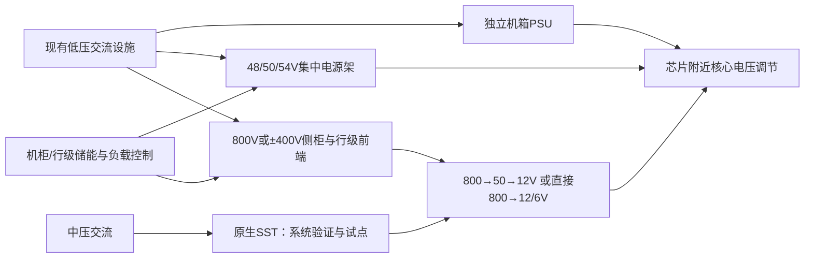

# 机柜级供电与服务器电源架构：从低压集中供电到高压直流的采用、供给与价值迁移

**研究截止：2026年10月10日。** 研究地域为全球，重点覆盖北美超大规模云客户、亚洲电源制造商及其全球交付网络。财务数字沿用公司披露币种与财政期；模型使用名义美元、自然年度交付流量。文中“事实”指已披露结果或已发布规格，“目标”指管理层/技术路线图，“计算”指可复算运算，“推断”指本报告判断。2026年行业规模是截至本日形成的全年估计，包含尚未结束的第四季度，不能读作全年已实现收入。

## 核心发现与结论边界

**最有依据的判断是：服务器供电正在从“更多低压电源模块”转向“更少的大功率转换单元，加上更复杂的保护、控制与系统验收”。** AI带来的功率密度确实推动架构升级；但每瓦净价、冗余比例、转换层数和采购权同样决定市场收入。技术重要性增加，并不保证旧电源产品收入、全部供应商利润或资本回报同时增加。

当前最可靠的商业进展集中在48/50/54V集中供电；800V和±400V已经形成客户规格、样品和产品组合，尚缺公开、可核对的全球合格交付GW台账。NVIDIA的分阶段路线、OCP客户联合规格、电源厂的验证/量产时间表，以及台积电披露的特定电源管理芯片短缺，是判断采用与约束的关键证据，集中列于后文。伙伴名单、模块峰值效率、规划工厂面积均没有被当作已验收系统产能。

本报告把可相加的核心市场划为四池：分布式服务器电源配套A、48/50/54V集中供电配套B、高压直流配套C、单列的机柜BBU/CBU配套D。2026年代表估计为**92.7亿美元**，采用附录参数条件的包络为**54.8亿—164.4亿美元**；这不是第三方统计市场规模，也不是统计置信区间。2027—2030年基准代表收入依次为106.9亿、118.3亿、127.4亿、136.9亿美元。到2030年，悲观、基准、乐观代表收入分别为51.3亿、136.9亿、211.2亿美元；完整细分、供给、价格、成本、毛利与条件范围见附录。宽范围主要反映电源采购功率、成交价和合格供给缺乏完整披露，不能凭代表点制造精确性。

基准路径中，AI年度电源采购对应功率从2026年18GW升至2030年34GW，增加约89%，核心收入只增加约48%。B池代表收入从2026年42.2亿美元升至2027年45.4亿美元，随后在2030年降至26.4亿美元；C池接续增长。这是架构替代与每瓦价格下降造成的价值迁移，不要求AI需求先衰退。现阶段无法证明800V会长期形成全行业供不应求，也无法证明电源厂可以永久取得平台级利润。

**最强反证是：客户支出增加，可能主要被更贵的芯片、内存、网络及建设吸收；开放规格、共享冗余、客户多供与直接高压降压，又可能压低电源每瓦支出。** 悲观路径允许AI应用继续发展，却出现电源市场与毛利收缩。反过来，若多个客户在2027—2028年同时验收高压架构，而合格保护/控制/转换组合不足，短期交付价值可能明显高于器件本身的价值。

最大的未解决问题是：各客户实际采购的电源瓦数、同规格OEM净价、800V付费验收规模、跨客户可转移的合格产能，以及寿命期故障/退货成本。报告对这些缺口给出条件范围和判别阈值，没有把未知写成零成本、无限供给或既定短缺。

## 一、客户购买的是可持续交付算力的供电责任

### 1. 边界与可相加市场

核心研究从服务器/机柜电源前端开始，覆盖电源转换、必要的机柜本地母排与控制保护配套、独立销售的中间DC/DC，以及机柜BBU/CBU。芯片附近最终核心电压调节器、园区主变压器、建筑级开关柜、UPS、长时储能、发电、冷却和工程总包另属相邻市场。高压路线会移动转换位置，比较时必须固定功能边界。

| 池 | 本报告的销售边界 | 客户任务与需求单位 | 与其他池的关系 |
|---|---|---|---|
| A：分布式服务器电源 | 独立机箱的AC/DC PSU及电源侧必要配套，输出12V或48V等；含尚未采用集中供电的AI机箱 | 每年需购买新电源配套的可用服务器负载GW；新增与替换都计入流量 | 与B、C按同一负载互斥；AI机柜内已计入的CPU/网络不再进入普通服务器需求 |
| B：48/50/54V集中供电 | 集中电源架/模块及必要的机柜本地母排、转换控制配套；不含芯片核心VRM | 同一机柜集中供电对应的可用IT负载GW | 同一负载仅在A/B/C之一计量；各级串联转换不能将瓦数逐级相加 |
| C：800V/±400V配套 | 从低压交流输入到高压直流前端、匹配的800→50→12V或直接800→12/6V转换、本地保护控制组成的配套 | 按匹配并验收的可用负载GW计；不是单一器件铭牌GW | B向C迁移是替代；高压前端和后级DC/DC属于同一配套收入边界 |
| D：机柜BBU/CBU | 与B/C配套且独立计价的电池、超级电容及其电源管理模块 | 受保护功率GW，并另看持续时间、循环和功率密度 | 可以与A/B/C的电源转换收入相加；若含在供应商电源架报价中，先从A/B/C报价剥离，再计D一次 |
| 相邻：原生MV→DC SST | 中压输入至800V输出的固态变压器，含其自身隔离与控制，排除建筑其他电气工程 | 经客户验收的转换功率及系统可用性 | 本报告作为替代路线研究；其销售额不加进核心C池，以免和低压前端重复 |
| 相邻：上游半导体/磁件/连接器 | GaN、SiC、硅器件、PMIC、控制、磁件及连接器等 | 器件数量、晶圆/封装能力、合格料号 | 已进入A/B/C/D成本，不能把上游收入再加到核心终端配套支出；可独立研究其利润 |

模型R是电源配套制造商售给ODM、服务器OEM、系统集成商或直接客户的净收入之和，尽量避免集成商转售重复。它近似这一层的采购池，**不是含服务器、园区工程、经销加价与运维的最终客户总账单，也不是全价值链增加值**。GP是扣除同边界制造成本后的毛利，仍未扣研发、销售管理、利息和税。上游器件收入、集成商整柜收入与客户总资本开支可以分别观察，不能作为新的互不相关需求相加。

地区也不能简单切开：北美客户采购、台湾企业收入、泰国/越南/中国/美国生产可能来自同一批交付。本报告全球汇总一次，不另加“美国市场”和“亚洲供应商市场”。

### 2. 付款、验收与失败成本

超大规模云客户和平台商决定参考架构、兼容性和多供策略；ODM/OEM把电源纳入整机BOM并承担交付；园区开发商、托管商和设施团队承担上游电力、消防与现场集成；运营团队负责负载瞬变、维护、热插拔和故障处置。采购合同上的买方与承担停机损失的人可能不同。需要明确系统责任由谁兜底，否则“模块更高效”仍可能无法通过整柜验收。

预算分三类：新AI系统部署创造新负载；旧系统刷新带来替换和部分电源复用；800V集中前端或SST则可能把费用从服务器BOM转到机房/设施BOM。最后一类是预算内部转移。若转换责任上移，电源技术并未消失，但原服务器电源供应商的可计价边界可能缩小。

客户对电源的支付意愿首先来自可交付性、机柜空间、可靠性、维护与兼容性，其次才是电费节省。可用供电让昂贵GPU系统及时上线，其价值很高；但集中采购和多个合格供应商会使这份价值留在客户或平台，而非全部进入电源ASP。

## 二、关键证据：量产、验证与路线图处在不同位置

下表集中保存会改变本报告判断的事实与目标。金融期为自然季度/半年度，另注明财政期；产品规格为公布时的设计口径。财报和官方技术材料优先于媒体转述；同一公告的转载没有增加证据权重。

| 证据与公开日期 | 原始披露及适用期/边界 | 性质与经济含义 |
|---|---|---|
| NVIDIA，2026-08-11 | MGX兼容800V电源架计划2026年下半年进入市场；2027年行级电源中心目标为每行最高2MW；更远期再走向原生DC设施；称生态已有80多家参与者 | **目标。** 第一阶段可由现有建筑AC给电源架供电，降低改造门槛；不代表建筑电力容量自动充足，也不代表80多家都已量产合格系统。[原始公告](https://blogs.nvidia.com/blog/800-vdc-power-architecture-ai-factory/) |
| OCP《Diablo 400》v0.7.0，生效2026-03-01 | Microsoft、Meta、Google共同参与，双极±400V、三导体结构，设计支持最高1.1MW平均功率；部分连接器细节仍待定 | **规格。** 客户有真实工程需求，并在定义接口；800V与±400V不能仅按数字视作完全可互换。[规格PDF，电气和接口章节](https://www.opencompute.org/documents/ocp-specification-diablo-400-v0-7-0-final-pdf) |
| OCP《LVDC White Paper》v1.0，2026-03-30 | 提供低压直流配电的初始框架及不同实现方式，并非唯一方案 | **框架。** 标准化有利于采用，也利于多供；开放文件不是每个地区通用的安全许可。[PDF，第7、39—40页](https://www.opencompute.org/documents/dcf-power-distribution-lvdc-white-paper-version-1-0-final-pdf-1) |
| OCP《SST Design Specification》v0.3，生效2026-06-22 | Google、Microsoft、NVIDIA参与；低电压穿越的一类区间要求储能供给100%额定负载；部分动态测试、协调和接地项仍待定 | **规格/待完成项。** 原生SST并未取消能量储备，也没有证明现场系统全部完成资格认证。文档生效日与NVIDIA所述7月发布时点分列，不混作矛盾。[PDF，第12、14—15页](https://www.opencompute.org/documents/ocp-sst-design-specification-v0-3-final-pdf) |
| Advanced Energy，2026-06-03 | ADH系列800→50V，6kW连续、8kW峰值、98.2%峰值效率；已向领先客户送样 | **规格/样品。** 峰值功率不能充当连续产能，单级峰值效率不能充当电网到GPU的全年效率。[公司公告](https://ir.advanced-energy.com/news/advanced-energy-introduces-800-v-dc-converters-for-next-generation-ai-data-centers-new-dc-dc-converters/4a23cb7c-eda6-405d-b5f6-5081b61c4c01) |
| Advanced Energy，2026-02-10、2026-08-03 | Data Center Computing收入：2024年2.842亿美元、2025年5.873亿美元；2026年Q1为1.942亿、Q2为1.915亿，上半年3.857亿美元；2026年增长超过50%及800V在2028年全面生产均为管理层目标 | **已实现收入/目标分离。** 上半年同比约62.2%，Q2环比约-1.4%；显示当前电源业务放量，不能把上半年机械年化成全年目标。[2025结果](https://ir.advanced-energy.com/news/advanced-energy-reports-fourth-quarter-and-full-year-2025-results/579d65f4-6a23-471e-8f5c-ec1be349785b)、[Q2结果](https://ir.advanced-energy.com/news/advanced-energy-reports-second-quarter-2026-results/a80af9be-bd06-413a-b193-5909f008ea48)、[Q2演示材料](https://ir.advancedenergy.com/media/document/2cee814a-5465-4847-b37d-e756a30cc2aa/assets/AEIS_2026_Q2_Earnings_Slides_vFinal.pdf) |
| LITEON，2026-04-29、2026-07-31 | 50V Power Rack已量产；110kW电源架开始出货并在Q2稳定交付；8.5kW PSU/BBU爬坡；800V电源架计划2026年下半年完成验证 | **量产与目标。** 传统集中供电的兑现进度领先于高压架构；cloud分类包括其他产品。[Q1公告](https://www.liteon.com/en/news/press-center/content/quarterly-first-eps-2026)、[Q2公告](https://www.liteon.com/en/news/press-center/content/quarterly-second-eps-2026) |
| Delta，2026-06-02—05产品展、2026-07-30财报 | 展示800V行级供电、800→54V的90kW DC/DC电源架及110kW AC/DC架；2026年H1总收入新台币3426亿元，Q2为1832亿元、毛利率35.6% | **产品展示/混合业务事实。** 可确认布局和公司增长，不能将整个Delta收入或毛利率归为机柜供电。[产品页](https://www.deltaww.com/en-US/landing/Computex-2026)、[Q2财报材料](https://filecenter.deltaww.com/ir/download/calendar/2Q26_Analyst%20Meeting.pdf) |
| 台积电，2026-07-16 | 电话会指出AI用途的0.18微米及90纳米电源管理芯片存在供应不足 | **特定供应约束。** 支持PMIC料号/工艺成为短板，不支持“所有功率半导体都短缺”。[Q2原始电话会，第21页附近](https://investor.tsmc.com/english/encrypt/files/encrypt_file/reports/2026-08/3e494f0c14dd0890f897aa044415e21d93486cc4/TSMC%202Q26%20Transcript.pdf) |
| Infineon，2026年度股东大会材料 | FY2025 AI数据中心电源相关半导体收入超过7亿欧元；FY2026约15亿欧元、FY2027约25亿欧元为当时目标 | **实际/目标。** 证明上游功率价值增加，覆盖整条供电链，不能与电源模块收入相加；FY截止9月30日，不作为已公告FY2026结果。[CEO原始材料，第2页](https://www.infineon.com/assets/row/public/documents/corporate/investors/annual-general-meeting/2026/agm2026-key-points-speech-jochen-hanebeck-chief-executive-officer-v01-00-en.pdf) |
| Enphase，2026-09-08 | 4kW模块在得州制造，用于完整SST系统验证；目标最高5MW、亚毫秒动态响应；计划2026年11月整机演示、2027年客户试点 | **部件制造/系统目标。** 不是截至10月10日已验收的5MW数据中心系统；其既有光伏微逆变器产能不是AI SST合格产能。[公司发布原文](https://www.globenewswire.com/news-release/2026/09/08/3357594/20176/en/enphase-advances-iq-solid-state-transformer-development-for-ai-data-centers-with-power-modules-now-being-built-in-texas.html) |
| Heron Power，2026-09-21 | 与RWE签署首个公用事业试点，计划2027年4月安装；额外至少500MW/年的保留路径仍以最终采购协议为条件；Factory One设计能力超过40GW/年、计划2027年末量产 | **试点/有条件协议/设计能力。** 首个试点属于公用事业储能/风电场景，不能作为AI机柜交付；40GW不能直接计入本行业有效供给。[公司原始公告](https://heronpower.com/news-stories/heron-power-and-rwe-sign-pilot-agreement) |
| AcBel，2026-10-08 | 宣布将与子公司OmniOn在10月13—15日展示±400/800V的100kW电源架和50V的72kW架 | **未来展示公告。** 截止日会议尚未举行；可以确认竞争者布局，不能写成已完成现场验证或量产。[公司发布原文](https://www.prnewswire.com/news-releases/acbel-to-showcase-high-density-power-solutions-for-ai-data-centers-at-ocp-global-summit-2026-302902055.html) |

LITEON原站部分页面在浏览工具中返回错误，本次另以直接请求读取官方HTML正文核验，未用转载替代内容。原文数据未换汇；NTD、USD、EUR之间没有被凑成一个“已披露行业总额”。

### 1. 三条采用路径并行，不是一次全设施改造



低功率企业服务器、存储、边缘设备继续使用成熟机箱PSU；它们不需要为了追随AI机柜而全部升至800V。高功率、集中管理的云系统倾向共享冗余和高密度电源架；在工程条件允许的范围内，48/50/54V仍是可以实际交付的过渡与长期并存路线。

高压直流初期可以由旁置电源柜/行级前端转换现有低压AC，先缓解机柜内的电流、母排和空间约束。只有新建站点或较大改造，才更适合把中压变压器、整流、UPS功能重新组织到原生SST。建筑拥有交流输入不妨碍第一阶段800V；但建筑入口、配电和冷却的容量仍约束最终上线。

客户采用链条至少包括：电路可行→样机→整机电热验证→动态负载/故障测试→客户料号与现场资格→付费验收→可重复规模交付→保修期现金贡献。不同厂商处于不同阶段，验证周期不能用同一个“800V发布日”替代。模块有样品与全球800V收入占比很高之间仍有明显距离。

### 2. 为什么提高电压有效，为什么其市场效果不是简单倍数

同一段直流输电，电流I=P/V。1MW在54V下约18519A，在800V下约1250A；同电阻条件下I²R损耗比约219倍。这说明高压对大功率传输有强烈工程价值，**不能推成整个数据中心损耗降低219倍，也不能推成铜耗或电源利润同比增长/下降同一倍数**。真正的比较必须含导体截面、长度、接点、温度、转换级数和负载分布。

NVIDIA在2025年5月的工程讨论中，指出兆瓦级机柜继续使用低压电源会大量占用机柜空间，并给出最高5%的端到端效率、70%的维护成本和30%的TCO改善等设计主张。这些是厂商特定设计与边界下的主张，不能直接当作本行业所有客户的电费、数据中心总投资或电源ASP变化。[NVIDIA原始技术文，2025-05-20](https://developer.nvidia.com/blog/nvidia-800-v-hvdc-architecture-will-power-the-next-generation-of-ai-factories/)

±400V是正负母线相对中点的双极结构，线间可以为800V，但导体、接地、绝缘和故障控制与单极800V方案不同。直流中断缺少交流的自然过零条件；热插拔、预充、短路选择性、接触器/半导体保护、爬电距离和部分放电测试因而影响整机可靠性。Diablo的三导体、接触顺序和连接器安排说明，竞争不只发生在“效率百分比”上。与开放规格相容也不等于已完成客户和地域验收。

从8.5kW模块升到12kW、从18kW架升到110kW架，会使每架收入提高，但同一GW所需模块/架数量减少。OCP ORV3的一个参考架使用6个3kW模块；若按一个模块冗余，18kW铭牌只对应15kW可用容量，购买比率ρ=1.2。2N结构的ρ则可能接近2，不能混用。随着共享冗余和模块功率提高，ρ下降可以抵消IT负载增长。[OCP ORV3 Power Shelf rev1.0.1，2025-04-29](https://www.opencompute.org/documents/ocp-open-rack-v3-power-shelf-rev-1-0-1-pdf)

### 3. 直接降压、垂直供电与SST是不同的价值迁移

中间电压不是永远固定。NVIDIA已讨论800→12V高变比转换；TI在2026年3月发布从800V至GPU的两级参考架构；Navitas在2026年5月披露20kW、800→6V板级方案，效率目标97.5%，以及与EPFL合作的250kW SST演示。参考设计和演示支持减少转换层数的可行性，尚不能证明大批量成本、故障率和寿命都已达标。[NVIDIA技术文，2025-10-13](https://developer.nvidia.com/blog/building-the-800-vdc-ecosystem-for-efficient-scalable-ai-factories/)、[TI公告，2026-03-16](https://www.ti.com/about-ti/newsroom/news-releases/2026/2026-03-16-ti-unveils-complete-800-vdc-power-architecture-for-future-generation-ai-data-centers-with-nvidia.html)、[Navitas Q1公告，2026-05-05](https://navitassemi.gcs-web.com/news-releases/news-release-details/navitas-semiconductor-announces-first-quarter-2026-financial)

因此，800V可以一边放量，一边压缩传统50→12V模块或部分前端的收入。器件厂需要争夺新的拓扑设计位置；电源厂需要把单级产品转换为完整匹配方案。高频磁件、GaN、SiC、硅和控制IC会按电压、开关频率、热设计、可靠性与成本分工，现有证据不足以指定某一种材料包办全部供电链。

芯片附近的垂直/Z轴供电则解决封装、走线电阻和电流密度。MPS提出PDN损耗改善及高电流密度目标，这只覆盖芯片供电网络，不能当作全设施节电倍数。本报告将其放在相邻PoL领域：它可能强化芯片/封装入口的控制权，但不能在核心电源市场上再加一个完整服务器收入池。[MPS 2026企业责任报告，电源架构章节](https://www.monolithicpower.com/media/mps_cms_document/2/0/2026_corporate-responsibility-report.pdf)

## 三、瞬变与储能：快响应不等于有能量

AI训练中的计算/通信阶段交替可能形成同步功率波动。NVIDIA、Microsoft、OpenAI等参与的原始研究讨论了GPU负载控制、系统调度和储能的组合，并使用真实训练相关数据及测试/模拟。问题取决于工作负载和集群同步程度；不能把某一训练测试波形当作所有推理机柜的固定要求。[《Power Stabilization for AI Training Datacenters》，2025-08-20/21](https://arxiv.org/abs/2508.14318)、[Microsoft原始研究页](https://www.microsoft.com/en-us/research/publication/power-stabilization-for-ai-training-datacenters/)

以1MW负载为例，维持10秒需要约2.78kWh，维持5分钟约83.3kWh；20MW集群平滑5秒需要约27.8kWh。高瞬时功率、循环频度、允许电压变化、温度和可靠性，可能比单纯电池kWh更决定价格。毫秒级电容、秒级超级电容、短时BBU和设施储能承担不同任务，不能都按同一锂电池美元/kWh曲线估值。

**SST响应快，只能更快调节输入输出，不能凭空创造电网中断期间的能量。** 电网正常且允许功率迅速变化时，快速前端与GPU控制可能减少局部缓冲；电网扰动、限功率或同步负载需要能量支撑时，必须由储能、负载削减或其他电源承担。OCP SST规格的储能穿越要求正好给出这一区别。

Enphase的“减少靠近机柜的本地电池缓冲”可以成立，却仍可能意味着储能上移、容量/功率分工变化或软件平滑承担更多责任。其公告没有证明所有机柜BBU、设施UPS和储能均可取消。判断D池价值，必须观察同一客户、同一工作负载和同一可靠性指标下的储能位置、功率、时长及实际BOM变化，不能只按“SST出现”作方向判断。

本报告D池在基准中由2026年6.48亿美元增至2030年14.69亿美元，来自受保护负载增加；每受保护瓦净价由0.075美元降至0.060美元。下行分支同时降低采用率和每瓦价格。D只覆盖机柜配套，未把IEA提及的数据中心整体储能规模当作同口径收入。

## 四、需求估算：采购功率、预算与上电分开核验

### 1. 当前需求的独立锚点与相互冲突

| 来源、公开日期与经济期 | 可保留的披露 | 对电源估计的约束 |
|---|---|---|
| IDC，2026-09-10，2026Q2 | 全球服务器收入1663亿美元，同比+52%；单位出货+15.4%；GPU加速服务器单位出货-10.8%、ASP由约118600美元升至170200美元 | 收入增长不能直接映射到瓦数。IDC整机“单位”也不能等同GPU卡或机柜；ASP与系统组合变化需分开。[原始研究发布](https://www.idc.com/resource-center/press-releases/2q2026-wwserver-tracker/) |
| Microsoft，2026-07-29，FY2026Q4截至6月30日 | 当季资本开支410亿美元，约三分之二为短寿命CPU/GPU资产；现金PP&E358亿美元；CY2026资本开支约1750亿美元为目标，并涉及租赁分类调整 | 支出确认、现金付款和交付功率有时差；会计重分类不等于新部署加速。[原始电话会](https://www.microsoft.com/en-us/investor/events/fy-2026/earnings-fy-2026-q4) |
| Amazon，2026-07-30；Alphabet，2026-07-22，均为H1截至6月30日 | 各自现金流表PP&E购置984.11亿美元、805.98亿美元；两者直接相加为1790.09亿美元 | 同期现金流可相加，但包括其他业务、建设和非电源IT；不能再加到服务器供应商收入上作为第二份终端需求。[Amazon原始财报](https://ir.aboutamazon.com/news-release/news-release-details/2026/Amazon-com-Announces-Second-Quarter-Results/default.aspx)、[Alphabet原始SEC文件](https://www.sec.gov/Archives/edgar/data/1652044/000165204426000066/googexhibit991q22026.htm) |
| Meta，2026-07-29，2026全年指导 | 资本开支1300亿—1450亿美元，包括融资租赁本金 | 保留原范围和定义；是目标，不是已经采购的电源收入。[公司原始发布](https://www.prnewswire.com/news-releases/meta-reports-second-quarter-2026-results-302838214.html) |
| CoreWeave，2026-08-11，Q2截至6月30日 | 活跃电力约1.5GW，环比增加接近500MW；签约电力约3.7GW；收入25.75亿美元、净利息费用6.40亿美元；收入backlog约1040亿美元 | 活跃容量更接近兑现，签约容量不是当期负载；backlog含交付条件，不能当现金。利息显示融资对上线速度有真实约束。[原始结果](https://investors.coreweave.com/news/news-details/2026/CoreWeave-Reports-Strong-Second-Quarter-2026-Results/default.aspx) |
| NVIDIA，2026-08-26，FY2027Q2截至7月26日 | 数据中心收入890亿美元；管理层称Vera Rubin在生产/爬坡，多家客户运行相关机架 | 证明计算系统商业进展；该分类含网络等，且未给800V付费交付GW。Rubin生产不自动等于全部高压电源系统验收。[原始财报](https://investor.nvidia.com/news/press-release-details/2026/NVIDIA-Announces-Financial-Results-for-Second-Quarter-Fiscal-2027/) |
| IEA，2026-04-16报告 | 2025全球数据中心用电485TWh；2030中央预测950TWh；五家大型技术企业2025资本开支超过4000亿美元，2026预计再增75% | 提供全设施能源和预算数量级，不能直接当电源年度交付。近7000亿美元级预算锚点为估算，仍需扣非AI/非硬件。[原始报告摘要](https://www.iea.org/reports/key-questions-on-energy-and-ai/executive-summary) |
| DIGITIMES Research，2026-02-13，2025全年 | 全球服务器出货1560万台，为研究机构统计 | 用于普通服务器数量级校准；不是公司审计数据，不能混同不同配置AI系统。[原始研究摘要](https://www.digitimes.com/reports/item.php?id=20260213RS402) |

IDC的GPU整机单位下降与NVIDIA的数据中心收入上升并非可直接定性的矛盾：期间、GPU/整机统计单位、ASIC与网络覆盖、ASP和客户库存均不相同。最强可支持结论是“美元增长和台数/瓦数增长正在分离”，而不是凭一季台数宣布AI供电需求拐点。

普通服务器N在2026年采用13—19GW、代表15GW，口径为需新增/更新电源配套的可用负载。以约1100万—1500万台非集中AI机柜服务器、平均约1.1—1.5kW作交叉校准，可覆盖约12—23GW的更宽工程范围；台数拆分、平均额定功率和复用比例均是推断。附录条件区间选择13—19GW作为本轮市场模型的联合参数条件，不声称已穷尽所有可能。后续直接采购瓦数与高功率普通服务器占比会改变N；不能只以总服务器美元收入校准。

### 2. AI需求侧公式与采用参数

先估算硬件交付对应功率，再扣除电源复用，最后分配架构。令：

- B：五家主要技术企业当年总资本开支，十亿美元，含建设与非AI；
- f：其中进入本次AI计算系统硬件采购的比例，已排除建筑和非AI；硬件含机柜内CPU、网络/内存等；
- m：该硬件组合每MW可用输出负载的资本成本，百万美元/MW，不含园区电气和土建；
- O：五家之外的客户采购对应GW；不含五家自己采购、只是放在第三方托管的同一硬件；
- k：当年计算硬件交付功率中，需要新增/更换电源配套的比例，扣除复用。

于是**H≈(B×f/m+O)×k**。十亿美元除以百万美元/MW，数值对应GW。B、f、m、O、k均有独立含义；不能用已知电源厂收入先反求H，再拿这个H证明电源厂增长。m并无可直接核验的统一客户成交价，下表数值属于组合假设；用IDC不同GPU整机ASP直接除一个固定GPU功率会引入配置错误。

| 年度/路径 | B，十亿美元 | f | m，百万美元/MW | O，GW | k | 公式结果约值/采用H，GW |
|---|---:|---:|---:|---:|---:|---:|
| 2026当前全年估计 | 700 | 0.48 | 24 | 6 | 0.90 | 18.0 / 18 |
| 2027需求回落、竞争压价 | 600 | 0.45 | 25 | 6.7 | 0.80 | 14.0 / 14 |
| 2027分阶段采用基准 | 840 | 0.50 | 28 | 10 | 0.88 | 22.0 / 22 |
| 2027高密度采用加速 | 1000 | 0.55 | 25 | 10 | 0.91 | 29.1 / 29 |
| 2028悲观 | 600 | 0.40 | 25 | 6 | 0.83 | 12.9 / 13 |
| 2028基准 | 1050 | 0.50 | 30 | 12 | 0.88 | 26.0 / 26 |
| 2028乐观 | 1300 | 0.60 | 25 | 8 | 0.92 | 36.1 / 36 |
| 2029悲观 | 620 | 0.42 | 25 | 6 | 0.85 | 14.0 / 14 |
| 2029基准 | 1200 | 0.525 | 30 | 13 | 0.88 | 29.9 / 30 |
| 2029乐观 | 1550 | 0.60 | 25 | 10.5 | 0.92 | 43.9 / 44 |
| 2030悲观 | 650 | 0.40 | 24 | 7 | 0.84 | 15.0 / 15 |
| 2030基准 | 1400 | 0.55 | 30 | 13 | 0.88 | 34.0 / 34 |
| 2030乐观 | 1800 | 0.60 | 24 | 11.5 | 0.92 | 52.0 / 52 |

2027年以后B不是已公告客户预算，整张表也不是若干财报的机械求和，而是可审查的需求侧情景。低m的乐观路线要求供给/产品组合改善或采购成本下降；基准m由24升至30，允许内存、网络和更复杂系统吸收部分支出。悲观在需求降温时提高复用、降低AI预算占比，即使推理使用量增长也可能减少电源采购。

H是**当年新增电源采购对应的服务器DC输出满载等效GW**，不是设施PUE后的输入GW、已运行平均负载、净新增电网容量或GPU数量。r是H中集中供电的比例，h是其中高压配套占比。2026代表r=80%、h约1.39%；到2030基准为90%、60%。这些采用比例是研究估计，未找到覆盖全行业的客户采购统计。近期50V量产证据比800V更扎实，因此基准采取高压逐步加速，并没有把2026年大量展示都当作当年收入。

只看AI训练也会漏掉普通服务器、存储和推理：低密度、分散的推理可能继续采用A或B；ASIC自研会改变模块规格和采购入口，却未必减少总机柜功率。开源与更低每任务能耗可能扩大使用量，也可能使同等任务需要更少设备。报告以采购功率和架构采用承载这些效果，没有默认Token、算力、设备和收入同比例增长。

### 3. 用电交叉检查与资金约束

基准2026—2030累计H为130GW，扣复用前的计算硬件交付功率约147GW。这是五年毛交付量。若其中40%对应替换/退役，2030另保留15GW此前设备，期末AI满载存量约103GW；假设平均运行负载率40%、PUE=1.2，则年化设施用电约**433TWh**。这一工程检验可以与IEA全球950TWh中央预测共存，余下约517TWh留给非本模型AI负载及其他数据中心。它不是IEA对AI子市场的精确预测，15GW旧存量、40%替换和40%平均负载率都是本报告检验参数。

若把同一基准毛交付都当净新增、再用65%持续负载率，能源需要会显著超过这一检验。反过来，机柜卖出但站点未上电，可以先形成电源收入、后形成用电，并不立即证明终端盈利。它会积累GPU/电源库存、客户融资和交付尾款风险。

乐观路径五年H约179GW；取扣复用前约195GW、35%替换、15GW旧存量、50%平均负载率、PUE=1.2，AI年化用电约745TWh。在其他数据中心仍增长的情况下，这明显要求全球用电高于IEA当前中央路径，或者替换比例更高、负载率更低、设施更高效。**乐观不是中央情景的免费上修，而需要电力、站点、融资与软件使用一起兑现。** 本报告因此不给乐观路径最高权重。

CoreWeave的活跃/签约容量差距和利息费用说明：电源硬件能交付，仍不等于建设资本、客户服务收入和现金流能支持全部签约功率。用于AI系统的租赁、预付款和长期服务合同可以释放需求，也会把取消、融资和残值风险传给ODM、运营商及供应商。模型的H包络允许预算延后，未把1040亿美元backlog作不受约束的硬件需求。

## 五、供给侧：缺的是哪一个合格组合

### 1. 有效供给不能从收入指导倒推出物理产能

一个800V系统的有效供给由前端、后级DC/DC、控制保护、连接器/母排、储能接口、散热及客户认证共同决定。若一环不合格，多出来的其它模块不能补足同一机柜。高温、输入范围、连续功率和故障降额同样影响可用能力。

供给侧按**年度可交付的可用负载GW**统计，与需求侧同产品/全球/自然年口径比较。设计和工厂面积是更上游的名义能力；最终验收及可交付能力还要扣工位利用率、良率、热降额、客户资格和项目分配。A/B存在共用工厂与测试设备，本报告的S已按项目分配，不能将所有厂的“全厂产能”分别完整加进每个架构。

目前没有可公开核验的全球PSU工位、测试通道、良率和客户核准产量普查。附录S是**低置信度的条件供给估计**，不是披露产能。它没有按D自动设定：成熟A/B供给在悲观下仍扩张，造成闲置；高压C在乐观下反而跟不上需求。收入基数只用来检查美元数量级是否离谱，不用来独立证明物理供给。

可审查的工程形式为：

**S=K×u×f_q×y/ρ。**

K为各产品族全年设计铭牌GW；u为可用工位/项目分配利用率；f_q为已通过客户资格且适合该规格的份额；y为制造合格及降额后的通过系数；ρ为购买铭牌容量/可用负载。D池按受保护可用功率标定，ρ=1。C的K取匹配链条中的最小能力，不累计串联转换的铭牌功率。

2026代表校准如下；K、u、f_q、y全部是透明工程假设，不是供应商披露。其作用是暴露S需要的生产与认证条件。

| 产品族 | K，GW/年 | u | f_q | y | ρ | 算得可用S约值，GW/年 |
|---|---:|---:|---:|---:|---:|---:|
| A成熟分布式配套 | 48 | 0.90 | 0.89 | 0.97 | 1.55 | 24.1 |
| B集中低压配套 | 32 | 0.90 | 0.87 | 0.97 | 1.35 | 18.0 |
| C高压完整配套 | 0.70 | 0.75 | 0.72 | 0.99 | 1.25 | 0.30 |
| D机柜缓冲配套 | 15（按可用保护瓦标定） | 0.85 | 0.95 | 0.99 | 1 | 12.0 |

例如B的32GW设计铭牌能力，相当于约376万颗8.5kW模块/年。若每颗占用独立测试通道2小时、每通道年有效6000小时，需要约1255个并行测试通道；测试时长/并行架构换成1—4小时，则要求约628—2510个通道。模块规格、烧机方式和回馈式测试会改变这项计算。它是核验工厂声明的方法，**不是发现了1255个实际工位**。模块从3kW增至8.5kW可以在件数近似不变时提高GW，不能只用SMT台数预测未来供给。

当前最有依据的供给方向是：**A/B没有足够证据支持持续的全面物理短缺，但高功率料号、客户指定PMIC、热设计和项目资格可能造成结构性缺口；C的约束更接近匹配系统与客户验收，而不是原材料普遍枯竭。** 台积电的特定PMIC披露支持前半句。TrendForce在2026年4月15日原始研究中报告8英寸相关PMIC交期由约21—26周延长至35—40周；属于产业调研，不能替代每家公司真实采购合同，也不能将交期放大为全行业同等溢价。[TrendForce原始研究](https://www.trendforce.com/presscenter/news/20260415-13013.html)

### 2. 扩产能否兑现，要看资格、折旧与共享资源

Advanced Energy将泰国工厂初期生产/客户资格进展放在2026年第四季度，并提出2028年底约50亿美元公司收入承载能力；后者是**全公司美元能力目标**，不是50GW，也不是全部数据中心电源。2026资本开支目标1.80亿—1.95亿美元，显示制造投入先于全部收入兑现。其2026数据中心收入增长超过50%的目标，对2025年5.873亿美元基数意味着超过8.8095亿美元，仍不能等同实际合格满产。上表B的18GW供给按ρ=1.35、P=0.22美元/W对应约53亿美元收入承载能力，可用AE与其他大型电源企业的业务规模作宽松检查；缺少产品份额统计，不能据此宣称已经测得全球供给。[AE Q2原始演示材料，工厂与财务页](https://ir.advancedenergy.com/media/document/2cee814a-5465-4847-b37d-e756a30cc2aa/assets/AEIS_2026_Q2_Earnings_Slides_vFinal.pdf)

LITEON批准美国9.19亿美元投资，涵盖土地、厂房和设备；当地发展机构2026年9月3日披露约65万平方英尺设施分阶段建设与用工计划。金额既不是当年费用，也不是已形成GW。LITEON将2026资本开支目标提高至新台币180亿元；部分高端产品从Q1延至Q2发货，说明季度收入既受需求影响也受爬坡节奏影响。[LITEON Q1](https://www.liteon.com/en/news/press-center/content/quarterly-first-eps-2026)、[当地项目原始公告](https://uniquemckinney.com/liteon-conducts-ceremonial-groundbreaking-on-mckinney-manufacturing-campus/)、[LITEON Q2](https://www.liteon.com/en/news/press-center/content/quarterly-second-eps-2026)

Delta的2026年7月30日电话会称上半年数据中心相关收入超过总收入一半，含冷却等业务；H1资本开支新台币275亿元，下半年预计超过400亿元。新AI设备按3年折旧，并解释产品组合、取消订单收入和扩张成本对毛利的影响。这些事实支持大规模供给反应与更快设备更新，不能直接解释为PSU净价持续上涨。[Delta原始电话会](https://filecenter.deltaww.com/IR/download/calendar/2Q26_Transcript.pdf)

跨地域工厂可以降低贸易/物流和客户本地化约束，也增加重复设备、初期人员、资格维护及库存。材料涨价能否转嫁取决于合同重定价与客户议价；制造商可能先承担成本，几个月后才体现调价或更换规格。本报告不假设原材料每涨1%电源ASP立即涨1%。特定PMIC交期可达半年以上，客户也可能通过库存与长期预订缓冲；其营运资本占用并不会因为终端机柜技术重要而消失。

### 3. 同规格交叉比较：何时短缺、何时闲置

2026代表D_A/B/C/D为18.6/14.2/0.2/8.64GW，代表S为24/18/0.3/12GW。A/B总体有缓冲；C缓冲的绝对量很小，且可供给0—0.6GW条件范围仍跨越“几乎未兑现”和“少量商业交付”。在当前证据下，这不支持精准计算全球缺口比例，支持优先核验某客户、某高压规格的资格与匹配转换能力。

2027乐观C需求4.99GW、供给4GW，模型延后约0.99GW；2028乐观为14.58GW对13GW，延后约1.58GW。其他低压模块富余无法无条件替换已按高压设计的机柜。到2030，乐观C为41.55GW需求对40GW供给，仍有结构性延后；A/B反而存在较多备用能力。这些是附录参数下的结果，不是已知全球订单缺口。

悲观路径2028成熟B需求9.36GW，而供给22GW；同年的C需求1.04GW、供给2GW。即使AI硬件路线向高压发展，供给反应也可能领先实际验收，从而压低订单利用率、成交价和毛利。供给缓解可以帮助GPU/系统买方按时上线，却削弱电源供应商定价，二者利益方向不同。

## 六、价格、单位成本与客户回报

### 1. 每瓦净价与每架售价必须一起看

公开OEM大单净价、返利、保修和捆绑条款很少。Supermicro官方配件商店在本次截止日可见的数款3000W替换PSU标价约535.19—982.14美元，约0.178—0.327美元/铭牌W；不同料号、接口和效率等级不能作同规格价格历史。它只是小批零售备件的锚点，不是OEM大单成交价，个别缺货也不证明全球短缺。[官方商店查询页，2026-10-10读取](https://store.supermicro.com/us_en/server-accessories/power-supplies.html?price=155.4600-&pwr_spl_ttl_output=1271&pwr_spl_type_of=1147)

本报告A的2026代表净价0.15美元/冗余等效W、条件范围0.13—0.18；其低于多数上述零售备件，且只按本报告配套边界计量。OEM折扣并无可核验统一比例，报告没有把假想固定折扣写成事实。B、C的P包含本地匹配配套，D另列；用单颗PSU零售价去乘整柜所有串联转换功率会多算。

B在2026代表P=0.22美元/W、C=0.34、D=0.075。高压早期增加保护、隔离、磁件、控制、测试、保修准备和低利用率成本，所以不假设它一开始就最便宜；到2030基准C降至0.235美元/W，制造成本降至0.1551。量产学习、拓扑简化和多供拉低价格，但复杂验收仍允许合格方案保持相对较好的毛利。所有价格和产品毛利率是条件估计；制造商混合业务毛利仅作合理性参考，并未当成细分真实毛利。

每MW客户采购支出约ρ×P×100万美元。例如B的2026代表ρ=1.35，对应约29.7万美元/MW；C为1.25×0.34=42.5万美元/MW。同一100MW的B/C配套差约1280万美元，D和建筑其余成本另列。在同一负载下，高压占比提高先拉升组合ASP；之后C自身降价和冗余收敛可以削弱总收入增长。

量产并不自动降低真实成交价：客户临时抢交付、单一合格料号或保修风险较高时，短期净价可能较强。真正可持续的议价能力需要跨季度看同规格净价、合同重定价、折扣、质量成本及客户第二来源，而不能只看公司综合ASP或业务组合。

### 2. 一个固定资产/客户边界的回收检验

以下为**研究工程示例**，不冒充已披露客户项目。固定同一100MW服务器DC输出系统，平均负载率65%，电费0.08美元/kWh；只比较电源链效率95.5%与97.8%，不把冷却、地产、GPU生产率自动加入收益。

- 输入功率节省=100×0.65×(1/0.955−1/0.978)≈1.60MW；
- 年节电约1402万kWh，年电费节省约112万美元；
- 7年经济寿命、10%折现率、无中途更新、期末残值0，节电现值约546万美元；
- 若同边界升级增量采购500万—1500万美元，仅靠电费的简单回收期约4.5—13.4年；以本报告B/C差额1280万美元计，约11.4年，超过7年假定寿命；
- 该例未计并不确定的停机、空间、冷却与延迟收益，也未把新系统更长寿命当已证实。若需要中期替换，其现金回收更差；若客户因空间/电流约束根本无法部署原方案，高压的交付价值则可以远大于节电。

所以，节电是必要的工程收益之一，却可能不足以解释800V升级的全部支付意愿。平均负载率越低，节电回报越小；电费翻倍会显著改善回报。模块“98.2%峰值”不等于本例假设的97.8%全年电源链效率，后者要有负载曲线、各级损耗与客户测试支持。

原生SST在OCP中提出15年以上设计寿命目标，不能直接替换这项服务器电源配套的7年示例：设备边界、维护、软件安全、部件更换和客户扩建周期不同。用长寿命设施资产给短寿命AI设备制造漂亮回收期，会隐藏必要更新与残值风险。

### 3. 毛利改善与现金改善不是同一件事

AE2026Q2公司GAAP毛利率41.1%；非GAAP41.9%含约120基点关税退款影响，直接减去该影响为约40.7%，仍是公司混合业务口径，不能称为数据中心电源实际毛利。其该季经营现金流8560万美元、资本开支4950万美元，两者之差约3610万美元；不是单独服务器电源自由现金流。库存从Q1的4.587亿美元增至5.381亿美元，资金提前占用。事实说明增长同时需要库存和资本投入。[AE原始Q2财报及演示材料](https://ir.advanced-energy.com/news/advanced-energy-reports-second-quarter-2026-results/a80af9be-bd06-413a-b193-5909f008ea48)、[现金与营运资本页](https://ir.advancedenergy.com/media/document/2cee814a-5465-4847-b37d-e756a30cc2aa/assets/AEIS_2026_Q2_Earnings_Slides_vFinal.pdf)

为看清机制，假设一个电源业务新增收入10亿美元，制造毛利率32%，研发/销售管理等增量及分配费用13%，则税前经营利润约1.9亿美元；按20%税率为1.52亿美元。若该收入新增净营运资本25%（2.5亿），现金资本开支6%（0.6亿），已在成本中计入折旧3%（0.3亿），首年增量经营投资后现金约**−1.28亿美元**。参数均为示例，不是AE或Delta细分预测。此后若收入不再增加、营运资本不再扩张且资本开支条件不变，现金可转为约1.22亿美元/年。

因此，放量需要客户验收、合格交付与付款；利润扩张另需售价下降慢于单位成本、工厂利用率改善、保修损失受控和研发摊薄；现金改善再需库存回落、尾款收回、资本开支不反复追加。更高GM与更高ROIC并非同义。本报告不估计精确行业ROIC，因为细分投入资本、内部转移与制造外包口径不足。

## 七、竞争地图与价值捕获

| 参与者/位置 | 可核验进展与独特能力 | 价值捕获条件、替代压力与未知 |
|---|---|---|
| Google、Microsoft、Meta及其它大客户；NVIDIA平台 | 客户联合OCP规格、参考架构、平台认证和大规模采购入口 | 能定义接口、多供与系统责任，保留大量交付收益；自研控制/架构不代表自制全部电源。芯片平台入口强，电源供应商仍须争取具体项目与料号 |
| Delta | 横跨转换、控制、储能、配电与冷却，现有全球制造和系统组合 | 能销售完整匹配责任，减少客户集成摩擦；混合收入和利润无法直接归因供电。更快折旧、扩产和多客户资格会消耗资本 |
| LITEON | 50V架和110kW产品量产/稳定交付，高功率PSU与BBU爬坡，跨地域扩张 | 有机会从单PSU扩大配套；800V验证与新厂需兑现。其2026年9月合并收入新台币188亿元、前9月1536亿元分别同比+22%、+26%，仍包括非电源产品。[2026-10-08官方月营收](https://www.liteon.com/en/news/press-center/content/liteon-monthly-sales-sep-2026) |
| Advanced Energy / Artesyn | 可见数据中心收入，800→50V高功率样品与后级/保护组合；电源设计和品质体系 | 特定高端方案和客户资格可取得利润；不能把半导体设备业务毛利或全公司扩产能力移给服务器电源。2028全面生产目标仍有时间风险 |
| Flex | 全球制造、系统集成及800V Power Rack，能配BBU/CBU；2026-03-16发布面向NVIDIA下一代基础设施的方案 | 可承接系统责任、区域交付和完整BOM；同时可能把价值内化至集成层。发布不是全球大批量验收。[原始公告](https://investors.flex.com/news/news-details/2026/Flex-Launches-800-VDC-Power-Rack-for-Next-Generation-NVIDIA-AI-Infrastructure/default.aspx) |
| AcBel / OmniOn、Bel；其他亚洲电源商 | AcBel兼有50V和高压展示计划；Bel在2026年OCP EMEA展示电源架、模块和配套能力 | 第二来源和开放接口增加竞争；须核验具体客户认证与连续输出，不凭品牌名单分配份额。[Bel原始展会公告，2026-04](https://www.belfuse.com/lp/bel-to-exhibit-at-the-ocp-emea-summit) |
| 麦格米特等中国挑战者 | 官方资料列出HVDC/机柜供电产品，2025年5月宣布为NVIDIA相关架构设计800V方案 | 电力电子、制造与价格竞争可能形成新供给；设计宣布不等于独家订单、美国全场景准入或实际GW份额。[公司原始新闻入口](https://en.megmeet.com/news?time=2025) |
| Vertiv、Eaton、Schneider Electric、ABB、Siemens等设施/电气整合商 | UPS、配电、控制保护和现场服务入口；Vertiv公布800V组合计划；Eaton给出侧柜、储能和验证/制造准备路线 | 转换责任上移时可捕获系统集成、服务和保护价值；也面临OEM直接供货与开放接口。Eaton的DVT/2027制造时间是目标，不能计为已交付。[Vertiv公告，2025-05-19](https://investors.vertiv.com/news/news-details/2025/Vertiv-Accelerates-AI-Infrastructure-Evolution-in-Alignment-with-NVIDIA-800-VDC-Power-Architecture-Announcement/default.aspx)、[Eaton原始路线页](https://www.eaton.com/us/en-us/markets/data-centers/knowledge-center/the-future-of-white-space-and-data-hall-design.html) |
| Infineon、TI、MPS、Vicor、Navitas及其它功率/模拟厂 | 材料、控制、热管理、高变比转换、芯片附近供电各有设计位置 | 价值取决于实际design-in、芯片面积/含量、良率与多供，不取决于列入生态名单。Infineon2026Q3称AI产能预留协议累计高个位数十亿欧元，混合已签与谈判，非全部已锁定当年收入。[2026-08-05公司公告](https://www.infineon.com/press-release/2026/infpr202608-125)、[Vicor 2025年报](https://vicorcorporation.gcs-web.com/static-files/518e6261-81b7-42a4-bb83-ebbda38b139c) |
| Enphase、Heron及其他非传统/非上市SST竞争者 | 高频隔离、模块化控制、制造路线和公用事业试点 | 单模块规模化经验有价值，但中压绝缘、局放、黑启动/穿越、保护协调、系统可用性和客户运行记录仍决定采用。潜在40GW工厂设计能力会挑战长期稀缺叙事，却不证明AI供给已解决 |

这是关键角色覆盖，不是所有厂商或料号的完备名录。设施集成商各地能力、未公开的客户自研、磁件/连接器小厂、ASIC电源与区域标准仍有覆盖缺口。没有可比客户采购份额数据库，故不输出精确厂商市占率排行榜。

技术壁垒最可能体现在故障控制、热降额、动态负载、长期质量数据和客户资格的组合，以及按期承担整柜责任的能力；只销售标准转换模块的利润更容易被多供和价格比较约束。平台与客户控制规格，既加速市场，又限制供应商单方面定价。客户集中度很高时，可靠性壁垒可能换来稳定订单，而非永久提价。

地缘、关税与融资的传导具体落在：指定产地使原厂产能暂不可用；区域厂重建资格使库存与重复资本增加；材料或运输涨价在合同重定价前压毛利；客户融资变贵推迟上线与尾款。AE的关税退款说明政策影响可逆、且综合GM含一次性项；不能把这些都归为架构带来的经营改善。

## 八、年度联合判断与概率

### 1. 三条主路径的机制

| 路径 | 2027—2028需求与供给 | 价格、成本与价值分配 | 2029—2030及重要成立条件 |
|---|---|---|---|
| 悲观：需求降温、复用增多、扩产过快 | 客户AI预算/电源更新放慢，H为14→13GW；成熟工厂仍扩张，高压客户资格逐步形成但订单不足 | A/B/C/D净价均下降，单位成本下降更慢或被低利用率抵消；GPU/系统买方受益，电源收入与GM下降，库存/资本负担增加 | H为14→15GW，C份额仍升至20%，却不足以补旧产品收入；2030核心收入51.3亿美元、毛利6.73亿美元，净利润可受固定研发费用进一步压缩 |
| 基准：低压放量后迁移、高压逐步多供 | H为22→26GW；B仍大，C从1.8GW交付升到5.59GW；供给顺利增加但资格尚有项目差异 | 2027高压组合与量增抵消降价，之后成本学习和更多合格方案压低P；ρ下降；利润主要来自匹配方案、质量与成本控制 | H为30→34GW，C交付11.35→18.36GW；2030收入136.9亿美元、毛利42.72亿美元。需要客户持续投资与可靠规模交付，并非只需要800V样机成功 |
| 乐观：高密度采用快、合格供给暂时滞后 | H为29→36GW，高压需求4.99→14.58GW，交付受C的4→13GW供给限制 | 初期合格方案净价较强，后期仍降价；客户/系统厂等待损失提高交付价值；电源厂可能赚取阶段利润，同时先投资本、备货 | H为44→52GW，高压交付26→40GW；2030收入211.2亿美元、毛利72.95亿美元。要求电力与站点超越当前中央预期，客户资金、持续使用与质量记录同时兑现 |

基准来自目前更强的量产、财务和客户规格证据，是最有依据的机制；不是悲观/乐观收入区间的平均值。三条路径不是完整概率分布，也允许出现“需求很旺但供给顺利释放、价格大跌”等交叉组合；不把三条代表点当作三分位数。

2026基数与2027—2030每年各路径的四池需求、S、实际可交付q、P、C、R、GP，以及每个池的条件范围全部保留在同一报告附录。价格下降与产能提高在模型中分别承载，没有以一个统一收入倍率代替技术代际。GP未扣研发/管理费用，不等于供应商净利润；R也不含服务、全部上游或设施SST。

### 2. 概率对象、成功标准与修正证据

以下是**研究者主观事件概率区间**，没有可用于精确统计的历史样本。区间依据为客户共同规格、多个厂商样品/量产能力、目前验证阶段与供给扩张经验；宽度反映行业首次大规模高压供电缺乏长期运行记录。事件彼此相关，不直接独立相乘，也不要求相加为100%。

| 事件与截止期 | 概率及性质 | 上调/下调证据 |
|---|---|---|
| 2028全年全球高压C付费且客户验收交付≥5GW，≥3个独立最终客户采用 | **55%—75%，无条件事件概率。** 标准参与、低压制造规模和多厂验证提供支持；缺公开付费GW、保护/系统资格记录限制上界 | 上调：多个最终客户明确验收瓦数、复购，连续功率和可靠性合格。下调：2027年末仍以送样/单客户测试为主、重大保护缺陷或平台系统延期 |
| 2030全年C占B+C可交付负载≥50%，且合计≥20GW | **55%—75%，无条件规模事件概率。** 与第一项相关，不能按独立事件相乘；要求行业渗透，不只是存在一个成功案例 | 上调：高功率ASIC与非单一GPU平台也采用相容方案，多供且现场可维护。下调：多数部署保持较低密度、客户以拆分机柜维持低压、转换/保护费用超收益 |
| 2028全年原生MV→800V SST在AI数据中心验收交付≥1GW，至少2个最终客户，排除公用事业试点 | **15%—35%，无条件事件概率。** 目前模块/试点进度早，绝缘/保护与长期可用性仍缺规模验证；不是“至少一台样机成功” | 上调：2027年完成中压整机测试、现场运行、复制订单和明确保修责任。下调：仅有公用事业安装、设计工厂GW或未来演示，没有AI验收 |
| 给定2030高压规模事件成立，直接800→12/6V匹配方案占C年验收量≥60%且≥8GW，覆盖≥3客户；同功能C池加权净价≤0.20美元/购买等效W、加权制造成本≤0.13，可靠性不弱于参照系统 | **20%—35%，条件概率P(成本突破｜高压规模事件)**；主张转换层数减少与设计标准化形成规模成本变化，而不是仅提高H | 对应无条件联合概率约**11%—26%**，为55%—75%乘条件区间的界限计算，不是假设两个独立事件。上调需规模验收、客户BOM/净价与故障率实证；峰值效率/展示不够 |

成本突破在附录作为2030基准机制的子分支计算：同样H、r、h、q、ρ与BBU采用，C加权净价从0.235降至0.18美元/W、加权制造成本从0.1551降至0.12。条件参数为C购买等效瓦数的60%采用新方案，P/C为0.15/0.095；其余40%为0.225/0.1575，加权恰为0.18/0.12。按相同ρ，新方案对应约11.0GW可用负载，超过8GW成功标准。核心收入从136.9亿降至125.3亿美元、毛利从42.72亿降至38.52亿美元。客户获得成本收益，部分电源价值却流失；只验证少数样机或2GW方案不足以应用此全池降价。该子分支未假设SST取消储能，也没有用转换功能上移导致的统计边界缩小伪装真正成本降低。

### 3. 原生SST相邻池的数量边界

SST会影响高压前端的归属，值得估算；但它目前不属于已有可比收入池，也未发现AI数据中心付费验收的完整公开统计。本报告给**很低置信度的条件测算**，排除电网/风电/充电等公用事业用途。下表q=min(需求,合格供给)，均按年度可用800V输出GW；价格只含MV→DC转换系统，不含上游变电站、建筑工程和后级机柜DC/DC。其区间是经济可行条件，未获得实际成交报价。

SST价格边界用同功能前端预算作反向约束：2026核心C代表42.5万美元/可用MW，若前端占20%—50%，相当于8.5万—21.3万美元/MW；2030基准核心C约27.0万美元/可用MW，若前端占20%—40%，相当于5.4万—10.8万美元/MW。前端份额本身是工程假设，因此表内P只是客户可能接受的转换预算条件，不是已观察厂商ASP。成本区间允许早期冗余、绝缘/测试与低利用率高于净价；缺完整BOM，不能据此推出可持续利润率。数量边界来自独立的采用和供给条件：2030基准需求2—6GW相当于当年H的约6%—18%，供给2—5GW需要模块制造、系统资格和AI项目分配共同兑现；没有将Heron的公用事业设计40GW或Enphase微逆产能直接视为这些合格GW。P/C在此按系统验收可用输出W标定，包含自身所需冗余，与核心C的购买等效W口径分别列明。

| 时期/路径 | 需求GW；合格供给GW | 可交付q，GW | 净价；制造成本，美元/W | 收入范围，十亿美元；毛利范围 | 核心条件 |
|---|---|---|---|---|---|
| 2026当前 | 0—0.05；0—0.05 | 0—0.05 | 0.08—0.20；0.08—0.22 | R为0—0.01；GP为−0.007—0.006，仅条件测试 | 模块正在制造，原生AI系统规模验收未证实；允许实际收入为0，未披露实际全行业毛利 |
| 2027悲观/基准/乐观 | 0—0.10 / 0.05—0.30 / 0.20—0.70；供给分别0—0.10 / 0.03—0.15 / 0.10—0.40 | 0—0.10 / 0.03—0.15 / 0.10—0.40 | 各路径0.08—0.20；0.08—0.22 | R为0—0.020 / 0.0024—0.030 / 0.008—0.080；GP为−0.014—0.012 / −0.021—0.018 / −0.056—0.048 | AI客户试点取得验收，与公用事业试点严格分开；不是名义40GW工厂 |
| 2028悲观 | 0.03—0.20；0.03—0.20 | 0.03—0.20 | 0.07—0.13；0.08—0.14 | 0.0021—0.026；−0.014—0.010 | 延迟验收、产能闲置、单位成本高 |
| 2028基准 | 0.20—1.50；0.15—0.80 | 0.15—0.80 | 0.075—0.14；0.065—0.14 | 0.0113—0.112；−0.052—0.060 | 中压系统、保护协调和多模块控制完成，但复制仍慢 |
| 2028乐观 | 0.80—3.00；0.40—2.00 | 0.40—2.00 | 0.08—0.15；0.06—0.12 | 0.032—0.300；−0.080—0.180 | 客户验收及可靠运行快，仍受合格供给限制 |
| 2029悲观/基准/乐观 | 0.10—0.60 / 0.80—3.00 / 3—9；供给0.10—0.80 / 0.80—2.50 / 2—7 | 0.10—0.60 / 0.80—2.50 / 2—7 | 0.055—0.11 / 0.06—0.11 / 0.06—0.12；成本0.055—0.12 / 0.045—0.095 / 0.04—0.09 | R为0.0055—0.066 / 0.048—0.275 / 0.12—0.84；GP为−0.039—0.033 / −0.0875—0.1625 / −0.21—0.56 | 各路径对应低利用率/顺利复制/高采用，需要新增系统测试与现场服务能力 |
| 2030悲观 | 0.20—1.20；0.20—1.50 | 0.20—1.20 | 0.045—0.10；0.045—0.11 | 0.009—0.120；−0.078—0.066 | 少量项目成功，未形成统一设施采购标准 |
| 2030基准 | 2—6；2—5 | 2—5 | 0.05—0.095；0.035—0.08 | 0.10—0.475；−0.150—0.300 | 至少数个客户复制、现场维护成熟；不等于所有新设施原生DC |
| 2030乐观 | 8—18；6—14 | 6—14 | 0.055—0.11；0.03—0.085 | 0.33—1.54；−0.420—1.120 | 电力/站点超中央路径，新建设施愿承担重构，制造与安全验证大幅加速 |

上述相邻池R=q×P，GP=q×(P−C)。毛利上下界允许价格/成本不利组合，负毛利取最大q乘负单位差，不是用最低q缩小亏损。尚无可靠固定成本/工程费用分解，范围因此很宽。核心C的低压AC前端被SST替换时，应从C剥离原前端，再在这个相邻池计一次；表中收入**没有加入核心总额**。产品验证成功和产业级利润兑现是两个事件。

## 九、演进时滞、反面解释与真正可证伪的观察

最可能的顺序是：2026—2027先兑现高功率低压架，再在特定高压机柜上完成匹配验证和侧柜交付；2027—2028平台/客户采购扩大，测试、关键器件与客户资格决定供给；2028—2030多供、工厂与拓扑优化压低成本，同时迁移旧产品收入；原生SST在系统、地区和客户层面分别推进，可能快于或慢于此时间窗。

这些时间窗是研究推断，依据不同厂商当前进度，不是行业统一标准。资格认证、工厂投入、采购与收入确认先后交错：扩产可以先增加折旧和库存；首批验收后还有复购和保修；同料号重定价又可能滞后需求变化。不能只靠年度增长率捕捉季度验证失败或订单集中前置。

| 竞争性解释 | 支持证据与最强反面证据 | 区分观察及本报告研究阈值 |
|---|---|---|
| 高压架构创造持续供给稀缺，利润长期上移 | 大功率负载、电流/空间约束、PMIC缺口支持近期约束；开放客户规格、80多家生态参与、亚洲/北美扩产和SST新进入者反对永久稀缺 | 连续4个季度同规格OEM净价是否仍强、至少3个合格供应商后交期是否仍长、保证连续功率的系统验收是否复制。季度数是研究观察窗口，非行业标准 |
| 客户预算很旺，电源收入必随之大增 | 供应商DC收入及客户资本开支支持放量；IDC收入/单位分离、租赁分类、复用和价格下降反驳同率增长 | 同客户采购瓦数、同规格P、ρ、电源/整机BOM比例分开记录；若瓦数增长但P×ρ降得更快，收入论点失效 |
| 800V快速全面替代低压 | OCP、平台路线与产品组合支持高密度采用；低密度企业/推理、现有设施和验证进度支持并存 | 看C/(B+C)年度验收GW，不看展品数。到2028仍低于10%且主要客户新采购继续B，将明显下调高压迁移速度 |
| SST会消灭BBU/UPS利润池 | 快响应与可集中缓冲支持局部减少；OCP穿越储能要求和能量守恒反对全部取消 | 固定工作负载与可用性目标，比较机柜/行/设施总储能功率、能量、控制及成本。只减少“local”一项不构成全池缩减 |
| 供应商增长代表高回报 | 组合升级与良率/规模学习支持GM；库存、短折旧、重复区域厂、退款/取消订单及资格成本反驳净利润/现金同幅增长 | 新产品复购、保修/退货、DIO、现金资本开支和研发费用；若交付增长而营运资本/资本开支持续吞噬现金，ROIC论点未成立 |

最强的非景气反面路径是：GPU/ASIC性能与软件效率改善使同任务硬件功率减少，推理转向较低密度，客户又借开放规格降低冗余、复用电源和多供压价；制造商按高增长提前扩产。这可以同时出现“AI使用量增长、800V技术进步、核心电源市场收入下降”。现有商业放量与客户高密度路线使它还不是最有依据的基准，但IDC的量价分离与制造商资本投入使其不能被忽略。

与之相反的上行分支也必须用规模证明：2027—2028多个最终客户完成合格高压交付、新电力和站点实际投运，C的价格下降慢于单位成本、返修率受控，才能把大规模采用转为利润。仅一个兆瓦样机运行、一个工厂开工、一个芯片峰值效率突破，都不足以代表整条路径成功。

## 附录：可审查的核心市场模型

以下附录是正文唯一正式市场模型。所有输入、输出和参数区间均放在本报告内；不依赖第二份报告或其它本地公司/行业研究。表内斜线值按A/B/C/D固定顺序，只有ρ按A/B/C，D的ρ恒为1。年度2026为当前全年估计，2027—2030为前瞻；数值尾差来自显示四舍五入。

### A. 公式、经济单位与覆盖

令X=H×r；集中低压与高压按同一IT负载分割：

```text
D_A = N + H × (1-r)
D_B = X × (1-h)
D_C = X × h
D_D = X × a

q_A/B/C = min(D_A/B/C, S_A/B/C)
q_D = min[a × (q_B+q_C), S_D]

R_i  = q_i × rho_i × P_i
GP_i = q_i × rho_i × (P_i-C_i)
核心R = R_A + R_B + R_C + R_D
核心GP = GP_A + GP_B + GP_C + GP_D
```

D为需求、S为年度合格可交付能力、q为当年实际可交付量，单位GW。ρ是冗余/热降额后的购买铭牌容量比，不重复计算串联级功率；P是整个同边界配套的工厂净价，美元/冗余等效W；C是同边界完整制造成本，包含材料、制造、测试、工厂折旧和保修准备，排除研发、销售管理、融资与税。D池P/C按受保护可用W标定。GW×美元/W的结果数值为**十亿美元**，即1十亿美元=10亿美元。

a为集中架构的机柜缓冲采用率；未交付的B/C不会自动产生D销售。模型不假设高压供给不够便能立即改成低压，故保留延期q<D。没有将设施SST、GPU核心VRM、全部电池储能或工程服务拼入核心总额。

2026C代表q=0.2GW只是全年条件估计，付费验收全球总量未知；区间保留0，防止以送样证明当年收入。现有服务器电源是否复用已在H、N估算中扣除，不能再把全部GPU硬件刷新计成全新电源需求。

### B. 代表参数底表

需求、采用与供给表中的小数是模型选择，不是统计精度。高压S从2026早期匹配验证能力，到2027/2028/2029/2030各路径形成不同的资格与制造能力；它与H独立设定。基准C有效能力0.3→2.4→7→14→24GW；悲观即使需求偏弱，仍可能形成更高于订单的合格能力；乐观扩大制造更快，却遭遇客户同时采用。

| 编号 | 年度/情景 | N | H | r | h | a | ρ：A/B/C | S：A/B/C/D |
|---|---|---:|---:|---:|---:|---:|---|---|
| M26 | 2026/当前基数 | 15 | 18 | 0.8 | 0.013888888889 | 0.6 | 1.55 / 1.35 / 1.25 | 24 / 18 / 0.3 / 12 |
| M27D | 2027/悲观 | 15 | 14 | 0.78 | 0.03 | 0.5 | 1.5 / 1.35 / 1.25 | 24 / 20 / 0.6 / 14 |
| M27B | 2027/基准 | 17 | 22 | 0.82 | 0.1 | 0.7 | 1.5 / 1.3 / 1.2 | 26 / 23 / 2.4 / 18 |
| M27U | 2027/乐观 | 19 | 29 | 0.86 | 0.2 | 0.8 | 1.45 / 1.3 / 1.2 | 29 / 24 / 4 / 24 |
| M28D | 2028/悲观 | 14 | 13 | 0.8 | 0.1 | 0.45 | 1.5 / 1.3 / 1.2 | 25 / 22 / 2 / 17 |
| M28B | 2028/基准 | 19 | 26 | 0.86 | 0.25 | 0.78 | 1.45 / 1.25 / 1.18 | 30 / 28 / 7 / 26 |
| M28U | 2028/乐观 | 22 | 36 | 0.9 | 0.45 | 0.85 | 1.4 / 1.25 / 1.15 | 35 / 28 / 13 / 34 |
| M29D | 2029/悲观 | 13 | 14 | 0.81 | 0.15 | 0.42 | 1.47 / 1.28 / 1.19 | 26 / 23 / 4 / 20 |
| M29B | 2029/基准 | 21 | 30 | 0.88 | 0.43 | 0.8 | 1.42 / 1.22 / 1.16 | 32 / 29 / 14 / 32 |
| M29U | 2029/乐观 | 25 | 44 | 0.92 | 0.67 | 0.88 | 1.37 / 1.22 / 1.12 | 38 / 29 / 26 / 43 |
| M30D | 2030/悲观 | 13 | 15 | 0.82 | 0.2 | 0.4 | 1.45 / 1.25 / 1.18 | 27 / 24 / 6 / 22 |
| M30B | 2030/基准 | 23 | 34 | 0.9 | 0.6 | 0.8 | 1.4 / 1.2 / 1.15 | 34 / 29 / 24 / 37 |
| M30U | 2030/乐观 | 27 | 52 | 0.94 | 0.85 | 0.9 | 1.35 / 1.2 / 1.1 | 40 / 31 / 40 / 52 |

价格/成本机制：A/B成熟方案面临共享冗余、竞争与规模学习；C早期保护/转换复杂且利用率低，之后量产与层数简化降低C；D因功率密度、控制与循环要求保持单位价，仍受集成和客户缓冲优化约束。成本下降和成交价下降分别设定。

| 编号 | P：A/B/C/D，美元/W | C：A/B/C/D，美元/W |
|---|---|---|
| M26 | 0.15 / 0.22 / 0.34 / 0.075 | 0.1125 / 0.1474 / 0.272 / 0.0525 |
| M27D | 0.135 / 0.195 / 0.3 / 0.068 | 0.114 / 0.158 / 0.249 / 0.055 |
| M27B | 0.145 / 0.215 / 0.31 / 0.073 | 0.10875 / 0.1419 / 0.2325 / 0.04964 |
| M27U | 0.15 / 0.225 / 0.355 / 0.078 | 0.108 / 0.14625 / 0.245 / 0.0515 |
| M28D | 0.12 / 0.175 / 0.26 / 0.06 | 0.105 / 0.148 / 0.218 / 0.049 |
| M28B | 0.137 / 0.205 / 0.28 / 0.068 | 0.10275 / 0.13325 / 0.196 / 0.04556 |
| M28U | 0.145 / 0.215 / 0.315 / 0.073 | 0.1 / 0.1333 / 0.19845 / 0.04526 |
| M29D | 0.112 / 0.16 / 0.235 / 0.057 | 0.09968 / 0.138 / 0.1974 / 0.04674 |
| M29B | 0.13 / 0.19 / 0.255 / 0.064 | 0.0962 / 0.1254 / 0.17085 / 0.04288 |
| M29U | 0.138 / 0.2 / 0.285 / 0.069 | 0.09384 / 0.132 / 0.1824 / 0.04416 |
| M30D | 0.105 / 0.15 / 0.215 / 0.055 | 0.093 / 0.13 / 0.179 / 0.045 |
| M30B | 0.125 / 0.18 / 0.235 / 0.06 | 0.0925 / 0.1188 / 0.1551 / 0.0402 |
| M30U | 0.13 / 0.185 / 0.26 / 0.065 | 0.09 / 0.1221 / 0.1664 / 0.0416 |

前瞻供给也保留吞吐与资格参数。对2027—2030年的A/B设u=0.90、f_q=0.90、y=0.98，对D设u=0.90、f_q=0.95、y=0.99；这是可用制造时间和已分配产品族的条件，不是实际订单利用率。C按逐年系统成熟设如下u/f_q/y。K列给出该路径所需且本模型采用的设计吞吐条件，S由K与这些系数计算，不由需求D设定；两位小数只为复算，不能当作实测工厂能力。K和资格占比缺直接公开工位台账，证据强度低于已披露收入和现有产品规格。

| 年度/路径 | K：A/B/C/D，GW/年 | C的u | C的f_q | C的y | 所得S：A/B/C/D，GW/年 |
|---|---|---:|---:|---:|---|
| 2027/悲观 | 45.35 / 34.01 / 1.41 / 16.54 | 0.8 | 0.7 | 0.95 | 24 / 20 / 0.6 / 14 |
| 2027/基准 | 49.13 / 37.67 / 4.86 / 21.27 | 0.8 | 0.78 | 0.95 | 26 / 23 / 2.4 / 18 |
| 2027/乐观 | 52.97 / 39.30 / 7.43 / 28.35 | 0.8 | 0.85 | 0.95 | 29 / 24 / 4 / 24 |
| 2028/悲观 | 47.24 / 36.03 / 3.73 / 20.08 | 0.85 | 0.78 | 0.97 | 25 / 22 / 2 / 17 |
| 2028/基准 | 54.80 / 44.09 / 11.52 / 30.72 | 0.85 | 0.87 | 0.97 | 30 / 28 / 7 / 26 |
| 2028/乐观 | 61.73 / 44.09 / 19.71 / 40.17 | 0.85 | 0.92 | 0.97 | 35 / 28 / 13 / 34 |
| 2029/悲观 | 48.15 / 37.09 / 6.58 / 23.63 | 0.9 | 0.82 | 0.98 | 26 / 23 / 4 / 20 |
| 2029/基准 | 57.24 / 44.57 / 20.46 / 37.80 | 0.9 | 0.9 | 0.98 | 32 / 29 / 14 / 32 |
| 2029/乐观 | 65.58 / 44.57 / 35.12 / 50.80 | 0.9 | 0.94 | 0.98 | 38 / 29 / 26 / 43 |
| 2030/悲观 | 49.32 / 37.79 / 8.98 / 25.99 | 0.92 | 0.87 | 0.985 | 27 / 24 / 6 / 22 |
| 2030/基准 | 59.96 / 43.84 / 32.40 / 43.71 | 0.92 | 0.94 | 0.985 | 34 / 29 / 24 / 37 |
| 2030/乐观 | 68.03 / 46.86 / 49.55 / 61.43 | 0.92 | 0.98 | 0.985 | 40 / 31 / 40 / 52 |

这张表可以挑战供给路径，而不是只接受S：例如2030基准C需要约32.4GW匹配设计吞吐、92%可用工位时间、94%已合格/适配份额及98.5%制造通过与降额系数，才能形成24GW可用交付。若客户资格只能覆盖60%，同一K与其它系数只能得到约15.3GW，会低于18.36GW需求；即使前端库存充足，也会延期。模块良率、资格份额与工位吞吐三者不能相互替代。成熟A/B/D的K则已按共同工厂的产品分配计量，没有把它们各自当成全厂全部名义吞吐。

### C. 各子市场年度需求、交付、收入与毛利

代表结果用于比较机制，不是置信区间或已披露财报。q与D不相同处是供给造成的延期；每个细分的GP均扣同表C，不能把核心GP看作净利润。细分显示3位小数，总额显示2位，存在尾差。

| 编号 | D：A/B/C/D，GW | q：A/B/C/D，GW | R：A/B/C/D，十亿美元 | GP：A/B/C/D，十亿美元 | R合计 | GP合计 |
|---|---|---|---|---|---:|---:|
| M26 | 18.6 / 14.2 / 0.2 / 8.64 | 18.6 / 14.2 / 0.2 / 8.64 | 4.324 / 4.217 / 0.085 / 0.648 | 1.081 / 1.392 / 0.017 / 0.194 | 9.27 | 2.68 |
| M27D | 18.08 / 10.5924 / 0.3276 / 5.46 | 18.08 / 10.5924 / 0.3276 / 5.46 | 3.661 / 2.788 / 0.123 / 0.371 | 0.57 / 0.529 / 0.021 / 0.071 | 6.94 | 1.19 |
| M27B | 20.96 / 16.236 / 1.804 / 12.628 | 20.96 / 16.236 / 1.804 / 12.628 | 4.559 / 4.538 / 0.671 / 0.922 | 1.14 / 1.543 / 0.168 / 0.295 | 10.69 | 3.15 |
| M27U | 23.06 / 19.952 / 4.988 / 19.952 | 23.06 / 19.952 / 4 / 19.1616 | 5.016 / 5.836 / 1.704 / 1.495 | 1.404 / 2.043 / 0.528 / 0.508 | 14.05 | 4.48 |
| M28D | 16.6 / 9.36 / 1.04 / 4.68 | 16.6 / 9.36 / 1.04 / 4.68 | 2.988 / 2.129 / 0.324 / 0.281 | 0.373 / 0.329 / 0.052 / 0.051 | 5.72 | 0.81 |
| M28B | 22.64 / 16.77 / 5.59 / 17.4408 | 22.64 / 16.77 / 5.59 / 17.4408 | 4.497 / 4.297 / 1.847 / 1.186 | 1.124 / 1.504 / 0.554 / 0.391 | 11.83 | 3.57 |
| M28U | 25.6 / 17.82 / 14.58 / 27.54 | 25.6 / 17.82 / 13 / 26.197 | 5.197 / 4.789 / 4.709 / 1.912 | 1.613 / 1.82 / 1.742 / 0.727 | 16.61 | 5.90 |
| M29D | 15.66 / 9.639 / 1.701 / 4.7628 | 15.66 / 9.639 / 1.701 / 4.7628 | 2.578 / 1.974 / 0.476 / 0.271 | 0.284 / 0.271 / 0.076 / 0.049 | 5.30 | 0.68 |
| M29B | 24.6 / 15.048 / 11.352 / 21.12 | 24.6 / 15.048 / 11.352 / 21.12 | 4.541 / 3.488 / 3.358 / 1.352 | 1.181 / 1.186 / 1.108 / 0.446 | 12.74 | 3.92 |
| M29U | 28.52 / 13.3584 / 27.1216 / 35.6224 | 28.52 / 13.3584 / 26 / 34.6354 | 5.392 / 3.259 / 8.299 / 2.39 | 1.725 / 1.108 / 2.988 / 0.86 | 19.34 | 6.68 |
| M30D | 15.7 / 9.84 / 2.46 / 4.92 | 15.7 / 9.84 / 2.46 / 4.92 | 2.39 / 1.845 / 0.624 / 0.271 | 0.273 / 0.246 / 0.105 / 0.049 | 5.13 | 0.67 |
| M30B | 26.4 / 12.24 / 18.36 / 24.48 | 26.4 / 12.24 / 18.36 / 24.48 | 4.62 / 2.644 / 4.962 / 1.469 | 1.201 / 0.899 / 1.687 / 0.485 | 13.69 | 4.27 |
| M30U | 30.12 / 7.332 / 41.548 / 43.992 | 30.12 / 7.332 / 40 / 42.5988 | 5.286 / 1.628 / 11.44 / 2.769 | 1.626 / 0.553 / 4.118 / 0.997 | 21.12 | 7.30 |

### D. 条件范围底表：数量、有效供给与采用

本节是**参数条件包络**。各编号内部允许下表输入在范围内变化；并未赋予均匀、正态或其它分布。多个年份的边界也不是可以独立拼接的公司预算计划。N/H主要缺少直接采购瓦数；r/h/a缺少完整客户采用统计；S缺少测试/资格台账；ρ依据冗余与热设计工程范围。相较这些未知，表内多位小数只服务复算。

上游证据的约束是：2026B已有量产与收入，C仍送样/验证；2027—2028多个厂商有投入与资格计划，但公开目标相异；2030成熟供给扩张、客户多供和更高模块功率可以形成较大S。S范围不由D区间反算，本报告也不将这些条件供给范围伪装成工厂调查数据。

| 编号 | N区间 | H区间 | r区间 | h区间 | a区间 | ρ区间：A/B/C | S区间：A/B/C/D，GW |
|---|---|---|---|---|---|---|---|
| M26 | 13–19 | 14–23 | 0.78–0.84 | 0–0.03 | 0.5–0.8 | 1.4–1.7 / 1.2–1.5 / 1.15–1.45 | 20–29 / 12–23 / 0–0.6 / 7–19 |
| M27D | 13–17 | 11–17 | 0.72–0.82 | 0.01–0.06 | 0.35–0.65 | 1.4–1.65 / 1.25–1.5 / 1.15–1.4 | 20–29 / 17–23 / 0.3–1.2 / 11–18 |
| M27B | 15–19 | 18–26 | 0.78–0.86 | 0.06–0.16 | 0.55–0.8 | 1.4–1.65 / 1.2–1.4 / 1.1–1.35 | 22–30 / 19–27 / 1–4 / 14–22 |
| M27U | 17–22 | 25–35 | 0.82–0.9 | 0.14–0.28 | 0.7–0.9 | 1.35–1.6 / 1.2–1.45 / 1.1–1.35 | 25–34 / 20–30 / 2.5–7 / 19–29 |
| M28D | 12–16 | 9–17 | 0.75–0.85 | 0.04–0.18 | 0.3–0.6 | 1.35–1.65 / 1.15–1.45 / 1.08–1.32 | 21–30 / 18–27 / 0.8–4 / 13–22 |
| M28B | 16–22 | 21–31 | 0.82–0.9 | 0.18–0.36 | 0.65–0.88 | 1.35–1.6 / 1.15–1.4 / 1.1–1.3 | 26–36 / 23–34 / 4–11 / 21–33 |
| M28U | 19–25 | 30–44 | 0.86–0.94 | 0.35–0.6 | 0.75–0.95 | 1.3–1.55 / 1.12–1.4 / 1.05–1.3 | 30–40 / 23–35 / 9–20 / 27–43 |
| M29D | 11–16 | 9–20 | 0.75–0.87 | 0.07–0.26 | 0.28–0.58 | 1.3–1.6 / 1.12–1.42 / 1.05–1.3 | 22–32 / 19–29 / 2–7 / 15–26 |
| M29B | 18–25 | 24–37 | 0.84–0.92 | 0.32–0.57 | 0.68–0.9 | 1.32–1.57 / 1.12–1.37 / 1.07–1.29 | 28–39 / 24–35 / 9–21 / 26–40 |
| M29U | 21–29 | 36–55 | 0.88–0.96 | 0.55–0.8 | 0.78–0.96 | 1.28–1.52 / 1.1–1.38 / 1.03–1.27 | 32–44 / 24–37 / 18–37 / 35–56 |
| M30D | 10–17 | 10–22 | 0.76–0.88 | 0.1–0.35 | 0.25–0.55 | 1.3–1.6 / 1.1–1.4 / 1.05–1.3 | 23–34 / 20–31 / 3–11 / 17–29 |
| M30B | 19–28 | 26–43 | 0.86–0.94 | 0.45–0.72 | 0.65–0.9 | 1.3–1.55 / 1.1–1.35 / 1.05–1.28 | 29–41 / 24–35 / 16–34 / 30–48 |
| M30U | 23–33 | 42–65 | 0.9–0.97 | 0.72–0.94 | 0.8–0.97 | 1.25–1.5 / 1.08–1.35 / 1.02–1.25 | 34–48 / 25–40 / 29–55 / 43–68 |

### E. 条件范围底表：净价、成本与毛利率

下表单元为“P区间（美元/W）/制造毛利率g区间”。成本在范围模型中由**C=P×(1−g)**生成，以保持同一产品边界。它不是对价格、成本和g三个独立变量重复采样。对应成本区间下界为P下界×(1−g上界)，上界为P上界×(1−g下界)，所有参数均已给出。

例如M28B高压C：P=0.235—0.330、g=20%—36%，C条件范围为0.1504—0.2640美元/W。不是观测到的制造报价。年度平均制造g≥0是本包络的条件之一；验证批次可以亏损、研发后净利润也可以为负，失败和极端过剩可超出此包络。相邻SST表另允许负制造毛利。

| 编号 | A：P区间/毛利率区间 | B：P区间/毛利率区间 | C：P区间/毛利率区间 | D：P区间/毛利率区间 |
|---|---|---|---|---|
| M26 | 0.13–0.18/17–31% | 0.18–0.27/24–39% | 0.27–0.43/0–25% | 0.05–0.1/18–36% |
| M27D | 0.12–0.15/10–22% | 0.17–0.22/12–24% | 0.25–0.35/3–22% | 0.055–0.08/8–25% |
| M27B | 0.13–0.16/20–30% | 0.19–0.24/27–38% | 0.27–0.36/15–32% | 0.06–0.085/24–36% |
| M27U | 0.135–0.17/22–33% | 0.2–0.25/30–40% | 0.3–0.4/21–36% | 0.065–0.09/28–40% |
| M28D | 0.1–0.14/6–18% | 0.145–0.2/8–22% | 0.22–0.31/3–23% | 0.048–0.072/8–25% |
| M28B | 0.12–0.155/20–30% | 0.18–0.235/28–39% | 0.235–0.33/20–36% | 0.056–0.08/24–40% |
| M28U | 0.125–0.16/25–35% | 0.185–0.245/33–43% | 0.27–0.37/28–42% | 0.06–0.088/30–43% |
| M29D | 0.09–0.13/5–19% | 0.13–0.185/8–22% | 0.185–0.285/3–24% | 0.044–0.069/8–24% |
| M29B | 0.11–0.15/21–32% | 0.16–0.22/28–40% | 0.21–0.3/23–40% | 0.05–0.076/25–40% |
| M29U | 0.115–0.158/25–36% | 0.17–0.235/30–41% | 0.24–0.34/28–42% | 0.055–0.085/29–43% |
| M30D | 0.085–0.125/4–18% | 0.12–0.18/6–22% | 0.17–0.27/2–25% | 0.04–0.065/8–24% |
| M30B | 0.105–0.145/21–32% | 0.15–0.215/28–40% | 0.19–0.28/25–40% | 0.045–0.075/25–40% |
| M30U | 0.11–0.155/24–36% | 0.155–0.22/29–39% | 0.215–0.32/28–42% | 0.05–0.082/28–43% |

### F. 各细分与总市场条件范围

单位均为十亿美元；各单元是“R区间；GP区间”。**各池上界不能直接相加得到总上界**：r、h相互分配同一负载，减少B会增加C，D又依附实际交付。总范围对同一组参数联合计算，再取上下界，没有用各细分独立极值相加。

| 编号 | A：R区间；GP区间 | B：R区间；GP区间 | C：R区间；GP区间 | D：R区间；GP区间 | 总R区间 | 总GP区间 |
|---|---|---|---|---|---:|---:|
| M26 | 2.77–7.36；0.47–2.28 | 2.29–7.82；0.55–3.05 | 0.00–0.36；0.00–0.09 | 0.26–1.55；0.05–0.56 | 5.48–16.44 | 1.09–5.76 |
| M27D | 2.52–5.39；0.25–1.18 | 1.58–4.55；0.19–1.09 | 0.02–0.41；0.00–0.09 | 0.15–0.72；0.01–0.18 | 4.52–10.42 | 0.47–2.40 |
| M27B | 3.19–6.53；0.64–1.96 | 2.69–7.06；0.73–2.68 | 0.25–1.74；0.04–0.56 | 0.42–1.52；0.10–0.55 | 6.86–15.55 | 1.56–5.29 |
| M27U | 3.55–7.70；0.78–2.54 | 3.54–9.82；1.06–3.93 | 0.82–3.78；0.17–1.36 | 0.79–2.55；0.22–1.02 | 9.07–22.15 | 2.32–8.22 |
| M28D | 1.80–4.68；0.11–0.84 | 0.92–4.02；0.07–0.89 | 0.06–1.06；0.00–0.24 | 0.09–0.62；0.01–0.16 | 3.13–9.41 | 0.20–1.93 |
| M28B | 2.93–6.84；0.59–2.05 | 2.28–7.53；0.64–2.94 | 0.80–4.31；0.16–1.55 | 0.55–1.96；0.13–0.79 | 7.06–18.37 | 1.62–6.50 |
| M28U | 3.38–7.73；0.85–2.70 | 2.14–9.22；0.71–3.97 | 2.55–9.62；0.71–4.04 | 0.87–3.46；0.26–1.49 | 9.18–27.26 | 2.60–11.08 |
| M29D | 1.42–4.37；0.07–0.83 | 0.73–4.25；0.06–0.94 | 0.09–1.68；0.00–0.40 | 0.08–0.70；0.01–0.17 | 2.64–9.62 | 0.15–2.05 |
| M29B | 2.89–7.28；0.61–2.33 | 1.55–6.98；0.43–2.79 | 1.45–7.51；0.33–3.00 | 0.60–2.33；0.15–0.93 | 7.24–20.83 | 1.71–7.81 |
| M29U | 3.30–8.55；0.83–3.08 | 1.18–7.71；0.36–3.16 | 4.31–15.98；1.21–6.71 | 1.04–4.31；0.30–1.85 | 10.11–32.90 | 2.77–13.36 |
| M30D | 1.24–4.46；0.05–0.80 | 0.65–4.39；0.04–0.97 | 0.14–2.38；0.00–0.59 | 0.08–0.69；0.01–0.17 | 2.48–10.17 | 0.11–2.17 |
| M30B | 2.81–7.65；0.59–2.45 | 1.03–6.45；0.29–2.58 | 2.01–10.43；0.50–4.17 | 0.65–2.73；0.16–1.09 | 7.78–23.32 | 1.87–8.78 |
| M30U | 3.34–9.18；0.80–3.31 | 0.38–5.24；0.11–2.04 | 5.97–22.00；1.67–9.24 | 1.25–5.01；0.35–2.16 | 11.36–37.53 | 3.05–15.25 |

包络复算方法：对正价格/非负g，N、H、S、ρ、P、a与g的端点可用于全局下/上界；r/h改变收入组合，需要共同优化。固定端点后令X=H×r、Y=X×h，在X上下界及h下界×X≤Y≤h上界×X的多边形内，检查边界和分段折点的交点：

```text
X = H*r_low 或 H*r_high
Y = h_low*X 或 h_high*X
X = N+H-S_A             （A达到供给上限）
X-Y = S_B                （B达到供给上限）
Y = S_C                  （C达到供给上限）
X = S_D/a                （B、C均未封顶时D达到上限）
Y = S_D/a-S_B            （B封顶时D达到上限）
X-Y = S_D/a-S_C          （C封顶时D达到上限）
```

代入有效交点，分别求每池R/GP和总R/GP的极值，便可还原本节。结果覆盖所选参数箱的角点与供给封顶折点；没有给此箱发生概率，也不声称覆盖宏观冲击、全部验证失败、成本突变等所有经济世界。各路径区间重叠源于真实参数不确定性，不能用区间重叠否认机制区别。

### G. 主要敏感性、突破分支与模型挑战

在2030基准代表点，以下只改变指定参数，保留其它参数与统计边界：

| 扰动 | 计算关系与约值 | 解释 |
|---|---|---|
| H增加1GW且供给未封顶 | A/B/C/D贡献约0.0175+0.07776+0.145935+0.0432=0.2844十亿美元 | 约2.84亿美元/GW；仅适用于该年度架构、ρ、价格、缓冲率及有余量的S |
| C占集中负载比例h提高10个百分点，且两池均不封顶 | 30.6×0.10×(1.15×0.235−1.2×0.18)=0.1660十亿美元 | 同一负载高压替代低压使收入约增1.66亿美元；不是创造一份新的全部负载需求 |
| 全部核心净价降低10%，制造成本暂不变 | R减少约13.69亿美元，GP从42.72亿降至29.02亿美元 | 数量增长不足以自动保护利润；若成本同时下降需另算 |
| C有效供给从24GW降至12GW | C交付少6.36GW，配套D少5.088GW，R约少20.24亿美元、GP约少6.85亿美元 | 关键资格不足可以在其它产品产能富余时造成交付损失 |
| N增加1GW且A供给未封顶 | 1×1.4×0.125=0.175十亿美元 | 普通服务器数量/功率口径仍重要，不能把全部总额都归AI |
| ρ整体降低 | 同一q下A/B/C收入按ρ比例下降；D已按可用瓦标定，不再乘ρ | 共享冗余让客户每GW省钱，供应商可能需更多数量弥补 |
| 同基准数量的直接降压成本突破 | C的P/C变为0.18/0.12，其余不变；总R=12.5332、总GP=3.85165十亿美元 | 原代表总R=13.6944、总GP=4.27182；客户降本不等同供应商利润扩张 |

固定成本与研发费用未进入GP，因此上述价格冲击对净利润/现金可能更剧烈；反过来，规模摊薄研发可能改善经营利润。没有对应细分费用与投入资本披露，报告保留机制和实际公司现金锚点，未编造行业净利率。

**另一种有效模型**是按“客户机柜数×电源BOM”估算。若1GW平均每柜100kW，需要10000柜；若升至500kW，只需2000柜。将单柜电源支出提高与柜数减少同时纳入，会得到与每瓦模型相近的结果；若固定柜数，再按高功率机柜ASP上涨推市场，则容易高估。由于全球机柜配置和客户净BOM缺失，本报告选GW×ρ×P为主，并保留预算/用电交叉约束。模型选择并非中性：以美元服务器市场同比乘PSU份额会忽略内存/芯片ASP，以芯片颗数乘固定电源美元会忽略机柜共享，以新建园区GW乘固定费用会漏替换且可能误加PUE。

### H. 研究输入、出处与覆盖披露

项目内研究输入仅限于本次方案与`基本面/产业背景/结果/`中的产业背景资料。本次用于产生线索的材料包括《数据中心建设规模》《数据中心电力与项目台账》《头部AI芯片》《会议调研_AI_Infra_Summit_2026》《AI产业链瓶颈与反证指标总表》及全局口径线索；其已有估算没有直接充当本报告当前市场或供给事实。涉及客户资本开支、厂商规格、SST进度与PMIC约束均独立追溯外部原始资料；本报告的市场模型独立建立。

原始出处链接就近放在事实表、技术段落和竞争地图中，注明公开日期/期间；产品页无可核对发布日期时，以截止日读取状态注明，不作为某历史季度已实现收入。Infineon年度股东大会文件的精确会议日未作为关键输入，仅保留2026年度材料与FY边界；Eaton路线网页未确认原始发表日，故只用于所述计划与设计，不作为已完成交付的时间证据。会议在截止日之后的演示、财报和客户试点没有被回填为已发生事实。

本报告没有访问其它本地公司、行业、评分、排序或情景决策报告作为研究输入，没有输出证券投资建议，也没有按上市公司曝光量替代非上市竞争者与客户自研。仍缺采购合同净价、合格工位/良率、客户验收台账、寿命期故障和复用数据；这些缺口会扩大规模与利润范围，但不会阻止对“低压已商业化、高压分阶段采用、价值随架构与采购权迁移”的有条件判断。
