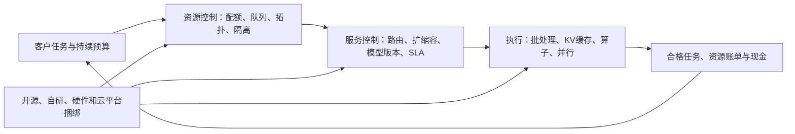

# AI集群调度与推理运行时行业调研：效率增长、收费边界与生产责任的价值分配

研究截止日期：**2026年10月10日，America/Los_Angeles**。研究地域为全球，重点证据来自美国及国际云平台、中国、欧洲企业软件和亚洲客户；公开资料无法支持精确的地区份额。年度模型采用自然年2026、2027、2028；2026全年尚未结束，表内全年市场数均为研究估计，已披露季度、融资公告和时点运行率单独保留。重要来源的公开日期、对应期间和证据属性见附录D。

证据标记：**F＝来源披露的已发生事实，M＝厂商性能主张或管理层目标，C＝直接计算，I＝研究假设或推断，U＝未知**。客户案例和开源项目采用数据属于利益相关方披露，并非审计事实。金额默认**十亿美元，USD bn；1 bn＝10亿美元**。本文范围是参数条件范围、情景包络或主观概率区间，均非统计置信区间；情景代表点的小数仅用于复算。

本地研究输入仅使用`基本面/产业背景/结果/`内获准的产业背景资料，作为线索和口径提醒；没有读取其他本地公司、行业、排序或分析报告作为研究输入。决定性主张重新追到外部原始材料；没有承接产业背景报告的规模预测、情景权重或投资结论。本报告不评价企业Agent应用收费、数据库商业模式或整个GPU云市场。

## 一、核心判断与最需要保留的边界

**技术和使用量扩张的证据很强，独立软件利润池等比例扩张的证据不足。** 这个行业至少包含四种不同交易：管理已有集群的调度软件、部署在客户资源上的推理运行时支持、共享推理服务、专用托管推理服务。开源内核供给增加与付费履约需求增长可以同时发生。最可能扩大付费空间的能力，是在客户特定模型、负载、数据边界和时延约束下持续交付合格服务，而非独占一个通用推理算法。

决定性证据来自相互制约的几组事实。NVIDIA在2026年3月发布开源Dynamo 1.0，在2025年已开源KAI Scheduler，并于2025年12月收购SchedMD后承诺继续提供开放、厂商中立的Slurm。Red Hat把llm-d和vLLM纳入有支持责任的企业产品，2026年已有GA版本。免费代码与商业支持共同扩张，不能把项目部署量当作软件订阅量。[S08](https://investor.nvidia.com/news/press-release-details/2026/NVIDIA-Enters-Production-With-Dynamo-the-Broadly-Adopted-Inference-Operating-System-for-AI-Factories/default.aspx)、[S09](https://developer.nvidia.com/blog/?p=98094)、[S11](https://blogs.nvidia.com/blog/nvidia-acquires-schedmd/)、[S18](https://access.redhat.com/articles/llm-d_components)。

另一方面，Fireworks于2026年7月15日披露**超过10亿美元年化收入运行率、每天超过40万亿token、其中超过95%来自客户专有数据上专门化的模型**；Baseten于6月22日披露近一年收入增长20倍、推理量增长40倍。这证明独立推理供应商已经承接真实商业工作，但没有公开它们的全年确认收入、可比净价、完整成本或现金利润。[S24](https://fireworks.ai/blog/series-d-announcement)、[S25](https://www.baseten.co/blog/announcing-our-series-f/)。

**本报告当前最支持的路径，是收费运行时支持和专用推理扩张，共享推理竞争更早侵蚀单位利润。** 模型的2028年基准中，共享推理账单比2026年增加132%，交付毛收益只由0.365增至0.300 bn；专用推理账单由2.400增至7.990 bn，交付毛收益由0.644增至2.770 bn。差异来自工作量、投入、价格传导和服务溢价，不是“推理一定高毛利”的假设。以下数字均为I，参数和不确定范围完整保留在附录A、B。

| 可定量覆盖对象；全球年度外部客户采购，不含税 | 2026共同可比基数：代表点〔条件范围〕 | 2027悲观／基准／乐观代表点 | 2028悲观／基准／乐观代表点 |
| --- | ---: | ---: | ---: |
| A：AI集群调度、配额、治理和资源控制软件净收费 | 0.450〔0.150—1.000〕 | 0.360／0.693／1.344 | 0.273／1.026／2.484 |
| R：推理运行时订阅、BYOC支持、相关生产运维软件净收费 | 1.050〔0.300—2.500〕 | 0.745／1.800／2.972 | 0.504／2.769／5.610 |
| H1：独立平台共享推理服务账单，包含资源采购 | 1.500〔0.700—3.000〕 | 1.440／2.604／4.500 | 1.365／3.480／7.820 |
| H2：独立平台专用托管推理账单，包含资源采购 | 2.400〔1.000—4.000〕 | 2.295／4.930／8.100 | 2.340／7.990／18.900 |
| 其中纯软件采购A＋R | 1.500〔0.450—3.500〕 | 1.105／2.493／4.316 | 0.777／3.795／8.094 |
| 四项可覆盖账单合计 | **5.400〔2.150—10.500〕** | **4.840／10.027／16.916** | **4.482／15.265／34.814** |

这不是全球所有推理支出或所有调度活动的统计总额。**大云厂和模型厂内部运行时、云平台捆绑能力、模型IP溢价、纯GPU租赁以及难以分配的整套企业软件合同，没有被伪装成已识别市场。** 四项相加只在附录的发票分配和链内采购剔除规则下成立；硬件采购、上游GPU云收入和最终应用收入不能再加进来。当前总额范围较宽，反映买方数量、付费附着率和服务归属尚无全球普查。可靠结论是独立服务已有十亿美元级时点收入锚、软件净收费仍需要单独验证；5.400 bn不是公开披露值。

放量首先需要客户任务进入持续生产、预算从试用转向经常性采购、开放模型达到任务质量要求，以及兼容资源上线。利润扩张还需要净价下降慢于单位成本、可计费工作吸收新增能力、工程支持可复用、合同承担闲置与失败风险的安排合理。若免费技术进步、云额度和自研吸收价值，行业技术重要性仍可上升，而独立软件收费或资本回报下降。

最强反面解释是：**这一层会被硬件与云平台内化，独立商只是短期工程代办和资源转售商。** NVIDIA免费软件、云厂原生推理路由、客户多供应商采购和公开项目快速迭代支持它。反对它的证据是独立供应商已经进入高要求客户的生产供应链，而且数据边界、跨云部署、持续优化和服务责任不等同于下载代码。尚无法裁决的是：谁能在免费实现追平之后保留续费、净价和现金收益。收入运行率和融资估值不能裁决这一点。

## 二、行业边界：客户购买的不是一个“GPU利用率”

### 2.1 三层技术，四类收费

集群资源控制决定哪些团队、作业和模型获得资源；服务路由与部署控制决定请求进入哪个实例、何时扩缩容；执行引擎决定GPU或其他加速器怎样完成模型计算。这三层可以由不同供应商提供，也可以一套平台包办。Kubernetes、Slurm、Ray与vLLM不是四个可直接相加的终端需求市场。

| 交易边界 | 支付者、使用者与验收者 | 预算来源与适用单位 | 本报告归属 |
| --- | --- | --- | --- |
| 管理自有或自租集群 | 基础设施负责人采购，平台团队使用，研究/应用团队验收资源可获得性与故障恢复 | 既有基础设施运维预算、新增AI平台预算；GPU年、集群年、支持合同 | A；训练、后训练与推理共享资源控制均包括，模型训练服务收入排除 |
| 在客户云、机房运行模型 | 平台、ML工程和安全团队采购与使用，业务负责人验收服务，SRE承担故障 | 自研人力、运维合同、企业软件替代；受支持GPU年、生产部署或年度合同 | R；硬件与客户直接支付的云实例账单排除 |
| 共享模型API或弹性托管 | 产品公司/企业应用负责人支付，开发者使用，业务与SRE联合验收 | 应用基础设施成本；分别计输入、缓存、输出，或实际占用资源秒 | H1；独立平台提供的开放/自定义模型执行服务，不计模型厂自有通用闭源API总收入 |
| 专用实例与容量保障 | 有持续流量或数据边界的企业、AI原生公司采购 | API迁移、云承诺转用、内部集群替代；实例小时、保障吞吐、专用部署和SLA | H2；平台完整托管的资源与推理执行收入，纯VM租赁排除 |
| 大云、芯片厂、模型厂内置或内部自研 | 企业总云预算，或内部成本中心 | 不另收费或难以拆分；内部成本、云综合账单、硬件系统价格 | 技术和竞争范围包括；未识别金额不加入四池 |

新增预算与转移预算必须分别解释。购买推理服务可以替代原模型API、内部GPU租金和工程人员，不必增加客户总AI预算；同一客户先采用共享API、再改专用、最后BYOC，也可能让H1下降、H2或R增长。研究并不把迁移当作新增终端需求。

集群占用率、SM忙碌率、显存占用率、合格吞吐和可计费利用率不同。缓存和小批量decode可以显存很满却计算不忙；达到高计算占用也可能让P99延迟失控。客户真正需要的是**在质量、时限和隔离条件内完成的工作及其总成本**。可计费利用率下降可以与技术利用率上升同时发生。

### 2.2 失败成本决定采购权

离线批推理和实验可以等、重试或被抢占；在线客服、代码交互、语音和关键业务接口需要排队预算、容量预留和故障切换。平台团队希望资源统一，业务团队希望自己的时延和隔离不被破坏，财务团队希望避免GPU空转。真正有用的调度器必须处理这些目标的冲突，而不是只优化某个平均指标。

运行失败的成本包括业务中断、人工回退、错误输出、冷启动、状态丢失、重新认证和迁移。谁承担这些成本，决定谁有议价权。承诺可用性但把全部故障责任留给客户的工具，其支付上限通常低于承担生产责任的服务；承担责任的卖方也会付出支持、备用容量和赔付成本，不能直接套用传统软件毛利。

## 三、商业化证据：使用、付费和利润分别到了哪一步

### 3.1 可以确认的锚点

| 来源与公开日期 | 原始对象和期间 | 可以支持的判断 | 不能支持的判断 |
| --- | --- | --- | --- |
| Fireworks，2026-07-15，F/厂商披露 | 超过1 bn年化收入运行率；每天超过40万亿token；超过95%为专门化模型token | 独立推理平台已有重大商业规模；特定任务和客户数据与商业需求有关 | 2026全年收入等于1 bn、全部收入是推理、全部token收费、净利润或客户集中度；[S24](https://fireworks.ai/blog/series-d-announcement) |
| Baseten，2026-06-22，F/厂商披露 | 近一年收入20倍、推理量40倍；融资1.5 bn、估值13 bn | 商业采用快速增长；基础设施、后训练与工程服务共同参与 | 绝对收入、同模型降价50%、融资即收入；[S25](https://www.baseten.co/blog/announcing-our-series-f/) |
| Together，2026-07-01，F/M | 股权融资0.8 bn；投资者拟独立资本化超过500 MW算力承诺 | 资金和未来履约资源有实质安排 | 500 MW已经运行、全部用于推理、当年收入或软件收入；[S26](https://www.together.ai/blog/announcing-our-series-c) |
| Inferact，2026-01-22，F | vLLM创建者及核心维护者设立公司，融资0.150 bn、估值0.800 bn | 开源执行层出现新的商业供给和验证投入 | 开源部署已经转为订阅、收入、盈利；公司和交易律师说明属于同一次融资，非两条需求确认；[S20](https://inferact.ai/)、[S21](https://www.cooley.com/news/coverage/2026/2026-01-22-inferact-announces-$150-million-seed-financing) |
| Red Hat产品组件表，更新2026-09-26，F | RHAII/RHOAI 3.5与llm-d 0.9、vLLM v0.24，GA日期2026-08-27 | 分布式推理已进入有版本与支持边界的企业发行 | 已披露客户数、单列收入或所有硬件均合格；[S18](https://access.redhat.com/articles/llm-d_components) |
| SGLang/RadixArk与Google，2026-07-30，F/M | 当前通过SGL-JAX支持TPU；提出后续统一能力；项目称运行于数十万GPU | 异构支持已进入工程合作，开源供给有重大规模 | GPU数等于付费席位，未来功能已全部实现、跨芯片完整TCO优势已验证；[S19](https://www.lmsys.org/blog/2026-07-30-sglang-google-tpu) |
| CNCF，2026-01-20，调查结果 | 2025调查中AI托管受访组213个有效样本，全面/部分用Kubernetes分别23%/43% | Kubernetes是相关受访者的重要部署基础 | 全球66%的AI公司都购买Kubernetes或GPU调度软件；[S39](https://www.cncf.io/wp-content/uploads/2026/01/CNCF_Annual_Survey_Report_final.pdf) |
| 硅基流动公司页，截止日读取，F/厂商披露 | 截至2026年4月超过1,000万注册用户、13,000家企业客户 | 中国独立推理平台有广泛客户触达，国产与国际硬件适配是实际方向 | 13,000家均付费、均有私有集群、可按每家固定预算估收入；[S46](https://siliconflow.cn/about) |

**增长倍数的正确用法。** 在Baseten近一年两个指标口径稳定的条件下，收入/披露推理量的比值变化为20/40＝0.5（C）。它可能来自价格、缓存、模型大小、客户折扣、训练与推理收入结构，不能裁决同一产品成交价下降50%。它至少反驳了“推理量一定等比例成为收入”的机械外推。

Fireworks的两项披露均为“超过”。临时把二者放在披露门槛，`1 bn ÷ (40万亿×365) ×100万＝约0.0685美元/百万token`，只是**门槛代入的量纲示例**；两个下限的比值不是实际值或上下界。发布日期、收入覆盖业务、缓存与内部token口径也不同。因此本报告既不把这个数当净价，也不使用40万亿乘公开价表估收入。

### 3.2 从卖方客户名单追到买方材料

Cursor于2026年3月27日发布Composer 2技术说明，披露基于开放底座、继续预训练与真实工作环境RL，并致谢Fireworks和Colfax合作；其信任中心明确列出Fireworks作为模型托管和服务基础设施供应方，2026年10月7日新增CoreWeave推理分处理方。买方材料确认了开放底座、自有模型和外部基础设施共存，但不披露各家的合同金额或调用份额。[S27](https://prod.cursor.com/blog/composer-2-technical-report)、[S28](https://trust.cursor.com/)。

Harvey于2026年9月21日更新的分处理方清单同时列出Baseten、Fireworks及多家云/模型供应商；Notion AI Meeting Notes帮助页也列出Baseten和Fireworks。它们确认进入客户数据处理链，强于单纯合作Logo；清单本身不证明最低采购量、独家合同或每位客户贡献。[S29](https://www.harvey.ai/legal/subprocessors)、[S30](https://www.notion.com/help/ai-meeting-notes)。

【I】这些客户拥有特定任务、评测和反馈，可能希望保留自己的模型与推理选择权。独立平台因此不必与通用模型API正面同质竞争，也不需要先成为应用所有者。不过，同一客户允许多家供应商又削弱了单家议价权。**客户数据和模型专门化是需求来源，平台对这些资产的所有权仍须看合同，不能假设归平台。**

中国的采用也应分阶段。硅基流动与宇信科技2026年7月14日公告中，一个银行客户仍在算力卡适配与性能测试，属于具名行业方向上的工程验证，不是已披露规模收入。[S47](https://www.siliconflow.cn/news/agd6v0r0omgx1ymzxrj9jagy)。

### 3.3 采用关口与现金时间

| 阶段 | 本行业所需证据 | 典型经济含义与研究时间尺度，I |
| --- | --- | --- |
| 技术可行/公开项目 | 代码、论文、支持模型、可重复的固定负载结果 | 商业机会可识别；收入仍可能为零 |
| 工程验证 | 客户真实并发、模型版本、硬件拓扑、长运行和故障注入 | 常为数周至一季度；大集群/新芯片更久，工程费用可能先发生 |
| 生产资格 | 数据边界、认证、尾延迟、升级回退、值班与责任条款 | 常需一至数季度；一次通过不覆盖下一代模型与硬件 |
| 付费采用 | 采购合同、真实账单、续用，而非免费额度或试验量 | 软件订阅与实际资源使用分别计量；客户预付款不等于已确认收入 |
| 规模交付/现金贡献 | 更多业务部署、净留存、净价、成本、现金回收 | 通常滞后初次采用；托管者还受资源承诺、爬坡和融资约束 |

上述时间范围是工程与采购机制假设，不是行业统一交付标准。对成熟模型的小型部署，进入付费可以更快；对于跨芯片、强隔离、大型MoE或主权部署，资格验证可能跨年度。模型更新与硬件更新会反复开启验证关口，使支持需求持续，也可能使定制服务难以规模化。

### 3.4 客户为什么愿意为已有免费实现再付费

付费回报应与客户能够维护的成熟免费栈比较，包括当前vLLM/SGLang、已有调度和云平台能力；与未经优化的历史实现比较，会夸大新增软件的支付空间。对软件A/R，采购上限可写成：`可归属资源节约＋避免的人员/事故成本＋新增合格业务价值−客户新增实施和迁移成本`。同一资源节约不能同时完整归给调度、执行和硬件供应商。

下表检验附录A当前代表点的客户预算，**全部为I/C的条件示例**。资源预算使用近似H100级受管理资源每GPU年11,000/14,000美元，涵盖经济折旧或租用及配套运营，并非核验到的客户采购价；具体客户应改用自己的硬件、租约和利用率。这里暂将人员、事故避免和新增业务价值设为零，检验只靠资源节约是否够付钱。

| 客户示例与同一年度边界 | 原有资源成本 | 新增独立软件费 | 客户另承担实施/迁移成本 | 只靠资源节约所需改善幅度 |
| --- | ---: | ---: | ---: | --- |
| A：250个GPU、1,000美元/GPU年 | 2.750百万美元 | 0.250百万美元 | 第一年度另假设0.100百万美元 | 仅覆盖软件费需9.1%；第一年合计需12.7% |
| R：200个GPU、1,500美元/GPU年 | 2.800百万美元 | 0.300百万美元 | 第一年度另假设0.100百万美元 | 仅覆盖软件费需10.7%；第一年合计需14.3% |

这些门槛要求节约能够取消租金、推迟购置、减少必要预留，或转化为有预算的新增工作。只提高闲置资产的实验吞吐、却不能减少支出或出售新增服务，现金回报可能远低于benchmark改善。人员、事故与业务价值可以降低资源节约门槛，但应有客户侧证据；不能用全部AI应用收入充当运行时贡献。

这一检验也说明小集群的收费压力：GPU基数小但实施和支持成本不必同比变小，更可能使用免费或云内置能力；大而稳定的客户又可以自研。独立商的经济位置往往在有足够预算、持续变更、内部维护尚不经济的部署，以及对跨环境支持和系统责任要求高的客户。这个位置是否扩大，要看独立付费附着和续约，而不是总安装量。

## 四、技术前沿怎样改变可交付需求和成本

### 4.1 调度的对象从“空闲GPU”转成“状态、拓扑和服务预算”

训练和后训练需要成组启动、拓扑紧凑、检查点和合理抢占；在线推理需要请求持续到达、状态保留和尾延迟；两者混用时，分配一张空闲卡并不等于得到一个可用模型实例。GPU显存碎片、多个节点的网络距离、冷启动和已有KV状态，可以让空闲资源不能即时替代繁忙资源。

KAI开源机制包括公平份额、分层队列、gang scheduling和GPU共享；Grove描述互相依赖的prefill、decode、前端等组件怎样共同启动和扩缩容。Kueue管理作业准入、队列与配额，Volcano提供批工作负载调度；它们与执行引擎承担不同任务。开源降低基础调度收费的稀缺性，但不自动消除生产配置和责任成本。[S09](https://developer.nvidia.com/blog/?p=98094)、[S10](https://developer.nvidia.com/grove)、[S43](https://volcano.sh/docs/home/introduction/)、[S44](https://kueue.sigs.k8s.io/docs/overview/)。

【I】更有价值的调度目标是，在GPU、HBM、主机内存、网络、功率和客户SLA约束下最大化合格工作或贡献利润。例如优先安排已有缓存且边际成本低的请求，可能提高利润；追求每卡满载而混入长prefill，可能降低在线服务价值。支持分数GPU或MIG不能消除模型最低显存、共享噪声与隔离要求；小模型与大型MoE的资源可替换性不同。

### 4.2 已成熟机制与有条件的前沿

| 机制与主要原始来源 | 技术和商业成熟度 | 对需求、供给与价值的具体传导 | 最强限制或替代解释 |
| --- | --- | --- | --- |
| 连续批处理、PagedAttention；vLLM论文，2023-09-12 [S01](https://arxiv.org/abs/2309.06180) | 已进入开源生产栈 | 降低KV碎片，提高可同时承接请求；先增加客户有效容量 | 峰值吞吐不等于所有负载的P99；功能普及使算法本身较难单独收费 |
| 前缀共享与结构化生成；SGLang固定v2，2024-06-06 [S02](https://arxiv.org/abs/2312.07104v2) | 开源生产使用；不同模块成熟度不一 | 复用共同前缀、减少重复工作，有利于多轮和模板化请求 | 用户、权限、模型版本与采样边界限制复用；高缓存token不等于高新增计算 |
| Chunked prefill；Sarathi-Serve，OSDI 2024 [S03](https://www.usenix.org/conference/osdi24/presentation/agrawal) | 已成为运行时优化的重要路线 | 把长prefill拆分，平衡TTFT和持续decode，改善服务合格吞吐 | chunk大小、请求长度与批处理策略有权衡；不能把论文相对旧版本的优势重复计入成熟产品 |
| Prefill/decode分离；DistServe，OSDI 2024 [S04](https://www.usenix.org/conference/osdi24/presentation/zhong-yinmin) | 商业平台与开源分布式栈已有实现 | 独立配置两个阶段；可用不同计算/带宽资源承接工作 | KV搬运、额外容量预留、低负荷碎片与故障域可能抵消收益 |
| 分层KV缓存、状态路由；Mooncake，FAST 2025 [S06](https://www.usenix.org/conference/fast25/presentation/qin) | Kimi服务架构的作者一手披露；开放实现与其他平台持续迭代 | 借CPU DRAM、SSD和网络减少重算，改写内存与计算需求 | 存储可容纳状态，不等于能在时限内恢复；最稀缺环节可以转为搬运路径 |
| 推测解码；2022论文及Baseten DFlash，2026-05-08 [S05](https://arxiv.org/abs/2211.17192)、[S54](https://www.baseten.co/blog/dflash-faster-llm-inference/) | 机制已商用，最新实现仍需负载验证 | 小模型/并行草稿降低串行decode等待，可能扩大交互任务与单位硬件产出 | 接受率、草稿成本、质量约束与并发共同决定收益；卖方3倍测试不代表全舰队平均 |
| MoE、低精度、MLA及更紧凑状态；DeepSeek-V2，2024-05-07 [S60](https://arxiv.org/abs/2405.04434) | 相关模型架构已商业采用；具体实现与新架构需再验证 | 减少活动计算或KV强度，也提高专家通信和运行时适配的重要性 | 不能同时沿用旧模型的每token算力和缓存系数；质量与极端请求可能改变成本 |

量化、草稿模型、批处理、前缀复用和PD分离的收益通常相互影响。本文不把各项最大倍数相乘。低负荷客户常由冷启动、最低实例配置和等待资源支配成本；高负荷客户更接近带宽、专家通信、KV恢复和合格吞吐约束。相同执行引擎在两类客户上的付费价值可以不同。

### 4.3 状态调度：2026年最有解释力的新增约束

DualPath固定v2发表于2026年2月26日，借decode侧闲置存储入口向prefill搬运KV。在线实验相对内部基线平均吞吐约1.96倍，设置TTFT≤4秒、TPOT≤50毫秒；实验假设轮次间到达时间与工具调用延迟为零。作者还说明真实等待会扩大工作集、降低缓存命中。它证明特定I/O受限场景存在改进空间，未证明所有公开运行时均落后，也未证明完整Agent任务加速1.96倍。[S07，§7及讨论](https://arxiv.org/html/2602.21548v2)。

【I/C】一个解释这一问题的最小模型是：

`活跃会话数≈任务到达率×会话存续时间；保留KV≈活跃会话数×平均需保留状态。`

若工具等待使会话存续时间翻倍，即使每轮只追加少量token，保留状态也可能翻倍；GPU计算忙碌度却不一定翻倍。是否保留、驱逐、恢复或重算，成为客户成本选择。长期等待的状态不能一直占最贵HBM；但放到SSD之后，恢复预算和工作集竞争又会限制吞吐。

对一种**示例性GQA配置**，未分片、未压缩KV为：

`M_KV=2×层数×KV头数×每头维度×元素字节×上下文长度×保留会话数。`

采用80层、8个KV头、128维、2字节、32,768上下文，单会话约10 GiB；100会话约1,000 GiB（C）。这是配置示例，不是所有模型的需求；MLA、滑动窗口、量化、分片和前缀共享可大幅改变它。若要100毫秒恢复8 GiB，至少需要80 GiB/s有效带宽；单路400 Gbit/s的理论50 GB/s，即便无协议与排队开销也约需172毫秒。更多廉价容量不能单独满足恢复时限。

保存状态的经济条件可写成：

`命中概率×(重算成本−恢复成本)>保留成本＋路由/隔离/失效处理成本。`

最有价值的前沿发现是，**推理效率有时来自重新安排现有状态和入口，而非购买更多GPU或存储**。客户可能延缓某类设备采购，同时增加并发与网络流量。KV编辑和复用仍须保证结果质量、权限、模型版本和缓存有效性；LMCache于2026年9月提供研究到真实负载的SDK入口，但SDK发布不等于所有编辑策略已经生产验证。[S55](https://blog.lmcache.ai/en/2026/09/07/from-research-paper-to-real-workload-kv-cache-editing-with-the-lmcache-sdk/)。

### 4.4 异构分工并不必然把价值从NVIDIA迁走

NVIDIA于2026年5月说明Dynamo协调attention—FFN分离：GPU执行attention、保留KV，LPX执行FFN；8月24日宣布Groq 3 LPX进入全面生产并称Nebius首先采用。这里的“生产”是供应方制造/产品状态，客户规模和收入仍未单列；特定模型速度主张不是全任务TCO。[S59](https://developer.nvidia.com/blog/how-the-nvidia-vera-rubin-platform-is-solving-agentic-ais-scale-up-problem/)、[S58](https://blogs.nvidia.com/blog/vera-rubin-lpx-spectrum-x-nvlink-fusion/)。

d-Matrix于2026年9月10日公布Raptor进入NVLink Fusion/MGX路线，集成机架初始可用目标为2027年第四季度，不能提前当作已交付。[S57](https://www.d-matrix.ai/announcements/d-matrix-rackscale-nvidia/)。SGLang与Google的TPU合作、Inferact的硬件适配，说明开放引擎可以成为跨硬件接口；华为MindIE又展示以本地硬件、运行加速与服务部署为中心的另一套路径。[S19](https://www.lmsys.org/blog/2026-07-30-sglang-google-tpu)、[S20](https://inferact.ai/)、[S45](https://www.hiascend.com/document/detail/zh/mindie/310/index/index.html)。

【I】“替代一部分GPU计算”和“替代整个系统平台”是两个事件。新加速器可能降低某阶段成本，却继续使用既有CPU、网络、调度框架和部署入口。平台可通过兼容性与系统责任保留价值；独立运行时若真正降低跨芯片迁移、资格验证和持续维护成本，也可获得付费空间。当前材料未披露这些合作的许可费、排他性、采购承诺或利润分配，不据合作图估特许权收入。

嵌入、rerank、语音和扩散生成也需要调度，但计算形态不同。串行decode优化不能统一应用于扩散步骤，LLM的token数不能代表音频时长或图像质量。本报告模型采用固定2026工作负载篮子，明确保留非LLM覆盖及归一误差；没有给每种模态制造一个虚假的精确市场。

## 五、有效供给、成交价格与供给反应

### 5.1 代码可复制，合格履约能力有成本

软件不存在晶圆式的复制产能瓶颈。开源、自研和平台内置使通用功能供给充足；限制可交付软件服务的，是模型/硬件组合测试、专业工程人员、版本兼容、生产事故处理和客户组织改造。vLLM团队披露2026年6月合并1,918个提交、CI运行1,300万job minutes，说明维护成本和变化速度；安装量、镜像拉取或贡献者数没有直接转换为付费部署。[S23](https://vllm.ai/blog/2026-07-16-keeping-vllm-production-quality)。

托管推理的有效供给还要求资源到货、供电、网络、存储、支持模型、客户数据地域以及服务负载合格。不同地区、模型和时延等级的资源不能完全互换。Together的500 MW承诺是未来资源锚；CoreWeave截至2026年6月30日披露active power 1.5 GW，是包含不同AI用途的云资源锚，不能直接换成本专题可售推理小时。[S26](https://www.together.ai/blog/announcing-our-series-c)、[S37](https://investors.coreweave.com/news/news-details/2026/CoreWeave-Reports-Strong-Second-Quarter-2026-Results/default.aspx)。

【I】当前证据更接近**通用调度/执行软件供给充足，合格生产服务局部不足，区域和高要求负载存在结构性缺口**。没有公开数据证明全球推理服务长期全面短缺；也没有足够同规格闲置、成交价和取消数据判定全球全面过剩。附录的独立需求与供给估计，在2026代表点显示两类托管服务仍有总量余量；这不是实测利用率或某地区的可即时交付容量。

供应方反应有三条不同路径：免费项目以发布和适配补供给；收费软件以标准化部署和渠道提高支持覆盖；托管服务以租用、购置、迁移和功率管理增加资源。前两者可以较快跟随，资源形成、地域合格和资本安排更慢。若服务需求低于承诺资源，供应商可能停止新租赁、合并集群、减少最低常驻实例、把资源转向训练/批处理或退出；多年承诺和已购设备使调整存在时滞。

### 5.2 公开价格只解决部分问题

下表保留截止日原价与原单位；动态价目为2026-10-10页面快照，并无已核验的全球成交价指数。价格不含税，配置、地域、保障与支持不完全相同。

| 产品与地域/计费边界 | 页面原价 | 直接计算 | 对经济判断的限制 |
| --- | --- | --- | --- |
| NVIDIA AI Enterprise，自管理系统，含标准支持；2026-09-02更新 | 1年4,500美元/GPU；EDU/Inception 1,125美元/GPU；5年18,000美元/GPU | 5年平均3,600美元/GPU年，但合同收入确认另看条款 | 是整套产品标价，含特定硬件随附授权与私有报价；不能全归运行时，也不能乘所有GPU；[S13](https://docs.nvidia.com/ai-enterprise/planning-resource/licensing-guide/latest/pricing.html) |
| Modal，H100 SXM5，不含另计CPU/内存/网络 | 0.001097美元/GPU秒 | 3.9492美元/GPU小时 | 8物理CPU核＋64 GiB内存按页面单价另计约0.8888美元/小时，合计约4.838；地域和企业保障另看合同；[S32](https://modal.com/pricing) |
| Baseten，专用H100 80 GiB部署 | 0.10833美元/分钟 | 6.4998美元/小时 | VM、支持、扩缩容和部署计费边界不同；部署和伸缩时间可收费，批量折扣可谈；[S33](https://www.baseten.co/pricing/) |
| Fireworks，按需H100/H200 | 8.00美元/小时；B200为13.00美元/小时 | 原小时价保留，不用四舍五入分钟价反推 | 地域限制部署为1.5倍溢价；是服务标价，不是批量净价或GPU裸租价；[S34](https://fireworks.ai/pricing) |
| Hugging Face专用Inference Endpoints | 配置化小时价，实际按分钟计；初始化和运行中的端点按规则收费 | 需要按云、实例和副本数计算 | 私有企业支持和保障另报价；“请求没有运行”不必然等于没有基础设施费用；[S36](https://huggingface.co/docs/inference-endpoints/pricing) |
| Anyscale，Hosted/BYOC | 公开按量与承诺折扣；H/B/GB系列须询价 | 不把AC展示值擅自解释为某项独立软件费 | BYOC可使用既有GPU预留，资源与平台收费须按合同拆分；[S35](https://www.anyscale.com/pricing) |

【I】同一客户的经济价格可以是GPU秒、输入/缓存/输出token、专用容量或完整年合同。真实净价由折扣、预付款、地域、延迟等级、容量保障和资源使用共同决定。不能把3.95、6.50、8.00美元解释为纯运行时附加值差异，也不能由价表横截面认定价格已经下跌。

价格传导在交易类型上不对称。公开按量API可以较快修改新SKU、价格或促销，承诺客户须按重定价条款处理；专用合同可能按季度、年度或续约谈判，资源承诺可能持续更久。开放实现追平通常先影响新客户报价和续约，再影响卖方平均收入。本文采用的6—12个月价格/供给反应窗口是研究假设，未得到全行业合同分布验证。

### 5.3 供给缓解可以同时扩大使用、压低收费和增加闲置损失

同质量工作量增长率为g、每单位工作净价比为p时，收入比为`g×p`；成本则还取决于固定资源、投入价格、有效吞吐和可计费使用。假设有效吞吐提高50%、净价下降30%，在新增工作全部卖出的理想条件下收入仅提高5%；若客户预算固定，卖方甚至未必多卖出工作。此为机制示例，非行业测量。

成本变化首先由GPU、机房、电力、人员和网络采购者承担，传导给客户取决于合同和竞争。已有固定资源时，开源优化能降低单位成本；随后竞争者也采用，价格可能回落。按GPU年收费的软件如果减少客户需要的GPU数量，还会缩小自己的计费基数，除非采用扩大、功能升级或按结果收费抵消。免费效率优化因此既是技术推广，也可能是硬件/云平台的获客策略。

电网协同是边界外延中的高信息价值发现。NVIDIA于2026年9月披露Conductor现场把4 MW降至3 MW、优先作业继续运行，算术削减25%；同文表格40%的口径未获得对应解释，未并入模型。低优先工作延期、负荷回补、合同允许范围和电网接入权利仍未知。[S49](https://blogs.nvidia.com/blog/from-megawatts-to-tokens-how-nvidia-maximizes-ai-factory-production/)。

【I】调度若换取提前接入或可用电力，价值可以大于节约少量GPU时间；但必须有可执行接入/容量协议、任务延期成本和付费客户，不能从演示直接估计软件收入。Emerald的融资和部署公告证明有新供给参与者，不证明其“最多释放100 GW”愿景已经实现。[S50](https://www.emeraldai.co/blog/emerald-ai-raises-150-million-series-a)。这一分支未强行加进四项基准规模。

## 六、竞争地图与价值捕获

### 6.1 竞争单位是能力组合，开源项目与商业公司不一一对应

| 参与者/路线 | 技术与经济位置 | 可能保留价值的能力 | 发展条件、主要未知与替代压力 |
| --- | --- | --- | --- |
| NVIDIA：Run:ai/KAI、Slurm/SchedMD、Dynamo、TensorRT-LLM、NIM/AI Enterprise | 控制硬件生态、系统协作和企业支持入口；免费组件与收费产品并存 | 模型/硬件协同、认证、系统责任、渠道和新系统销售 | 自研与开放跨芯片执行降低部分依赖；Run:ai/Slurm/Dynamo收入未单列，整套AI Enterprise不能全算本专题；[S08][S09][S11][S13] |
| Red Hat/IBM：Neural Magic、vLLM贡献、llm-d与企业AI发行 | 把开放执行和分布式控制接到企业Kubernetes、混合云支持 | 安全更新、受支持配置、迁移和企业采购渠道 | 基础算法非独占；与云厂/芯片厂合作同时存在；独立推理支持收入未知；[S15][S16][S17][S18] |
| Inferact/vLLM生态 | 开放执行、模型适配、硬件后端和生产质量 | 上游维护经验、首日支持、持续性能与生产故障解决 | 融资不等于订单；维护者地位不自动排除其他发行和自研；[S20][S21][S23] |
| RadixArk/SGLang生态 | 开放执行、缓存与复杂生成，拓展TPU和后训练系统 | 大规模优化、适配、托管和工程工具 | SGLang采用不等于商业附着；统一异构能力仍分阶段；公司收入和毛利未披露；[S19][S22] |
| Anyscale/Ray Serve | 分布式应用部署、推理、批处理与训练；Hosted/BYOC | 统一操作、调度集成、支持和既有云承诺使用 | Ray为开放基础；平台收费须与计算分开，客户可用KubeRay等自行运维；[S35][S42] |
| Fireworks、Baseten、Together | 开放/自定义模型执行、工程优化、资源采购和后训练组合 | 特定负载低延迟、规模运营、客户反馈与快速迭代 | 私营财务粒度低；多供应商、免费改进、算力承诺、工程定制和客户集中度约束利润；[S24][S25][S26] |
| Modal、Hugging Face Endpoints及其他开放模型托管者 | 弹性容器、开发者入口、模型分发和部署服务 | 冷启动、弹性、简化运营、容量池与采购入口 | 资源标价包括不同内容；通用API可迁移，企业保障另收费；[S32][S36] |
| AWS、Google、Azure及其他大云 | 原生资源准入、推理路由和综合云账单；常是独立商的供应商与竞争者 | 云额度、数据地域、企业渠道、采购承诺和运维 | HyperPod借Kueue，GKE Inference Gateway借llm-d；开放实现被平台内化；整体AI收入不是运行时收入；[S40][S41] |
| CoreWeave等GPU云和自有控制平台 | 资源、网络、生命周期管理、运行加速和模型工具合并 | 交付可靠性、可用容量、低启动延迟和系统操作 | 需分训练、纯GPU和完整推理托管；融资、折旧、承诺和客户集中风险重大，集团收入不能全归本专题；[S37][S38] |
| 中国平台：华为MindIE、硅基流动及客户自研 | 国产/异构硬件适配、私有推理和Token服务 | 本地硬件、区域合格性、行业部署和工程协作 | 宣传性能与完整TCO区分；服务客户/注册用户与付费分别计，国内净价和归属未知；[S45][S46][S47] |
| Groq、Cerebras、d-Matrix等专用计算路线 | 极低延迟、确定执行、特定计算阶段或完整推理服务 | 架构与软件共同优化，潜在任务级速度/成本优势 | 支持模型、容量、并发、长上下文、故障与质量；Groq继续独立运营并与NVIDIA许可/云伙伴合作，Raptor机架目标尚在2027Q4；[S51][S52][S53][S57][S58] |
| 客户自研、Kueue/Volcano、内部调度、开放引擎自托管 | 对大客户和低要求客户均可构成直接替代 | 既有人员、数据控制、避免供应商利润与锁定 | 人员与持续维护是实际成本；量小时不经济，量大且稳定时可内化外部利润；[S43][S44] |

表内编号对应附录D链接；同源产品宣称不重复加权。地图覆盖主要执行、控制、资源与客户自研路线，不声称列出所有推理云、MLOps工具、系统集成商或国家供应商。没有可靠原始财务的长尾公司不分配虚构收入份额。

### 6.2 谁控制稀缺性，谁承担资本与残值

芯片/云平台可以免费提供运行时，借此提高系统需求、使用量和生态依赖。中立企业发行可以按支持、安全与跨环境责任收费。独立推理服务可以用更好的工程把资源成本节约转为毛收益，但客户多平台采购与自研随时争夺节约。维护一个重要开放项目是影响力，是否形成议价权还要看客户无法替代的责任与服务。

开源代码的许可证不收费，不代表整体经济成本为零。上游维护、CI、模型验证和现场故障要由企业、硬件厂、云厂、投资者或客户承担。赞助者可能把收益放在硬件、云或应用层，接受运行时层低收费。**技术重要性与本层利润之间存在系统性的归属断裂**，这是本专题区别于按装机数量收费的硬件分析的核心。

CoreWeave的2026Q2收入为2.575 bn、调整后EBITDA率59%，同时GAAP经营亏损0.049 bn、净利息费用0.640 bn。10-Q披露当季98%收入与客户承诺相关，且技术与基础设施费用承接大量设备折旧。其报表中的简单“收入减cost of revenue”不是可与普通SaaS比较的全成本推理毛利，更不能代表运行时软件盈利。[S37](https://investors.coreweave.com/news/news-details/2026/CoreWeave-Reports-Strong-Second-Quarter-2026-Results/default.aspx)、[S38，收入、费用与承诺附注](https://www.sec.gov/Archives/edgar/data/1769628/000176962826000366/crwv-20260630.htm)。

【I】托管者承担长期容量、设备残值和客户信用；软件商主要承担研发、实施、人力和支持，但大额定制、测试算力、平台担保或代垫资源也会增加资本负担。BYOC让客户保留云资源风险，不自动让软件商拥有高ROIC：获客、部署和兼容维护可能先花钱，续约之后才兑现。附录C用同一资产边界保留爬坡、降价、更新与残值，而非用一个季度EBITDA率推出回报。

## 七、情景机制、阶段与可证伪判断

### 7.1 三条互斥的研究路径

以下路径针对四项可覆盖采购池，权重为主观研究判断，**不是统计拟合**。25%／55%／20%合计100%，只表示本次互斥机制分类；表内区间相互重叠，不能据金额把真实世界机械分箱，也不能把代表点当概率均值。

| 路径与整条路径权重 | 2027—2028成立机制 | 需求、有效供给与净价 | 成本和价值分配 | 当前支持与主要反证 |
| --- | --- | --- | --- | --- |
| P：需求增加但平台内化、竞争压价，25% | 付费附着下降；客户预算增长慢于任务量；资源承诺先交付 | 参考工作量仍增加，合格供给增长更快；A/R净价和附着下降，H1/H2价格下落 | 软件工程成本难摊薄，托管固定资源成本滞留；客户保留效率红利，部分卖方退出 | 免费组件和捆绑已经存在；若独立供应商持续净留存和正现金流，则下调此权重 |
| B：采用增长、支持收费、资源顺利释放，55% | 开放/自有模型进入生产，独立支持承担持续责任；专用服务保持一定溢价 | A/R附着温和提高；共享价格更快传导效率，专用较慢；总体仍有余量，局部高要求短缺 | R与H2规模摊薄维护成本；H1利润率受到供给与降价双重压缩 | 真实买方材料和商业收入锚最支持；若仅为补贴/临时迁移、长期价格下降更快则失效 |
| O：特定任务采用加速，工程规模化且预算兑现，20% | 更多客户建立专门化模型；高价值在线任务增长，开放模型质量与部署均合格 | 较高付费附着和工作量增长，能力及时交付；净价仍降但服务价值保留 | 量增和可复用支持摊薄成本；承担更复杂服务与新资源投入，资本需求并未消失 | 商业增长倍数支持可能性；需要续费、稳定工程成本和现金，而非融资/最大benchmark兑现 |

基准不是悲观、乐观的平均。它同时采用开源优化、净价下降和生产工作量增长；共享推理到2028年仍可能收入增长但交付毛收益低于2026年。悲观也不是使用量停止，而是货币化与固定投入不匹配。乐观需要更多付费业务和更可复用的服务供给，不仅把同一收入增长率调高。

### 7.2 时间先后关系

2026年已有从单机优化转向分布式、状态路由、开放企业发行和异构协作的进展，但不同客户仍跨越不同关口。2026Q4—2027H1最有信息量的是生产升级、实际SLO、净价、部署时间和客户是否用满保障容量；模型发布后立即支持仅证明适配速度。

2027年更可能观察到供给与重定价分离：新资源上线、免费执行改进先提高合格能力，客户使用和采购预算随后跟进；旧合同价格可能晚于新报价下降。若托管者凭低成本新增资源吸走工作，旧资源即使技术可用也可能承担折旧与闲置。Raptor等晚2027可用目标只能形成当年有限爬坡，不在模型中假设全年等量贡献。

2028年判断重点转为收费附着、跨模型维护、资源再投资和客户迁移。到那时才可能更有把握区分：运行时成为收费企业平台、成为主要免费的系统标准，还是高价值能力集中到少数专用推理服务。没有证据要求存在一个统一拐点；各条路径可以按负载与地区分化。

### 7.3 重要事件概率与额外突破分支

| 事件与成功标准、截止时间 | 概率性质与判断 | 支持范围的理由与主要未知 | 上调/下调证据 |
| --- | --- | --- | --- |
| 四池中H1＋H2全年实际外部账单超过10 bn，2028年 | 无条件事件概率约50%—70%，I；与路径相关，不能另乘路径权重 | 当前独立服务收入锚与买方生产采用支持扩张；但基准区间跨越10，全部归属、补贴和私营收入未知 | 经审计/可核验期间收入、稳定付费任务与续约上调；预算收缩、资源转售占比更高或集中客户迁移下调 |
| A/R付费附着率至少一项较2026下降10个百分点，2028年 | 无条件约25%—40%，I | 已有免费核心与云捆绑；生产支持需求又可抵消；缺少当前全球附着统计 | 更强捆绑、同质量自托管成本降低下调收费判断；独立支持续费且单列净收入上调 |
| 异构/状态协作达到可复制TCO突破：至少10个生产集群、每个≥1,024个加速器，在≥3种硬件生态上同质量同SLO全成本降低≥20%，持续≥90天，2028年底 | **P(突破\|P)=5%—15%；P(突破\|B)=20%—35%；P(突破\|O)=40%—60%**。据本报告路径权重换算P(突破)约20%—35%，不是独立相乘 | PD/KV/TPU合作和异构分工给出机制与工程起点；公开独立跨客户全成本数据不足，门槛为研究判别条件而非行业标准 | 真实故障、网络/缓存成本、采购总价可复算上调；只报单阶段或最佳模型、需要大量定制下调 |
| 至少两家中立运行时商各实现≥0.100 bn年度纯软件/支持净收入，且年度自由现金流为正，排除计算资源转售，2028年底 | 无条件约15%—30%，I；不由技术突破概率直接推得 | 新公司资金充足、维护经验与企业发行存在；付费附着、收入质量和持续研发费用未知 | 单列纯软件收入、成本和续约上调；仅托管毛账单、补贴和定制工程扩张下调 |

这些概率来自可识别的生产阶段、免费替代、支持商业化和资本约束的主观判断，缺少可用于频率估计的同类大样本，因此区间较宽。相关事件不相乘；突破子事件发生也不等于行业规模渗透或独立利润兑现。

【突破的经济结果，I】若突破仅覆盖某母路径2028年托管工作量的10%—25%，且同质量资源成本下降20%—35%，加权成本改善约2%—9%。在基准H1＋H2成本8.40 bn上，潜在年度节约约0.17—0.74 bn，尚未扣新增系统投资与部署费用。若卖方仅保留0%—40%，可保留增量收益约0—0.30 bn；剩余流向客户降价、上游或被额外工作消耗。这是有覆盖参数的经济分支，未假定所有技术突破普及全行业，也未额外加进三路径规模。

### 7.4 最强竞争性假说与观察

1. **平台内化假说**：通用功能成为免费标准，独立收费趋于下降。支持证据是Dynamo/KAI、云原生控制和开放后端；反对证据是有支持边界的GA产品和独立商真实客户。判别应观察同一客户在同质量下的续费、净价和新增模块，不能看GitHub热度。
2. **专门化服务假说**：高价值任务、专有模型和持续反馈使独立履约者长期获利。买方材料和Fireworks专门化token支持需求；多供应商清单、数据并不归平台及未披露利润反对强壁垒。应看可迁移性、人员/部署量、成本下降与客户集中度。
3. **效率替代假说**：任务增长主要被缓存、小模型、压缩和更便宜资源吸收，资源收入低增长。实际技术路线支持；新任务质量要求、长上下文和复杂生成可反向增加需求。判别要对同质量工作记录资源小时、缓存与重试，不能只看token增长。
4. **责任与工程难以规模化假说**：每家客户都需要大量定制，服务收入增长但利润低。模型变化速度与验证成本支持；开放标准与企业发行可减少定制。应看同一团队支持的生产部署增长、升级故障、工程工时和成本归属，而非总客户数。

当前最难获得、最能改变结论的资料是：按相同任务/SLO的净价和成本序列、私营平台期间收入与现金、真正付费且持续使用的部署数、相同资源的可计费利用率、资源承诺的取消/迁移权、软件套装中本专题的可分配金额。附录公开这些缺口如何进入范围与模型。

## 附录A：规模模型、现实锚点、计算关系与覆盖边界

### A1. 统计边界与去重规则

四池统计年度外部客户支付给本专题供应商的可归属收入，A/R为软件净收费，H1/H2为完整推理服务毛账单。对同一采购发票，调度、运行时、训练、资源和模型IP按可分配内容划分；无法分配的整套合同留在覆盖缺口，不硬分成四份。GPU装机数量、同一客户和同一付费业务的上游转售不得重复形成终端需求。

1. A/R的GPU年是**终端采购方**的受管理/受支持资源，排除H1/H2运营商为了自己履约而采购的同类软件。后者的链内软件采购进入托管成本，不能再加到A/R。
2. 同一终端集群可以同时购买独立调度与独立运行时支持；不同费用可加，同一套装金额须先分配。A与R的GPU年不能相加成物理GPU存量。
3. H1与H2按工作与发票分配，同一请求只进入一个池；同一组织可以分别采购两个池的不同工作，组织数不加成全球唯一客户数。
4. H1/H2向GPU云、托管机房或硬件商采购，属于同一最终服务的中间投入。不能再加入CoreWeave等上游整家公司收入；H1/H2采购者的最终应用席位/任务收入也不能再加。
5. H1/H2覆盖独立平台开放、客户自定义与专门化模型执行，排除平台纯训练、纯VM租赁、转售闭源模型IP和难以剥离的应用收入。资源无论自购或外租均计入完整服务成本。

**未覆盖金额**包括大云/模型厂内部运行时的影子价值、捆绑且不能分配的云软件、客户自研、模型厂自有闭源API的完整账单、模态长尾和主权部署中的不可识别集成费。缺口可能很大；本研究对“全球所有技术活动”给方向和供给机制，对四项可识别采购给有参数的数量级，不将覆盖池冒充完整全球TAM。

### A2. 单位与公式

软件A/R：

`E＝有资格购买本类独立能力的终端GPU年；D＝E×付费附着率t；Q＝min(D, 可支持能力S)；收入＝Q×年度净价p；交付毛收益＝Q×(p−c)。`

E、D、S以百万GPU年计，收入bn为`Q×p/1000`。这是可归属收费对象，含自有和客户直接租用的资源，不是全球GPU总装机。c含实施、支持、验证资源和服务交付分摊，未含公司全部产品研发、销售、总部和融资费用；不同会计归类可改变GAAP毛利，但不会消除这些成本。

托管H1/H2使用**固定2026工作负载篮子的参考工作小时，RWH**。一个RWH为同质量、固定输入/输出/缓存结构、相同SLO下，2026参考引擎在H100级参考资源上交付一GPU小时对应的合格工作。大型模型可以需多GPU，按总GPU时间计；模态分别归一后以固定权重合并。RWH是模型记账单位，**不是平台披露量、原生token、实际GPU租赁小时或物理装机数**。

`需求D＝Σ(分层年度付费账户N×每账户所需参考工作小时h)。`

`有效供给S＝全年平均名义参考等效GPU数G×8,760×上线/兼容/保障余量份额r×同硬件运行时合格效率k。`

`Q＝min(D,S)；收入＝Q×参考工作小时净价p；全成本交付成本＝G×固定年度资源成本F＋Q×变动成本v；交付毛收益＝收入−交付成本。`

表内G以千参考等效GPU、D/S/Q以百万RWH计，`S＝G×8.76×r×k`；bn成本为`G×F/1,000,000＋Q×v/1000`。G是全年平均而非年底值，含年内资源爬坡的时间权重；将各硬件放在同一2026参考引擎、同负载/SLO下换算后进入G，k只计在同样硬件上新增运行时/部署优化，避免把GPU代际收益计算两次。

r不是客户需求利用率，表示资源已经上线、目标组合合格、可用于对应地域及保障余量后的份额；k不是峰值benchmark最大倍数。需求未用满能力造成的固定成本仍保留；`Q/S`是模型中的可计费能力使用比例，不能冒充硬件SM利用率。需求侧N、h从任务/预算形成，供给侧G、r、k从资源与交付形成，未由一侧反推另一侧证明平衡。

固定篮子假设：H1为LLM 75%、嵌入/rerank 10%、语音10%、扩散/其他5%；H2为70%/15%/10%/5%，按2026参考工作量权重，均为I。现实权重未知，范围允许非LLM占比和归一成本显著变化。2027基准H1的k=1.40可由LLM/嵌入/语音/其他分别1.48/1.20/1.10/1.20加权；2028为2.36/1.30/1.30/1.40，得2.10。H2基准对应1.40/1.10/1.00/1.10得1.30，2028为1.90/1.40/1.40/1.40得1.75。这里保留了模态差异，并未用一个新芯片峰值统一放大。

### A3. 当前规模怎样被约束，哪里仍不可识别

| 现实锚点 | 约束模型的方式 | 没有直接识别的参数 |
| --- | --- | --- |
| Fireworks超过1 bn时点年化收入，Baseten20倍增长，Together数千客户；[S24—S26] | H总池必须允许一个头部平台重大收入，并支持客户分层；排除“仅几千万美元市场”的描述 | 全年收入、H1/H2/训练归属、毛利、全部平台合计，不能从运行率直接加总 |
| 买方的Cursor/Harvey/Notion材料；[S27—S30] | 头部AI原生与企业任务确有独立托管采购；账户模型保留高使用量长尾 | 合同预算、独家性、每家供应商调用份额与续约 |
| AI Enterprise标价、折扣和捆绑；[S13—S14] | R每GPU年净价必须低于全套公开标价并考虑归属/折扣；不使用全球GPU×4,500 | 实际独立软件净价、套装分配和付费附着 |
| SchedMD数百客户、CNCF受访部署、硅基流动13,000企业触达；[S11][S39][S46] | 说明相关部署/客户广度已超出极少数实验室；支持企业数以千计的条件模型 | 不是全球普查；不能把数百、213或13,000直接相加或当付费GPU集群数 |
| 500 MW未来承诺、CoreWeave 1.5 GW现有广义资源；[S26][S37] | 独立托管资源的物理上界/爬坡约束具有实质数量级 | 对本专题、地域、模型、推理用途、实际负荷和价格的归属 |
| 开源执行/控制与企业GA版本；[S08—S10][S18—S23] | 技术供给充足，资格验证与支持交付才有服务容量边界 | 维护者和安装量不能识别软件收入，FTE和每队支持量仍需估计 |

这些锚点并不能把5.400 bn“验证”为统计事实。最可靠的是十亿美元级独立平台运行率与真实生产采购存在；软件合计、全球账户数和参考工作量置信度低至中低。采用宽当前范围并保留预算与供给交叉约束，避免用总AI CapEx的任意百分比包装精确市场。

A当前代表点为6,000个合格终端采购组织×平均250个GPU＝1.50百万GPU年，付费附着30%，可归属净价1,000美元；R为10,000组织×平均200个GPU＝2.00百万GPU年、附着35%、净价1,500美元。这些组织及均值是I，未披露普查；长尾小集群与少量大集群使均值高于中位数。MISA的64卡生产案例证明一类客户规模现实存在，不证明平均250或200；其0.200百万美元/月节约属于全栈客户案例主张，未归因给调度软件。[S56](https://www.nvidia.com/en-us/case-studies/misa-ai-factory-enterprise-workflow-automation-vietnam/)。

A当前范围采用付费GPU年0.25—0.80百万、净价600—1,250美元；R采用0.30—1.25百万、净价1,000—2,000美元。极端相容端点得到0.15—1.00和0.30—2.50 bn。隐含付费组织与预算必须同时合理：A代表点约1,800组织、平均25万美元/年，R约3,500组织、平均30万美元/年；如果真实独立付费组织或预算只有一半，规模也应接近减半。

**经济价值约束模型，作为对组织×收费模型的挑战。** 若以同一E近似为H100级资源预算，A对应1.50百万GPU年×11,000美元＝16.50 bn，R对应2.00百万×14,000＝28.00 bn；再假设相对客户成熟免费方案的可兑现增量节约分别为5%—20%、8%—25%，卖方获取其中10%—35%，得到A软件收入约0.083—1.155 bn、R约0.224—2.450 bn。全部是I/C，不是第二个披露规模；E与主模型相同，因而也不是独立人口验证。节约率和分成缺少行业样本，是刻意保留宽幅的支付约束；硬件组成、已优化程度、实施和事故成本会改变它。

它与主模型的当前代表点相容，却不能证明代表点。若成熟免费栈上的可兑现改善只有2%、卖方分成20%，则A约0.066 bn、R约0.112 bn，显著低于当前主模型，除非人员、责任或新增业务价值补足。反过来，免费实现发布之后仍有持续支持收入，意味着收费未必主要来自资源节约。两模型的不同预测，应由客户节约实现、采购内容和续费证据裁决。A/R可能作用于同一资源预算，**不能把两个节约池相加成互不相关的新增价值**。

H1当前条件端点为175—500百万RWH、净价4—6美元，收入0.70—3.00 bn；H2为200—550百万RWH、净价5—7.273美元，约1.00—4.00 bn。来源没有披露RWH，这是账户所需工作、公开资源/服务价和交付容量联合限制下的范围。头部收入锚只作独立检查，不用它倒推供给再证明需求。

对未来500 MW承诺做物理量级检查：假设整套设施每个加速器摊1.4—2.5 kW，则满建约20万—35.7万物理加速器位置；若目标年平均形成10%—30%、其中推理份额40%—70%，只有约0.8万—7.5万平均推理位置，再按真实硬件性能换参考等效。功率、爬坡和用途均为I；这是承诺到有效供给的桥梁，未与其他云资源重复加入，也未把全部承诺算成当期可售能力。

### A4. 独立需求参数底表

软件合格资源E的组织数×平均GPU配置如下。A与R的组织和资源可重叠，发票内容按A1规则分配，不把二者合并为物理存量。

| 年份/路径 | A：合格组织×平均GPU＝百万GPU年 | R：合格组织×平均GPU＝百万GPU年 |
| --- | --- | --- |
| 2026共同基数 | 6,000×250＝1.50 | 10,000×200＝2.00 |
| 2027 P | 7,200×250＝1.80 | 11,500×200＝2.30 |
| 2027 B | 7,500×280＝2.10 | 12,000×250＝3.00 |
| 2027 O | 8,000×350＝2.80 | 15,200×250＝3.80 |
| 2028 P | 8,400×250＝2.10 | 14,000×200＝2.80 |
| 2028 B | 10,000×300＝3.00 | 18,400×250＝4.60 |
| 2028 O | 12,000×400＝4.80 | 20,000×340＝6.80 |

托管账户分大使用量AI原生/平台、中等企业/产品、小型开发与企业部署。每格为`年度付费账户数×每账户年度RWH`，不是注册账户、独立公司普查或API调用数。账户内实际工作可以经新运行时用更少物理小时完成；h在固定质量基准下计量，复杂任务升级可以提高h。需求侧与资源供给侧分别估计。

| 对象/年份/路径 | 大使用量账户 | 中等账户 | 小账户 | 合计需求，百万RWH |
| --- | --- | --- | --- | ---: |
| H1 2026 | 250×500,000 | 5,000×20,000 | 50,000×1,500 | 300 |
| H1 2027 P | 300×550,000 | 6,500×25,000 | 50,000×1,450 | 400 |
| H1 2027 B | 400×650,000 | 10,000×27,000 | 60,000×1,500 | 620 |
| H1 2027 O | 600×800,000 | 14,000×30,000 | 100,000×1,000 | 1,000 |
| H1 2028 P | 400×650,000 | 11,000×30,000 | 60,000×1,000 | 650 |
| H1 2028 B | 700×900,000 | 19,000×25,000 | 95,000×1,000 | 1,200 |
| H1 2028 O | 1,000×1,200,000 | 30,000×30,000 | 200,000×1,000 | 2,300 |
| H2 2026 | 180×1,000,000 | 2,700×50,000 | 12,000×5,000 | 375 |
| H2 2027 P | 200×1,200,000 | 3,200×50,000 | 10,000×5,000 | 450 |
| H2 2027 B | 300×1,500,000 | 6,000×60,000 | 10,000×4,000 | 850 |
| H2 2027 O | 450×1,800,000 | 8,000×60,000 | 15,000×4,000 | 1,350 |
| H2 2028 P | 250×1,400,000 | 5,000×50,000 | 10,000×5,000 | 650 |
| H2 2028 B | 500×2,000,000 | 10,000×65,000 | 12,500×4,000 | 1,700 |
| H2 2028 O | 800×2,500,000 | 20,000×70,000 | 25,000×4,000 | 3,500 |

预算交叉检查：2026代表点H1三层每账户服务预算约250万、10万、0.75万美元；H2约640万、32万、3.2万美元。2028基准分别约261万/7.25万/0.29万美元和940万/30.55万/1.88万美元。大账户数量与平均复杂工作扩张、小账户单位净支出下降共同形成基准，而非所有客户统一涨价。头部会出现远高于均值的账户，但实际集中度U；如果大账户支付意愿达不到这些预算，应下调需求，而不是靠增加免费token补回收入。

### A5. 独立供给参数底表与约束

A/R服务能力用可维持合格支持的GPU年衡量，**不是代码复制能力或实际已卖许可证**。2026 A采用60个交付队等效×每队15,000 GPU年＝0.90百万，R采用120队×10,000＝1.20百万；一队相当于3—6名相关工程/支持人员。人数、队数和效率均为I，不能由贡献者或下载量证明。未来能力由队伍扩张、标准发行、自动化与复用形成，不从销量倒推。

| 年份/路径 | A支持供给：队等效×每队GPU年 | R支持供给：队等效×每队GPU年 | 形成机制与约束，I |
| --- | --- | --- | --- |
| 2026 | 60×15,000＝0.90百万 | 120×10,000＝1.20百万 | 现有平台和企业支持、开源验证；跨硬件完整支持仍不均衡 |
| 2027 P | 80×13,750＝1.10百万 | 150×10,000＝1.50百万 | 开源可用而定制负担较重；付费需求不足不消除既有团队 |
| 2027 B | 80×17,500＝1.40百万 | 180×10,000＝1.80百万 | 标准化、GA产品与支持团队扩张 |
| 2027 O | 100×15,500＝1.55百万 | 210×10,000＝2.10百万 | 更多客户与复杂组合；人员增加而非无限自动化 |
| 2028 P | 100×14,000＝1.40百万 | 200×10,000＝2.00百万 | 持续发布但收费附着下降，供给竞争较强 |
| 2028 B | 100×20,000＝2.00百万 | 200×14,000＝2.80百万 | 认证、升级与运维复用，单队覆盖改善 |
| 2028 O | 120×20,000＝2.40百万 | 250×15,200＝3.80百万 | 工程与跨硬件适配形成可复制服务，需更多高级人员 |

H名义参考等效资源G的2026代表点为H1 8万、H2 10万；量级可来自数十家平台分别承接数千至上万卡参考资源，包含同一物理基础设施向独立推理平台批发的情况，但物理资源归属只能分配一次。当前组合范围约H1 5万—14万、H2 6万—20万参考等效；并无逐供应商库存披露足以证明这个合计。全年度平均、模型合格与利用率不得用年底能力替代。

所有未来G、r、k、F、v逐项列在附录B。G形成受已有资源、未来采购/租赁、用途分配与爬坡约束；r受地域、组合和SLA约束；k受生产适配而非单项最大benchmark约束。悲观仍增加资源，是已签约/已购资产和滞后调整形成的条件分支，**不是假定缺乏融资的卖方可以无止境扩张**；2028后必须允许退出、租约转移或损失确认。若较早取消与迁移有效，应降低G和损失，不能坚持原悲观库存。

### A6. 当前交叉判断与边界

当前代表点A需求0.450、支持供给0.900百万GPU年；R为0.700/1.200；H1需求300、供给434.496百万RWH，H2为375/578.160。模型内支持与托管能力均有总量余量。当前条件范围可以接近满载或出现局部缺口，尤其新模型、异构硬件、指定地域和严格P99不能由其他空闲资源立即补齐。

判断因而是：**无法支持全球通用软件或全部推理服务永久短缺；支持生产工程和某些合格资源的结构性短缺。** 当前估计本身依赖低置信参数，不能作为确认实际全球利用率的证据。需要逐产品、地域、SLO的订单、可交付实例、排队和净价验证；若名义资源增长同时交付失败，r下调；若客户工作和净价落后能力，首先表现为卖方资源成本与利润压力。

## 附录B：各主要市场的三路径参数、范围与经营结果

### B1. 调度与运行时软件

下表采用附录A的同一对象与年度边界；D/S/Q为百万GPU年。每行所有参数均为I；p、c为美元/GPU年，收入和交付毛收益为bn。产品研发、销售、总部和融资另扣，交付毛收益不是净利润。

| 市场/年份/路径 | 合格资源E；付费率t | 需求D／有效支持S；销量Q | 净价p／交付成本c | 年收入／交付毛收益 | 关键条件 |
| --- | --- | --- | --- | --- | --- |
| A 2026共同基数 | 1.50；30% | 0.450／0.900；0.450 | 1,000／400 | 0.450／0.270 | 独立资源控制费用有可分配采购 |
| A 2027 P | 1.80；25% | 0.450／1.100；0.450 | 800／400 | 0.360／0.180 | 捆绑和自研吸收需求，支持成本不同比下降 |
| A 2027 B | 2.10；33% | 0.693／1.400；0.693 | 1,000／380 | 0.693／0.430 | 付费治理增加，部署标准化 |
| A 2027 O | 2.80；40% | 1.120／1.550；1.120 | 1,200／360 | 1.344／0.941 | 复杂多团队集群增加，高级治理可收费 |
| A 2028 P | 2.10；20% | 0.420／1.400；0.420 | 650／400 | 0.273／0.105 | 管理资源更多，但独立收费减少 |
| A 2028 B | 3.00；36% | 1.080／2.000；1.080 | 950／340 | 1.026／0.659 | 采用与复用大于净价下落 |
| A 2028 O | 4.80；45% | 2.160／2.400；2.160 | 1,150／320 | 2.484／1.793 | 多地域/团队责任产生持续付费，供给须合格 |
| R 2026共同基数 | 2.00；35% | 0.700／1.200；0.700 | 1,500／650 | 1.050／0.595 | 发行、支持与生产责任有独立净收费 |
| R 2027 P | 2.30；27% | 0.621／1.500；0.621 | 1,200／700 | 0.745／0.311 | 免费能力追平，定制/兼容成本上升 |
| R 2027 B | 3.00；40% | 1.200／1.800；1.200 | 1,500／600 | 1.800／1.080 | GA部署与持续支持扩大 |
| R 2027 O | 3.80；46% | 1.748／2.100；1.748 | 1,700／550 | 2.972／2.010 | 模型专门化与多硬件支持形成较高价值 |
| R 2028 P | 2.80；20% | 0.560／2.000；0.560 | 900／700 | 0.504／0.112 | 支持责任难复制，客户转入平台 |
| R 2028 B | 4.60；43% | 1.978／2.800；1.978 | 1,400／520 | 2.769／1.741 | 付费覆盖扩大、单位维护成本下降 |
| R 2028 O | 6.80；50% | 3.400／3.800；3.400 | 1,650／480 | 5.610／3.978 | 跨环境支持可重复，部分支持能力趋近约束 |

软件放量条件是E与付费率共同增加；利润改善还需p−c维持、研发与获客不同比增加。源码免费使p易受压，c中的验证和责任成本却未必下降。表内较大毛收益只说明交付分摊后的能力，不能断言行业实际毛利或成熟软件估值。

### B2. 共享和专用托管：资源、效率与成本逐项保留

D/S/Q为百万RWH；G为**全年平均千参考等效GPU**；p/v为美元/RWH，F为美元/参考GPU年。F包含购置资产的经济折旧或租用资源固定承诺、机房和网络固定费用、基础运维与保障资源；v包含使用相关电力、I/O、网络与交付成本，不与F重复。软件采购及内部交付费用在相应成本中分配。新增硬件/资源价格、经济寿命和模态误差反映在F范围，未用资本支出金额代替物理能力。

| 市场/年份/路径 | 需求D；G×r×k | 有效供给S；交付Q | 净价p；固定F；变动v | 单位全成本c；年收入／交付毛收益 | 形成条件与价值分配 |
| --- | --- | --- | --- | --- | --- |
| H1 2026 | 300；80×62%×1.00 | 434.496；300 | 5.00；11,000；0.85 | 3.783；1.500／0.365 | 共享资源整合，尚有能力余量 |
| H1 2027 P | 400；125×58%×1.25 | 793.875；400 | 3.60；10,000；0.65 | 3.775；1.440／−0.070 | 量增不足抵消净价与承诺资源压力 |
| H1 2027 B | 620；145×65%×1.40 | 1,155.882；620 | 4.20；11,000；0.70 | 3.273；2.604／0.575 | 更多生产工作与优化，价格传导较快 |
| H1 2027 O | 1,000；170×70%×1.60 | 1,667.904；1,000 | 4.50；12,000；0.65 | 2.690；4.500／1.810 | 需求快速吸收、采购和工程运营合格 |
| H1 2028 P | 650；200×62%×1.70 | 1,846.608；650 | 2.10；9,000；0.40 | 3.169；1.365／−0.695 | 客户得益，供应商尚未退出固定承诺 |
| H1 2028 B | 1,200；240×70%×2.10 | 3,090.528；1,200 | 2.90；11,000；0.45 | 2.650；3.480／0.300 | 使用放量但净价/能力扩张压缩收益 |
| H1 2028 O | 2,300；300×73%×2.50 | 4,796.100；2,300 | 3.40；12,500；0.40 | 2.030；7.820／3.150 | 高价值任务吸收能力，效率兑现且保持净价 |
| H2 2026 | 375；100×66%×1.00 | 578.160；375 | 6.40；14,000；0.95 | 4.683；2.400／0.644 | 专用资源、隔离与服务责任收费 |
| H2 2027 P | 450；140×60%×1.20 | 883.008；450 | 5.10；13,000；0.75 | 4.794；2.295／0.138 | 保障资源闲置，交付收益接近耗尽 |
| H2 2027 B | 850；180×68%×1.30 | 1,393.891；850 | 5.80；14,000；0.80 | 3.765；4.930／1.730 | 稳定业务、隔离与SLA保留溢价 |
| H2 2027 O | 1,350；220×70%×1.45 | 1,956.108；1,350 | 6.00；17,000；0.85 | 3.620；8.100／3.213 | 高要求客户多，资源和责任成本也较高 |
| H2 2028 P | 650；240×64%×1.55 | 2,085.581；650 | 3.60；12,000；0.55 | 4.981；2.340／−0.898 | 早期承诺尚在，预算/迁移导致使用不足 |
| H2 2028 B | 1,700；300×70%×1.75 | 3,219.300；1,700 | 4.70；14,000；0.60 | 3.071；7.990／2.770 | 业务放量和成本改善快于专用净价下降 |
| H2 2028 O | 3,500；380×74%×2.05 | 5,049.790；3,500 | 5.40；20,000；0.70 | 2.871；18.900／8.850 | 大规模付费任务，更多高成本新资源、稳定责任溢价 |

这里的净价下降针对**同一2026参考工作单位**，不等于同一型号物理GPU小时租价下跌。新硬件与软件使一个实际小时可完成更多参考工作；净价还受到客户折扣与保障内容影响。物理GPU供应数量、美元收入能力与RWH能力必须分开。

### B3. 每个主要子市场的条件范围及上下界

下表列每条路径内的主要参数端点，收入下/上界在需求与可用供给相容的组合下计算，不是所有参数任意组合都可行，也不表示极端同时发生的概率。A/R为百万付费GPU年，H为百万RWH；A/R净价为美元/GPU年，H为美元/RWH。D来自A4的组织/负载不确定性；S来自队伍或资源爬坡、资格与效率不确定性。当前范围见A3。

| 对象/时期/路径 | 需求条件D | 有效供给条件S | 净价条件p | 年收入条件范围，bn | 范围形成的关键机制 |
| --- | --- | --- | --- | --- | --- |
| A 2027 P | 0.30—0.65 | 0.80—1.40 | 700—1,000 | 0.210—0.650 | 合格资源扩张但收费附着弱，净价受捆绑约束 |
| A 2027 B | 0.50—1.05 | 1.10—1.80 | 800—1,200 | 0.400—1.260 | 生产治理采用、独立收费与客户规模分布 |
| A 2027 O | 0.85—1.60 | 1.20—2.10 | 1,000—1,400 | 0.850—2.240 | 更复杂治理预算，交付队伍和认证需跟进 |
| A 2028 P | 0.25—0.65 | 1.00—1.80 | 500—800 | 0.125—0.520 | 免费替代增加，单位交付成本不能同步消失 |
| A 2028 B | 0.80—1.60 | 1.50—2.80 | 750—1,100 | 0.600—1.760 | 付费组织与受控资源增加，价格有所下降 |
| A 2028 O | 1.50—3.40 | 1.80—4.00 | 950—1,400 | 1.425—4.760 | 高附着、可收费责任扩大，支持可能局部紧张 |
| R 2027 P | 0.40—0.90 | 1.00—2.00 | 1,000—1,500 | 0.400—1.350 | 客户留在原平台，升级维护成本较重 |
| R 2027 B | 0.85—1.65 | 1.30—2.40 | 1,250—1,750 | 1.063—2.888 | 开放发行与持续支持成为采购内容 |
| R 2027 O | 1.25—2.50 | 1.70—3.00 | 1,450—1,950 | 1.813—4.875 | 多硬件/模型生产责任变现，人员供给限制部分组合 |
| R 2028 P | 0.35—0.85 | 1.40—2.70 | 700—1,200 | 0.245—1.020 | 平台内化、附着下降与定制难摊薄 |
| R 2028 B | 1.30—2.80 | 2.00—3.80 | 1,200—1,700 | 1.560—4.760 | 部署扩张且支持成本可复用 |
| R 2028 O | 2.40—4.80 | 2.70—6.00 | 1,400—1,900 | 3.360—9.120 | 跨环境生产覆盖广，完整质量验证是前提 |
| H1 2027 P | 250—550 | 600—1,100 | 3.00—4.20 | 0.750—2.310 | 客户量/预算较弱、已承诺资源释放、共享竞争 |
| H1 2027 B | 450—900 | 800—1,600 | 3.60—4.80 | 1.620—4.320 | 生产工作扩大，开源效率较快传价 |
| H1 2027 O | 750—1,400 | 1,200—2,200 | 3.80—5.20 | 2.850—7.280 | 高使用客户增长与服务质量保持 |
| H1 2028 P | 450—900 | 1,400—2,500 | 1.50—2.60 | 0.675—2.340 | 效率扩产大于预算，低价和闲置并存 |
| H1 2028 B | 900—1,800 | 2,200—4,200 | 2.20—3.50 | 1.980—6.300 | 资源、缓存与优化成熟，收入与利润脱钩风险大 |
| H1 2028 O | 1,700—3,200 | 3,600—6,800 | 2.80—4.20 | 4.760—13.440 | 高价值任务大量付费，成本优势没有完全让价 |
| H2 2027 P | 300—650 | 650—1,300 | 4.30—5.80 | 1.290—3.770 | 专用最低配置与客户爬坡不匹配 |
| H2 2027 B | 600—1,200 | 1,000—2,000 | 5.00—6.50 | 3.000—7.800 | 稳定流量、地域/隔离与支持溢价 |
| H2 2027 O | 1,000—1,850 | 1,600—2,600 | 5.20—7.00 | 5.200—12.950 | 模型专门化与高要求服务广泛采用 |
| H2 2028 P | 450—950 | 1,600—2,800 | 2.80—4.30 | 1.260—4.085 | 自研、迁移和重定价压价，固定资源仍在 |
| H2 2028 B | 1,200—2,400 | 2,400—4,400 | 4.00—5.40 | 4.800—12.960 | 生产采用扩张、服务责任与成本稳定 |
| H2 2028 O | 2,600—5,000 | 4,000—7,000 | 4.60—6.30 | 11.960—31.500 | 高价值任务、资格和融资均兑现；上界需强预算证据 |

这些范围不是以统一增长倍率产生。A/R主要变化在组织、集群规模、附着、套装归属与支持成本；H1在缓存/共享、弹性和更快重定价；H2在专用最低资源、保障溢价、生产流量与不同优化节奏。乐观收入上界需要相应预算和供给端点同时成立，不能从一家平台20倍收入增长外推。

成本范围也必须保留。软件交付c在2027/2028的P路径采用A 300—600、R 500—1,000美元/GPU年；B为A 250—550、R 400—850；O为A 230—500、R 350—800，受客户平均集群、定制程度和支持责任影响。H1固定F条件范围：2027 P 8,000—13,000、B 9,000—14,000、O 10,000—16,000；2028 P 7,000—12,000、B 9,000—15,000、O 10,000—18,000。H2对应2027为10,000—17,000／11,000—18,000／13,000—23,000，2028为9,000—17,000／11,000—19,000／15,000—27,000。单位为美元/参考GPU年，实际硬件租购、寿命、地域和配置均会改变F。

H1变动v的2027 P/B/O范围为0.45—0.95／0.45—1.00／0.40—0.95，2028为0.25—0.70／0.25—0.75／0.25—0.70美元/RWH；H2为2027 0.50—1.10／0.55—1.15／0.60—1.25，2028 0.35—0.90／0.40—0.95／0.45—1.10。成本范围与D/G相关，**不能只取最高需求、最低价和最高成本后声称是一个有概率意义的行业亏损区间**；相容组合可用B2公式重建，包括供给未用满的成本。

### B4. 利润、现金与主要敏感性

| 四池组合/年份/路径 | A＋R收入／交付毛收益，bn | H1＋H2收入／交付毛收益，bn | 合计可覆盖账单，bn | 经营与现金限制 |
| --- | --- | --- | ---: | --- |
| 2026共同基数 | 1.500／0.865 | 3.900／1.009 | 5.400 | 均为估计；私营完整成本、费用和现金未知 |
| 2027 P | 1.105／0.491 | 3.735／0.068 | 4.840 | 交付收益不足支撑普遍扩张研发/销售，资源承诺可能导致现金压力 |
| 2027 B | 2.493／1.510 | 7.534／2.305 | 10.027 | 量增、维护复用与专用溢价支持利润，但需继续再投资 |
| 2027 O | 4.316／2.951 | 12.600／5.023 | 16.916 | 工程和付费同时扩张；资源与获客资金需求仍高 |
| 2028 P | 0.777／0.217 | 3.705／−1.593 | 4.482 | 条件性亏损会触发退出、取消、迁移和减值；不能长期维持不反应 |
| 2028 B | 3.795／2.399 | 11.470／3.070 | 15.265 | 托管增量收益主要在专用，共享利润脆弱；纯软件也须扣维护研发 |
| 2028 O | 8.094／5.771 | 26.720／12.000 | 34.814 | 不仅工作量大，还要求净价、标准化与可交付能力成立 |

公司级营业利润没有公开充分的费用归属，不能给一个假精确利润率。为了保留可审查的经营范围，可在软件交付毛收益后另扣产品研发、获客和总部费用：2026暂用软件收入45%—75%；2027 P/B/O为45%—80%／40%—65%／35%—60%，2028为40%—80%／35%—60%／30%—55%。这些费用包含持续验证的研发部分，与c中客户交付支持分开，不再次扣相同成本；费用范围是I。

据代表点，软件组合营业利润的条件范围约：2026 **−0.260至＋0.190** bn；2027 P **−0.394至−0.007**、B **−0.111至＋0.512**、O **＋0.362至＋1.441**；2028 P **−0.405至−0.094**、B **＋0.122至＋1.071**、O **＋1.319至＋3.343**。即使交付毛收益为正，营业利润也不必正；不同成熟供应商和新进入者的结果可以相反。

托管在B2全成本后另扣产品研发、销售和总部，2026采用收入15%—30%；2027 P/B/O为15%—30%／15%—25%／12%—22%，2028为15%—30%／12%—22%／10%—20%。代表点营业结果约：2026 **−0.161至＋0.424** bn；2027 P **−1.053至−0.493**、B **＋0.422至＋1.175**、O **＋2.250至＋3.511**；2028 P **−2.704至−2.148**、B **＋0.547至＋1.694**、O **＋6.656至＋9.328**。还未扣利息、税、营运资本和资源更新现金，不能写成自由现金流或全行业实际利润。

敏感性优先级如下：

- 2028基准A付费率每变动10个百分点，收入变动约0.285 bn；R约0.644 bn。免费项目扩张而附着不升，足以明显改变纯软件池。
- 2028基准H1全成本均价约2.65美元/RWH，净价2.90。净价降10%至2.61，交付毛收益变为约−0.048 bn；它首先暴露于重定价。
- H1基准的交付收支平衡需求为`2.64 bn÷(2.90−0.45)≈1,078百万RWH`，只比1,200代表点低约10.2%；对应可计费能力使用约34.9%，代表点38.8%。这两个比例是本模型门槛，不是行业利用率标准。
- H2基准收支平衡需求约`4.20 bn÷(4.70−0.60)=1,024百万RWH`，低于1,700代表点；若客户不再为专用责任付费、p跌近3.07，优势也消失。
- H1/H2的G增10%、D不变、其他参数不变，2028基准年度固定成本分别增加0.264、0.420 bn；新增名义供给并不自动增加利润。
- E、付费账户数量或大账户预算明显低于假设时，应直接缩小规模；模型不能靠提高token到美元系数补回。若模态、缓存或质量归一出现一倍误差，RWH规模和单位净价会同时改变，需在同一篮子上重估，不能只移动数量一边。

## 附录C：同一资源资产的收入、爬坡、更新与回收

这是**条件性资产示例**，用于检验托管经济，不能冒充整个行业或某家公司ROIC。资产为1,000张物理H100级GPU及配套主机/网络设备，初始投资40百万美元；设备4年经济寿命、终值4百万，直线经济折旧9百万/年。每年固定现金运营支出6百万，含机房、电力基础部分、网络和人员；实际计费GPU小时变动成本0.35美元。第2、3年各需1百万必要更新，四年末残值只入现金一次。未含税、债务、股东融资、客户预付款与额外土地；所有情景边界相同。

初始投资条件范围为30—60百万，经济寿命3—5年、期末残值初值0%—15%、固定现金成本4—10百万/年。采用40/4年/4百万/6百万作为代表点，是市场资源/服务价量级下的I；没有声称获得某个实际整机采购合同。固定资产回报需用实际买入价更新，租用资产则应替换为不可取消租金现金流，不能同时再扣折旧和完整租金。

`年度收入=1,000×8,760×可计费物理小时比例×净GPU小时价；运营现金=收入−变动成本−固定现金成本；经济营业利润=运营现金−9百万；自由现金=运营现金−必要更新＋期末残值。`

| 资产路径 | 四年净价，美元/实际GPU小时 | 四年可计费比例 | 四年收入，百万美元 | 四年经济营业利润，百万美元 | 四年自由现金，百万美元；第4年含残值 | 12%折现NPV／税前无杠杆IRR |
| --- | --- | --- | --- | --- | --- | --- |
| P：爬坡慢、持续压价 | 4.50／3.40／2.50／2.00 | 25%／40%／40%／30% | 9.855／11.914／8.760／5.256 | −5.912／−4.313／−7.466／−10.664 | 3.089／3.687／0.534／2.336 | **−32.438百万／约−42.2%** |
| B：生产增长但代际与竞争重定价 | 5.50／4.60／3.80／3.20 | 40%／60%／60%／50% | 19.272／24.178／19.973／14.016 | 3.046／7.338／3.133／−2.517 | 12.046／15.338／11.133／10.483 | **−2.431百万／约9.0%** |
| O：持续高要求流量与服务溢价 | 6.50／6.00／5.50／5.00 | 60%／75%／75%／70% | 34.164／39.420／36.135／30.660 | 17.324／22.121／18.835／13.514 | 26.324／30.121／26.835／26.514 | **＋43.467百万／约57.6%** |

【C/I】基准运营现金为正，多数年度经济利润也为正，但9%资产IRR低于12%示例要求。乐观回报高，需要更早爬坡、持续服务价值和缓慢净价衰减共同成立；悲观则会引发转租、减值、退场，固定资源风险不能由“软件毛利高”化解。这里用实际物理GPU小时，和附录A/B固定篮子RWH的计量不同，不把两个价格直接拼接为同一时间序列。

在基准第2年，净价4.60、计费比例60%时，年度经济营业利润7.338百万；若计费比例降至40%，收入降至16.118百万、经济营业利润约−0.108百万。运营指标改善未必抵消闲置和价格；融资进一步降低股东现金，而客户预付款改善营运资本但不增加同一服务的经济收入。此示例保留了更新与残值，未用期末运行率充当全年收入。

## 附录D：来源台账、公开日期与证据用途

以下为本报告使用的外部原始证据。动态文档以2026-10-10读取状态为准；未标独立发布日期的页面明确写“未标”，不把读取日期当首次公开日。公司公告、项目作者、客户或交易律师分别保留利益关系。论文与其作者宣传、融资公告与投资人转述、产品页与相应新闻属于同源证据，不增加独立确认次数。

| 编号与原始文件/页面 | 公开/更新日期；对应经济或工程期间 | 属性与使用边界 |
| --- | --- | --- |
| [S01 vLLM/PagedAttention论文](https://arxiv.org/abs/2309.06180) | 2023-09-12；论文实验 | 作者研究；内存管理与服务机制，非当前全行业性能 |
| [S02 SGLang论文v2](https://arxiv.org/abs/2312.07104v2) | 2024-06-06，首版2023-12-12；论文实验 | 作者研究；结构化执行、前缀复用，不把历史优势当当前所有负载倍数 |
| [S03 Sarathi-Serve，OSDI 2024](https://www.usenix.org/conference/osdi24/presentation/agrawal) | 2024年会议，预印本2024-03-04；实验 | 作者原始材料；吞吐与延迟权衡、chunked prefill |
| [S04 DistServe，OSDI 2024](https://www.usenix.org/conference/osdi24/presentation/zhong-yinmin) | 2024年会议；实验 | 作者原始材料；PD分离、带宽和合格吞吐 |
| [S05 Speculative Decoding论文](https://arxiv.org/abs/2211.17192) | 2022-11-30；论文实验 | 原始算法；精确采样机制和成本条件 |
| [S06 Mooncake，FAST 2025](https://www.usenix.org/conference/fast25/presentation/qin) | 2025-02会议；Kimi服务架构与实验 | 作者兼运营方；KV中心架构、生产用途，不独立审计规模 |
| [S07 DualPath固定v2全文](https://arxiv.org/html/2602.21548v2) | 2026-02-26；§7实验与讨论 | 作者含DeepSeek；内部基线、SLO、零工具等待及工作集限制 |
| [S08 NVIDIA Dynamo 1.0公告](https://investor.nvidia.com/news/press-release-details/2026/NVIDIA-Enters-Production-With-Dynamo-the-Broadly-Adopted-Inference-Operating-System-for-AI-Factories/default.aspx) | 2026-03-16；当时产品发布/采用披露 | 平台方；开放生产基础与模块，最高7倍为厂商条件主张 |
| [S09 NVIDIA开源KAI Scheduler](https://developer.nvidia.com/blog/?p=98094) | 2025-04-01；发布 | 开源方；Apache 2.0、队列、公平、gang与GPU共享 |
| [S10 NVIDIA Grove文档](https://developer.nvidia.com/grove) | 独立发布日期未标；截止日现行功能 | 技术文档；组件层级、生命周期和协同扩缩容 |
| [S11 NVIDIA收购SchedMD](https://blogs.nvidia.com/blog/nvidia-acquires-schedmd/) | 2025-12-15；已收购/支持承诺 | 收购方；Slurm继续开放中立、数百支持客户，未披露本专题收入 |
| [S13 AI Enterprise价格页](https://docs.nvidia.com/ai-enterprise/planning-resource/licensing-guide/latest/pricing.html) | 更新2026-09-02；截止日价格与条款 | 原价保留；全套、折扣、支持和硬件随附许可，不是成交价 |
| [S14 AI Enterprise许可指南](https://docs.nvidia.com/ai-enterprise/planning-resource/licensing-guide/latest/licensing.html) | 独立发布日期未标；截止日现行许可 | GPU许可、订阅/云消费、私有报价；分配规则 |
| [S15 Red Hat完成Neural Magic收购](https://www.redhat.com/en/about/press-releases/red-hat-completes-acquisition-neural-magic-fuel-optimized-generative-ai-innovation-across-hybrid-cloud) | 2025-01-13；交易完成 | 收购方；模型优化与vLLM贡献，非收入 |
| [S16 Red Hat启动llm-d社区](https://www.redhat.com/en/about/press-releases/red-hat-launches-llm-d-community-powering-distributed-gen-ai-inference-scale) | 2025-05-20；项目发布 | 开放社区发起方；合作与系统机制，不由成员数证明交付 |
| [S17 Red Hat AI Inference扩展至托管Kubernetes](https://www.redhat.com/en/blog/red-hat-ai-inference-brings-llm-d-any-managed-kubernetes-starting-coreweave-and-microsoft-azure) | 2026-05-12；平台扩展 | 产品方；CoreWeave/Azure验证路径和企业支持 |
| [S18 llm-d企业发行组件表](https://access.redhat.com/articles/llm-d_components) | 更新2026-09-26；GA版本截至2026-08-27 | 支持文档；版本/阶段与发布日期，非销售统计 |
| [S19 RadixArk/Google SGLang TPU合作](https://www.lmsys.org/blog/2026-07-30-sglang-google-tpu) | 2026-07-30；现有SGL-JAX与后续计划 | 项目和合作方；采用规模为项目自述，未来功能另标 |
| [S20 Inferact公司发布与新闻](https://inferact.ai/) | 创立公告2026-01-22；新闻更新截至2026-09 | 公司；维护者、资金、适配方向，商业规模未知 |
| [S21 Cooley融资交易说明](https://www.cooley.com/news/coverage/2026/2026-01-22-inferact-announces-$150-million-seed-financing) | 2026-01-22；Inferact融资 | 交易律师利益相关方；金额与交易，和公司融资不重复计需求 |
| [S22 RadixArk公司页](https://www.radixark.com/) | 独立发布日期未标；截止日产品方向 | 公司；SGLang、Miles、托管与工具；未采用非正式收入估计 |
| [S23 vLLM生产质量与CI说明](https://vllm.ai/blog/2026-07-16-keeping-vllm-production-quality) | 2026-07-16；2026年6月提交与测试 | 项目/Inferact作者；维护规模与成本机制，下载不计付费 |
| [S24 Fireworks Series D及运行率](https://fireworks.ai/blog/series-d-announcement) | 2026-07-15；发布前后运行率与当日量级 | 公司；1.505 bn融资、17.5 bn估值、超过1 bn年化收入均保留原口径 |
| [S25 Baseten Series F](https://www.baseten.co/blog/announcing-our-series-f/) | 2026-06-22；近一年增长、当次融资 | 公司；20倍收入、40倍推理量、1.5 bn融资；绝对收入U |
| [S26 Together Series C](https://www.together.ai/blog/announcing-our-series-c) | 2026-07-01；融资和未来资源承诺 | 公司；0.8 bn股权、超过500 MW承诺；用途与投运未知 |
| [S27 Cursor Composer 2技术说明](https://prod.cursor.com/blog/composer-2-technical-report) | 2026-03-27；训练、评测与基础设施 | 采购/应用方；开放底座与合作，未披露成本/份额 |
| [S28 Cursor Trust Center](https://trust.cursor.com/) | 现行清单；CoreWeave新增日期2026-10-07 | 客户侧；分处理方与服务用途，非采购金额 |
| [S29 Harvey分处理方清单](https://www.harvey.ai/legal/subprocessors) | 更新2026-09-21；现行供应链 | 客户侧；多供应商和区域，不等于独家或最低消费 |
| [S30 Notion AI Meeting Notes帮助](https://www.notion.com/help/ai-meeting-notes) | 独立发布日期未标；截止日服务说明 | 客户侧；供应商和产品任务，不给未披露收入 |
| [S32 Modal价表](https://modal.com/pricing) | 动态页面，2026-10-10读取 | 服务原价；GPU/CPU/内存、计划和网络边界 |
| [S33 Baseten价表](https://www.baseten.co/pricing/) | 动态页面，2026-10-10读取 | 服务原价；分钟、折扣、部署/伸缩和BYOC |
| [S34 Fireworks价表](https://fireworks.ai/pricing) | 动态页面，2026-10-10读取 | 服务原价；按量、专用资源、地域溢价和训练边界 |
| [S35 Anyscale价表](https://www.anyscale.com/pricing) | 动态页面，2026-10-10读取 | Hosted/BYOC、预留与支持；不擅自分离AC费用 |
| [S36 Hugging Face Endpoints价格文档](https://huggingface.co/docs/inference-endpoints/pricing) | 独立发布日期未标；2026-10-10读取 | 专用配置、分钟计费、初始化/运行；非全部Hub收入 |
| [S37 CoreWeave 2026Q2结果](https://investors.coreweave.com/news/news-details/2026/CoreWeave-Reports-Strong-Second-Quarter-2026-Results/default.aspx) | 2026-08-11；季度/时点截至2026-06-30 | 上游云运营商；收入、EBITDA、经营亏损、利息和active power |
| [S38 CoreWeave 10-Q](https://www.sec.gov/Archives/edgar/data/1769628/000176962826000366/crwv-20260630.htm) | SEC提交2026-08-12；季度/半年截至2026-06-30 | 财务原始材料；98%承诺收入、成本分类、集中度与资源责任 |
| [S39 CNCF 2025年度调查原PDF，第6页](https://www.cncf.io/wp-content/uploads/2026/01/CNCF_Annual_Survey_Report_final.pdf#page=6) | 发布2026-01-20；2025调查，第6页Q41 | 行业组织调查；213 AI托管组、23%/43%，有样本选择，不外推全球组织数 |
| [S40 AWS HyperPod推理task governance](https://docs.aws.amazon.com/en_en/sagemaker/latest/dg/sagemaker-hyperpod-model-deployment-task-gov.html) | 独立发布日期未标；截止日文档 | 云厂一手；Kueue、配额借用与推理治理，不能识别单列收入 |
| [S41 GKE Inference Gateway/llm-d](https://docs.cloud.google.com/kubernetes-engine/docs/concepts/about-gke-inference-gateway) | 独立发布日期未标；截止日文档 | 云厂一手；原生路由与开放组件，收入未拆分 |
| [S42 Ray Serve LLM文档](https://docs.ray.io/en/latest/serve/llm/index.html) | 独立发布日期未标；截止日文档 | 项目一手；部署、后端、PD与路由，不以master功能承诺当GA |
| [S43 Volcano概览](https://volcano.sh/docs/home/introduction/) | 独立发布日期未标；截止日文档 | 项目一手；批任务调度替代路径 |
| [S44 Kueue概览](https://kueue.sigs.k8s.io/docs/overview/) | 独立发布日期未标；截止日文档 | 项目一手；准入、配额、公平与拓扑 |
| [S45 MindIE 3.1.0使用导读](https://www.hiascend.com/document/detail/zh/mindie/310/index/index.html) | 版本3.1.0；独立公开/更新时间未从正文确认，截止日读取 | 硬件/平台方；运行加速、部署和适配；不由支持列表证明全部TCO |
| [S46 硅基流动公司介绍](https://siliconflow.cn/about) | 动态页；客户数据截至2026年4月、历程含6月 | 公司；注册/服务客户、自研与硬件适配；非付费普查 |
| [S47 宇信科技/硅基流动合作](https://www.siliconflow.cn/news/agd6v0r0omgx1ymzxrj9jagy) | 2026-07-14；合作与银行测试 | 卖方原始公告；行业验证，不提前认规模交付 |
| [S48 MLPerf Inference v6.1公告](https://mlcommons.org/2026/09/mlperf-inference-v6-1-results/) | 2026-09-16；提交测试 | 基准组织；完整RAG/Edge Agentic、可用/预览产品需区分，不直接估市场 |
| [S49 NVIDIA电力与任务调度案例](https://blogs.nvidia.com/blog/from-megawatts-to-tokens-how-nvidia-maximizes-ai-factory-production/) | 2026-09-15；2026年8月现场事件及后续响应 | 厂商/合作方；4→3 MW与优先作业，40%表述未合并，合同收入U |
| [S50 Emerald Series A与部署](https://www.emeraldai.co/blog/emerald-ai-raises-150-million-series-a) | 2026-08-25；融资/部署与愿景 | 公司；0.150 bn融资、1.05 bn估值，100 GW为潜力主张非兑现 |
| [S51 Groq/NVIDIA非独家技术许可](https://groq.com/newsroom/groq-and-nvidia-enter-non-exclusive-inference-technology-licensing-agreement-to-accelerate-ai-inference-at-global-scale) | 2025-12-24；协议与人员安排 | 协议方；Groq继续独立、非独家许可；未采用媒体估计交易金额 |
| [S52 Groq成为NVIDIA云伙伴](https://groq.com/newsroom/groq-becomes-an-nvidia-cloud-partner) | 2026-08-12；认证与合作 | 公司；认证与未来NVIDIA资源，不等于全部已上线 |
| [S53 Cerebras推理价目与生产层级](https://www.cerebras.ai/pricing) | 动态页，2026-10-10读取 | 供应方；开发/生产容量与支持区别，性能随配置、合同而变 |
| [S54 Baseten DFlash技术与测试](https://www.baseten.co/blog/dflash-faster-llm-inference/) | 2026-05-08；指定Qwen3-8B/B200实验 | 厂商；相对实现和接受率条件，非全舰队平均 |
| [S55 LMCache KV编辑SDK](https://blog.lmcache.ai/en/2026/09/07/from-research-paper-to-real-workload-kv-cache-editing-with-the-lmcache-sdk/) | 2026-09-07；SDK/实验入口 | 项目作者；研究到部署工具，不等于全部策略合格 |
| [S56 MISA客户案例](https://www.nvidia.com/en-us/case-studies/misa-ai-factory-enterprise-workflow-automation-vietnam/) | 独立发布日期未标；截止日客户/平台案例 | NVIDIA及客户；64 H200、全栈节约，未把节约归到单项软件 |
| [S57 d-Matrix/NVIDIA Raptor合作](https://www.d-matrix.ai/announcements/d-matrix-rackscale-nvidia/) | 2026-09-10；未来路线 | 合作方；集成机架初始可用目标2027Q4，非当期交付 |
| [S58 NVIDIA Groq 3 LPX生产更新](https://blogs.nvidia.com/blog/vera-rubin-lpx-spectrum-x-nvlink-fusion/) | 2026-08-24；产品制造/采用披露 | 厂商；生产与Nebius采用，特定速度非全行业成本 |
| [S59 NVIDIA异构attention/FFN架构](https://developer.nvidia.com/blog/how-the-nvidia-vera-rubin-platform-is-solving-agentic-ais-scale-up-problem/) | 2026-05-14；设计与条件性能 | 技术原文正文；Dynamo协调，未采用AI生成摘要替代证据 |
| [S60 DeepSeek-V2报告](https://arxiv.org/abs/2405.04434) | 2024-05-07首版；模型结构和实验 | 作者；MLA/MoE改变资源强度，不固定未来内存系数 |

S48的评测进展用于解释“完整任务与SLO”的研究单位：基准结果是工程证据，本文没有从最高性能倍数推当期收入，也未把Preview产品算成全年度可交付资源。

### D1. 使用的本地产业背景线索与重新核验

允许目录中，本报告查阅了《全球AI需求与Token经济框架》《AI产业链全局图谱与口径字典》《AI产业链瓶颈与反证指标总表》《AI硬件贸易流量与算力租价》《头部AI芯片》《数据中心建设规模》及AI Infra Summit、ACM SIGCOMM 2026会议报告的相关摘要/段落，均为2026-10-10版本。它们提供单位、状态调度、有效供给、电力和异构分工线索。DualPath、Mooncake、Dynamo、LPX、Raptor、电力案例与云财务均重新打开原始材料核验；报告自建账户、支持和托管模型，未复制背景报告需求规模或资产回收结论。

### D2. 可复算检查与未解决问题

交付前对A/R的组织与资源乘积、付费率、供给和净价，H1/H2全部账户工作量、G/r/k供给、固定与变动成本、四池加总，以及资产现金流/NPV/IRR进行了程序复算。原价、年化与全年、物理小时与RWH、供应方主张与客户材料、融资与收入分别保留；无关键结论依赖未标日期的非正式收入估计。

尚不能从公开信息识别：完整全球运行时净收入、捆绑分配、独立付费集群普查、各平台缓存/免费/内部token比例、同规格真实成交价、合格利用率、私营平台全成本和自由现金。它们使四池当前与前瞻只能作为条件数量级。最有依据的产业判断仍是：**生产推理需求正在扩大，免费执行供给也在增强；谁把合格履约做成可复制服务、谁承担和管理固定资源风险，决定放量之后能否保留利润。**
