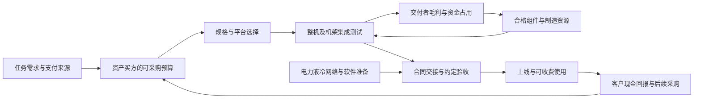

# AI服务器整机与机架集成行业调研：系统责任、采购口径与可留存价值

**研究截止日期：2026-10-10，美国洛杉矶当地日期。** 重要经营事实主要覆盖截至2026年6—8月的已披露季度；未披露的2026年余期属于估计，2027—2028年属于前瞻。财年原样保留，模型统一采用自然年1月1日至12月31日。金额中的 **bn为十亿美元，1bn=10亿美元**；美元为当年名义美元。人民币和新台币披露保留原币，不隐含换汇。

证据标记：**F＝已发生期间的披露事实；M＝管理层目标、指引或厂商主张；C＝直接计算；I＝本报告推断或条件模型；U＝未知。** 转录管理层讲话的非公司渠道另标M-T。所有模型区间均为参数条件包络，**不是统计置信区间，情景代表点也不是概率分布**。

本次只把`基本面/产业背景/结果/`中的许可背景资料用作线索，另行联网核验。未使用公司报告、既有行业报告、索引、评分或排序作为研究输入。使用的背景材料及核验边界列于文末；正式研究、来源和复算参数均集中在本文件。

## 一、先看决定性发现及其边界

**最有依据的判断是：AI整机需求仍在扩张，但集成价值正沿两条方向分化——向能承担上线责任、客户信用和长期运维的供应商集中，同时被芯片平台标准化、客户直接采购和自研体系分走。** 截止日的证据支持新代际及特定客户的结构性约束，尚不足以证明全球所有AI服务器都处于短缺，也不足以认定收入放量必然带来利润率扩张。

1. **真正稀缺的商品是按客户条件完成交接的系统能力。** 加速器、互连、供电、液冷、软件和验收串联；工厂装配、合同交付、通电上线和收费使用分别发生。芯片供应改善能推动整机放量，现场约束却能让采购与现金回报继续错位。
2. **整机财务报表的分母正在改变。** 纬颖披露部分客户内存采购转为代理模式，相关金额退出收入与成本；产品不一定减少，收入增长和毛利率却会变化。因此，本报告首先估算资产买方的完整采购价值，再讨论集成商可留存的绝对毛利，避免把代理采购造成的分母收缩当作经营能力突变。
3. **技术复杂度上升与装配劳动减少可以同时成立。** NVIDIA将Rubin计算托盘装配由接近两小时简化至五分钟，这是托盘工序的厂商主张；不能扩大成整柜、园区或集群验收时间。标准化削弱部分手工集成溢价，流体、供电、可靠性、软件及客户现场责任仍有价值。
4. **营运资本可能比厂房更决定供给与回报。** Supermicro年度现金流和库存、浪潮信息半年现金流均显示备货占资；季度盈利改善也确实存在。谁拥有昂贵芯片和内存、谁支付预付款、谁承担延迟验收，往往比“每月能装多少柜”更接近可持续供给。
5. **自研ASIC扩大的是系统工作量，未必扩大系统美元支出。** TPU、Trainium和Maia已有商用或生产负载证据；开放机架和NVLink Fusion又能把专用芯片接入平台。替代可能降低芯片租金、增加定制工程，也可能保留原平台的网络与软件收入，不能把替代率机械等同于集成商收入增速。

下表集中保存决定判断的经营披露；后文以其解释机制，不将这些金额彼此相加成市场规模。

| 证据对象 | 原始披露、经济期间与性质 | 能支持什么；主要限制 | 公开日期与出处 |
|---|---|---|---|
| Dell | FY27Q2，截至2026-07-31：AI服务器收入 **16.4bn**、订单 **60.9bn**、期末积压 **95bn**；半年AI收入 **32.533bn**〔F〕；FY27全年AI收入指引 **74bn**〔M〕 | 客户采购和交付量级已很大；积压跨期，订单不可年化；ISG利润率包含传统服务器、网络和存储，不能赋给AI业务 | 2026-09-01，[S01][S01] |
| Supermicro | FY26截至2026-06-30：收入 **39.1bn**、毛利率 **10.8%**；Q4收入 **11.1bn**、毛利率 **17.5%**、季度经营现金流 **+0.747bn**；全年经营现金流 **−6.809886bn**、期末库存 **12.895949bn**〔F〕 | 利润改善与现金负担并存；全公司含非AI业务，季度组合改善不能直接外推全部同行或全年 | 2026-08-11，[S02][S02] |
| 纬颖 Wiwynn | 2026Q2收入 **NT$278.153bn**、毛利率 **9.3%**、营业利润率 **7.3%**；2026H1收入 **NT$554.660bn**；4月起部分客户内存代理采购退出收入与成本，Q2另有新品NRE收入〔F〕 | 交付与报表收入不再一一对应；毛利率变化同时含分母及一次性工程收入效应 | 董事会2026-08-07，官网更新08-10，[S03][S03] |
| HPE | FY26Q3截至2026-07-31：AI Systems订单 **2.4bn**、积压 **6.8bn**；含Networks for AI的总AI订单 **3.1bn**、总积压 **7.6bn**；季度后获 **3.5bn**推理订单〔F/M：合同与未来兑现分别看待〕 | 总AI积压不能全计入整机；后获订单不属于该季已实现收入，Cloud & AI利润亦含其他业务 | 2026-09-02，业绩材料第8—9页，[S04][S04] |
| NVIDIA及Rubin系统阶段 | FY27Q2截至2026-07-26：NVIDIA数据中心收入 **89.0bn**〔F〕；8月电话会披露Rubin已开始生产出货〔F，管理层披露〕；9月MLPerf将所提交Rubin系统归为Preview〔F〕；Supermicro于09-23公告已开始交付Rubin NVL72机架〔F，厂商披露〕 | 已有系统厂商出货证据；测试提交时点、普遍可购、客户规模验收和现金贡献仍是不同阶段 | 2026-08-26、09-16及09-23，[S05][S05]、[S06][S06]、[S07][S07]、[S34][S34] |
| 台积电 | Q2电话会明确先进封装容量限制客户增长〔F，管理层对当时约束的披露〕 | 支持上游约束，不能把名义晶圆投入变成特定GPU、特定机架的合格产出 | 2026-07-16，电话会第10页，[S08][S08] |
| 浪潮信息 | 2026H1营业收入 **8,437,872.72万元**；服务器及部件收入 **7,806,243.85万元**、毛利率 **8.73%**；经营现金流 **−749,277.12万元**，公司解释与备货增加有关〔F〕 | 中国系统需求和利润不应仅以海外云厂外推；这是全服务器口径，未单列可比AI机架 | 2026-08-29，半年报第7、12页，[S09][S09] |

**规模判断〔I〕。** 在排除独立外部网络、设施建设、云服务收入及重复转售后，2026年全球AI加速服务器/机架的完整资产采购价值，条件代表点约 **492bn，即4,922亿美元**；参数包络约 **373—630bn**。代表点对应最后一层整机/集成交付者毛利约 **34bn**、营业利润约 **20bn**，并不是所有芯片、内存及制造企业的合计利润。2027基准代表点约 **660bn**，2028约 **820bn**，但集成营业利润代表点只升至约 **25/30bn**。扩张支出和集成利润不是同一增长率。

2028悲观代表点约390bn，乐观约1,090bn；另有“替代和开放体系突破”分支，支出约740bn而系统工作量向自研ASIC转移。区间较宽，原因是商业净价、供货资源、客户采购归属和系统验收缺少全球可比统计；不能用公开订单强行收窄。完整对象×期间×路径数据、成本和现金条件见第八节及附录B—D。

**最强反证**是：同质量工作量增长主要被软件效率、利用率和自研路线承接，新增资本采购下降；与此同时，标准化与买方直采降低每套系统可留存费用。它可以在AI应用继续增长时使本行业美元收入和利润下降。相反，客户净回报、同代际交付和每套绝对毛利共同改善，才会证实较强的利润扩张路径。最大的未决问题是全球净成交价、分客户有效产能、合同验收时间、代理采购占比及客户项目现金回报。

## 二、研究边界：客户购买什么，如何避免重复计数

### 2.1 产品及相邻池

本行业负责把加速器和主机、托盘、机架内部互连、管理软件、供电及冷却接口变成可以交付的系统。范围含新交付的训练、后训练及推理加速服务器，机架级设计/工程、工厂集成测试、与硬件交易不可分的初始部署及质保配置。地域按**资产买方及最终安装所在地**理解；台湾制造、美国品牌或美元开票并不决定设备属于哪个区域的需求。

| 统计对象 | 是否纳入核心采购价值 | 可加关系及交叉责任 |
|---|---|---|
| GPU/NPU、HBM及计算板、CPU、主机内存/SSD、内置NIC、机架内scale-up交换、机架电源和所交付液路 | 纳入完整系统价值；客户直接提供的组件按实际采购成本归入同一资产 | 芯片、内存等相邻研究可以分别研究收入及利润；不再把其销售额加到系统总额上 |
| 面向资产买方的最终整机或集成发票 | 用于识别最后一次资产交易；代理及客户自供件另补齐 | OEM采购ODM的同一整机不能重复计入；同集团合并主体不当作独立厂商相加 |
| 独立scale-out网络、外部光模块及存储集群、专用KV缓存设施 | 核心规模排除，除非嵌入所交付计算系统且不可拆分 | 网络/存储专题承担独立采购规模；本报告解释它们对上线和系统吞吐的约束 |
| 建筑、土地、电网接入、设施侧配电、独立CDU/冷机、水系统 | 排除 | 属园区、电力和冷却专题；本报告研究接口、交付影响及资本回收条件 |
| 单独长期运维订阅、软件许可、托管及GPU小时 | 不混入新硬件采购总额 | 是售后或算力服务收入；可以提升交付者价值，但不能把多年合同总额当本年设备收入 |
| 普通CPU服务器及AI标签PC、端侧设备 | 原则排除；计算机架中的主机CPU计入 | 代理工具/沙箱可能带来CPU采购，这是真实相邻需求，不自动纳入加速服务器规模 |
| 二手整机转售与存量重复使用 | 排除新设备流量，影响残值、更新和新购需求 | 转售收入与新增供给分开；存量利用率提升可以替代新交付 |

**核心总池是资产买方完整硬件采购价值V；供应商确认收入R不是V的同义词。** 客户自供昂贵ASIC、GPU或内存时，制造商可能只确认剩余硬件和加工收入；V仍计该客户为同一系统支付的组件成本。自研芯片按买方实际外购制造/封装成本归入资产，排除内部假定销售利润、云服务收入和全集团研发费用。因此，本文的V可比较客户资源占用，不能不经调整就和一个研究机构的“服务器供应商收入市场”比较。

### 2.2 三个可加子池与经济单位

本报告采用三个互斥分支。它们在美元资产采购价值上可加，**数量不跨分支相加或当作相等性能**。

| 分支 | 统计边界及单位 | 为什么采用这一单位 |
|---|---|---|
| **R：商用加速平台的高密度整机架** | 以72颗物理封装加速器为一个采购等价单位；含NVL、Helios及外售NPU等大型系统的可归属计算部分；更大/双宽/超节点按封装数折算 | 量纲服务于BOM、托盘、交接和单位费用；不等于一只实际机柜，不比较理论FLOPS；双裸片封装仍按一颗封装计 |
| **M：模块化加速服务器** | 8颗加速器服务器采购等价；含HGX及较小企业、推理或存量架构替换；按实际封装数折算 | 可以观察单节点价格、配置、扩容与集成成本；把M装进机柜不再创造一个R收入 |
| **C：资产买方自研ASIC系统** | 64颗自研加速ASIC的采购等价；主要为TPU、Trainium、Maia、MTIA等；按客户自供芯片成本及外围设备完整价值归一 | 把定制设计、组件代采及机架交付的经济工作量保留下来；不把64颗不同ASIC当成64颗GPU，也不据此算跨平台算力份额 |

一套异构POD按可识别计算硬件分解，只在相应分支记一次；拆分不了的归属为未知，不把GPU计算机架、CPU机架、LPU机架和网络机架全部冠以一个NVL72价格。中国为上述分支的地域覆盖，不是第四个可再相加的产品池；独立专用推理产品尚不足以形成可核验全球规模，放在前沿发现中，不伪造出货数。

箭头代表条件传导，不代表收入可以沿价值链相加。模型Q统计本年完成资产交接及合同约定系统验收的新增硬件；它不强称所有设备已经通电或处于收费使用。合同允许工厂/交货验收的项目可以先交接、后上线，因此供应商收入与园区进度仍有跨期差异。

## 三、需求：从客户任务和预算走到可采购的系统

### 3.1 采购者、失败责任与支付来源

| 客户类型 | 支付来源、采用任务与验收者 | 最能改变整机需求的变量 |
|---|---|---|
| 大型云及自用平台 | 云客户承诺、广告/搜索/订阅现金流和自身资本市场融资；基础设施部门采购，模型/服务团队使用，供应链与工程团队验收 | 同质量推理成本、峰值/低延迟约束、内部资源分配；自研ASIC和GPU在同一预算池竞争 |
| 模型实验室 | 直接自建资产或向云购买服务；科研团队不等于最终资产买方 | 直接建设设备算一次；购买云服务不再算一次设备；股权资金、算力预付款和最低采购承诺决定持续性 |
| 专业算力云 | 客户长期合同、债务、股权、资产融资及预付款；工程和服务SLA同时约束 | 设备交付期、上线延迟、客户信用、净租价和残值决定融资，而不只是订单面值 |
| 企业与主权客户 | 业务IT/数据预算、研究预算、政府资金及合规成本；IT、业务及安全部门共同验收 | 数据驻留、应用可用性、支撑服务、项目集成成本；购买云或小模型可能替代自建整机 |
| 中国算力建设客户 | 云/互联网现金流、企业与公共采购、融资租赁；本地软硬件生态及合规验收 | 合格芯片来源、实际模型迁移、集群利用率与回款；进口许可不等于可购买与可交付 |

预算同时包括新增、更新替换和内部转移。广告推荐转向更大模型是内部预算重新分配；旧机更新可能减少设备台数但提高单套价值；推理迁往ASIC会改变供应商收入路径。在任何一条传导中，token增长、设备增长、收入增长均不能默认同比。

### 3.2 现实预算锚点与2026条件需求

截至截止日，大客户依然具有实质采购能力。微软的指引又说明，报表资本开支变化不一定反映物理投资变化：数据中心建筑使用寿命调整改变了未来租赁分类，原投资计划之外的变化不大。另一方面，Amazon管理层将新增资本金额的一部分明确联系到内存成本，金额增长不是同等比例的物理扩容。[S10][S10]、[S12][S12]

| 资产买方 | 截止日原始预算/实际锚点；不可替换的口径 | 本报告2026设备采购归属参数〔I〕 | 对应核心设备预算〔C，基于假设〕 |
|---|---|---|---:|
| Amazon | 自然年2026现金CapEx约 **220bn**，Q2电话会公开转录；此前约200bn。属于M-T，未取得公司完整文字稿；公司财报的2026H1购建PP&E为 **98.411bn**〔F〕 | 核心AI加速系统占总现金CapEx **48%**；考察35%—60%。排除零售物流、卫星、建筑及相邻非核心设备 | 105.60bn |
| Alphabet | 2026CapEx **195—205bn**为S&P Global对管理层指引的转述〔M-T〕；SEC财报H1购建PP&E **80.598bn**〔F〕；模型点采用200bn | 核心系统占 **52%**；考察40%—62%。转述称约60%用于全部服务器，仍含非AI服务器，故不用60%全算AI | 104.00bn |
| Microsoft | 自然年2026CapEx约 **175bn**〔M〕；含融资租赁、排除经营租赁，租赁分类变化须保留 | 核心系统占 **58%**；考察45%—68%。不可把175bn当全部现金服务器采购或把租赁改分类解释成减建 | 101.50bn |
| Meta | 2026CapEx含融资租赁本金偿付 **130—145bn**〔M〕；Q2为 **31.08bn**〔F〕；模型点137.5bn | 核心系统占 **62%**；考察48%—72%。推荐/广告、自用模型预算均有支付来源，仍须扣建筑及非核心设备 | 85.25bn |
| Oracle | FY27Q1截至2026-08-31购建CapEx **28.499bn**〔F〕；不能乘四冒充自然年实际 | 自然年全年总CapEx **95bn**为I，考察70—120bn；核心归属 **60%**，考察45%—75% | 57.00bn |
| 其他独立专业算力云 | CoreWeave等已有上线与融资事实，缺全球可比CapEx总额；不把每个建设公告当现款 | 总预算45bn、核心占70%，均为I；预算25—75bn、归属55%—80% | 31.50bn |
| 中国外主权、企业及其他独立资产买方 | 没有全球完整台账；严格排除前述资产所有者已经记账的设备 | 总预算75bn、核心占42%，均为I；预算40—120bn、归属25%—60% | 31.50bn |
| 中国资产买方 | 半年报支持实际业务与占资，但未取得全行业可比设备支出 | 总相关资本预算45bn、核心占45%，均为I；预算25—75bn、归属30%—65%；模型为美元条件金额，非将人民币披露强行换汇 | 20.25bn |

来源：Amazon公司财报与电话会转录[S11][S11]、[S12][S12]；Alphabet SEC与S&P[S13][S13]、[S14][S14]；微软[S10][S10]；Meta[S15][S15]；Oracle[S16][S16]。后面三类低置信度参数不是披露总额，不能和已披露大客户预算混写为“已确认资本支出”。

模型四大客户核心预算合计396.35bn，全部资产买方合计 **B=536.60bn**。这是愿意且有资金用于本年核心系统交接的预算条件，不是2026实际市场统计。借助预算结构，分配到R/M/C的比例为62.5%/22.5%/15%，以各分支价格分别形成需求数量D，**不从预测供给反推需求**。这些分配是I，依据机架平台升级、企业模块化采用和已商用自研路线设置；目前无公开数据能把它们验证至小数点。

独立算力云向微软/Google出售算力时，前者拥有硬件、后者服务采购记Opex，则设备只计在前者。若云大客户直接持有设备，则从其他客户组扣除。资产与租赁所有权、付款和经济归属不一致的项目，应逐笔调整；本报告没有掌握全量合同，因此以条件预算而非审计总数表达。

**需求敏感性。** 四大客户模型CapEx点合计732.5bn，核心系统归属每共同增加10个百分点，B增加73.25bn〔C〕，即当前需求点的约13.7%。这是比把pipeline增长率直接外推市场更有解释力的变量。反之，内存涨价可以提高B而几乎不增加物理数量；代采会减少供应商R而不减少B。

### 3.3 任务回报、效率与替代的共同作用

可采购硬件首先取决于质量合格的任务负载及资源峰值，而非公布的总token量。训练/后训练需要集群完工、通信和故障恢复；在线推理受响应时间、并发和存量兼容约束；多模态/长上下文可能更多受内存和状态移动约束；工具调用又增加CPU与存储使用。

一个用于检验方向的关系为：

`所需合格资源 ∝ 成功任务数 × 每任务资源需求 / (同质量有效吞吐 × 可收费利用率)`

`新增采购 = max(0, 所需资源 − 可兼容且仍存续的有效存量)`

其中存续存量已经扣掉退役设备，不能再加一次同一笔替换量。训练峰值和在线推理SLA须分别校验，平均吞吐不能代替峰值约束。

两组演算〔I/C〕说明为什么方向不能预设：任务增长2.5倍、每任务需求增加1.2倍，吞吐增2倍、利用率增1.25倍，则资源需求为原来的1.20倍；若任务增2倍、有效效率增3倍、利用率增1.2倍，则资源需求仅为0.556倍。第二种情况下，应用继续增长仍可能减少设备采购。新增低价服务能否产生足够新任务，须看支付意愿和净回款，而不是默认“效率一定扩需求”。

买方材料支持两种力量均存在：微软披露存量Copilot吞吐优化，同时仍扩充容量；Amazon已披露AI和自有芯片业务的服务收入运行率，既说明有付费使用，也说明GPU并非唯一采用路径。运行率是期末年化，不是当期全年收入；芯片云服务收入也不是芯片或整机销售。[S10][S10]、[S11][S11]

## 四、技术为何推向机架，以及为什么机架并非唯一答案

### 4.1 从单节点到共同设计的系统

大模型训练、MoE路由和低延迟推理把内存与scale-up通信变成系统配置问题。把更多加速器纳入低延迟域，能降低通信占用、扩大单模型容量并提高某些任务的有效吞吐；但“域更大”不保证每个任务更便宜，小模型或分散客户可能无法充分利用大机架。

| 路径及截止日证据阶段 | 对客户采用及集成的经济意义 | 不可跳过的验证 |
|---|---|---|
| Blackwell/Blackwell Ultra大型机架；已有已披露系统交付和财务收入 | 客户从节点采购转向计算、内存、互连和液冷的一体化验收；同一机架失败会影响更多资产 | 同配置验收率、集群故障恢复、净价、冷却和现场网络，不以芯片收入替代 |
| Vera Rubin NVL72；厂商2026-03发布架构，8月披露生产出货，9月MLPerf提交为Preview；Supermicro于09-23公告已开始机架出货 | 72颗GPU、36颗Vera CPU、18计算托盘、9交换托盘等一体化设计降低局部装配工序；系统责任与平台控制加深 | 已开始厂商交付，数量及客户验收未充分披露；公开测试分类、普遍可购、真实功耗和规模现金贡献分别验证 |
| AMD Helios/MI450系列；已有Meta多年度协议与2H26初始交付目标，公开产品配置含72颗MI455X、OCP/UALink/UEC | 对厂商而言新增机架设计与验证路线；对买方而言增加议价选项，换平台仍需迁移软件和集群工程 | 一GW初始计划不等于全年已验收一GW，多代际六GW不等于当年采购；不能直接将客户定制MI450与通用MI455X规格混用 |
| 模块化8卡及小规模推理节点；成熟商业路径 | 既有机房、低密度任务和分步采购更易采用；当大机架超过客户负载或液冷条件时仍有竞争力 | 同任务利用率、每套总成本及部署时点；模块化不必然被机架取代 |
| TPU、Trainium、Maia及其他买方自研体系；部分已普遍可用或承载生产负载 | 硬件BOM与软件同属买方，系统制造、NRE和资源采购持续存在，芯片品牌租金可能下降 | 跨模型覆盖、工具链、任务质量、迁移、容量及区域可购；单一服务成功不代表通用替代 |

依据分别为[S05][S05]—[S07][S07]、Rubin架构[S17][S17]及Supermicro出货公告[S34][S34]、AMD与Meta原公告[S18][S18]及Helios规格[S19][S19]、AWS商用公告[S20][S20]、Google TPU发布/版本记录[S21][S21]、微软买方披露[S10][S10]。

### 4.2 不能把代际性能倍数当作价格与盈利倍数

MLCommons的2026-09-16结果明确区分Available和Preview，NVIDIA的Rubin提交采用两个高要求模型；其公开解读给出Qwen3-VL最高约3.7倍、DeepSeek-R1最高约2.5倍吞吐提升。模型、精度、SLA、软件和系统规模必须保留，不能将最高倍数推广到所有任务或每瓦吞吐。厂商随后把更高吞吐解释为更多收入，是在有收费需求的条件下才成立的经济推断。[S07][S07]、[S22][S22]

9月公布的Preview是该轮测试提交的分类，不能用来否定9月23日后另有系统厂商开始出货；出货公告也不能反过来把该轮测试分类改成Available。公告涉及完整机架与液冷集成，证明阶段已经前进，仍未给出全球交付量、独立客户验收数或稳定运行现金。[S34][S34]

本报告不以峰值FLOPS预测ASP。ASP同时受HBM容量、CPU/互连/托盘价值、地域、系统责任及交易条款影响；单位任务成本还受利用率、寿命和价格下降影响。新机架可以更贵而每任务更便宜，也可以在负载不足时比小系统更差。

### 4.3 液冷、供电与可服务性

厂商资料对Rubin提出完整液冷、45°C进液和免风扇托盘等设计；适宜气候/设施下可以减少冷机及水耗，并不意味着所有地区、所有负载都无需设施侧投入。冷却接口、污染控制、流量/压力、漏液检测、维护隔离和故障恢复，是把技术能力转成客户验收的步骤。[S23][S23]

机架重量、功率密度和接口会改变运输、楼板、配电与现场工程；更小的物理占地不等于更少的能源或更低系统成本。R的72封装单位在双宽机架或超节点中只是采购等价，其电力、网络和维护资源不能沿用一个固定物理机柜系数。

研究工程例子〔I/C〕：当前模型R交付72.3千采购等价单位，若每单位计算设备功率120—220kW，对应采购名义IT负荷约8.7—15.9GW；并非当年新增上电。100MW现成IT负荷，按同样功率区间只能容纳约455—833个单位，若设备加接口方案每单位4.2百万美元，则核心硬件约1.91—3.50bn。这样的桥梁将园区约束与行业数量联系起来，但应扣更新设备、既有园区余量及跨年安装；不能从设备发票直接推出新增GW。

### 4.4 开放接口和专用推理：价值可能迁移而不消失

OCP机架、UALink和UEC可减少定制接口成本，增加多供应商竞争；其公开规格并不使不同平台即插即用。UALink在2026-04发布扩展规格，之后仍需硅片、固件、测试和客户系统验证。[S24][S24]

NVLink Fusion则显示另一种路径：买方保留自研XPU，同时采用既有互连和机架平台。这能减少新芯片的系统进入成本，也会让平台继续参与专用芯片价值分配。d-Matrix在2026-09公布合作和多年路线图，属于高信息价值的前沿线索，不是规模收入证据。纯粹以“ASIC替代GPU”预测NVIDIA网络或系统平台收入下降，会漏掉这一迁移。[S25][S25]、[S26][S26]

本报告额外关注预填充/解码分离、KV状态的分层保存、专用低延迟执行和CPU沙箱：它们既能降低加速器数量，又可能增加CPU、网络和缓存的配套工作。Cerebras等专用系统属于竞争地图；未取得同口径已验收数量及价格时，不把架构演示冒充一个确定的新市场规模。

## 五、有效供给：哪些能力真正可以交付

### 5.1 供给不是一个厂房面积数字

本行业至少有五个供给层次：参考设计、名义装配能力、适配目标组件的合格能力、能够按客户条件交接的能力，以及已上线可服务能力。扩张前两层并不自动增加后两层。

| 资源及约束 | 截止日最有依据的状态 | 供给响应、价格与利润传导 |
|---|---|---|
| 合格加速器、HBM及封装、板级配置 | 台积电先进封装约束有直接披露；NVIDIA新旧代际并行并有供给承诺，具体客户分配未知 | 增加资源后仍需板级及系统资格认证；如果组件按实价转嫁，整机收入增加，固定集成费可不变；缺货租金可能留在平台和内存层 |
| 托盘/机架、高功率测试及故障筛查 | 多家OEM/ODM具备产品和全球制造体系；没有全球按相同规格统计的测试小时、返修率 | 装配简化提高速度，电液冷满载测试和新平台资格不能据此同比缩短；返修和质保可能吞掉新代际溢价 |
| 客户现场网络、供电和冷却接口 | 微软披露主要区域GPU从到货到上线时间较上年缩短近50%，说明约束能够改善，非恒定瓶颈 | 提前完成场地有利交付和回款；所有权已经交接但尚未上线的设备仍给客户造成资本占用 |
| 地理布局和本地交付 | 2026-09纬颖及Amazon披露美国服务器制造扩张；其他厂商也扩全球布局 | 临近客户和采购合规有价值；板卡/封装资源集中度并不随末端装配迁移而消失，本地工资与双重产线提高成本 |
| 采购资金、供应商信用与验收资金 | 备货现金流直接显示资金约束；客户代理采购/预付款可减少制造商资金责任 | 融资足够才构成商业有效供给；账期或库存所有权改变可比单纯扩厂更快改善现金效率 |
| 法规与地区准入 | NVIDIA披露中国H200少量许可出货、收入占比很小及额外关税不能转嫁，政策可直接改变供货和成本 | 同型号的可交付地域、检查与价税不同；不能将海外供应余量直接视为中国可得供给 |

供给、金融及监管证据分别来自[S08][S08]、[S10][S10]、[S02][S02]、[S03][S03]、纬颖设施材料[S27][S27]及NVIDIA 10-Q[S28][S28]。本报告没有把新闻涨价当作物理产能证明，也没有读取行业外本地资料补齐未知分母。

### 5.2 独立供给模型及其可信度

需求侧由预算和产品分配产生D；供给侧另设组件、工厂和交接资源：

`S_i = min(A_i×1,000/n_i, K_i, L_i) × y_i`

其中A为分配给该产品分支的百万颗合格封装，n为72/8/64；K为适配目标配置的年度工厂能力，L为当年可完成约定系统验收的客户/现场验证槽位，均以千采购等价计；y为最终通过验证、返修并按期交接的比例。K已考虑运行时间及目标代际适配，y仅扣最终系统放行，不能把同一良率损失扣两次。**A不是晶圆数，也不是厂商公告的未封装设计产能；L不是已签约园区GW，更不是已收费使用量。**

这些资源的全行业数值没有公开调查可复核。附录C因此明确把A/K/L/y标为独立资源条件，而非披露产能；它们用于验证“需要什么供给才能支持路径”，可信度低于客户实际预算、财报收入及原始技术配置。中央资源点没有通过把B除以ASP来设定，亦没有把订单增长反推产能。

资源条件的现实约束来自：先进封装及合格内存不能无限释放；现有OEM/ODM和自研体系已经具备规模交付；新机架资格与场地验证可随代际重启；当地装配扩张不等于全部上游约束解除。由此形成“成熟配置可用、新配置局部受限”的方向判断。对于相同配置，组件分配、测试小时或场地槽位任何一项低于附录门槛，相关路径即不能兑现。

**一个可审查的制造锚点，也说明为何不能直接填全球产能。** Supermicro在2025-11-04的FY26Q1演示第5页提出，FY26年末达到每月6,000个风冷/液冷机架能力，其中3,000个液冷机架〔M，目标时点2026-06-30〕。即使目标全部达到并连续运行，分别也只是72,000/36,000个实际机架的年化名义上界，不是全年交付。2026-07-30的机架产品公告又称可每月交付至多3,000个该系列机架，其中2,000个液冷机架〔M，厂商能力主张〕；该公告主要介绍机架结构、尺寸、接口及预装，未明确全部均为装有72颗加速器且完成客户验收的系统。两份公告的产品范围及能力状态未统一，不能把数字差异解释为实际产能下降，也不能将任一数乘以NVL72价格算收入。[S35][S35]、[S36][S36]

本文当前R的K=90千采购等价，是全供应体系在指定配置下的资源条件，须由多个厂商的合格满载测试与组件配额共同支持；单家液冷机架的上述数万年化数量只支持“已有规模制造组织”这一数量级。实际机柜可能装M、C、网络或部分配置，K与公开机架数字之间缺乏可核验映射。因此该锚点提高制造可行性判断的依据，**没有把全球有效供给从条件估计升级为统计事实**。

当前代表点的S为R72.3千、M334.8千、C82.8千。相应**资源不确定性筛查范围**约为R55—95千、M270—410千、C60—110千〔I，不是调查置信区间〕；这些范围与需求有明显交集，不能靠模型证明一个精确全球缺口。当前中央模型未交付预算占比约8.3%，应读作条件差额，**不是已观察到的全球短缺率**。

行业现实更接近哪一侧：**新代际高密度平台及部分大客户更接近局部短缺；成熟模块化系统、旧代际及客户长尾更接近可采购而经济需求分化。** 理由是强订单/交付、上游直接约束和客户上线改善同时存在，尚无足够同配置库存、取消及成交折扣证据证明全行业普遍过剩；也没有全球按规格的交期及有效利用率证据支持普遍短缺。

### 5.3 供给反应的时滞与再分配

已认证配置增加班次、代采或预付款安排，可能在数周至数季内改善交付；新代际系统、换内存/板卡、供电和冷却接口通常要经历工程验证与客户资格。新场地和上游制造投资往往跨年。以上为研究节奏判断，实际以项目里程碑替换，不是统一行业标准。

扩产会双向改变价值：系统数量上升利于固定工程和运营费用摊薄；参考设计成熟、多家供应商认证和客户议价又会压低集成费用。旧配置库存不能直接转为新配置能力；价格下调既可能反映组件降价，也可能来自客户采用转弱、失去平台配额或清理残值。应比较同型号、地区、条款和交付期，不用企业平均ASP识别供需拐点。

## 六、竞争与价值捕获：系统重要性为何不能直接变成高利润

### 6.1 控制权和风险的分配

| 层级/参与者 | 控制的关键入口 | 可捕获价值与承担的风险 |
|---|---|---|
| NVIDIA及商用加速平台 | 芯片、scale-up互连、软件、参考架构与认证生态 | 保留平台租金、扩大附带组件；上游承诺、生态供货及客户融资支持带来额外风险 |
| 大型云和自研方 | 任务数据、部署位置、软件及预算，能直接采购关键组件 | 把芯片利润内化，选择/替换ODM；承担设计、迁移、利用率与资产残值 |
| 品牌OEM | 企业入口、整体方案、全球服务、融资及系统合同责任 | 在复杂企业项目收集成/服务费用，也承担信用、保修和交付承诺；大云客户可削弱品牌附加值 |
| ODM/JDM与专业集成商 | 定制设计、工厂验证、供应链执行、NRE和客户资格 | 熟练工程与可靠交付能复购；集中客户、代际切换、代采变化与强势买方制约费用 |
| 电源/液冷/网络等关键供应商 | 指定接口及认证后的可靠组件 | 小金额部件仍可卡住大系统；供应恢复后溢价可能回落，稀缺不等于系统商获益 |

NVIDIA 10-Q披露供给承诺、面向AI云的未来服务安排及相关客户支持，说明平台有时同时推动供给和帮助买方取得资源。由此产生的订单不能自动视作最终独立客户现金需求，但也不能无证据定性为虚假需求；应追踪第三方使用、项目建成与真实回款。担保是或有信用风险，不与设备CapEx或当期收入相加。[S28][S28]

Sanmina在2025-10完成收购ZT Systems的制造业务，为设计和制造责任可以拆分的现实例子：芯片平台与系统设计、客户资格、制造履约不是同一资产。不能把“ZT”作为一个未变动的独立竞争者，与AMD、Sanmina各自重复计算。[S29][S29]

### 6.2 三种经营路径

**品牌全套交付。** OEM采购组件并对总系统收费，收入大，库存/应收也大。企业/主权客户愿为数据安全、方案、支持和单一责任人付费；规模云往往能将集成业务拆开议价。利润扩张需要单位工程/质保成本下降，或服务和系统责任被客户付费，不只是芯片更贵。

**云客户共同设计和直接制造。** ODM/JDM获得设计/NRE、硬件加工和订单执行收入，技术工作真实，但客户可以控制关键BOM和供应商配额。NRE在新品阶段较高，量产硬件比重增加可压低报表毛利率；直接采购和代采还能改分母。应看按项目的绝对毛利、复购资格与资本效率。

**客户自供件/代理采购。** 外部组件由客户持有，系统商仅对剩余部分负责。这可能降低报表收入，却提高现金效率和资本回报；也可能削弱采购加价和供应链控制。该方向对收入、利润率、绝对利润与ROIC的影响可以相反。

一个纯会计演算〔I/C〕：原全套系统收入100、成本92、毛利8，毛利率8%；客户自供原成本中的50后，集成商收入50、成本42，毛利仍8，毛利率16%。资产买方的完整采购仍为100。只有成本节约、费用提高或资金风险变化，才有新增经济价值，不能把这一毛利率翻倍直接称为竞争优势翻倍。

### 6.3 成交价格、费用和成本传导

没有公开覆盖全行业、同BOM的实际净成交价数据库。附录中的P是明确的价格假设，不是官方标价、媒体传闻或财报平均ASP；g为完成系统交付后可留存的毛利金额，C=P−g包含外购组件、直接制造/集成/测试、运输、合理质保和制造折旧。客户自供件同时补入P和经济成本C，避免分母变化。

跨年P统一了币种、地域总池和72/8/64封装采购单位，**没有统一芯片代际、内存容量或完全相同BOM**。其变化包含产品组合与同配置重定价，尚不能拆成各自贡献；本文不把基准R的4.2→4.6→5.0百万称为同型号涨价。短缺是否形成真实溢价，仍需同型号、地区和合同的成交证据。

典型合同须辨别四种变化：组件按成本转嫁、固定集成费、成本加成以及全包固定价。组件涨价在前三种合同中可能提高收入却不增加g；固定价合同可能先由系统商吸收成本，待新订单或重定价再传导。供应商信用、库存所有权和验收时间不同，会改变同一标价背后的经济净价。

折扣还可能以部署、软件、售后或融资条款出现。GPU整柜缺货未必立刻给系统商带来售价溢价，原因是关键组件由平台分配、客户已有框架协议，或OEM在锁定新客户时愿意让出硬件费用。对该行业，**每一采购等价单位g及其资金占用，比毛利率单点更容易比较**。

### 6.4 资金约束与ROIC：一批100个R单位的例子

下表为同一交付者、同一批资产的条件模型，排除GPU平台上游利润；单位为百万美元〔全部I/C〕。

| 项目 | 基准参数及结果 | 经济解释 |
|---|---:|---|
| 100个72封装采购等价，P=4.20 | 完整交易价值420 | 每个单位的昂贵组件都按相同经济边界计入 |
| C=3.93，g=0.27，营业费用o=0.10 | 毛利27、营业利润17 | 4.05%营业利润率并不代表回报很低或很高 |
| 净营运资本为交易价值16%，另配置厂房/测试等资本10 | 占用67.2+10=77.2 | 此处16%是同一边界假设，含付款/验收安排，不是全行业实际平均 |
| 25%税率、稳定经营且不考虑新增长投资 | 税后营业利润12.75，示例ROIC约16.5% | 只适用于该批周转/费用配置，不能赋给一家公司的全集团ROIC |
| 额外30天成本库存 | 追加现金占用约32.30 | `393×30/365`；按10%融资约增3.23年利息，另影响融资后的收益，不从EBIT重复扣 |
| 单套成本或质保增加0.05，不能转嫁 | 营业利润降为12，下降29.4% | 完整系统价格只对应约1.2%的误差，却显著影响薄利润交付者 |

Supermicro和浪潮信息的现金证据支持占资风险是真实机制，不证明它们所有库存均无法出售。SupermicroQ4已有现金改善，也说明去库存、客户组合和合同安排能改变结果。当前全球营运资本存量没有可比数据，本报告不将该例子当成已观察到的行业现金流。

## 七、竞争地图及覆盖边界

### 7.1 关键参与者

| 参与者/群组 | 技术与经济位置 | 截止日证据及价值捕获条件 | 主要未知或替代压力 |
|---|---|---|---|
| Dell | 品牌OEM、企业与大项目系统责任、供应链及融资 | 已披露AI收入、订单和积压；在系统交付、部署和支持上收费 | AI独立毛利、合同可取消性、客户及代际组合未充分拆分 |
| HPE | 企业/主权、超级计算、网络与私有AI方案 | 订单证据含AI系统与独立网络；大型推理客户扩展 | 高利润网络/软件和低利润整机混合，不能套用集团毛利 |
| Supermicro | 模块化产品、液冷、整机架和快速配置 | 有财务交付及最新季度组合改善；硬件、液路与工程一体化 | 集中订单、库存资金、质量与代际切换；不从企业客户增加推全行业高利润 |
| Lenovo | CSP与企业/SMB并行，全球制造及液冷体系 | FY26/27Q1 ISG收入8.5bn、营业利润0.777bn、利润率9.1%；AI pipeline54bn〔F/M分别区分〕 | ISG含非AI，pipeline不是积压或收入；单季改善需持续验证 |
| Quanta/QCT | 大云客户ODM/JDM、标准和定制机架 | 月营收及平台展示支持规模体系，但未把全公司收入当AI收入 | 笔电/普通服务器混合，BOM所有权与同配置产出未知 |
| Wiwynn/Wistron | 云客户共同设计、NRE、机架与全球工厂 | 代理采购和NRE披露具有高辨识力；美国制造扩张有客户共同公告 | 同集团合并边界、GPU/ASIC组合、代采份额及单项目绝对利润未知 |
| Hon Hai/Foxconn/FII、Ingrasys | 大规模云网制造、全球本地履约与垂直部件 | 2026Q2全集团云网业务及扩张披露；集团毛利6.12%不等于AI机架毛利 | 客户集中、主体合并、部件/整柜重复交易和当地成本 |
| Sanmina/ZT Systems | 已收购制造能力、复杂系统制造和履约 | 交易改变了制造业务归属；设计与制造分工是竞争结构信号 | 收购后具体客户、系统配置和独立利润仍需披露 |
| Inventec、MiTAC、Giga Computing、ASUS及其他区域ODM/OEM | 模块服务器、HPC或特定客户机架、区域交付 | 处于多厂商认证与竞争扩张层；部分参与公开性能提交 | 未取得同口径AI收入和验收数，不凭参展估算份额 |
| 浪潮信息、新华三、华为及中国系统生态 | 本地客户、软硬件适配、开放/专用互连及超节点 | 浪潮原始财报提供经济锚点；不同平台的迁移/利用率决定需求 | 未建立中国全行业实际采购量和净价；禁限清单、外部组件及客户回款须按主体核验 |
| NVIDIA、AMD | 商用芯片/平台与系统设计规则 | 决定平台配额、互连和软件，能够提高系统附带价值 | 同时推动伙伴与标准化；各OEM不拥有相同议价权 |
| Google、AWS、Microsoft、Meta等买方自研方 | 数据、预算、编译器/运行时及自用部署 | 自研商业使用已存在；与外购GPU并行 | 芯片和整机完整成本、真实资源数量、可迁移工作负载仍未知 |
| Broadcom、Marvell、MediaTek等定制芯片与接口生态 | 自研客户的芯片/互连实现，与系统平台协作 | ASIC扩张可能给不同系统制造链带来订单 | 核心IP、客户集中与工程NRE；不把客户芯片收入直接加到整机总池 |
| Cerebras、d-Matrix及其他专用执行方案 | 晶圆级或低延迟推理路线，潜在异构系统 | 新路线可能先在某阶段或特定任务成立；d-Matrix已有平台合作公告 | 未取得足以约束全球系统市场的交付/价格，技术成功不等于行业规模或利润兑现 |
| CoreWeave、Nebius、Lambda、Crusoe等专业算力云 | 资产采购者、上线及收费服务组织者 | 可能承担初始部署、融资与复杂运行，反向改变硬件合同 | 云收入不计本行业硬件销售；客户集中、净租价和资金安排影响后续下单 |

经济锚点除前述来源外，另有Lenovo[S30][S30]、Quanta月营收[S31][S31]、Foxconn[S32][S32]、MLCommons参与者记录[S07][S07]和CoreWeave[S33][S33]。表中缺数据的公司不被赋予市场份额、利润率或无限持续竞争优势。

### 7.2 什么能力可以持续收费

跨客户重复使用的测试程序、失效数据库、机架软件、流体/供电设计、售后网络及客户资格，能够降低下一代系统的交付成本。对大云客户，重复使用也可能直接成为新的降价要求；对企业客户，快速通过验收和可靠支持可以提高支付意愿。

本报告的原创判断是：**可持续集成价值更像“减少客户不可回收的等待和故障成本”，而非“复杂机架里有多少元器件”。** 如果平台将接口和托盘高度标准化，系统商仍可通过上线速度、客户信用、运行可靠性和服务得到回报；如果客户将这些能力内建，制造数量可以增加而第三方费用下降。最能区分两者的证据是同客户、同规格的绝对交付费、责任边界、客户复购及实际占资，而不是产品发布数量。

## 八、联合情景：放量、利润扩张与价值流失需要不同条件

### 8.1 情景机制及当前裁决

| 路径 | 需求、有效供给与价格的共同条件 | 集成成本、价值分配及现金含义 | 未来判别证据 |
|---|---|---|---|
| **悲观：采用回报不足、成熟供给释放、竞争压价** | 付费任务未达到原采购回报，存量效率/ASIC承接更多；高密度采购减少，成熟配置供给仍增加；组件和集成净价均弱 | R的g显著下行，固定费用摊薄恶化；M低价节点数量可增加而收入不增；库存现金不一定立即释放 | 同配置净价、延期/取消、库存天数、付费利用率共同转弱；不是单看CapEx一季下降 |
| **基准：任务采用继续，机架过渡与供给渐进改善** | 大客户延续采购，R提高占比，C扩张；合格组件和验收资源跟上多数需求，局部缺口保留；ASP因BOM/代际提高 | 绝对g温和变化，标准化和大客户议价抵消部分复杂性溢价；营运资本所有权改善比毛利率扩张更明确 | 同期客户现金/预算、系统验收和费用复购；g及资本效率要分别成立 |
| **乐观：付费采用加速、工程稳定、客户为系统责任付费** | 企业/主权及大云需求共同增加，新系统合格率和现场资源改善；高容量与高责任配置提高P，C仍可能局部资源不足 | 失效/返修/交付成本下降，g增长且营业费用不同比增加；预付款/自供件抑制资金占用 | 量产交付、售后事故、单位费用、客户净回报同步验证，只有更大订单不够 |
| **替代突破：开放/自研推理大规模承接工作量** | 额外条件为软件迁移、任务质量/SLA达标、自研ASIC及相应系统合格供给大增；减少昂贵GPU需求，C支出占比显著上升 | 资产客户任务成本下降；系统工程量向C移动，平台/集成加价下降；一次性占资释放可让现金暂时高于利润 | 至少多个独立大客户持续生产部署、同质量净成本优势、复购及资源保障；一个演示案例不够 |

当前证据最支持基准方向，因为客户实际支出/交付、已商用自研路线、约束改善与继续受限并存；没有用悲观和乐观平均值定义基准。三条路径用于比较经济机制，现实可混合，不把它们包装成覆盖所有未来的完整概率分布。

### 8.2 全市场联合结果

下表金额为bn。精确小数仅为复算保留，可信度不等于小数位数。GP/EBIT为向资产买方最终交付系统者的经济毛利/营业利润，排除芯片平台、零部件及前一道ODM已计在采购成本中的利润。W为净营运资本条件存量；现金代理按税后EBIT减新增W和净固定再投资计算，非公司GAAP现金流。

| 自然年 / 路径 | 核心采购需求预算 B | 交付资产价值 V | V 参数包络 | GP / EBIT | GP / EBIT 参数包络 | W | ΔW / 净固定再投资 | 现金代理 |
|---|---:|---:|---:|---:|---:|---:|---:|---:|
| 2026 / 当前条件基数 | 536.60 | 492.15 | 373.3–629.6 | 34.03 / 19.55 | 21.1–49.3 / 4.9–36.1 | 69.37 | 不适用 | 基数未知，未估计 |
| 2027 / 悲观 | 420.00 | 420.00 | 306.0–519.0 | 22.17 / 6.73 | 12.4–32.3 / -6.2–18.4 | 68.67 | -0.70 / 0.80 | 4.94 |
| 2027 / 基准 | 660.00 | 660.00 | 531.0–852.0 | 44.57 / 24.93 | 30.2–64.8 / 7.9–46.0 | 82.10 | 12.74 / 1.40 | 4.56 |
| 2027 / 乐观 | 800.00 | 790.61 | 660.0–1,011.3 | 62.10 / 40.89 | 45.4–87.9 / 20.4–68.4 | 82.49 | 13.12 / 2.00 | 15.55 |
| 2028 / 悲观 | 390.00 | 390.00 | 253.4–556.1 | 15.07 / 1.55 | 6.8–29.0 / -12.9–15.8 | 63.45 | -5.22 / 0.70 | 5.68 |
| 2028 / 基准 | 820.00 | 820.00 | 616.2–1,082.3 | 52.17 / 29.57 | 32.0–80.5 / 7.5–59.0 | 83.97 | 1.86 / 1.80 | 18.51 |
| 2028 / 乐观 | 1,110.00 | 1,090.14 | 882.1–1,462.5 | 90.53 / 61.36 | 62.4–135.5 / 28.4–108.1 | 94.44 | 11.95 / 3.00 | 31.07 |
| 2028 / 替代突破 | 740.00 | 740.00 | 532.2–972.2 | 38.22 / 19.14 | 22.4–59.1 / 0.6–40.5 | 57.94 | -24.16 / 2.00 | 36.52 |

2026未公开可比的前期全球W，故不提供年度行业现金流点。2027现金代理以2026条件W为基数；2028依对应2027路径，替代突破以2027基准为过渡。代理使用25%税率、没有新增融资收支、无重大坏账/减值及并购，净固定再投资是CapEx减已在成本里的折旧；其数值是I。若不接受W或税率假设，应删除现金代理而保留资产、毛利和供给判断，不能把代理当已验证自由现金流。

**代表点的经济区别〔C〕：** 2026—2028基准完整采购增约66.6%，GP增约53.3%、EBIT增约51.3%；不是收入每增长一美元就留存同样利润。2028悲观中M采购等价数量上升、R显著下降，证明需求和供给不需要所有变量同时向坏。替代突破的EBIT低于2028基准，现金代理却较高，主要来自一次性营运资本释放，不代表更强的持续盈利。

范围表中各产品Q、P、g和o有显式上下界，且允许负营业利润。加总包络是独立参数极值的宽界，并不表示上下界同等可能；部分组合需更高客户预算或供给资源才能实现。所有反向约束都须同时满足`Q≤D`、`Q≤S`和核心预算上限，不能将不满足的角点当成可实现市场。附录D保留它们，是为公开模型的不确定性，而非给狭窄范围制造精度。

**包络不等于全部未知的绝对上下限。** 若第三节列示的2026预算/核心归属同时取低端，B约358.90bn；同时取高端约753.25bn〔C，使用原指引端点及本文归属假设〕。前者已低于当前V包络下端373.3bn，必须重设数量并使V≤B；后者也不能越过实际供给直接成为收入。这些是共同极端参数的压力检验，不是新增管理层指引或事件概率。表内包络描述选定路径的Q/P/g/o条件，预算、资源或会计归属发生更大变化时，应重新计算，而不是宣布落在包络之外的结果“不可能”。

### 8.3 重要事件的概率判断

下列是**主观研究概率区间**，不是根据独立历史样本拟合；证据支持采用宽区间。事件相关，不能相乘，也不要求相加100%。

| 事件、成功标准及期间 | 概率性质与判断〔I〕 | 支持理由、未知及上/下调条件 |
|---|---|---|
| 到2028年，按本文边界的全年完整系统采购价值高于2026条件基数 | **无条件事件概率60%—80%** | 大客户投入、商用应用与供给响应支持增长；上调需同质量收费采用和回款，上游涨价本身不能证明；预算归属/效率替代、融资或政策冲击会下调 |
| 2027年内，至少三个相互独立的资产买方完成Helios类系统生产负载部署，且存在复购/追加，不只送样 | **无条件事件概率45%—70%** | 有大客户和开放生态锚点；新品整机、软件及资源认证仍需兑现。客户同型号验收与持续运行上调，量产/软件迁移延迟下调；成功不等于六GW全部交付 |
| 到2028年，最后一层R交付者按相同责任边界的绝对毛利/单位比2026提高至少20%，且扣质保后仍成立 | **无条件事件概率30%—50%** | 系统责任与高附加值客户支持，平台标准化、集中采购及代理模式限制；真实收费、失效率与资本效率证据上调，分母变化或仅BOM变贵不算成功 |
| 到2028年，买方自研C占完整采购价值至少30%，并有多个客户的同质量任务净成本较主流GPU路线低至少20% | **跨路径突破事件无条件概率15%—30%** | TPU/Trainium/Maia采用与开放路线支持可能性；仍需显著资源增量、迁移及真实生产测试。附录突破点C为38%；它不是任何母情景的固定子事件，不与三条路径权重相加 |

概率的可比经验是：目前存在成熟商用自研路线和反复发生的新品验证/爬坡，已有客户能缩短上线，也已有系统商通过组合与采购模式改善利润；与此同时，未取得足够同责任边界的单位利润和全行业投资回报统计。它们支持方向和宽范围，不支持个位数精确概率。若2026基数因补齐真实净价明显改变，第一项成功标准须同步重估，不保留旧分母制造“命中”。

## 九、演进顺序、最强反面解释与可证伪观察

### 9.1 阶段及时间范围

| 验证窗口 | 产业推进所需条件 | 应观察的成果；不能替代的后续阶段 |
|---|---|---|
| 2026Q4—2027H1 | Rubin/Helios指定配置、组件资格、工厂满载测试、客户液冷/供电和软件准备 | 可交付配置及合同验收、dock-to-live、净价与返修；路线图/厂房开业不等于交付收入 |
| 2027年 | 原有云大客户扩容与企业/主权付费采用；采购模式明确，供给分配不因旧代际库存卡住 | 持续交付、按客户绝对费用、回款和资金占用；单次大订单不等于全年运行率 |
| 2027—2028年 | 自研/异构工具链、开放接口互操作、真实任务迁移、专用系统资源保障 | 多客户生产负载与复购，工作量到成本再到系统采购的桥梁；基准性能不等于客户现金回收 |
| 2028年及以后 | 部署存量足够大，残值/经济寿命、更新需求与售后现金可观察 | 区分更新与净扩容、服务续费、平台绑定/替换和行业资本效率；期末运行率不当年度收入 |

采购、建设、交付、上线和重定价时滞不同。季度订单可以先于收入，收入可以先于收费使用，库存减值和服务收入又可能滞后。年度总量须保留，不能仅凭某季拐点把后面阶段全部视为已经成立。

### 9.2 竞争性解释与区分证据

| 假说 | 最强支持 / 最强反对 | 能区分的观察及研究阈值 |
|---|---|---|
| **机架复杂性形成长期集成租金** | 支持：客户接口、部署责任、错误代价和服务复购；反对：参考架构、托盘标准化、客户自供件和多厂商认证 | 看同客户/同责任g、失败成本和认证替换。若连续两个半年交付增长而g下降超过15%，应下调“复杂性自动扩利润”；15%是研究筛查阈值，非行业标准 |
| **当前需求是独立付费使用推动** | 支持：云服务与系统实际交付，主权/企业采用；反对：融资、供应商支持、预付款和多期积压使现金来源难识别 | 同代际净租价、可收费利用率和收款同时改善才上调。若两季利用率/价格及回款共同转弱，而设备与库存仍增，应检查前置采购与资金脆弱性 |
| **上游扩产将产生整机普遍过剩** | 支持：成熟工艺/产线可释放、装配简化；反对：新BOM资源强度、验收及地区政策 | 比较同规格交期、取消和成品库存。交期缩短且验收/收费使用上升是改善；交期缩短且折扣/取消/库存上升才更像过剩 |
| **ASIC会快速挤掉GPU系统支出** | 支持：已商用自研路线、低成本及客户控制；反对：GPU通用性、迁移成本、规模资源及异构平台仍可保留价值 | 至少多个客户达到同质量净成本优势并持续复购；性能演示或一个成功案例不支持全行业30%以上采购占比 |
| **代理采购只是会计改变，没有经济意义** | 支持：同硬件V及g可以不变；反对：实际库存/应收与信用风险确实转移 | 调整到同分母后g不变而资金占用下降，说明资本效率改善；若只是分母下降且风险仍留在系统商，ROIC改善推论撤回 |

没有证据要求本行业必须在某个季度出现统一拐点。未来可能发生的是结构切换：成熟模块化配置供给宽松、新机架仍局部受限；客户系统数量上升、供应商确认收入减少；现金改善而单位费用下降。研究应容许这些组合。

## 十、模型约束、敏感性与尚不能识别的部分

### 10.1 两个独立交叉检验

**买方预算检验。** 附录B先由买方组计算核心预算，再由产品分配和净价计算D；下一年度预算变化要由任务采用、资金和建设进度解释。相邻项目公告、多年度云合同和组件涨价不能自行增加独立资产买方数量。

**供应商及工程检验。** NVIDIA已披露数据中心季度量级、Dell半年系统收入、其他交付者的现实业务，约束模型不能落在明显不相容的数量级；但NVIDIA数据中心含网络/CPU/系统，Dell及ODM也可覆盖同一组件，不可直接相加。若R/M完整采购中的商用平台含量假设为65%—85%，当前代表点R+M约418bn对应272—355bn上游平台相关价值〔I/C〕；需扣外部网络/独立CPU并加入其他商用GPU/NPU才能同期间比较。因此这里只作宽边界核验，**不是从NVIDIA收入反推并证明供需平衡**。

工程上，R基准2027/2028需要约94.7/111.5千采购等价按约定交接，分别约6.82/8.03百万颗封装；供给中央条件A约8.0/10.4百万颗。它们需要新增资源或从其他配置转配，不能拿一个厂商的未限定“月产机架”数字填入。在自研突破中，C采购需要约16.36百万颗ASIC、全年适配的K/L能力亦显著提高，比基准C需求约9.54百万颗高得多；没有这些资源，突破支出分配只是客户愿望。

### 10.2 最重要的敏感性

| 改变的参数，固定其他边界 | 对当前条件点的影响〔C〕 | 解释 |
|---|---|---|
| R完整净价升10%，交付数量及g不变 | V增加约30.38bn，GP不增加；R毛利率从约6.43%降至约5.84% | 芯片/BOM变贵可以制造收入增长并加重占资，而非更高单位集成价值 |
| R每单位g减少0.05百万美元 | GP/EBIT均减少约3.62bn，占当前全部EBIT约18.5% | 费用议价与返修成本对薄利润系统商很敏感 |
| R最终系统通过率y从93%升到97%，组件/K/L保持当前点且需求可承接 | Q增加约3.11千单位，V增加约13.07bn、GP约0.84bn | 合格率改善是真实有效扩产，不能以名义厂房面积替代 |
| 四大客户核心采购归属共同减少10个百分点 | 需求预算减约73.25bn | 预算构成、效率及替代路径可以超过小幅ASP和装配效率的影响 |
| 2027基准W/V整体高5个百分点 | W增加约33bn，现金代理同比减少同额 | 资产所有权和客户账期未知使行业现金判断显著宽于利润判断 |

### 10.3 已知缺口及后果

- **价格与财务口径：** 没有同规格、同地区、同合同的全行业净价和代理采购比例；因此P、g及W均保留条件范围，不能估算公司AI利润排名。管理层指引原值不人为改区间，归属不确定性另列。
- **实际有效产能：** 组件客户配额、工厂测试小时、代际良率、返修和验收槽位不公开；供给表是必要资源的可复算条件，全球精确缺口未知，方向判断依直接证据。
- **需求归属：** 若同一项目在云平台、专业算力云、融资租赁和主权预算间重复出现，完整采购池要按最终资产账本去重；本报告没有完整所有权台账，其他客户组覆盖置信度较低。
- **地区与非上市覆盖：** 中国、中东、欧洲、区域供应商及自研内部成本不完整；全球模型覆盖这些买方的条件支出，但不声称拥有完整地区份额或每家厂商名单。
- **单位比较：** 封装不是裸片，采购等价不是实际机柜，更不是同质量算力；异构POD的外部网络、缓存和CPU相邻支出未完整纳入。本模型不能用数量直接比较芯片性能或电力效率。
- **未来技术：** 2028配置、超节点、光互连及ASIC代际尚不确定；不把未兑现路线图设成确定供给，也不为了数据少而排除高信息价值的新路线。
- **客户ROI：** 一套资产的租价、利用率、寿命和残值不能统一替代所有任务。本报告附录E只给完整资产条件演算；未证明全行业AI设备已回收资本成本。

## 附录A：关键来源、公开日期与经济期间

下列是本次实际访问的外部来源。官方财报/监管文件优先；M-T仅有公开转录/转述，明确降低证据等级。动态规格页没有独立署期时记录为截止日访问状态，不据页面今日抓取时间发明发布时间。引用同一披露的多个载体不增加独立证据权重。

| 标识 | 文件与可定位内容 | 公开日期 / 对应期间 / 限制 |
|---|---|---|
| S01 | [Dell FY27Q2 SEC Exhibit 99.1][S01]；AI服务器、订单积压、指引及半年分部表 | 2026-09-01；截至2026-07-31季度/半年，全年FY27为M |
| S02 | [Supermicro FY26Q4及全年业绩][S02]；季度摘要、年度资产负债/现金流表 | 2026-08-11；截至2026-06-30季度/全年；业绩公告标未经审计 |
| S03 | [Wiwynn 2026Q2业绩][S03]；正文代理采购、NRE及半年数据 | 决议2026-08-07，网页更新08-10；2026Q2/H1 |
| S04 | [HPE FY26Q3业绩演示][S04]；第8—9页AI Systems及Networks for AI拆分 | 2026-09-02；截至2026-07-31；季度后订单另列 |
| S05 | [NVIDIA FY27Q2业绩][S05]；数据中心收入及FY27Q3指引 | 2026-08-26；截至2026-07-26；指引不是实际 |
| S06 | [NVIDIA FY27Q2官方托管电话会稿][S06]；第4页Rubin出货和平台价值机会 | 2026-08-26电话会；厂商性能/未来机会属于M |
| S07 | [MLCommons Inference v6.1发布][S07]；Preview/Available与参与者 | 2026-09-16；测试提交状态，不是市场销售统计 |
| S08 | [TSMC 2026Q2电话会][S08]；PDF第10页封装限制客户增长 | 电话会2026-07-16，官网PDF置于08月目录；2026Q2及当时展望 |
| S09 | [浪潮信息2026半年度报告][S09]；第7、12页主要数据与产品毛利、第42页现金流 | 2026-08-29；2026-01-01至06-30；非AI专属口径 |
| S10 | [Microsoft FY26Q4电话会][S10]；CapEx租赁分类、吞吐、dock-to-live、自研与容量 | 2026-07-29；截至2026-06-30财季；自然年CapEx为M |
| S11 | [Amazon 2026Q2财报][S11]；现金流表、AI/芯片服务运行率 | 2026-07-30；2026Q2/H1；运行率非年度收入 |
| S12 | [Amazon Q2电话会公开转录（ROIC）][S12]；Jassy的220bn及内存成本解释 | 2026-07-30讲话；M-T，非公司全文文字发布，未作为技术性能原始证据 |
| S13 | [Alphabet 2026Q2 SEC业绩附件][S13]；现金流购建PP&E、经营结果 | 2026-07-22；2026Q2/H1 |
| S14 | [S&P Global：Alphabet Q2后资本支出更新][S14]；Guidance段 | 2026-07月业绩后，页面未能确认独立日署期；M-T，原指引195—205bn及全部服务器约60%转述 |
| S15 | [Meta 2026Q2业绩][S15]；CapEx及全年原范围 | 2026-07-29；2026Q2和自然年2026指引 |
| S16 | [Oracle FY27Q1 SEC业绩附件][S16]；现金流、原始CapEx和有融资成分预付款 | 2026-09-10；截至2026-08-31财季；不机械转成自然年 |
| S17 | [NVIDIA Vera Rubin POD技术文档][S17]；计算机架与托盘结构、装配说明 | 页面署期2026-03-16；厂商架构/性能和装配主张，非第三方工时调查 |
| S18 | [AMD与Meta六GW协议][S18]；初始一GW及2H26开始出货目标 | 2026-02-24；多年度多代际协议，未当本年六GW实际 |
| S19 | [AMD Helios产品规格][S19]；72 MI455X及开放接口 | 截止日动态页面，无独立署期；客户定制配置与通用产品不混用 |
| S20 | [AWS Trainium3 UltraServers商用公告][S20]；GA及144芯片配置 | 2025-12-02；已发布服务可用性，非2026新增交付数 |
| S21 | [Google Ironwood发布][S21]、[TPU版本记录][S21B]；商用状态及TPU7x | 2025-11-06发布预告，版本记录截至2026-10-10；原文“即将GA”不单独当已商用证据 |
| S22 | [NVIDIA对MLPerf v6.1的解读][S22]；Preview、模型与最高吞吐倍数 | 2026-09-16；厂商解释测试结果，不推广到所有任务 |
| S23 | [NVIDIA 45°C及完整液冷说明][S23]；系统与适宜气候条件 | 2026-06-21；设计/效率主张，非全地域设施实际成本 |
| S24 | [UALink 2026规格公告][S24]；2.0、互连/管理等 | 2026-04-07；规范发布而非客户全部采用 |
| S25 | [NVLink Fusion系统生态说明][S25]；XPU、机架/软件与接口 | 2026-08-24；平台设计及厂商经济主张 |
| S26 | [d-Matrix与NVIDIA合作公告][S26]；多年产品路线 | 2026-09-10；合作/路线图，未用作规模营收证明 |
| S27 | [Amazon与Wiwynn美国制造扩张][S27]、[Wiwynn Texas开业][S27B] | 2026-09-10及09-14（官网09-15条目）；不能由岗位/工厂开业反推NVL有效年产 |
| S28 | [NVIDIA FY27Q2 10-Q][S28]；第18—19页承诺/信用支持，第37页中国H200及关税 | 2026-08-27提交；截至07-26，后续事件依文件日期；承诺/担保不当当前收入 |
| S29 | [Sanmina完成ZT制造业务收购][S29] | 2025-10-27；竞争主体边界变动，不重复计算ZT、AMD和Sanmina |
| S30 | [Lenovo FY26/27Q1业绩][S30]；ISG及AI pipeline | 2026-08-13；截至2026-06-30；pipeline不是积压或实际收入 |
| S31 | [Quanta月营收][S31] | 动态页面截至本次访问有2026年1—8月；全公司、非AI口径，不用空白9月补造实际 |
| S32 | [Hon Hai 2026Q2业绩][S32]；云网制造、利润及布局 | 2026-08-12；2026Q2、Q3展望为M；集团利润非AI独立利润 |
| S33 | [CoreWeave 2026Q2业绩][S33]；active/contracted power及财务 | 2026-08-11；截至2026-06-30；合约电力不可当已投运 |
| S34 | [Supermicro开始交付Rubin NVL72公告][S34]；正文出货阶段、系统与液冷验证 | 2026-09-23；厂商披露开始出货，未披露全球数量或独立客户验收 |
| S35 | [Supermicro FY26Q1业绩演示][S35]；第5页6,000/3,000机架月能力目标 | 2025-11-04；目标FY26年末，不当已实现、全年或72封装系统产能 |
| S36 | [Supermicro机架产品系列公告][S36]；3,000/2,000月交付能力主张及机架边界 | 2026-07-30；机架产品范围未与装满加速器的整机验收口径统一 |

## 附录B：需求参数、分配和公式

1. `B_t = Σ(资产买方可用于本年采购的预算 × 核心系统归属)`。2026原始锚点和假设已集中在第三节；后续年度下表是对任务采用、预算、资金及买方结构变化的I，不是公司的2027/2028指引。
2. `D_i,t = B_t × w_i,t / P_i,t`。B单位bn、P单位百万美元，得到千采购等价。R/M/C分配可加，`Σw=1`；数量各自保留72/8/64封装定义。
3. `Q_i,t = min(D_i,t, S_i,t)`。预算愿望不能超过按约定完成交付的能力；供应商未被最终买方交接的库存不当行业设备流量。
4. `V=Q×P；GP=Q×g；EBIT=Q×(g−o)`。当Q用千单位、P/g/o用百万美元时，结果为bn。经济成本`C=P−g`，含客户自供件的采购成本，只有最后一层交付者的利润留在GP；不把OEM和它采购的ODM毛利再次相加。
5. `W=V×k；现金代理=0.75×EBIT−ΔW−净固定再投资`。k反映库存、应收、应付、预付及自供件的净作用，是同经济边界参数；差额递推按第八节定义。没有给每家企业套统一税率或资本回报。

| 自然年 / 路径 | 四大客户 | Oracle | 独立专业算力云 | 中国外主权、企业等 | 中国资产买方 | 合计 B | R / M / C 分配 |
|---|---:|---:|---:|---:|---:|---:|---:|
| 2026 / 当前条件基数 | 396.35 | 57.00 | 31.50 | 31.50 | 20.25 | 536.60 | 62.5% / 22.5% / 15.0% |
| 2027 / 悲观 | 300.00 | 45.00 | 25.00 | 25.00 | 25.00 | 420.00 | 55.0% / 25.0% / 20.0% |
| 2027 / 基准 | 485.00 | 75.00 | 40.00 | 35.00 | 25.00 | 660.00 | 66.0% / 18.0% / 16.0% |
| 2027 / 乐观 | 575.00 | 90.00 | 55.00 | 50.00 | 30.00 | 800.00 | 66.0% / 15.0% / 19.0% |
| 2028 / 悲观 | 260.00 | 35.00 | 25.00 | 35.00 | 35.00 | 390.00 | 46.0% / 28.0% / 26.0% |
| 2028 / 基准 | 580.00 | 95.00 | 55.00 | 50.00 | 40.00 | 820.00 | 68.0% / 12.0% / 20.0% |
| 2028 / 乐观 | 765.00 | 140.00 | 85.00 | 70.00 | 50.00 | 1,110.00 | 68.0% / 10.0% / 22.0% |
| 2028 / 替代突破 | 535.00 | 85.00 | 45.00 | 45.00 | 30.00 | 740.00 | 54.0% / 8.0% / 38.0% |

未来买方分支有不同变化：悲观削减高价平台采购但允许中国/自研份额和低价模块化量增长；基准大型云继续增加核心支出而企业及专业云渐进增加；乐观需要多群体付费采用与融资共同支持；替代突破同任务经济成本下降，核心美元预算比基准低，同时C获得更大分配。没有把2026全市场统一乘一个增长倍数。

需求上界不能无限采用：例如2028乐观核心预算1,110bn，若全部相关总资本预算只有1,400bn，就要约79%的归属，在建筑、非AI及相邻设备仍大量存在时很苛刻；若核心归属约55%—65%，需要相关总预算约1,708—2,018bn〔C〕。这是乐观路径必须核验的客户/资金门槛，不是已公布预算。

## 附录C：独立供给资源与各子市场联合底表

### C1. 资源点及必要条件

以下**全部为I**，资源单位与公式见第五节。A须有分支和代际匹配的实际合格封装，K须有有效测试/制造与已认证配置，L须能完成合同约定验收，y须能按期放行。用小数是为复算，不暗示掌握未公开厂商资源。当前筛查范围已列于第五节，后续的可实现性须用新增资源及验收证据逐项更新。

| 自然年 / 路径 | 市场 | A（百万颗封装） | K（千单位） | L（千单位） | y | S（千单位） |
|---|---|---:|---:|---:|---:|---:|
| 2026 / 当前条件基数 | R | 5.6 | 90 | 78 | 93% | 72.3 |
| 2026 / 当前条件基数 | M | 3.0 | 420 | 360 | 93% | 334.8 |
| 2026 / 当前条件基数 | C | 6.2 | 95 | 90 | 92% | 82.8 |
| 2027 / 悲观 | R | 8.4 | 145 | 118 | 90% | 105.0 |
| 2027 / 悲观 | M | 3.5 | 500 | 435 | 90% | 391.5 |
| 2027 / 悲观 | C | 8.0 | 140 | 117 | 90% | 105.3 |
| 2027 / 基准 | R | 8.0 | 130 | 106 | 93% | 98.6 |
| 2027 / 基准 | M | 3.4 | 460 | 400 | 93% | 372.0 |
| 2027 / 基准 | C | 7.8 | 140 | 113 | 93% | 105.1 |
| 2027 / 乐观 | R | 8.8 | 140 | 117 | 95% | 111.1 |
| 2027 / 乐观 | M | 3.4 | 480 | 395 | 95% | 375.2 |
| 2027 / 乐观 | C | 9.6 | 155 | 139 | 95% | 132.0 |
| 2028 / 悲观 | R | 11.2 | 180 | 156 | 90% | 140.0 |
| 2028 / 悲观 | M | 4.4 | 600 | 535 | 90% | 481.5 |
| 2028 / 悲观 | C | 10.5 | 190 | 156 | 90% | 140.4 |
| 2028 / 基准 | R | 10.4 | 170 | 138 | 93% | 128.3 |
| 2028 / 基准 | M | 3.7 | 530 | 410 | 93% | 381.3 |
| 2028 / 基准 | C | 11.5 | 200 | 166 | 93% | 154.4 |
| 2028 / 乐观 | R | 11.5 | 180 | 150 | 97% | 145.5 |
| 2028 / 乐观 | M | 3.6 | 520 | 395 | 97% | 383.1 |
| 2028 / 乐观 | C | 13.5 | 230 | 196 | 97% | 190.1 |
| 2028 / 替代突破 | R | 8.0 | 170 | 138 | 95% | 105.6 |
| 2028 / 替代突破 | M | 2.4 | 520 | 410 | 95% | 285.0 |
| 2028 / 替代突破 | C | 19.2 | 320 | 290 | 94% | 272.6 |

悲观的某些S高于基准并不矛盾：更成熟、资源强度较低的配置和此前建设可继续释放，需求反而下降；新高密度配置和自研爬坡仍有不同约束。基准所需的R资源并非所有封装供给，自研C也不能与R任意转配。突破分支C的A/K/L显著提高，是额外必要条件，未满足时不能沿用其数量。

### C2. 完整联合点表

D/S/Q单位均为**千个各自定义的采购等价**；P/C/g/o为**百万美元/单位**；V/GP/EBIT/W为bn。g是扣直接成本后绝对毛利，o是分摊经营费用；C=P−g。所有2026数量、价格与利润也是I/C，不冒充已披露全球实际；现实财报基数在第一节。

| 市场 | 自然年 / 路径 | D | S | Q | P / C | g / o | V | GP / EBIT | k / W |
|---|---|---:|---:|---:|---:|---:|---:|---:|---:|
| R | 2026 / 当前条件基数 | 79.9 | 72.3 | 72.3 | 4.200 / 3.930 | 0.270 / 0.1000 | 303.80 | 19.53 / 12.30 | 16.0% / 48.61 |
| M | 2026 / 当前条件基数 | 355.1 | 334.8 | 334.8 | 0.340 / 0.313 | 0.027 / 0.0140 | 113.83 | 9.04 / 4.35 | 13.0% / 14.80 |
| C | 2026 / 当前条件基数 | 89.4 | 82.8 | 82.8 | 0.900 / 0.834 | 0.066 / 0.0310 | 74.52 | 5.46 / 2.90 | 8.0% / 5.96 |
| R | 2027 / 悲观 | 57.8 | 105.0 | 57.8 | 4.000 / 3.820 | 0.180 / 0.1250 | 231.00 | 10.40 / 3.18 | 20.0% / 46.20 |
| M | 2027 / 悲观 | 362.1 | 391.5 | 362.1 | 0.290 / 0.272 | 0.018 / 0.0135 | 105.00 | 6.52 / 1.63 | 15.0% / 15.75 |
| C | 2027 / 悲观 | 101.2 | 105.3 | 101.2 | 0.830 / 0.778 | 0.052 / 0.0330 | 84.00 | 5.26 / 1.92 | 8.0% / 6.72 |
| R | 2027 / 基准 | 94.7 | 98.6 | 94.7 | 4.600 / 4.300 | 0.300 / 0.1200 | 435.60 | 28.41 / 17.05 | 14.0% / 60.98 |
| M | 2027 / 基准 | 349.4 | 372.0 | 349.4 | 0.340 / 0.314 | 0.026 / 0.0140 | 118.80 | 9.08 / 4.19 | 12.0% / 14.26 |
| C | 2027 / 基准 | 102.5 | 105.1 | 102.5 | 1.030 / 0.961 | 0.069 / 0.0330 | 105.60 | 7.07 / 3.69 | 6.5% / 6.86 |
| R | 2027 / 乐观 | 108.9 | 111.1 | 108.9 | 4.850 / 4.480 | 0.370 / 0.1150 | 528.00 | 40.28 / 27.76 | 12.0% / 63.36 |
| M | 2027 / 乐观 | 333.3 | 375.2 | 333.3 | 0.360 / 0.329 | 0.031 / 0.0130 | 120.00 | 10.33 / 6.00 | 10.0% / 12.00 |
| C | 2027 / 乐观 | 140.7 | 132.0 | 132.0 | 1.080 / 0.993 | 0.087 / 0.0330 | 142.61 | 11.49 / 7.13 | 5.0% / 7.13 |
| R | 2028 / 悲观 | 47.2 | 140.0 | 47.2 | 3.800 / 3.700 | 0.100 / 0.0950 | 179.40 | 4.72 / 0.24 | 22.0% / 39.47 |
| M | 2028 / 悲观 | 455.0 | 481.5 | 455.0 | 0.240 / 0.227 | 0.013 / 0.0115 | 109.20 | 5.92 / 0.68 | 15.0% / 16.38 |
| C | 2028 / 悲观 | 126.8 | 140.4 | 126.8 | 0.800 / 0.765 | 0.035 / 0.0300 | 101.40 | 4.44 / 0.63 | 7.5% / 7.61 |
| R | 2028 / 基准 | 111.5 | 128.3 | 111.5 | 5.000 / 4.700 | 0.300 / 0.1200 | 557.60 | 33.46 / 20.07 | 11.5% / 64.12 |
| M | 2028 / 基准 | 307.5 | 381.3 | 307.5 | 0.320 / 0.296 | 0.024 / 0.0130 | 98.40 | 7.38 / 3.38 | 11.0% / 10.82 |
| C | 2028 / 基准 | 149.1 | 154.4 | 149.1 | 1.100 / 1.024 | 0.076 / 0.0350 | 164.00 | 11.33 / 6.11 | 5.5% / 9.02 |
| R | 2028 / 乐观 | 134.8 | 145.5 | 134.8 | 5.600 / 5.140 | 0.460 / 0.1350 | 754.80 | 62.00 / 43.81 | 10.0% / 75.48 |
| M | 2028 / 乐观 | 317.1 | 383.1 | 317.1 | 0.350 / 0.320 | 0.030 / 0.0130 | 111.00 | 9.51 / 5.39 | 9.0% / 9.99 |
| C | 2028 / 乐观 | 206.9 | 190.1 | 190.1 | 1.180 / 1.080 | 0.100 / 0.0360 | 224.34 | 19.01 / 12.17 | 4.0% / 8.97 |
| R | 2028 / 替代突破 | 79.9 | 105.6 | 79.9 | 5.000 / 4.760 | 0.240 / 0.1150 | 399.60 | 19.18 / 9.99 | 10.0% / 39.96 |
| M | 2028 / 替代突破 | 185.0 | 285.0 | 185.0 | 0.320 / 0.300 | 0.020 / 0.0120 | 59.20 | 3.70 / 1.48 | 9.0% / 5.33 |
| C | 2028 / 替代突破 | 255.6 | 272.6 | 255.6 | 1.100 / 1.040 | 0.060 / 0.0300 | 281.20 | 15.34 / 7.67 | 4.5% / 12.65 |

价格与费用的设定依据：R当前P3.8—4.6百万的范围反映整机架计算系统及不同BOM/责任组合，未来基准因更大内存与新平台配置提高，悲观因代际/折扣降低；M以较小系统和旧机房替换为主，成熟竞争使未来净价更弱；C采用自研组件成本及外围系统，芯片设计内部利润不计。**这些均未得到全行业成交价调查验证**，由买方预算、原始系统规格、供应商财务量级作宽约束，非厂商报价。

另有两个只能用于数量级筛查的锚点。第一，当前M价格0.34百万乘9个8封装节点为3.06百万，R的4.2百万多1.14百万；差额必须由更高BOM、机架内部互连/主机和责任配置解释，不能全当加工利润。由于两者不是同芯片/内存配置，这不是可观测的机架溢价。第二，NVIDIA在8月电话会将每GW的平台收入机会描述为Hopper约18bn、Blackwell约25bn、Rubin约40bn〔M〕；按假设每72封装采购等价占150kW，Blackwell对应约3.75百万、Rubin约6.00百万〔I/C〕。原主张包括网络、CPU及异构平台，且GW和POD分配不一致，**不是计算机架净成交价**，只能排查本文参数是否明显离开平台量级，不能据此确定4.2百万为实际市场均价。[S06][S06]

对C没有同强度的外部美元成本锚点，0.90百万/64颗意味着约14,063美元的全系统采购归属/封装〔C〕，含客户实际制造/封装/HBM与外围硬件，并非每颗芯片售价。它与R/M单位不能性能比较；若客户真实自研成本远低于该数，给定预算的C物理需求会上升，资源约束可能更紧，而系统商g未必增加。C规模及绝对利润因此是本模型置信度较低的部分，不能靠自研云服务运行率校准成确定的芯片成本。

g/o分别参考现实系统商经营范围及差异机制，不直接套用公司毛利率：品牌服务可以更高，规模直采/代理采购可以更低；NRE、一次性重定价和产品组合要分离。2027基准R g比2026温和增加，2028P继续升而g不再同比升，体现价值更多留在上游；乐观需服务责任付费和成本稳定；悲观允许低费用和固定成本挤压。k按采购所有权及预付款方向变化，来源是合同机制判断，不是已观测全球周转比率。

### C3. 将供给点当作阈值，而不是既成事实

若2027基准R最终可交接能力仅为80千而非98.6千，D保持94.7千，R资产价值最大约368bn而非435.6bn，差额约67.6bn〔C〕；这不一定流失，而可能成为跨年积压、转配M或取消。若C实际合格封装只有6百万、其他条件不变，`6×1000/64×93%≈87.2千`，低于需求102.5千，C交付价值约89.8bn而非105.6bn。两者给出可审查的资源门槛，不能以订单面值证明已达到。

同理，2028基准R需要111.5千单位而资源S为128.3千，供给有缓冲，并不保证所有客户获得配额；地域、型号、内存和验收仍可能形成结构缺口。若把缓冲全部用于打价格战，g应下修，不能只提高数量却保留原利润假设。

## 附录D：显式条件范围、成本及覆盖

范围按不同产品和路径设置，未用统一百分比涨跌。R受代际、资源和服务责任影响较大，M在悲观中允许数量增加但净价下降，C受客户自研采用和合格资源爬坡影响。当前上下界是可供审查的条件估计，价格和数量没有独立统计样本；g/o范围允许成本不能转嫁、返修和固定费用影响。

`C条件下界=P下界−g上界；C条件上界=P上界−g下界`，两个参数上下界均在表内，故可复算全部成本范围。`GP下界=Q下界×g下界`，上界相反；EBIT若单位利润为负，以较大Q计算更低总利润。表中负值保留，不用零隐藏亏损条件。

| 年 / 路径 | 市场 | Q 条件范围（千） | P 条件范围（百万美元） | g / o 条件范围（百万美元） | V 条件范围（bn） | GP 条件范围（bn） | EBIT 条件范围（bn） |
|---|---|---:|---:|---:|---:|---:|---:|
| 2026 / 当前条件基数 | R | 62–82 | 3.80–4.60 | 0.200–0.340 / 0.080–0.130 | 235.6–377.2 | 12.4–27.9 | 4.3–21.3 |
| 2026 / 当前条件基数 | M | 290–380 | 0.30–0.38 | 0.020–0.034 / 0.011–0.018 | 87.0–144.4 | 5.8–12.9 | 0.6–8.7 |
| 2026 / 当前条件基数 | C | 65–100 | 0.78–1.08 | 0.045–0.085 / 0.025–0.045 | 50.7–108.0 | 2.9–8.5 | 0.0–6.0 |
| 2027 / 悲观 | R | 50–65 | 3.50–4.20 | 0.120–0.230 / 0.100–0.160 | 175.0–273.0 | 6.0–15.0 | -2.6–8.5 |
| 2027 / 悲观 | M | 300–400 | 0.25–0.33 | 0.012–0.023 / 0.011–0.018 | 75.0–132.0 | 3.6–9.2 | -2.4–4.8 |
| 2027 / 悲观 | C | 80–120 | 0.70–0.95 | 0.035–0.068 / 0.025–0.045 | 56.0–114.0 | 2.8–8.2 | -1.2–5.2 |
| 2027 / 基准 | R | 85–110 | 4.20–5.00 | 0.230–0.370 / 0.100–0.150 | 357.0–550.0 | 19.6–40.7 | 6.8–29.7 |
| 2027 / 基准 | M | 310–400 | 0.30–0.38 | 0.020–0.032 / 0.011–0.018 | 93.0–152.0 | 6.2–12.8 | 0.6–8.4 |
| 2027 / 基准 | C | 90–125 | 0.90–1.20 | 0.050–0.090 / 0.027–0.045 | 81.0–150.0 | 4.5–11.2 | 0.5–7.9 |
| 2027 / 乐观 | R | 100–125 | 4.50–5.30 | 0.300–0.450 / 0.095–0.145 | 450.0–662.5 | 30.0–56.2 | 15.5–44.4 |
| 2027 / 乐观 | M | 300–360 | 0.32–0.40 | 0.024–0.039 / 0.010–0.017 | 96.0–144.0 | 7.2–14.0 | 2.1–10.4 |
| 2027 / 乐观 | C | 120–160 | 0.95–1.28 | 0.068–0.110 / 0.025–0.045 | 114.0–204.8 | 8.2–17.6 | 2.8–13.6 |
| 2028 / 悲观 | R | 38–62 | 3.20–4.20 | 0.055–0.160 / 0.080–0.145 | 121.6–260.4 | 2.1–9.9 | -5.6–5.0 |
| 2028 / 悲观 | M | 350–530 | 0.20–0.28 | 0.008–0.020 / 0.009–0.016 | 70.0–148.4 | 2.8–10.6 | -4.2–5.8 |
| 2028 / 悲观 | C | 95–155 | 0.65–0.95 | 0.020–0.055 / 0.023–0.040 | 61.8–147.2 | 1.9–8.5 | -3.1–5.0 |
| 2028 / 基准 | R | 95–130 | 4.50–5.50 | 0.220–0.390 / 0.100–0.150 | 427.5–715.0 | 20.9–50.7 | 6.7–37.7 |
| 2028 / 基准 | M | 250–370 | 0.28–0.37 | 0.017–0.032 / 0.010–0.017 | 70.0–136.9 | 4.2–11.8 | 0.0–8.1 |
| 2028 / 基准 | C | 125–180 | 0.95–1.28 | 0.055–0.100 / 0.027–0.048 | 118.8–230.4 | 6.9–18.0 | 0.9–13.1 |
| 2028 / 乐观 | R | 125–160 | 5.00–6.30 | 0.350–0.570 / 0.110–0.170 | 625.0–1,008.0 | 43.8–91.2 | 22.5–73.6 |
| 2028 / 乐观 | M | 270–360 | 0.31–0.40 | 0.022–0.040 / 0.010–0.017 | 83.7–144.0 | 5.9–14.4 | 1.3–10.8 |
| 2028 / 乐观 | C | 170–230 | 1.02–1.35 | 0.075–0.130 / 0.027–0.048 | 173.4–310.5 | 12.8–29.9 | 4.6–23.7 |
| 2028 / 替代突破 | R | 65–95 | 4.40–5.50 | 0.170–0.310 / 0.095–0.150 | 286.0–522.5 | 11.1–29.4 | 1.3–20.4 |
| 2028 / 替代突破 | M | 150–225 | 0.28–0.36 | 0.014–0.027 / 0.010–0.017 | 42.0–81.0 | 2.1–6.1 | -0.7–3.8 |
| 2028 / 替代突破 | C | 215–295 | 0.95–1.25 | 0.043–0.080 / 0.025–0.043 | 204.2–368.8 | 9.2–23.6 | 0.0–16.2 |

附录D的Q区间包含不同预算/资源状态，是条件结果；不得固定C1中央资源S，同时拿D中超过S的Q上界当可实现预测。任何角点都须重新检查D、A、K、L、y及同期间预算。由于缺少相互依赖的联合统计，参数包络比路径代表点宽且重叠，不能称为70%或95%置信区间。

## 附录E：客户同一资产边界的三年现金回收示例

本例用于约束客户支付能力，**不是当前云租价、全行业平均回报或客户盈利预测**。资产为一个72封装采购等价：计算系统4.2百万美元，另外分摊0.8百万设施/连接资产，初始投入5.0百万；寿命三年，期末残值0.82百万，其中计算设备0.42、可复用设施/连接0.40。残值不是再出售收入保障，必要更新在三年期末终止该代资产；下一代购建若要延续运营，须另计，不能把旧代无资本投入延长。

第一年有爬坡，可收费利用率40%，第二/三年65%，已将故障及闲置计入该利用率。可计费封装小时分别252,288/409,968/409,968。年现金运行成本0.38/0.42/0.44百万，含电力、设施运维、网络/人员及维修备件的归属，不再单独加同一支出；税前、不加杠杆，折现率10%。运行成本和残值均为I，不能用建筑会计寿命直接替代三年计算设备经济寿命。

| 每个已收费封装小时的净收入假设 | 三年收入（百万美元，逐年） | 三年运行现金成本 | 三年税前资产NPV（百万美元） | 结论边界 |
|---|---|---|---:|---|
| 3美元 | 0.757 / 1.230 / 1.230 | 0.38 / 0.42 / 0.44 | −2.779 | 收入与运行贡献为正仍未覆盖初始资本 |
| 5美元 | 1.261 / 2.050 / 2.050 | 同上 | −1.026 | 不能只凭EBITDA为正认定资本回收 |
| 7美元 | 1.766 / 2.870 / 2.870 | 同上 | +0.726 | 成立需维持净价、爬坡、利用率和残值条件 |

按这组参数，税前NPV零的净收入阈值约 **6.17美元/已收费封装小时**〔C〕。该阈值不是市场租价、芯片可比算力价或行业回报标准；任务软件效率、共享CPU/网络分摊和买方自用收益可使结果不同。若延迟上线或残值减半，阈值上升；若更多年份有稳定现金且必要更新更少，阈值下降。由此能推出的行业机制是：客户的使用增长只有转成足够高的净价值与利用率，才支持追加设备预算。

现实中CoreWeave同时披露active power与contracted power，财报利润层次也不同，印证上线、使用和资本现金必须分开；Oracle的有融资成分客户预付款则改变自有现金负担，并未改变原始购建金额。本报告不用这些单一客户证明全行业回报方向。[S33][S33]、[S16][S16]

## 附录F：允许背景资料的使用记录

本次读取以下许可报告的开篇、相关段落或来源线索：

- `基本面/产业背景/结果/AI产业链全局图谱与口径字典_2026-10-10.md`
- `基本面/产业背景/结果/AI产业链瓶颈与反证指标总表_2026-10-10.md`
- `基本面/产业背景/结果/数据中心建设规模_2026-10-10.md`
- `基本面/产业背景/结果/头部AI芯片_2026-10-10.md`
- `基本面/产业背景/结果/会议调研_Hot_Chips_2026_2026-10-10.md`
- `基本面/产业背景/结果/会议调研_AI_Infra_Summit_2026_2026-10-10.md`

背景关于资本开支、封装、系统阶段、自研及效率的线索均重新追到本次外部来源；没有直接采用背景的全球建设模型、芯片颗数、功率或概率作为本文参数事实。某些会议性能复算没有在本次获取完整原始提交表，本文仅使用核验到的原始机构/厂商限定，不转述其精确复算倍数。本文预算、资源条件、价格/费用和现金模型独立建立，历史路径或已有结论没有覆盖本次目录规则。

[S01]: https://www.sec.gov/Archives/edgar/data/1571996/000157199626000039/exhibit991earnings8kq2fy27.htm
[S02]: https://ir.supermicro.com/news/news-details/2026/Supermicro-Announces-Fourth-Quarter-and-Full-Fiscal-Year-2026-Financial-Results/default.aspx
[S03]: https://www.wiwynn.com/news/wiwynn-reports-second-quarter-2026-financial-results
[S04]: https://investors.hpe.com/~/media/Files/H/HP-Enterprise-IR/documents/q3-2026/q3-2026-earnings-presentation.pdf
[S05]: https://investor.nvidia.com/news/press-release-details/2026/NVIDIA-Announces-Financial-Results-for-Second-Quarter-Fiscal-2027/
[S06]: https://investor.nvidia.com/files/content_files/TRANSCRIPT_-NVIDIA-Corp-NVDA-US-Q2-2027-Earnings-Call-26-August-2026-5_00-PM-ET.pdf
[S07]: https://mlcommons.org/2026/09/mlperf-inference-v6-1-results/
[S08]: https://investor.tsmc.com/english/encrypt/files/encrypt_file/reports/2026-08/3e494f0c14dd0890f897aa044415e21d93486cc4/TSMC%202Q26%20Transcript.pdf
[S09]: https://static.cninfo.com.cn/finalpage/2026-08-29/1225530925.PDF
[S10]: https://www.microsoft.com/en-us/investor/events/fy-2026/earnings-fy-2026-q4
[S11]: https://ir.aboutamazon.com/news-release/news-release-details/2026/Amazon-com-Announces-Second-Quarter-Results/default.aspx
[S12]: https://www.roic.ai/quote/AMZN:SW/transcripts/2026-year/2-quarter
[S13]: https://www.sec.gov/Archives/edgar/data/1652044/000165204426000066/googexhibit991q22026.htm
[S14]: https://www.spglobal.com/market-intelligence/en/news-insights/research/2026/07/alphabet-postq-ai-growth-accelerates-as-spending-weighs-on-cash-flow
[S15]: https://investor.atmeta.com/investor-news/press-release-details/2026/Meta-Reports-Second-Quarter-2026-Results/
[S16]: https://www.sec.gov/Archives/edgar/data/1341439/000119312526387905/orcl-ex99_1.htm
[S17]: https://developer.nvidia.com/blog/nvidia-vera-rubin-pod-seven-chips-five-rack-scale-systems-one-ai-supercomputer/
[S18]: https://ir.amd.com/news-events/press-releases/detail/1279/amd-and-meta-announce-expanded-strategic-partnership-to-deploy-6-gigawatts-of-amd-gpus
[S19]: https://www.amd.com/en/products/rackscale-solutions/helios.html
[S20]: https://press.aboutamazon.com/2025/12/trainium3-ultraservers-now-available-enabling-customers-to-train-and-deploy-ai-models-faster-at-lower-cost
[S21]: https://cloud.google.com/blog/products/compute/ironwood-tpus-and-new-axion-based-vms-for-your-ai-workloads/
[S21B]: https://docs.cloud.google.com/tpu/docs/release-notes
[S22]: https://blogs.nvidia.com/blog/vera-rubin-nvl72-mlperf-inference/
[S23]: https://blogs.nvidia.com/blog/liquid-cooling-ai-factories/
[S24]: https://ualinkconsortium.org/wp-content/uploads/2026/04/UALink-2.0-Specification-PR_FINAL.pdf
[S25]: https://blogs.nvidia.com/blog/nvlink-fusion-xpu-ai-factory/
[S26]: https://www.d-matrix.ai/announcements/d-matrix-rackscale-nvidia/
[S27]: https://www.wiwynn.com/news/amazon-wiwynn-data-center-manufacturing-jobs-texas
[S27B]: https://www.wiwynn.com/news/wiwynn-strengthens-global-supply-chain-resilience-with-grand-opening-of-advanced-manufacturing-facility-in-texas
[S28]: https://investor.nvidia.com/files/doc_financials/2027/NVDA-2027-Q2-10Q-Final-including-exhibits.pdf
[S29]: https://ir.sanmina.com/news/news-details/2025/SANMINA-COMPLETES-ACQUISITION-OF-ZT-SYSTEMS-DATA-CENTER-INFRASTRUCTURE-MANUFACTURING-BUSINESS-FROM-AMD/default.aspx
[S30]: https://news.lenovo.com/pressroom/press-releases/q1-fy-2026-27/
[S31]: https://www.quantatw.com/Quanta/english/investment/financials_ms.aspx
[S32]: https://www.honhai.com/en-us/press-center/press-releases/latest-news/2095
[S33]: https://investors.coreweave.com/news/news-details/2026/CoreWeave-Reports-Strong-Second-Quarter-2026-Results/default.aspx
[S34]: https://ir.supermicro.com/news/news-details/2026/Supermicro-Now-Shipping-NVIDIA-Vera-Rubin-NVL72-Racks/default.aspx
[S35]: https://ir.supermicro.com/files/doc_financials/2026/q1/FQ126-SMCI-Earnings-Deck.pdf
[S36]: https://www.supermicro.com/en/pressreleases/supermicro-expands-dcbbs-precision-engineered-ai-rack-series-accelerate-deployment
