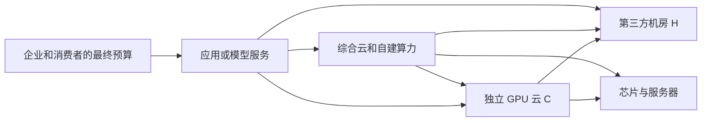

# AI云算力外包和NeoCloud与AI数据中心运营商行业调研

研究截止：2026-10-10，美国洛杉矶当地日期。所有预测以该日可取得的公开信息为基础；2026 年尚未公布的季度和全年均为估计。财务金额默认美元，主模型收入用十亿美元（bn），资产模型用百万美元（m）。本报告研究经营机制与行业范围，不进行股票目标价排序。

## 核心判断：交付确定性有价格，扩张本身没有资本回报保证

本行业正在从“买到 GPU 就能出租”，转向同时出售计算性能、客户验收、指定日期交付和可融资合同。当前证据支持大型合格集群的结构性紧张，也支持成熟 GPU、零散时段和部分短租市场的竞争压价。不能把其中一端当作全行业供需状态：截至 10 月 10 日，Ornn 的 H100 SXM 短租成交指数为 2.67 美元/GPU小时，30 天下降 6%；H200、B200 的同平台指数分别上涨 19.9%、9.3%。与此同时，Nebius 披露第二季度新签大单年合同额为每 MW 2,000万—2,500万美元，但这属于特定合同、代际与交付条件。[Ornn H100](https://data.ornn.com/markets/h100-sxm)、[H200](https://data.ornn.com/markets/h200)、[B200](https://data.ornn.com/markets/b200)、[Nebius Q2股东信，2026-08-12，第3—4页](https://assets.nebius.com/assets/a6ecfd85-a6cb-4967-8ef7-9a25bd261f9c/SHLQ226.pdf)。

收入增长有坚实的合同和经营基数，利润兑现仍有明显条件。CoreWeave 2026Q2 收入 25.75 亿美元、调整后 EBITDA 率 59%，但调整后营业利润率只有 5%，净利息费用 6.40 亿美元；Nebius 同季 AI 云调整后 EBITDA 率约 50%，集团仍有营业亏损。算力供给增加需要先购买短寿命设备、支付建设和租赁成本，现金收款又可能受到预付款推动。以毛利或 EBITDA 推断最终股东回报，会漏掉本行业最大的成本。[CoreWeave Q2财报，2026-08-11](https://investors.coreweave.com/news/news-details/2026/CoreWeave-Reports-Strong-Second-Quarter-2026-Results/default.aspx)、[Nebius Q2财报，2026-08-12](https://assets.nebius.com/assets/72a8c258-bbb7-4df7-ab9d-8698f6cb88fc/PR.pdf)。

本报告分别估计两个不能相加的供应商收入池。C 是独立专业 GPU 云服务的一次销售收入；H1 是可识别的专用 AI 园区和矿场改造机房的基础租金。传统运营商中 AI 可归属的 H2 另作低可信度扩展测算，不把公司全部收入算成 AI。2026 年 C 的工作区间为 **200亿—340亿美元**，代表点 252 亿美元；这不是已观测的全球总量或统计置信区间。2027 年 C 基准条件范围约 **477亿—854亿美元**，2028 年约 **728亿—1,359亿美元**。基准代表点为 643 亿、1,015 亿美元。H1 基准代表点分别为 65 亿、119 亿美元，明显小于包含 GPU 的计算服务收入。未披露私营云收入、国内地方智算、传统机房的 AI 归属等缺口限制了总量精度，详见附录 A、B。

价值分配可能比总需求方向更早改变。AWS 的 Trainium、Google 的 TPU、客户自研芯片和开源推理优化，都可能减少独立 GPU 云每单位任务的收入；但只要工作量与付费需求增长足够，机房、电力接入和系统服务仍可能受益。更深一层的变化是信用与技术路线绑定：NVIDIA 的 2026-08-26 10-Q 披露，PORTS-Pike 初始约 4.25GW IT 租赁相关担保上限为 **1,050 亿美元**，园区原则上专用 NVIDIA 算力。这个数字是有条件的最大信用敞口，既不是已经支出的现金，也不是新的终端客户收入。[NVIDIA 10-Q，担保及AI云协议注释](https://www.sec.gov/Archives/edgar/data/1045810/000104581026000075/nvda-20260726.htm)。

最强反面解释是：目前增长主要由少数客户的预采购、融资和供应商信用支持推动，尚未证明未来付费利用率和续约价格可以覆盖全周期资本成本。反对这一解释的证据是已有收入、真实客户使用与多代设备续约；支持它的证据是客户集中、交付条件、未建容量、资本开支远超经营收款，以及 ASIC 路线已经获得大型采购承诺。现阶段更有依据的判断是 **2027 年计算与机房交付继续放量，2028 年开始更明显地按客户、合同和资产批次分化**。增长不能消除再投资风险，技术替代也不能直接证明需求崩溃。

## 一、边界从客户付款和资产责任划分

“NeoCloud”不是会计分类。这里指以专业 AI 计算为主要产品、独立于综合超大云平台的供应商，包括 GPU 所有者、专业云平台以及具有计算服务责任的垂直整合企业。只开发机房、收基础租金的企业属于 H；只做服务器制造、机电施工、电力出售、模型 API 或应用订阅的企业属于相邻层。IREN、Crusoe、Applied Digital 等横跨数层，必须拆业务，不能按公司名称整体计入一个市场。

| 收入池 | 客户买什么、经济单位 | 纳入与排除 | 可加关系与统计边界 |
|---|---|---|---|
| C1：专用、预留和承诺 GPU 云 | 连续集群、可用 GPU小时、合格集群月；客户即使没有满负荷使用，也可能购买容量保证 | 纳入首次出售的计算、必要网络存储和集群服务；排除硬件转售、施工和重复转售同一份算力 | 与 C2 可加；以北美、欧洲头部供应商及可约束私营企业的全球经营为主，不声称覆盖所有地方智算 |
| C2：弹性与托管计算 | 按小时、实际推理工作量、满足延迟和质量要求的成功请求 | 纳入计算服务；API 捆绑模型许可、搜索和软件时，只计可识别计算部分 | 平台内部把同一 GPU 从训练调到推理，只改变组合，不产生两份需求 |
| H1：专用 AI 园区及改造机房 | 已交付、符合冷却和可靠性要求的关键 IT MW月，基础租金 | 纳入出租给云或模型客户的机房；排除 GPU、电费转付、租户装修及 EPC 收入 | 与 H2 可加；自建自用机房没有外部租金，不在 H 中虚构收入 |
| H2：传统运营商的 AI 可归属部分 | 同样按 IT MW月或租赁收入归属 | Digital Realty、QTS、Vantage、亚洲运营商中可归属 AI 的部分；共享机房难以审计归属 | 数据弱于 H1，条件测算单列，不冒充精确全球统计 |
| X：综合云、模型和应用 | Azure/AWS/GCP/OCI 自有计算、TPU/Trainium、模型 API、业务任务 | 本专题研究其采购、替代与议价作用，不将其全部收入纳入 C | X 可以采购 C，C 可以采购 H；三层收入不能作为独立终端需求相加 |

同一企业支付模型 API 费用，可能依次形成模型公司、综合云、NeoCloud 和机房收入。它们都有研究价值，但合计收入不等于新增最终需求；增加值还要扣除购买的中间服务。NVIDIA 与云公司的交叉投资、预付款和备用采购进一步增加了重复计算风险。本报告没有形成“C+H+芯片销售”的终端总市场。

客户任务决定采购标准。前沿训练由研究团队使用，采购及融资团队承诺预算，验收看大规模网络、失败恢复、训练收敛和可用性；训练延误的机会成本可能远大于 GPU 租金折扣。生产推理由业务及平台团队使用，验收看首 Token 延迟、逐 Token 延迟、成功请求、吞吐与稳定性；低价却达不到服务标准的 GPU小时没有同等价值。企业小规模试验更重视可退出、数据边界、运维简便和现有采购关系。机房租户则验收电力、冷却、冗余、网络和合同交付条件，并承担 GPU 空转、融资和错过窗口的损失。

预算来源也不同：模型训练和新推理产品可能属于新增支出；把原本自建 GPU 租给 NeoCloud 属于资产责任转移；由 CPU、已有云或内部 IT 转入 GPU 属于预算替代；超大云采购 NeoCloud 是补充自己交付能力，不能再算一份完全独立的最终需求。预付款是资金时点变化，股权投资是融资，两者都不自动证明产品已产生现金利润。

## 二、先固定现实基数：收入、ARR、合同和电力不是同一层事实

### 2.1 可比较的 GPU 云经营数据

| 企业与期间 | 已披露收入 | 未来指标及其性质 | 不能据此直接得出的结论 |
|---|---:|---|---|
| CoreWeave，2026-04-01至06-30 | 25.75亿美元；上半年46.53亿美元 | 2026全年收入指引124亿—132亿美元；年末 ARR 指引185亿—195亿美元，按末月收入×12 | 年末 ARR 不能作为全年收入；全年指引仍未兑现 |
| Nebius AI云，同一季度 | 5.749亿美元；集团5.823亿美元 | 6月AI云ARR30亿美元；此前全年收入指引30亿—34亿美元、ARR70亿—90亿美元，Q2重申财务指引 | 集团含其他业务；新大单多数主要贡献2027收入 |
| IREN AI云，同一季度 | 7,050万美元；2026-01至06合计1.041亿美元 | 8月26日运营ARR10亿美元，2026年容量的已签合同ARR40亿美元，目标年末投运 | 其ARR按合约GPU小时价×8,760等计算，**不是末月GAAP收入×12** |
| 三家，同一2026Q2 | **32.204亿美元直接加总** | 是公开样本季度收入，不是全行业、不作机械年化 | 不包含大量私营供应商，也不意味着全年只有128.8亿美元 |

来源分别为 [CoreWeave Q2财报](https://investors.coreweave.com/news/news-details/2026/CoreWeave-Reports-Strong-Second-Quarter-2026-Results/default.aspx)、[Q2展望第3页](https://s205.q4cdn.com/133937190/files/doc_financials/2026/q2/CoreWeave-Q2-26-Earnings-Outlook-Presentation.pdf)（2026-08-11）；[Nebius Q2股东信](https://assets.nebius.com/assets/a6ecfd85-a6cb-4967-8ef7-9a25bd261f9c/SHLQ226.pdf)及[Q1股东信第2页](https://assets.nebius.com/assets/6aba98d1-946c-4891-a420-d2f0aa60da95/Nebius%20SHL_Q1%202026.pdf)（08-12、05-13）；[IREN FY26结果及ARR脚注1—2](https://iren.gcs-web.com/news-releases/news-release-details/iren-reports-fy26-results)（08-27，财政年度结束于06-30）。

CoreWeave 截至 6 月 30 日剩余履约义务 RPO 为 1,037 亿美元，约 41% 预计在其后 24 个月确认，即直接计算约 425 亿美元；这是从 **2026-07-01至2028-06-30** 的预期确认窗口，不是 2027 年收入指引，也不是无条件到账。其约 1,040 亿美元 backlog 还包括对其他承诺合同收入的估计；不能与 RPO 相加。公司披露的早期 Q3 新增承诺超过 250 亿美元，也不能直接加成截止 10 月 10 日的净余额，因为期间已有履约。Q2 98% 收入来自承诺合同，客户 A/B/C 分别占 36%/26%/10%；公开字母客户不在本报告中擅自映射为具体公司。[CoreWeave 2026Q2 10-Q，收入、客户集中及RPO注释，2026-08-11](https://www.sec.gov/Archives/edgar/data/1769628/000176962826000366/crwv-20260630.htm)。

### 2.2 机房增长要先剥离装修、硬件、电费和其他业务

| 企业；公开日；经济期间 | 已披露的相关指标 | 正确的经营含义 |
|---|---|---|
| Applied Digital；2026-10-07；FY27Q1，06—08月 | HPC收入2.626亿美元，其中基础租金6,580万美元、租户装修1.835亿美元、成本回收1,330万美元 | 约70%的HPC收入来自装修，持续租金只占约25%；不能用2.626亿美元代表稳定季度AI租金 |
| Core Scientific；07-28；04—06月 | 托管收入1.367亿美元；6月底计费容量395MW | 托管收入仍需检查转付和服务边界；其比特币收入不属于AI机房市场 |
| TeraWulf；08-05；04—06月 | HPC租金3,190万美元；6月底产生收入的容量81MW，7月初102MW | 已签租约839MW不等于839MW都在收租；已出售的Abernathy JV权益不继续算自有现行供给 |
| VNET；08-18；04—06月 | 批发收入人民币11.0亿元；在役批发容量1,007MW，客户使用744MW | 包含一般云，不能把11亿元或744MW全部贴上AI标签 |
| GDS；08-13；04—06月 | 收入人民币30.880亿元；使用面积占可运营面积79.2% | 以平方米披露的资产不能用未核实的机架功率直接换成MW；DayOne权益收益不是中国机房经营收入 |

来源：[Applied Digital FY27Q1](https://ir.applieddigital.com/news-events/press-releases/detail/163/applied-digital-reports-fiscal-first-quarter-2027-results)、[Core Scientific Q2](https://investors.corescientific.com/news-events/press-releases/detail/139/core-scientific-announces-second-quarter-2026-results)、[TeraWulf Q2](https://investors.terawulf.com/news-events/press-releases/detail/144/terawulf-reports-second-quarter-2026-results)、[VNET Q2](https://ir.vnet.com/news-releases/news-release-details/vnet-reports-unaudited-second-quarter-2026-financial-results)、[GDS Q2](https://investors.gds-services.com/zh-hant/node/12756)。人民币保持原值，没有把未经统一换汇的收入并入美元市场池；各财政季度也没有强行合并。

传统运营商的 AI 收入归属是一个真实缺口。Digital Realty 6 月底披露约 3GW 在役 IT 容量、约 9GW 未来开发能力，后者包括土地、空壳与在建资产；Q2 新租赁的年化 GAAP 租金按项目100%份额为3.07亿美元，按公司份额约2.08亿美元，且包含互联和一般托管。它提供了重要物理及需求锚点，但没有给出可直接使用的全公司 AI 分部收入。[Digital Realty 2026-07-23 Q2材料第3—9页](https://www.sec.gov/Archives/edgar/data/1297996/000110465926086270/dlr-20260723xex99d2.htm)。

## 三、需求从客户预算与任务展开，不从供应商建设规模反推

### 3.1 谁能持续支付

大型综合云有内部业务现金流和交付责任，通常比未盈利模型创业企业更容易提供可融资信用。Microsoft 2026-07-29 披露，FY26Q4（4—6月）资本开支410亿美元、其中约三分之二为 CPU/GPU 等短寿命资产；现金购买物业设备358亿美元，经营现金流554亿美元。管理层同时表示需求仍超过可供容量。FY26 Azure 收入超过1,000亿美元、付费 Microsoft 365 Copilot 席位3,000万，支持商业采用已形成预算，但这两项都不能直接当成独立 GPU 云收入。[Microsoft FY26Q4电话会](https://www.microsoft.com/en-us/investor/events/fy-2026/earnings-fy-2026-q4)。

前沿模型公司同时依赖产品收入与融资。Anthropic 2026-05-28 披露650亿美元新融资，称5月初收入运行率超过470亿美元；运行率不是全年确认收入，融资也不是经营收入。它既增强未来支付能力，也说明从终端收款到基础设施支出的资金桥梁仍有资本市场部分。[Anthropic Series H公告](https://www.anthropic.com/news/series-h)。客户采购是否可持续，需要看真实付费留存、推理服务成本、训练预算、债务与预付款，而不能只看用户数量或估值。

企业端会同时采用综合云、模型 API、独立专业云和本地模型。NeoCloud 要拿到预算，通常需要在交付速度、特定集群性能、数据位置、总体成本或服务责任上超过企业已有云关系。对小规模应用，调用模型 API 可能比管理 GPU 更合算；对持续、高负载、可优化的推理，专用算力更可能进入。泛化的“所有企业都会租 GPU”不是有效需求模型。

### 3.2 合同显示了客户愿意买什么，也显示了购买的条件

| 采购证据 | 保留的披露原值 | 需求侧使用方法及限制 |
|---|---|---|
| Microsoft—Nebius，2025-09-08 6-K | 分批2025—2026交付，每批五年；至2031约174亿美元，增购后可至194亿美元 | 174÷5=34.8亿美元是满服务期算术均值，不是指定自然年收入；延迟交付并不能提供替代容量时可终止相应服务 |
| Meta—Nebius，2026-03-16 | 五年专用容量120亿美元，另对部分剩余可用容量提供最高150亿美元购买安排 | 最高270亿美元有两种经济责任；剩余容量被其他客户买走时，不能再加一遍Meta支付 |
| Microsoft—Nscale，2025-10-15 | 约20万GB300 GPU，跨四国；美国约10.4万GPU、约240MW园区容量分阶段交付 | 是设备数量及未来安排，未核验全部已交付；英国等时点不同，不能把20万GPU全年满租提前计入2026 |
| Microsoft—Lambda，2025-11-03 | 多年、数十亿美元，数万NVIDIA GPU | 足以证明采购类型和数量级；金额、确认曲线未披露，本报告不补成精确合同总额 |
| Anthropic—Fluidstack，2025-11-12 | Anthropic称500亿美元美国计算基础设施投资；Fluidstack称500亿美元deal | 买方“总投资”与供应商“交易”表述不能直接证明都是Fluidstack可确认云收入；GPU归属、施工、租赁和服务需拆分 |

原始证据：[Nebius Microsoft 6-K第2页](https://assets.nebius.com/assets/86625727-9e66-46c1-af79-c27d57434e3c/25-25580-1_Nebius%20Group%20N.V._6-K.pdf)、[Nebius Meta公告](https://nebius.com/newsroom/nebius-signs-new-ai-infrastructure-agreement-with-meta)、[Nscale公告](https://www.nscale.com/press-releases/nscale-microsoft-2025)、[Lambda公告](https://lambda.ai/blog/lambda-announces-multibillion-dollar-agreement-with-microsoft-to-deploy-ai-infrastructure-powered-by-tens-of-thousands-of-nvidia-gpus)、[Anthropic公告](https://www.anthropic.com/news/anthropic-invests-50-billion-in-american-ai-infrastructure)、[Fluidstack公告](https://fluidstack.io/news/fluidstack-selected-by-anthropic-to-deliver-custom-data-centers-in-the-us)。双方转述同一交易不作为两次独立确认。

需求估计先用买方已签购买责任、持续付费任务和资金能力形成金额条件，再用价格转成可计费容量。比如20万GPU若全部满足交付条件、每GPU小时净价5—7美元、全年付费预留，服务年金额约88亿—123亿美元；这是 **交付完成后的条件上界桥梁**，不是Nscale公告金额、2026收入或实际利用率。将交付比例降到一半，就只有约44亿—61亿美元。与Nebius约35亿美元五年均值、Lambda未披露大单、IREN已签容量和CoreWeave履约窗口结合，说明2027—2028买方愿意外购的核心池达到数百亿美元有基础，却不能保证全部兑现。

本报告需求侧采用下列预算范围。它们是将上述合同在不同履约曲线下配置到自然年、加入其他客户续购与任务预算的研究假设，**不是客户正式指引或终端AI收入预测**；表中包括付费预留，不能等同实际GPU电气负载。进入 C 的是首次计算销售，超大云或模型客户的再销售不重复计算。

为使预算判断可审查，2027基准的非重复采购桥梁采用如下参数。这里按供应商合同标识汇总买方购买责任，**不使用该供应商的工程MW计划**；平台/模型分类无法精确追溯的匿名买方不被强行命名。

| 2027基准预算桥梁 | 参数、公式与范围，bn | 可识别处及缺口 |
|---|---|---|
| CoreWeave原有RPO窗口 | 103.7×41%×40%—65%=17.0—27.6，取约17—28 | 40%—65%是其24个月窗口分配到2027的研究比例，非公司指引；其他部分落在2026H2与2028H1 |
| Nebius Microsoft | 17.4÷5×约86%—115%=3—4 | 分批起始且自然年服务范围不同，比例承载爬坡及合同年分布，不使用19.4增购上限 |
| Nebius Meta专用部分 | 12÷5×约83%—100%=2.0—2.4 | 2027启动的专用容量按分批交付配置，先不假设首年超过满期算术均值；150亿美元备用部分不叠加 |
| Nscale Microsoft | 200,000×8,760×5—7美元×60%—90%交付/服务权重≈5.3—11.0 | GPU数来自公告，5—7美元净价和服务权重是假设；不是确认已交付量 |
| IREN已签2026容量 | 4bn合同ARR×65%—95%=2.6—3.8 | 以买方支付承诺为起点，验收与确认时滞另留；不视作实际2026全年收入 |
| Lambda大额及稳定采购 | 1—3 | 多年数十亿美元、数万GPU给数量级；无财务曲线，是条件参数 |
| 上述合同锚点小计 | 约31—53 | 覆盖缺口存在，不是市场总量；合同总价与年度流量保持区分 |
| 截至日已知新签、未进入上述窗口的CoreWeave/Nebius采购 | 约5—11 | CoreWeave早期Q3超过25bn新增承诺的年度分配假设3—7；Nebius四项平均TCV超过1bn、中期1—3年采购年度配置约2—4；不能全部当成2027收入 |
| 其他专业云、已续购任务及弹性服务 | 约12—21 | 从2026私人经营、既有服务、买方新任务和C2付费时间扩展；缺审计收入，是基准范围中最弱的增量 |
| 基准需求金额工作范围 | 约48—85 | 因四舍五入与范围配对，和精细供应交叉后的47.7—85.4不同；这两个结果未强制相等 |

2028没有完整可识别的全客户合同曲线。基准预算以综合云外购增长但不全部追随其CapEx、模型客户继续采用但ASIC分走相容任务、企业付费迁移为条件，采用下表41—77、26—46、6—13bn三个子预算。相对2027基准，对应的下端/上端预算变化分别约52%/71%、63%/48%、20%/44%，仅用于说明采用假设的数量级；它们不是统计增长率区间，也不对所有客户使用相同倍率。若未列大客户新合同和私营真实计费不能支持该增量，应下调需求D而不是因既有供给已建成而维持预测。

| 年度及机制 | 综合云/大型平台外购C预算，bn | AI模型及研究客户，bn | 企业与其他付费任务，bn | 合计潜在采购预算，bn |
|---|---:|---:|---:|---:|
| 2026工作范围 | 11—17 | 6—12 | 3—5 | 20—34 |
| 2027悲观：延迟、预算筛选、部分取消 | 17—29 | 9—19 | 3—6 | 29—54 |
| 2027基准：已签合同逐步交付，续购分化 | 27—45 | 16—31 | 5—9 | 48—85 |
| 2027乐观：训练与生产推理采购一起加速 | 44—76 | 28—49 | 10—17 | 82—142 |
| 2028悲观：成熟GPU降价、资金收紧和内化 | 13—27 | 6—17 | 2—5 | 21—49 |
| 2028基准：付费采用增长，ASIC分走部分任务 | 41—77 | 26—46 | 6—13 | 73—136 |
| 2028乐观：新任务与海外交付推动外购扩张 | 70—120 | 45—80 | 13—25 | 128—225 |

这些宽区间不是从供应 GW 乘价格倒推买方必然花费。对大型平台，主要约束是现有合同交付曲线、自建和 ASIC 替代速度；对模型客户，是收入兑现与融资余额；企业小任务则看专用负载比例和采购迁移。分类归属不完整，尤其匿名大客户，故不据此声称平台、模型客户的精确份额。潜在预算也可能因买方转向自建或改签其他供应商而不能转成 C 的收入。

## 四、技术进步先改变合格工作量，再改变收入和资本效率

### 4.1 三类工作负载不能使用同一种GPU小时价格

| 任务 | 客户真正支付的产出 | 技术变化的经济作用 | 有效供给的必要条件 |
|---|---|---|---|
| 大规模训练、强化学习与后训练 | 如期完成的实验、有效训练步、可恢复的任务 | 网络拥塞、检查点、节点故障和调度改善，可以减少失败重跑和等待；更快GPU只有系统均衡时有同等收益 | 连续拓扑、互联、存储、运维、长时稳定性和客户验收 |
| 高吞吐生产推理 | 质量不降、满足延迟约束的成功请求/Token | 量化、缓存、批处理、MoE和分离调度提高单卡工作量；可能减少每任务GPU采购 | 模型适配、足够并发、可靠性、区域延迟及安全治理 |
| 低并发、主权和本地推理 | 单个用户或业务的可用响应 | 本地CPU+GPU、较小开放模型可能把部分租云预算移走；需要把人员与能耗算入成本 | 小规模部署能达到SLO，数据和运维要求可满足 |

DistServe 的 OSDI 2024 原始研究将 prefill/decode 分离，目标是在首 Token 与逐 Token 延迟限制下优化有效吞吐。其意义是“峰值 Token/s”与客户可购买服务不同，不把论文特定加速倍数外推为2026全行业降本比例。OSDI 2026 的低并发 MoE 研究则说明在特定模型与服务约束下，CPU加消费级GPU可承担部分任务；它不能替代高并发集群或前沿训练。[DistServe原论文与会议材料](https://www.usenix.org/conference/osdi24/presentation/zhong-yinmin)、[OSDI 2026研究](https://www.usenix.org/conference/osdi26/presentation/wang-wenxin)。

新代路线处于不同阶段。CoreWeave 宣布完成 Rubin NVL72 bring-up 和验证；Nebius 的 MLPerf Inference 6.1 中 Rubin 系统是 Preview。这些是工程及基准进展，不能当作全客户已验收的量产舰队，也不能用不同GPU数量、模型和功耗的结果直接证明TCO。[CoreWeave Q2技术进展](https://investors.coreweave.com/news/news-details/2026/CoreWeave-Reports-Strong-Second-Quarter-2026-Results/default.aspx)、[Nebius MLPerf结果，2026-09-16](https://nebius.com/blog/posts/mlperf-inference-v6-1-results)。

### 4.2 效率扩张能否带来收入增长，有一个可检验的门槛

NVIDIA 与 Lambda 2026-09-15 案例中，固定129kW机架功率预算下从16节点增加至19节点，GPT-OSS-120B 工作负载吞吐从404万增至500万Token/s。直接计算吞吐增加23.8%，节点数量增加18.75%；若节点价格相同，设备资本/吞吐只下降约4.1%，**不是总成本下降23.8%**。若充分卖出新增Token、单位Token净价下降19.2%，则Token收入恰好持平；若客户并不需要额外吞吐，效果体现为提前购买设备的回报变化而非收入增加。[NVIDIA DSX生产案例](https://blogs.nvidia.com/blog/from-megawatts-to-tokens-how-nvidia-maximizes-ai-factory-production/)、[Lambda原始案例](https://www.nvidia.com/en-us/case-studies/lambda/)。

更一般地，计算收入增长约等于“成功付费任务量增长×每任务所需计算下降后的单价变化”，还受软件附加费和预留容量影响。工作量增长50%、每任务GPU时间下降40%、GPU小时净价下降10%，则GPU计费收入变为1.5×0.6×0.9=0.81，即下降19%；若任务量翻三倍，相同效率和价格条件下则增长62%。这些是机制示例，不是需求预测。Token增长不等于GPU时间增长，更不等于C收入增长。

共享缓存、推测解码、模型路由和动态批处理，可以减少计算或转向便宜设备；训练、推理及强化学习共用平台又可以填补闲置时段。能把多类任务调度到同一资产的供应商可能提高付费利用率，但客户如果控制调度、采用可迁移的软件，节省会更多流向买方。CoreWeave SUNK/Mission Control 与 Nebius 推理产品说明竞争正进入操作系统、可靠性和工作负载层，尚不足以证明这些功能具有独立的高利润软件收入。[CoreWeave SUNK说明，2026-03-04](https://www.coreweave.com/resources/solution-briefs/sunk-a-unified-system-for-production-grade-ai-training)、[Nebius Q2产品及业务更新](https://assets.nebius.com/assets/a6ecfd85-a6cb-4967-8ef7-9a25bd261f9c/SHLQ226.pdf)。

### 4.3 自研ASIC已经进入采购，经济兑现仍需逐层验证

Anthropic 2026-04-20 原始公告明确承诺未来十年在 AWS 技术上花费超过1,000亿美元，容量最高5GW，并称当时已经使用超过100万枚Trainium2芯片；近1GW Trainium2/3容量在2026年底前上线仍是目标。AWS 与 OpenAI 2026-02-27 宣布将已有380亿美元多年协议再扩大1,000亿美元、为期八年，并包含2GW Trainium容量安排。它们证明替代路线已有真实客户采购基础，不证明全部未来容量已经投运。[Anthropic—Amazon公告](https://www.anthropic.com/news/anthropic-amazon-compute)、[AWS—OpenAI公告](https://press.aboutamazon.com/2026/2/openai-and-amazon-announce-strategic-partnership)。

Google 的2026Q2材料介绍面向训练/推理的TPU8t/8i及框架支持；OpenAI 在8月展示自研推理芯片的早期实测，9月仍把年末部署写作计划。采用阶段需要经过编译与模型适配、工程可靠性、客户任务性能、付费部署、规模交付及现金节省。不能把计划自研、单模型基准和已商业化Trainium采购归为同一成熟度。[Google Q2 CEO材料，07-29](https://blog.google/company-news/inside-google/message-ceo/alphabet-earnings-q2-2026/)、[OpenAI技术说明，08-25](https://openai.com/index/the-full-stack-behind-abundant-intelligence/)、[OpenAI部署计划，09-08](https://openai.com/index/the-work-now-within-reach/)。

对 C 的风险在于客户把稳定、高规模任务迁往自有或综合云ASIC，留下难调度、变化大或峰值需求的GPU负载；对 H，芯片替代未必减少机房面积和IT功率，取决于总任务增长与每任务能耗。对芯片供应商，先进技术、软件及融资捆绑可能提高替代难度。本报告没有给出缺少可比实测的“ASIC将替代GPU百分之多少”伪精确结论。

### 4.4 中国和主权算力：有需求证据，不能并入同一个美欧租价模型

Alibaba 2026-08-20披露，截至6月30日季度，合并原云业务及T-Head后的“AI Cloud and Compute Services”收入人民币484.37亿元，其中披露的AI相关产品收入人民币123.76亿元。直接计算约25.6%属于该AI相关口径，**部门名称含AI不意味着全部收入都是AI算力**；该口径还包含产品和服务，不能作为独立GPU云C收入。公司称自研Zhenwu芯片经云服务的外部客户超过650家，支持本地软硬件替代已进入商业采用，但缺少可比部署容量和GPU总体成本。新部门上年数据已重述，本报告不把组织范围变化写成额外终端需求。[Alibaba六月季度原始财报，2026-08-20，第2—3、6—8页](https://www.sec.gov/Archives/edgar/data/1577552/000110465926099220/tm2623667d1_ex99-1.htm)。

同份财报还显示，AI Labs and Applications季度调整后EBITA亏损人民币138.61亿元，包含AI能力投入和Qwen应用推理成本。云服务增长与下游应用现金回报不充分可以同时存在；这并不证明AI需求虚假，却要求区分云客户采购预算、消费者支付与集团内部转移。中国智算的综合云、芯片适配、政企数据边界及自建需求，与本报告C专业云覆盖池不完全重合，故不以全球美元GPU指数外推全部本地需求和利润。

G42是另一类重要非上市参与者：2025-05-22的原始安排是5GW UAE–US园区中的1GW Stargate集群，由G42建设、OpenAI和Oracle运营，首200MW计划2026上线。主权和跨国合作可能支付本地化、数据治理与基础设施任务，而非只按最低GPU小时价采购；开发方、运行方与客户预算仍须分开。截至本研究未取得足以确认该首期全部投运及收入的原始证据，因此不按计划把1GW或5GW提前计入有效供给。[G42原始公告](https://www.g42.ai/resources/news/global-tech-alliance-launches-stargate-uae)、[OpenAI原始公告](https://openai.com/index/introducing-stargate-uae/)。两者为同一项目的双方披露，不是两份可相加的建设量。

## 五、有效供给按交付链形成：GW公告只是第一步

把供给分成土地或供电规划、可执行接入与融资、机房机电完成、GPU/网络部署、系统资格、客户验收、产生计费七个节点，更接近经济现实。矿场拥有电力和土地不等于拥有满足AI训练的冗余、液冷、网络、承重和运维；出售矿机或进行减值，也不能用来证明转换项目马上盈利。短缺可能发生于任意节点，客户付款或融资也可能成为决定性约束。

### 5.1 项目锚点及其真实状态

| 供应商/项目；证据公开日 | 可观察状态 | 尚待兑现的承诺或目标 | 模型处理 |
|---|---|---|---|
| CoreWeave；08-11、08-11电话会 | 6月底active power 1.5GW；Q2新增近500MW，其中超过300MW在6月 | 6月底contracted 3.7GW，8月电话会4.2GW；另有选择权等不在其内 | active与contracted分开；末月投运不计为全年满产 |
| Nebius；08-12 | 已运营云业务有收入与ARR；Q2新合同多数对应尚未建成容量 | 年末contracted power目标5GW；2027开始每年部署超过1GW的计划 | 土地/电力承诺不等于已装GPU；合作方自有硬件另识别收入责任 |
| IREN Horizon；08-27 | 8月向Microsoft交付第一座50MW IT设施 | 其余三座50MW目标Q4；累计IT交付2026约0.3GW、2027约0.8GW | >5GW开发管线不作当前供给；先计50MW已交付，再按验收爬坡 |
| Applied Digital；10-07 | 10月1日新增75MW ready-for-service，总计250MW | 五个园区合计1.41GW已出租；年末北达科他交付300MW目标 | CoreWeave租用的园区在H中计一次，不在其C物理供给再增加一次园区GW |
| Core Scientific；07-28 | 6月底395MW计费，7月中超过430MW | CoreWeave590MW完成目标2027年初；AMD530MW合约与未来安排 | 约1.1GW租约和更大合作上限区分；不将全部AMD合作潜力计入已租供给 |
| TeraWulf；08-05 | 6月底81MW产生租金 | Lake Mariner438MW合同；Anthropic401MW IT目标2027下半年至2028初 | 两组项目不同；20年合同仍需 construction→租金确认 |
| Galaxy Helios；08月Q2材料 | Q2交付133MW IT给CoreWeave | 第二期260MW目标2027Q2收租；第三期133MW目标2028 | 已租526MW IT与园区800MW gross不可互换 |
| Hut 8 River Bend；2025-12-17 | 签约245MW IT、15年租约 | 首座机房目标2027Q2，后续2027；融资条款有条件 | 不把合同金额或融资预期当作已经施工完成 |
| Crusoe Abilene Microsoft；2026-03-27 | 相邻新园区开始准备工作 | 900MW能源规划、两栋各336MW critical IT，首栋目标2027年中通电 | 合计672MW IT独立于旧园区；现场能源900MW不是全部可出租IT |
| SB Energy PORTS-Pike；08-17 | OpenAI已签未来容量安排，信用支持覆盖初始约4.25GW IT | 全园区约8GW IT，先期800MW目标2028；后续需新发电和输电 | 2027供给为零；2028只对首期给条件权重，不提前纳入8GW |

证据：[CoreWeave Q2电话会](https://s205.q4cdn.com/133937190/files/doc_financials/2026/q2/CRWV-US-CORRECTED-TRANSCRIPT-CoreWeave-Q2-2026-Earnings-Call-11August2026.pdf)、[Nebius Q2信](https://assets.nebius.com/assets/a6ecfd85-a6cb-4967-8ef7-9a25bd261f9c/SHLQ226.pdf)、[IREN FY26](https://iren.gcs-web.com/news-releases/news-release-details/iren-reports-fy26-results)、[Applied Digital FY27Q1](https://ir.applieddigital.com/news-events/press-releases/detail/163/applied-digital-reports-fiscal-first-quarter-2027-results)、[Core Scientific Q2](https://investors.corescientific.com/news-events/press-releases/detail/139/core-scientific-announces-second-quarter-2026-results)、[TeraWulf Q2](https://investors.terawulf.com/news-events/press-releases/detail/144/terawulf-reports-second-quarter-2026-results)、[Galaxy材料第16页](https://www.sec.gov/Archives/edgar/data/1859392/000185939226000084/exhibit992-q22026overvie.htm)、[Hut 8租约](https://www.hut8.com/news-insights/press-releases/hut-8-signs-15-year-245-mw-ai-data-center-lease-at-river-bend-campus-with-total-contract-value)、[Crusoe项目](https://www.crusoe.ai/resources/newsroom/crusoe-announces-new-900-mw-ai-factory-campus-in-abilene-texas-to-support-microsoft-ai-infrastructure)、[OpenAI PORTS-Pike原始说明](https://openai.com/index/openai-joins-ports-pike-project/)。表中公司报告的power定义仍有差异，没有把这些数值机械求和成一个合格GPU容量。

供给模型独立采用开年已装或可出租容量、年内新增、平均服务月份和验收折损（附录 B）。需求金额来自第三节的买方预算，供应来自这些项目的工程状态；两者没有用同一合同总额反向“证明平衡”。参数中的未披露私人GPU装机和H2的AI占比是明确假设，不能据此宣称已经测得全球供需缺口。

### 5.2 MW到GPU的转换必须承认代际和工程差异

NVIDIA DGX B200 技术文档给出8枚GPU、整机最大功率14.3kW。直接算术是约559GPU/ITMW，尚未留外部网络与存储余量；资产示例因此采用500枚/ITMW。最大功耗不是平均电耗，PUE不能把GPU最大TDP、关键IT功率和园区总接入重复相乘。Hopper、NVL72和Rubin的GPU密度、CPU/交换网络以及收入能力都不同，不能长期使用一个“MW对应多少GPU”的常数。[DGX B200官方用户指南，截止日读取](https://docs.nvidia.com/dgx/dgxb200-user-guide/introduction-to-dgxb200.html)。

本报告的年度 IT GW 是经工程配置归一的量纲，**不是各公司gross、connected、active、billing power相加**。C 模型从2026约2.15GW平均专用装机及0.26GW弹性装机的条件起点出发；约2.02GW专用和0.24GW弹性经资格调整后可交付，实际付费等效量1.90和0.15GW年。2027基准具备约3.98GW年专用合格供给，对应需求3.10；2028约6.56，对应4.60。总量出现空余不排除新代、特定地区、指定交付月份及超大连续集群短缺，也不保证空余资产都能转售。

### 5.3 电力成本与电力接入不是同一种约束

一个100MW IT、PUE1.25的满负载设施，电价0.065美元/kWh时年电费约7,118万美元；电价增加0.02美元，年电费增加约2,190万美元。相对于每MW年1,200万—2,500万美元的计算收入能力，电费通常小于设备、融资及折旧的重要性；但没有接入，所有其他资产都不能产生正常收入。这解释了为何电力稀缺价值主要体现于**可交付日期和许可确定性**，而非单纯几分钱/kWh。

现场发电和电网灵活性可以改变路径，却要支付新的成本。Vantage 与 Liberty 2026-01-05 公告约定未来五年最高1GW供电安排，包含2027年400MW发电容量预留，不是已投运1GW。PORTS-Pike 首期利用已有电网、后期需要新发电与输电，显示分期条件不同。调度降功率试验则需要证明客户任务损失、恢复、备用及补偿后的净收益，不能把一次数小时削峰写成永久新增GW。[Vantage—Liberty原始公告](https://vantage-dc.com/news/vantage-data-centers-and-liberty-energy-announce-strategic-partnership-to-develop-and-operate-one-gigawatt-of-power-solutions-for-next-generation-data-centers/)、[OpenAI项目条件](https://openai.com/index/openai-joins-ports-pike-project/)。

## 六、价格按同一产品、期限和责任比较

| 来源及观察日 | 产品、单位与价格 | 比较边界 |
|---|---|---|
| Ornn，2026-10-10美东16时日结 | H100 SXM80GB：2.67美元/GPU小时，30天-6%；H200：5.91，+19.9%；B200：7.53，+9.3%；A100 SXM4 80GB：0.95 | 提供方称基于实际短租成交、量加权和截尾；样本区域、节点配置及成交总体未完全公开 |
| Lambda，10-10读取 | 8GPU节点按每GPU小时：H100 SXM3.99、B200180GB6.69、A10080GB2.79美元 | 自助按需标价，CPU/RAM/存储配置不同；未实际下单验证库存、折扣或长期成交价 |
| Nebius，10-01起生效；10-10读取 | H100 HGX4.50、H2005.40、B2008.50、B3009.50美元/GPU小时；旧标价分别3.85、4.50、7.15、7.85 | 同一页面明确标价调整，H100+16.9%、H200+20%、B200+18.9%为直接计算；不证明所有旧合同重定价 |
| Nebius可中断spot，10-10读取 | H100/H200起价0.79，B200/B300起价0.99美元/GPU小时 | 起价、可中断、库存和服务责任不同；不能当作可立即获得的大训练集群价格 |
| Silicon Data，10-10观察 | H200标准化指数3.43美元/GPU小时 | 对平台、地域、租期、集群和网络作标准化；与Ornn5.91的样本不同，不能平均成“真实行业价” |

来源：[Ornn四类产品页](https://data.ornn.com/markets/h100-sxm)、[H200](https://data.ornn.com/markets/h200)、[B200](https://data.ornn.com/markets/b200)、[A100](https://data.ornn.com/markets/a100-sxm4)、[Ornn方法](https://data.ornn.com/methodology)、[Lambda价格](https://lambda.ai/pricing)、[Nebius价格及变更说明](https://nebius.com/prices)、[Silicon Data H200](https://www.silicondata.com/products/silicon-index/h200)。Ornn同时出租算力，有商业利益；其成交声明未获本研究独立审计。Silicon Data也有商业产品利益。不同口径不是互相独立地确认同一个价格。

短租和长约可以反向变动。长期承诺通常以折扣换取资本可融资性；急迫客户为几个月交付窗口付高价，不能把这个价格锁入六年回收模型。预付款还会改变价格的现值：两个相同名义GPU小时价格，先支付与按月支付的经济价值不同。早期合同可能到2028—2030才续约，成熟GPU短租下跌先影响弹性供给和残值，新代长期合同的收入并不会即刻全部重定价。

单位MW年收入上升也不全是同代涨价。更先进设备、高吞吐、稀缺交付窗口、网络存储捆绑和付费预留都会提高该指标。一个有用的反向检查是：CoreWeave Q2收入×4÷6月底1.5GW约为每MW年687万美元，远低于Nebius新单2,000万—2,500万美元。这**不是两家公司效率排名**，因为末期投运、报表确认、power定义、客户合同和GPU组合不同；它说明不能用最新大单ACV直接重估整个旧资产池。模型2026 C1代表收入密度采用1,200万美元/MW年，未来随着合同与代际组合变化至1,900万、2,039万美元，详见附录参数。

## 七、价值捕获由客户入口、信用、交付和资产更新共同决定

### 7.1 高现金利润率可以与低股东回报同时存在

CoreWeave Q2经营现金流6.79亿美元、现金购买物业设备64.22亿美元，直接相减为负57.43亿美元；上半年为36.63亿减141.17亿，即负104.54亿美元。这个相减数不是公司的正式自由现金流口径，未加入融资租赁等全部资本责任；Q2递延收入变动增加约7.90亿美元，也不能把收款全部解释成当季净经营利润。Nebius Q2经营现金流22.461亿美元，购置物业设备和无形资产56.574亿美元，直接相减负34.113亿美元；同期递延收入增加11.97亿美元。二者都说明客户预付是建设融资的重要部分。[CoreWeave现金流表](https://investors.coreweave.com/news/news-details/2026/CoreWeave-Reports-Strong-Second-Quarter-2026-Results/default.aspx)、[Nebius现金流表](https://assets.nebius.com/assets/72a8c258-bbb7-4df7-ab9d-8698f6cb88fc/PR.pdf)。

不同财报的毛利口径也不相同。CoreWeave 的技术基础设施费用含大量折旧，IREN 的AI云收入成本明确不含折旧和摊销，因此不能把收入减这条成本算成可比的最终经济毛利。Applied Digital 的租户装修可以带来大量收入、少量利润和营运资本占用；硬件转售同理。评估收入质量，应依次追到持续服务、计费资产、合同条款、运营成本、折旧和更新、利息、偿债及股权稀释。

GPU批次回收取决于前三年合同能否覆盖投资，以及续约、寿命和残值。CoreWeave 在8月电话会提及A100新合同延续至2029、价格“有吸引力”，没有披露价格；A100产品2020年推出也不代表该批资产安装于2020年。它支持旧代仍有需求，不能证明每一台GPU都有九年盈利寿命。会计折旧延长只改变利润时点；经济寿命必须由同一批资产的客户付费、成本与残值证明。[CoreWeave Q2官方托管电话会文字稿](https://s205.q4cdn.com/133937190/files/doc_financials/2026/q2/CRWV-US-CORRECTED-TRANSCRIPT-CoreWeave-Q2-2026-Earnings-Call-11August2026.pdf)。

### 7.2 信用支持是产品的一部分，也把风险集中到少数节点

| 安排 | 披露事实及日期 | 对价值分配的推断 |
|---|---|---|
| NVIDIA AI云服务协议 | 2026-07-26余额360亿美元，典型期限六年；随着第三方或NVIDIA使用容量而减少 | 有备用需求/容量保险功能，不是另一份360亿美元独立终端支出；供应商可获得融资确定性，芯片方承担市场风险 |
| NVIDIA—SB Energy—OpenAI | 08-26 10-Q：初始约4.25GW IT、担保上限1,050亿美元；08-17公告：NVIDIA投入SB Energy股权15亿美元，园区专用NVIDIA算力，2028起分期上线 | 信用条件可能锁定长期芯片路线；15亿美元股权、担保上限与租约收入不可相加。担保不是覆盖所有成本的无限保单 |
| Google—TeraWulf租约支持 | Q2 10-Q描述违约后可选择支付约定终止费或承接并支付租约责任，另有生效条件 | 卖方风险降低但未消失；必须查支持对象、封顶、开始日期和终止机制 |
| IREN GPU融资 | 08-27披露Microsoft对应36亿美元融资利率6%；非投资级客户一项24亿美元融资利率9% | 客户信用能改变资本成本三个百分点；它可能比小幅电费差异更重要 |
| CoreWeave融资 | 09月材料：Q2债务356亿美元、加权利率8.3%；某笔新可转债票息2.625% | 单笔低票息不等于全部资产资本成本下降至2.6%，还需股权、可转债及限制条款 |

来源：[NVIDIA 10-Q，2026-08-26](https://www.sec.gov/Archives/edgar/data/1045810/000104581026000075/nvda-20260726.htm)、[NVIDIA PORTS公告，08-17](https://nvidianews.nvidia.com/news/nvidia-guarantees-sb-energy-s-ports-pike-technology-campus-in-ohio-to-exclusively-host-nvidia-ai-compute)、[TeraWulf 10-Q，08-05](https://investors.terawulf.com/sec-filings/all-sec-filings/content/0001083301-26-000166/wulf-20260630.htm)、[IREN财报融资条款](https://iren.gcs-web.com/news-releases/news-release-details/iren-reports-fy26-results)、[CoreWeave 2026-09-17融资材料](https://www.sec.gov/Archives/edgar/data/1769628/000176962826000429/crwv2026convertpresentat.htm)。NVIDIA融资平台意向协议涉及的第三方资本目标也不是已承销、已拨付资金，不纳入有效供给。

原创推断是：行业进入了 **技术、信用与交付联合竞争**。如果更便宜的ASIC缺少可融资的客户合同，而GPU方案能获得信用支持，技术成本优势未必能立即转成市场份额；反之，综合云掌握客户现金流和自研芯片，可能把同样优势内化。判断最终价值归属需要比较完整资金与服务条件，不只比较峰值算力。可证伪证据是采用其他芯片的项目能以相同信用、杠杆、交付速度和服务标准稳定获得客户。

### 7.3 轻资产并不消除资产，只重新分配它

Nebius Q2提出合作方拥有土地、电力和硬件，平台负责软件、客户及服务的模式。若不承担利用率、最低回报或残值保证，平台可以以较少资本获取运营费用；若仍有兜底责任，则风险并未完全移出。还要查其是principal还是agent：净额平台费收入与原本全额云收入不可直接比较。到截止日，没有足够公开的合作机架量、费率、担保和成熟回报，不能把这个模式已实现的高ROIC写成事实。[Nebius Q2合作模型说明](https://assets.nebius.com/assets/a6ecfd85-a6cb-4967-8ef7-9a25bd261f9c/SHLQ226.pdf)。

一个额外突破分支是：到2028合作方实际交付0.5GW、年计算销售密度2,000万美元/MW、平台收5%—10%净服务费，则底层计算销售约100亿美元，净平台费约5亿—10亿美元。底层硬件资本按3,000万美元/MW约150亿美元，由合作方承担，平台还需软件及运营资本。这是**新增条件分支**，可以出现在基准或乐观需求路径中，不独立加到C一次销售收入；平台若净额确认，上市公司报告收入甚至可能降低。利润兑现要求合作方可持续融资、付费利用率、可迁移服务能力以及没有重大隐藏担保。

## 八、联合情景：放量、价格与利润的方向可以不同

### 8.1 模型单位与比较方法

年度模型按2026、2027、2028自然年运行。需求 D 用付费容量等效GW年表示：C1包含付费闲置预留，C2是实际计费时间换算，H是租金开始后的IT容量年；它们都不是实际平均电气负载。S 是年均工程供给GW，α 是资格与客户可交付折损；完整量纲为Q=min(D,αS×1年)，表中将年度合格能力简写为αS。R=Q×F，F以百万美元/ITMW年计价，GW年×F在单位换算后直接得到十亿美元期间收入；不同代际F和新代占比b分别建模。GWs之间并非完全可替代，模型只在相容产品池内作加总，不能用总量盈余证明某新代集群没有缺口。

现金经营余量 O=R−kS−vQ，k为单位平均在役容量的固定现金费用，v为单位计费容量的可变费用。C的设备折旧代理按各批**原投入成本**累积，以S×Kbar/L表示，Kbar与新增采购资本K分开，L=6年不是经济寿命保证。R−现金成本−S×Kbar/L只用于检验资本强度，**不是预测公司GAAP EBIT**。H给基础租金和物业现金NOI代理，融资及更新在资产模型中展开。新增资本 A×K不包括C自建机房和全部旧设备更新，因此仍是部分资本需求，不是完整行业CapEx。

### 8.2 规模结果及覆盖边界

| 自然年 | 情景/性质 | C条件范围，bn | C代表点 | H1范围，bn | H1代表点 | H2归属条件范围，bn | H2代表点 |
| --- | --- | --- | --- | --- | --- | --- | --- |
| 2026 | 当前估计 | 19.60—34.00 | 25.20 | 1.80—3.00 | 2.33 | 3.50—8.00 | 5.38 |
| 2027 | 悲观 | 28.65—54.25 | 40.24 | 2.97—4.95 | 3.90 | 4.62—6.89 | 5.76 |
| 2027 | 基准 | 47.70—85.40 | 64.34 | 5.10—8.10 | 6.49 | 6.36—9.38 | 7.80 |
| 2027 | 乐观 | 81.60—141.60 | 107.33 | 6.76—10.33 | 8.41 | 7.80—12.16 | 9.71 |
| 2028 | 悲观 | 20.98—49.25 | 31.67 | 3.62—6.60 | 4.93 | 4.60—7.80 | 6.09 |
| 2028 | 基准 | 72.84—135.90 | 101.47 | 9.00—15.39 | 11.90 | 8.64—14.55 | 11.44 |
| 2028 | 乐观 | 128.00—224.80 | 168.73 | 12.41—21.00 | 16.15 | 11.74—19.78 | 15.50 |

表内条件范围按附录B各子市场独立的D、合格供给和F区间计算；不是对所有变量套一个增长倍数。2026H1工作范围约18亿—30亿美元；H2约35亿—80亿美元仅为AI归属条件估算。H1+H2的2026代表点约77亿美元、2027基准143亿美元、2028基准233亿美元，是 **含未识别AI归属的扩展测算**，不用于宣称全球AI机房市场已被完整统计。C与H无论采用哪一个边界都不能相加。

悲观路径的机制是预算筛选、融资成本与延期先降低计费，随后成熟资产续约降价、自建和ASIC转移需求。2027仍有旧约支持增长，2028C收入可以下降，H1却因已签长约和分期交付继续增长。代价包括闲置GPU折旧、资本回收变差，部分弹性供应退出；信用支持的机房租金延续不等于其GPU租户健康。

基准路径是2027执行已签采购与项目，2028继续增长但不把所有未来GW都认作收入。新代组合使C1每MW收入提高，成熟合同及弹性市场降价，GPU供给增长快于部分可兑现预算。代表计算中C收入从2027的643亿美元至2028的1,015亿美元，现金经营余量由318亿美元至488亿美元，原投入折旧后代理仅由约74亿美元至77亿美元，其收入占比由约11.5%降至7.6%。这个结果来自年均资产与资本强度增长，说明 **经营杠杆与资本杠杆可以相反**；它不是对真实行业净利润的精确预测。若平均利息债务1,000亿美元、综合现金利率8%，年利息80亿美元即可超过该代理；这个债务水平是压力检验参数，不是已披露行业债务，净利润仍取决于融资安排与利用率。

乐观路径要求生产推理与新任务预算扩大、大集群如期验收、定价权没有全部被客户拿走，且融资不是只靠短期续借。C1新代占比与收入密度高于基准，C2因高质量托管工作量增加而提高付费利用率。H受益于更快交付，但合同大多固定，不能把短租GPU价格上涨同比例传给机房租金。GPU现金回报改善需要买方持续支付；机房回报改善需要建设成本、融资和长期履约同时满足。

三种路径的关键差异、供给、单位价、成本、现金余量和资本投入全部保留于附录B。各路径仍存在代际、地区和时间的结构性短缺，不是均质商品市场的供需清算预测。情景代表点也不是范围的平均值；基准取已有合同、现实工程爬坡和当前融资条件较支持的参数。

### 8.3 哪些条件决定利润扩张

增加新装设备能增加收入，但会同时提高折旧、租赁和融资责任。对已经在役而有可售空余的设备，填充付费任务往往具有更高增量回报。在2028 C1基准参数中，额外填充0.1GW年相容、已装容量，可增加约20.39亿美元收入和15.69亿美元现金余量，未增加同一资产的折旧；若要为这0.1GW另建买设备，必须再付约34亿美元硬件资本及建设成本。这里的“相容”是必要条件，不能把多处零散旧卡当作一整个新训练集群。

同样，一批100MW IT机房延迟半年，在每MW年160万美元基础租金下约损失8,000万美元当年租金，融资及建设成本还在；100MW GPU云按每MW年1,900万美元则对应约9.5亿美元延迟收入，且新GPU面临代际窗口缩短。这就是“交付确定性”的货币价值。延期所损失的是时点收入及可能的合同权利，不是合同总金额必然全部消失。

## 九、同一资产边界下的回收检验

附录C保留完整参数和每年现金流。GPU模型为2026安装的1,000枚B200、2MW IT，初始硬件/网络资本6,000万美元；机房成本通过租金进入，避免再把机房资本重复计入。前三年净价5.3美元/GPU小时，付费比例从60%爬升到85%，之后续约净价和付费比例下降；六年经济寿命、两次必要更新和5%残值均是研究假设。基准税前无杠杆IRR约14.0%，12%折现NPV仅约262万美元；回收期2.79年并不意味着回报非常稳健。净价全期降低20%，NPV变为负1,736万美元；付费比例降低10个百分点，NPV约负1,060万美元。前三年合同是否真正约束价格与购买责任，比孤立GPU标价更重要。

客户预付可改善现金时点，而不提高服务总价。基准前三年预计收入的30%若在期初预付，金额约3,204万美元，再在前三年每年等额抵扣现金发票，本模型的服务总价和经营现金成本不变；NPV从262万提高到约901万美元。它等于客户提供资金，不能再将期初收款和未来全部发票同时算收入。本现金示例没有处理显著融资成分导致的会计列示变化；若预付款可退、建设违约或约束资产处置，收益还会降低。这个比例不是Nebius或IREN某项实际合同。

以70%GPU资本、9%利率、四年等额年偿债做额外融资示例，年债务服务约1,296万美元；第4年续约降价后可用于偿债的现金只覆盖约0.80倍。项目六年总体回报为正，仍可能在一个年度出现现金缺口。这个例子解释了为什么客户合同期限、偿债期限与GPU经济寿命必须匹配，也说明“贷款+客户预付款覆盖资本开支”不等于无需偿债或无股东风险。

机房模型为100MW IT、15年租约，建设资本12亿美元、首年半年度收租、满年基础租金每MW160万美元、每年递增3%；保留运营成本、维护资本、第8年液冷/机电大改造1亿美元和期末30%净残值。基准税前无杠杆IRR约9.25%，10%折现NPV负6,288万美元。即使长约NOI较高，建设成本偏高或首年延迟，回报仍可能不足。假设75%融资、7.5%利率、15年等额年债务服务，首年DSCR约0.49、第二年1.31；首年需要利息储备或分期提款，不能把成熟年覆盖率用在建设期。

长约披露还容易混淆首年与长期平均租金。Hut 8 的245MW IT、15年基础合约总值70亿美元含3%年递增；70÷15÷245约为每MW年190.5万美元。若简化为15个完整服务年、全部金额是同比例递增租金，反算首年约3.764亿美元，即每MW153.6万美元。实际分期起租、GAAP直线租金及合同其他项目仍要核实；这只是证明 **长期平均租金不能直接做首年收入或初始收益率**，没有改写公司70亿美元披露。[Hut 8 2025-12-17公告及租金假设](https://www.hut8.com/news-insights/press-releases/hut-8-signs-15-year-245-mw-ai-data-center-lease-at-river-bend-campus-with-total-contract-value)。

## 十、竞争地图：决定位置的是责任组合

| 参与者 | 技术、客户和经济位置 | 捕获价值的条件及未知 |
|---|---|---|
| CoreWeave | 承诺集群、训练平台、可用性和融资规模；主要GPU架构由客户要求及生态形成 | 大客户预算、交付与续约；高EBITDA转成扣折旧、利息和更新后的现金回报 |
| Nebius | 完整云、推理和平台产品，长期大客户与中期AI客户并行，探索合作方持有硬件 | 新大单价格能否持续、GPU实际交付、软件净费率和担保边界；工作量增长不等于软件盈利 |
| IREN | 土地、电力、机房、GPU与软件垂直整合；通过客户信用融资 | 自建降低协调时滞但提高资本责任；要验证0.3/0.8GW交付及合同ARR转收入 |
| Lambda | 开发者/专业集群、按需平台及大型Microsoft采购 | 把不同客户需求填充同一资产；大单数量已知但确认收入、债务和续约透明度较低 |
| Nscale及Aker合作体系 | 面向多国超大云部署和大型集群的快速建设 | 各国工程、硬件及客户资格按时完成；约20万GPU安排不能当已装机 |
| Crusoe | 自有云与机房建设/能源能力并存；新客户包括Perplexity | 2026-09-17称合同TCV超过1,400亿美元，跨云和机房；6GW gross签约、1GW交付也不能全算自有GPU云。产品层与物业层必须拆 |
| Fluidstack | 面向模型实验室的定制算力和工程交付，涉及Google支持的机房租赁 | Anthropic投资金额与云收入归属待拆；GPU究竟由谁持有、principal/agent及履约责任是关键 |
| GMI Cloud等推理型私营云 | 从专用GPU扩展到推理API、编排、生产延迟与可预测成本 | 网站自述部署和客户未独立审计；需要看到真实计费工作量、净费率、获客与资产回报 |
| G42 / Khazna及主权算力合作方 | 本地能源、机房开发、国家和跨国客户入口，涉及建设与综合云运行分工 | 5GW园区、1GW集群和首200MW计划分层；主权预算能增加本地任务，但仍需硬件资格、交付和现金回报 |
| Alibaba云与T-Head | 云客户入口、自研芯片和异构编排，位于综合云X及替代路径 | AI相关产品收入与全部云/芯片部门区分；进入商业采用不证明每个任务总成本优势 |
| Applied Digital / Core Scientific / TeraWulf / Galaxy / Hut 8 / Cipher Digital | 已有电力或开发能力转向高密度机房，部分另有云、矿业及硬件业务 | 选择租户、融资、机电改造和交付，长约保护租金但集中信用风险；Cipher在2026更名，项目选择权不当作已建资产 |
| SB Energy | 能源与机房开发运营，OpenAI长约、NVIDIA信用和技术关系 | 2028起分期履约、发电输电和融资审批；长寿命底座能承载多代GPU，承担的是不同于NeoCloud的风险 |
| Digital Realty / QTS / Vantage / Equinix / GDS / VNET / DayOne | 跨地区、客户接入、运营资质、开发与资金；既做一般云也接AI | AI归属和合资份额需要核实；亚洲本地电力、采购与监管不能套用美国GPU价格 |
| Microsoft / AWS / Google / Oracle | 同时是采购方、分销渠道、替代供给与客户入口；拥有自建和自研路线 | 可以外购渡过窗口，也能到期内化工作量；综合云总收入不等于本行业新增池 |
| OpenAI / Anthropic / Meta及新模型实验室 | 对训练及推理规格、预算和合格芯片有强影响，可直接租机房、自建、跨云采购 | 是需求也是价值内化方；收入和资金需要覆盖长期承诺，大额投资与采购不能自动视为独立经济需求 |
| NVIDIA / AMD及自研ASIC生态 | GPU、网络、软件、系统架构与越来越多信用支持 | 芯片销售之外的风险资本与长期标准绑定；性能优势、替代成本和信用成本共同决定价值 |

地图基于前述公司原始披露及[Crusoe 2026-09-17融资与TCV公告](https://www.crusoe.ai/resources/newsroom/crusoe-announces-series-f-funding)、[Crusoe—Perplexity 09-15服务公告](https://www.crusoe.ai/resources/newsroom/crusoe-perplexity-partnership)、[GMI平台说明，10-10读取](https://www.gmicloud.ai/en/company/about)、[Cipher Digital 08-04业务更新](https://investors.cipherdigital.com/news-releases/news-release-details/cipher-digital-provides-second-quarter-2026-business-update)。Crusoe融资公告中的预期39亿美元融资、309亿美元估值不是收入；Perplexity既买训练又买生产推理，说明客户任务扩展，但金额未披露。未量化的玩家不被当作零供给，也不为补全名单制造份额。

真正竞争不是一张“NeoCloud对传统云”的二元图。客户可以把同一模型的训练、后训练、低延迟推理与批量推理交给不同技术和不同地区；地主、电力方、平台与资金方可以各自拥有一段资产。AMD与Core Scientific的大规模托管安排说明，机房可服务其他芯片生态；PORTS-Pike的信用绑定又说明，并非所有新机房都能自由切换。这两股力量会共同影响供给。

## 十一、演进节奏、概率和最强反证

### 11.1 关键阶段及时间差

| 窗口 | 最有解释力的过程 | 收入与利润应出现的次序 |
|---|---|---|
| 2026Q4 | IREN等晚年交付、Applied新容量、Nebius已签大单所需容量，Rubin继续验证 | 首先出现ready-for-service和客户验收；期末ARR可能上升，全年收入只计服务月份；预付早于利润 |
| 2027上半年 | Helios第二期、Core Scientific收尾、River Bend及Abilene首批等工程目标 | 机房先交付、GPU系统再测试，云收入及折旧分批爬坡；并非全部1月1日计费 |
| 2027下半年至2028 | 新租约放量、Anthropic机房、PORTS首期、自研与新代系统的实际客户部署 | 长约收入兑现与续约降价并存；新技术可增加工作量、减少每任务GPU支出或转移采购 |
| 2028—2030 | 首批2025—2026GPU合同陆续进入续约、更新及可能退役；机房长期租约仍在 | GPU残值及再投资开始区分企业；物业风险更多体现在租户信用、改造及重租，而非同一GPU寿命 |

这些时间由公开项目与典型合同期限约束，是研究窗口，不是统一行业标准。美国项目的接入、液冷、许可和融资时滞也不能替代欧洲、亚洲的具体条件。2028后的园区规划用于解释长周期责任，没有另造无法复算的2030精确市场规模。

### 11.2 有限事件概率，不把相关事件相乘

以下概率是截止日的主观研究区间，没有频率统计或完整样本。悲观、基准、乐观是条件机制，没有给它们强行分配合计100%的权重；各范围也不是完整概率分布。交付、需求、资金和价格高度相关，不能把单项成功概率相乘计算“全路径成功率”。

| 事件、成功标准与截止期 | 概率性质与判断 | 支持范围的理由、上调/下调证据 |
|---|---|---|
| 本报告C覆盖池2027自然年确认收入超过450亿美元 | 无条件事件概率约60%—80% | 上半年样本收入、全年指引与2026后履约窗口支持增长；私营池和取消条款使其不能更窄。主要客户继续付费预留且项目验收则上调；客户取消或2026年末运行率显著落后则下调 |
| 第五节明确列入2027窗口的项目，在该年按原定批次形成至少70%的承诺关键IT计费容量 | 无条件事件概率约50%—70%；仅对有明确2027目标的批次，不含选择权 | 已运营设施、在建状态与分期经验支持部分兑现，融资、电力和客户验收易形成共同延迟。以实际计费MW而非通电公告核验；70%是研究阈值，非行业标准 |
| 2028合作方持有资产、平台无重大残值或最低回报担保的模式达到至少0.5GW实际付费服务规模 | 无条件突破事件约15%—35%，跨基准与乐观路径 | 已有模式宣布，但截至日缺公开量产、费率与责任证据；须验证足够规模而非一个试点成功。若合作容量只获得LOI或平台仍兜底，则下调；多个可核验运营季度与资金闭环则上调 |
| 自研ASIC在2028使本报告大客户池对独立GPU云的相容任务采购金额减少20%以上，相对同等任务的无替代反事实 | 不给数值概率；目前无法观测反事实与统一任务量，只判断为实质风险 | Trainium实际采用支持方向，GPU灵活性与信用绑定反对快速全面迁移。需要实际任务、性能/成本、采购和留存的同口径数据；已签5GW或单模型基准不足以确认20% |

第一个事件是收入规模，第二个是工程与计费，第三个是商业模式规模，均不是“利润已经兑现”的概率。最后一项因不可识别分母保留定性，不用伪精确百分比替代研究。

### 11.3 最强竞争性解释及区分观察

| 假说 | 当前支持证据 | 当前反面证据 | 最能区分的观察 |
|---|---|---|---|
| 主要是少数买家的融资性预采购，未来服务支出会不及承诺 | 预付款、信用担保、集中客户、未来容量和巨额建设资金 | 已确认云收入、付费产品采用、综合云现金流、持续签约 | 取消/缩约比例、真实服务验收、预付抵扣后现金、买方产品现金回报 |
| GPU效率提升会让NeoCloud单位任务收入下降快于工作量增长 | 推理优化、ASIC采购、成熟卡短租压力 | 新训练、强化学习、生产推理及高急迫性合同扩大 | 同一模型/质量/SLO的任务量、GPU时间、客户净支出同时披露 |
| 电力永远是主要瓶颈，拥有GW就拥有定价权 | 接入周期、交付窗口、现场能源投资 | 名义电力不等于合格机房；GPU、资金、客户预算及算法也可限制 | 已接入但未装/未计费MW、客户验收、投产曲线，而非新增土地公告 |
| 新代价格和供应释放会普遍改善利润 | 高ACV、预付、成熟软件和规模化 | 更高资本、折旧及融资，旧卡降价，竞争与客户内化 | 相同资产批次的全寿命净价、更新资本与税前无杠杆回报 |
| 长约和大企业信用意味着地主风险已经很低 | 固定租金、支持机制和可融资性 | 建设风险、担保条件、租户集中、长期改造和续租选择权 | 实际提款/成本、计费起始、DSCR储备、保障兑现与重租成本 |

监测应围绕能够改变判断的少数量，而不是同时收集所有产品路线。GPU侧看同代、同期限、同区域净成交价和付费利用率；工程侧看按期计费的关键IT MW；资金侧看预付款抵扣后的现金、债务服务和剩余资产责任；客户侧看相容任务是否从专业云迁回自建或ASIC。价格持续下降但利用率快速增长，可能是需求健康且供给改善；合同ACV上涨但未建容量增加、净现金恶化，可能只是交付窗口与信用在资本化。

## 附录 A：现实锚点、估计边界和参数约束

### A1. 2026当前规模如何得到

| C供应商校验；均为2026自然年，bn | 采用区间 | 证据性质与计算 |
|---|---:|---|
| CoreWeave | 12.4—13.2 | 公司全年收入指引，未经兑现；不改成所谓精确实际收入 |
| Nebius AI云 | 2.9—3.4 | 集团30亿—34亿美元指引与Q2约98%云收入；AI归属误差另列，不将非AI业务硬计入 |
| IREN AI云 | 0.7—1.4 | 上半年实际0.1041；Q3假设0.15—0.35、Q4假设0.45—0.95，合计0.7041—1.4041后取整。晚年爬坡，不用40亿美元合同ARR代替全年 |
| Lambda | 0.8—2.0 | 数万GPU、多年Microsoft采购及既有按需业务；收入未披露，属于交付/付费比例条件参数 |
| Nscale | 0.8—2.5 | 分国、分批20万GPU安排；按10万级阶段交付、服务月份与长约价估计，非全年满部署 |
| Crusoe云 | 0.5—2.0 | 只取计算与托管计算，排除机房开发和TCV；云财务拆分缺失，低可信度 |
| Fluidstack及其他可归属专业云 | 1.5—9.5 | 是否持有GPU并承担服务、转售去重、私人部署和确认收入缺口较大；为待验证覆盖参数，不能叫已披露余量 |
| 工作范围；各端点直接相加 | **19.6—34.0，表达约20—34** | 私营贡献约3.6—16.0是条件数，不是已审计行业事实；核心代表点25.20不代表真实值精确到两位小数 |

当前C1代表22.80bn、C2为2.40bn；区间分配采用C1约18—30、C2约2—4，端点是可同时成立的预算组合。它们必须接受上表合同及买方预算校验，不能用单一标价生成全池。其他供应商的区间没有可审计财报，若大型客户拥有GPU而平台只收净管理费，可归属C低于该工作范围；如果未识别的私人经营更大，则上界也可能失效。**已核验的硬事实是季度样本32.204亿美元，不是完整年度上下界。**

H1约1.8—3.0bn的2026工作范围，基于公开运营商已开始租金、分期MW，加上Crusoe等私人专用园区的可归属基础租金条件。APLD、Core Scientific、TeraWulf的不同季度不能直接相加年化；Crusoe所有合同TCV也不能进入当年租金。模型代表2.33bn，以平均已可出租1.55GW、资格0.94、实际计费1.457GW年及每MW年160万美元复算。

H2当前3.5—8.0bn是**低可信度归属包络**。Digital Realty约3GW在役IT是可核验总资产，AI归属采用20%—40%条件即0.6—1.2GW；其他成熟全球运营商与中国批发机房的AI计费容量缺少统一公开分部。模型2026 H2开年4.2GW、平均4.8GW、计费4.3GW年，均为归属假设，不是对QTS/Vantage/GDS已测得的AI总量。每MW年110万—150万美元的净基础租金，加上约3—5.3GW年计费区间，提供工作数量级而非可靠全球上界。它给出透明的“如果这些归属成立，则规模如此”，不利用这个假设去证明全行业短缺。

### A2. 参数依据、上下界与敏感性集中说明

| 变量 | 使用的现实锚点 | 采用参数的理由与不确定性 |
|---|---|---|
| C1当前收入密度及成熟/新代组合 | CoreWeave末期power与期间收入的错配检验；Nebius Q2材料的2026 base约1,200万美元/MW及新单2,000万—2,500万美元 | 当前成熟及旧约8m、新代18m、新代占40%，组合12m。不是把所有成熟GPU都当H100，也没有把新单高价施加于旧合同 |
| C1未来F及新代占比 | 新合同交付、旧约保护、短租价、客户自研/效率 | 基准2027成熟12、新代22、占70%；2028成熟8.5、新代23、占82%。成熟价下跌与组合变新并存；代表值不是同一GPU的涨价预测 |
| C2F | 截止日短租/标价及节点配置，实际付费占用 | 按小时基价→年度密度，再用Q承载付费比例；模型没有将按需标价当长约成交。成熟和新代分别定价，不采用全池相同增长率 |
| C供给E/A/w/α | 项目第五节：已运行、分期交付、GPU数量与客户资格 | 2026 C1年初1.2GW、年末3.3GW是相容安装池估计；2027新增1.35/2.6/3.9GW，平均服务权重25%/43%/48%；各公司power口径未统一，保留较宽盒范围 |
| H1供给 | APLD1.41GW、CoreScientific约1.1GW、TeraWulf839MW、Helios526MW、Hut245MW及Crusoe/SB分期 | 样本是部分覆盖；剔除同园区上下游重复、选择权及自建自用。2028首期SB容量是增量条件，不将8GW全记入 |
| H2供给/需求 | DLR约3GW在役及开发计划，亚洲批发容量/面积、混合业务 | AI标签归属最弱，α同时承载客户租金起始，不能与按平方米资产作精确跨公司比较 |
| H基础租金 | Hut首年简化反算约1.54m/MW；Galaxy披露的是多年代际平均；新项目租金和维护责任差异 | H1基准1.6→1.65→1.70m/MW年；H2较低。悲观平均价下降反映新合同/续约与低价区域组合，不假设全部存量固定租约被重写 |
| GPU新增K、存量原投入与六年L | 公司资本开支、专业GPU系统与网络范围、买方金融条件；单设备采购净价未完全披露 | C1新增硬件/网络资本约28—35m/ITMW，C2约24—33m；2026开年存量原投入参数为C1每MW28m、C2每MW24m。不包含自建机房。L=6是统一比较代理，资产现金模型另测4年退役 |
| 机房新增K | TeraWulf披露部分项目8—10m/criticalITMW、较新项目资料10—12m；Helios特定项目更高 | H1情景10.5—14m/MW，H2约9.5—11.5m；土地、冷却、冗余、地域和范围不可直接类比。资产例基准12m、压力14m |
| k、v与现金余量 | 当前云调整后EBITDA约50%—59%、机房租约NOI目标及转付边界 | k包括现金固定运维、平台/设施费用，v包括服务、能耗等变量；不是电费单项。数据不足采用条件成本，所有路径公开参数 |
| 资金与残值 | IREN6%/9%、CoreWeave组合8.3%、长约融资；GPU续约有案例但未披露完整价值 | 资产折现率GPU12%、机房10%，为研究门槛；不是市场统一WACC。残值均为净处置假设，非管理层保证 |

TeraWulf建设成本来源为[2026-08-05财报及项目说明](https://investors.terawulf.com/news-events/press-releases/detail/144/terawulf-reports-second-quarter-2026-results)；对更高密度、新场址和长期改造的加成本是本报告假设。整池ROIC缺少统一资产、预付与租赁口径，故不给一个貌似精确的行业ROIC；用资产现金模型、资本强度与资金阈值代替。

## 附录 B：可复算年度情景底表

所有行均为研究模型，不是公司指引的汇总。2026“当前估计”包含尚未披露的全年及私人数据；2027/2028为条件情景。C1/C2相加形成C；H1/H2相加仅形成含AI归属假设的扩展H。数值显示三位小数用于核对公式，经济判断使用约数。

### B1. 需求与供给底表

E、A是年初/新增至年末的GW存量，S为年平均GW；αS列表示其乘以完整一年后的合格服务能力GW年，D和Q为年度GW年等效量，w为新增容量在当年平均可服务比例。S=E+A×w；下一年E=上年E+A；每条路径独立延续。αS和D不由彼此倒推，也不把期末存量直接当作全年服务流量。

| 年 | 情景 | 池 | E | A | w | S | α | αS | D | Q |
| --- | --- | --- | --- | --- | --- | --- | --- | --- | --- | --- |
| 2026 | 当前估计 | C1 | 1.200 | 2.100 | 45.0% | 2.145 | 94.0% | 2.016 | 1.900 | 1.900 |
| 2026 | 当前估计 | C2 | 0.200 | 0.160 | 35.0% | 0.256 | 95.0% | 0.243 | 0.150 | 0.150 |
| 2026 | 当前估计 | H1 | 0.750 | 2.000 | 40.0% | 1.550 | 94.0% | 1.457 | 1.500 | 1.457 |
| 2026 | 当前估计 | H2 | 4.200 | 1.500 | 40.0% | 4.800 | 94.0% | 4.512 | 4.300 | 4.300 |
| 2027 | 悲观 | C1 | 3.300 | 1.350 | 25.0% | 3.637 | 80.0% | 2.910 | 2.500 | 2.500 |
| 2027 | 悲观 | C2 | 0.360 | 0.120 | 30.0% | 0.396 | 90.0% | 0.356 | 0.200 | 0.200 |
| 2027 | 悲观 | H1 | 2.750 | 1.600 | 25.0% | 3.150 | 85.0% | 2.677 | 2.600 | 2.600 |
| 2027 | 悲观 | H2 | 5.700 | 1.000 | 30.0% | 6.000 | 90.0% | 5.400 | 4.800 | 4.800 |
| 2027 | 基准 | C1 | 3.300 | 2.600 | 43.0% | 4.418 | 90.0% | 3.976 | 3.100 | 3.100 |
| 2027 | 基准 | C2 | 0.360 | 0.340 | 50.0% | 0.530 | 95.0% | 0.503 | 0.320 | 0.320 |
| 2027 | 基准 | H1 | 2.750 | 3.000 | 45.0% | 4.100 | 96.0% | 3.936 | 4.000 | 3.936 |
| 2027 | 基准 | H2 | 5.700 | 2.000 | 45.0% | 6.600 | 95.0% | 6.270 | 6.000 | 6.000 |
| 2027 | 乐观 | C1 | 3.300 | 3.900 | 48.0% | 5.172 | 94.0% | 4.862 | 4.100 | 4.100 |
| 2027 | 乐观 | C2 | 0.360 | 0.650 | 45.0% | 0.653 | 96.0% | 0.626 | 0.550 | 0.550 |
| 2027 | 乐观 | H1 | 2.750 | 4.200 | 48.0% | 4.766 | 98.0% | 4.671 | 4.700 | 4.671 |
| 2027 | 乐观 | H2 | 5.700 | 3.000 | 45.0% | 7.050 | 97.0% | 6.839 | 6.700 | 6.700 |
| 2028 | 悲观 | C1 | 4.650 | 1.000 | 30.0% | 4.950 | 83.0% | 4.109 | 2.500 | 2.500 |
| 2028 | 悲观 | C2 | 0.480 | 0.080 | 30.0% | 0.504 | 90.0% | 0.454 | 0.190 | 0.190 |
| 2028 | 悲观 | H1 | 4.350 | 1.600 | 30.0% | 4.830 | 85.0% | 4.106 | 3.400 | 3.400 |
| 2028 | 悲观 | H2 | 6.700 | 1.100 | 30.0% | 7.030 | 90.0% | 6.327 | 5.300 | 5.300 |
| 2028 | 基准 | C1 | 5.900 | 2.800 | 44.0% | 7.132 | 92.0% | 6.561 | 4.600 | 4.600 |
| 2028 | 基准 | C2 | 0.700 | 0.400 | 50.0% | 0.900 | 95.0% | 0.855 | 0.480 | 0.480 |
| 2028 | 基准 | H1 | 5.750 | 3.500 | 45.0% | 7.325 | 96.0% | 7.032 | 7.000 | 7.000 |
| 2028 | 基准 | H2 | 7.700 | 2.500 | 45.0% | 8.825 | 96.0% | 8.472 | 8.500 | 8.472 |
| 2028 | 乐观 | C1 | 7.200 | 2.900 | 42.0% | 8.418 | 92.0% | 7.745 | 5.650 | 5.650 |
| 2028 | 乐观 | C2 | 1.010 | 0.850 | 48.0% | 1.418 | 96.0% | 1.361 | 1.000 | 1.000 |
| 2028 | 乐观 | H1 | 6.950 | 4.800 | 48.0% | 9.254 | 98.0% | 9.069 | 8.500 | 8.500 |
| 2028 | 乐观 | H2 | 8.700 | 3.800 | 48.0% | 10.524 | 97.0% | 10.208 | 10.000 | 10.000 |

### B2. 单位价格、产品组合、成本和资本

F0为成熟代/既有合同年收入密度，F1为新代；C的F=(1−b)F0+bF1。H直接使用基础租金F，b不适用。F、k、v均为百万美元/ITMW年，K和Kbar是百万美元/ITMW的一次投入或原投入平均；k按S、v按Q乘。L为年；H的25年是建筑参考寿命，不用于计算本表NOI或宣称设备无需更新，资产例另列第8年改造。

折旧代理不使用未来采购价重置旧资产。C的2026开年资本B分别为1.2GW×28=33.6bn、0.2GW×24=4.8bn；期末原投入资本Bnext=B+A×K；年平均原投入资本Bavg=B+A×w×K；Kbar=Bavg/S，折旧代理=Bavg/L。2027、2028各路径沿用上年Bnext，假设这些批次在三年窗口中尚未整体退役，不加新资产重估收益。提前报废、真实剩余折旧期和减值数据若出现，必须调整这一代理；附录C另给同批资产退役压力，不把资产寿命变化隐藏在公司总收入中。

| 年 | 情景 | 池 | b | F0 | F1 | F | k | v | 新增K | 原投入平均Kbar | L |
| --- | --- | --- | --- | --- | --- | --- | --- | --- | --- | --- | --- |
| 2026 | 当前估计 | C1 | 40.0% | 8.00 | 18.00 | 12.00 | 2.00 | 2.60 | 30.0 | 28.88 | 6 |
| 2026 | 当前估计 | C2 | 45.0% | 13.00 | 19.67 | 16.00 | 4.00 | 6.00 | 28.0 | 24.88 | 6 |
| 2026 | 当前估计 | H1 | 不适用 | 1.60 | 1.60 | 1.60 | 0.08 | 0.14 | 11.0 | 不适用 | 25 |
| 2026 | 当前估计 | H2 | 不适用 | 1.25 | 1.25 | 1.25 | 0.18 | 0.20 | 9.5 | 不适用 | 25 |
| 2027 | 悲观 | C1 | 65.0% | 10.00 | 18.00 | 15.20 | 3.40 | 4.20 | 32.0 | 29.53 | 6 |
| 2027 | 悲观 | C2 | 60.0% | 10.00 | 12.00 | 11.20 | 4.30 | 5.80 | 27.0 | 25.89 | 6 |
| 2027 | 悲观 | H1 | 不适用 | 1.50 | 1.50 | 1.50 | 0.11 | 0.18 | 13.0 | 不适用 | 25 |
| 2027 | 悲观 | H2 | 不适用 | 1.20 | 1.20 | 1.20 | 0.21 | 0.24 | 11.0 | 不适用 | 25 |
| 2027 | 基准 | C1 | 70.0% | 12.00 | 22.00 | 19.00 | 3.40 | 4.30 | 32.0 | 29.96 | 6 |
| 2027 | 基准 | C2 | 70.0% | 10.00 | 20.00 | 17.00 | 4.20 | 6.00 | 30.0 | 27.13 | 6 |
| 2027 | 基准 | H1 | 不适用 | 1.65 | 1.65 | 1.65 | 0.09 | 0.15 | 12.0 | 不适用 | 25 |
| 2027 | 基准 | H2 | 不适用 | 1.30 | 1.30 | 1.30 | 0.19 | 0.21 | 10.0 | 不适用 | 25 |
| 2027 | 乐观 | C1 | 78.0% | 14.00 | 26.00 | 23.36 | 3.50 | 4.50 | 35.0 | 31.35 | 6 |
| 2027 | 乐观 | C2 | 80.0% | 13.00 | 23.00 | 21.00 | 4.50 | 6.20 | 33.0 | 29.02 | 6 |
| 2027 | 乐观 | H1 | 不适用 | 1.80 | 1.80 | 1.80 | 0.09 | 0.15 | 11.0 | 不适用 | 25 |
| 2027 | 乐观 | H2 | 不适用 | 1.45 | 1.45 | 1.45 | 0.18 | 0.20 | 9.5 | 不适用 | 25 |
| 2028 | 悲观 | C1 | 75.0% | 6.00 | 14.00 | 12.00 | 3.50 | 4.00 | 28.0 | 29.94 | 6 |
| 2028 | 悲观 | C2 | 60.0% | 7.00 | 10.00 | 8.80 | 3.80 | 4.50 | 24.0 | 25.98 | 6 |
| 2028 | 悲观 | H1 | 不适用 | 1.45 | 1.45 | 1.45 | 0.12 | 0.19 | 14.0 | 不适用 | 25 |
| 2028 | 悲观 | H2 | 不适用 | 1.15 | 1.15 | 1.15 | 0.22 | 0.25 | 11.5 | 不适用 | 25 |
| 2028 | 基准 | C1 | 82.0% | 8.50 | 23.00 | 20.39 | 3.50 | 4.70 | 34.0 | 31.08 | 6 |
| 2028 | 基准 | C2 | 80.0% | 8.00 | 18.00 | 16.00 | 4.00 | 5.20 | 28.0 | 27.87 | 6 |
| 2028 | 基准 | H1 | 不适用 | 1.70 | 1.70 | 1.70 | 0.10 | 0.16 | 12.0 | 不适用 | 25 |
| 2028 | 基准 | H2 | 不适用 | 1.35 | 1.35 | 1.35 | 0.20 | 0.22 | 10.5 | 不适用 | 25 |
| 2028 | 乐观 | C1 | 90.0% | 13.00 | 28.00 | 26.50 | 3.60 | 4.80 | 35.0 | 32.75 | 6 |
| 2028 | 乐观 | C2 | 90.0% | 10.00 | 20.00 | 19.00 | 4.60 | 6.00 | 31.0 | 30.59 | 6 |
| 2028 | 乐观 | H1 | 不适用 | 1.90 | 1.90 | 1.90 | 0.10 | 0.17 | 10.5 | 不适用 | 25 |
| 2028 | 乐观 | H2 | 不适用 | 1.55 | 1.55 | 1.55 | 0.19 | 0.21 | 9.5 | 不适用 | 25 |

### B3. 收入、现金余量、折旧代理和新增资本

所有金额bn。C的折旧后代理=O−S×Kbar/L，Kbar按上表原投入资本累积，未扣利息、税、股权激励与额外建设前费用；H的O是基础租金物业NOI代理，未扣维护资本和融资。新增资本=A×K只覆盖该池新增资产，不能拿它与经营现金差额宣称精确行业自由现金流。

| 年 | 情景 | 池 | 收入R | 现金成本 | 余量O/NOI | 余量率 | C折旧后代理 | 新增资本 |
| --- | --- | --- | --- | --- | --- | --- | --- | --- |
| 2026 | 当前估计 | C1 | 22.800 | 9.230 | 13.570 | 59.5% | 3.245 | 63.000 |
| 2026 | 当前估计 | C2 | 2.400 | 1.924 | 0.476 | 19.8% | -0.585 | 4.480 |
| 2026 | 当前估计 | H1 | 2.331 | 0.328 | 2.003 | 85.9% | 不适用 | 22.000 |
| 2026 | 当前估计 | H2 | 5.375 | 1.724 | 3.651 | 67.9% | 不适用 | 14.250 |
| 2027 | 悲观 | C1 | 38.000 | 22.867 | 15.133 | 39.8% | -2.767 | 43.200 |
| 2027 | 悲观 | C2 | 2.240 | 2.863 | -0.623 | -27.8% | -2.331 | 3.240 |
| 2027 | 悲观 | H1 | 3.900 | 0.815 | 3.086 | 79.1% | 不适用 | 20.800 |
| 2027 | 悲观 | H2 | 5.760 | 2.412 | 3.348 | 58.1% | 不适用 | 11.000 |
| 2027 | 基准 | C1 | 58.900 | 28.351 | 30.549 | 51.9% | 8.486 | 83.200 |
| 2027 | 基准 | C2 | 5.440 | 4.146 | 1.294 | 23.8% | -1.103 | 10.200 |
| 2027 | 基准 | H1 | 6.494 | 0.959 | 5.535 | 85.2% | 不适用 | 36.000 |
| 2027 | 基准 | H2 | 7.800 | 2.514 | 5.286 | 67.8% | 不适用 | 20.000 |
| 2027 | 乐观 | C1 | 95.776 | 36.552 | 59.224 | 61.8% | 32.204 | 136.500 |
| 2027 | 乐观 | C2 | 11.550 | 6.346 | 5.204 | 45.1% | 2.048 | 21.450 |
| 2027 | 乐观 | H1 | 8.407 | 1.130 | 7.278 | 86.6% | 不适用 | 46.200 |
| 2027 | 乐观 | H2 | 9.715 | 2.609 | 7.106 | 73.1% | 不适用 | 28.500 |
| 2028 | 悲观 | C1 | 30.000 | 27.325 | 2.675 | 8.9% | -22.025 | 28.000 |
| 2028 | 悲观 | C2 | 1.672 | 2.770 | -1.098 | -65.7% | -3.281 | 1.920 |
| 2028 | 悲观 | H1 | 4.930 | 1.226 | 3.704 | 75.1% | 不适用 | 22.400 |
| 2028 | 悲观 | H2 | 6.095 | 2.872 | 3.223 | 52.9% | 不适用 | 12.650 |
| 2028 | 基准 | C1 | 93.794 | 46.582 | 47.212 | 50.3% | 10.264 | 95.200 |
| 2028 | 基准 | C2 | 7.680 | 6.096 | 1.584 | 20.6% | -2.596 | 11.200 |
| 2028 | 基准 | H1 | 11.900 | 1.853 | 10.047 | 84.4% | 不适用 | 42.000 |
| 2028 | 基准 | H2 | 11.437 | 3.629 | 7.808 | 68.3% | 不适用 | 26.250 |
| 2028 | 乐观 | C1 | 149.725 | 57.425 | 92.300 | 61.6% | 46.345 | 101.500 |
| 2028 | 乐观 | C2 | 19.000 | 12.523 | 6.477 | 34.1% | -0.752 | 26.350 |
| 2028 | 乐观 | H1 | 16.150 | 2.370 | 13.780 | 85.3% | 不适用 | 50.400 |
| 2028 | 乐观 | H2 | 15.500 | 4.100 | 11.400 | 73.6% | 不适用 | 36.100 |

基准2027C新增硬件资本约934亿美元，而现金经营余量约318亿美元；2028新增约1,064亿美元、现金余量约488亿美元。两年还未纳入全部GPU更新与自建机房资本，继续需要客户预付、债务、股权或资产合作。把本表K解释为企业全部CapEx，或把折旧代理解释为税后利润，都会超出模型边界。

### B4. 范围上下界如何约束

下表是允许成立的联合参数盒：R低=min(D低,合格供给低)×F低；R高=min(D高,合格供给高)×F高。角点仅说明条件包络，不代表这些变量独立、不代表最可能值，也不是统计置信区间。价格、成本和融资必须共同满足路径机制；高供给与高价并存需要新代/区域/交付月份分化。现金结果以B2/B3代表点承载，不能把范围角点与不同路径成本任意拼成最大利润。

| 年 | 情景 | 池 | 需求D，GW年 | 合格供给，GW年 | F，m/MW年 | 收入范围，bn |
| --- | --- | --- | --- | --- | --- | --- |
| 2027 | 悲观 | C1 | 2.10—3.00 | 2.50—3.30 | 13.00—17.00 | 27.30—51.00 |
| 2027 | 悲观 | C2 | 0.15—0.25 | 0.30—0.40 | 9.00—13.00 | 1.35—3.25 |
| 2027 | 基准 | C1 | 2.60—3.50 | 3.40—4.60 | 17.00—22.00 | 44.20—77.00 |
| 2027 | 基准 | C2 | 0.25—0.42 | 0.43—0.60 | 14.00—20.00 | 3.50—8.40 |
| 2027 | 乐观 | C1 | 3.50—4.80 | 4.20—5.80 | 21.00—26.00 | 73.50—124.80 |
| 2027 | 乐观 | C2 | 0.45—0.70 | 0.50—0.80 | 18.00—24.00 | 8.10—16.80 |
| 2028 | 悲观 | C1 | 2.00—3.10 | 3.80—4.70 | 10.00—15.00 | 20.00—46.50 |
| 2028 | 悲观 | C2 | 0.14—0.25 | 0.40—0.55 | 7.00—11.00 | 0.98—2.75 |
| 2028 | 基准 | C1 | 3.80—5.40 | 5.80—7.60 | 18.00—23.00 | 68.40—124.20 |
| 2028 | 基准 | C2 | 0.37—0.65 | 0.75—1.00 | 12.00—18.00 | 4.44—11.70 |
| 2028 | 乐观 | C1 | 4.80—6.80 | 5.80—8.10 | 24.00—29.00 | 115.20—197.20 |
| 2028 | 乐观 | C2 | 0.80—1.20 | 1.05—1.55 | 16.00—23.00 | 12.80—27.60 |
| 2027 | 悲观 | H1 | 2.20—3.00 | 2.20—3.20 | 1.35—1.65 | 2.97—4.95 |
| 2027 | 悲观 | H2 | 4.20—5.30 | 4.80—6.00 | 1.10—1.30 | 4.62—6.89 |
| 2027 | 基准 | H1 | 3.40—4.50 | 3.40—4.60 | 1.50—1.80 | 5.10—8.10 |
| 2027 | 基准 | H2 | 5.30—6.70 | 5.70—7.10 | 1.20—1.40 | 6.36—9.38 |
| 2027 | 乐观 | H1 | 4.20—5.40 | 4.10—5.30 | 1.65—1.95 | 6.76—10.33 |
| 2027 | 乐观 | H2 | 6.00—7.60 | 6.30—7.80 | 1.30—1.60 | 7.80—12.16 |
| 2028 | 悲观 | H1 | 2.90—4.00 | 3.60—4.70 | 1.25—1.65 | 3.62—6.60 |
| 2028 | 悲观 | H2 | 4.60—6.00 | 5.50—7.00 | 1.00—1.30 | 4.60—7.80 |
| 2028 | 基准 | H1 | 6.00—8.10 | 6.10—8.20 | 1.50—1.90 | 9.00—15.39 |
| 2028 | 基准 | H2 | 7.20—9.70 | 7.50—9.90 | 1.20—1.50 | 8.64—14.55 |
| 2028 | 乐观 | H1 | 7.30—10.00 | 7.80—10.50 | 1.70—2.10 | 12.41—21.00 |
| 2028 | 乐观 | H2 | 8.70—11.30 | 9.00—11.70 | 1.35—1.75 | 11.74—19.78 |

主要敏感性：2028C1基准F变动10%，收入变动约93.8亿美元；Q改变0.5GW年，在相容已装资产内，现金余量改变约78.5亿美元；w降低0.10使当年平均新增供给减少0.28GW，是否减少收入取决于它与客户规格是否相容，不能总量机械相减。H1每新增0.5GW全年可计费、F1.70m/MW时收入约8.5亿美元，但需约60亿美元建设资本。H2AI归属少1GW年、F1.35m/MW时收入减少13.5亿美元，说明扩展总池对归属假设非常敏感。

## 附录 C：资产现金模型与资金时点

### C1. GPU云：同一1,000GPU资产，六年而非永续

边界：2026安装1,000GPU，2MW IT，全年理论8.76百万GPU小时；机房租赁承诺六年，租金在固定费用中。无额外GPU更新扩容收入，必要网络/系统更新第3年3m、第4年2m计现金资本；经济寿命六年，处置残值扣成本后计入最后一年。所有参数是条件工程与金融示例；市场上的B200当期标价仅作价格合理性线索，后续续约净价未披露。

| 参数 | 悲观 | 基准 | 乐观 |
|---|---|---|---|
| 初始硬件、网络、安装资本，m | 75 | 60 | 50 |
| 第1—6年净价，美元/GPU小时 | 4.5/4.5/4.5/1.8/1.3/0.9 | 5.3/5.3/5.3/3.7/2.9/2.3 | 6.5/6.5/6.5/5.2/4.5/3.7 |
| 付费利用/预留比例 | 40/60/60/45/35/25% | 60/85/85/75/65/55% | 75/95/95/90/85/80% |
| 首年固定现金费用，m；随后年增3% | 7.5 | 7.0 | 6.5 |
| 可变现金费用/收入 | 18% | 13% | 10% |
| 第6年净残值/初始资本 | 2% | 5% | 15% |
| 电价、PUE、空载耗电比例 | 三路径均0.065美元/kWh、1.25、30% | 同左 | 同左 |
| 第3/4年必要更新，m | 3/2 | 3/2 | 3/2 |

收入=8.76×净价×付费比例，单位m；电费=2MW×1.25×8,760×0.065/1,000×(0.3+0.7×物理使用率)，单位m。本示例令物理使用率=付费比例，仅为简化；现实预留但空闲会使两者分离。固定费用含首年机房租金约3.2m及运维/平台，其余为参数；不能把由客户付费的闲置当作耗电满载。税前无杠杆现金=收入−固定−可变−电费−必要更新+净残值。

| 情景 | 运营年 | 净价 | 付费比例 | 收入 | 固定费 | 可变费 | 电费 | 更新资本 | 残值 | 无杠杆现金 |
| --- | --- | --- | --- | --- | --- | --- | --- | --- | --- | --- |
| 悲观 | 1 | 4.50 | 40.0% | 15.768 | 7.500 | 2.838 | 0.826 | 0.000 | 0.000 | 4.604 |
| 悲观 | 2 | 4.50 | 60.0% | 23.652 | 7.725 | 4.257 | 1.025 | 0.000 | 0.000 | 10.645 |
| 悲观 | 3 | 4.50 | 60.0% | 23.652 | 7.957 | 4.257 | 1.025 | 3.000 | 0.000 | 7.413 |
| 悲观 | 4 | 1.80 | 45.0% | 7.096 | 8.195 | 1.277 | 0.875 | 2.000 | 0.000 | -5.253 |
| 悲观 | 5 | 1.30 | 35.0% | 3.986 | 8.441 | 0.717 | 0.776 | 0.000 | 0.000 | -5.949 |
| 悲观 | 6 | 0.90 | 25.0% | 1.971 | 8.695 | 0.355 | 0.676 | 0.000 | 1.500 | -6.254 |
| 基准 | 1 | 5.30 | 60.0% | 27.857 | 7.000 | 3.621 | 1.025 | 0.000 | 0.000 | 16.210 |
| 基准 | 2 | 5.30 | 85.0% | 39.464 | 7.210 | 5.130 | 1.274 | 0.000 | 0.000 | 25.849 |
| 基准 | 3 | 5.30 | 85.0% | 39.464 | 7.426 | 5.130 | 1.274 | 3.000 | 0.000 | 22.633 |
| 基准 | 4 | 3.70 | 75.0% | 24.309 | 7.649 | 3.160 | 1.174 | 2.000 | 0.000 | 10.325 |
| 基准 | 5 | 2.90 | 65.0% | 16.513 | 7.879 | 2.147 | 1.075 | 0.000 | 0.000 | 5.413 |
| 基准 | 6 | 2.30 | 55.0% | 11.081 | 8.115 | 1.441 | 0.975 | 0.000 | 3.000 | 3.551 |
| 乐观 | 1 | 6.50 | 75.0% | 42.705 | 6.500 | 4.271 | 1.174 | 0.000 | 0.000 | 30.760 |
| 乐观 | 2 | 6.50 | 95.0% | 54.093 | 6.695 | 5.409 | 1.374 | 0.000 | 0.000 | 40.615 |
| 乐观 | 3 | 6.50 | 95.0% | 54.093 | 6.896 | 5.409 | 1.374 | 3.000 | 0.000 | 37.414 |
| 乐观 | 4 | 5.20 | 90.0% | 40.997 | 7.103 | 4.100 | 1.324 | 2.000 | 0.000 | 26.471 |
| 乐观 | 5 | 4.50 | 85.0% | 33.507 | 7.316 | 3.351 | 1.274 | 0.000 | 0.000 | 21.566 |
| 乐观 | 6 | 3.70 | 80.0% | 25.930 | 7.535 | 2.593 | 1.224 | 0.000 | 7.500 | 22.077 |

| 情景 | 六年累计收入，m | 12%NPV，m | 税前无杠杆IRR | 未折现回收，年 |
| --- | --- | --- | --- | --- |
| 悲观 | 76.124 | -67.009 | 不适用 | 不适用 |
| 基准 | 158.687 | 2.623 | 13.9% | 2.79 |
| 乐观 | 251.324 | 76.718 | 62.4% | 1.47 |

悲观后期经营现金转负，现金序列多次变号，不报告单一IRR；NPV足以显示资本损失。基准六年未折现回收期约2.79年；乐观约1.47年。乐观62%左右IRR只在低采购资本、高付费占用、前三年高净价并兑现残值的组合下成立，不作为全行业普遍回报。公司的“1年10个月”或“两年”回收目标可能来自另一批设备、合同、资本范围和成本假设，不能直接贴到本例。

| 基准单变量/寿命改变 | 12%NPV，m | 与基准NPV差额，m |
| --- | --- | --- |
| 净价下降20% | -17.362 | -19.985 |
| 净价提高20% | 22.607 | 19.985 |
| 付费利用率下降10个百分点 | -10.603 | -13.226 |
| 资本成本提高20% | -9.073 | -11.696 |
| 第四年末退役且机房租赁仍到第六年 | -4.264 | -6.887 |

基准在12%门槛下，全部年度净价乘约0.974即到NPV零点：约2.6%的全期降价就可耗尽基准超额回报。四年末退役分支在第4年收到假设净残值，此后两年仍支付机房租赁，每年租金由首年3.2m按3%递增；不会把租赁责任随着GPU消失。更换GPU后的收入属于新资产，不能并入旧批次来证明旧设备的六年回报。

预付款示例：期初收32.035m（前三年收入的30%），随后第1—3年各抵扣10.678m现金发票；本模型保持服务总价和现金成本不变，未模拟显著融资成分会计。客户可能要求退款、服务折扣、担保或受限账户，此例均未赋值，实际NPV改善可能较低。股权回报不能从这个无杠杆模型直接得出；四年贷款例也未叠加预付款，以免把两个融资安排当免费资金。

### C2. 机房：同一100MW、15年租约，包含必要改造

初始资本包括土地/土建、供配电、冷却、安装和建设期融资成本的条件包，不含GPU和租户自行购置设备。电费与租户转付被剥离；净残值包括再用途所需费用，不预设永续租金。15年后若续租需进一步设备替换，该责任没有因“长期资产”而消失，残值只给条件金额。

| 参数，m或注明单位 | 悲观 | 基准 | 乐观 |
|---|---:|---:|---:|
| 初始资本；每MW资本 | 1,400；14 | 1,200；12 | 950；9.5 |
| 第1个完整服务年基础租金，m/MW | 1.30 | 1.60 | 1.80 |
| 租金年递增；首年实际服务比例 | 2%；25% | 3%；50% | 3%；75% |
| 首年非转付运营成本，m/MW；年增3% | 0.23 | 0.18 | 0.15 |
| 首年维护资本，m/MW；年增2% | 0.18 | 0.12 | 0.10 |
| 第8年冷却/机电大改造资本 | 180 | 100 | 70 |
| 第15年净残值/初始资本 | 15% | 30% | 50% |
| 折现门槛 | 10% | 10% | 10% |

第t年收入=100×首年满年租金×(1+递增率)^(t−1)，第1年再乘服务比例；运营、维护资本分别按3%、2%递增。基准第1年保留全年固定运营与维护费用，对半年度未收租资产不免除责任；未折现回收包含必要改造，并在确有必要时包含最后残值。没有计入公司额外业务、优先股分成、税或资产重估收益。

| 情景 | 运营年 | 基础租金 | 运营成本 | 维护资本 | 大改造 | 净残值 | 税前无杠杆现金 |
| --- | --- | --- | --- | --- | --- | --- | --- |
| 悲观 | 1 | 32.500 | 23.000 | 18.000 | 0.000 | 0.000 | -8.500 |
| 悲观 | 2 | 132.600 | 23.690 | 18.360 | 0.000 | 0.000 | 90.550 |
| 悲观 | 3 | 135.252 | 24.401 | 18.727 | 0.000 | 0.000 | 92.124 |
| 悲观 | 4 | 137.957 | 25.133 | 19.102 | 0.000 | 0.000 | 93.723 |
| 悲观 | 5 | 140.716 | 25.887 | 19.484 | 0.000 | 0.000 | 95.346 |
| 悲观 | 6 | 143.531 | 26.663 | 19.873 | 0.000 | 0.000 | 96.994 |
| 悲观 | 7 | 146.401 | 27.463 | 20.271 | 0.000 | 0.000 | 98.667 |
| 悲观 | 8 | 149.329 | 28.287 | 20.676 | 180.000 | 0.000 | -79.634 |
| 悲观 | 9 | 152.316 | 29.136 | 21.090 | 0.000 | 0.000 | 102.090 |
| 悲观 | 10 | 155.362 | 30.010 | 21.512 | 0.000 | 0.000 | 103.841 |
| 悲观 | 11 | 158.469 | 30.910 | 21.942 | 0.000 | 0.000 | 105.617 |
| 悲观 | 12 | 161.639 | 31.837 | 22.381 | 0.000 | 0.000 | 107.421 |
| 悲观 | 13 | 164.871 | 32.793 | 22.828 | 0.000 | 0.000 | 109.251 |
| 悲观 | 14 | 168.169 | 33.776 | 23.285 | 0.000 | 0.000 | 111.108 |
| 悲观 | 15 | 171.532 | 34.790 | 23.751 | 0.000 | 210.000 | 322.992 |
| 基准 | 1 | 80.000 | 18.000 | 12.000 | 0.000 | 0.000 | 50.000 |
| 基准 | 2 | 164.800 | 18.540 | 12.240 | 0.000 | 0.000 | 134.020 |
| 基准 | 3 | 169.744 | 19.096 | 12.485 | 0.000 | 0.000 | 138.163 |
| 基准 | 4 | 174.836 | 19.669 | 12.734 | 0.000 | 0.000 | 142.433 |
| 基准 | 5 | 180.081 | 20.259 | 12.989 | 0.000 | 0.000 | 146.833 |
| 基准 | 6 | 185.484 | 20.867 | 13.249 | 0.000 | 0.000 | 151.368 |
| 基准 | 7 | 191.048 | 21.493 | 13.514 | 0.000 | 0.000 | 156.041 |
| 基准 | 8 | 196.780 | 22.138 | 13.784 | 100.000 | 0.000 | 60.858 |
| 基准 | 9 | 202.683 | 22.802 | 14.060 | 0.000 | 0.000 | 165.821 |
| 基准 | 10 | 208.764 | 23.486 | 14.341 | 0.000 | 0.000 | 170.937 |
| 基准 | 11 | 215.027 | 24.190 | 14.628 | 0.000 | 0.000 | 176.208 |
| 基准 | 12 | 221.477 | 24.916 | 14.920 | 0.000 | 0.000 | 181.641 |
| 基准 | 13 | 228.122 | 25.664 | 15.219 | 0.000 | 0.000 | 187.239 |
| 基准 | 14 | 234.965 | 26.434 | 15.523 | 0.000 | 0.000 | 193.009 |
| 基准 | 15 | 242.014 | 27.227 | 15.834 | 0.000 | 360.000 | 558.954 |
| 乐观 | 1 | 135.000 | 15.000 | 10.000 | 0.000 | 0.000 | 110.000 |
| 乐观 | 2 | 185.400 | 15.450 | 10.200 | 0.000 | 0.000 | 159.750 |
| 乐观 | 3 | 190.962 | 15.913 | 10.404 | 0.000 | 0.000 | 164.644 |
| 乐观 | 4 | 196.691 | 16.391 | 10.612 | 0.000 | 0.000 | 169.688 |
| 乐观 | 5 | 202.592 | 16.883 | 10.824 | 0.000 | 0.000 | 174.885 |
| 乐观 | 6 | 208.669 | 17.389 | 11.041 | 0.000 | 0.000 | 180.239 |
| 乐观 | 7 | 214.929 | 17.911 | 11.262 | 0.000 | 0.000 | 185.757 |
| 乐观 | 8 | 221.377 | 18.448 | 11.487 | 70.000 | 0.000 | 121.442 |
| 乐观 | 9 | 228.019 | 19.002 | 11.717 | 0.000 | 0.000 | 197.300 |
| 乐观 | 10 | 234.859 | 19.572 | 11.951 | 0.000 | 0.000 | 203.337 |
| 乐观 | 11 | 241.905 | 20.159 | 12.190 | 0.000 | 0.000 | 209.556 |
| 乐观 | 12 | 249.162 | 20.764 | 12.434 | 0.000 | 0.000 | 215.965 |
| 乐观 | 13 | 256.637 | 21.386 | 12.682 | 0.000 | 0.000 | 222.568 |
| 乐观 | 14 | 264.336 | 22.028 | 12.936 | 0.000 | 0.000 | 229.372 |
| 乐观 | 15 | 272.266 | 22.689 | 13.195 | 0.000 | 475.000 | 711.383 |

| 情景 | 10%NPV，m | 税前无杠杆IRR | 未折现回收，年 |
| --- | --- | --- | --- |
| 悲观 | -779.427 | 不适用 | 14.87 |
| 基准 | -62.883 | 9.2% | 9.32 |
| 乐观 | 483.431 | 16.7% | 5.95 |

悲观第8年大额改造造成非单次变号，不报告单一IRR。基准第二年扣维护后的现金约134m，相对于年债务服务约102m覆盖1.31倍；第8年若将100m改造也扣在当年，可供全部债务服务覆盖由改造前约1.58降至约0.60。融资安排若允许另筹改造资本，风险会转为融资及下一批资产责任，而不是消失。

资本和残值敏感性比租金NOI百分比更能解释回报：以基准模型，初始资本增加20%且残值仍取同一初始资本的30%时，10%NPV进一步下降约223m；残值从30%降至零，NPV下降约86m。首年半年度租金已经进入模型，但其他年份施工延期、建设成本追加或租户违约未被概率化，因此本表不是项目估值。

## 附录 D：证据使用与研究边界

本次独立联网研究。项目内研究资料只使用了下列`基本面/产业背景/结果/`报告的相关部分作为线索：`AI产业链全局图谱与口径字典_2026-10-10.md`、`全球AI需求与Token经济框架_2026-10-10.md`、`AI硬件贸易流量与算力租价_2026-10-10.md`、`数据中心建设规模_2026-10-10.md`、`数据中心电力与项目台账_2026-10-10.md`、`会议调研_AI_Infra_Summit_2026_2026-10-10.md`。未将这些报告的市场总量、情景或既有结论直接当作已验证事实；涉及本报告关键结论时追到外部公司、监管或研究原文。目录规则文件只用于确认交付位置与权限，不作为行业证据。

披露数字在正文保留原值和限定；直接计算注明算式；公司目标在未达成前保留目标身份；研究推断及模型参数独立标注。主要出处已在事实附近链接到具体原始文件或页面，PDF页码按文档自然页或公司页码说明。重要公开日和经济期间已在各表及正文标明；实时价格和无独立发布日期的技术/产品网页按2026-10-10访问快照使用。

下列缺口影响结论：私营云的确认收入、GPU归属与净额确认；同代同期限长期净成交价；不同运营商power定义和客户验收数据；H2的AI收入归属；不同资产批次成本、寿命、更新和残值；模型客户的完整现金回报、合同取消与退款责任。它们限制总量与全行业ROIC精度，**不推翻已确认季度收入、已有合同、工程阶段和信用责任，也不预设数据缺失必然利好或利空**。

最优先的新证据是：2026年末服务收入与实际计费MW能否接近期末目标；2027已签采购在预付抵扣后能否继续产生净现金；2028旧GPU合同能以怎样的净价、资本更新和利用率续约；NVIDIA/Google信用支持与ASIC、自研、资产合作如何改变可融资性和客户归属。只有这些条件共同变化，才能区分行业规模增长、资本回报提高以及价值流向买方、芯片方或地主这三种不同结果。
