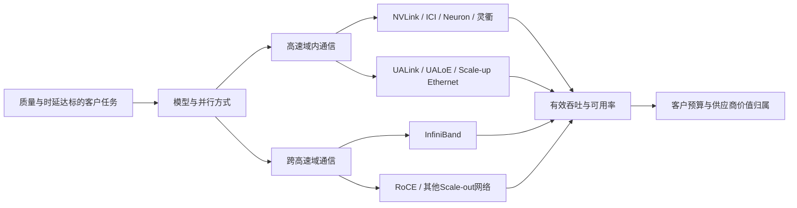

# InfiniBand与专有Scale-up互联行业调研（截至2026-10-10）

**研究截止：2026年10月10日，美国洛杉矶日期。** 地域为全球；预测按自然年1月1日至12月31日统计，美元名义金额，不含税。NVIDIA财政年度另列，不能把FY2026当作CY2026。本文以F表示披露事实，T表示厂商目标或产品宣称，C表示直接计算，R表示研究推断或模型假设，U表示尚未识别。全文的情景和参数区间均为条件范围，没有统计置信区间的含义。

本次独立联网研究。本地研究输入仅使用`基本面/产业背景/结果/`中的允许资料作为线索，随后核验外部原始证据；未读取本项目其他公司、行业、估值、评分或历史报告作为研究输入。目录规则用于确定交付位置。主要覆盖InfiniBand的交换机、HCA/NIC、专属连接与管理支持，以及NVLink、Google ICI、AWS NeuronLink、华为灵衢/HCCS等专有Scale-up；开放Scale-up作为替代路径单列。

## 研究结论与证据强度

**最有依据的基准判断是：高速域内互联的价值增长快于InfiniBand协议份额，平台控制者比单纯提高链路速率的供应商更有机会保留利润。** 这不是所有网络环节同时涨价的判断。InfiniBand的工程优势和既有生态仍有客户价值，但客户可以保留NVLink，同时把跨机架网络换成以太网；Google可以把路由做进TPU，AWS又可以让部分下一代自研芯片采用NVLink Fusion。技术任务在扩大，外售收入、内部成本和各公司的利润可能分向变化。

决定判断的证据和限制如下：

| 发现 | 最有信息量的证据 | 推导及尚未解决处 |
|---|---|---|
| 网络已经是重要收入，但协议分项不可直接识别 | NVIDIA FY2026全部网络收入超过310亿美元；FY2027Q1原口径网络收入148亿美元，Q2电话会称环比增长18%。分别见[2月25日电话会，第4页](https://s201.q4cdn.com/141608511/files/doc_financials/2026/q4/NVDA-Q4-2026-Earnings-Call-25-February-2026-5_00-PM-ET.pdf)、[5月20日公告](https://investor.nvidia.com/news/press-release-details/2026/NVIDIA-Announces-Financial-Results-for-First-Quarter-Fiscal-2027/default.aspx)、[8月26日电话会，第4页](https://investor.nvidia.com/files/content_files/TRANSCRIPT_-NVIDIA-Corp-NVDA-US-Q2-2027-Earnings-Call-26-August-2026-5_00-PM-ET.pdf)。 | 均含NVLink、InfiniBand、以太网等，不能全部归入本行业。Q2约175亿美元是148×1.18的近似计算，不是公司新的分项披露。 |
| InfiniBand的替代不必消灭NVIDIA的网络收入 | Meta原始客户材料说明两套24,576 GPU集群经调优可取得相当表现；CoreWeave新架构同时提供IB和RoCE。见[Meta，2024-06-12](https://engineering.fb.com/2024/06/12/data-infrastructure/training-large-language-models-at-scale-meta/)、[CoreWeave，2026年6月架构说明](https://www.coreweave.com/blog/a-deep-dive-on-coreweave-innovations-for-nvidia-vera-rubin-nvl72)。 | 对IB是份额压力，对仍出售ConnectX和Spectrum-X的NVIDIA未必是同额损失；不能从一个客户外推所有集群已经可无成本切换。 |
| 开放与专有的竞争边界正在改变 | AMD于7月23日明确Helios使用UALink over Ethernet；AWS明确Trainium4设计支持NVLink Fusion。见[AMD原始技术说明](https://www.amd.com/en/blogs/2026/ai-networking-built-for-scale.html)、[AWS的Trainium3/4公告](https://www.aboutamazon.com/news/aws/trainium-3-ultraserver-faster-ai-training-lower-cost)。 | 协议开放、端点兼容、多厂商认证和利润归属是四个不同问题。自研算术芯片可以减少GPU采购，却增加对另一家公司互联平台的支付。 |
| 更大Scale-up域不等于更多外置交换芯片 | ICI将分布式路由集成于TPU，OCS承担连接重构；8i又针对MoE改变拓扑。见[Google作者论文，第7—8页，2026-06-14](https://arxiv.org/pdf/2606.15870)、[8t/8i架构，2026-04-22](https://cloud.google.com/blog/products/compute/tpu-8t-and-tpu-8i-technical-deep-dive)。 | 客户得到更大可用算力池，价值可能进入ASIC、光连接、调度和云服务，不一定进入merchant交换芯片收入。 |
| 光Scale-up是重要分支，尚不能以局部性能倍数给整个行业定价 | Lightmatter相关论文公开的是模拟，完整服务受decode容量约束；L20 CPX评估套件计划在2027Q1。见[论文§V-E、§VII，9月1日](https://arxiv.org/html/2609.01821v1)、[产品公告，9月17日](https://lightmatter.com/press-release/lightmatter-joins-open-cpx-msa-introduces-the-industrys-first-bidirectional-cpx-optical-engine/)。 | 需要同时验收链路、任务质量、TTFT/TPOT、可用率和完整成本。当前不能确认大规模光学NVLink域的独立收入和利润率。 |

**规模判断。** 本文定义的A池是“不重复的外售互联归属价值”，包含整机中分配给互联的价值，不是纯芯片市场，也不是公司逐项审计收入。三条代表参数路径下，CY2026为**399/517/659亿美元**，CY2027为**403/750/1,093亿美元**，CY2028为**322/988/1,564亿美元**。2026全年尚未结束。基准路径由当前量产、客户采用和代际增加的互联内容支持；绝对值主要受NVLink收入归属单价影响，证据强度低于增长机制本身。

代表值之外，2027基准的参数包络为**535—1,097亿美元**，2028基准为**569—1,535亿美元**；这些宽区间如实保留未披露的单价、数量和成本误差。2026各路径的自由参数包络为约295—920亿美元，其中上端还须通过NVIDIA全部网络金额约束，不能全部同时成立。附录B给出采用参数、逐项计算和约束；不将代表点、自由包络或管理层目标混作已证实市场规模。

自用ICI与非Fusion Neuron网络BOM为B池，2026基准约**65亿美元**，2027约**94亿美元**，2028约**101亿美元**；这是硬件成本等价，不是TPU/Trainium芯片收入。开放Scale-up外售替代池C在基准下约**10/50/102亿美元**。**A、B、C不能不加处理相加称“本行业终端市场”**：B有上游采购和未来Fusion归属的交叉，C是另一个协议边界，算力、光模块和云服务还属于相邻层。

**最强反证**是客户以软件、拓扑和更高利用率得到足够性能，同时取消高价网络升级，且新增AI需求无法抵消每项任务所需端点、端口和网络支出的下降。Meta既有RoCE运行经验、DeepSeek的通信重叠以及ICI的集成路由支持这条解释；NVL72量产、GPU直接发起通信和MoE低延迟需求则支持平台价值继续扩大。仅观察Token增长、800G出货、标准发布或网络总收入，无法区分这些机制。

## 1. 客户购买的是可用的并行计算，不是协议名称

### 1.1 本专题的经济边界

Scale-up是紧耦合加速器间的高速通信域，Scale-out连接节点或高速域。边界随架构移动，不固定等于“机内/机外”或“铜/光”。TPU的大型光连接域说明Scale-up可以跨机架；NVLink机架也需要跨机架IB或Ethernet。InfiniBand是IBTA制定的标准体系，供应集中度高不等于协议本身由一家私有。可交付高端IB的实际硅、固件、软件及平台责任高度集中于NVIDIA；OEM品牌数量不能当作独立硅供给数量。[IBTA标准与路线图](https://infinibandta.org/infiniband-roadmap/)

| 统计层 | 本文计入 | 排除或交叉处理 | 经济单位 |
|---|---|---|---|
| A1 NVLink/Fusion外售 | 独立/嵌入式交换Fabric、交换托盘、专属背板/线束及归属支持/IP价值 | GPU/CPU本体、HBM、GPU内部SerDes不另拆入；第三方采用Fusion不能再把同一NVLink硬件加进A5 | 年内交付连接端点；指定代际及域大小的Fabric |
| A2/A3 InfiniBand外售 | IB HCA/NIC、交换Fabric、在该供应商销售边界内的专属连接、UFM/维护 | Ethernet模式的同型号NIC排除；AI和HPC/存储按最终工作负载分配；已含于Fabric包的光学采购不重复加 | 800Gb/s单方向主机注入容量等价端点；更新/支持流量 |
| A4 灵衢/HCCS外售归属 | 超节点中交换、连接、网络管理的归属价值 | 不计整台昇腾系统收入；NPU连接位不等于逻辑die数；中国价格不是按未知人民币成交价换汇 | 卡/处理器连接位及超节点 |
| A5 其他定制专有Fabric | 确属定制协议/客户特有加速器Fabric的外售硅与系统归属 | 标准PCIe/CXL交换、普通Retimer排除；不能把Astera全部Scorpio或Marvell全部数据中心收入归入 | 定制Fabric连接端点 |
| B 自用专有互联 | ICI、非Fusion Neuron的外部连接、交换/光电器件、板/线束和测试BOM成本 | 不以内部转移价制造“芯片收入”；集成于计算芯片的路由逻辑不虚构独立售价；云租费另列 | 自用新设备×相关BOM成本 |
| C 开放Scale-up替代 | UALoE、开放Ethernet/UALink的规模采用所形成的Fabric外售归属 | 不计入A的专有协议边界；通用Scale-out Ethernet不在C；不能把会员、规格或演示计成付费部署 | 已验收开放Fabric连接端点 |

A各子池按同一系统采购中的互联归属计一次，可加为外售价值；其上游晶圆、连接器、激光、光引擎等供应商收入可研究，但不是额外终端需求。A5是最弱、较小的残余覆盖，退出A5不改变主要方向。B和A的物理工作量可对比，美元不能按“收入＋成本”相加。C与A的不同设备采购在统一最终采购边界下可以形成更宽的功能市场，但本报告不以更宽市场替代本专题定义。

### 1.2 谁付款、谁验收、谁承担失败

大云厂、AI实验室、GPU云、主权/HPC中心和企业计算集群是主要资产买方或容量承租者。AI实验室采购云容量，可能由云商向OEM采购设备；不能把两次支付都计为新增硬件终端需求。AI训练支出来自模型开发和研发，推理来自云服务销售、广告/推荐改进、企业工作流或内部计算预算。HPC还有气象、材料、科学模拟等任务，不必接受“全部由Token驱动”的解释。

基础设施采购团队负责硬件价格和交期，模型/应用团队提出通信与质量要求，网络及站点团队承担部署、故障和升级责任。验收应针对具体模型、并发、消息分布、故障路径和运行时，不能只测某条链路的线速。若端点未到、液冷未完成、电力未接入或软件无法稳定运行，网络供应商可能已经确认销售，最终客户仍不能获得付费吞吐。资金成本和闲置残值主要留给资产所有者，固定总价履约风险部分留给集成商。

预算可同时包含新增、替代和内部转移：NVL8升级NVL72增加高速域内容，也可能减少某些跨节点交换；把GPU任务转到TPU减少外售GPU/IB采购，却增加自用ICI采购；把Trainium互联迁到Fusion则把内部网络成本的一部分变成外售平台收入。预算归属变化不等于新增最终AI支付。

## 2. 技术前沿：决定价格的是通信边界、拓扑和恢复能力

### 2.1 商业阶段与带宽口径

下表集中交付重要规格。厂商性能宣称保留其适用边界，不当作所有客户的实测收益；网络名义带宽不等于应用吞吐、二分带宽或全局共享内存容量。

| 路线 | 截止日可核验事实/目标 | 客户采用阶段与经济含义 |
|---|---|---|
| InfiniBand NDR/XDR | NDR常见400Gb/s；Quantum-X800的Q3400系列提供144×800Gb/s，200Gb/s/lane，72个OSFP cage；Q3200机箱包含两个独立36端口交换单元。Q3450-LD文档列144×800G及直接MPO的CPO形态。F规格，非年度产能。[硬件手册，访问10月10日](https://networking-docs.nvidia.com/xdrswitcheshw/introduction) | NDR/XDR已有产品、参考架构及交付生态。CPO型号进入文档强于纯概念，但没有由文档识别其出货量、良率或客户采购价。144端口、72个cage、交换单元数不能混用。 |
| NVLink 4/5与NVL72 | NVIDIA列Hopper 900GB/s、Blackwell 1,800GB/s每GPU双向带宽；GB200/GB300 NVL72为9个交换托盘、每托盘2个交换ASIC，即18个ASIC/72 GPU。F规格。[NVLink产品规格](https://www.nvidia.com/en-us/data-center/nvlink/)、[Mission Control手册，NVLink Technology](https://docs.nvidia.com/base-command-manager/manuals/11/nvidia-mission-control-manual.pdf) | 已规模商业采用。8 GPU板与72 GPU高速域的价值归属不同，不应沿用“每节点网卡数量”估NVLink收入。 |
| NVLink 6/Vera Rubin | 每GPU3.6TB/s双向，72 GPU机架约260TB/s；每交换托盘4个ASIC，9托盘共36个ASIC；1,152 GPU及CPO是路线图。T规格与路线图。[7月20日技术说明](https://developer.nvidia.com/blog/nvidia-nvlink-the-scale-up-network-for-ai-factories/) | 管理层8月26日称8月开始Rubin生产出货，强于年初下半年目标；但全客户验收架数未披露。36/72与18/72意味着相同端点量可能需要两倍交换ASIC，而不是两倍GPU数。[8月26日电话会](https://investor.nvidia.com/files/content_files/TRANSCRIPT_-NVIDIA-Corp-NVDA-US-Q2-2027-Earnings-Call-26-August-2026-5_00-PM-ET.pdf) |
| Google Ironwood ICI | 正式商用材料自2025年11月公开；TPU7x文档为9,216芯片pod、1,200GB/s每芯片双向ICI、3D torus；DCN为100Gb/s每芯片，另一个层级。F规格。[商用公告，2025-11-06](https://cloud.google.com/blog/products/compute/ironwood-tpus-and-new-axion-based-vms-for-your-ai-workloads/)、[TPU7x架构文档](https://docs.cloud.google.com/tpu/docs/tpu7x) | 有正式可售云配置。9,216×每芯片注入带宽不能当全域任意两半之间的可用带宽，更不能当交换机外售市场。 |
| Google TPU 8t/8i | 4月22日发布：8t为9,600芯片torus；8i为1,152芯片Boardfly；双向ICI19.2Tb/s。Boardfly以4芯片基本单元、8单元群组及36群组缩短跳数。T架构。[发布材料](https://cloud.google.com/blog/products/compute/ai-infrastructure-at-next26)、[架构深读](https://cloud.google.com/blog/products/compute/tpu-8t-and-tpu-8i-technical-deep-dive) | 本次未核到截止日前足以证明8t/8i全系列GA及年度验收量的材料；按发布/客户导入处理。厂商约50%通信延迟改善有指定工作负载边界，不是所有云服务价格下降50%。 |
| AWS Trainium/Neuron | 2026年2月披露Trainium2累计落地140万颗，Rainier逾50万是其中子集；Trainium3已有生产任务。Trn3页面列至144颗、NeuronSwitch-v1/NeuronLink-v4每芯片2TB/s。F披露、T规格。[2月5日财报](https://ir.aboutamazon.com/news-release/news-release-details/2026/Amazon-com-Announces-Fourth-Quarter-Results/default.aspx)、[Trn3产品页](https://aws.amazon.com/ec2/instance-types/trn3/) | 累计140万不是CY2026新增140万；Trn3可售不等于全年所有芯片供给完成。Trainium4预期2027交付并支持Fusion，尚无足以拆分两种Fabric份额的采购披露。 |
| 华为灵衢/HCCS/Peerium | 7月17日称384超节点已部署750+套，展示950的1,024卡配置；9月17日称25.6万卡950集群“部署中”，NPO 960“测试中”。F公司披露。[7月原公告](https://www.huawei.com/cn/news/2026/7/atlas-950-superpod)、[9月原公告](https://www.huawei.com/cn/news/2026/9/new-computing-architecture-peerium) | 750×384=至少28.8万个配置位C，是累计配置规模，不是当年净新增；25.6万不能直接全部认作已验收或与前者无交叉。模型按卡/处理器连接位计，不按die计。 |
| AMD Helios/UALoE | 7月23日生产发布与技术说明；72 MI455X，12个UALoE交换设备/6交换托盘，宣称260TB/s聚合Scale-up。F配置/T能力。[生产发布](https://ir.amd.com/news-events/press-releases/detail/1294/aai-2026-amd-delivers-full-stack-compute-for-the-agentic-ai-era)、[ROCm架构](https://rocm.blogs.amd.com/ecosystems-and-partners/cdna5-helios/README.html) | 初始生产/部署阶段，长期GW合作不等于当年验收量。UALoE不是用一个普通RoCE交换机就能替代NVLink，也不能把原生UALink PHY规格直接当这套系统已验证的多厂商接口。 |

换算要保留方向：800Gb/s每方向=100GB/s每方向；与NVLink双向1,800GB/s比较时，对应单方向约900GB/s，带宽之比约9倍，而不是直接得18倍。Rubin单方向约1,800GB/s，对单端800G为18倍；若每GPU两端800G，差距约9倍。不能用这些比值推应用速度，更不能把“rack总带宽”与某对GPU的带宽混为一谈。

### 2.2 为什么IB和专有Scale-up可以一起成长，也可以发生替代

训练中的数据并行、张量并行、流水线并行、专家并行需要不同的消息粒度、同步频率和拓扑。大消息all-reduce看总带宽与集体操作，小消息/专家路由看启动延迟、包率、负载偏斜和尾部恢复。GPU直接发起通信、远端load/store/atomic、对称内存及运行时集体操作提高了高速域的系统价值，但“统一编址”不能自动解释为所有HBM具备硬件缓存一致性。

DeepSeek-V3给出可核验的共存案例：2,048 H800，节点内8 GPU使用NVLink/NVSwitch，节点间IB，64路专家并行跨8节点；其算法让每Token最多发送到4节点，并把IB到NVLink转发及计算重叠。论文所列160GB/s与50GB/s属于该配置，不能推广成所有NVLink和IB的固定比例。[技术报告§3.1—3.2，2025-02-18版本](https://arxiv.org/html/2412.19437v2)

这形成两条竞争性路径：更多、更大的模型任务会提高并行端点和通信需求；路由局部化、量化、通信重叠、缓存和更大的高速域又降低每项任务暴露在慢网络上的通信。**必须区分产生的字节、跨域字节和关键路径等待时间。** 跨域流量少了并不意味着IB完全没有价值，仍有数据并行、模型阶段、KV转移、存储、容错和冗余任务；但支付更多交换层级的必要性会改变。

### 2.3 不同拓扑如何改变价值分配

在理想两层、每交换机radix为r、下行/上行各占一半的满二分Fat-tree中，最大端点为r²/2：64端口为2,048，144端口为10,368。这是工程上限示例，须保留冗余、布线和端点注入约束；NVIDIA手册也列后一个规模。端点N对应约3N个交换端口：叶层2N，加脊层N；连同主机侧，约4N个高速终端接口。某些三层网络会接近5N交换端口和6N接口，取决于具体拓扑。

因此，升到高radix可能在相同端点、带宽和冗余要求下删除一层交换。即使单端速率翻倍，交换机/连接器数量也可能减少；IB供应商收入取决于端点、速度、拓扑层级和单位归属净价共同变化。OSFP双端口形态还会改变模块颗数，不能把上述“接口”逐个当成一颗独立光模块。该拓扑示例在附录B通过注入等价端点而非机箱数进入模型。

ICI另给出不同价值路径：分布式路由在TPU内部，OCS让铜连接的计算块能绕过故障、重新组成任务切片。Google作者特别解释，OCS使小块到货即可独立投入生产，而不必等完整大pod齐套。这改变的是**爬坡现金与资源碎片**，并非仅链路能耗。[Google作者论文，第7—8页](https://arxiv.org/pdf/2606.15870)

本报告由此推断：更大高速域的第一笔经济价值可能是让已有芯片更早、更连续地进入可用服务。它既能提高供应商平台溢价，也可能让采购方延后部分新增GPU与跨域网络。判断哪一方保留节约，需看合同、实际利用率和新增客户任务。

### 2.4 光学前沿需要完整服务验收

光学的价值来自更远的有效连接、更高I/O密度、较低某些电通道损耗，以及更大的低延迟域；瓶颈可能移到激光、光耦合、封装测试、故障定位和维修。CPO/NPO/可插拔是封装或安装边界，NVLink/UALink/ICI/IB/Ethernet是协议与运行体系；不能把它们排成互斥路线。

9月1日Lightmatter作者论文的重要限制是：光方案使用未部署验证的理想4倍Scale-up带宽和1,152 GPU域，成本、额外链路延迟、热限制等并未完整建模。服务模拟故意仅配一个decode worker，显示改善prefill可把压力转到decode。因此，它能支持“通信受限prefill值得扩大高速域”，不能证明所有在线推理服务都有相同倍数的收入或GPU节省。这个限制也不反向证明光学无效：扩大decode、重配并行与完整SLA验证可能兑现收益。[论文§IV、§V-E、§VII](https://arxiv.org/html/2609.01821v1)

已商业化TPU的光连接与新型光学NVLink、开放高radixFabric处于不同阶段；不能把未来CPO首次采用写成“行业第一次采用光Scale-up”。突破模型只指原本受电连接边界限制的高带宽交换域取得新增规模验收。

## 3. 需求：先看预算与有效工作量，再看端点和端口

### 3.1 现实支付锚点与采用证据

| 现实锚点 | 公布日、期间与性质 | 本报告如何使用 |
|---|---|---|
| Microsoft CY2026 CapEx约1,750亿美元 | 2026年7月FY2026Q4电话会，T；部分机房租赁因寿命调整由finance转operating，投资预期本身未变。[原文CapEx段](https://www.microsoft.com/en-us/investor/events/fy-2026/earnings-fy-2026-q4) | 不能把租赁分类变化当物理网络需求缩减；只作资金规模锚，不全分配给AI网络。 |
| Amazon CY2026 CapEx约2,000亿美元 | 2026-02-05，T，包含AI、芯片、机器人、卫星等。[原始财报](https://ir.aboutamazon.com/news-release/news-release-details/2026/Amazon-com-Announces-Fourth-Quarter-Results/default.aspx) | 保留管理层约数和全公司范围；Trainium与GPU共同争用预算，不能再各取全部2,000亿。 |
| Meta CY2026 CapEx1,300—1,450亿美元 | 2026-07-29，T，包含融资租赁本金；Q2实际310.8亿美元F。[原始财报](https://investor.atmeta.com/investor-news/press-release-details/2026/Meta-Reports-Second-Quarter-2026-Results/) | 原范围不是本报告预测区间；内部广告收入支持计算支出，但客户真实回报不能由CapEx本身证明。 |
| AWS增加GPU的多年度计划 | 2026-08-26；客户公告称2027—2028计划额外部署200万Blackwell Ultra/Rubin/Rubin Ultra。T。[客户原公告](https://press.aboutamazon.com/aws/2026/8/aws-and-nvidia-to-deliver-2-million-additional-gpus-and-next-generation-infrastructure-for-agentic-and-physical-ai) | 未当作单年200万或已上线200万。NVIDIA电话会有财季交付描述，期间与客户自然年文字不同，未强行合并。 |
| IB存量客户任务 | TOP500 2026年6月有292台IB系统，占台数58.4%；覆盖HPC的样本，不是所有AI集群。[官方榜单统计](https://www.top500.org/lists/top500/2026/06/highs/) | 支持IB具有非AI存量与维护基盘；不能用台数推全球网络金额或新购份额。 |

前三项账面参考和为5,050—5,200亿美元C；现金、租赁和非AI口径不一致，只用于排除明显不可能的预算，不是统一硬件支出。若强绑定AI IT取得/更新占其中35%—55%R，为约1,768—2,860亿美元；若全套网络占该边界10%—20%R，为约177—572亿美元。该网络池还含Ethernet、存储/前端及自用BOM，且没有包括其他云厂、GPU云、主权与企业；它与全球A的约517亿美元代表值可相容，但低预算占比一端会很紧。

这是**独立的预算可行性约束，不是把A按比例倒推出预算的证明**。如果这三家实际IT比例和网络比例均在低端，而其他客户没有填补缺口，则A的基准数量/归属单价过高；如果大云厂采用内部网络，自用成本上升也未必填补A外售收入。

### 3.2 可审查的需求桥

NVLink需求用年内需要付费交付的高速域连接端点计算，先区别NVIDIA原生设备与Fusion第三方设备，再检查8设备板、72设备机架与后续跨机架域的混合。CY2026基准6.8百万端点R中，10%为8 GPU类、80%为Blackwell NVL72类、10%为NVLink6类；约6.12百万机架类端点相当于8.5万套72端点域C。它不是公司披露机架出货，也不把传统8 GPU系统硬写成72 GPU物理机架。

这些数量受到当期数据中心收入、已量产系统组合、客户长期订单、最终预算及交付能力共同约束。公开资料没有足以独立证明全球GPU颗数、所有NVLink装配率或OEM成交价的明细，因此数量仍是R，模型精确度不超过区间。CY2027、2028基准端点分别9.0、11.5百万，其中Fusion为3%、5%，亦为待验收假设；费用条款未披露，不能把合作伙伴名单当确定收入。

AI用IB需求单独从可接该类后端网络的GPU新增/升级池推导：

> D_IB_AI = G × a_IB × u + r_upgrade。

G为相关GPU连接位百万数；a为IB采用比例；u为每GPU单方向注入能力相对800Gb/s的等价数；r为存量网络独立升级的新增容量，排除已随新GPU计入的替换。TPU/Neuron等自有网络设备不放入G。所有参数为R，附录B按三路径给值。基准CY2026：9×24%×1.05＋0.132=2.4百万800G等价端点；CY2027约3.2百万；CY2028约3.6百万。

基准IB份额从24%降至20.5%、16%，但单GPU注入能力及整个采购池上升。这条路径会产生**IB数量和收入继续增长、协议份额下降**的联合结果。悲观路径则让算法效率、开放部署和资金压力同时减小GPU池与IB比例，出现绝对缩量；乐观路径需要更大集群、更高带宽以及IB保持特定大作业客户份额。

HPC/存储IB独立计算设备更新和存量支持，AI与HPC不能拿同一份采购重复占满。自用ICI/Neuron从可部署设备和外部网络BOM计算，140万Trainium2累计锚与正式云服务只约束数量级，并不直接给2026新增量。Google百万级年度TPU流量尤其缺少公开出货明细，B的绝对金额可信度较低，不反过来用B证明A。

### 3.3 效率能否减少采购：必须经过现金边界

若通信占旧任务关键路径时间比例f，通信速度提高s倍，且计算、软件、质量和其他等待不变，单任务总时长比例为`(1−f)+f/s`。f=20%、s=2时，有效吞吐最多提高11.1%；f=3%时只约1.52%。使用量增长能否转为更多GPU/网络采购，还要乘需求弹性、预算及利用率：同任务量且闲置容量充分时，提高效率可延后采购；需求随价格下降扩大时，新增任务可能超过节约。

为说明支付阈值，采用同一4,096 GPU集群的四年现金模型。以下金额均为R，**不是厂商报价或真实客户回报**：

| 参数/结果 | 原配置 | 互联改善后 |
|---|---:|---:|
| 一次性取得成本，含计算/网络/相关设施，百万美元 | 300（其中网络45；不再另加网络器件） | 310（新增网络10） |
| 寿命/末期残值/资金成本 | 4年 / 10% / 10% | 相同；残值31 |
| 年现金运维，含电力、维护、人员，百万美元 | 30 | 31 |
| 质量相同的计费价格/旧计费利用率 | 6美元/GPU等价小时 / 65% | 同价；只有可售任务填满改善的容量才增加利用率 |
| 稳态年收入，百万美元 | 139.936 | 155.484，条件是f=20%、s=2及11.1%净吞吐可全部售出 |
| 90%取得成本按4年直线折旧后的示例EBIT，百万美元 | 42.436 | 54.734 |
| 含残值的年资本回收额，百万美元 | 88.177 | 91.116 |
| 年收入−现金运维−资本回收额，百万美元 | 21.759 | 33.368 |

年资本回收额公式：`[K−残值/(1+r)^L] × r/[1−(1+r)^−L]`。它含资金成本，不是会计折旧；上表EBIT未扣税或利息，也不是净利润。原集群年收入公式为`4096×8760×65%×6`。网络改善年增量负担为2.939资本回收＋1运维=3.939百万，因此需要有效、可售产出提升约**2.81%**才能覆盖。相同条件下，f=3%的改善低于阈值；若只改善微基准而端到端吞吐不增，增量网络没有这项回报。

保留爬坡后，回报更弱：假设2026年末一次支付资本300百万，2027—2030运营，第一年计费利用率40%，后三年65%；第一年运营净现金为86.114−30=56.114百万，后三年各109.936百万，第四年另回收残值30百万。按10%折现，原配置NPV约**2,004万美元**C；若四年都65%，则约6,897万美元。若计费价格下降20%，在40%/65%的同一爬坡下NPV转为约**负5,889万美元**。运营利润正值仍可与资本回收失败共存。

第4年末残值只是旧资产出售估值，未假定必然实现。维持后续性能若需新一轮更新，2031年应另预算约3.0—4.2亿美元R，扣可保留设施及旧设备出售；该更新不在四年项目现金流中，也不假定旧网络可跨代无限复用。模型没有把网络收益单独算成整套算力资本回报。

## 4. 有效供给：当前更接近代际与验收错配，不足以证明全面短缺

### 4.1 供给能力的实际组成

InfiniBand/NVLink供给依次经过架构/IP、逻辑制造、封装与板卡、连接/线束、固件/运行时、OEM系统验收、站点上线。设计带宽、投片数量、可测器件、合格托盘、可发货Fabric和可用集群是不同阶段。HBM和GPU不足会限制可配套系统数，但不能当作交换ASIC本身的产能；客户预算与电力不足则使已出货网络成为闲置资产。

| 环节 | 实际约束与供给反应 | 受益/受损方向 |
|---|---|---|
| 交换/HCA逻辑制造 | 正确产品与节点的配额、良率、封装/测试；每端点ASIC内容随代际变。已有先进晶圆总体规模不证明某产品已分配足额配额。 | 配额释放帮助平台成交量；若客户需求弱，制造承诺与库存可能先增加风险。 |
| 高密度电连接与装配 | 背板/线束一致性、串扰、连接器公差、液冷及批量测试。Rubin的托盘可维护设计有方向性帮助，产线绝对节拍U。 | 交付加速对OEM与客户有利；标准化/自动化会降低每套工程费用或把价值留给平台。 |
| CPO/NPO光学 | 激光源、光耦合良率、光学测试、温控、纤维与连接、可维修边界。独立封装/测试投入可能先于付费规模。 | 光引擎/激光/测试获新内容；传统可插拔、DSP或铜路径的单位内容可能被替代，不能全算受益。 |
| 软件、资格与运维 | NCCL/运行时、Fabric Manager、拥塞/路由、遥测、故障恢复；多厂商验收不能由规格出版代替。 | 能承担系统责任者有溢价；仅有PHY/IP、无法保障SLA的供应商更易被压价。 |
| 场地和资金 | GPU、机架、电力、冷却及客户信用齐套；交付确认与通电变现有时差。 | 缓解瓶颈可增加出货，也可能增加云供给、降低租价并延缓下一轮采购。 |

NVIDIA FY2027Q2材料将全部供应承诺从上一季约1,190亿提高至2,790亿美元，说明强调供应保障；公司明确主要与内存采购相关，**不能把这笔金额分配成NVLink或IB产能**。10-Q另披露以色列网络业务约6,200人及供应链风险，构成研发/运营集中暴露，不是某季度已停产的证明。[CFO commentary，8月26日](https://www.sec.gov/Archives/edgar/data/1045810/000104581026000073/q2fy27cfocommentary.htm)、[10-Q，8月27日，第27页](https://investor.nvidia.com/files/doc_financials/2027/NVDA-2027-Q2-10Q-Final-including-exhibits.pdf)

### 4.2 从供给端独立构造可交付阈值

公开材料未给出协议专属晶圆、良率、年度交换机测试能力或线束产量。**因此，下表不是实际工厂产能披露，也不是由需求填一个同数的供给。** 它从投片、合格芯片、每端点内容和交付测试席位构造独立条件，回答“满足需求需要何种供给资源”。附录模型的S*只在这些类似条件成立时有效。

NVLink供应约束写成：

> S_NV = min[W×g×y_pack×q_qual/k_ASIC，T_fabric×72×q_accept，配套端点可交付量]。

W为分配给相关交换ASIC的年晶圆片数，g为每片合格逻辑die数，y为封装后成功率，q为规格资格/验收率，k为每连接端点平均交换ASIC数量，T为72端点Fabric等价交付测试席位。g是逻辑良率后的数量，不再次乘同一逻辑良率。T把混合系统归一化，**不是实际72 GPU机架产量**。

| 年度基准供应条件R | W | g | y_pack；q_qual | k_ASIC | T；q_accept | 硅端/交付端能力C，百万端点 | 采用S* |
|---|---:|---:|---|---:|---|---|---:|
| CY2026 | 30,000 | 90 | 95%；90% | 0.30 | 113,000；90% | 7.695 / 7.322 | 7.3 |
| CY2027 | 53,000 | 90 | 96%；90% | 0.42 | 145,000；94% | 9.813 / 9.814 | 9.8 |
| CY2028 | 78,000 | 90 | 96%；90% | 0.48 | 185,000；94% | 12.636 / 12.521 | 12.5 |

实际分配片数与席位数U，不能据此断言已经获得上述资源。g可取65—150，封装成功率88%—98%、资格80%—98%作条件敏感性；2028新型跨机架域的ASIC/端点比可能高于0.48，若达到0.65而W等参数不变，硅端能力降至约9.33百万，低于11.5百万基准需求。**这条独立反证比“总晶圆扩产”更有意义。** 芯片增加也不能补偿接入端GPU未到。

IB从合格NIC注入能力、交换端口、连接测试和集成能力另构造：

> S_IB = min[NIC_800等价能力，合格交换端口/e_switch，合格连接接口/e_link，集成验收能力]。

以2027 AI预留部分为例：NIC能力3.8百万、交换端口10.9百万且每注入端点3.1个、连接接口15.4百万且每端点4.4个、集成3.6百万，得到约3.5百万800G端点能力C。全为条件资源R；HPC部分另预留配额，不把同一批端口重复分给两池。144端口设备用于这部分交换需求时，10.9百万端口相当于约7.57万套全端口设备C，是资源需求检查，**不是厂商出货预测的独立实证**。多层、冗余与混合速度使e不能永远取3或4。

对于ICI/Neuron，名义能力先需可交付加速器，再需光/电连接、OCS或交换托盘、运行时和站点验收齐套；不能把云商愿意支出倒推为已合格产能。附录B中的自用S*代表这样的成套能力条件，证据不足处用宽参数范围保留。

### 4.3 当前判决与何时改变

**当前最接近“主流产品可扩供、代际和系统验收局部吃紧”。** 支持它的是NVL72/IB既有交付生态、Rubin已经开始生产出货、多个云/OEM路径及可维护架构；反面是新代交换ASIC内容增加、光学资格未全面证明、现场齐套和客户资金风险。没有协议专属交期/库存与净成交价序列，无法证明全球IB或NVLink都存在可持续物理短缺，也无法断言已经过剩。

基准2027条件下，NVLink S*/D≈1.09，AI IB约1.09，保留少量总量余裕但容易发生规格错配；乐观需求时分别约0.95和0.93，若客户坚持交付会形成结构性缺口。悲观2028时约1.64和2.14，投片/资格不能即时取消，价格和库存承压。这个比例是本报告情景值，不是公司当前订单覆盖率；只有独立供应参数和客户付费部署落入相应范围后，判决才成立。

### 4.4 价格和成本的传导

没有公开、同SKU、同地域、同合同的可比净成交价时间序列。OEM挂牌、经销报价、整机分配价、芯片ASP及IP费是不同层级。本文P是**合同折扣及捆绑分配后的模型净归属单价**，不是声称客户可单独按此价购买NVLink；UFM、维护、支持在与实际包一致时计入，不再另加云费。

短缺首先可能表现为规格替代、延期、优先级和整机捆绑，未必当季提价。框架采购、资格切换、固件和年度合同使重新定价常需一个或数个季度R；本报告把以下窗口作为研究假设：同平台追加订单约1—3个月，代际切换/新网络客户验证约3—9个月，更换端点协议或新光学架构约9—24个月。它们不是各供应商保证交期，也不由标准发布时间自动起算。

升速导致的组合ASP上升必须与同规格提价分开。2026/27模型NVLink均价上升主要来自8 GPU向机架域、新代交换内容及平台归属，且假定较高代际价格可以维持；2028悲观允许同类客户折扣、平台份额和强度下降。IB由400G/800G/双端800G与拓扑共同改变；每端点美元增加时，每Gb/s美元仍可能下降。

成本按有效规格和交付计算。对NVLink，晶圆/ASIC、封装、板/供电/冷却、专属线束、装配测试及质保共同构成C；GPU内部接口成本不重复放入。研究级拆分可取ASIC及封装100—600美元/端点、板及相关结构200—700、线束/连接700—1,400、测试/验收100—300、质保/交付100—300，合计约1,200—3,300美元，跨代光学形态可能更高。**这些是成本约束假设，非采购报价**。不能把“5,000根内部铜连接”逐个按一条商用AEC定价；封装/线束良率也会使投入量高于出货BOM。

IB成本随NIC与交换容量、光学/铜距离、层数及支持变化；新客户工程费用会使低量项目即使产品毛利为正仍亏损。材料和代工涨价能否转嫁取决于客户是否有替代资格与预算，不能由供应集中度直接回答。

## 5. 竞争与价值捕获：平台入口、集成责任和开放采用

### 5.1 竞争地图与非上市参与者

| 参与者/路线 | 独特位置与已核验阶段 | 捕获机制与条件 | 主要未知/竞争压力 |
|---|---|---|---|
| NVIDIA，含Mellanox体系 | 同时掌握NVLink、IB、ConnectX、Spectrum-X与相关运行时；NVLink6已生产出货。 | 平台、软件与成套交付使单纯换交换ASIC困难；IB转Ethernet仍可保留部分NIC/交换收入；Fusion增加非GPU端点入口。 | 分项收入/毛利及Fusion收费U；大客户自研和开放资格会约束溢价。不是所有Fusion组件都强制采购。 |
| Google | ICI/TPU、OCS、编译/调度和云运营；Ironwood可售，8t/8i已发布。 | 内化网络价值，减少外置电子交换、缩短爬坡并提高可用率，成本节约可留在云服务或回馈客户。 | 年度设备新增量、外部网络BOM和8代客户验收U。特定拓扑不等于通用GPU即插即用。 |
| AWS/Annapurna Labs | 大规模Trainium、Neuron/EFA/Nitro和云运营；Trainium4设计接Fusion。 | 选择自研与购买边界，利用现有生态加快上市；议价筹码来自庞大采购与可替代设计。 | Neuron与Fusion并行份额、复用程度、费用、上线速度U；合作目标不能当现金贡献。 |
| 华为及昇腾系统生态 | 灵衢与超节点、CANN及系统集成；已有384落地，950部署中，960 NPO测试。 | 国内系统责任、软件生态和受约束市场形成相对入口；互联可增加整个系统可用性。 | 连接位净新增、成套合格量、成交价/现金回收U；更大卡数可能用于补偿单卡性能，并非同额经济价值。 |
| AMD | 旧8 GPU类Infinity Fabric是存量专有节点内路径；Helios以UALoE切入机架域并有ROCm/Fabric Manager。 | 开放机架与端点性能争取整机预算，不仅出售GPU；软件和可恢复系统是交付条件。 | 不能把标准、初产及多年度客户框架当年度收入；多厂商交换/管理互换性需实际资格验证。 |
| Broadcom | Tomahawk Ultra已于2025-07-15宣布出货，51.2Tb/s、250ns是芯片指标；2026-10-08预告OCP展示TH6-Davisson等。[原始出货公告](https://investors.broadcom.com/news-releases/news-release-details/broadcom-ships-tomahawk-ultra-reimagining-ethernet-switch-hpc)、[10月8日公告](https://investors.broadcom.com/news-releases/news-release-details/broadcom-redefines-ai-infrastructure-industry-leading-networking) | merchant硅、SerDes与定制ASIC协同；高radix/拓扑可以降低客户系统内容，同时扩大自身硅覆盖。 | 整端到端延迟不能由250ns替代；AI半导体总收入包含XPU和其他网络；10月12—15会议在截止日尚未召开。 |
| Astera Labs | 1月22日称Scorpio X初始生产；8月4日Q2收入3.924亿美元、全公司GAAP毛利73.3%，预期Q3 Scorpio成为最大产品族。[初产公告](https://www.asteralabs.com/news/astera-labs-broadens-scorpio-x-series-smart-fabric-switch-roadmap-to-address-expanding-scale-up-market-opportunities/)、[Q2财报](https://www.asteralabs.com/news/astera-labs-reports-second-quarter-2026-financial-results/) | 定制Fabric、诊断管理软件与客户协作；光连接/UALink可拓展资格。 | Scorpio P/X及协议归属分项U；PCIe演示不证明UALink量产。不能把全公司或全部Scorpio收入列为专有Scale-up。 |
| Marvell，含已收购Celestial AI/XConn | 2月2日完成Celestial收购；10-K描述UALink/ESUN及PCIe/CXL布局。[收购完成](https://www.marvell.com/company/newsroom/marvell-completes-acquisition-of-celestial-ai.html)、[10-K，3月11日](https://investor.marvell.com/sec-filings/all-sec-filings/content/0001835632-26-000011/mrvl-20260131.htm) | 定制芯片、光Fabric、交换与DSP组合；从配套部件向系统连接升级。 | Celestial应作为Marvell体系分析，不能再当独立供应商重复加。公司目标是FY2028H2起收入、Q4达到5亿美元年化运行率，不是FY2028实际5亿美元收入。 |
| Lightmatter（非上市） | Passage光互联，L20 CPX评估套件预计2027Q1；论文提供模拟而非大规模客户TCO。 | 光密度、连接与封装可成为平台接口，也可受多源模块标准约束。 | 具体规模客户、价格、测试良率与收入U；纤维数量节约不等于全网络成本同比例下降。 |
| Ayar Labs（非上市） | 9月10日披露2026融资累计6.5亿美元，用于产品、制造生态及高量产准备。[原公告](https://ayarlabs.com/news/ayar-labs-expands-2026-funding-to-650-million/) | TeraPHY、外置光源及制造伙伴；进入平台生态有利于资格，放量仍需客户和测试。 | 融资不是收入，manufacturing-ready不是年度合格产能；平台可能控制采购价与接口。 |
| Cisco/Arista及交换系统伙伴 | 可编程Ethernet、网络系统管理和客户运维入口；Cisco讨论现有硅的软件适配。[Cisco原始技术文章](https://blogs.cisco.com/datacenter/scaling-the-future-why-ethernet-is-the-backbone-of-ai-supercomputing) | 开放Fabric的系统、运维和软件服务，可能保留部分客户网络预算。 | Scale-out资格不自动成为Scale-up资格；交换芯片上游收入不与系统收入当独立终端池相加。 |
| HPE/Cray、HPC系统集成与Slingshot | Slingshot是相邻HPC替代；6月22日宣布400软件的多租户能力。[HPE公告](https://www.hpe.com/us/en/newsroom/blog-post/2026/06/hpe-simplifies-the-supercomputing-experience-for-sovereign-ai-research-and-large-enterprises.html) | 科学任务软件、可恢复大系统与工程服务；可以采购IB，也提供另一种网络。 | Slingshot不是第二家独立IB硅供应；OEM系统利润与其采购芯片收入层级不同。 |
| QCT/Quanta、Wiwynn、Foxconn、其他OEM/ODM；MediaTek/GUC/EDA/IP伙伴 | Fusion生态覆盖ASIC设计、光学、机架与供应；NVIDIA 8月24日说明可选的组件和制造体系。[原始Fusion说明](https://blogs.nvidia.com/blog/nvlink-fusion-xpu-ai-factory/) | 降低客户研发与集成时间，制造/工程可能放量；客户仍掌握最终验收。 | 生态成员不等于独立订单；标准化和自动化可能增加数量、压低工程加价，且上游IP不能重复加进A1。 |

覆盖以公开可验证且影响主要机制者为主。其他国产加速器互联、定制私有网络、尚未披露协议的项目以及部分HPC互联没有足够独立分项数据；不承诺无限不遗漏，A5保留有限条件覆盖。标准PCIe/CXL、通用I/O Retimer与计算芯片内Infinity Fabric的归属缺口明确留在相邻专题/内部集成逻辑，未以全部相关上市公司收入补齐。

### 5.2 开放标准改变议价，但不会替客户承担工程责任

UALink 200G 1.0规定每lane 200G和至1,024加速器的pod；2026年4月7日发布Common 2.0等规格，引入网络内计算、管理与chiplet定义。四lane 200G为每方向100GB/s名义容量，不能直接与每GPU多端口、双向TB/s的NVLink规格比较。[UALink规格入口](https://ualinkconsortium.org/specification/)、[4月7日原始发布](https://ualinkconsortium.org/wp-content/uploads/2026/04/UALink-2.0-Specification-PR_FINAL.pdf)

ESUN是开放Ethernet Scale-up技术协作，主要处理交换/帧行为，不包办主机栈和所有应用语义。[Broadcom技术边界说明](https://www.broadcom.com/topics/what-is-scale-up-networking-for-ai-clusters) 不能把UEC的Scale-out能力、ESUN讨论和UALink端点组合成一套已经验证的全球可替换商品。AMD UALoE是实际产品路径的重要进展，但仍需端点、协议适配、交换、管理与故障恢复共同证明多源资格。

开放的首轮收益可能是单一客户不必被一家系统供应商捆绑，从而提高议价权；merchant供应商甚至可保持较高硅毛利。再往后，采购方若能在合格供应商间移订单、复用软件，才会压低单端点净价或把利润内化。ASIC生命周期及新端点集成意味着切换常要等下一代芯片；现有NVL72不能仅换一台交换设备就成为UALink系统。

Fusion是另一种开放：允许第三方端点使用受控互联和成熟机架体系。第三方客户可选择部分配套组件；本报告未假定所有客户都必须购买NVIDIA CPU、DPU和全部交换网络。平台对端点兼容、IP和运行体系的控制仍可能保留利润，**开放给谁、开放哪一层比“是否开放”更决定经济结果**。

### 5.3 毛利、现金和资本回报

NVIDIA Q2综合GAAP毛利75.0%F；Astera Q2综合GAAP毛利73.3%F、经营利润率22.7%F。它们是不同公司和组合，不能用于证明NVLink、IB或Scorpio X同一产品毛利，更不能证明ROIC。Astera财报显示较高毛利仍伴随明显研发/其他费用，正说明净利润的边界不同。

附录模型G为`归属收入−直接产品与交付成本`，没有公司共享研发、股票薪酬、销售、并购摊销、税、利息或营运资本，不是报表毛利和经营利润预测。放量首先需要量产、端点资格、预算和客户验收；G扩张还需净价保留快于成本/固定投入增长。开放网络以更低净价放量时，厂商收入可增而每端点贡献下降；光学方案可收入增加而合格成本、重工和售后更快增加。

对资本约束，Marvell完成Celestial交易付出约10亿美元现金、追加约5,000万美元年非GAAP经营费用并发行股份；相关利息收入下降也是公司披露的代价。预期收入尚在后续财季，投资回报不能由5亿美元期末年化目标直接计算。[2月2日收购完成公告](https://www.marvell.com/company/newsroom/marvell-completes-acquisition-of-celestial-ai.html) 对自研云厂，BOM节约还须扣NRE、软件、资格、运维及闲置成本；本文未因自研没有外售价格而假定成本为零。

出口和地缘影响需沿具体链传导。NVIDIA 8月10-Q称在中国数据中心计算市场受到实质限制，削弱可配套NVLink的设备池并加强本地生态；这不足以推断所有IB型号或全部网络产品都不能出口。以色列研发/运营扰动影响产品维护和履约，不能由战争新闻直接按百分比扣全球产能。贸易、融资或能源事件若只改变客户到账/通电日期，应先改变Q和回款，而不是直接改变技术需求。

## 6. 联合情景：放量、净价和价值迁移必须同时判断

### 6.1 三条主路径及其经济机制

研究时间选择CY2026、2027和2028：2026是未完结的现实基数估计，2027足以观察Rubin、Helios与Trainium4的初始验收及重定价，2028容纳至少一轮追加采购、替代资格与新型光学验证。更远年份的协议、端点和收费归属无法同等约束，本报告不把2030路线图加工成精确年度利润。

| 路径 | 需求与有效供给 | 净价、成本与商业结果 | 必要条件及受益/受损分配 |
|---|---|---|---|
| 悲观：效率替代、预算减速与竞争压价 | 新任务被软件效率和存量利用率吸收，GPU连接位增长放缓；已承诺投片和资格继续释放，2028 NVLink与IB出现较多余裕。开放路线仍渗透，但总采购较弱。 | NVLink归属均价从2026的5.4降至2028的4.6千美元；AI IB从2.7降至2.4。成本下降慢于净价，A在2028低于2026；云商可能节约资本，器件和整机供应商承受折扣、库存与固定投入。 | 可比任务的网络增量收益不足覆盖成本，客户利用率/回报偏弱，至少一条替代路线具备足够规模资格。不能仅因标准公布就判此路径已经发生。 |
| 基准：高速域内容升级，IB份额下降但容量增长 | 已有需求持续转为验收，NVLink端点2026—2028从6.8增至11.5百万；AI IB从2.4增至3.6百万800G等价端点。供给总体可扩，局部新代际齐套约束；Fusion、自研和开放并行。 | NVLink归属均价6.0→6.6→7.0千美元，主要由产品组合/内容改变；成本2.0→2.2→2.3。IB净价大体平稳、单位成本缓降。平台G增长，单纯零部件的利润取决于采购折扣；不需要所有产品短缺或同规格提价。 | 客户资金、端点与站点可交付；新代软件和Fabric达到运行要求；净价溢价保留且实际任务仍需要更大的高速域。大云厂预算不能只停在框架或未通电资产。 |
| 乐观：采用强、代际付费顺利且供给局部偏紧 | 大作业、MoE和推理扩展形成更大设备池；2027 NVLink需求11.2百万、能力10.6百万，AI IB需求4.5、能力4.2百万。未满足需求不能当期间收入；2028继续扩供。 | 2027/28 NVLink均价8.0/8.5千美元，AI IB3.9/3.9；新内容提高成本，但平台保留较大净价。供给方G显著增加，采购方资本、交付和租价回收风险更高。 | 高端产品组合、愿意付费的任务、成套资源及强预算同时成立；不是把所有基准变量乘相同增长率。若高价使任务迁到自研或开放路线，乐观毛贡献会受到约束。 |

基准最受当前量产、客户投资和代际内容支持，但不意味着基准单价已获验证。乐观需要更高支付意愿及足额资源，悲观需要效率/替代或资本回报压力真正进入采购。三者是可复算的代表机制；参数包络重叠，不能把它们当作互斥且覆盖完整的统计分布，因此不凑一个合计100%的情景权重，也不对代表点做机械加权估值。

下表为附录B逐行相加；**单位全部为十亿美元，1十亿美元=10亿美元**。A为外售归属价值；G为直接毛贡献模型；B为自用BOM成本；C为另列开放Scale-up价值。A中同一互联支出计一次，G未扣研发等公司费用，B没有假造利润。

| 自然年 | 悲观A；G | 基准A；G | 乐观A；G | 悲观/基准/乐观B | 悲观/基准/乐观C |
|---|---:|---:|---:|---|---|
| 2026 | 39.91；24.05 | 51.73；33.11 | 65.858；43.357 | 3.06 / 6.48 / 10.61 | 0.42 / 0.96 / 2.09 |
| 2027 | 40.267；24.116 | 74.994；48.351 | 109.26；72.343 | 3.77 / 9.365 / 15.68 | 2.25 / 5.04 / 6.88 |
| 2028 | 32.19；18.23 | 98.838；64.626 | 156.37；105.025 | 3.23 / 10.14 / 18.48 | 4.84 / 10.2 / 15.96 |

放量与利润扩张不同。以NVLink为例，基准2027端点较2026增加32.4%，单价增加10.0%，模型V增加45.6%；单位直接贡献由4.0增至4.4千美元，G增加45.6%。这里成本与单价按同样比例增加，并非凭增长假定利润率自动改善。2028单位贡献由4.4增至4.7千美元，才产生一定组合/成本带来的贡献率提高。悲观2028端点、净价和单位贡献一起下降，G会比单纯销量模型更弱。**这些是参数内的经营分解，不能替代真实产品成本和费用披露。**

对基准AI IB，2026→2028容量增加50%，净归属价3.2→3.2千美元，直接成本1.4→1.25千美元，V增加50%、G约增加62.5%。如果同规格竞争净价跌至2.4而成本仍1.25，则同一3.6百万端点的G由7.02降至4.14十亿美元；协议的重要性仍在，价值捕获已经变弱。

预算反向校验也必须保留：2028基准A1+A2为92.02十亿美元；若这些网络归属占相应全球设备取得/更新池10%—20%R，需要约460—920十亿美元的同年设备池。乐观A1+A2为144.70十亿美元，对应约724—1,447十亿美元。该设备池不是最终Token收入，不能与设备订单再相加；它包括全球客户，且网络份额、含设施范围和芯片价格仍未知。若实际相关设备池达不到下界且没有更高网络份额，则对应收入路径应下调。

### 6.2 概率：事件成功、规模渗透和利润兑现分开

以下为截至截止日的**研究者主观无条件事件概率范围R**，不是历史频率或有统计依据的置信区间；不同事件相关，不按独立事件相乘。数值取宽区间，依据是既有商用、原始客户承诺、行业切换资格和关键未知，而非“AI市场惯常增长率”。样本不足，不能给1个百分点精度。

| 对象、成功标准与目标期 | 概率判断R | 支持与限制 | 可使判断调整的证据 |
|---|---|---|---|
| CY2028 A的实际同口径价值比CY2026最终可核验基数高至少25% | 55%—75% | 高速域量产、客户资金和内容升级支持增长；基数、归属价和完整预算未识别，效率/替代可能抵消。判断的是全行业归属增长，不是某一家收入增幅。 | 连续两个可比季度的端点验收/组合和净归属价；客户预算转为实际设备及上线；同口径拆分若明显低于模型则下调。 |
| CY2028 AI IB在适用GPU后端注入容量中的份额低于CY2026 | 60%—80% | Meta、云客户RoCE、自研网络和更大高速域支持；既有IB运营与大作业优势可能延缓。这里份额按800G容量，不按机箱台数。 | 两个以上大客户可比新增采购的协议/容量；开放切换工程费用和SLA，不能以会员人数判定。 |
| CY2028 IB外售A2+A3绝对价值高于CY2026 | 45%—65% | 整体设备池和注入容量增加可以超过份额损失；效率、降价和删除交换层级构成同等有力反面。与上行事件不矛盾。 | 合格IB容量、支持续约、同SKU净价；若GPU池增量持续弱于IB采用比例的下降，则下调。 |
| 到CY2027末，至少10万非NVIDIA计算端点采用Fusion并付费验收 | 50%—70% | AWS原始设计和客户规模提高可信度，已超出单纯生态会员；但Trainium4时间、采购条款与数量U。设计成功不等于全部设备转用。 | 首次GA/客户工作负载、实际验收端点与费用归属；客户推迟或继续以Neuron为主则下调。 |
| 到CY2027末，至少25万开放Scale-up端点付费验收，且至少两种独立系统/芯片组合完成端到端资格 | 50%—70% | Helios初产及merchant硅提供基础；跨厂商互换、运行时与运维仍需证明。25万是本研究规模门槛，非标准。 | 系统交付和多源资格材料；只有单厂单平台演示、不披露业务验收则不满足。 |
| 到CY2028末，新型高带宽光交换Scale-up在原电连接受限平台累计验收至少10万端点 | 35%—55% | 已有TPU光学经验、CPO文档与光学投资支持技术可行；新平台价格、良率、热和维修资格U。排除已有TPU基盘，以避免“至少一个现成案例”代替新增产业规模。 | 可复现完整任务SLA、客户运行、连续量产与现场替换；评估套件、融资或单链路规格不满足。 |

NVLink和IB绝对值判断受非公开会计分配影响，未来若无法观察同口径金额，应以“端点×经核验归属单价”的上下界核验，不能把无法观察当作事件已经发生。上述概率不解决这个识别缺口。

### 6.3 突破分支：光学扩大域，可能同时压低IB内容

额外突破定义更严格：**到CY2028末，原本受电连接边界限制的NVLink级新端点中，至少20%采用可维护光交换路径，并在客户完整SLA与全成本下证明有净收益**。这要求约数百万级验收，而非10万端点试点；主观无条件概率为**15%—30%R**。这是可以跨越基准和乐观的事件，不作为第四个互斥主路径，也不借某个母情景权重扩大概率。成功条件是光耦合/封装测试、可维修边界、平台端点资格、调度与足够通信受限任务共同成立；彼此相关，不能逐项独立相乘。

用基准2028作同一边界的条件对照，保持NVLink Q=11.5百万，其中20%—35%为新光学形态R，即约2.3—4.0百万端点。采用加权归属净价7.8—9.0千美元、直接成本3.2—4.2千美元R；AI IB因更多工作留在域内，Q降至2.0—2.7百万800G等价，P为3.0—3.4千美元、C为1.3—1.7千美元。其他A子池暂保持基准，以隔离这项分支。

| 条件结果，CY2028、十亿美元 | 普通基准 | 突破参数范围R/C | 如何解释 |
|---|---:|---:|---|
| A1 NVLink/Fusion V | 80.50 | 89.70—103.50 | 平台光学内容增加，归属收入可升；数量暂保持，不额外假造更多GPU需求。 |
| A1直接G | 54.05 | 41.40—66.70 | 更高内容伴随更高合格成本，收入增长仍可能毛贡献下降。 |
| A2 AI IB V | 11.52 | 6.00—9.18 | 特定跨域任务减少；其他数据/存储/容错任务仍在，不假定IB退出。 |
| A2直接G | 7.02 | 2.60—5.67 | 把量、价和成本同时改变，不能只估端口减少。 |
| A合计V | 98.838 | 102.518—119.498 | 光学平台新增价值可能超过IB损失，但受光学净价/成本和任务迁移条件约束。 |

范围是同一条件模型的极端参数包络，不是概率分布，亦不保证最小/最大各参数可同时成立。如果新光学形态只到10万端点，不能使用这组数百万端点经济结果。如果光学被标准化/自研内化，P没有达到上述下界，则器件放量仍可能成功，而外售平台价值和利润突破失败。

更大的域也有复杂度和故障面的代价。只有通信受限且可以保留精度/质量、尾延迟与恢复水平的任务，才支持扩大支付；Google既有OCS可提供工程线索，不能证明新平台已免除资格成本。

## 7. 产业演进、时滞与竞争性假说

### 7.1 未来阶段及先后关系

| 时期 | 最有依据的阶段 | 先后关系、规模条件与判断边界 |
|---|---|---|
| 截止日至2026Q4 | 既有NVL72/IB继续交付，Rubin、Helios进入生产及客户验证；光学新路线处于产品、评估/测试等不同阶段 | 先确认端点与运行时，再测Fabric，再做完整任务与站点验收。管理层出货可能早于客户上线，未完结年度只能估计。OCP 10月会议在截止日后，不使用其后结果。 |
| 2027H1 | 代际切换、首批新客户及初始重定价窗口 | NVLink6较高ASIC内容需资源和测试匹配；Trainium4支持Fusion还需实际付费交付；L20评估套件即使按期也只是验证起点。采购框架不等于这一阶段现金。 |
| 2027H2 | 首批架构的追加部署和开放多源资格更有辨别力 | 观察客户是否追加而非只完成首单、可售利用率、尾延迟和故障恢复；制造可扩供不等于客户愿意继续按旧溢价买。价格反应可能滞后资格一至数季。 |
| 2028全年 | 至少一轮追加采购、替代和成本学习；新型光学可形成有限或更大规模分支 | 保留全年收入与数量，不用Q4运行率冒充全年；成熟光学的测试/良率改善要进入同规格净成本，开放路线的付费规模要区别于会员与设计胜出。 |
| 更远阶段 | 大型跨机架高速域、更多平台接口外售或客户内化 | 没有足够依据给单一规模或确定拐点。更高端点密度可能减少传统交换级数，也可能扩大集群范围；原框架可被新的内存、模型与调度架构改变。 |

传统8 GPU、高密度机架、多机架光域不是所有客户必经的线性升级顺序。小任务、企业多租户、数据合规、分散站点和维护能力可能长期选择较小域，或用分离的prefill/decode资源。技术规模极限并不自动成为采购最优点。

### 7.2 用最强反面解释检验基准

| 竞争性解释 | 支持它的具体证据 | 与之相反的证据 | 能区分的观察与研究阈值R |
|---|---|---|---|
| 算法/软件消除暴露通信，单位工作量网络支出下降快于任务增长 | DeepSeek路由局部化和重叠；Meta调优RoCE可相当；Lightmatter模拟完整服务收益受decode限制 | NVL72的实际商业采用、GPU直接发起通信与MoE对小消息/延迟需求；仍有跨域存储与容错 | 质量、并发、SLA相同下，完整任务产出提升能否超过新增网络资本/运维的回收门槛。§3示例约2.81%，只是给定成本下的研究门槛；不可称行业标准。 |
| 开放网络迅速商品化专有溢价 | merchant高radix、UALink规格与Helios初产；客户集中采购有议价能力 | 端点语义、运行时、恢复和现场验收未由规格解决；Fusion仍有平台入口 | 两种以上合格替代、至少一次原平台之外的规模验收与追加订单；同规格完整取得/维护成本下降15%—25%R并保持任务SLA，比宣传带宽更有反证力。 |
| 网络内容升级主要是会计分配/捆绑，客户没有获得相应回报 | NVLink独立ASP和利润U；整机价格与收入归属可变化 | 全部网络收入大增、真实机架架构和客户投资支持实际内容变化 | 同一采购边界的物料/设备量、归属价、性能和现金回收；若网络归属上涨而取得成本/可用吞吐均未改善，需要重新解释价值转移而非真实新需求。 |
| 总体供给宽松足以消除溢价，只有集成延误 | 既有逻辑与连接制造可扩、可维护设计、多OEM参与 | 新代每端点ASIC翻倍、光学测试/资格、新端点及电力齐套约束 | 同代际可交付Fabric交期连续两季缩短、供给/需求条件比高于1.2R，同时净价下降；反之总资源增长但合格新品交期仍长，属于结构缺口。 |
| 专有平台借Fusion继续收取互联租金，自研不会内化全部价值 | AWS原始设计、可选NVLink平台接口与制造生态 | Google自研ICI、AMD开放路径；超大采购者可继续培养替代资格 | 非NVIDIA端点的实际费用/供货合同、稳定付费规模；合作同时存在自研替代并不自动证明平台有永久定价权。 |

连续两季、1.2倍、15%—25%等均为本研究的可更新观察阈值，不是物理定律或行业认证标准。金额、净价和交期如缺乏可比披露，应先取宽上下界，不把某经销商挂牌价或单项公开benchmark当全面反证。

本报告的重要原创推断是：**互联最大的新增价值可能来自减少已买算力的闲置、碎片与上线等待；这与增加每台设备网络BOM不是同一件事。** 这一机制能同时解释高速域受欢迎、客户自研、上游某些器件被替代、平台收入提高及云资产回报受压。可证伪方式是固定设备/任务边界，测算网络升级前后的上线日期、可用率、实际计费量和全成本；若只有理论带宽提高而这些指标无改善，应下调相应支付意愿。

## 8. 覆盖缺口与不能据此断言的事项

本研究覆盖商用IB、主要专有高速域、关键开放替代、芯片/光学前沿、系统交付和主要客户预算，未承诺覆盖所有定制ASIC、区域经销渠道、私有合同和非公开初创企业。地方产业投入或生态名单不能直接增加市场规模；供应商的同一原始消息经媒体转述，不算多源确认。

最影响绝对值的缺口是：NVLink按代际/组合的真正收入归属和端点量、协议模式下的ConnectX/交换净价、Google年度TPU净新增、Trainium4的Fusion/Neuron份额、华为已验收/付款而非部署中规模，以及各厂协议专属制造/资格资源。附录给出了足够复算的条件模型，却没有把这些未知升级为披露事实。若读者只需要已确认金额，应只采用附录A的F/C事实，不能采用A/B/C市场估计。

技术/竞争判断的证据强度高于绝对市场金额，绝对金额的强度又高于尚未分项披露的利润/ROIC：这个排序来自披露粒度，不能因数据缺失自动选择乐观或悲观。基准方向可维持，模型数量、单价和成本应随实际验收/财务拆分重新估计。

## 附录A：现实财务基数、口径转换与独立约束

### A.1 已披露金额不能擅自拆成协议市场

| 对象/原始期间 | 公布日 | 原值与性质 | 本研究中的限制 |
|---|---|---|---|
| NVIDIA FY2026，年度截至2026-01-25 | 2026-02-25 | 全部网络超过31十亿美元F；当季约11十亿美元F | 属财政期，含IB、NVLink、Ethernet等；大于号保留，不能改成精确31，也不能当CY2026行业基数。[原电话会，第4页](https://s201.q4cdn.com/141608511/files/doc_financials/2026/q4/NVDA-Q4-2026-Earnings-Call-25-February-2026-5_00-PM-ET.pdf) |
| NVIDIA FY2027Q1，季末2026-04-26 | 2026-05-20 | 原网络子口径14.8十亿美元F；数据中心75.246十亿美元F | 新的客户类别披露和原网络子口径不同，不能用“Compute & Networking”公司分部代替网络。[原始公告](https://investor.nvidia.com/news/press-release-details/2026/NVIDIA-Announces-Financial-Results-for-First-Quarter-Fiscal-2027/default.aspx) |
| NVIDIA FY2027Q2，季末2026-07-26 | 2026-08-26 | 总收入96.221、数据中心89.023十亿美元F；电话会原网络口径环比+18%F | 14.8×1.18≈17.464十亿美元C；因两项四舍五入，仅能称约17.5，不是新分项审计值。[公告](https://investor.nvidia.com/news/press-release-details/2026/NVIDIA-Announces-Financial-Results-for-Second-Quarter-Fiscal-2027/)、[电话会](https://investor.nvidia.com/files/content_files/TRANSCRIPT_-NVIDIA-Corp-NVDA-US-Q2-2027-Earnings-Call-26-August-2026-5_00-PM-ET.pdf) |
| NVIDIA FY2027Q2新的客户子市场 | 同上 | Hyperscale48.710、ACIE40.313十亿美元F，合为89.023 | 按客户类型而非协议分类；历史重列改变分类，不代表凭空产生收入。[CFO原文](https://www.sec.gov/Archives/edgar/data/1045810/000104581026000073/q2fy27cfocommentary.htm) |
| Astera CY2026Q2，季末2026-06-30 | 2026-08-04 | 收入0.3924十亿美元F；Q3收入指引0.540—0.560十亿美元T | 保留原范围；Scorpio P/X、专有/开放分项及毛利U；不将全公司收入列入A5。[原财报](https://www.asteralabs.com/news/astera-labs-reports-second-quarter-2026-financial-results/) |
| Marvell Celestial后续目标 | 2026-02-02 | FY2028H2开始收入T，FY2028Q4末0.5十亿美元年化、FY2029Q4末1.0十亿美元年化T | 季末运行率不是当财年收入，更不是CY2026规模；不假定爬坡线性。[原公告](https://www.marvell.com/company/newsroom/marvell-completes-acquisition-of-celestial-ai.html) |

Q2网络近似值若只考虑14.8精确到0.1、18%精确到1个百分点，落在约17.33—17.60十亿美元的舍入包络C。这是计算精度，不是行业供需范围。FY2027上半年近似网络为32.264十亿美元C；不得简单乘2得到全年，因为Rubin代际、交付和客户验收在下半年变化。

### A.2 财政期、自然期与终端层级的转换

为校验2026模型而非“生成一项披露”，假设FY2027Q3网络18—23、Q4为19—28十亿美元R；与上半年合计为69.264—83.264十亿美元。再假设跨自然年边界调整为−6至+1十亿美元R，即CY2026条件范围约63—85十亿美元。调整需要2026年1月和2027年1月的产品组合及交付明细，公开不足；**这个辅助范围可信度低，既不是全年指引，也不是把两个财政季度直接年化。**

A1—A3使用采购中互联的归属价值，可能含OEM专属板/线束和集成加价，因此不能全部等同于NVIDIA报表网络收入。设：

> N_NV_network = α_NV × A1 + α_IB × (A2+A3) + E_other。

α表示NVIDIA在对应终端归属价值中的确认份额，暂用0.8—1.0R；E包含Ethernet和其他网络，暂用10—30十亿美元R。这两项不是公司拆分，也不证明真实网络品类比例。若α=1且采用上述全年辅助范围，则A1—A3需在约33—75十亿美元内；若α=0.8，条件上限可放宽至约93.75。**不能不披露α就以一家公司的网络总收入硬截终端市场。**

2026三条代表路径A1—A3分别为38.95、49.88、62.738十亿美元，存在满足这个条件关系的参数组合；这说明“尚未被总金额排除”，不证明每条路径等可能或已被事实确认。自由参数上端若选α=1，A总量约需压到81十亿美元以内；α更低、总网络更高且Ethernet在低端，才可能容纳约92十亿美元。低端同样要通过总金额和非本行业E的约束，不能把原始参数包络的每个角点都称联合可实现。

### A.3 自用需求与资金来源的额外核对

Alphabet 2026Q2财报于7月22日公布：季度购置物业设备44.924十亿美元、上半年80.598十亿美元F；6月发行普通股及强制可转优先股净筹资49.6十亿美元F，另有季度债务融资。用途包含AI基础设施及全球计算，但购置设备含TPU、GPU、网络、服务器、建筑等，筹资也不能直接称互联订单。[SEC原始财报，现金流表及Equity Capital Raise](https://www.sec.gov/Archives/edgar/data/1652044/000165204426000066/googexhibit991q22026.htm)

这支持Google网络有真实资金渠道，并显示扩展不应只由毛利或现存现金余额判断。B1的2026基准4百万TPU、0.9千美元外部网络BOM得到3.6十亿美元成本C，但实际年度TPU新增仍U。若整颗TPU及相关计算板的取得成本取8—20千美元R，对应32—80十亿美元计算取得成本，再加网络/设施；与半年全公司80.598十亿美元资产购置的数量级可相容，**无法由此反证4百万已出货，也不能排除更低数量**。B1的宽量/成本范围因此保留，而非用公司CapEx反推唯一设备数。

## 附录B：情景参数、逐项结果与参数包络

### B.1 单位、计算关系和输入性质

下表及范围表的所有数量、价格、成本和S*均为R；由其产生的V、B、G为C。F现实锚集中在附录A和正文技术/客户表，**没有隐藏的厂商产能或售价数据**。

- D：同一自然年愿意采购并需要交付的需求，百万连接端点/800G注入等价端点/卡位/TPU/非Fusion Trainium，具体单位按对象；不是总装机存量。
- S*：该年有正确规格、端点与软件、可发货并通过系统交付验收的成套能力条件，单位与本行D相同；不是纯设计、投片或已经通电容量。模型供给条件不等于厂商已实现产能。
- Q：当年可确认的交付量，`min(D,S*)`。未满足需求留在未来或转用其他路线，不在本年V确认；客户通电利用率仍可能晚于销售。
- P、C：每本行单位的净归属价及直接产品/交付成本，**千美元/端点等**。混合400G/800G以注入等价端点归一化，不能将这一归一化单价冒充一张具体800G NIC的报价。
- L：A3存量HPC/存储支持收入，十亿美元/年；k：其直接履约成本占L比例。A2随新/升级采购的管理/支持含于P，独立旧AI续费未另强估，构成较小但不能确认的覆盖缺口。
- 外售V=`Q×P+L`；直接成本K=`Q×C+L×k`；G=`V−K`，均为十亿美元。
- 自用B=`Q×C`，十亿美元；P/G不适用，不以0代表价格、利润或云收入。B只计外部网络BOM，不计计算芯片内的路由逻辑、NRE或云运营利润。

G只是相同模型边界的直接毛贡献，包括制造/连接/装配测试/部分质保支持成本；没有营运资本、研发、销售、股票薪酬、折旧分配、税或并购费用。不同对象的G可用于解释价值捕获条件，不能称全球上市公司报表毛利合计。价格区间宽于某单SKU，因为代际、拓扑和捆绑不同，正文与下表没有声称同规格涨价。

### B.2 核心参数如何受到事实、工程与预算约束

**NVLink量的现实桥。** Q1/Q2数据中心金额扣原口径网络约为60.446/71.559十亿美元，合计132.005C；这只是非网络数据中心金额近似，内含CPU、系统等，不能直接除一个“GPU ASP”便称真实GPU数量。条件取CY2026相应整年金额250—320十亿美元R、每连接端点的计算/系统归属30—45千美元R，得到约5.56—10.67百万计算端点；若NVLink适用/采用比例65%—90%R，对应约3.61—9.60百万。该宽桥包含本模型6.8百万基准，未证明精确出货。全年和端点均价是假设，不是对半年机械年化，也不将收入全部当独立GPU裸片价。

2027/28基准需求增至9.0/11.5百万，需要客户全年设备预算、更多验收以及Fusion约3%/5%的非原生端点份额。AWS两年200万新增GPU计划只是一个客户的目标锚；它不是全球端点数，也未与其他云厂框架额相加成既成出货。若条件设备预算不足、配置以8 GPU为主、Fusion延期或现场验收更弱，应采用较低量与价的路径。

**NVLink代际组合桥。** 基准混合表如下，全部为R；ASIC内容来自已核规格的近似应用，8设备板按0.5 ASIC/端点的条件配置。P/C是为量化归属和成本学习使用的研究输入，尚无公开合同独立确认。这里新代从低量资格到批量成本下降，同代净价也下降，而整体均价因组合变化上升：

| 自然年 | 8设备类 / NVLink5机架类 / NVLink6及后续类的端点比重 | 各类P，千美元 | 各类C，千美元 | 加权P/C | 加权交换ASIC/端点 |
|---|---|---|---|---|---:|
| 2026 | 10% / 80% / 10% | 3.0 / 6.0 / 9.0 | 1.30 / 1.75 / 4.70 | 6.00 / 2.00 | 0.30 |
| 2027 | 10% / 32% / 58% | 3.0 / 5.8 / 7.66 | 1.30 / 1.65 / 2.66 | 约6.60 / 2.20 | 0.42 |
| 2028 | 10% / 8% / 82% | 3.0 / 5.5 / 7.634 | 1.30 / 1.55 / 2.495 | 约7.00 / 2.30 | 0.48 |

这些细分小数只为还原加权代表值，**不是报价精度**；未要求各代真实价格恰等于输入，误差由B.4宽范围保留。Fusion在相应技术类中使用加权归属，IP/硬件边界未知，未再单独额外加一次许可费。悲观的配置内容、采用与同规格折扣更弱，乐观的新代内容与净价保留更强，各路径参数见B.3，不沿用统一倍数。

**AI IB需求完整桥。** 这里G的适用GPU池允许包括使用Ethernet及无机架级NVLink的GPU，但排除自有TPU/Neuron端点；G与NVLink量是同一设备池的不同切片，不能相加算计算设备量。下表输入均为R，最后一列C：

| 年/路径 | G，百万GPU连接位 | a_IB | u，800G注入等价/连接位 | r_upgrade，百万等价 | D_IB_AI |
|---|---:|---:|---:|---:|---:|
| 2026悲观 | 8.0 | 22.5% | 1.00 | 0.200 | 2.0 |
| 2026基准 | 9.0 | 24.0% | 1.05 | 0.132 | 2.4 |
| 2026乐观 | 10.5 | 25.0% | 1.10 | 0.1125 | 3.0 |
| 2027悲观 | 8.5 | 20.0% | 1.00 | 0.300 | 2.0 |
| 2027基准 | 12.0 | 20.5% | 1.20 | 0.248 | 3.2 |
| 2027乐观 | 14.0 | 24.0% | 1.30 | 0.132 | 4.5 |
| 2028悲观 | 8.0 | 12.5% | 1.10 | 0.300 | 1.4 |
| 2028基准 | 15.0 | 16.0% | 1.40 | 0.240 | 3.6 |
| 2028乐观 | 18.5 | 22.0% | 1.40 | 0.302 | 6.0 |

每端点P含对应HCA、按拓扑分配的交换容量、专属连接与随包管理，不能再把这几层作为独立市场加到V上。P主要受混合速度、交换层数、线路距离、供应边界和折扣影响；C保留同样BOM边界。没有同合同价单，B.4允许P、C更宽、甚至直接贡献很低或为负，防止综合75%毛利被机械套入IB。

**其他对象的量与单价依据。**

| 对象 | 当前现实锚及需求桥 | 供给/价格/成本条件与区间约束 |
|---|---|---|
| A3 HPC/存储IB | TOP500证明存量客户存在，未给新增带宽。基准0.30百万800G等价不是292台系统乘统一规模，而是全球更新/非样本采购的条件流量；存量支持0.50十亿美元亦R。 | 基准2027新/升级0.32百万、2028 0.34；支持0.55/0.60，分别保留旧装机与更新节奏。纯HPC规模可信度低，供应资源独立预留，AI不得重复占用；k在点表30%—40%、范围表25%—55%。 |
| A4 灵衢/HCCS | 384系统750+套提供至少0.288百万累计配置位锚，950的0.256百万部署中支持后续量级；不能直接加成当年验收。 | 2026基准D0.45百万、S*0.50，2027需0.75需求/0.70交付条件。按处理器卡位而非die，P/C仅分配互联部分；没有人民币报价，不伪造汇率转换。成套昇腾、光电连接、CANN和资金限制共同影响Q。 |
| A5 其他外售专有 | AMD旧节点内路径、客户特有Fabric及Scorpio X初产提供可能池；未按某厂全部收入估计。 | 基准2026 Q0.50百万、P1.0千美元。公司/协议分项缺失，宽区间允许该池很小；2027/28需客户资格、独立采购与新增端点，P不能直接套通用PCIe交换价格。Fusion和开放收入分别放A1、C。 |
| B1 ICI | Ironwood GA、7x规格、8t/8i设计和Alphabet取得资产金额约束技术/资金，不披露TPU新增。 | 2026基准4百万×0.9千美元外部网络；2027光密度/内容升到1.1，2028成本学习到1.0。Google论文64芯片块约96条跨块光连接提供工程参照，端点约1.5条/芯片C；OCS/板/激光/测试还需分配，路由逻辑已在TPU内。0.6—1.8等宽成本范围见下表，不把光模块“条/颗/接口”混用。 |
| B2 Neuron | Trainium2累计1.4百万及Trainium3可售证明基盘；未给年度新增。 | 2026基准Q2.4百万、C1.2；2027为2.7/1.35，2028为2.8/1.3。量仅非Fusion设备；第三方Fusion转用部分须退出B2、进入A1，不得双计。供给需端点、NeuronSwitch/链接、运行时和站点齐套。 |
| C 开放Scale-up | Helios初产、Tomahawk Ultra既有出货、UALink2.0及客户导入支持商业起点，不给2026全年净成交量。 | 2026基准Q0.3百万、2027 1.4、2028 3.0；新系统资格/测试和开放端点决定S*，不是普通以太网总产量。初期成本高，之后量产/多源可能降本也压价。量占相应GPU池的基准比例约3.3%/11.7%/20%仅是采用桥，需剔除和G范围不一致的自研端点。2026下界允许尚无满足本定义的规模付费验收，不能把未知写成已知零。 |

这组价格/成本约束结合工程内容、现实收入/预算和资格阶段，仍缺采购合同、逐代BOM和协议产量。特别是B1、A4、A5，不足以给高置信的全行业金额。供给的直接制造阈值在§4.2，其他对象的S*是成套交付条件；如未获得这些资源，读者应把Q改为实际较小的`min(D,S*)`，而非保留收入结果不变。

### B.3 对象×时期×路径联合参数与结果

D/S*/Q单位按各对象定义；P/C千美元；L/V/B/G十亿美元；k为小数。表中“—”或“不适用”均表示该变量不适用。**所有2026数字都是未完结年度估计，不是已经实现收入或已确认全年产能。**

| 对象 | 自然年 | 路径 | D | S* | Q | P | C | L；k | V或B | G |
|---|---|---|---:|---:|---:|---:|---:|---|---:|---:|
| A1 NVLink/Fusion | 2026 | 悲观 | 6.2 | 6 | 6 | 5.4 | 2 | — | 32.4 | 20.4 |
| A1 NVLink/Fusion | 2026 | 基准 | 6.8 | 7.3 | 6.8 | 6 | 2 | — | 40.8 | 27.2 |
| A1 NVLink/Fusion | 2026 | 乐观 | 8.1 | 7.6 | 7.6 | 6.7 | 2.1 | — | 50.92 | 34.96 |
| A1 NVLink/Fusion | 2027 | 悲观 | 6.5 | 8 | 6.5 | 5 | 1.9 | — | 32.5 | 20.15 |
| A1 NVLink/Fusion | 2027 | 基准 | 9 | 9.8 | 9 | 6.6 | 2.2 | — | 59.4 | 39.6 |
| A1 NVLink/Fusion | 2027 | 乐观 | 11.2 | 10.6 | 10.6 | 8 | 2.5 | — | 84.8 | 58.3 |
| A1 NVLink/Fusion | 2028 | 悲观 | 5.8 | 9.5 | 5.8 | 4.6 | 1.9 | — | 26.68 | 15.66 |
| A1 NVLink/Fusion | 2028 | 基准 | 11.5 | 12.5 | 11.5 | 7 | 2.3 | — | 80.5 | 54.05 |
| A1 NVLink/Fusion | 2028 | 乐观 | 16 | 14.5 | 14.5 | 8.5 | 2.6 | — | 123.25 | 85.55 |
| A2 IB：AI后端 | 2026 | 悲观 | 2 | 2.5 | 2 | 2.7 | 1.35 | — | 5.4 | 2.7 |
| A2 IB：AI后端 | 2026 | 基准 | 2.4 | 2.8 | 2.4 | 3.2 | 1.4 | — | 7.68 | 4.32 |
| A2 IB：AI后端 | 2026 | 乐观 | 3 | 2.8 | 2.8 | 3.6 | 1.5 | — | 10.08 | 5.88 |
| A2 IB：AI后端 | 2027 | 悲观 | 2 | 2.8 | 2 | 2.7 | 1.25 | — | 5.4 | 2.9 |
| A2 IB：AI后端 | 2027 | 基准 | 3.2 | 3.5 | 3.2 | 3.3 | 1.35 | — | 10.56 | 6.24 |
| A2 IB：AI后端 | 2027 | 乐观 | 4.5 | 4.2 | 4.2 | 3.9 | 1.55 | — | 16.38 | 9.87 |
| A2 IB：AI后端 | 2028 | 悲观 | 1.4 | 3 | 1.4 | 2.4 | 1.2 | — | 3.36 | 1.68 |
| A2 IB：AI后端 | 2028 | 基准 | 3.6 | 4.4 | 3.6 | 3.2 | 1.25 | — | 11.52 | 7.02 |
| A2 IB：AI后端 | 2028 | 乐观 | 6 | 5.5 | 5.5 | 3.9 | 1.5 | — | 21.45 | 13.2 |
| A3 IB：HPC/存储 | 2026 | 悲观 | 0.25 | 0.4 | 0.25 | 2.8 | 1.4 | 0.45；0.4 | 1.15 | 0.62 |
| A3 IB：HPC/存储 | 2026 | 基准 | 0.3 | 0.45 | 0.3 | 3 | 1.5 | 0.5；0.35 | 1.4 | 0.775 |
| A3 IB：HPC/存储 | 2026 | 乐观 | 0.36 | 0.45 | 0.36 | 3.3 | 1.6 | 0.55；0.3 | 1.738 | 0.997 |
| A3 IB：HPC/存储 | 2027 | 悲观 | 0.24 | 0.4 | 0.24 | 2.8 | 1.4 | 0.45；0.4 | 1.122 | 0.606 |
| A3 IB：HPC/存储 | 2027 | 基准 | 0.32 | 0.45 | 0.32 | 3.2 | 1.5 | 0.55；0.35 | 1.574 | 0.902 |
| A3 IB：HPC/存储 | 2027 | 乐观 | 0.42 | 0.5 | 0.42 | 3.5 | 1.6 | 0.65；0.3 | 2.12 | 1.253 |
| A3 IB：HPC/存储 | 2028 | 悲观 | 0.2 | 0.4 | 0.2 | 2.6 | 1.4 | 0.45；0.4 | 0.97 | 0.51 |
| A3 IB：HPC/存储 | 2028 | 基准 | 0.34 | 0.5 | 0.34 | 3.2 | 1.5 | 0.6；0.35 | 1.688 | 0.968 |
| A3 IB：HPC/存储 | 2028 | 乐观 | 0.5 | 0.55 | 0.5 | 3.6 | 1.6 | 0.75；0.3 | 2.55 | 1.525 |
| A4 灵衢/HCCS外售归属 | 2026 | 悲观 | 0.4 | 0.3 | 0.3 | 2.4 | 1.65 | — | 0.72 | 0.225 |
| A4 灵衢/HCCS外售归属 | 2026 | 基准 | 0.45 | 0.5 | 0.45 | 3 | 1.8 | — | 1.35 | 0.54 |
| A4 灵衢/HCCS外售归属 | 2026 | 乐观 | 0.7 | 0.6 | 0.6 | 3.6 | 2 | — | 2.16 | 0.96 |
| A4 灵衢/HCCS外售归属 | 2027 | 悲观 | 0.45 | 0.35 | 0.35 | 2.4 | 1.6 | — | 0.84 | 0.28 |
| A4 灵衢/HCCS外售归属 | 2027 | 基准 | 0.75 | 0.7 | 0.7 | 3.3 | 1.9 | — | 2.31 | 0.98 |
| A4 灵衢/HCCS外售归属 | 2027 | 乐观 | 1.2 | 1 | 1 | 4 | 2.2 | — | 4 | 1.8 |
| A4 灵衢/HCCS外售归属 | 2028 | 悲观 | 0.4 | 0.65 | 0.4 | 2.2 | 1.5 | — | 0.88 | 0.28 |
| A4 灵衢/HCCS外售归属 | 2028 | 基准 | 1.1 | 1.15 | 1.1 | 3.2 | 1.7 | — | 3.52 | 1.65 |
| A4 灵衢/HCCS外售归属 | 2028 | 乐观 | 1.7 | 1.4 | 1.4 | 4 | 2.1 | — | 5.6 | 2.66 |
| A5 其他外售定制专有Fabric | 2026 | 悲观 | 0.4 | 0.3 | 0.3 | 0.8 | 0.45 | — | 0.24 | 0.105 |
| A5 其他外售定制专有Fabric | 2026 | 基准 | 0.5 | 0.7 | 0.5 | 1 | 0.45 | — | 0.5 | 0.275 |
| A5 其他外售定制专有Fabric | 2026 | 乐观 | 1 | 0.8 | 0.8 | 1.2 | 0.5 | — | 0.96 | 0.56 |
| A5 其他外售定制专有Fabric | 2027 | 悲观 | 0.45 | 0.6 | 0.45 | 0.9 | 0.5 | — | 0.405 | 0.18 |
| A5 其他外售定制专有Fabric | 2027 | 基准 | 1 | 1.1 | 1 | 1.15 | 0.52 | — | 1.15 | 0.63 |
| A5 其他外售定制专有Fabric | 2027 | 乐观 | 1.6 | 1.4 | 1.4 | 1.4 | 0.6 | — | 1.96 | 1.12 |
| A5 其他外售定制专有Fabric | 2028 | 悲观 | 0.4 | 1 | 0.4 | 0.75 | 0.5 | — | 0.3 | 0.1 |
| A5 其他外售定制专有Fabric | 2028 | 基准 | 1.4 | 1.6 | 1.4 | 1.15 | 0.48 | — | 1.61 | 0.938 |
| A5 其他外售定制专有Fabric | 2028 | 乐观 | 2.6 | 2.2 | 2.2 | 1.6 | 0.65 | — | 3.52 | 2.09 |
| B1 Google ICI自用BOM | 2026 | 悲观 | 3 | 3.2 | 3 | 不适用 | 0.6 | — | 1.8 | 不适用 |
| B1 Google ICI自用BOM | 2026 | 基准 | 4 | 4.3 | 4 | 不适用 | 0.9 | — | 3.6 | 不适用 |
| B1 Google ICI自用BOM | 2026 | 乐观 | 5 | 4.5 | 4.5 | 不适用 | 1.3 | — | 5.85 | 不适用 |
| B1 Google ICI自用BOM | 2027 | 悲观 | 3.2 | 4.2 | 3.2 | 不适用 | 0.7 | — | 2.24 | 不适用 |
| B1 Google ICI自用BOM | 2027 | 基准 | 5.2 | 5.5 | 5.2 | 不适用 | 1.1 | — | 5.72 | 不适用 |
| B1 Google ICI自用BOM | 2027 | 乐观 | 7 | 6 | 6 | 不适用 | 1.6 | — | 9.6 | 不适用 |
| B1 Google ICI自用BOM | 2028 | 悲观 | 3.4 | 5 | 3.4 | 不适用 | 0.65 | — | 2.21 | 不适用 |
| B1 Google ICI自用BOM | 2028 | 基准 | 6.5 | 7 | 6.5 | 不适用 | 1 | — | 6.5 | 不适用 |
| B1 Google ICI自用BOM | 2028 | 乐观 | 9 | 8 | 8 | 不适用 | 1.5 | — | 12 | 不适用 |
| B2 AWS Neuron自用BOM | 2026 | 悲观 | 1.8 | 2 | 1.8 | 不适用 | 0.7 | — | 1.26 | 不适用 |
| B2 AWS Neuron自用BOM | 2026 | 基准 | 2.4 | 2.6 | 2.4 | 不适用 | 1.2 | — | 2.88 | 不适用 |
| B2 AWS Neuron自用BOM | 2026 | 乐观 | 3.2 | 2.8 | 2.8 | 不适用 | 1.7 | — | 4.76 | 不适用 |
| B2 AWS Neuron自用BOM | 2027 | 悲观 | 1.8 | 2.4 | 1.8 | 不适用 | 0.85 | — | 1.53 | 不适用 |
| B2 AWS Neuron自用BOM | 2027 | 基准 | 2.7 | 3 | 2.7 | 不适用 | 1.35 | — | 3.645 | 不适用 |
| B2 AWS Neuron自用BOM | 2027 | 乐观 | 3.5 | 3.2 | 3.2 | 不适用 | 1.9 | — | 6.08 | 不适用 |
| B2 AWS Neuron自用BOM | 2028 | 悲观 | 1.2 | 2.6 | 1.2 | 不适用 | 0.85 | — | 1.02 | 不适用 |
| B2 AWS Neuron自用BOM | 2028 | 基准 | 2.8 | 3.3 | 2.8 | 不适用 | 1.3 | — | 3.64 | 不适用 |
| B2 AWS Neuron自用BOM | 2028 | 乐观 | 4 | 3.6 | 3.6 | 不适用 | 1.8 | — | 6.48 | 不适用 |
| C 开放Scale-up替代池 | 2026 | 悲观 | 0.15 | 0.2 | 0.15 | 2.8 | 2 | — | 0.42 | 0.12 |
| C 开放Scale-up替代池 | 2026 | 基准 | 0.3 | 0.4 | 0.3 | 3.2 | 2.1 | — | 0.96 | 0.33 |
| C 开放Scale-up替代池 | 2026 | 乐观 | 0.65 | 0.55 | 0.55 | 3.8 | 2.3 | — | 2.09 | 0.825 |
| C 开放Scale-up替代池 | 2027 | 悲观 | 1 | 0.9 | 0.9 | 2.5 | 1.8 | — | 2.25 | 0.63 |
| C 开放Scale-up替代池 | 2027 | 基准 | 1.4 | 1.6 | 1.4 | 3.6 | 2.2 | — | 5.04 | 1.96 |
| C 开放Scale-up替代池 | 2027 | 乐观 | 2 | 1.6 | 1.6 | 4.3 | 2.5 | — | 6.88 | 2.88 |
| C 开放Scale-up替代池 | 2028 | 悲观 | 2.2 | 2.6 | 2.2 | 2.2 | 1.7 | — | 4.84 | 1.1 |
| C 开放Scale-up替代池 | 2028 | 基准 | 3 | 3.4 | 3 | 3.4 | 2 | — | 10.2 | 4.2 |
| C 开放Scale-up替代池 | 2028 | 乐观 | 4.5 | 3.8 | 3.8 | 4.2 | 2.3 | — | 15.96 | 7.22 |

### B.4 每个子市场的参数范围

下列对象缩写对应B.3：NV=A1；IBAI=A2；IBH=A3；HW=A4；OTH=A5；ICI=B1；NEURON=B2；OPEN=C。Q/P/C/L单位相同。Q范围允许D、端点、制造/资格和交付条件共同变化，并不是将B.3的S*固定后让Q越过它；若取高Q，必须另满足更高S*和付费需求。例如2028 NV高Q17百万，需要至少17百万合格成套能力及其配套端点，不能使用12.5百万基准能力同时确认17百万销售。

这些是**给定机制下的自由参数包络**，上下限来自采用/代际内容/归属、工程BOM、资源和未知程度的条件约束，非统计置信区间。参数之间有关联，独立取极值仅显示暴露；联合可实现还要通过附录A的总收入、§3/§6的客户预算、§4的成套资源以及不重复计入规则。

G界限按`Q×(P−C)+L×(1−k)`检查参数角点；当P−C可为负时，下界不必取低Q。A3 k全范围25%—55%；其他对象L不适用。自用只算B=Q×C，绝不把P/G空值当0。

| 对象 | 年/路径 | Q范围 | P范围 | C范围 | L范围（仅A3） | V或B范围 | G范围 |
|---|---|---|---|---|---|---|---|
| NV | 2026/悲观 | 5.4—6.4 | 4.6—6.2 | 1.6—3 | — | 24.84—39.68 | 8.64—29.44 |
| NV | 2026/基准 | 6—7.8 | 5—7.5 | 1.5—3.2 | — | 30—58.5 | 10.8—46.8 |
| NV | 2026/乐观 | 6.5—8.5 | 5.7—8 | 1.7—3.6 | — | 37.05—68 | 13.65—53.55 |
| NV | 2027/悲观 | 5.5—7.5 | 4—6 | 1.5—3 | — | 22—45 | 5.5—33.75 |
| NV | 2027/基准 | 8—10 | 5.5—8.5 | 1.6—3.7 | — | 44—85 | 14.4—69 |
| NV | 2027/乐观 | 9—12.2 | 6.5—10 | 1.8—4.1 | — | 58.5—122 | 21.6—100.04 |
| NV | 2028/悲观 | 4.2—7 | 3.6—5.8 | 1.4—3.3 | — | 15.12—40.6 | 1.26—30.8 |
| NV | 2028/基准 | 9.5—13.5 | 5—9 | 1.6—4 | — | 47.5—121.5 | 9.5—99.9 |
| NV | 2028/乐观 | 12—17 | 7—11.5 | 1.9—4.8 | — | 84—195.5 | 26.4—163.2 |
| IBAI | 2026/悲观 | 1.6—2.3 | 2.2—3.4 | 1—1.9 | — | 3.52—7.82 | 0.48—5.52 |
| IBAI | 2026/基准 | 2—2.9 | 2.6—4 | 1—2 | — | 5.2—11.6 | 1.2—8.7 |
| IBAI | 2026/乐观 | 2.3—3.4 | 3—4.5 | 1.1—2.3 | — | 6.9—15.3 | 1.61—11.56 |
| IBAI | 2027/悲观 | 1.5—2.5 | 2.1—3.3 | 0.9—2 | — | 3.15—8.25 | 0.15—6 |
| IBAI | 2027/基准 | 2.5—3.8 | 2.7—4.3 | 1—2.3 | — | 6.75—16.34 | 1—12.54 |
| IBAI | 2027/乐观 | 3.4—5 | 3.2—4.8 | 1.1—2.6 | — | 10.88—24 | 2.04—18.5 |
| IBAI | 2028/悲观 | 0.9—1.9 | 1.8—3 | 0.8—2 | — | 1.62—5.7 | -0.38—4.18 |
| IBAI | 2028/基准 | 2.6—4.5 | 2.4—4.4 | 0.9—2.5 | — | 6.24—19.8 | -0.45—15.75 |
| IBAI | 2028/乐观 | 4.3—6.5 | 3.1—4.9 | 1.1—2.8 | — | 13.33—31.85 | 1.29—24.7 |
| IBH | 2026/悲观 | 0.2—0.3 | 2.3—3.3 | 1—2 | 0.35—0.55 | 0.81—1.54 | 0.217—1.103 |
| IBH | 2026/基准 | 0.25—0.36 | 2.5—3.6 | 1.1—2.1 | 0.4—0.6 | 1.025—1.896 | 0.28—1.35 |
| IBH | 2026/乐观 | 0.3—0.45 | 2.8—4 | 1.2—2.3 | 0.45—0.7 | 1.29—2.5 | 0.352—1.785 |
| IBH | 2027/悲观 | 0.18—0.3 | 2.3—3.4 | 1—2 | 0.35—0.55 | 0.764—1.57 | 0.211—1.133 |
| IBH | 2027/基准 | 0.25—0.4 | 2.8—3.6 | 1.1—2.2 | 0.45—0.65 | 1.15—2.09 | 0.352—1.488 |
| IBH | 2027/乐观 | 0.33—0.5 | 2.9—4.3 | 1.2—2.5 | 0.5—0.8 | 1.457—2.95 | 0.357—2.15 |
| IBH | 2028/悲观 | 0.14—0.28 | 2.1—3.2 | 1—2 | 0.35—0.55 | 0.644—1.446 | 0.171—1.029 |
| IBH | 2028/基准 | 0.27—0.42 | 2.7—3.7 | 1.1—2.3 | 0.5—0.7 | 1.229—2.254 | 0.333—1.617 |
| IBH | 2028/乐观 | 0.4—0.62 | 3—4.4 | 1.2—2.7 | 0.6—0.9 | 1.8—3.628 | 0.39—2.659 |
| HW | 2026/悲观 | 0.2—0.4 | 1.8—3.2 | 1.3—2.7 | — | 0.36—1.28 | -0.36—0.76 |
| HW | 2026/基准 | 0.3—0.65 | 2.2—4 | 1.4—3.2 | — | 0.66—2.6 | -0.65—1.69 |
| HW | 2026/乐观 | 0.4—0.8 | 2.8—4.8 | 1.6—3.8 | — | 1.12—3.84 | -0.8—2.56 |
| HW | 2027/悲观 | 0.2—0.55 | 1.8—3.2 | 1.2—2.8 | — | 0.36—1.76 | -0.55—1.1 |
| HW | 2027/基准 | 0.5—0.9 | 2.3—4.5 | 1.4—3.5 | — | 1.15—4.05 | -1.08—2.79 |
| HW | 2027/乐观 | 0.7—1.3 | 3—5.5 | 1.6—4.2 | — | 2.1—7.15 | -1.56—5.07 |
| HW | 2028/悲观 | 0.25—0.6 | 1.5—3 | 1.2—3 | — | 0.375—1.8 | -0.9—1.08 |
| HW | 2028/基准 | 0.7—1.4 | 2.1—4.8 | 1.3—3.8 | — | 1.47—6.72 | -2.38—4.9 |
| HW | 2028/乐观 | 1—1.9 | 2.9—6 | 1.6—4.7 | — | 2.9—11.4 | -3.42—8.36 |
| OTH | 2026/悲观 | 0.05—0.5 | 0.4—1.2 | 0.3—0.9 | — | 0.02—0.6 | -0.25—0.45 |
| OTH | 2026/基准 | 0.15—0.8 | 0.6—1.6 | 0.3—1.1 | — | 0.09—1.28 | -0.4—1.04 |
| OTH | 2026/乐观 | 0.4—1.2 | 0.8—2 | 0.4—1.4 | — | 0.32—2.4 | -0.72—1.92 |
| OTH | 2027/悲观 | 0.1—0.8 | 0.4—1.4 | 0.3—1.1 | — | 0.04—1.12 | -0.56—0.88 |
| OTH | 2027/基准 | 0.6—1.4 | 0.7—1.6 | 0.3—1.3 | — | 0.42—2.24 | -0.84—1.82 |
| OTH | 2027/乐观 | 1—2 | 0.9—2 | 0.4—1.7 | — | 0.9—4 | -1.6—3.2 |
| OTH | 2028/悲观 | 0.1—0.8 | 0.3—1.2 | 0.3—1.2 | — | 0.03—0.96 | -0.72—0.72 |
| OTH | 2028/基准 | 0.8—1.9 | 0.6—1.7 | 0.3—1.5 | — | 0.48—3.23 | -1.71—2.66 |
| OTH | 2028/乐观 | 1.5—3 | 0.9—2.3 | 0.4—2 | — | 1.35—6.9 | -3.3—5.7 |
| ICI | 2026/悲观 | 2.3—3.5 | 不适用 | 0.4—0.9 | — | 0.92—3.15 | 不适用 |
| ICI | 2026/基准 | 3.3—4.7 | 不适用 | 0.6—1.4 | — | 1.98—6.58 | 不适用 |
| ICI | 2026/乐观 | 3.7—5.5 | 不适用 | 0.9—1.9 | — | 3.33—10.45 | 不适用 |
| ICI | 2027/悲观 | 2.4—4.2 | 不适用 | 0.4—1.1 | — | 0.96—4.62 | 不适用 |
| ICI | 2027/基准 | 4.2—6.2 | 不适用 | 0.7—1.7 | — | 2.94—10.54 | 不适用 |
| ICI | 2027/乐观 | 5—7.4 | 不适用 | 1.1—2.4 | — | 5.5—17.76 | 不适用 |
| ICI | 2028/悲观 | 2.4—4.5 | 不适用 | 0.35—1.1 | — | 0.84—4.95 | 不适用 |
| ICI | 2028/基准 | 5—8 | 不适用 | 0.6—1.8 | — | 3—14.4 | 不适用 |
| ICI | 2028/乐观 | 6.5—10 | 不适用 | 1—2.4 | — | 6.5—24 | 不适用 |
| NEURON | 2026/悲观 | 1.1—2.3 | 不适用 | 0.4—1.1 | — | 0.44—2.53 | 不适用 |
| NEURON | 2026/基准 | 1.8—3.1 | 不适用 | 0.7—1.8 | — | 1.26—5.58 | 不适用 |
| NEURON | 2026/乐观 | 2.2—3.5 | 不适用 | 1.1—2.4 | — | 2.42—8.4 | 不适用 |
| NEURON | 2027/悲观 | 1—2.5 | 不适用 | 0.5—1.4 | — | 0.5—3.5 | 不适用 |
| NEURON | 2027/基准 | 1.8—3.5 | 不适用 | 0.8—2.1 | — | 1.44—7.35 | 不适用 |
| NEURON | 2027/乐观 | 2.4—4 | 不适用 | 1.2—2.8 | — | 2.88—11.2 | 不适用 |
| NEURON | 2028/悲观 | 0.6—2.1 | 不适用 | 0.45—1.4 | — | 0.27—2.94 | 不适用 |
| NEURON | 2028/基准 | 1.8—3.8 | 不适用 | 0.7—2.1 | — | 1.26—7.98 | 不适用 |
| NEURON | 2028/乐观 | 2.6—4.8 | 不适用 | 1.1—2.8 | — | 2.86—13.44 | 不适用 |
| OPEN | 2026/悲观 | 0—0.3 | 1.8—3.8 | 1.3—2.9 | — | 0—1.14 | -0.33—0.75 |
| OPEN | 2026/基准 | 0.1—0.6 | 2.1—4.5 | 1.4—3.3 | — | 0.21—2.7 | -0.72—1.86 |
| OPEN | 2026/乐观 | 0.25—0.9 | 2.7—5 | 1.6—3.8 | — | 0.675—4.5 | -0.99—3.06 |
| OPEN | 2027/悲观 | 0.5—1.4 | 1.7—3.6 | 1.2—2.8 | — | 0.85—5.04 | -1.54—3.36 |
| OPEN | 2027/基准 | 0.9—2 | 2.6—5 | 1.5—3.7 | — | 2.34—10 | -2.2—7 |
| OPEN | 2027/乐观 | 1.1—2.4 | 3.1—5.8 | 1.7—4.2 | — | 3.41—13.92 | -2.64—9.84 |
| OPEN | 2028/悲观 | 1.3—3.2 | 1.5—3.2 | 1.1—2.8 | — | 1.95—10.24 | -4.16—6.72 |
| OPEN | 2028/基准 | 2.1—4 | 2.4—4.8 | 1.4—3.8 | — | 5.04—19.2 | -5.6—13.6 |
| OPEN | 2028/乐观 | 2.8—5.3 | 3—6 | 1.7—4.5 | — | 8.4—31.8 | -7.95—22.79 |

按各子池加总的自由包络如下，单位十亿美元。**这张表只集中不确定性，不能把宽包络与主路径代表点混用成新的“高低景气结论”**：

| 自然年/路径 | A自由包络 | A的G自由包络 | B成本包络 | C价值包络 |
|---|---:|---:|---:|---:|
| 2026/悲观 | 29.55—50.92 | 8.727—37.272 | 1.36—5.68 | 0—1.14 |
| 2026/基准 | 36.975—75.876 | 11.23—59.58 | 3.24—12.16 | 0.21—2.7 |
| 2026/乐观 | 46.68—92.04 | 14.092—71.375 | 5.75—18.85 | 0.675—4.5 |
| 2027/悲观 | 26.314—57.7 | 4.752—42.863 | 1.46—8.12 | 0.85—5.04 |
| 2027/基准 | 53.47—109.72 | 13.832—87.637 | 4.38—17.89 | 2.34—10 |
| 2027/乐观 | 73.837—160.1 | 20.837—128.96 | 8.38—28.96 | 3.41—13.92 |
| 2028/悲观 | 17.789—50.506 | -0.568—37.809 | 1.11—7.89 | 1.95—10.24 |
| 2028/基准 | 56.919—153.504 | 5.293—124.827 | 4.26—22.38 | 5.04—19.2 |
| 2028/乐观 | 103.38—249.278 | 21.36—204.619 | 9.36—37.44 | 8.4—31.8 |

最重要敏感性是2027基准NVLink单价：Q=9百万时，每增减1千美元，A和G各增减9十亿美元C；每端点成本增减0.5千美元，G反向变化4.5十亿美元而A不变。1百万端点增量在同价/成本下贡献V6.6、G4.4十亿美元，但需付费需求、资源与交付同时满足，不能当无成本扩张。

2027 AI IB的a_IB每变5个百分点，在G=12百万、u=1.2下改变需求0.72百万800G等价C；若供给未限制且P/C不变，V变化约2.376、G约1.404十亿美元。u增加、a下降、总G上升可以互相抵消；关注协议台数或链路速率单变量会误判。

2028基准NVLink W资源若不变而g降至65，硅端能力约9.126百万；若交付端仍12.521，实际Q应由11.5降至约9.126，按原价V减少约16.62十亿美元C。它是从供给独立参数进入销量的压力测试，不能因需求强就忽略良率/资格。

## 附录C：原始证据索引与日期处理

本文优先使用发布者/客户、监管文件、技术文档及原论文。下表供审查主要证据，不是另一套增长模型；同公司财报、电话会、新闻稿对同一消息只算一个披露来源。原始公开日期与经济期间分列在正文，动态产品文档只注明版本/访问日，不虚构首次公开日期。文章宣传、规格、试验、出货、付费验收和客户现金贡献按正文各自阶段使用。

| 证据组 | 原始公开日期或版本 | 可追溯文件/页面及本报告使用处 |
|---|---|---|
| NVIDIA历史网络基数 | 2026-02-25；FY2026 | [Q4/FY2026电话会，第4页](https://s201.q4cdn.com/141608511/files/doc_financials/2026/q4/NVDA-Q4-2026-Earnings-Call-25-February-2026-5_00-PM-ET.pdf)，附录A，不能当自然年及纯IB规模。 |
| NVIDIA Q1与分类 | 2026-05-20；季末4月26日 | [FY2027Q1公告](https://investor.nvidia.com/news/press-release-details/2026/NVIDIA-Announces-Financial-Results-for-First-Quarter-Fiscal-2027/default.aspx)，原网络子口径与新客户分类。 |
| NVIDIA Q2实际财务 | 2026-08-26；季末7月26日 | [财报公告](https://investor.nvidia.com/news/press-release-details/2026/NVIDIA-Announces-Financial-Results-for-Second-Quarter-Fiscal-2027/)、[CFO commentary](https://www.sec.gov/Archives/edgar/data/1045810/000104581026000073/q2fy27cfocommentary.htm)，附录A与供应承诺/利润边界。 |
| NVIDIA Q2网络、生产与目标 | 2026-08-26 | [电话会PDF，第4页及Rubin/系统价值段](https://investor.nvidia.com/files/content_files/TRANSCRIPT_-NVIDIA-Corp-NVDA-US-Q2-2027-Earnings-Call-26-August-2026-5_00-PM-ET.pdf)，实际同比/环比口径与管理层生产描述；GW全平台价值不当网络TAM。 |
| NVIDIA监管风险 | 2026-08-27；同上季度 | [10-Q，第27页附近Risk Factors](https://investor.nvidia.com/files/doc_financials/2027/NVDA-2027-Q2-10Q-Final-including-exhibits.pdf)，经营/地域风险，不按新闻扣全球产能。 |
| NVLink5/6与交换内容 | 2026-07-20技术文章；动态产品文档访问2026-10-10 | [NVLink技术说明](https://developer.nvidia.com/blog/nvidia-nvlink-the-scale-up-network-for-ai-factories/)、[NVLink产品页](https://www.nvidia.com/en-us/data-center/nvlink/)、[Mission Control 11手册，NVLink Technology章节](https://docs.nvidia.com/base-command-manager/manuals/11/nvidia-mission-control-manual.pdf)，规格/平台阶段。 |
| Fusion商业边界 | 2026-08-24；2025-12-02 | [XPU与Fusion说明](https://blogs.nvidia.com/blog/nvlink-fusion-xpu-ai-factory/)、[AWS Trainium4集成技术说明](https://developer.nvidia.com/blog/aws-integrates-ai-infrastructure-with-nvidia-nvlink-fusion-for-trainium4-deployment/)，可选组件与非原生端点；费用条款未披露。 |
| IB XDR规格 | 在线硬件手册，访问2026-10-10 | [Q3400/Q3200/Q3450文档](https://networking-docs.nvidia.com/xdrswitcheshw/introduction)，端口/cage/ASIC与CPO形态，不给实际产量。 |
| IB标准边界 | 动态页面，访问2026-10-10 | [IBTA路线图](https://infinibandta.org/infiniband-roadmap/)，标准体系与实现集中分开。 |
| DeepSeek通信路径 | v1 2024-12-27；本文v2 2025-02-18 | [DeepSeek-V3技术报告§3](https://arxiv.org/html/2412.19437v2)，配置、并行与重叠的实际论文边界。 |
| Meta客户网络经验 | 2024-06-12 | [Training large language models at scale](https://engineering.fb.com/2024/06/12/data-infrastructure/training-large-language-models-at-scale-meta/)，客户对IB/RoCE与运行任务的比较。 |
| GPU云IB/RoCE路径 | 截止日访问；页面含2026年6月活动说明 | [CoreWeave Rubin NVL72架构](https://www.coreweave.com/blog/a-deep-dive-on-coreweave-innovations-for-nvidia-vera-rubin-nvl72)，可选架构及注入能力；本次未以活动日期替代文章精确发布日期或实际验收日。 |
| Ironwood正式可售 | 2025-11-06 | [Google商用公告](https://cloud.google.com/blog/products/compute/ironwood-tpus-and-new-axion-based-vms-for-your-ai-workloads/)，云产品状态，不给全球出货。 |
| TPU7x规格 | 动态文档，访问2026-10-10 | [TPU7x架构文档](https://docs.cloud.google.com/tpu/docs/tpu7x)，ICI与DCN分别计量。 |
| Ironwood拓扑与OCS | 论文v1 2026-06-14 | [TPU作者论文PDF，第7—8页](https://arxiv.org/pdf/2606.15870)，内置路由、光连接和部署碎片机制。 |
| TPU8t/8i | 2026-04-22 | [Next26发布](https://cloud.google.com/blog/products/compute/ai-infrastructure-at-next26)、[架构技术深读](https://cloud.google.com/blog/products/compute/tpu-8t-and-tpu-8i-technical-deep-dive)，设计及指定任务性能目标，不自动升级为GA。 |
| Alphabet资金与取得资产 | 2026-07-22；季末6月30日 | [SEC EX-99.1，现金流表/Equity Capital Raise](https://www.sec.gov/Archives/edgar/data/1652044/000165204426000066/googexhibit991q22026.htm)，独立资金/预算约束，不给ICI分项。 |
| AWS已部署自研设备与预算 | 2026-02-05；2025Q4/全年 | [Amazon财报](https://ir.aboutamazon.com/news-release/news-release-details/2026/Amazon-com-Announces-Fourth-Quarter-Results/default.aspx)，累计设备与子集、全公司CapEx目标。 |
| Trainium3与Trainium4阶段 | 2025-12-02；动态产品页访问2026-10-10 | [AWS原始公告](https://www.aboutamazon.com/news/aws/trainium-3-ultraserver-faster-ai-training-lower-cost)、[Trn3配置](https://aws.amazon.com/ec2/instance-types/trn3/)，商用/目标和Fabric边界。 |
| AWS新增GPU计划 | 2026-08-26；目标2027—2028 | [AWS客户公告](https://press.aboutamazon.com/aws/2026/8/aws-and-nvidia-to-deliver-2-million-additional-gpus-and-next-generation-infrastructure-for-agentic-and-physical-ai)，多年度计划不当单年现金。 |
| Microsoft预算会计 | 2026-07-29；FY2026Q4、CY2026目标 | [官方电话会CapEx段](https://www.microsoft.com/en-us/investor/events/fy-2026/earnings-fy-2026-q4)，租赁类别与物理投资分开。 |
| Meta现实支出/指引 | 2026-07-29；CY2026Q2/全年目标 | [财报](https://investor.atmeta.com/investor-news/press-release-details/2026/Meta-Reports-Second-Quarter-2026-Results/)，披露原范围和融资租赁范围。 |
| HPC样本 | 2026年6月榜单 | [TOP500官方Highlights](https://www.top500.org/lists/top500/2026/06/highs/)，只用作存量任务证据，不代表全球AI采购样本。 |
| 华为384/950阶段 | 2026-07-17 | [华为原始发布](https://www.huawei.com/cn/news/2026/7/atlas-950-superpod)，累计部署、配置与展示区分。 |
| 华为950/960阶段 | 2026-09-17 | [Peerium原始发布](https://www.huawei.com/cn/news/2026/9/new-computing-architecture-peerium)，部署中、测试中与已验收分开。 |
| AMD Helios生产/UALoE | 2026-07-23 | [生产发布](https://ir.amd.com/news-events/press-releases/detail/1294/aai-2026-amd-delivers-full-stack-compute-for-the-agentic-ai-era)、[网络技术说明](https://www.amd.com/en/blogs/2026/ai-networking-built-for-scale.html)、[ROCm架构](https://rocm.blogs.amd.com/ecosystems-and-partners/cdna5-helios/README.html)，协议、拓扑与可维护性，不替代多源资格。 |
| UALink标准进展 | 2.0公告2026-04-07；动态规格索引访问截止日 | [规格索引](https://ualinkconsortium.org/specification/)、[2.0公告PDF](https://ualinkconsortium.org/wp-content/uploads/2026/04/UALink-2.0-Specification-PR_FINAL.pdf)，1.0物理接口与2.0管理/INC等功能，标准不等于付费规模。 |
| Broadcom既有出货 | 2025-07-15 | [Tomahawk Ultra原公告](https://investors.broadcom.com/news-releases/news-release-details/broadcom-ships-tomahawk-ultra-reimagining-ethernet-switch-hpc)，芯片性能宣称与系统责任分开。 |
| Broadcom新产品/展示 | 2026-10-08 | [原始公告](https://investors.broadcom.com/news-releases/news-release-details/broadcom-redefines-ai-infrastructure-industry-leading-networking)，截止日已发布的预告；10月12—15日展示结果未纳入。 |
| Astera专有/开放产品路径 | 2026-01-22 | [Scorpio X初产公告](https://www.asteralabs.com/news/astera-labs-broadens-scorpio-x-series-smart-fabric-switch-roadmap-to-address-expanding-scale-up-market-opportunities/)，定制初产与开放量产分开。 |
| Astera财务 | 2026-08-04；2026Q2 | [Q2财报](https://www.asteralabs.com/news/astera-labs-reports-second-quarter-2026-financial-results/)，综合毛利、经营费用与产品分项U。 |
| Marvell/Celestial经济边界 | 2026-02-02；2026-03-11 10-K | [收购完成及目标](https://www.marvell.com/company/newsroom/marvell-completes-acquisition-of-celestial-ai.html)、[10-K](https://investor.marvell.com/sec-filings/all-sec-filings/content/0001835632-26-000011/mrvl-20260131.htm)，公司归属、资本成本与年度/运行率区分。 |
| Lightmatter模拟证据 | 2026-09-01 v1 | [论文§IV、§V-E、§VII](https://arxiv.org/html/2609.01821v1)，模拟假设、decode限制与完整服务边界。 |
| Lightmatter产品阶段 | 2026-09-17 | [L20 CPX公告](https://lightmatter.com/press-release/lightmatter-joins-open-cpx-msa-introduces-the-industrys-first-bidirectional-cpx-optical-engine/)，规格与2027Q1评估目标，不认作已付费量产。 |
| Ayar资本与制造准备 | 2026-09-10 | [原始融资公告](https://ayarlabs.com/news/ayar-labs-expands-2026-funding-to-650-million/)，融资金额与客户收入分开。 |
| Cisco开放网络工程位置 | 动态文章，访问2026-10-10 | [Cisco Scale-up Ethernet原文](https://blogs.cisco.com/datacenter/scaling-the-future-why-ethernet-is-the-backbone-of-ai-supercomputing)，可编程/软件路径，不证明端到端可无成本替换。 |
| HPC相邻替代 | 2026-06-22 | [HPE Slingshot软件公告](https://www.hpe.com/us/en/newsroom/blog-post/2026/06/hpe-simplifies-the-supercomputing-experience-for-sovereign-ai-research-and-large-enterprises.html)，系统责任和非IB替代边界。 |

允许的本地产业背景资料只提供分类、会议及技术线索；本文采用的主要线索来自《AI产业链全局图谱与口径字典》《头部AI芯片》以及Hot Interconnects、Hot Chips、ACM SIGCOMM会议背景。有关Helios/UALoE、Fusion、产品阶段与光学模拟的最终判断，以以上外部原始材料为准，没有将背景报告的转述作为第二个独立确认，也没有沿旧路径读取其他本地研究。

## 附录D：复算方法与模型使用边界

复算时先选择一个年份/路径，按B.3输入逐行计算Q、V/B和G，再相加A1—A5；B1/B2只相加为自用成本，C另列。换算人民币需另外给时点/合同汇率，本文没有披露人民币成交价，故不做伪精确换汇。需要更宽条件时，使用B.4替换参数并重新检查预算、端点、投片/资格、交付与收入归属关系；不能把不相容极端拼接成一个有实现概率的情景。

现金例的复算式，美元为单位、t=1…4：

> NPV = −300,000,000 + Σ[(4,096×8,760×p×u_t−30,000,000)/(1.10)^t] + 30,000,000/(1.10)^4。

p=6，u_1=40%，u_2=u_3=u_4=65%；下降价格例p=4.8，其余不变。初始资本在t=0支付，运营现金在年末计；折旧只进入EBIT示例，不再次作为现金支出。稳态资本回收、现金NPV和会计利润采用相同资产/客户边界；网络增量比较使用310百万及31百万末期残值/31百万年运维，没有把对照资产的成本或收入漏到边界之外。

模型有意保留粗精度：结果显示到小数只是为了审查算术，不能解读为真实产业规模精确到百万美元。与预设乐观/悲观方向相比，现实付费验收、同边界价格、供应合格量和客户现金回报有更高优先级；出现反证时应改变需求、供给、净价和成本的相关参数，而非只改最后的总市场倍率。
