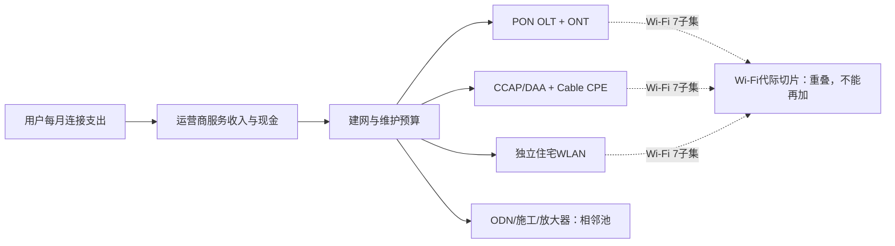

# 行业调研：宽带接入、PON、DOCSIS 4.0与Wi-Fi 7

研究截止日：**2026年10月10日，America/Los_Angeles**。2026年全年数字仍属估算；财务实绩以已公开的2026年二季度、上半年及中国2026年前8个月数据为主。预测覆盖2027、2028、2029自然年，前沿机会另观察至2030年。

证据标记：**F**＝监管、企业或研究机构已经披露的事实，其中市场调查并非审计数据；**M**＝管理层目标、产品承诺或机构预测；**C**＝直接计算；**I**＝本报告推断或条件模型；**U**＝尚不能识别。美元设备收入为供应商当年收入，包含产品组合变化；欧元、人民币披露保留原币种。附录A为各年度名义美元条件模型，价格是设备供应商不含税净收入；不另套通胀倍率或未核定汇率，相关冲击经售价、成本与客户预算传导。附录B为不变购买力美元现金模型，采用实际折现率。零售标价仅作产品定位证据。

本地研究线索来自允许范围内的《会议调研_ECOC_2026_2026-10-10.md》，其高速PON摘要已通过会议官方接口独立核验。经济判断、客户资料与模型独立联网形成。全文只对应本次指定的正式报告。

## 一、先给结论：升级成立，行业超常增长与利润扩张仍各有门槛

**最有依据的主线是一次有区域差异的设备更新周期：北美光纤建设和同轴改造较强，中国主要从覆盖建设转向存量提速和室内网络，Wi-Fi 7从高价产品向低价双频与运营商捆绑产品渗透。行业并未出现需要用AI算力增长解释的普遍物理产能短缺。** 存储器成本、合格料号、美国型号准入、现场改造和客户预算，比“芯片制程越先进越稀缺”更能解释当前收入、交付和利润差异。

| 核心判断 | 决定性证据及性质 | 本报告推导与条件 | 最强反证或未解决问题 |
|---|---|---|---|
| 技术代际增长可以与总市场停滞并存 | F：全球宽带接入及家庭网络设备1Q26收入44亿美元、2Q26为45亿美元；后者同比下降3%。同季北美PON支出增长26%、住宅Wi-Fi 7路由器出货增长62%。[Dell’Oro 1Q26][S02]、[2Q26][S01] | I：新增FTTH、旧网更新和Wi-Fi代际替换互相交叉；新标准收入不能全当新增终端预算。核心可加设备模型2026参考点约159亿美元，2028基准约185亿美元，2029约173亿美元；这些是模型结果，当前尺度的条件估计约130—190亿美元，绝非披露实绩 | 价格和产品分类透明度不足，模型绝对值可信度低于方向；如果客户连接量、净价和已验收交付同时加速，增长会超过基准 |
| XGS-PON是主力，25/50G是增长较快的小池 | F：中国8月底有7.04亿固定宽带用户、2.63亿千兆用户、3325万个10G PON端口；F：2025全球ONT出货1.58亿台；50G首批出货与试点已出现。[工信部8月数据][S06]、[ONT年度披露][S03]、[50G首批出货][S02] | I：多数客户可在已有ODN和10G接入能力上升级；25/50G需要共享端口繁忙、企业任务或真多千兆付费。2029基准25/50G OLT与ONU合计模型收入约11.25亿美元，仍是PON设备子集 | 千兆套餐渗透不是忙时负载，也不是新光猫采购；全球25/50G分代出货绝对值未公开，基数仅为宽范围假设 |
| DOCSIS 4.0的核心经济任务是延长既有HFC寿命 | F：Charter仍以2027年完成网络演进为目标；2025年10-K明确先用高分割、DAA与现有3.1 CPE提供多千兆，后续再导入4.0和1.8 GHz。[Charter 2Q26][S14]、[2025年10-K][S15] | I：网络变强先于全部用户换调制解调器。2028基准DOCSIS 4.0 CPE约1500万台、21亿美元，包含于Cable CPE；数字接入设备周期峰值可能晚于室外放大器峰值 | 4.0未能改善流失、维护成本或付费组合时，只形成防御支出；高分割3.1、按需光纤和FWA可推迟4.0换机 |
| Wi-Fi 7的数量机会大于长期单机溢价机会 | F：2025住宅Wi-Fi 7路由器出货增长211%，主要由低价双频产品驱动；2026成本上升促使运营商限制高端网关采购、扩大翻新。F：Wi-Fi 8芯片与平台已公开。[2025披露][S03]、[2026长期预测][S04]、[Broadcom Wi-Fi 8平台][S29] | I：最能兑现的价值是可靠性、室内覆盖、支持成本和留存，而非所有客户都需要320 MHz。基准模型Wi-Fi 7整机收入2028约100亿美元、2029约93亿美元，均与PON/Cable CPE和独立WLAN池重叠；Wi-Fi 8会分走高端预算 | 客户端不支持MLO、射频环境不佳、网口或回程受限，会削弱收益；新型号准入可能延迟Wi-Fi 8并拉长Wi-Fi 7存续期 |
| 涨价收入不等于利润增加；合格供应商可能受益于准入壁垒 | F：Calix 2Q26收入约2.933亿美元、非GAAP毛利率54.8%；3Q指引毛利率50.5%—53.5%，附加费目标是回收存储成本。F：FCC对境外生产消费路由器实施新授权限制，同时保留既有授权与条件批准。[Calix股东信][S17]、[FCC规则说明][S33]、[9月条件批准清单][S34] | I：库存、附加费重定价和型号批准决定价值在芯片、系统商、OEM与运营商之间如何移动。基准毛利池可在成本缓解后恢复；行业净利润与ROIC缺少统一口径，不能用毛利替代 | 加价不能及时转嫁、旧库存被高估或客户转向翻新时，设备收入和现金会背离；准入放宽又会释放竞争 |

两条最重要的反面解释都应保留。第一，当前订单只是存储器涨价前的提前采购，2027年连接和采购将回落；第二，光纤与FWA竞争迫使运营商降低价格，更新设备只是维持份额，新增供应商收入没有提高产业利润。现有证据支持“局部建设和更新周期”，尚不支持将其升级为全行业持续高增长。最需要补齐的资料是全球分代出货、运营商库存与翻新量、同配置实际成交价、具体型号批准和地区忙时拥塞数据。

## 二、先固定边界：用户买连接，设备商卖实现连接的不同层次

### 2.1 客户任务、预算和验收单位

住宅客户购买的任务是“家中多个设备稳定联网”，常见支付单位是每户每月套餐。企业和MDU客户更关注对称上行、恢复时间、隔离、覆盖、管理接口和服务责任；其单位可以是每条专线、每幢楼、每个站点或每个受管终端。光纤运营商采购的是可服务位置、OLT端口、接通的ONT与运维能力；有线运营商采购的是服务组、节点、频谱升级、调制解调器及相关软件；室内网络按网关、mesh节点和受管用户收费。

采购方通常是运营商网络、终端、采购和财务部门，验收分网络性能、互通、安装、计费与客户体验；现场失败成本主要由运营商承担，设备商承担质保、整改、库存及合同交付风险。消费者看到的速率指标只是验收的一部分。FTTH通过一个地址、该地址实际连接、用户拿到一台新网关、用户愿意多付钱，是四个不同事件。

预算有三种来源：

- **新增**：未覆盖地区、已覆盖但未连接的客户、新园区或MDU；建设、接通、运营服务的现金先后发生。
- **替代**：铜线退网、GPON转XGS、3.1换4.0、Wi-Fi 6换7；用户总数可能不变，设备支出会增加。
- **内部转移**：移动与固网捆绑、免费路由器、家庭安防和网络管理、Wi-Fi分流；收入可能在业务之间重分类或由原套餐承担。

AT&T 2Q26同时有36.7万光纤、27.9万固定无线的消费者与企业净增，表明光纤和FWA可以服务不同成本与需求区间；这不是两类新增“家庭总数”的简单相加。其季度披露38.6百万光纤可达位置，包含自营网络、收购业务和开放接入，不能全认作当季新建。[AT&T 2Q26公告][S09]

### 2.2 总池、可加子池与重叠池

本报告的**核心可加设备池**由以下五项组成：

1. PON局端OLT：线卡、光接口及分摊系统/嵌入式软件；Remote OLT计入这里。
2. PON用户侧CPE：主ONT/ONU及纳入家网供应链的FTTR子ONT；集成Wi-Fi的整机计一次。
3. Cable CCAP/DAA：CCAP、vCMTS、RPD、Remote MACPHY及软件；Remote OLT已归PON，不再计入。
4. Cable用户侧CPE：DOCSIS调制解调器和集成网关。
5. 独立住宅WLAN：独立路由器、独立出售的mesh节点；已计入PON或Cable网关的无线部分不再加入。

**Wi-Fi 7是横跨第2、4、5项的代际切片；DOCSIS 4.0 CPE是第4项的子集；25/50G PON是第1、2项的子集。** 三者均不能在五项合计上再加一次。若用户同时买独立ONT和独立Wi-Fi路由器，两台设备可以相加，因为是两个实际采购对象；若ONT已经集成Wi-Fi，则只计一台。

光缆/分光器/接头等ODN、施工、Cable室外放大器及无源器件、运营商服务收入、企业WLAN、FWA、卫星和独立的增值SaaS属于相邻池。它们可决定本行业的预算、成本或替代，但不混入核心合计。独立SaaS与硬件收入有独立付费时可分别分析；嵌入式许可证已在设备售价中的部分不能再次加入。数据中心PON带外管理在前沿章节单列，未加进住宅/运营商核心池。

供应商收入跨层重复并不代表数据错误：芯片商卖给整机商、整机商卖给运营商，均有收入，但两者不是两个独立终端需求。核心毛利池只计算所建模的整机/系统供应商毛利；芯片、晶圆和渠道毛利在其采购成本或渠道差价中，不能称作完整产业增加值。

## 三、现实基数：连接增长、覆盖扩张和运营商经营正在分化

### 3.1 可核验的事实底表

| 对象与地域 | 公开日期／经济期间 | 原始披露及口径 | 经济含义与限制 |
|---|---|---|---|
| 全球宽带接入与家庭网络设备 | 2026-06-11／1Q26；2026-09-08／2Q26 | 44亿美元、45亿美元；2Q同比-3%；包括PON、Cable、DSL、FWA CPE和住宅WLAN。[S02]、[S01] | C：上半年约89亿美元，因季度数已取整也只能是约值。公开信息不支持把某季简单乘4充当全年实绩 |
| 全球ONT与DOCSIS基础设施 | 2026-03-11／2025全年 | ONT出货1.58亿台；DOCSIS基础设施支出同比-21%，RPD支出-47%；住宅Wi-Fi 7出货+211%。[S03] | 数量、支出和新代际并不同步；ONT是否完整包含所有FTTR子终端的公开细分不足 |
| 全球2Q26结构 | 2026-09-08／2Q26 | 北美PON支出+26%；Cable Remote OLT端口出货+190%；RPD与Remote OLT合计收入+63%；住宅Wi-Fi 7出货+62%；FWA CPE数量-12%。[S01] | Remote OLT有线运营商采购并不改变其PON属性；相同消息不能当多源确认 |
| 中国固定接入 | 2026-09-28／截至2026-08-31 | 固定用户7.04亿、年内净增1365万；千兆用户2.63亿、净增2427万；10G PON端口3325万、净增162.9万；FTTH/O接入端口12.3亿。[S06] | 接入端口、局端PON端口和用户的物理单位不同。C：千兆用户年内约+10.2%、10G端口约+5.2%，支持存量迁移；不能据此计算真实分光负载 |
| 美国光纤建设 | 2025-12-16／2025调查；2026-01／2025成本调查 | 2025新增11.8百万FTTH passings，累计98.3百万，包括多次覆盖；新增unique homes约8.1百万；全美光纤可达超过60%家庭。[S07]、[S08] | 新增passing不等于新增家庭或付费连接；约3.7百万差额涉及重复覆盖。调查覆盖与统计时点不同，不从两个年度累计数差值重建年度流量 |
| AT&T | 2026-07-22／2Q26 | 光纤可达38.6百万位置；消费者光纤用户12.144百万、消费者光纤净增34.4万、ARPU每月72.29美元；全公司含企业光纤净增36.7万。[S09]、[S10] | 12.144百万与38.6百万边界不同，不能相除当运营商精确渗透率；ARPU同比变化包含Lumen客户混合 |
| AT&T收购 | 2026-02-02／交易完成 | 新纳入超过100万既有光纤用户和超过400万位置。[S11] | 收购导致份额和报表规模增加，没有等量新增行业用户与设备 |
| Comcast美国住宅宽带 | 2026-07-23／2Q26 | 用户28.486百万、季度净减16.7万；收入62.80亿美元、同比-5.5%。电话会称ARPU同比-3.8%，约45%用户处于gig-plus套餐。[S12]、[S13] | 高速套餐占比提高仍可与收入下降共存。2026披露中部分DTC佣金归入宽带，比较应使用公司重述口径 |
| Charter | 2026-07-24／2Q26 | Internet用户29.388百万、季度净减17.2万，含小企业；住宅Internet收入57.76亿美元、同比-3.2%；总passings58.981百万；全年capex目标约114亿美元。[S14] | 用户和住宅收入范围不同，不直接算Internet ARPU；全公司capex不能全部分配给DOCSIS 4.0 |
| Calix | 2026-07-20／截至2026-06-27季度 | 收入293.329百万美元（2.93329亿美元）、同比+21%；软件与服务50.546百万美元（5054.6万美元）、同比+16%；非GAAP毛利率54.8%；美国收入95%。[S17]、[S58] | C：软件与服务约占收入17.2%，含即时确认许可证、SaaS、支持与专业服务，不能全认作经常性SaaS |
| Nokia Fixed Networks | 2026-07-23／2Q26 | 固定网络销售按固定汇率-2%，用户侧光纤产品减少，局端OLT增加；固定网络产品组合对利润率有正贡献。[S18]（PDF第4页） | NI的AI/Cloud高速增长不能外推到Fixed Networks；CPE占比下降可使销售减少、产品组合改善；不代表退出PON终端 |
| Harmonic Broadband | 2026-08-12／截至2026-07-03季度 | Broadband收入同比+54%、Rest-of-Market +44%；2026全年Broadband收入目标5.05亿—5.25亿美元。[S19] | 是公司财年季度；原有Video出售使总公司口径变化，目标不是已实现收入 |
| Vantiva | 2026-07-30／1H26 | 收入7.34亿欧元，-14.7%报告口径／-8.9%固定汇率；调整后EBITDA4300万欧元、FCF3000万欧元；2025比较数已重分类。[S20] | 与Calix增长形成重要异质性，不能把产品热度等同所有OEM收入和利润同向 |
| Vistance/Aurora | 2026-08-06／2Q26 | Aurora收入3.192亿美元、同比-1%；调整后EBITDA4550万美元，去年8020万美元。[S21] | 传统业务下降和Access Technologies增长同时存在；“Cable升级”不足以推导整家公司利润增加 |

市场调研发布会发生取整、重估和分类调整。2025年的1Q、2Q早期公布约44亿、47亿美元，4Q约48亿美元，4Q环比+7%可回推3Q约44.9亿美元；据此重建全年量级约180亿—187亿美元，而非一个审计全年值。后续同比回推与早期发布存在小差异，不能人为消掉误差。本报告用这个量级校验设备模型，原值与回推值分开保留。[2025年1Q][S53]、[2Q][S54]、[4Q][S03]

### 3.2 为什么“覆盖仍增长”不保证建设回报提高

美国2025新增11.8百万passings中，约8.1百万是独特位置。重复覆盖意味着同样的终端家庭预算可能分配给更多基础设施，追加OLT、ONT和施工收入，却同时压低单个运营商的take rate与价格。行业整体中等40%段的光纤连接率，并不是第三家进入者能够拿到的份额，更不能对包含重复覆盖的所有passings统一套用。[FBA市场更新][S55]

FTTH早期必须支付路权、make-ready、施工和主干成本，随后才随连接增加采购ONT。覆盖项目延迟会压低OLT订单；终端价格上涨则可能让已经覆盖的地址延迟连接，扩大“passed但未connected”的差额。设备供应商的备货收入、运营商的固定资产和消费者的现金支出会在不同季度出现。

中国的情况不同：绝大多数接入端口已经光纤化，新增用户的速度低于千兆套餐迁移。现有GPON、XG-PON与XGS-PON共存，套餐迁移可能只改变计费，也可能换光猫、换线卡或重建室内网络；没有各类迁移明细时，不能把2427万新增千兆套餐用户全部算作新OLT、50G ONU或Wi-Fi 7订单。

FWA和卫星的替代作用主要通过预算与选择权发生。FWA可在移动网剩余容量较充裕、用户对稳定上行要求较低的地址，用较少前期固定建设取得订阅；容量拥塞或回传投入上升后优势减弱。卫星适合高造价和难覆盖区域，不需要夺走大部分城市用户，也能限制低密度FTTH的可获得价格与补贴。BEAD自2025-06-06调整为技术中性竞争，424.5亿美元法定项目资金不能当成PON设备订单。[NTIA重构通知][S35] 2026-05-04官方快照中54个最终提案获NTIA批准、52个获NIST批准、50个已签回协议；这是该日里程碑，不是截止10月已经完成的建设数量。[BEAD进度快照][S36]

## 四、技术采用：经济上有四条路径，而非一场统一的带宽竞赛

### 4.1 PON：复用ODN的价值很大，用户侧成本仍随每户重复

GPON、XG-PON、XGS-PON、25GS-PON和50G-PON不是简单依次强制替换。GPON适合低价存量任务；XG-PON的非对称能力能服务部分千兆下行；XGS-PON提供约10 Gbit/s对称线速，是新增光纤、多千兆与存量更新的主要平台。25GS-PON是一条MSA产业路线，50G-PON有ITU体系，二者存在相互竞争和共存，客户可以跳过某一代。[ITU XGS-PON][S37]、[25GS-PON MSA资料][S64]、[ITU 50G-PON][S38]

50G-PON名义下行50 Gbit/s，上行可选12.5、25、50 Gbit/s；“50G”不能自动解释为每个用户50G对称，更不能把共享线速当实际用户吞吐。分光、光功率预算、不同波长共存、突发接收、FEC、DBA、上联、供电和软件互通均影响合格交付。25G PON已存在明确商业用户，例如2024-06-12披露的Chorus与2Degrees首个25G客户；该案例为真实商用网络中的试点接入，未披露合同价或收入，不能证明全球家庭已经规模迁移。[Nokia/Chorus商用公告][S39]

进一步的采购方证据是GFiber Labs公开20 Gig Early Access套餐：采用25G PON，选定住宅客户价格250美元/月，另加税费，仍非广泛可用，并需要专门现场安装。[GFiber客户套餐页][S62] 这是明确收费产品和有限采用的证据，未给出用户规模。它挑战“家庭任务永远不需要25G”，也挑战“高代际已经成为大众刚需”；少量高价客户足以支持特定端口，却不足以推导数百万低价ONU。把所有高速家庭套用250美元ARPU，或把此报价当ONU成交价，都会错置价值层。

**采用阈值应从实际端口负载和任务推导。** 作为工程示例，若XGS端口可用净带宽取8.5 Gbit/s、规划忙时利用上限70%，32个活跃终端的平均忙时吞吐上限约：

8.5 × 70% ÷ 32 = 0.186 Gbit/s，即186 Mbit/s/终端。

这是规划假设，非行业标准。若每户平均忙时60 Mbit/s，32户合计1.92 Gbit/s，远低于上述门槛，即使每户购买1G或2G套餐也未必需要50G。64户、实际并发多千兆、企业备份和移动回传会较早触及边界；若上联或室内Wi-Fi先成为限制，单换更快PON不会解决完整任务。

因此50G扩大需求的必要条件是：高价值任务或端口拥塞出现、合格ONU成本下降、共存与安装风险可控、业务价格/留存/运维节约足够覆盖更新。政策小区试点可以加快资格验证，但不能替代后续付费使用。2026-05-26 Broadcom公布BCM68850网关与BCM55050 OLT芯片时明确处于early-access客户送样；这代表可供设计导入，不代表全年大规模出货已兑现。[Broadcom 50G芯片公告][S28]

复用ODN减少重新开挖，是PON价值的重要来源；这也会压低可销售设备数。高容量端口可能用更少线卡承担同样业务，GPON与XGS共存可能延长旧ONU寿命。对OLT供应商，单位端口价上升与端口节省相互抵消；对运营商，这是资本效率改善。50G功率预算和多代共存仍须逐网检查，不能保证每条既有光纤原样复用。

### 4.2 DOCSIS：高分割3.1、FDX、ESD与按需光纤是可组合的选择

基础DOCSIS 4.0支持最高约10 Gbit/s下行、6 Gbit/s上行网络容量。FDX通过在部分频段重用上下行频谱并处理回波与干扰；ESD通过扩展频谱及分配上下行频段增加容量。两者有不同的节点、放大器、调制解调器和现场约束，不能把协议上的峰值速率当作任意HFC网络的可交付速率。[CableLabs DOCSIS 4.0说明][S23]

现实采用分阶段：

- 先进行节点拆分、高分割、1.2 GHz扩展或DAA，使旧3.1调制解调器得到更好上行与容量；
- 再将合格4.0调制解调器与FDX或1.8 GHz ESD网络匹配；
- 对高需求或新覆盖地址，直接采用PON，或在既有节点上部署Remote OLT；
- 3 GHz扩展是额外的可选路线，并非当前每个4.0网络必须升级的步骤。

Comcast在2023年启动FDX商业服务；2024年披露超过100万家庭可达、六个市场，并推进支持放大器级联的现场部署。这里的百万是可达覆盖，不能当百万已付费4.0用户。[Comcast FDX进展][S45] 2026-06-11 CableLabs公告多家厂商取得**DOCSIS 3.1 Verified for Interoperability**，随后继续4.0认证；3.1 VFI不等于完整4.0认证，也不否定个别封闭平台已经商业运行。[CableLabs VFI公告][S24] 9月披露的BPI+ V2安全互通进一步证明生态阶段进展，仍没有给出家庭付费渗透。[9月安全互通][S25]

2024年Broadcom、Charter、Comcast联合开发统一FDX/ESD芯片，可以扩大共享研发规模、减少终端平台碎片，也可能集中芯片议价权。节点、OEM调制解调器厂商的数量并不等于拥有同等数量的独立核心硅平台。[统一DOCSIS芯片公告][S27] MaxLinear提供替代平台，是可改变这种集中度的竞争者；其Puma 8的VFI仍应按互通阶段解释。[MaxLinear VFI][S48]

**经济上的核心选择不是“同轴是否永远快过光纤”，而是既有同轴的增量更新现金，能否在客户转走之前换来足够留存与运维节约。** Charter历史方案约100美元/passing是目标且排除了新4.0 modem及部分附加成本，不能当2026全套完成成本；其完成时间也由早期约三年/2026目标转至2027。[Charter原始投资者材料，第11页][S16] 对已有HFC的运营商，资产沉没成本不应再付一次；对新增地区，PON没有同样的存量沉没条件。因此“cable运营商也在买PON”与“DOCSIS 4.0仍有商业意义”可同时成立。

### 4.3 Wi-Fi 7：空口改进只是端到端体验的一部分

Wi-Fi 7的关键功能包括MLO、更宽信道、4K-QAM、资源单元与打孔等效率改进。320 MHz需要可用的6 GHz频谱和相应AP/客户端支持；4K-QAM要求较好的信噪比；MLO收益取决于双方实现、可用链路和干扰条件。PHY峰值、多频段合计速率和单客户端实际业务吞吐不同。[Qualcomm技术参考][S31]

商业产品已分成两层：

- **双频低价产品**：2.4/5 GHz、较少空间流、2.5G网口，主要解决替换和体验；MediaTek Filogic 860是双频平台的明确例子，双频不能自动等价于三频320 MHz配置。[MediaTek 860公告][S30]
- **三频、高端mesh和运营商网关**：多千兆网口、更强处理器、更多内存、6 GHz及更复杂管理，服务大户型、多设备和高价值用户；设备贵、内存风险与安装支持负担更大。

中国6425—7125 MHz已划分用于IMT，不能把美国6 GHz Wi-Fi产品的320 MHz能力直接移植到中国住宅预测。该频率划分本身也不构成其他国家禁止6 GHz Wi-Fi的证据。[工信部频率划分说明][S32] 低价双频增长解释了为什么Wi-Fi 7“台数”可以快速增加，却没有同等整机ASP提升。

运营商采购的收益还可能来自远程诊断、少上门、家庭安防、mesh优化、移动分流和低流失；这些能力相当部分由软件、安装与服务流程决定，无法完全归因于802.11be。2026年Charter已推出集成5G与电池备份的三频Wi-Fi 7服务，价值任务扩展到停电/断网保持连接；电池、蜂窝备份与套餐责任应单独验收，不能全算作Wi-Fi 7射频价值。[Charter 2Q26产品披露][S14]

价格已有强约束。TP-Link 2024-11发布双频Wi-Fi 7产品，起价99.99美元；同期也有数百美元的高端配置。这是当时零售标价，不能充当2026运营商净成交价或OEM出厂价，但证明Wi-Fi 7并非必然维持高端溢价。[TP-Link产品发布][S56] 本报告Wi-Fi 7模型进一步区分集成PON网关、Cable网关与独立路由器，按完整设备收入计量，价格下降与高价型号混合分别处理。

### 4.4 AI需求的正确桥梁：文本Token弱，可靠连接和管理预算较强

文字推理不是家庭带宽爆炸的直接证据。示例假定每秒30 token、每token含协议开销100字节，输出链路约24 kbit/s。该假设不是模型服务的实测编码；它只是展示数量级。图片、实时视频、云游戏、模型/素材下载和多设备并发可能高很多，仍须分别测量忙时任务、上行和支付意愿。

AI真正可能改变本行业的路径有三条：多模态工作增加高质量上行与低时延要求；网络自动化降低支持成本；PON进入数据中心OOBM管理网络。前两条不保证运营商ARPU上升，后者有新的设备客户，但不属于GPU训练交换fabric。把数据中心以太网、光模块或Token预算整体加给宽带接入会重复计算终端预算。

## 五、有效供给与价格：总体更接近采购约束，特定料号和市场存在结构性缺口

### 5.1 供给如何形成，以及现在最靠近哪一侧

成熟PON ONU、旧代Wi-Fi与DOCSIS 3.1已有跨国设计和制造生态；2025年1.58亿ONT真实出货证明大规模交付下限。局端还有运营商资格、软件版本、运维接口和系统责任门槛。新25/50G ONU、4.0 modem、美国新路由器型号的“物理能制造”与“特定客户可以使用”距离更大。

独立供给证据包括：已交付历史规模、多个终端OEM参与互通、芯片送样/量产阶段、厂商库存和融资状态、型号批准。它们支持“成熟SKU具有较强交付基础，下一代SKU资格更窄”；没有公开晶圆、封装、良率与逐厂产能资料，无法测得一个全球可售产能数字。附录的S是**以历史交付为下限、对组件与资格条件作明示假设的可交付包络**，不是已验证工厂产能，不用需求Q反推S来宣称供需平衡。

| 产品/工作量 | 需求侧独立判断 | 供给侧独立证据与限制 | 当前联合判断 |
|---|---|---|---|
| GPON/XG(S)-PON用户侧 | 新连接、净更换与FTTR额外终端提供大盘；价格上升与翻新削弱高端采购 | 年度158百万ONT历史交付、多家OEM；存储/BOM成本上升，个别企业现金弱 | 更接近大盘可供、预算与SKU结构约束；内存或获批高端型号可短缺，不等于所有ONU短缺 |
| OLT局端 | 北美建设较强，中国主要存量迁移；网络新建与ONT连接之间有时滞 | 系统商、自研芯片、多代平台；资格和软件锁定，25/50G突发光器件未全面成熟 | 10G总体无充分短缺证据；新增地区特定供应商交期与下一代资格是结构性约束 |
| CCAP/DAA及室外改造 | 大运营商阶段性计划决定年度工作量 | 供应商软件、节点、放大器与现场施工须配套；初始芯片路线集中 | 约束常在整网现场可验收能力，数字设备到仓库不是改造完成 |
| DOCSIS 4.0 CPE | 兼容网络覆盖×付费用户×换机比例；3.1继续可用 | Broadcom平台、MaxLinear替代、OEM互通进展；完整4.0资格须逐型号核验 | 2026可交付型号结构较窄；2027—2028随着生态扩大可能由资格约束转向替换意愿 |
| Wi-Fi 7路由/网关 | 新代际替换较强，低价双频主导数量；高价配置可被翻新替代 | 多芯片/OEM；内存供给与美国新型号准入；库存可以缓冲当季 | 全球总台数缺口证据不足，美国获批SKU与高端内存配置更容易形成交付缺口 |

这里的判断允许供给侧独立失效：即使需求低于模型，某个芯片停供或某个美国型号不获批仍可造成客户短缺；即使厂商交期长，也可能主要是订单集中、备货和少数SKU，而不是全球经济需求超出物理能力。

### 5.2 2026存储成本冲击：谁先承担，谁能重新定价

Dell’Oro 9月披露运营商在ASP增加前提前购买OLT/ONT；7月预测又认为CPE成本可能扩大passed/connected缺口、刺激翻新和减少高端Wi-Fi 7采购。这些是调查判断和预测，不能当作每家运营商统一执行的数量。[2Q26市场调查][S01]、[7月预测][S04]

Calix给出了更具体的会计与合同证据：2Q26毛利下降主要受存储成本影响，附加费仅部分抵销；新订单附加费按月调整，3Q交付的既有backlog沿用2Q附加费率。公司称长期目标是成本回收、并非新增利润。直接推论是：某一批次收入增加，绝对毛利可能不变，毛利率还会因分母变大而下降；在重定价滞后时，绝对毛利也会受损。[Calix股东信][S17]

示例：原售价100、成本75、毛利25；内存成本增加10并全额转嫁，售价110、成本85、毛利仍25，毛利率由25%降至22.7%。只转嫁5时，售价105、毛利20，毛利率19.0%。这是C，不是Calix单产品披露。

融资与库存使冲击不同。Calix当季经营现金流1650万美元，存货周转低于其目标，DPO提高，说明备料与供应商付款也参与缓冲；Vantiva上半年现金及可用额度有限，客户/成本/交付错配更可能成为有效供给约束。一个高毛利平台商与低毛利OEM都可能面对同一内存涨价，却有不同现金承受力。[S17]、[S20]

### 5.3 美国路由器准入：供应“资格”可以比组装产能更稀缺

2026-03-23，FCC把境外生产消费路由器纳入Covered List的新设备授权限制，同时说明先前已授权型号可以继续销售、进口和使用，取得DoW/DHS条件批准者可继续申请授权。规则按生产地界定而非品牌国籍，美国品牌境外制造也受影响。该说明不能解释为全部既有路由器立即停售，也不能直接套给所有OLT或企业交换设备。[FCC事实说明][S33]

已经核验的2026-09-18名单包括Netgear、Adtran、eero、Calix、Nokia、Sagemcom、Arcadyan等特定产品或系列；期限不同，例如Netgear/Adtran列示至2027-10-01，Calix部分系列至2027-11-22，Sagemcom与Arcadyan相关产品至2027-12。[FCC DA 26-996，附录B第6—8页][S34] 本报告未取得截至10月10日逐型号完整授权数据库快照，也未假定系列批准自动覆盖所有未来设计。

这会产生四个经营传导：已获批SKU更易获得替代订单；新平台升级必须同时完成芯片、运营商和监管资格；厂商可能备货旧型号或改变制造安排；批准续期和硬件变更范围在2027—2028变得重要。供应缓解会提升运营商的可选型号，却可能削弱既有供应商的暂时溢价。基准路径假设主流平台能维持合法交付，乐观路径额外要求新代际批准不拖延，悲观路径包含新型号受阻与旧型复用。

## 六、竞争与价值捕获：系统责任、客户入口和软件比标准名称更关键

| 参与者/层级 | 技术和经济位置 | 价值捕获机制与发展条件 | 主要未知/竞争压力 |
|---|---|---|---|
| 运营商：Comcast、Charter、AT&T、Verizon、三大中国运营商、欧洲/日本/新兴市场固网商 | 拥有入口、预算、地址覆盖、计费与现场责任；大客户自研控制软件和网关要求 | 捆绑移动、设备租赁/套餐、较低流失及维护成本；采购规模可压低设备溢价 | 部分美国宽带量价下降；重复覆盖、补贴替代与高债务限制现金 |
| Nokia、Huawei、ZTE及FiberHome等PON系统商 | OLT、ONT、接入软件和多代共存；自研芯片与平台减少外部依赖 | 长期资格、管理软件、迁移工具与部署责任；优质OLT组合可胜过低价CPE份额 | 地域准入、客户自研、低价ONU竞争；Nokia NI增长不能分配给PON |
| Calix、Adtran | 运营商接入及家网平台；Calix更偏美国BSP、软件/受管服务，Adtran亦含光传输 | 帮助较小运营商获客、运行和服务管理；客户生命周期价值、软件附着与迁移成本 | 软件收入定义复杂；客户集中、成本转嫁、销售投入；Adtran 2Q26收入2.811亿美元、GAAP运营利润率-3.6%，毛利不是盈利保证。[Adtran 2Q26][S22] |
| Broadcom | DOCSIS/PON/Wi-Fi核心硅和参考设计，参与运营商联合开发 | 芯片、固件、参考设计与跨标准整合形成规模与设计导入壁垒 | 大运营商共同控制规格，替代硅与自研；50G/新Wi-Fi送样不等于现金贡献 |
| MaxLinear；Qualcomm、MediaTek、Realtek等芯片竞争者 | MaxLinear提供DOCSIS/PON替代；Qualcomm等提供不同层级Wi-Fi/连接芯片，各家覆盖不相同 | 多源、成本与功耗优势、OEM适配；可降低单一芯片平台依赖 | 高端认证、软件兼容与规模摊薄；不把单家整体芯片收入归为宽带 |
| Harmonic、Vistance旗下Aurora、Vecima等 | vCMTS/DAA、RPD、节点软件与PON扩展；软件与现场设备结合 | 系统集成、虚拟化运维、存量平台升级及长期客户关系 | 运营商采购集中，协议标准化不消除软件锁定；系统量增而旧业务或费用仍可拖累利润。[Vecima已交付节点与可升级边界][S59] |
| Vantiva、Sagemcom、Sercomm、Arcadyan、Gemtek、Hitron、Ubee等整机/OEM | 多制式运营商网关及设计制造，芯片平台外采为主 | 合格SKU、规模采购、射频/固件、量产交付、质保与准入；现金和备料能力重要 | 毛利较薄、营运资本大、客户延迟和翻新；不同市场需分别批准 |
| TP-Link、ASUS、Netgear、Amazon eero等品牌 | 消费者/渠道入口，独立路由、mesh与软件 | 品牌、分销、应用管理、售后和订阅；Wi-Fi代际是获客理由 | 低价双频压价，运营商免费网关替代独立购买；不是所有品牌拥有独立核心硅 |
| Airties、Plume及运营商自研家网软件 | Wi-Fi优化、管理与数据层，可能跨OEM；Airties已有德国电信Wi-Fi 7部署，Plume强调跨代软件编排。[S60]、[S61] | 支持成本、留存、服务附加收入及跨硬件数据控制 | 服务可能由运营商内化，软硬一体平台或开源标准降低外购金额；公开独立盈利资料少 |
| ODN/光器件/施工；FWA、卫星、开放接入及新型PON厂商 | 相邻预算、合格光器件和工程履约；替代技术与商业模式 | ODN长寿命、施工能力、低密度覆盖、共享网络批发 | 按单位成本和覆盖利用率定价；与本核心池不可无条件相加 |

企业归属必须按当前业务划分：Vantiva已整合原CommScope Home Networks；原CommScope的CCS于2026年出售给Amphenol，当前Vistance的Aurora承担原接入网络业务。不能把原CommScope历史全部收入、产品和毛利同时归给三个当前主体。[Vantiva披露][S20]、[Vistance 2Q26][S21]、[Amphenol交易公告][S57]

一种会改变价值分配的路线是**把家庭体验管理从专属硬件解绑**。Airties在2026-05-07宣布商业提供Lite，利用TR-369/标准数据模型管理消费者自购路由器，无需嵌入自有软件代理；前提是设备支持相应接口和授权，功能也不等于完整嵌入式套件。[Airties Lite公告][S63] 本报告推断：运营商可以延长现有硬件使用、扩大可采购品牌，软件商获得更多受管用户，而整机平台的附着与更换需求可能下降。竞争优势会更多依赖诊断质量、CRM/支持流程和责任，而非仅靠独占网关。这一产品公告没有披露净新增付费用户或独立利润，不能先认作价值迁移已经兑现。

Calix财报还显示，2Q26软件与服务毛利率为63.0%，同比下降2个百分点；上半年该项下降5.5个百分点，披露原因包括第二代向第三代平台迁移时并行运行双云环境。[Calix 10-Q][S58] 软件可复用并不等于增量运行成本为零，迁移成本和客户新增速度仍决定费用摊薄；该混合分项也不能充当纯SaaS毛利率。

盈利有三种不同机制。平台/芯片商可通过设计导入和软件复用摊薄固定开发成本，但也有研发失败和客户集中风险；系统商可通过复杂迁移、资格与维护责任保留价格；OEM主要依赖制造、采购、库存和交付，收入增加常需要同步占用现金。Calix高毛利并非全部来自SaaS，Vantiva调整后EBITDA不能与Calix毛利率比较，Aurora的调整后指标排除部分总部历史分摊，均不提供统一ROIC结论。

**量增条件**是客户建设/换机、库存释放、获批SKU和交付；**利润扩张条件**还要有成本下降快于净价、合同及时重定价、研发/销售摊薄及较少异常库存；**现金改善条件**再加应收、存货、付款条款和建设验收。若运营商能用少量节点、更少光接口或翻新CPE取得同样体验，技术成功也会使供应商单位需求减少。

## 七、年度联合情景：基准是更新周期，乐观需要连接和现金同时兑现

附录A给出五个可加池、三项重要技术子集、数量/净价/成本/交付包络及参数来源。所有情景数字均为I；表中算术精度只是为了复算。**三条路径不是覆盖全部可能结果的概率分布，未赋互斥路径权重；各事件概率在第九节单独定义。**

- **悲观：预算受挤压、提前采购回吐、旧型与翻新延用。** 终端净替换率较低；美国部分新型号或新硅资格延迟；内存成本转嫁滞后，净价偏高但销量和单位毛利受压。DOCSIS可用3.1先升级，下一代PON保留试点与企业任务。
- **基准：连接稳步增加、主流升级兑现、组件成本逐步缓解。** XGS/PON与DAA更新进入2027—2028，CPE滞后于覆盖；2028后节点更新下降，Wi-Fi 8转走部分高端预算。净价缓慢下行，单位成本下降更快时毛利恢复。
- **乐观：覆盖转连接较快、多代互通顺利、准入与供给释放。** 多源平台和较低BOM扩大采购量，OLT/ONU/PON高代际与DOCSIS换机共同放量；单位价格通常低于悲观，高利润主要靠单位成本与固定费用摊薄，部分节约仍给消费者。

最重要的时滞是“建网预算/路权→OLT和节点→覆盖验收→接通ONT/CPE→用户套餐与留存→合同重定价与现金”。订单到仓、付费采用、经常收入、利润与现金不能在同一天成立。

> 核心合计表、各细分年度参数和精度说明见附录A。基准2028毛利池约50.9亿美元，2029约49.6亿美元；悲观2029约20.6亿美元，乐观约74.9亿美元。该毛利池扣除了所建模设备生产成本，尚未扣研发、销售、总部、利息与税，也未计产业链其他层利润，不能当行业净利润或现金流。

与公开第三方预测相比，Dell’Oro 2026-07对2026—2030宽带设备的CAGR给0.5%、PON给1.6%，并认为设备总收入在2028达到峰值；这些为M。本报告基准也保留周期峰值，但核心设备池的前期增长较高，原因是XGS/CPE混合和北美升级，后续回落较明显。乐观路径显著高于该预测，需要附录所列新增连接、替换、净价与交付条件；公共预测提供挑战模型，不能作为已实现收入或作为模型正确性的独立验证。[Dell’Oro 7月预测][S04]

室外放大器另有周期：2026年机构预期收入+20%，2027达到峰值，本轮近1000万只新放大器；这些是预测/累计周期数量，未纳入CCAP/DAA合计。[Cable室外设备预测][S05] 室外工程先投入、数字节点与终端后兑现，允许不同供应链峰值错开，也不保证2027以后有同规模更新需求。

## 八、资本回收：少量ARPU或留存改善不一定够

### 8.1 FTTH新建项目：相同1000个可覆盖位置、同一资产边界

附录B使用20年经济评价期、完整覆盖成本、连接成本、爬坡、每户服务成本、ONT五年更新、OLT第8/16年更新与残值。价格为模型不变美元，现金为无杠杆、税前项目现金；不是任何运营商公司估值。网络较长物理寿命不保证竞争市场中的经济寿命相同。

本模型悲观/基准/乐观的每passing建设投入2500/1500/1000美元、成熟take rate38%/50%/64%。年度现金按年初/年末平均在网客户计算，避免把当年接通用户当成全年收费。对应1000个位置NPV约-202.7万美元、-3.8万美元、+188.7万美元；基准不折现回收约10年，而悲观20年仍未回收。基准保持同样爬坡形状时，成熟take rate约51%触及NPV零；它是模型阈值，不是光纤行业统一标准。

FBA/Cartesian 2025施工调查的地下和架空中位数约18、8美元/英尺；每passing的管线路径长度、密度、make-ready和混合方式才决定最终成本。每passing成本增加500美元，在其他条件不变时使NPV直接减少500美元。重复覆盖、连接延迟与补贴不足可能轻易把基准边际回报推到负值。[FBA成本调查][S08]

### 8.2 DOCSIS增量改造：计入相对于继续3.1的现金差额

另以既有1000个HFC passings、初始付费55%建立10年增量模型，升级投入120—250美元/passing，额外CPE溢价60—110美元/付费客户，三年分批换机，第8年另更新。模型只计相对于不改造的客户流失差额、实收ARPU溢价与净维护节约；原有全部客户收入不能归给新投资。

悲观/基准/乐观NPV约-31.6万、-5.6万、+22.4万美元。基准虽然不折现约第10年回收，10%折现仍未回本。在本模型基准成本与寿命下，若实收ARPU不提高，年净客户流失改善需约2.49个百分点；若平均每活跃客户实收提高0.60美元/月，则约需2.20个百分点。使用的是年度**净客户流失轨迹差**，不是原始gross churn，不能直接与公司月流失率比较。

这解释了低改造单价与经济回报之间的距离：既有网络便宜可以延缓不可逆的大规模替换，但流失、价格和维护改善仍须发生。工程价值、竞争防御与财务NPV可以分别成立或失效。上述FTTH是新建、DOCSIS是既有网增量，评价期也不同，NPV不能直接用来排序同一地区的两种技术；同址选择还要重建相同存量客户和迁移边界。

### 8.3 Wi-Fi 7网关：付费和支持节约要达到什么程度

若相对继续旧型设备增加40—80美元/用户资本，经济使用期3年、折现10%、单次避免上门价值150美元，单靠减少上门，需要每用户每年约0.107—0.214次减少，计算为资本增量÷(150×三年年金现值2.487)。这些都是研究假设。若只少一次几美元的电话支持，或终端不支持新功能，收益可能不够。

低流失、增值服务和移动分流可以补足回收，但需要同客户群的反事实。设备商所列个别客户ARPU增长不能证明Wi-Fi 7是原因；整合营销、价格、并购、客户选择与套餐重分类均是替代解释。软件订阅、新网关和支持成本须合并在同一客户现金边界，才能评估平台的长期价值。

## 九、前沿发现、事件概率与可证伪条件

### 9.1 数据中心PON带外管理：新的任务，小基数仍须收敛

Nokia 2026-03-16发布Aurelis数据中心OOBM平台，目标是专用控制路径、减少机架交换设备、功耗与运维，厂商宣称90%交换设备减少、至少50%节电等；这是产品/厂商比较，不是全行业独立现场节约。[Nokia OOBM产品公告][S41] 2026-08 Dell’Oro预测该市场2026同比+844%、2026—2030累计支出超过30亿美元、2026—2030 CAGR约52%。这些均为M，不能把累计额当单年，也不能把844%套给运营商PON。[数据中心PON预测][S42]

独立桥梁用机架而非Token：若每个采用PON的机架对应1台光modem，ONT/接口净价200—600美元、OLT/冗余/软件分摊50—150美元，设备收入为每机架250—750美元；达到年10亿美元需约133万—400万个**当年购买的机架等效端点**。一台ONT若服务多机架会减少台数，若每机架多冗余端点则增加，实际密度未公开。这个阈值支持“新且有意义的机会”，也显示单个大型数据中心项目成功无法证明十亿美元规模。

核心未知是现场维护/恢复、共因故障域、双路冗余与安全分区成本、真正计费的端点数，以及客户部署公告和分项收入。预先指定胜者或把低功耗直接写为高ROIC都没有依据。该池从核心设备合计中排除，企业POL、FTTR与OOBM在研究机构报告中的交叉也不重复加权。

### 9.2 3 GHz同轴与200/300G PON：不同前沿回答不同问题

2026-09-28 CableLabs确认DOCSIS 4.0 PHY新增可选3 GHz下行附录，最高约25 Gbit/s聚合容量，定义节点/RPD与modem侧要求。相较2024联合开发目标，多了一层规范进展；仍须放大器、无源器件、线缆损耗、功耗、互通与客户回报，并非现网普遍已供25G服务。[CableLabs 3 GHz公告][S26] 这保留了HFC寿命进一步延长的选择，可能延后部分FTTH替代；同时也可能让运营商等待新平台，从而延缓本轮1.8 GHz采购。

ECOC官方摘要独立核验两条研究路线：

- PDP-C-5：224 Gbit/s/波长的直接检测**下行**，双单边带信号分别接收；损耗预算>33 dB、色散容限>340 ps/nm。[ECOC官方摘要][S43]
- Th2-D4：57 km已敷设城市光纤、约34 dB损耗的相干TDM-PON，最高300 Gbit/s，30 ns前导码，200/300G功率预算分别42/39 dB。[ECOC现场试验摘要][S44]

直接检测与相干的预算、方向、处理和速率口径不同，不能用两个dB数字直接判成本赢家。局端DSP可共享，用户侧功耗、激光、接收、突发处理与校准随端点重复；消费端经济预算可能比高速通信可行性更严。前沿的高信息价值在于避免过早锁定统一技术路线，现阶段没有依据为这些试验填一个家庭设备收入或利润池。

### 9.3 对重要事件给宽概率，成功定义分别保留

以下均为**研究者主观无条件事件概率**，不是统计置信度，也不是三条路径权重。依据为已商业化/资格阶段、客户建设计划、成本与采购行为；由于共同受预算、内存与认证影响，不能相乘。没有用“至少一个客户成功”的概率替代全行业数量阈值。

| 对象／成功标准／目标期 | 概率判断 | 支持依据与主要未知 | 上调／下调证据 |
|---|---|---|---|
| 全球DOCSIS 4.0 CPE在2028自然年付费供应商出货达到1000万台，允许modem与集成网关但同一设备只计一次 | I：60%—80% | 已有商业FDX，大运营商演进、替代硅/OEM互通；网络覆盖、换机率与完整资格仍不充分 | 上调：网络可供地址、独立分代出货与连接同步；下调：以3.1为主继续延期、退货或资格失败 |
| 全球25/50G PON ONU在2029自然年出货达到500万台，不包括纯测试样品 | I：45%—65% | 25G商业先例、50G首批出货与送样；XGS仍足够，终端价格/业务任务未证实 | 上调：多个运营商有付费订单、ONU价格与供电达标；下调：试点未转付费、实际负载不触及10G |
| 核心设备毛利池在2028比2025模型参考值增长至少一倍，同边界、名义美元模型口径 | I：20%—35% | 需要接近乐观数量且成本下降快于净价；这是模型经济事件，并非已测得行业利润 | 上调：真实净价/成本差、库存周转与现金共同改善；下调：附加费只回收成本、费用/库存持续上升 |
| 数据中心PON OOBM/DCIM在2029年单年设备收入达到10亿美元，不包含训练fabric和住宅PON | I：15%—30% | 新产品与机构高增长预测；从机架端点推到全球仍缺密度、客户和收入披露 | 上调：多个非关联大型客户披露端点与收入；下调：冗余/故障域抬高成本，少数示范后停滞 |

概率范围体现未知，事件与利润兑现仍分别判断。500万高速ONU成功可能伴随ASP大降；1000万4.0 modem出货可能只是侵占3.1更新；OOBM成功可能给运营商PON供应商新客户，同时压低机架交换机和布线支出。

## 十、阶段、反证与下一次更新应观察的数量

| 时间与阶段 | 可观察进展 | 还需跨越的经济门槛 | 能区分竞争解释的观察 |
|---|---|---|---|
| 2026年余下季度—2027上半年 | 组件附加费、已批准型号交付、4.0/50G多家互通、新建网络验收 | 订单与库存转为连接；送样转为合格SKU；旧订单成本重定价 | 同期收入、数量、库存与现金：收入涨但连接不涨/存货升，偏向提前采购解释 |
| 2027—2028 | 大运营商HFC改造、FTTH接通、Wi-Fi 7普及、部分25/50G商用 | 现场履约、用户换机、付费上行、净价和有效成本 | 3.1用户换4.0比例与新付费用户分开；高分割3.1已经满足任务则4.0采购低于计划 |
| 2028—2029 | 设备更新峰值后、Wi-Fi 8切换、批准续期、组件供给正常化 | 单位成本下降快于价格；旧设备残值和维护节约兑现 | 数量平稳而毛利恢复支持成本缓解；ASP降更快、翻新扩大则价值转向客户 |
| 至2030的前沿 | 3 GHz、数据中心PON及更高速接入产品 | 完整网络可靠性、真实预算、标准与维护责任 | 公布合格端点、价/成本、故障恢复与分项收入，而非单项速率/节电演示 |

最强反证是“大多数付费客户的忙时任务在Wi-Fi 6/6E、XGS和高分割3.1上已足够，新增代际只是换标签”。支持它的证据是运营商宽带ARPU下降、低价双频增长、翻新与推迟采购；反对它的证据是北美新增光纤连接、局端升级、既有商业FDX与25G，以及某些企业/高密度任务的上行需求。能区分两者的不是最高速率，而是同客户群忙时负载、退订、支持成本、实际价差与净设备采购。

另一强反证是“当前收入增长只是内存通胀和备货”。Calix附加费、Dell’Oro采购前移支持它；若后续真实连接、单位毛利、周转和现金同时改善，该解释就不完整。市场会从料号和准入约束回到客户预算约束，也可能因新代际再次产生结构性短缺。

覆盖边界：本报告重点为全球运营商住宅/小企业接入及家庭网络，客户桥梁以中国、美国为强证据区，欧洲、拉美、印度和其他亚洲的分国采购、裸ONU/集成网关价格、EPON分项与资格数据库覆盖较弱。企业WLAN、施工、ODN、FWA/卫星服务与数据中心交换互联未纳入核心规模。原始出货细分、实际ASP、良率/产能、真实库存与净利润口径的缺口保留在模型里；模型允许形成方向与条件判断，没有把未知隐藏为0。

## 附录A：设备数量、价格、成本与交付的可复算模型

### A1. 统计和计算规则

以下金额统一为**十亿美元（USD bn）**，数量统一为**百万个/台/套（M）**，价格/成本为**美元/单位**。因此R＝Q×p÷1000；G＝Q×(p−c)÷1000。R为当年供应商收入，G为毛利。CCAP/DAA另有当年确认的持续软件/支持收入L，R＝Q×p÷1000＋L，G＝Q×(p−c)÷1000＋0.8L；80%是该软件/支持部分的毛利假设，不是披露值。已分摊在节点等效包中的初始软件不再进L。

Q为当年出厂销售数量；对CCAP/DAA，使用包含RPD节点、分摊核心资源和初始软件的“节点等效包”，多端口按资源折算，**不是公开真实RPD台数**。同一年度持续许可证按L确认，期末年化运行率不代替年度收入。p是实际供应商净收入模型假设，c含组件、制造、常规质保及交付，不含研发、销售、总部、融资和税。

S为在订单、组件、资金、客户资格和地区准入满足时的年度可交付包络参考点；其假设来源与可信度见A3，**并非测得的工厂产能**。各情景先从客户与更新推导Q，再以S核验所需交付是否可行。表中S均大于Q，表示所设条件下不需要普遍短缺才能实现需求；不构成现实存在相同闲置产能的证据。数字保留小数用于复算，证据不支持千分之一十亿美元的预测精度。

### A2. 当前基数和参数的约束

| 参数/模型对象 | 采用的2025／2026参考值 | 外部现实锚与独立推导 | 重要条件范围与缺口 |
|---|---|---|---|
| 全球设备大盘 | 2025约180—187亿美元重建量级；2026上半年约89亿美元披露季度相加 | [S53]、[S54]、[S03]的2025季度与环比；[S02]、[S01]的2026季度 | 2026全年条件量级175—197亿美元：上半年89亿＋下半年86—108亿；后者反映预算回吐到较强升级/价涨的条件，并非机械年化 |
| 核心可加设备池 | 2025模型149.22亿美元；2026模型159.03亿美元 | 五个分项从数量与价/成本建模，下表完整公开；与上述大盘交叉检查 | 当前约130—190亿美元是含分类与价格误差的研究条件尺度；不能当审计值。原始分项极端角点若超过包含DSL/FWA的大盘锚，需拒绝该组合或说明分类变更，不能令差额为负 |
| OLT数量、净价 | Q＝22／21M；p＝130／140 | 2026中国10G端口存量与净增，[S06]；全球旧XGS出货/2028预测数量级[S47]；北美建设与Nokia OLT增长[S01]、[S18] | 2026Q条件范围15—28M、p约110—170；季度净增不能代替出货，全球端口绝对值与系统分摊价缺实绩。这是低至中可信的推断 |
| OLT需求桥梁 | 基准新建/扩展约4M端口，旧网容量/代际及更换约17M | 新覆盖约70—110M位置、每新增局端端口规划16—32个位置，得到2.2—6.9M新端口；既有全球OLT端口存量条件80—120M，更新/升级10%—18%，得到8—21.6M | 规划位置/端口不是活跃客户数或最大分光比；既有全球端口存量为研究范围。新增与替换不会全表现为端口净增，2026合计10—29M数量级覆盖参考21M |
| PON CPE | Q＝158M(F)／160M(I)；p＝39／40 | [S03]年度158M为强数量锚；中国用户、海外建设、新连接、净替换与FTTR给需求路径 | 2026Q约150—175M、p约32—50；没有全行业裸ONT/集成网关成交数据库。定义上的FTTR子ONU误差若为20M×30—50美元，收入影响0.6—1.0bn；禁止另在158M基数上把所有FTTR重复加一次 |
| PON用户侧结构 | 2025的39美元均价可由廉价亚洲裸ONU、海外10G网关、高价型号混合得到；2026成本推升但低价产品限制净价 | [S01]、[S03]、[S17]、[S30]支持方向，不提供完整ASP | 同配置价格与组合不可识别；p变动5美元，在170M数量下改变收入0.85bn；若c不变，毛利同额变化 |
| Cable CCAP/DAA | Q＝0.20／0.28M等效包；p＝3300／3600；L＝0.25／0.30bn | [S03]2025投资下降，[S02]、[S01]2026DAA增长；[S14]、[S15]、[S19]、[S21]系统/客户规模与方案 | 数量是统一工作量假设，不是厂商公开RPD台数。每包约100—200个passing的改造能力只作工程桥梁；2027基准0.38M包约覆盖38—76M位置的资源，含3.1更新，非全部新增4.0可供地址 |
| Cable CPE | Q＝26／26M；p＝65／85 | 约1.2—1.6亿有效DOCSIS客户的研究存量，5—8年物理寿命、翻新/复用、新连接与4.0替换；美国客户披露提供强锚 | 2026Q约22—32M、p约65—100；全球DOCSIS客户、地区换机和裸modem/集成网关价格不完整。不能从58.981M Charter passings按一户一modem算当年采购 |
| 独立住宅WLAN | Q＝110／105M；p＝30／29 | 多国家独立路由、mesh节点替换；公开低价双频与高价配置；[S03]、[S04]、[S56] | Q约80—140M、p约22—40；零售标价不能代入。大陆廉价产品、mesh多节点和运营商集成对独立购买替代，使区间宽 |
| 25/50G、4.0、Wi-Fi 7 | A5/A6列出参考基数和全部年度参数 | 商用案例、首批出货/送样、互通、运营商任务而非路线图；[S02]、[S24]、[S28]、[S39]、[S45]、[S48] | 分代绝对出货不公开，历史参考点也是I。25与50合并降低无法识别的拆分误差，仍须保留其产业路线差异 |

p/c只针对最后出售整机/系统的统计层。品牌商委托OEM的采购和随后品牌出售，不算两个核心终端需求；不同合同决定本模型对应的供应商净价。现有公开资料无法完全还原这一层的地区mix，因此绝对美元值的可信度低于可观察的数量锚、技术阶段和经营分化。

### A3. 供给包络如何独立构建

| 产品 | 历史/当前供给证据 | 从证据到S的假设 | 可支持与不可支持的结论 |
|---|---|---|---|
| OLT | 多系统商成熟10G平台、2026 OLT销售增加；中国已运行33.25M 10G端口 | 现有平台每年约25—35M端口级交付包络；下表随多源/资格/客户需求而改变，但没有已披露全球名义产能 | 可用于压力测试21—29M需求；不能证明现实有若干百万闲置端口，也不能把InP数据中心光器件扩产归为PON产能 |
| 成熟ONT/ONU | 2025已交付158M；多OEM生产与互通；组件涨价和库存缓冲 | 2026参考190M，允许约165—215M；后续假定设计平台、组装、存储和资金可提供10%—30%阶梯式扩展 | 158M是历史履约下限，未来190M为条件而非事实；特定获批高端SKU可能远窄于大盘 |
| Cable数字接入 | Harmonic/Aurora/Vecima等系统基础、联合芯片、DAA互通 | 2026参考0.38M等效包；范围0.30—0.50M；未来现场配套和软件资格改善才提高 | 工厂套数与当年工程验收能力不同；节点/放大器/无源器件或停机窗口不足可使可用供给低于出库量 |
| DOCSIS CPE | 成熟3.1多源，4.0商用及多OEM VFI；完整认证/客户资格不同 | 全代际参考34M台/年；其中4.0 2026参考6M(条件范围3—10M)，2028基准22M，必须有合格硅/OEM和相应网络 | 当前基准3M 4.0采购未要求全球物理短缺；资格/平台单点故障仍会削弱可交付量 |
| 独立WLAN / Wi-Fi 7 | 多芯片/OEM，旧型可持续售卖；新型受内存和地区批准影响 | 全代际2026参考140M，条件110—180M；Wi-Fi 7横跨三类终端，参考有效包络130M，条件100—170M | 仅当SKU和市场准入匹配需求才可使用；旧Wi-Fi生产能力不能无条件转成高端三频Wi-Fi 7/8能力 |
| 25/50G OLT与ONU | 25G商业先例，50G首批出货和新芯片送样 | 2026局端0.4M、ONU1.5M参考包络，允许分别0.15—0.8M、0.5—3M；2029基准分别3.5M、15M | 资格范围宽，少量试点不证明上界；若突发光器件、DSP/固件或终端功耗不达标，上界应显著下修 |

所有S上界依赖可验证的供应反应，而不是从预测销量推算：多家芯片平台进入合格名单、库存/融资足够、交付周期趋稳、现场互通和型号批准。没有这些进展，乐观需求不能自动成为收入，需将Q改为min(采购需求,S)并保留积压/流失；上界也不是永久生产计划。

### A4. 五个可加池的年度完整参数

#### PON局端OLT（数量单位：百万个端口）

| 期间/情景 | Q | S参考包络 | p | c | 收入R | 毛利G |
|---|---:|---:|---:|---:|---:|---:|
| 2025参考 | 22 | 28 | 130 | 85 | 2.860 | 0.990 |
| 2026估算 | 21 | 28 | 140 | 98 | 2.940 | 0.882 |
| 2027 悲观 | 18 | 28 | 145 | 105 | 2.610 | 0.720 |
| 2027 基准 | 22 | 31 | 140 | 92 | 3.080 | 1.056 |
| 2027 乐观 | 28 | 35 | 135 | 82 | 3.780 | 1.484 |
| 2028 悲观 | 18 | 29 | 145 | 108 | 2.610 | 0.666 |
| 2028 基准 | 23 | 33 | 138 | 88 | 3.174 | 1.150 |
| 2028 乐观 | 29 | 37 | 130 | 77 | 3.770 | 1.537 |
| 2029 悲观 | 17 | 30 | 138 | 103 | 2.346 | 0.595 |
| 2029 基准 | 22 | 35 | 132 | 84 | 2.904 | 1.056 |
| 2029 乐观 | 28 | 40 | 125 | 72 | 3.500 | 1.484 |

#### PON用户侧CPE（数量单位：百万台ONT/ONU）

| 期间/情景 | Q | S参考包络 | p | c | 收入R | 毛利G |
|---|---:|---:|---:|---:|---:|---:|
| 2025参考 | 158 | 175 | 39 | 32 | 6.162 | 1.106 |
| 2026估算 | 160 | 190 | 40 | 34 | 6.400 | 0.960 |
| 2027 悲观 | 145 | 180 | 46 | 41 | 6.670 | 0.725 |
| 2027 基准 | 170 | 205 | 42 | 34 | 7.140 | 1.360 |
| 2027 乐观 | 205 | 225 | 42 | 32 | 8.610 | 2.050 |
| 2028 悲观 | 142 | 185 | 44 | 40 | 6.248 | 0.568 |
| 2028 基准 | 180 | 215 | 41 | 32 | 7.380 | 1.620 |
| 2028 乐观 | 225 | 245 | 41 | 30 | 9.225 | 2.475 |
| 2029 悲观 | 138 | 190 | 42 | 38 | 5.796 | 0.552 |
| 2029 基准 | 180 | 230 | 39 | 30 | 7.020 | 1.620 |
| 2029 乐观 | 230 | 260 | 40 | 28 | 9.200 | 2.760 |

#### Cable CCAP/DAA（数量单位：百万套节点等效包）

| 期间/情景 | Q | S参考包络 | p | c | 持续收入L | 收入R | 毛利G |
|---|---:|---:|---:|---:|---:|---:|---:|
| 2025参考 | 0.2 | 0.28 | 3300 | 2400 | 0.250 | 0.910 | 0.380 |
| 2026估算 | 0.28 | 0.38 | 3600 | 2800 | 0.300 | 1.308 | 0.464 |
| 2027 悲观 | 0.25 | 0.38 | 3900 | 3000 | 0.350 | 1.325 | 0.505 |
| 2027 基准 | 0.38 | 0.48 | 3600 | 2500 | 0.420 | 1.788 | 0.754 |
| 2027 乐观 | 0.5 | 0.6 | 3300 | 2100 | 0.500 | 2.150 | 1.000 |
| 2028 悲观 | 0.24 | 0.4 | 3800 | 3000 | 0.350 | 1.262 | 0.472 |
| 2028 基准 | 0.42 | 0.52 | 3400 | 2300 | 0.480 | 1.908 | 0.846 |
| 2028 乐观 | 0.56 | 0.65 | 3100 | 1900 | 0.600 | 2.336 | 1.152 |
| 2029 悲观 | 0.2 | 0.45 | 3600 | 2850 | 0.320 | 1.040 | 0.406 |
| 2029 基准 | 0.32 | 0.6 | 3200 | 2200 | 0.500 | 1.524 | 0.720 |
| 2029 乐观 | 0.44 | 0.75 | 2900 | 1750 | 0.620 | 1.896 | 1.002 |

#### Cable用户侧CPE（数量单位：百万台）

| 期间/情景 | Q | S参考包络 | p | c | 收入R | 毛利G |
|---|---:|---:|---:|---:|---:|---:|
| 2025参考 | 26 | 34 | 65 | 52 | 1.690 | 0.338 |
| 2026估算 | 26 | 34 | 85 | 70 | 2.210 | 0.390 |
| 2027 悲观 | 24 | 32 | 85 | 72 | 2.040 | 0.312 |
| 2027 基准 | 28 | 37 | 90 | 72 | 2.520 | 0.504 |
| 2027 乐观 | 32 | 42 | 103 | 76 | 3.296 | 0.864 |
| 2028 悲观 | 23 | 33 | 88 | 76 | 2.024 | 0.276 |
| 2028 基准 | 29 | 40 | 97 | 74 | 2.813 | 0.667 |
| 2028 乐观 | 34 | 46 | 102 | 70 | 3.468 | 1.088 |
| 2029 悲观 | 22 | 34 | 85 | 74 | 1.870 | 0.242 |
| 2029 基准 | 28 | 42 | 94 | 71 | 2.632 | 0.644 |
| 2029 乐观 | 34 | 50 | 94 | 65 | 3.196 | 0.986 |

#### 独立住宅WLAN（数量单位：百万台路由器/mesh节点）

| 期间/情景 | Q | S参考包络 | p | c | 收入R | 毛利G |
|---|---:|---:|---:|---:|---:|---:|
| 2025参考 | 110 | 140 | 30 | 24 | 3.300 | 0.660 |
| 2026估算 | 105 | 140 | 29 | 25 | 3.045 | 0.420 |
| 2027 悲观 | 95 | 135 | 33 | 29 | 3.135 | 0.380 |
| 2027 基准 | 110 | 150 | 29 | 23 | 3.190 | 0.660 |
| 2027 乐观 | 130 | 175 | 28 | 21 | 3.640 | 0.910 |
| 2028 悲观 | 92 | 140 | 31 | 28 | 2.852 | 0.276 |
| 2028 基准 | 115 | 165 | 28 | 21 | 3.220 | 0.805 |
| 2028 乐观 | 140 | 190 | 27 | 19 | 3.780 | 1.120 |
| 2029 悲观 | 88 | 150 | 29 | 26 | 2.552 | 0.264 |
| 2029 基准 | 115 | 175 | 28 | 20 | 3.220 | 0.920 |
| 2029 乐观 | 140 | 205 | 27 | 18 | 3.780 | 1.260 |

#### 核心合计：只加上述五项

| 自然年／情景 | 收入R（bn） | 毛利G（bn） | 主要联合机制 |
|---|---:|---:|---|
| 2025 参考点 | 14.922 | 3.474 | 历史出货锚＋推断净价/组合 |
| 2026 参考点 | 15.903 | 3.116 | 内存压力、采购前移与新代际分化 |
| 2027 悲观 | 15.780 | 2.642 | 采购回吐、翻新、成本转嫁滞后 |
| 2027 基准 | 17.718 | 4.334 | 接通和更新、交付与成本逐步改善 |
| 2027 乐观 | 21.476 | 6.308 | 连接/替换较快、多源和成本释放 |
| 2028 悲观 | 14.996 | 2.258 | 采购回吐、翻新、成本转嫁滞后 |
| 2028 基准 | 18.495 | 5.088 | 接通和更新、交付与成本逐步改善 |
| 2028 乐观 | 22.579 | 7.372 | 连接/替换较快、多源和成本释放 |
| 2029 悲观 | 13.604 | 2.059 | 采购回吐、翻新、成本转嫁滞后 |
| 2029 基准 | 17.300 | 4.960 | 节点周期回落、低价与成本下降 |
| 2029 乐观 | 21.572 | 7.492 | 连接/替换较快、多源和成本释放 |

2027、2028、2029三条代表路径分别形成收入情景跨度15.78—21.48、15.00—22.58、13.60—21.57bn；不是置信区间，也不包含全部参数角点。核心收入峰值不等于全部企业同年峰值。2025和2026除158M出货锚及单独注明的披露事实外，美元基数、成本与产能均为I，不能用于宣称精确行业增速。

### A5. 高代际子池：已包含在A4，不能再加

#### 25/50G PON局端端口（百万个/台）

| 期间/情景 | Q | S参考包络 | p | c | 收入R（bn） | 毛利G（bn） |
|---|---:|---:|---:|---:|---:|---:|
| 2025参考 | 0.1 | 0.2 | 650 | 450 | 0.065 | 0.020 |
| 2026估算 | 0.2 | 0.4 | 550 | 380 | 0.110 | 0.034 |
| 2027 悲观 | 0.2 | 0.6 | 600 | 420 | 0.120 | 0.036 |
| 2027 基准 | 0.6 | 1.2 | 450 | 300 | 0.270 | 0.090 |
| 2027 乐观 | 1 | 1.8 | 350 | 230 | 0.350 | 0.120 |
| 2028 悲观 | 0.3 | 1 | 580 | 405 | 0.174 | 0.052 |
| 2028 基准 | 1 | 2.2 | 400 | 260 | 0.400 | 0.140 |
| 2028 乐观 | 2 | 3.5 | 300 | 190 | 0.600 | 0.220 |
| 2029 悲观 | 0.5 | 1.8 | 550 | 390 | 0.275 | 0.080 |
| 2029 基准 | 1.5 | 3.5 | 350 | 225 | 0.525 | 0.188 |
| 2029 乐观 | 3 | 5 | 250 | 150 | 0.750 | 0.300 |

#### 25/50G PON用户侧ONU（百万个/台）

| 期间/情景 | Q | S参考包络 | p | c | 收入R（bn） | 毛利G（bn） |
|---|---:|---:|---:|---:|---:|---:|
| 2025参考 | 0.3 | 0.8 | 180 | 150 | 0.054 | 0.009 |
| 2026估算 | 0.7 | 1.5 | 165 | 135 | 0.115 | 0.021 |
| 2027 悲观 | 0.8 | 1.5 | 170 | 145 | 0.136 | 0.020 |
| 2027 基准 | 2 | 4 | 140 | 110 | 0.280 | 0.060 |
| 2027 乐观 | 5 | 7 | 110 | 82 | 0.550 | 0.140 |
| 2028 悲观 | 1.2 | 3 | 155 | 133 | 0.186 | 0.026 |
| 2028 基准 | 4 | 8 | 120 | 90 | 0.480 | 0.120 |
| 2028 乐观 | 10 | 14 | 90 | 62 | 0.900 | 0.280 |
| 2029 悲观 | 2 | 6 | 145 | 125 | 0.290 | 0.040 |
| 2029 基准 | 6 | 15 | 100 | 73 | 0.600 | 0.162 |
| 2029 乐观 | 15 | 22 | 75 | 50 | 1.125 | 0.375 |

#### DOCSIS 4.0 CPE（百万个/台）

| 期间/情景 | Q | S参考包络 | p | c | 收入R（bn） | 毛利G（bn） |
|---|---:|---:|---:|---:|---:|---:|
| 2025参考 | 1 | 2 | 180 | 155 | 0.180 | 0.025 |
| 2026估算 | 3 | 6 | 175 | 148 | 0.525 | 0.081 |
| 2027 悲观 | 5 | 8 | 170 | 142 | 0.850 | 0.140 |
| 2027 基准 | 9 | 14 | 160 | 125 | 1.440 | 0.315 |
| 2027 乐观 | 14 | 18 | 148 | 108 | 2.072 | 0.560 |
| 2028 悲观 | 6 | 11 | 160 | 136 | 0.960 | 0.144 |
| 2028 基准 | 15 | 22 | 140 | 105 | 2.100 | 0.525 |
| 2028 乐观 | 22 | 30 | 125 | 88 | 2.750 | 0.814 |
| 2029 悲观 | 6 | 15 | 155 | 134 | 0.930 | 0.126 |
| 2029 基准 | 17 | 25 | 125 | 90 | 2.125 | 0.595 |
| 2029 乐观 | 22 | 35 | 112 | 76 | 2.464 | 0.792 |

25/50G当前2026参考ONU0.7M的探索范围约0.2—1.5M、局端0.2M约0.05—0.4M；两者都没有公开全球实绩确认。2027基准ONU2M的条件范围0.8—3.5M，2029基准6M约3—9M；基准2029净价100美元的条件范围70—150美元。若价格或实际使用偏离，必须重算，不能只把既定6M乘一个“市场增长率”。50G占合并ONU数量的研究假设：2026约30%—60%，2029基准约50%—80%；不把25G案例全改称50G。设备收入没有含FTTH施工或ODN。

DOCSIS 4.0需求独立桥梁：D＝可供4.0网络位置×实际付费比例×当年换机/新接通比例＋其他地区销售−翻新/旧型延用。2027基准示例为约60M可供位置×50%付费×25%当年更新＝7.5M，再加其他地区约1.5M，合计9M。三个参数的条件范围分别45—80M、45%—55%、15%—30%，并非公开实绩；位置累计覆盖与年度modem数量不可互换。2028基准15M的条件范围约10—20M，2029基准17M约12—23M；140/125美元净价分别允许约110—170/95—155美元。新4.0 modem可以无内置Wi-Fi，所以不得假定它与Wi-Fi 7网关子集完全相同。

### A6. Wi-Fi 7整机切片：三种价格和成本，而非一个统一ASP

每组三项是Q/p/c，Q为百万台，p/c为美元。PON和Cable整机已归各自CPE；第三项是独立路由/mesh。R/G为三项相加，只用来衡量代际份额，**不能加入A4核心合计**。S为合格Wi-Fi 7整机跨三池的条件包络参考点，不是射频芯片产能。

| 期间/情景 | PON网关 Q/p/c | Cable网关 Q/p/c | 独立路由/mesh Q/p/c | 总台数Q | S | 整机收入R（bn） | 毛利G（bn） |
|---|---:|---:|---:|---:|---:|---:|---:|
| 2025参考 | 20/70/56 | 5/150/123 | 30/55/42 | 55 | 75 | 3.800 | 0.805 |
| 2026估算 | 40/65/56 | 9/125/107 | 45/40/34 | 94 | 130 | 5.525 | 0.792 |
| 2027 悲观 | 40/70/64 | 9/118/102 | 45/48/43 | 94 | 130 | 6.022 | 0.609 |
| 2027 基准 | 60/65/53 | 14/130/105 | 65/40/32 | 139 | 185 | 8.320 | 1.590 |
| 2027 乐观 | 85/58/44 | 21/122/91 | 85/35/26 | 191 | 230 | 10.467 | 2.606 |
| 2028 悲观 | 45/65/60 | 12/118/105 | 47/43/39 | 104 | 160 | 6.362 | 0.569 |
| 2028 基准 | 83/58/45 | 20/120/93 | 80/35/27 | 183 | 240 | 10.014 | 2.259 |
| 2028 乐观 | 115/52/37 | 27/110/75 | 100/31/21 | 242 | 300 | 12.050 | 3.670 |
| 2029 悲观 | 42/62/57 | 14/115/103 | 42/40/35 | 98 | 180 | 5.894 | 0.588 |
| 2029 基准 | 90/52/38 | 20/110/82 | 72/33/23 | 182 | 280 | 9.256 | 2.540 |
| 2029 乐观 | 125/47/30 | 27/100/66 | 95/28/16 | 247 | 350 | 11.235 | 4.183 |

2025/2026总量55/94M是研究假设，公开+211%、+62%主要描述住宅Wi-Fi 7路由器调查口径，不能由增长率唯一反推这两年的集成PON/Cable网关绝对台数。2026三个子池的探索范围分别PON25—60M、Cable5—13M、独立30—60M，不能把三个上界同时视为最可能；2027基准PON60M允许45—80M、Cable14M允许10—19M、独立65M允许45—80M。三类净价受配置影响，分别采用55—80、105—155、30—55美元的基准条件范围；对应中点并非价格调查实绩。

2029基准Wi-Fi 7台数182M低于2028的183M、收入也下降，但存量采用仍能上升。机制是低价替换和Wi-Fi 8承接部分高端新机预算；乐观放量路径也没有要求单台售价永远增加。Wi-Fi 8正式资格、客户端普及与美国新型号批准若推迟，2029可多保留约10—30M Wi-Fi 7新出货，同时可能延迟全代际家网采购，二者方向不能混为一项。若10—30M按45—90美元整机计，代际归属的收入变化约0.45—2.70bn；这是跨池重分类或延后，不能全部加给产业总量。

### A7. PON用户侧需求底表：更换、额外终端与库存分开

全球活跃主ONT在2027年初取1100M（I，探索范围950—1250M）；依据中国约700M固定用户和海外FTTH/PON的数量级，对P2P与非光纤保留扣减。全球固定宽带约19个订阅/百人、对应约15—16亿总订阅的数量级，只为上界校验，不能全算PON。[ITU 2025 Facts and Figures][S46] 后续年初主ONT存量＝上一年存量＋新增付费PON主连接N，FTTR子终端不进入主连接存量。

r是净采购替换率，已经包含翻新/复用对购买的减少，不等于设备自然故障率或平均寿命倒数；F是额外FTTR/分体专用ONU的新增与更新净采购；ΔI为渠道/运营商库存净增加，负值表示用旧库存满足部署。D＝年初主ONT存量×r＋N＋F；Q＝D＋ΔI，当D＋ΔI超过S时按S截断并留积压。库存不是终端需求；下表先独立形成D，再检查供给。

| 年/情景 | 年初主ONT存量M | r | 新连接N M | 额外终端F M | 可部署采购D M | ΔI M | 设备出厂Q M |
|---|---:|---:|---:|---:|---:|---:|---:|
| 2027 悲观 | 1100 | 9.5% | 35 | 12 | 151.500 | -6.500 | 145 |
| 2027 基准 | 1100 | 10.0% | 45 | 20 | 175.000 | -5.000 | 170 |
| 2027 乐观 | 1100 | 11.5% | 60 | 28 | 214.500 | -9.500 | 205 |
| 2028 悲观 | 1135 | 9.5% | 27 | 12 | 146.825 | -4.825 | 142 |
| 2028 基准 | 1145 | 10.5% | 40 | 22 | 182.225 | -2.225 | 180 |
| 2028 乐观 | 1160 | 12.0% | 62 | 30 | 231.200 | -6.200 | 225 |
| 2029 悲观 | 1162 | 9.0% | 22 | 11 | 137.580 | 0.420 | 138 |
| 2029 基准 | 1185 | 11.0% | 30 | 20 | 180.350 | -0.350 | 180 |
| 2029 乐观 | 1222 | 11.3% | 58 | 34 | 230.086 | -0.086 | 230 |

N的2027基准45M可拆为中国约15—22M、海外约23—30M的条件组合；中国2026前8个月实际新增13.65M固定用户提供量级约束，AT&T消费者2Q实际光纤新增0.344M提供海外强子样本。海外不足覆盖的部分保留在N范围，不把AT&T年化当全球。r与F受运营商翻新、套餐迁移和设备定义影响，尤其F是口径敏感项。年初存量、N和F都有误差；库存小数只是使参数关系精确可还原，并不声称测得百万台以下的库存流量。

### A8. 参数、价格与利润的敏感性和覆盖缺口

| 敏感参数 | 计算关系与采用量级 | 经济影响与判别 |
|---|---|---|
| PON更新率 | 1100M主ONT×r；r差1个百分点＝11M设备 | 按42美元，收入约0.462bn；按8美元单位毛利，毛利约0.088bn。翻新与延期可以吞掉新连接带来的数量增长 |
| PON主存量 | 年初存量±150M、r＝10% | 年度Q影响约±15M；不能通过调高未知存量来专门补乐观情景 |
| PON净价与组件 | Q＝170M，p或c变5美元 | 收入或毛利影响0.85bn；若p与c都同增5美元，收入涨、毛利不变，毛利率下降 |
| 25/50G采用 | 基准2029Q＝6M、p＝100、c＝73；Q探索3—9M、p70—150 | 按p固定100，收入0.30—0.90bn；若取全部独立角点则0.21—1.35bn，但高价通常降低采用，不应当无条件范围 |
| 4.0覆盖转采购 | 60M可供位置×50%×25%；更新率改变5个百分点 | 相差1.5M当年设备；按160美元约0.24bn，且受完整资格与旧型复用约束 |
| DAA数字与室外边界 | 等效包价格含数字节点/核心分摊，室外放大器另池 | 若把放大器、施工或Remote OLT重复放进数字设备，收入会虚增，必须先重分类再比较 |
| Wi-Fi 7配置 | 台数相同，PON/Cable/独立路由各自净价可相差数倍 | 代际标识不控制收入；低价双频可增量，高端三频下降会压ASP；不能把不同配置的零售标价混成运营商均价 |
| 软件/支持L | CCAP/DAA基准2028L＝0.48bn、毛利假设80% | 该部分毛利0.384bn；若实际只有60%，下降0.096bn；即刻许可证与按期SaaS确认改变年度节奏 |
| 营运资本 | PON CPE 2026R6.4bn、COGS5.44bn；假设DSO45、DIO90、DPO60天 | NWC≈R×45/365＋COGS×30/365≈1.24bn；DIO多30天再占用约0.447bn现金。是I，不是全行业披露余额 |

A4的代表点有以下产品独立压力范围（当前至2029，按给定机制使用，不能统一倍率）：OLT净价约110—170美元、单位毛利30—65；成熟PON CPE净价32—50、单位毛利3—12；DAA等效包2800—4300、包毛利600—1400，持续收入0.2—0.7bn；全代Cable CPE约65—110、单位毛利10—32；独立WLAN约22—40、单位毛利3—10。高代际特定配置可以超出全代均价范围。成本与售价通过转嫁、组合和竞争相关；价格高、销量高、成本低三个极值没有被同时写成“基准”。

行业研发/销售费用、实际净融资与资本成本未获得相同统计层数据，故没有把毛利池机械乘净利率。可审查的盈亏条件是：每单位研发、销售、总部摊销低于p−c，才有该层经营利润；营运资本与资本更新还需从现金扣除。毛利池恢复是必要经济信号之一，不能替代经营利润或ROIC。完整芯片/制造/渠道增加值、工业PON和企业WLAN的未覆盖部分明确留在核心合计之外。

## 附录B：同一资产边界的资本回收模型

### B1. FTTH新建：20年、1000个passing，美元税前无杠杆现金

所有参数为I；AT&T实收ARPU仅提供量级锚，不能证明新建项目能取得相同价格。施工调查[S08]约束造价方向与尺度，不直接给出本项目总成本。模型采用评价起点的不变购买力美元和相应实际折现率；不预测通胀、税收、债务或公司价值。建设投入在t＝0支付，年度经营与更新现金在年末支付。无补贴；有补贴应单列谁付款及到账时间，不能减少产业真实资源成本后又把补贴当新增用户支付。

| 参数／单位／资产边界 | 悲观 | 基准 | 乐观 | 依据与限制 |
|---|---:|---:|---:|---|
| 可覆盖位置 | 1000 | 1000 | 1000 | 同一规模单位；并非任一真实运营商项目 |
| 初建k，美元/passing | 2500 | 1500 | 1000 | 含ODN、初始局端分摊、工程/路权/make-ready；每位置路径长度和地下比例决定成本 |
| 首次连接conn，美元/新连接 | 500 | 350 | 250 | 接入引线、初始ONT/家网和安装获客；连接后更新另列 |
| ARPU，美元/活跃用户/月 | 65 | 72 | 78 | 不含税；不是AT&T报表原值，不含移动/视频独立收入 |
| 可变经营现金成本，美元/活跃用户/月 | 25 | 22 | 22 | 回传、服务、计费等研究假设，真实区域成本未知 |
| 固定经营现金成本，美元/passing/年 | 25 | 25 | 20 | 站点、当地管理等；避免重复计入可变项 |
| 维护现金，美元/passing/年 | 20 | 15 | 12 | 建成全网承担；低take rate不会自动免除 |
| 用户端五年更新，美元/设备 | 150 | 100 | 80 | 首次连接队列在第5、10、15个完整服务年后更新；本模型计入第20年到期更新，残值对应更新后资产 |
| 局端更新，美元/passing，每次 | 60 | 40 | 30 | t＝8、16；与初建分摊分开 |
| 第20年残值，美元/passing | 100 | 150 | 200 | 研究假设；是期末现金，不是期初投资抵扣 |
| 实际折现率 | 12% | 10% | 8% | 情景融资/风险条件，未声称市场统一资本成本 |
| 第1—8年末take rate | 10/18/25/30/35/36/37/38% | 15/25/35/42/45/47/49/50% | 20/32/44/52/58/60/62/64% | 从第9年起保持第8年；成熟率范围由竞争、重复覆盖与连接成本约束 |

令p_t为年末take rate，p_0＝0，年度平均有效在网率v_t＝(p_{t−1}＋p_t)/2，新增队列a_t＝max(p_t−p_{t−1},0)。采用当年连接均匀发生的近似，首年新增用户只贡献约半年的现金，成熟存量贡献全年。本例p_t为净活跃率，退出/重接的常规成本隐含在经营项，未另假定退出客户收入还保留。更新队列为首次连接后5/10/15年到期的a_{t−5}+a_{t−10}+a_{t−15}，不存在或超过第8年新增的队列为零。全网1000位置的年现金为：

CF_0＝−1000×k；

CF_t＝1000×{v_t×12×(ARPU−可变成本)−固定成本−维护成本−a_t×conn−更新队列×设备更新成本−局端更新_t＋残值_t}。

局端更新_t只在8/16年支付，残值_t只在20年收到；NPV＝ΣCF_t/(1+d)^t。未折现回收年为累计现金首次非负年份，不意味着折现后回收。

| 结果（同一1000位置） | 悲观 | 基准 | 乐观 |
|---|---:|---:|---:|
| NPV，美元 | -2026755 | -37668 | 1886873 |
| 第20年累计未折现净现金，美元 | -579700 | 2748000 | 5771360 |
| 未折现回收年 | 20年内未回收 | 第10年 | 第6年 |

年度表按**美元/passing**显示，乘1000得项目现金；各年包含已列更新与末期残值。小数是算术保留，非测量精度。

| t | 悲观CF | 基准CF | 乐观CF |
|---|---:|---:|---:|
| 0 | -2500.00 | -1500.00 | -1000.00 |
| 1 | -71.00 | -47.50 | -14.80 |
| 2 | -17.80 | 45.00 | 112.72 |
| 3 | 23.20 | 105.00 | 193.36 |
| 4 | 62.00 | 166.50 | 270.56 |
| 5 | 86.00 | 210.50 | 322.60 |
| 6 | 105.40 | 214.00 | 343.48 |
| 7 | 113.20 | 231.00 | 363.32 |
| 8 | 59.50 | 203.50 | 346.76 |
| 9 | 129.90 | 253.00 | 391.68 |
| 10 | 129.90 | 257.00 | 393.28 |
| 11 | 120.90 | 243.00 | 380.48 |
| 12 | 123.90 | 248.00 | 386.88 |
| 13 | 125.40 | 249.00 | 386.88 |
| 14 | 129.90 | 253.00 | 391.68 |
| 15 | 129.90 | 257.00 | 393.28 |
| 16 | 60.90 | 203.00 | 350.48 |
| 17 | 123.90 | 248.00 | 386.88 |
| 18 | 125.40 | 249.00 | 386.88 |
| 19 | 129.90 | 253.00 | 391.68 |
| 20 | 229.90 | 407.00 | 593.28 |

基准在保持p_t相对成熟率的爬坡形状不变时，NPV为零的成熟take rate约51.0%。只调成熟最后一年、不改变早期连接时，该阈值不同。k变动500美元使NPV每passing反向变动500美元；ARPU提高1美元/月在基准爬坡/折现下的增量现值约39.82美元/passing，尚需检查价格与take rate是否互相影响。

### B2. DOCSIS 4.0：既有1000个HFC passing，相对不改造的10年增量现金

每个案例内部均比较同一既有资产、初始55%付费用户、相同经济评价期。原有网络沉没投入和原有全体用户收入不归给新增改造。b为不升级路径年度净付费客户下降率，u为升级后净下降率；二者是客户存量轨迹，不是月度gross churn，且已隐含新增与退出的净效应。

| 参数／单位／边界 | 悲观 | 基准 | 乐观 | 依据与限制 |
|---|---:|---:|---:|---|
| 初始付费比例p0 | 55% | 55% | 55% | 示例；各运营商/地区真实take rate另查 |
| 初始升级k，美元/passing | 250 | 150 | 120 | 数字/室外工程分摊；历史Charter100美元目标[S16]仅作下限方向锚，已明确不含新modem |
| 额外CPE溢价，美元/初始付费用户 | 110 | 80 | 60 | 相对继续3.1；按初始55%用户，前3年支付20%/30%/50%；未付费位置不购终端 |
| 不升级净客户下降率b，年 | 3.5% | 3.5% | 4.0% | 模型假设，不能由单季客户下降机械年化认定 |
| 升级净客户下降率u，年 | 3.0% | 2.0% | 1.0% | 留存改善是核心成败条件，非运营商承诺 |
| 增量保留用户现金贡献，美元/年 | 480 | 600 | 672 | 相当月贡献40/50/56美元；为价格减可变现金成本，非全ARPU |
| 升级后平均实收ARPU溢价，美元/活跃用户/月 | 0 | 0.60 | 1.50 | 已按采用率折算至全活跃群；不能用标价直接替代 |
| 第2年起可避免运维现金，美元/passing/年 | 3 | 8 | 12 | 先列可避免成本，需减下一行；须由故障/电力/上门事实验证 |
| 新增维护现金，美元/passing/年 | 4 | 3 | 3 | 全评价期支付 |
| 第8年必要更新，美元/passing | 90 | 60 | 50 | 后续节点/端点分摊；无法沿用“无需再投资”假设 |
| 第10年增量残值，美元/passing | 0 | 0 | 0 | 既有网无增量变现锚，保守取零但不代表全HFC资产无价值 |
| 实际折现率 | 12% | 10% | 8% | 与情景风险/资金条件一致 |

不升级/升级的每passing年度平均活跃客户n_t＝0.55×[(1−b)^{t−1}＋(1−b)^t]/2，y_t＝0.55×[(1−u)^{t−1}＋(1−u)^t]/2。用年初/年末平均量估计当年现金，不把年末客户数当全年实收。CF_t＝(y_t−n_t)×现金贡献＋y_t×12×ARPU溢价＋可避免运维_t−新增维护−CPE溢价_t−第8年更新＋第10年残值。初始CF_0＝−k；前3年CPE溢价_t分别为0.55×溢价×20%/30%/50%。NPV按同一10年折现求和。

| 结果（同一1000位置增量） | 悲观 | 基准 | 乐观 |
|---|---:|---:|---:|
| NPV，美元 | -315602 | -55976 | 223711 |
| 第10年累计未折现净现金，美元 | -358658 | 35517 | 450549 |
| 未折现回收年 | 10年内未回收 | 第10年 | 第5年 |

| t | 悲观CF美元/passing | 基准CF美元/passing | 乐观CF美元/passing |
|---|---:|---:|---:|
| 0 | -250.00 | -150.00 | -120.00 |
| 1 | -15.44 | -5.40 | 5.79 |
| 2 | -17.21 | 2.93 | 25.21 |
| 3 | -28.12 | -1.40 | 28.78 |
| 4 | 3.24 | 24.82 | 54.93 |
| 5 | 4.28 | 28.79 | 64.08 |
| 6 | 5.25 | 32.53 | 72.76 |
| 7 | 6.15 | 36.05 | 80.98 |
| 8 | -83.02 | -20.64 | 38.77 |
| 9 | 7.75 | 42.46 | 96.14 |
| 10 | 8.46 | 45.37 | 103.11 |

留存阈值重算固定基准k、CPE、b＝3.5%、现金贡献、维护/节约、更新、10年期限和10%折现，只改变u。无ARPU溢价时，b−u约2.49个百分点才达到NPV＝0；有每月0.60美元溢价时约2.20个百分点。这分别意味着u约1.01%和1.30%，不是“流失率降低2%”的模糊表述。提高价格也可能增加流失，两个条件不能视为独立。基准升级投资k每增加50美元，1000位置NPV减少5万美元。

两项模型分别完整保留其边界，但FTTH新建与HFC既有网增量不是互斥的同址技术比较。若要比较迁移，应让两方案具有相同初始客户、ODN/HFC沉没资产、拆除/双网运营、迁移、ARPU和评价期后再算。用户套餐收入、硬件供应商收入与项目现金也不应相加。

**接通时间挑战模型：** 若FTTH新连接在年初全部完成，年度收入用年末p_t计全年，基准1000位置NPV为约+78371美元；若DOCSIS直接用年末用户差额计全年，基准NPV约−43811美元。本文主模型采用年初/年末平均量，分别约−37668/−55976美元。资本预算相同但现金发生时间不同，足以令边际光纤项目正负号改变。此处是相同参数下的时点敏感性，不是把模型误差偷偷并入产品造价，月度工程/连接进度应成为采购前的实际核验项。

### B3. 从单位示例到行业的约束桥梁

美国2025约8.1M独特新增光纤可达位置[S08]若都按上述新建案例计，初建现金约8.1—20.25bn；按11.8M包含重复覆盖的passing口径则约11.8—29.5bn。均为“同年度施工量×假设完整造价”的数量级校验，调查时点、企业/MDU、成本是否跨年等使它不能当已披露全美capex。取基准1500美元/passing与8.1M独特位置，约12.15bn初建现金，其中真正用于OLT/ONT的部分只占局端分摊和随接通发生的终端，不能把全部施工资本分配给PON系统商。

DOCSIS若2027某批60M可供4.0地址中仅30%在该年完成相同增量工程，即18M passing，按120—250美元为2.16—4.50bn当年网络增量预算；加初始55%用户、60—110美元终端溢价为全三年批次0.594—1.089bn。60M/30%是A5采用假设的桥梁，不是披露改造数量；“全网可供地址”“当年改造地址”和“当年终端换机”不能互换。网络预算还包含本报告核心池外的室外器件与工程，不能加到CCAP/DAA收入后再作为独立需求。

Wi-Fi 7若有50M活跃用户换到新配置、每户增量资本40—80美元，形成2—4bn增量现金支出，而不是新整机全部售价。若只靠每次150美元上门节约、3年和10%折现，每用户每年必须减少约0.107—0.214次上门；模型给的是必要经济阈值。只有真实可验收改善与净价/销量跨过这些阈值，代际出货增长才可能持续自我融资。

## 附录C：来源登记、证据冲突与复核边界

下表为实际使用的公开资料，均在研究截止日前已公开或作为截止日可访问的现行页面读取。未核定的具体公开日明确保留未知；没有把抓取日冒充公开日。季度、累计覆盖、历史目标、当年净增和预测期间分别列出。模型中没有出处的参数均为I，其约束、区间和敏感性在附录A/B公开。引用编号有保留空号，无其他隐藏资料。

| 编号／原始文件或页面 | 公开日期 | 对应经济时期／对象 | 证据性质及使用限制 |
|---|---|---|---|
| S01：[Dell’Oro：2Q26宽带接入市场与北美PON][S01] | 2026-09-08 | 2Q26 | F：调查收入、支出/出货同比；采购前移为机构判断 |
| S02：[Dell’Oro：1Q26 Cable DAA与50G首次出货][S02] | 2026-06-11 | 1Q26 | F：季度调查；50G出货/试点，无全球分代绝对量 |
| S03：[Dell’Oro：4Q25与2025全年ONT/Wi-Fi 7][S03] | 2026-03-11 | 4Q25；2025全年 | F：季度/年度调查；展望部分为M |
| S04：[Dell’Oro：2026—2030三年更新周期预测][S04] | 2026-07-29 | 预测2026—2030 | M：0.5%/1.6% CAGR、2028峰值、内存与翻新判断 |
| S05：[Dell’Oro：Cable室外设备预测][S05] | 2026-07-30 | 2026及本轮改造周期 | M：收入+20%、2027峰值、近10M放大器累计 |
| S06：[工信部：2026年1—8月份通信业经济运行情况][S06] | 2026-09-28 | 截至2026-08-31；年内净增 | F：用户、端口存量/净增；中国口径 |
| S07：[FBA/RVA：2025美国光纤部署调查][S07] | 2025-12-16 | 2025调查年度 | F：passing/累计覆盖调查；非运营商审计财年 |
| S08：[FBA/Cartesian：2025 Fiber Deployment Cost Annual Report（PDF）][S08] | 2026-01；公告2026-01-20 | 2025年9—10月等调查 | F：成本中位数、unique homes；样本不等于全美capex |
| S09：[AT&T：2026二季度业绩公告][S09] | 2026-07-22 | 2Q26；年末/2030目标 | F：季度用户/覆盖；未来覆盖与资本目标为M |
| S10：[AT&T：2Q26 Trending Schedule（PDF）][S10] | 2026-07-22 | 2Q26及可比2025季度 | F：PDF第10页，消费者光纤用户/净增/ARPU |
| S11：[AT&T：完成Lumen光纤业务收购][S11] | 2026-02-02 | 交易完成；被收购既有客户/位置 | F：并购边界；不是行业新增连接 |
| S12：[Comcast：2026二季度财务结果][S12] | 2026-07-23 | 2Q26及2Q25重述比较 | F：住宅宽带用户、收入；公司与分部范围分开 |
| S13：[Comcast：2Q26电话会逐字稿（PDF）][S13] | 2026-07-23 | 2Q26；当前套餐结构 | F：管理层披露ARPU、套餐；经营展望为M |
| S14：[Charter：2026二季度业绩][S14] | 2026-07-24 | 2Q26；全年/2027目标 | F：用户、住宅收入、passings；capex/完成时间为M |
| S15：[Charter：2025 Form 10-K（PDF）][S15] | 2026年公开；本次未核定提交日 | 2025财年；技术路径展望 | F/M：3.1高分割、DAA、4.0/1.8GHz、Fiber on Demand |
| S16：[Charter：2022 Investor Meeting网络演进材料（PDF）][S16] | 2022-12 | 当时的约三年改造目标 | M：PDF第11页，100美元/passing与明确排除项；历史目标 |
| S17：[Calix：2Q26股东信及三季度指引][S17] | 2026-07-20 | 季度截至2026-06-27；3Q26指引 | F/M：附加费政策、非GAAP结果/指引、现金/周转与收入确认说明 |
| S18：[Nokia：2Q26财务结果（PDF）][S18] | 2026-07-23 | 2Q26；固定汇率比较 | F：PDF第4页Fixed Networks；分部AI增长与接入分开 |
| S19：[Harmonic：2Q26业绩与Broadband全年指引][S19] | 2026-08-12 | 季度截至2026-07-03；2026全年目标 | F/M：Broadband增长/订单；目标5.05—5.25亿美元 |
| S20：[Vantiva：2026上半年结果][S20] | 2026-07-30 | 1H26及重分类1H25 | F：欧元原币、固定汇率、调整后EBITDA、现金/FCF |
| S21：[Vistance Networks：2Q26财务结果][S21] | 2026-08-06 | 2Q26及2Q25 | F：Aurora分项、调整后EBITDA/分摊、业务变更 |
| S22：[ADTRAN Holdings：2Q26财务结果（发行人IR页面）][S22] | 2026-08-03；电话会08-04 | 截至2026-06-30季度 | F：收入、GAAP/非GAAP利润、经营现金；IR列表可能更新 |
| S23：[CableLabs：DOCSIS 4.0技术介绍][S23] | 页面未标明固定发布日期；截止日检索 | 标准基础容量/技术边界 | F：最高约10/6Gbps为共享网络能力，不是每户保证吞吐 |
| S24：[CableLabs：DOCSIS 4.0 Verified for Interoperability][S24] | 2026-06-11 | 当时互通与认证进程 | F：3.1 VFI及后续4.0资格，非完整4.0认证销量 |
| S25：[CableLabs：DOCSIS 4.0 Security Goes Ecosystem-Wide][S25] | 2026-09-11 | 2026年8月互通活动 | F：多核心/调制解调器BPI+ V2进展；非采购实绩 |
| S26：[CableLabs：DOCSIS 4.0 Goes to 3 GHz][S26] | 2026-09-28 | 新增可选PHY附录 | F：规范阶段；25Gbps能力非现网普遍供给 |
| S27：[Broadcom/Charter/Comcast：统一DOCSIS芯片联合开发][S27] | 2024-09-25 | 开发路线 | M：联合开发与FDX/ESD能力；三方同一原始公告不算三源确认 |
| S28：[Broadcom：端到端50G PON平台][S28] | 2026-05-26 | 公布/早期客户送样 | F/M：BCM68850/55050阶段、规格；无行业量产承诺 |
| S29：[Broadcom：统一Wi-Fi 8平台][S29] | 2026-01-06 | 产品公布/送样阶段 | F/M：芯片与平台存在，不等于正式标准/广泛认证采用 |
| S30：[MediaTek：Filogic 860等主流Wi-Fi 7芯片][S30] | 2023-11-17 | 产品发布 | F/M：双频产品定位与规格；未提供2026终端ASP |
| S31：[Qualcomm：Wi-Fi 7 Reference Guide（PDF）][S31] | PDF未核定精确公开日；截止日检索 | Wi-Fi 7工程功能 | F：6GHz/320MHz、MLO与调制；供应商技术文档 |
| S32：[工信部：无线电频率划分与6 GHz上段IMT][S32] | 2023-06-28 | 2023规则及其地区适用性 | F：6425—7125MHz；不外推其他国家 |
| S33：[FCC：境外生产消费路由器Covered List事实说明（PDF）][S33] | 2026-03-23 | 新授权限制与既有型号例外 | F：PDF已读取；正式公共通知DA 26-278见补充链接 |
| S34：[FCC：DA 26-996，条件批准名单（PDF）][S34] | 2026-09-18 | 该日名单与逐系列到期日 | F：附录B第6—9页；已读PDF，不代表10月完整型号快照 |
| S35：[NTIA：BEAD Restructuring Policy Notice][S35] | 2025-06-06 | 2025起政策调整 | F：技术中性与项目资金边界；非PON订单 |
| S36：[NTIA：BEAD Progress Dashboard][S36] | 所用状态标注2026-05-04 | 当日批准/签回里程碑 | F：54/52/50；页面可更新，不称10月建设成果 |
| S37：[ITU-T：G.9807.1 XGS-PON][S37] | 2023-02-22通过；2025-05修订 | 标准版本 | F：10G对称、共享接入；版本与终端业务速率分开 |
| S38：[ITU-T：G.9804.3 Higher Speed PON PMD修订][S38] | 2023-02修订（基础版2021） | 50G PMD标准 | F：下行50G、上行选项；标准不等于商用资格 |
| S39：[Nokia/Chorus/2Degrees：首个新西兰25G PON客户][S39] | 2024-06-12 | 商用网络中的客户试点 | F：实网客户接入；未披露合同价/销量 |
| S41：[Nokia：PON数据中心OOBM产品发布][S41] | 2026-03-16 | Aurelis平台推出 | F：产品；90%/50%节约为厂商比较M，非独立全行业测量 |
| S42：[Dell’Oro：数据中心PON增长预测][S42] | 2026-08-05 | 2026—2030预测 | M：844%、52% CAGR、累计>3bn；不是单年收入 |
| S43：[ECOC 2026：PDP-C-5官方摘要接口][S43] | 2026会议公开；接口未标注上传日 | 224G/λ直接检测下行试验 | F：官方摘要已读取；非全文、非认证/订单 |
| S44：[ECOC 2026：Th2-D4官方摘要接口][S44] | 2026会议公开；接口未标注上传日 | 57km现场相干TDM-PON试验 | F：官方摘要已读取；200/300G功率预算口径 |
| S45：[Comcast/CommScope：FDX放大器首次实网及覆盖][S45] | 2024-09-24 | 2023-10以来商业进展 | F：>1M homes、6个市场、首次FDX放大器实网；非1M付费4.0客户 |
| S46：[ITU：Facts and Figures 2025（PDF）][S46] | 2025年报告；本次未核定发布日期 | 2025全球订阅指标 | F：固定宽带约19/百人；1.5—1.6B为C/I数量级，不全为PON |
| S47：[Omdia/Nokia：Why XGS-PON?（PDF）][S47] | 2023-07 | 2022实绩估计、2028旧预测 | F/M：PDF第4页XGS 2.3→13.4M；Nokia委托，旧预测不能当2025/26实际 |
| S48：[MaxLinear：Puma 8 DOCSIS 3.1 VFI][S48] | 2026-05-18 | 平台/互通进展 | F/M：3.1 VFI与早期部署；不是完整4.0认证或全球销量 |
| S53：[Dell’Oro：1Q25设备市场][S53] | 2025-06-11 | 1Q25 | F：当时调查约4.4bn；与后续重估分开 |
| S54：[Dell’Oro：2Q25设备市场][S54] | 2025-09-10 | 2Q25 | F：当时调查约4.7bn；取整/版本差异保留 |
| S55：[FBA/RVA：2025 North American FTTH市场更新][S55] | 2026-01公开；报告标2025 | 2025调查 | F：unique覆盖take rate中等40%段；与S07/S08共享部分调查，不当独立确认 |
| S56：[TP-Link：双频Wi-Fi 7产品与99.99美元定位][S56] | 2024-11-19 | 当时新品零售报价 | F：历史标价，不是当前运营商/OEM成交净价 |
| S57：[Amphenol：完成原CommScope CCS收购][S57] | 2026-01-12 | 交易完成 | F：CCS当前归属，避免历史整家公司重复计量 |
| S58：[Calix：2Q26 Form 10-Q][S58] | 2026-07-21 | 季度/半年截至2026-06-27 | F：财报分产品收入/成本；与股东信同源，不当多公司验证 |
| S59：[Vecima：4.0-ready 1.8GHz节点全面可供公告][S59] | 2023-10-12 | 已可供3.1节点与后续可升级能力 | F/M：EN8400/SC-2D4；ready不等于整网4.0已交付 |
| S60：[Airties：德国电信Wi-Fi 7软件部署][S60] | 2025-11-04 | 部署公告 | F：客户与软件位置；效果/净盈利未单独验证 |
| S61：[Plume：跨代Wi-Fi软件编排主张][S61] | 2026-07-22 | 产品/内部技术比较 | F/M：跨硬件管理路线；供应商利益相关，未采用其内部效果数字 |
| S62：[GFiber：20 Gig Early Access客户套餐][S62] | 页面未标注固定公开日；截止日检索 | 当时有限选择客户服务/价格 | F：25G PON、250美元/月+税费、专门安装；未公开采用量 |
| S63：[Airties：Lite零售路由器管理商业提供][S63] | 2026-05-07 | 产品商业提供公告 | F/M：TR-369、兼容条件、免专属代理；无付费规模披露 |
| S64：[25GS-PON MSA：规格与版本资源][S64] | v4文档标2026-03-13；截止日检索 | 25G对称/非对称规格路线 | F：MSA规范体系和版本；未把版本发布当销量 |

补充版本和核定路径：[FCC 2026-03-23正式公共通知DA 26-278](https://docs.fcc.gov/public/attachments/DA-26-278A1.pdf)与[S33]共同界定Covered List范围；[FBA 2026-01-20成本调查公告](https://fiberbroadband.org/2026/01/20/fiber-broadband-association-reports-rapid-fiber-expansion-amid-rising-labor-materials-permitting-costs/)对应[S08]；[Adtran发行人2026-08-03公告镜像](https://adtran2024rd.q4web.com/news/news-details/2026/ADTRAN-Holdings-Inc--reports-second-quarter-2026-financial-results/default.aspx)对应[S22]日期；[ITU XGS-PON 2025-05修订PDF](https://www.itu.int/rec/dologin_pub.asp?id=T-REC-G.9807.1-202505-I%21Amd1%21PDF-E&lang=e&type=items)对应[S37]版本。以上为同一事实的版本/文件关联，不增加独立证据权重。

需要特别解释的冲突和范围：

1. Dell’Oro季度数字取整、历史发布与后续同比回推存在小差异；2025年180—187亿美元只是重建量级，未选一个更符合预测的“精确真值”。多篇同一调查机构新闻稿、同一厂商转述及同一事件的OEM声明不当独立确认。
2. FBA/RVA调查代表光纤产业组织与调查样本，存在关注部署价值的利益关系。新增11.8M passing、8.1M unique homes与98.3M累计passing定义不同，且调查时点可能变化；重复覆盖增加设备与施工，却不增加相同数量的新家庭。
3. 中国端口存量、用户存量、年内净增与全球供应商出货不在同一层；AT&T并购、Comcast重述、Harmonic业务出售、Vantiva重分类和原CommScope拆分改变企业口径。原币种、固定汇率增长和报告增长不混写，没有用未核定汇率拼全球供应商收入。
4. 标准机构文件与产品送样/资格公告证明阶段进展。供应商声称节电、降低流失、面向mass market，不证明合同价、付费规模、客户回报或现金。S39商用网络试点与S62公开收费早期套餐分别保留，前者不擅自认定收费，后者不擅自认定大规模采用。
5. FCC原始PDF和ECOC官方JSON接口在网页解析受限时直接读取原文件/接口内容；FCC名单与官方摘要已核验，全文技术论文、逐型号10月授权数据库和收费机构数据库未获得，未假装已读。技术材料历史有效性按具体规格判断，旧市场预测保留原时点。
6. 主观事件概率未以不完整样本拟合统计分布；设备GP不是完整产业利润，S不是工厂测量值，DCF不是上市公司估值。下一轮证据若推翻数量、资格或单位经济假设，应改相应机制和参数，不能只改统一增长倍率。

[S01]: https://www.delloro.com/news/north-american-operators-investing-heavily-in-pon-equipment-as-fiber-subscribers-continue-to-surge/ "Dell’Oro：2Q26宽带接入市场与北美PON"
[S02]: https://www.delloro.com/news/spending-on-cable-daa-equipment-surges-40-percent-y-y-as-docsis-4-0-deployments-expand/ "Dell’Oro：1Q26 Cable DAA与50G首次出货"
[S03]: https://www.delloro.com/news/broadband-access-equipment-to-return-to-growth-in-2026/ "Dell’Oro：4Q25与2025全年ONT/Wi-Fi 7"
[S04]: https://www.delloro.com/news/cable-and-fiber-isps-in-a-new-three-year-spending-cycle-peaking-in-2028/ "Dell’Oro：2026—2030三年更新周期预测"
[S05]: https://www.delloro.com/news/cable-operators-accelerate-outside-plant-investments-record-spending-on-amplifiers-expected/ "Dell’Oro：Cable室外设备预测"
[S06]: https://www.miit.gov.cn/jgsj/yxj/xxfb/art/2026/art_5fb391bfb8dd487ca5c89cf0f3bab44c.html "工信部：2026年1—8月份通信业经济运行情况"
[S07]: https://fiberbroadband.org/2025/12/16/fiber-broadband-association-reports-historic-fiber-deployment-highs/ "FBA/RVA：2025美国光纤部署调查"
[S08]: https://fiberbroadband.org/wp-content/uploads/2026/01/FBA_Cartesian_Fiber-Deployment-Cost-Annual-Report_2025.pdf "FBA/Cartesian：2025 Fiber Deployment Cost Annual Report（PDF）"
[S09]: https://about.att.com/story/2026/2q-earnings.html "AT&T：2026二季度业绩公告"
[S10]: https://investors.att.com/~/media/Files/A/ATT-IR-V2/financial-reports/quarterly-earnings/2026/2Q-2026/2Q26_ATT_Trending_Schedule.pdf "AT&T：2Q26 Trending Schedule（PDF）"
[S11]: https://about.att.com/story/2026/att-lumen-deal-close.html "AT&T：完成Lumen光纤业务收购"
[S12]: https://cmcsa.gcs-web.com/news-releases/news-release-details/comcast-reports-2nd-quarter-2026-results "Comcast：2026二季度财务结果"
[S13]: https://www.cmcsa.com/static-files/8a2ae730-efbd-41c5-a2a9-b96aef03ced2 "Comcast：2Q26电话会逐字稿（PDF）"
[S14]: https://corporate.charter.com/newsroom/charter-announces-second-quarter-2026-results "Charter：2026二季度业绩"
[S15]: https://ir.charter.com/static-files/55aa6333-d5df-4982-a567-a17b5c508110 "Charter：2025 Form 10-K（PDF）"
[S16]: https://ir.charter.com/static-files/3943ccd3-dd07-4dfa-9946-a9afd1bef557 "Charter：2022 Investor Meeting网络演进材料（PDF）"
[S17]: https://investor-relations.calix.com/sec-filings/all-sec-filings/content/0001406666-26-000028/ex992stockholderletter26q2.htm "Calix：2Q26股东信及三季度指引"
[S18]: https://www.nokia.com/system/files/2026-07/nokia_results_2026_q2.pdf "Nokia：2Q26财务结果（PDF）"
[S19]: https://investor.harmonicinc.com/news-releases/news-release-details/harmonic-announces-second-quarter-2026-results "Harmonic：2Q26业绩与Broadband全年指引"
[S20]: https://www.vantiva.com/investor-center/financial-news/first-half-2026-results/ "Vantiva：2026上半年结果"
[S21]: https://ir.vistancenetworks.com/news-releases/news-release-details/vistance-networks-reports-second-quarter-2026-results "Vistance Networks：2Q26财务结果"
[S22]: https://investors.adtran.com/financials/quarterly-results/default.aspx "ADTRAN Holdings：2Q26财务结果（发行人IR页面）"
[S23]: https://www.cablelabs.com/technologies/docsis-4-0-technology "CableLabs：DOCSIS 4.0技术介绍"
[S24]: https://www.cablelabs.com/blog/docsis-4-0-verified-for-interoperability "CableLabs：DOCSIS 4.0 Verified for Interoperability"
[S25]: https://www.cablelabs.com/blog/docsis-4-0-security-goes-ecosystem-wide "CableLabs：DOCSIS 4.0 Security Goes Ecosystem-Wide"
[S26]: https://www.cablelabs.com/blog/docsis-4-0-technology-goes-to-3-ghz "CableLabs：DOCSIS 4.0 Goes to 3 GHz"
[S27]: https://www.broadcom.com/company/news/product-releases/broadcom-charter-communications-and-comcast-to-jointly-develop-unified-docsis-chipsets-capable-of-25gbps-speeds "Broadcom/Charter/Comcast：统一DOCSIS芯片联合开发"
[S28]: https://investors.broadcom.com/news-releases/news-release-details/broadcom-accelerates-ai-era-industrys-first-end-end-50g-pon-edge "Broadcom：端到端50G PON平台"
[S29]: https://investors.broadcom.com/news-releases/news-release-details/broadcom-launches-unified-wi-fi-8-platform-seamless-ai "Broadcom：统一Wi-Fi 8平台"
[S30]: https://www.mediatek.com/press-room/mediatek-expands-wi-fi-7-portfolio-with-new-chipsets-for-mainstream-devices "MediaTek：Filogic 860等主流Wi-Fi 7芯片"
[S31]: https://www.qualcomm.com/content/dam/qcomm-martech/dm-assets/documents/Qualcomm-Wi-Fi-7-Reference-Guide.pdf "Qualcomm：Wi-Fi 7 Reference Guide（PDF）"
[S32]: https://www.miit.gov.cn/xwdt/gxdt/sjdt/art/2023/art_ba4e3b3d237f459fa501688ee859dfa3.html "工信部：无线电频率划分与6 GHz上段IMT"
[S33]: https://docs.fcc.gov/public/attachments/DOC-420034A1.pdf "FCC：境外生产消费路由器Covered List事实说明（PDF）"
[S34]: https://docs.fcc.gov/public/attachments/DA-26-996A1.pdf "FCC：DA 26-996，条件批准名单（PDF）"
[S35]: https://www.ntia.gov/other-publication/2025/bead-restructuring-policy-notice "NTIA：BEAD Restructuring Policy Notice"
[S36]: https://www.ntia.gov/funding-programs/internet-all/broadband-equity-access-and-deployment-bead-program/progress-dashboard "NTIA：BEAD Progress Dashboard"
[S37]: https://www.itu.int/rec/T-REC-G.9807.1-202302-I/en "ITU-T：G.9807.1 XGS-PON"
[S38]: https://www.itu.int/itu-t/recommendations/rec.aspx?lang=en&rec=15160 "ITU-T：G.9804.3 Higher Speed PON PMD修订"
[S39]: https://www.nokia.com/newsroom/nokia-chorus-and-2degrees-connect-new-zealands-first-25g-pon-customer/ "Nokia/Chorus/2Degrees：首个新西兰25G PON客户"
[S41]: https://www.nokia.com/newsroom/nokia-brings-pon-based-out-of-band-management-to-data-centers-to-save-space-power-and-cost/ "Nokia：PON数据中心OOBM产品发布"
[S42]: https://www.delloro.com/news/pon-in-data-centers-expected-to-grow-at-52-percent-cagr-from-2026-2030/ "Dell’Oro：数据中心PON增长预测"
[S43]: https://ecoc2026.org/site/api/programme/json_call.asp?dataType=abstract_text&abstractid=218913&a=ecoc2026 "ECOC 2026：PDP-C-5官方摘要接口"
[S44]: https://ecoc2026.org/site/api/programme/json_call.asp?dataType=abstract_text&abstractid=211682&a=ecoc2026 "ECOC 2026：Th2-D4官方摘要接口"
[S45]: https://corporate.comcast.com/press/releases/comcast-commscope-notch-milestone-next-generation-connectivity-millions-across-us "Comcast/CommScope：FDX放大器首次实网及覆盖"
[S46]: https://www.itu.int/dms_pub/itu-d/opb/ind/D-IND-ICT_MDD-2025-3-PDF-E.pdf "ITU：Facts and Figures 2025（PDF）"
[S47]: https://www.nokia.com/asset/i/213480/ "Omdia/Nokia：Why XGS-PON?（PDF）"
[S48]: https://investors.maxlinear.com/press-releases/detail/611/maxlinear-first-to-achieve-docsis-3-1-vfi-with-puma-8 "MaxLinear：Puma 8 DOCSIS 3.1 VFI"
[S53]: https://www.delloro.com/news/broadband-access-equipment-revenue-declines-8-percent-due-to-soft-china-market-while-emea-shines/ "Dell’Oro：1Q25设备市场"
[S54]: https://www.delloro.com/news/broadband-access-equipment-market-up-7-percent-q-q-as-fiber-and-fixed-wireless-providers-continue-to-steal-cable-subscribers/ "Dell’Oro：2Q25设备市场"
[S55]: https://fiberbroadband.org/resources/2025-north-american-ftth-deployment-and-market-update/ "FBA/RVA：2025 North American FTTH市场更新"
[S56]: https://www.tp-link.com/us/press/news/21479/ "TP-Link：双频Wi-Fi 7产品与99.99美元定位"
[S57]: https://investors.amphenol.com/news-and-events/news-details/2026/Amphenol-Completes-Acquisition-of-CCS-Business-From-CommScope/default.aspx "Amphenol：完成原CommScope CCS收购"
[S58]: https://investor-relations.calix.com/sec-filings/all-sec-filings/content/0001406666-26-000034/calx-20260627.htm "Calix：2Q26 Form 10-Q"
[S59]: https://vecima.com/press-release/vecima-announces-full-availability-of-its-docsis-4-0-ready-and-1-8ghz-forever-nodes/ "Vecima：4.0-ready 1.8GHz节点全面可供公告"
[S60]: https://airties.com/airties-deployed-by-deutsche-telekom-for-managed-wi-fi-7-experience-for-homes-across-germany/ "Airties：德国电信Wi-Fi 7软件部署"
[S61]: https://www.plume.com/newsroom/how-plume-wi-fi-7-can-achieve-wi-fi-8-outcomes-today "Plume：跨代Wi-Fi软件编排主张"
[S62]: https://gfiber.com/support/en/answer/2051/ "GFiber：20 Gig Early Access客户套餐"
[S63]: https://airties.com/airties-lite-retail-gateway-management/ "Airties：Lite零售路由器管理商业提供"

[S64]: https://www.25gspon-msa.org/resources/ "25GS-PON MSA：规格与版本资源"

