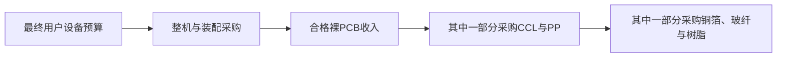

# AI高多层PCB、低损耗覆铜板与铜箔行业调研

研究截止日期：**2026年10月10日**。财务事实主要截至2026年6月30日，辅以截止日前公开的产能、技术和采购资料；2026全年仍为估计，2027、2028均为条件预测。地域为全球，重点观察中国大陆、中国台湾、日韩、东南亚和欧洲的供应链。除另有注明，年度指1月1日至12月31日，市场规模指年度销售流量，产能指相应时点能力。

本报告独立联网研究。项目内仅使用“基本面/产业背景/结果/”的产业背景报告作为检索线索，未将其他本地研究、评分或既有行业结论作为输入。主要线索来自《头部AI芯片》《Hot Interconnects 2026》《SEMICON Taiwan 2026》《AI产业链瓶颈与反证指标总表》《AI产业链全局图谱与口径字典》的2026-10-10版本。下述关键判断均重新追索外部原始材料；不能核实的客户名单、材料代际BOM和成交报价不作为事实。

标记约定：**F**＝文件披露事实，仍保留文件自身统计口径；**T**＝管理层目标或原始市场研究机构预测；**C**＝直接计算；**R**＝本报告估算、情景参数或推断；**U**＝重要未知。F不意味着审计保证，T不等于兑现。全部模型区间都是**参数条件范围或情景范围，均非统计置信区间**。来源编号可点击，公开日期、经济期间和定位集中列于附录D。

## 一、先给判断：需求升级已经兑现，利润的决定变量正在从“有没有产能”转向“产能是否匹配”

**当前证据最支持的路径，是2026—2027年高端板与材料继续扩张，2028年数量增长与同规格价格走弱可以同时出现。**不能将“AI支出增长”直接变成PCB收入增长，也不能将HVLP4的局部紧张推广为全部铜箔、覆铜板和所有PCB工厂持续短缺。

支撑这一判断的证据有三层：

- **客户支出有真实增长。**IDC统计2025年全球数据中心以太网交换机收入325亿美元；2026年第二季度为123亿美元，800G占该季度收入41.2%。这些是设备收入及收入结构，既不是裸板收入，也不是端口数量。[S10][S11]
- **升级已进入不同的交付阶段。**沪电披露1.6T交换机PCB已经批量出货，而224Gbps算力产品仍处小批量供货。两者不能统一写成“224G全产业链大规模放量”。[S01]
- **供给在反应，资本回报却没有跟随当前毛利率线性上升。**深南无锡AI PCB项目计划总投资453,630.84万元，测算达产毛利率25.19%、税后IRR11.12%，均为管理层预测。建滔计划2027年三季度投产21,000吨/年的RTF及HVLP铜箔项目；斗山2026年9月宣布约9,700亿韩元的CCL投资，新增产线从2028年下半年陆续投运。设备数量、合格规格和收入贡献之间存在时间差。[S03][S30][S31]

本报告对**服务器、计算板组及高速交换机/相关路由器的高规格裸PCB**估算，2025年可比基数约70—146亿美元，2026年约113—239亿美元，代表值分别为107.55、171.53亿美元；2028年基准路径约223—351亿美元，代表值282.94亿美元。区间宽，主要因为AI服务器统计单位、实际裸板BOM和采购价格未公开，而非因为需求方向不可判断。代表值是便于复算的参数组合，不是精确预言。

上游另列：本报告低损耗刚性CCL加配套粘结片、排除封装基板材料的2025年约48—75亿美元，2026年约68—144亿美元，2028年基准约112—216亿美元。HVLP≥2技术篮子的铜箔需求代表值由2026年约1.40万吨增加至2028年基准约2.93万吨。**这三个收入池存在包含关系，不能加成“终端市场总额”。**铜箔牌号跨厂不完全同义，吨数模型覆盖低损耗板用铜箔，不包括电池铜箔，也不包括所有超薄封装铜箔。

最有解释力的原创判断是：

1. **真正稀缺的是客户批准的“铜箔表面处理—树脂—玻纤—压合与测试”组合。**一个独立材料指标优秀，或一座工厂已经建成，都不能证明它能替换目标板上的材料组合。高层数、高密度与低损耗共同提高失败成本，合格组合比通用平方米更有议价价值。
2. **带宽升级可能增加单块板收入，同时降低每Tb/s的板材支出。**若交换芯片带宽翻倍、所需设备数减半，单板ASP上涨不足一倍，板级收入就不会与网络带宽同比例增长。提高设备密度与直接采用电缆、近封装光学均会改变价值分配。
3. **最好的存量工厂不等于最好的新增资本回报。**稀缺订单与成熟良率可抬高毛利；海外新厂的折旧、人员、库存及客户认证先发生，收入后发生。进入行业的资本越多，增长与价值流失越可能并存。

最强反面解释是：目前所谓景气主要是材料涨价、产品组合和客户提前备货，真实安装量与最终回报不足；待新厂爬坡和采购去库存后，2028年板级收入及毛利同时回落。本报告保留这一悲观路径。公开证据仍不能解决的关键问题，是全球224G合格产能、按规格拆分的真实净价、云客户库存和每个AI计算板组的准确BOM。后文采用有锚点的范围、供应商子市场和供给阈值约束，而不填造全球供需缺口。

## 二、客户究竟买什么：将板组、材料与供应链收入放到同一经济边界

### 2.1 三类可相加的裸板子池

本报告的板级收入均为**裸PCB制造商向装配方销售的收入**，包括板内导体、介质和制造，不含芯片、光模块、独立连接器及整机装配收入。三类按设备用途去重：

| 子池 | 采购单位与用途 | 包含 | 排除与去重 |
|---|---|---|---|
| A：AI计算板组 | 每8颗加速器等效的合格裸板组；使用折算单位而非物理服务器台数 | GPU/ASIC计算托盘、载板以外的加速卡/底板、配套主板、机架内部scale-up交换托盘PCB的分摊 | ABF/BT封装基板；外部scale-out网络已计B；连接器不计；普通电源板除非满足本专题规格 |
| B：外部高速网络板组 | 一台高速交换机或相关高端路由器的一组主板及高规格配套板 | 数据中心Ethernet、InfiniBand及可识别的高端路由板；scale-up设备若已分摊A则剔除 | 园区普通交换机、低规格通信板、光模块内部PCB及独立连接器；不按端口与主板各算一次 |
| C：通用服务器高规格板组 | 每台符合规格的服务器一组裸板 | 本报告筛选的≥16层或HDI服务器主板及配套高规格子板 | 普通4—12层板、大部分存储及消费类HDI；不能把全体服务器台数都当作本子池 |

“≥16层或HDI”是本报告的操作筛选，**不是统一行业分类标准**；相同服务器可能同时具有高多层和HDI。本报告工艺拆分时优先将采用HDI工艺的板计入HDI，其余计高多层，避免同一块板重复；按产品用途A/B/C相加仍是唯一正式板级总量。Prismark的“18层以上”“8—16层”“HDI”统计分类不能未经核对直接映射到本报告。

低损耗CCL与粘结片是板厂的投入，铜箔是其上游投入。CCL池还覆盖本报告裸板子池之外的部分通信、雷达、工业及光模块板材；板级池也包含普通电源层介质、制造服务和部分非低损耗材料。两个池既不完全覆盖彼此，也不独立。

价值链可以表示为：

总收入不是增加值。板厂增加值应扣除外购材料及其他中间投入；板厂毛利包含制造成本、折旧等后的差额，材料厂毛利又包含其自有制造。不能将上中下游毛利机械相加为同一系统的净利润。

### 2.2 支付、验收与失败成本

云服务商及大型企业为训练/推理集群的性能、可靠性和交付时间支付；预算既有新增集群，也有通用服务器及网络替换。设备品牌或云客户控制系统架构与物料批准，ODM/EMS通常执行采购；板厂和CCL厂需要通过材料清单、工艺窗口、可靠性、批量一致性及交付认证。具体合同责任由客户安排决定，未公开。

客户购买的是通过误码、时序、电源完整性和可靠性要求的系统，不是最小Df或最高层数。一块裸板占整套加速系统成本的比例即使较低，失败仍可能拖延昂贵芯片和机柜上线，因此首次认证后短期切换意愿低；设计换代、第二来源建立后，原供应商也可能失去价格保护。采购方有动力提前锁定材料，又有动力在下一代重新议价。

Meta的2026Q2资本开支含融资租赁本金为310.8亿美元，同期经营现金流318.6亿美元、自由现金流7.84亿美元；全年资本开支指引1300—1450亿美元。这里只把它当作**客户现金与预算约束样本**，不当作PCB需求池。[S14] 开源模型、推理效率或自研ASIC只有经过“单位任务成本→使用量/设备组合→网络需求→采购台数”的链条，才可能扩大或削减板材收入。

## 三、技术向经济传导的关键：损耗预算、制造良率和系统架构

### 3.1 “800G”“224G”“M9”不是同一个指标

800G/1.6T是端口或设备接口的聚合速率，224Gbps是电气lane级信号能力；不同并行lane数可以实现相同端口速率。若采用PAM4，名义224Gbps对应约112GBd、奈奎斯特频率约56GHz，这是工程计算，不等于所有接口最终采用完全相同的实现。

对理想铜导体，采用ρ=1.68×10^-8 Ω·m、μ=4π×10^-7 H/m，趋肤深度δ=√[ρ/(πfμ)]，在28GHz和56GHz分别约0.39、0.28μm（C）。实际铜箔粗糙度与此处数量级接近，表面形貌会影响导体损耗；但Rz、Rq、测量方法、表面处理以及线宽均不同，**不能从“Rz减半”直接推成插损减半**。

OIF的2022年CEI-224G框架讨论更高阶调制、电缆直达芯片封装及多种互联距离，体现的原则是全链路成本/功耗优化，并未规定所有线路都必须使用最昂贵CCL。[S20] TTM公开能力资料列示40层以上、224Gbps/1.6T、30:1以上纵横比及67GHz插损测试等，属于供应商能力宣示，不能当作所有工厂均已按客户规格量产。[S21]

“Megtron”“M系列”“Ultra/Extreme Low Loss”“HVLP2/3/4/5”分别带有厂商、材料构造或应用分级特征，**不是可以跨供应商直接兑换的统一性能币种**。必须比较相同频率、树脂含量、玻布结构、铜箔处理、线路长度、测试方法及可靠性条件。Isola 2026年6月修订的Tachyon 100G Dk/Df表按玻布结构及树脂含量给出多个数值，这本身就否定了“一个品牌=一个固定Df”的估值方法。[S22]

### 3.2 低损耗不能只靠树脂，也不能只靠铜箔

Panasonic在2022年发布MEGTRON8，给出的同条件28GHz插损改善约30%是相对MEGTRON7的特定构造比较，而非全部PCB都降低30%损耗；方案结合树脂、低损耗玻布与更平滑铜箔，并兼顾多层板加工。[S18] 2025年MEGTRON9宣传面向224Gbps，只证明产品与演示方向，未给出2026全球渗透率。[S19]

更平滑的铜面降低导体损耗，却可能牺牲树脂结合力；需要化学处理、表面形貌和层压条件共同解决。高层数增加压合、对位、钻孔/背钻、孔铜及CAF可靠性难度，HDI还增加激光微孔、填孔、连续增层等要求。成本不仅随铜和介质数量增加，也随重复工序、投料损耗和报废风险增加。

对一个仅作机制说明的工序串联模型，六次独立合格率97%的关键步骤相乘为83.3%，十次为73.7%（C）；真实缺陷相关、返工及质控并不独立，不能用它估计某公司的实际良率。它说明同样的平方米投料，在更复杂流程里未必得到相同合格平方米。**面积、层数、压合次数和测试工时共同决定有效供给。**

玻纤也需要分开。Nittobo材料把NE/NER放在低介电损耗方向，T-glass的核心优势则是低热膨胀；后者大量用于封装相关体系。本专题不把T-glass/封装载板的紧张直接移植到AI主板。更低损耗玻璃、展开布、树脂含量控制和局部混压可能减少高速线路使用的高端材料量；全板全部电源层使用最高等级材料并非经济必然。[S23]

### 3.3 光学替代与PCB模块化可以同时发生

NVIDIA 2026年3月Vera Rubin POD技术正文描述托盘采用更多PCB连接，托盘设计可无内部电缆，同时机架脊柱仍含预集成铜缆组件。**“cable-free tray”不等于全机架无铜，也不等于PCB价值消失。**[S24] 本报告只使用原文技术正文，未把该页面机器生成的摘要当证据。

Broadcom 2025年10月Davisson CPO发布材料给出102.4Tbps及200Gbps/lane等参数；正文“shipping”与可用性栏“early access/sampling”的表述不完全一致，本报告采用较窄的早期客户采样状态。其光学功耗改善宣称也不等于整座数据中心节电同一比例。[S25]

CPO或近封装光学最直接侵蚀的是交换ASIC至前面板的长电气通道所需的极低损耗材料、retimer及部分走线空间。封装、光引擎和测试获得价值，但主板仍承担供电、控制、散热及机械功能。另一方面，板对板连接、机架内交换托盘增加，仍可能提高裸板产值。必须比较每台设备/每Tb/s的PCB与材料消耗，不能只数CPO发布会。

## 四、目前能坐实什么：现实基数、来源冲突及样本限制

### 4.1 现实锚点集中表

以下保留币种和披露期间，不把半年度或季度机械年化。公司收入并非本专题市场份额，未披露的AI占比不自行标成事实。

| 对象、期间 | 原始披露或原始估计 | 性质、边界与解释 | 来源 |
|---|---|---|---|
| 全球PCB，2025；2026预测 | 2025产值858.36亿美元；2026为1019.54亿美元 | F/T：市场研究估计及预测，含本报告排除的封装基板、柔性和普通板 | [S05] |
| 全球18层以上、HDI，2026预测 | 18层以上94.06亿美元，同比增长79.0%；HDI199.23亿美元，同比增长23.0% | T；反算2025分别约52.55、161.97亿美元（C），不是全部AI板；18层以上与16层筛选有差别 | [S01] |
| 全球服务器/数据存储PCB，2025及2030 | 2025为160.31亿美元；2030预测485.76亿美元 | F/T，深南引用Prismark；未提供产品技术交叉表，不能直接视为本专题TAM | [S03] |
| 全球刚性CCL，2025 | 187亿美元，较2024约150亿美元增长24.4%；EMC30.3、生益24.7、建滔23.1亿美元 | F：Prismark市场估计，含PP，剔除flex与mass lam；仍含非低损耗及封装相关材料 | [S09] |
| 无卤高速CCL，2024、2025 | 26.56、45.23亿美元；EMC 2025份额38.6% | F：EMC展示的市场研究口径；不包括所有非无卤低损耗产品，不能覆盖Megtron全系列 | [S08] |
| 沪电，2026H1 | PCB收入129.9448亿元；毛利率40.52%；数据通信收入113.3014亿元、毛利率43.26% | F；数据通信名称变更无口径变更；含AI、通用服务器、高速交换和其他，非纯AI | [S01] |
| 深南，2026H1 | PCB收入85.5226亿元；毛利率36.85%；数据中心业务突破20亿元 | F；封装基板及电子装联另列并排除，不把所有PCB都归AI | [S02] |
| 胜宏，2026H1 | 收入116.2937亿元；制造成本77.6593亿元 | F；直接计算整体毛利率约33.22%，高阶板与其他产品未完整分拆；非主营公允价值损益不等于制造利润 | [S05] |
| 金像电，2026H1 | 收入435.92亿新台币；毛利151.36亿新台币 | F；直接计算毛利率34.72%；2026年1—7月收入536亿新台币与H1不能混加 | [S06] |
| TTM，2026Q2 | 收入10.041亿美元；数据中心与网络占40%；经营现金流9640万美元 | F；约4.02亿美元为两应用合计（C），含非AI及非本专题板型；不能外推为全年纯AI收入 | [S07] |
| 生益，2026H1 | CCL+粘结片收入123.5699亿元，毛利率29.16%；销售CCL 8714.01万平方米、粘结片11574.88万米 | F；PP为线性米，缺宽度/层片转换，不与平方米相加；集团PCB子公司收入不能再计为CCL | [S04] |
| EMC，2026Q2及H1 | Q2收入472.75亿新台币，毛利率33.9%；H1收入803.42亿新台币 | F；为公司业务合计，并非纯AI/纯最高等级；收入增长受数量、净价和组合共同作用 | [S08] |
| ISU Petasys，2025 | 收入1.0888万亿韩元，营业利润2047亿韩元，营业利润率18.8% | F；与上述毛利率不可直接横比；2026多次压合收入占比31%为目标，2025为9% | [S17] |

**披露收入增长可以大于物量增长。**生益CCL+PP收入增长47.74%，而CCL销售面积增长14.24%；产品等级、PP结构、价格及不同单位造成收入/面积的差异。不能把差额全部解释为同规格涨价。[S04] 同理，全球PCB产值增长和面积增长不同：2025—2030产值与面积预测年复合增速约11%与5.4%，反映单位面积价值与组合变化，非新增面积同速增长。[S01]

### 4.2 三类会显著改变结论的口径冲突

| 冲突 | 原始主张 | 本报告处理 |
|---|---|---|
| PCB总市场预测版本 | 2026年4月Compeq演示采用2026约958亿美元；较晚披露文件引用1019.54亿美元 | 视作预测版本/更新差异，不平均，也不将两个数之间的差异当作实际扩产；2025历史估计也有小幅修订。[S39][S05] |
| 低损耗CCL到底多大 | 无卤高速45.23亿美元与全部刚性187亿美元 | 前者是子集，后者含大量其他产品；采用无卤覆盖比例及供应商收入反向约束宽区间，绝不称任一数字为全行业AI材料收入。[S08][S09] |
| 铜箔“60%份额” | 三井称HVLP2以上内部估计份额60%；Solus 2024称AI加速器用低信号损耗铜箔份额60%；金居年报引用的更广HVLP口径给三井37% | 产品等级、应用、期间及估计方不同，且均有供应商利益关系；不相加，不把其中之一当完整独立市场份额，不据此推定单一永久垄断。[S15][S28][S26] |

金居年报对2026年HVLP4缺口15%—25%及价格上行数年的预测，是一条值得调查的正式供应商线索；未找到其完整独立供需参数表，**本报告不把该缺口当作已验证全球事实**。其产品开发和新厂试产计划可用于供给分析，宣传性行业判断需要另行检验。[S26]

## 五、需求模型：从板组推到行业，再用不同来源反向约束

详细参数及所有情景逐行列在附录A。这里只给计算关系、锚点和不能识别的地方。

### 5.1 A：AI计算板组，核心不确定性是统计单位与板材含量

公式：N_A=AI服务器统计单位U×单位所含加速器数k/8；R_A=N_A×裸板组净价P_A。

TrendForce 2026年4月公开摘要预计全年AI服务器超过200万台，8月更新全年数量增长接近31%；这是机构预测，不是截至10月实际交付总量，付费详情和统一机架/节点口径未取得。[S12][S13] 本报告先给2026统计单位约205—245万、加速器平均含量约6.9—8.4颗的**R条件范围**，折成约177—257万8颗等效组，取整为180—260万；超过8颗表示统计单元可能混含整柜或多节点，不代表每一台标准服务器有该数量。2025用同比及不同平台折算回约140—190万等效组，标为估计历史基数。

2026每等效组裸板2900—4400美元，代表值3600美元，包括计算及机架内部交换板分摊。**未获得可公开的采购BOM验证该价格**。约束来自板材面积/工艺经济、供应商相关收入与全体PCB分类上限，可信度低于出货方向。不能把单一GB机架BOM套给所有GPU和ASIC平台。2027—2028各路径分别改变付费设备量、平均板组内容和净价，未采用统一AI增长倍率。

### 5.2 B：高速网络采用买方支出和端口/主板两种桥梁

独立买方桥梁：2025数据中心Ethernet收入325亿美元，加上纳入边界的InfiniBand及高端路由器设备预算，采用50—100亿美元附加量（R），相关设备池375—425亿美元。假设裸板对应其中8%—12%的销售额，得到30—51亿美元的约束；该比例是采购价值假设，未披露的真实BOM仍是主要未知。

2026H1数据中心Ethernet支出由Q1约100亿美元、Q2 123亿美元合计约223亿美元；Q1金额来自该系列季度数据，全年模型采用460—560亿美元而非简单×2；附加网络预算50—100亿美元，裸板份额9%—14%，约46—92亿美元（R）。范围变化体现800G/1.6T和设备结构，并非同规格涨价百分比。[S41][S11]

第二桥梁：R_B=N_B×P_B。2026约210—300万合格板组、2100—3100美元/组，代表值260万×2600美元＝67.6亿美元。若平均每组对应64个端口，代表值对应约1.66亿端口，包含200/400G及更高带宽设备；不能把它标为800G端口出货。32/64/128端口设计改变设备数、板尺寸和层数，本报告不将端口数锁死为64。

两个模型的交叉区间比任何一个单独的“AI网络资本开支×固定比例”更可审查，但裸板份额、低规格剔除比例及设备分类仍未被直接观测。Dell'Oro 2026年9月公开研究称AI后端网络支出已超过前端，1.6T仍在采样与下半年放量预期阶段；这与PCB提前批量交付并不矛盾。[S38]

### 5.3 C：通用服务器是需要筛选的独立需求，并非纯AI附属

采用每台高规格服务器170—255美元裸板组、2026约1000—1250万组，代表值1150万×215美元＝24.725亿美元（R）。数量是全体通用服务器中符合≥16层或HDI门槛的条件量，不是全市场台数事实。CPU/内存/接口升级提高合格板含量，整机预算受内存涨价及客户更新周期约束；推理转向CPU/ASIC或设备重复使用也会改变量价。

本池采用另一独立总量锚点：臻鼎2025年报引用IDC 2026年3月数据，2025全球服务器图表为16,376千台，2026预测16,641千台；IDC 2026年10月9日更新则预计2026全年单位数增长约12%，且Q2支出增长52.0%远快于单位增长15.4%。旧、新预测不能平均。[S43][S42] 以2026全体服务器1650—1850万统计单位、扣除AI约205—245万、其中符合本专题规格约60%—80%作R条件，给出约843—1316万的数学范围；主表采用与供应商收入检查相容的1000—1250万。IDC与TrendForce机架/节点分类未完整对齐，这一扣除仅是条件桥梁，不能标为正式精确统计。此子市场的规格覆盖率缺直接统计，取宽范围；无需假装所有企业服务器都采用最低损耗材料。沪电已披露通用服务器PCB与AI/HPC、交换路由PCB的收入拆分，是本池存在且可区分的直接证据，不能因此反推全行业台数。[S01]

### 5.4 三个外部检查，约束模型不越过证据

第一，2026板级代表值171.5亿美元并非全归18层以上。若A/B/C中按非HDI传统分类归属18层以上的收入份额分别约40%—55%、55%—70%、15%—25%（R，且与HDI分类去重），对应约72.6—97.1亿美元。高端全部落在上沿会触及全球18层以上94.06亿美元预测，需下调该归属组合或承认统计技术分类不同；**不能同时取所有产品最高量、最高价和最高18层比例**。

第二，本报告2025 A+C代表值约66.2亿美元，小于全球服务器/存储PCB160.31亿美元；B单列网络，普通存储及较低层数板不纳入。本报告没有拿全球终端分类倒推“纯AI PCB”的市场额。

第三，已披露供应商相关收入支持“数十亿美元至百亿美元级”的市场，不能直接给完整份额。采用只用于归属检查的**计划汇率**美元兑人民币7、兑新台币32，并令汇兑误差±10%，沪电H1数据通信约16.2亿美元、深南数据中心至少约2.9亿美元；若金像电H1收入的70%—90%、胜宏H1的30%—65%在本边界内（均为R），两者合计约14.5—23.1亿美元。四家公司H1相关样本约33.6—42.2亿美元，只构成数量级检查，**不是下游终端支出，也不是全球份额估计**。不把Q2 TTM或2025 ISU再加进H1样本，不把假设汇率标为真实历史均价。

### 5.5 CCL与铜箔：用介质层面积和厚度，避免“每台机器固定若干公斤”

低损耗CCL+PP分成互斥的两组技术篮子：

- **L：成熟低损耗/VLL/ULL组合**，包括多数已经放量的高速板材料，仍可混用普通玻布或更高损耗的非关键信号层。
- **U：更高要求的极低损耗组合**，由低损耗玻布、低粗糙度铜箔及树脂/加工要求共同定义，面向更多224G等严苛通道。U不等于某一厂商“M9”，也不意味着224G只有U能实现。

计算R_CCL=M_L×P_L+M_U×P_U。M为**出货介质层等效平方米**：一块CCL芯板的介质算一层，PP按实际铺层数及宽度转成介质层面积；价格含该类供应商交付中的铜箔/树脂/玻布价值。它是本报告比较CCL与PP的分析单位，**不是公司的披露产能单位**，不得用生益PP线性米直接填入。

2025无卤高速45.23亿美元，原始口径未给出完整应用交叉表。设其中可归本报告板材边界的适用比例a为85%—100%，该净适用子池占全部低损耗板材收入h为60%—80%（均R，封装剔除及非无卤覆盖误差分别保留），则总池=45.23×a/h，约48.06—75.38亿美元。代表组合L 2.60亿平方米×17美元、U 0.40亿×50美元，合计64.2亿美元。原始45.23亿美元始终保留，没有人为变成预测区间。[S08]

2026代表组合L 3.50亿平方米×20美元、U 0.60亿×50美元，合计100亿美元；范围68.2—143.9亿美元。面积是假设价格篮子下的隐含物量，**没有被独立披露物量验证**。EMC和生益收入及产销量用于交叉约束，但不把它们公司合计收入全部归低损耗。2025刚性CCL总池187亿美元提供外部上界参考；2026以后总池也会变，不把2025金额冻结成未来上限。[S04][S08][S09]

从裸板端再次检查：以2026代表值A/B/C每组约0.8/0.6/0.18平方米、约34/30/18个介质层（R），成品介质层面积约1.440亿平方米；若其中65%—85%采用本池低损耗组合、板材综合利用率75%—90%，对应采购约1.04—1.63亿等效平方米。按混合净价25—40美元，约26—65亿美元材料采购。本报告全球低损耗CCL池100亿美元代表值还包含其他板型/客户任务，覆盖差约35—74亿美元；**不能将全部100亿美元都声称来自A/B/C**。这个剩余池缺少直接应用交叉表，是材料市场估算的重要覆盖风险。如果后续证明其他应用不足，该CCL估计应先下修。

铜箔需求不由供应商份额倒推，而由材料物量计算：

**Q_HVLP≥2（千吨）=0.00896×t（μm）×[M_L×g_L+M_U×g_U]÷η**

M单位为百万等效平方米；g是对应铜层采用本篮子铜箔的比例；默认每介质层约对应一个铜层（高多层内部CCL/PP交错的近似），η覆盖板材裁切/投料利用率，既不是电解良率也不是客户认证率。电源层、普通信号层与封装载体箔另计或剔除。12μm铜箔为约0.10752kg/m²（C）。

2026采用t=13.2μm、g_L=15%、g_U=80%、η=85%，得约1.398万吨；2028基准t=12μm、g_L=20%、g_U=90%、η=88%，得约2.932万吨。更薄铜箔可降低吨数、增加加工难度和每公斤售价；并非电流层都能减薄。全部参数是R，确切铜层布局和厚度未公开。2025计算约0.926万吨，与三井FY2025销量预测580吨/月、HVLP≥2占比85%、该篮子内部份额估计60%所提示的约0.986万吨年化数量级相近；后者为财政年度预测与供应商份额估计，**仅作第二锚点，不与自然年实际等同，更不作为供给证明**。[S40][S15]

## 六、独立供给检查：按工艺、材料组合与认证区分，不按“厂房都能转产”计算

### 6.1 已定位的物理产线及扩产响应

| 供应层与公司 | 截止日前可核验的能力/计划 | 有效供给扣减与时间边界 | 来源 |
|---|---|---|---|
| 高多层/HDI：ISU Petasys | 多次压合能力图：2026H2 8000m²/月，2027H1争取提前取得10,500m²/月，2028H1附近12,500m²/月+α；额外提前投资仍在检讨 | 这是专项工艺能力，不是全公司PCB面积；配套HDI技术与客户进入也需验证。公司“收入产能”注明100%良率假设，不能拿美元能力替代平方米 | [S17] |
| 高多层：沪电泰国 | 已量产≤30层400G交换及AI板，800G仍送样 | 海外客户批准不代表所有高层数/224G组合批准；不能将该厂面积全投入最高等级 | [S01] |
| 高多层：深南 | 泰国、南通四期产线爬坡；无锡AI项目建设计划12个月 | 设备、人员与折旧先到，客户认证及订单转换后到；计划建设期不是收入贡献期限 | [S02][S03] |
| CCL：EMC | 年末片/月：2025为585万，2026为615万，2027为930万，2028为1110万 | 跨地域、跨等级；缺片面积、独立PP产线和具体等级分配，不能称1110万片为已合格U级产能；年末值不能×12当全年产量 | [S08] |
| CCL：生益 | 江西二期增加1800万m²/年CCL及3400万米/年PP，H1已全部投产；2026年4月审批48百万m²/年CCL等项目、总投资约52亿元 | 规格覆盖多用途，封装等需剔除；生产线投产不等于最高等级认证；新项目两期，完整爬坡时点未披露 | [S04] |
| CCL：斗山 | 2026年9月公告约9700亿韩元投资：国内光模块材料约4200亿，中国AI加速器/交换CCL约5500亿；2028H2起陆续启动 | 光模块材料属于本报告CCL扩展池、其板级产值不计A/B/C；不能提前算入2027交付，也不能把全额投资归同一材料规格 | [S31] |
| 铜箔：三井 | 2026年1月计划VSP能力：2025年11月620、2026年3月720、9月840、2027年9月1000、2028年9月1200吨/月 | 含不同VSP代际；处理产线和电解设备都需转换。按日历实施模型，不声称截至10月均已实测达产 | [S15] |
| 铜箔：三井更远扩产 | 2026年8月更新展望2030年既有能力1400吨/月，新马来西亚场址2031年后增加1200吨/月 | 远期场址、许可、建设及爬坡条件未完成；不填进2027/2028供给 | [S16] |
| 铜箔/CCL：建滔 | 清远RTF/HVLP项目21,000吨/年，计划2027Q3投产；萍乡新增CCL规划110万片/月、一期35万片/月计划2027年中投产 | 2.1万吨不是全部HVLP≥2、更不是全部HVLP4；一体化内部销售不能再当独立终端收入 | [S30] |
| 铜箔：金居 | HVLP3/4等产品开发与工艺优化，新三厂计划2027Q1试产 | 不采用媒体中互相冲突的“2026即新增900吨/月”等数字；产品完成与量产良率不同 | [S26] |
| 铜箔：CFL、福田、长春、古河等 | CFL公布经CCL组合进入客户量产的消息；福田、长春、古河提供低粗糙度/高频铜箔产品 | 高等级可交付吨数、客户批准结构未充分披露；不使用电池铜箔总能力作为补缺 | [S27][S32][S33][S36] |

对于客户切换和产能爬坡，采用本报告工作假设：既有材料组合的新产线复制，首批资格和爬坡可占约2—4个季度；全新材料组合或新供应商可更长。这个时间范围是R，受客户测试强度、工艺复制、良率及平台换代制约，不是统一行业标准。供给响应还包括存量工厂产品转移、库存消化和缩短高速走线，而不只有新建厂房。

### 6.2 一个能够比较同单位的板厂子市场，揭示“当前有余量，下一年可能缺”的顺序

ISU 2026年2月图示的客户多次压合需求，是2026H2约5000m²/月、2027H1约13,400、H2约13,600m²/月；它是该公司的客户预测，非全球调查。原始图已核看，13.4K/13.6K对应**2027上、下半年**，不挪到2028。[S17]

用其独立的设备能力计划，加本报告“名义能力到客户合格可交付”综合系数φ做供给模型：

| 期间 | 客户需求锚点，m²/月 | 名义专项能力，m²/月 | φ条件 | 有效供给条件范围，m²/月 | 同边界判断 |
|---|---:|---:|---:|---:|---|
| 2026H2 | 5000，T | 8000，T | 65%—85%，R | 5200—6800 | 若计划实施，允许有余量；不能称所有工艺当下都短缺 |
| 2027H1/H2 | 13,400/13,600，T | 10,500，仍有提前投资条件 | 75%—90%，R | 7875—9450 | 若客户预测兑现，原计划即使φ=100%仍不足；须追加能力、转单或设计变化 |
| 2028H1附近 | 需求未给可直接引用精确值，U | 12,500+α，T | 80%—95%，R | 10,000—11,875，未含α | 是否满足取决于2027需求延续和α；若仍需13,600，至少补1725—3600合格m²/月 |

φ若公司已按合格成品面积披露能力，应把良率部分设为1，避免重复扣减；这里由于100%良率式“收入能力”及专项名义图未给实际交付率，采用综合条件而非认定真实折损。这个子市场既有真实物理单位，也有独立设备计划及客户需求预期，支持“工艺匹配在2027更困难”，**不能据一家客户预测断言全球缺口百分比**。

### 6.3 低损耗CCL：名义增长够快，最高等级分配仍不可识别

EMC年末片能力从2026至2028增长80.5%（C），但年度供给必须逐期计算：Σ季度平均能力×3个月×等级配置×可生产及合格率。若2027扩产在年内分阶段实施，采用年平均730—830万片/月（R）；2028采用980—1080万片/月（R），均小于年末930/1110万。原始计划有变化或延期，应重算，不能“提前一整年”贡献。

设a为每片实际面积、x为用于本研究低损耗材料的比例、η_p为可交付率、h为PP换算与额外交付的介质层倍数，则：

S_EMC,CCL等效m²=12×月均片能力×a×x×η_p×h。

a、x、h未充分披露，故不能由片数给可信全球合格平方米。一个**条件示例而非事实**：2027取780万片/月、a=1m²、x=75%、η_p=90%、h=2，得1.264亿介质层等效平方米。若其在本报告全球低损耗池的供货归属约25%，基准需求5.40亿平方米对应1.35亿平方米；将x提升至80.1%或增加PP交付即可满足量，反之若U级组合认证受限，总片数足够仍可出现U缺口。此处市场归属25%也只是分配假设，不用它倒推名义设备能力。

生益、斗山、建滔、台燿等的扩产与竞争意味着2028低损耗**总量过剩**是合理路径；最严格的低损耗玻布、铜箔处理与客户组合仍可能局部紧张。玻布布型、树脂材料供给和按规格产线份额缺公开可比表，全球S_L/S_U无法作可靠点估计。判断更接近哪侧，应观察最高等级交付和同规格净价，而不是只看累计资本开支。

### 6.4 铜箔：可复算的龙头供给子池与全球余下门槛

三井2026年1月进度计划若按月准时实施，日历名义VSP量分别为：2026年8920吨、2027年10,720吨、2028年12,800吨（C/T）。2028之后的新场址不加进来。以HVLP≥2等级配置、生产爬坡及客户合格交付的综合φ=55%—85%（R），可交付子池约：

| 自然年 | 计划名义量，千吨 | 三井HVLP≥2有效子池条件范围，千吨 | 本报告基准需求代表值，千吨 | 除该子池以外所需合格供给，千吨 |
|---|---:|---:|---:|---:|
| 2026 | 8.92 | 4.91—7.58 | 13.98 | 6.40—9.08 |
| 2027 | 10.72 | 5.90—9.11 | 23.78 | 14.67—17.88 |
| 2028 | 12.80 | 7.04—10.88 | 29.32 | 18.44—22.28 |

这不是采用“60%份额”倒推全球供给。未列供应商已经存在，余下需求并不等于缺口。新增建滔项目按2028全年名义2.1万吨、该篮子配置20%—60%、爬坡及认证60%—85%（R）计算，新增可交付约2520—10,710吨；2027只有投产后部分年度，不能全年计算。两项可定位产线可支持2028约0.956—2.159万吨的条件子池，全球基准仍需其他已存及新增厂家提供约0.77—1.98万吨。**这在物理上可能，客户资格匹配却尚未被证明。**

三井早期对2030年HVLP≥3需求超过2400吨/月、≥4约1400吨/月的管理层预测，两者是包含关系，不能相加。[S15] 本报告2028乐观HVLP≥2约4.75万吨包含更广等级且采用更快渗透，要求其他厂商提供约2.59—3.80万吨合格供给；不能把它当作不需供给突破的普通上行情景。

反向门槛提供可证伪的联合判断：2028基准M_L=4.8亿、g_L=20%、g_U=90%、t=12μm、η=88%保持不变时，

M_U可支持上限=[Q×η/(0.00896×t)−M_L×g_L]/g_U。

若全球该篮子实际合格交付仅2万吨，最多支持约0.752亿平方米U材料，而基准需求为1.60亿；若能交付3万吨，可支持约1.662亿，基准才大体成立。前者将迫使混压、缩短线路、减薄或替代重新验证，U材料收入和部分设备交付须下修；**不能只保持原出货量再提高ASP**。它是研究阈值，非行业标准或已经观测到的全球产能。

### 6.5 截止日供需判断

本报告对2026的排序是：**U级材料/特定HVLP4组合及高复杂度专项工艺的紧张可信度，高于“所有高多层PCB总量短缺”的可信度。**依据是多家公司高负载、原材料和认证叙述，加上较严格规格尚处小批量、能力不跨规格替换；反面证据是专项新增产能可能先于客户放量，ISU的2026H2计划便容许余量。

2027基准更接近“需求快于部分合格组合释放”，需要客户从报价到付费交付持续兑现。2028更接近“总能力逐渐释放、同规格价格承压、少数顶级组合仍紧”，其中建滔2027Q3项目、EMC分阶段扩产及斗山2028H2开始增加竞争。若需求没有继续提升，物理产线不能立刻撤销，价格与利用率下行将把收益移回采购方。**全球具体短缺幅度为U，不报告虚假的10%或20%统一缺口。**

## 七、联合情景：核心市场与材料子市场都有当前基数、数量、净价及经营结果

以下总表金额单位为**十亿美元，即10亿美元**。A/B/C裸板相加；材料、铜箔与HDI列均不再加到板级总量。2025、2026亦为本报告边界估计，不能当行业正式统计。毛利是本报告经营参数条件下的制造毛利池，非已审计全行业利润；未扣销售研发管理、利息和税。表中范围采用附录A各子市场参数端点，现实可取的联合组合还受外部上限约束，不是所有端点都能同时发生。

| 自然年/情景 | 板级产值范围〔代表值〕 | 板级制造毛利代表值 | 低损耗CCL+PP收入范围〔代表值〕 | 材料制造毛利代表值 | HVLP≥2铜箔需求代表值，千吨 / 收入代表值 | HDI工艺板产值代表值，已含在板级总量 |
|---|---:|---:|---:|---:|---:|---:|
| 2025/基数 | 6.99–14.62〔10.75〕 | 3.15 | 4.81–7.54〔6.42〕 | 1.66 | 9.26 / 0.42 | 2.02 |
| 2026/当前估计 | 11.33–23.93〔17.15〕 | 5.55 | 6.82–14.39〔10.00〕 | 3.11 | 13.98 / 0.70 | 4.40 |
| 2027/悲观 | 12.20–19.50〔15.52〕 | 4.00 | 6.49–11.73〔8.80〕 | 2.17 | 13.20 / 0.59 | 4.23 |
| 2027/基准 | 19.22–28.37〔23.58〕 | 8.02 | 10.32–17.98〔13.88〕 | 4.39 | 23.78 / 1.24 | 7.94 |
| 2027/乐观 | 25.44–37.69〔31.19〕 | 12.19 | 14.48–26.43〔19.74〕 | 7.41 | 33.32 / 2.17 | 11.71 |
| 2028/悲观 | 10.09–18.06〔13.41〕 | 2.82 | 5.70–11.21〔8.00〕 | 1.64 | 12.83 / 0.46 | 3.72 |
| 2028/基准 | 22.25–35.06〔28.29〕 | 8.62 | 11.22–21.55〔15.76〕 | 4.42 | 29.32 / 1.41 | 10.95 |
| 2028/乐观 | 33.42–52.91〔42.07〕 | 16.48 | 18.50–37.63〔26.56〕 | 10.14 | 47.52 / 3.33 | 18.17 |

2025 CCL合计范围额外使用外部无卤口径约束，因此不等于附录A材料独立端点之和。未来情景范围也有重叠，这是模型参数不确定性的结果，不代表互斥概率分布。

### 7.1 每条路径需要什么，供给、价格与价值如何共同变化

| 路径 | 需求与采用机制 | 有效供给条件，分别检验 | 同规格成交净价/成本机制 | 放量与利润兑现 |
|---|---|---|---|---|
| 悲观：更新放缓、供给释放、竞争压价 | 2027新增AI量有限，2028回落；设备复用、客户现金压力、ASIC提高任务效率；网络带宽/设备提高压低板组数 | 既有合格线足以承接较低需求；EMC/建滔新能力释放；U需求2027 5000—8500万、2028 6000—10500万等效m²；箔需求代表值1.32/1.28万吨可被既有与新增子池覆盖的可能性提高 | 裸板同SKU每年下调约8%—15%（R）；L/U材料下调约8%—18%；良率改善及铜价回落只能部分补偿固定成本摊薄恶化 | 板级收入代表值2027/2028 155.2/134.1亿美元；制造毛利40.0/28.2亿美元；领先厂仍可能盈利，新厂回收期明显拉长 |
| 基准：采用扩张、2028供给缓解 | AI等效板组2027/2028 285/350万，高速网络315/380万；高规格内容增加，但ASIC带宽与架构效率抑制单任务板材消耗 | 满足U需求2027 8500—13500万、2028 1.25—2.00亿m²；全体铜箔需要达约2.38/2.93万吨代表值；新厂家客户批准、良率和原有厂产品转移缺一不可；板厂专项供给须超越ISU单厂计划约束 | 裸板同SKU2027约持平至+5%，2028约-3%至-8%；组合升级使A净ASP仍较高。L/U同SKU2028下降约5%—12%；材料厂单位成本随良率改善下降；极端玻布/箔溢价不能无限持续 | 板级代表值从2026 171.5增至2028 282.9亿美元，但模型毛利率由32.3%降至30.5%；CCL从100增至157.6亿美元，毛利率从31.1%降至28.1%；数量增长与利润率下降并存 |
| 乐观：高规格采用快、合格组合也顺利形成 | 更多付费集群与网络，2028 AI等效425万组、网络470万组；多次压合/HDI、低损耗组合渗透快；并非仅使用更高增长率 | U需求2028 1.80—2.90亿m²；箔代表需求4.75万吨，未定位供应商须提供2.59—3.80万吨；需要更多新厂、设备转换及第二来源提前认证，不能用已宣布名义总吨数保证 | 裸板同SKU2027/2028约+3%—10%/+0%—8%，受合格供给约束但扩产改善交付；材料组合比总面积增长快，单位铜箔成本上升也需转嫁；按规格良率应接近成熟厂 | 2028板级代表值420.7亿美元、制造毛利164.8亿美元；材料265.6亿美元、制造毛利101.4亿美元。这是条件上行组合；若供给不能达门槛，应削减可交付量，非继续保留全部收入 |
| 跨路径技术分支：电缆直达/近封装光学/局部混压 | 系统完成与采用达标，长距离电气材料下降；不要求全行业CPO占统治地位 | 更高封装/光学测试能力及系统可靠性；平台重新设计及材料重新认证 | 每Tb/s高端CCL采购下降可能比设备收入下降快；一部分价值转移出本专题；功率与控制PCB需求保留 | 附录B给2028基准母路径下的数量及收入差异；事件成功与全行业渗透分开 |

同SKU变化是R条件，未获取市场真实成交价序列；表里的ASP是产品组合后的净成交价篮子，因此可能在同SKU降价时上升。成本、毛利的具体经营参数列于附录A及A.4；不把“供应短缺”自动转换为净利润率。采购合同重定价的工作假设为1—2个季度，平台换代后议价可更久，属于R。报价、锁单、材料提价通知和确认收入是不同事件。

## 八、谁拿到价值：竞争、现金与资本回报必须放在同一资产边界

### 8.1 竞争地图与议价位置

| 位置 | 关键参与者及角色 | 独特能力/价值捕获 | 需要成立的条件与重要未知 |
|---|---|---|---|
| 系统及预算入口 | NVIDIA、Broadcom交换平台；云客户自研ASIC与采购；Arista、Cisco等系统商，ODM/EMS执行采购 | 决定拓扑、通道长度、可批准材料与合格供应商；设备/平台责任创造客户黏性 | 芯片或网络系统收入增长不等于板材同比增长；客户自行改变BOM、双供和议价可内化材料租金。[S10][S24][S25] |
| 高多层/HDI领先制造 | 沪电、深南、胜宏、金像电、TTM、ISU；生益电子另属板厂 | 复杂压合、HDI、测试、一致性与客户认证；成熟产线在紧供给时取得订单/价格优势 | 客户结构与工艺组合不同；TTM有大量国防航空，深南有封装及装联，生益集团内交易需去重；无公开精确纯AI份额。[S01]—[S07][S17] |
| 材料组合与技术品牌 | EMC、生益、Panasonic、斗山、台燿；建滔、南亚、Isola及其他供应商 | 树脂/玻布/铜面处理适配，产品可靠性及配合板厂工艺窗口；品牌指定可增加切换成本 | EMC收入份额与无卤高速份额不同；Panasonic/Isola非独立上市纯CCL主体；台燿、斗山材料目录说明竞争路线存在，非证明所有最高规格已批量采用。[S08][S09][S18][S22][S34][S35] |
| 一体化材料供给 | 建滔，部分生益供应协同、南亚体系及长春上游 | 玻布/树脂/铜箔协同能降低采购风险和库存冲击，一部分材料利润留在集团 | 集团内部收入不能重复加总；仍需终端组合批准，一体化不自动胜过更优秀的独立材料。[S30][S33] |
| 高端铜箔 | 三井、CFL、金居、古河；福田、长春等含非上市参与者 | 电解均匀性、表面化学、低粗糙度与结合力；可进入材料体系并获得溢价 | 跨厂HVLP编号不完全一致；电池箔转产不等于直接获批；最高等级稳定吨数与纯业务利润未披露。[S15][S26][S27][S32][S33][S36] |
| 低损耗玻纤及工艺耗材/设备 | Nittobo与其他玻纤/织布厂家；压合、激光/机械钻孔、背钻、电镀、检测设备厂 | 特殊布型与低损耗玻璃、精密工序和检验改善合格产量 | 本报告不量化设备独立TAM；未获取全体低损耗玻布合格能力；低CTE封装玻璃与本池分开。[S23] |
| 替代路线与非上市能力 | CPO/近封装光学、电缆直达、局部混压；福田/长春及其他专业材料厂 | 以系统优化降低昂贵材料覆盖面积，或在小范围打破供应集中 | 一项技术演示不足以证明全行业替代；本专题不核算迁往封装/光引擎的收入。[S20][S25][S32][S33] |

公开覆盖涵盖决定本模型的主要客户入口、制造工艺和材料组合，未覆盖每家小型板厂、树脂供应商或未披露客户的私人项目。对未验证的GPU客户关系不点名猜测。

**一个实际的资本约束：**德福原拟取得Circuit Foil Luxembourg 100%股权；其2026年1月11日签署、交易所1月12日刊载的公告说明，卢森堡审查附加少数投票权、无否决权及知识产权等限制，交易终止、标的股权未交割。[S29] 不能按2025收购预案将CFL工艺、认证和利润归入德福；资本可买设备，不一定能通过并购取得所需控制权及技术。这是明确的政策→控制权→供给响应通道，而不是泛化地缘风险清单。

### 8.2 收入放量和毛利扩张需要不同条件

制造毛利来自：合格数量、同SKU净价、等级组合、良率/报废、材料成本、工序工时、工资/能源、折旧与固定成本摊薄。新产线如果用高价外购材料、客户认证延迟且低利用率，即使订单增长，也可能挤压毛利。

材料涨价通常先进入在途库存和新批次投料，后到整机客户重定价。板厂承担长交期材料和成品备货风险，VMI需要客户领用才能确认收入：深南的会计说明保留这一条件，出库发运不能当作云客户已经安装上线。[S02] 股权投资公允价值收益、汇兑、补贴不代表制造议价权。

现金检验也会改变判断。EMC 2026Q2显示应收及票据653.54亿、存货236.64亿、应付403.99亿新台币，净营业占用约486.19亿（C），并披露应收周转108天、库存65天。净利润高增长仍需要融资支撑备货与应收。[S08] TTM Q2销售明显增长而经营现金流9640万美元接近上年同期，提供另一种“收入增长不等于现金等比例增长”的样本。[S07]

Prismark公开概览给2025前40家PCB公司平均净利率8.3%、资本开支/收入15.6%。这些广泛样本与AI高端领先厂不能混为一谈，但足以提醒：只取当前最成功厂商30%—40%以上的毛利率，会系统性高估新进入者和行业平均资本回报。[S37]

### 8.3 同一产线的全现金示例，说明利润率如何跨过资本回收门槛

本例全部为**R机制模型，不是任何一家公司的产线报价或估值**。初始投入1亿美元、寿命10年、最终残值500万美元；名义投料10万m²/年。每投料m²成本850美元，每合格m²新增成本300美元；年固定现金费用1500万美元，其中含300万美元维修；销售研发管理费用为收入8%。初始设备按残值直线折旧，年950万美元；第6年必须更新2000万美元，余下5年折旧每年400万美元，更新资产最终残值0。所得税20%，亏损当期无税、不给亏损税盾；净营运资本20%收入，期末全部释放；无杠杆，不计利息。所选板ASP只用于本条资产边界，不替代A/B/C市场板组价格。

第一年投料利用率60%、良率65%、售价2000美元/m²；第二年85%、80%、售价2000；第三年起分情景维持，维修已含现金固定成本，不再重复扣。计算公式：

合格量=名义投料×利用率×良率；收入=合格量×售价；制造成本=投料×850+合格量×300+固定现金费+折旧；EBIT=收入−制造成本−8%收入；FCF=EBIT−当期所得税+折旧−Δ净营运资本−必要更新支出，最后一年加残值与营运资本释放。

| 第3年起稳定条件 | 悲观 | 基准 | 乐观 |
|---|---:|---:|---:|
| 利用率 / 良率 | 90% / 88% | 95% / 90% | 100% / 93% |
| 合格m²/年 | 79,200 | 85,500 | 93,000 |
| 净售价，美元/m² | 1800 | 2000 | 2400 |
| 第3年收入，百万美元 | 142.56 | 171.00 | 223.20 |
| 第3年制造毛利率 | 12.49% | 23.45% | 38.44% |
| 第3年NOPAT，百万美元 | 5.12 | 21.14 | 54.36 |
| 第3年FCF，百万美元，含当年营运资本增加 | 13.30 | 23.64 | 46.42 |
| 第4、5年单年FCF，百万美元 | 14.62 | 30.64 | 63.86 |
| 第6年FCF，含2000万美元更新 | -4.58 | 11.44 | 44.66 |
| 第7—9年单年FCF，百万美元 | 15.42 | 31.44 | 64.66 |
| 第10年FCF，含终值释放 | 48.93 | 70.64 | 114.30 |
| 全周期税后无杠杆IRR | 1.74% | 12.70% | 27.51% |
| 10%折现率NPV，百万美元 | -49.08 | 19.47 | 162.12 |

三情景第0年均-100、第1年FCF均-21.54、第2年均+4.276百万美元，保留了认证/爬坡支出及营运资本。比较有意义的机制是：基准与悲观售价相差10%，利用率/良率略变，IRR却从12.7%跌到1.7%；更高收入不保证更高回报。它与深南项目税后IRR11.12%的管理层测算不是同一资产或假设，**仅是方向上的交叉提醒，不是复算深南IRR**。[S03] 若经济寿命缩短、必要更新更高或库存不能全部释放，回报还要下修。

## 九、演进顺序、概率与最强反证

### 9.1 时间不是一个统一“放量年”

| 时间窗口 | 可观察进展 | 尚须通过的条件 | 对全年规模及价值的影响 |
|---|---|---|---|
| 2026Q4—2027H1 | 800G继续交付，1.6T从板级备货走向系统客户验收，224G组合扩大批准 | 可重复良率、材料可交付、云客户安装及现金预算；PCB交付早于系统上线 | 材料提前收入与客户库存可能先上升；销量、现金和安装量不同步 |
| 2027H2—2028H1 | 专项工艺、新CCL产线、建滔铜箔与金居试产计划陆续转成实际供给 | 高端材料分配、合格吨数/面积和跨厂工艺复制，认证后还需采购份额 | 开始削弱普通高端材料的稀缺溢价；新厂折旧先压利润，有效数量后增 |
| 2028H2—2029 | 斗山新一轮CCL投资计划进入逐步启动期；更多第二来源可能生效 | 工厂启动不等于全年稳定供货；U料可靠性与客户测试需完成 | 2028只能计部分时间贡献，2029才可能反映较完整供给；总量与顶级组合仍可分化 |
| 2030—2031以后 | 三井新场址等远期布局 | 土地、许可、建设、客户认证和商业需求均须成立 | 本报告不据此填入2027/2028规模，只说明长期供给并非固定 |

### 9.2 概率只对定义清楚的事件给宽区间

以下均为截止日的**主观研究概率**，依据项目时点、客户采用阶段、模型门槛与替代路线进展；没有足够可比历史样本形成统计频率。宽区间也不能掩盖判断依赖。三条经济路径不是完整互斥分布，故不人为分配合计100%的权重。

| 事件、成功标准与期限 | 概率类型与判断 | 为什么给这个范围 | 上调/下调证据 |
|---|---|---|---|
| 2027至少连续两个季度，最高等级224G材料/箔组合存在可识别交付限制；需至少两个独立采购客户确认，相同规格交期超过12周或明确配额 | 无条件事件概率，约55%—75% | 需求组合升级快，部分新产线较晚；但已有厂转产、备货与替代可改善，不能用一份供应商缺口预测定论。12周是研究观察阈值，非行业短缺标准 | 上调：合格供货下降或重验证失败；下调：两个新增来源通过同规格认证并按季度稳定交付、净价回落 |
| 2028四家可比板厂沪电/深南PCB/金像电/胜宏的合计PCB收入较2026全年至少增25%，且收入加权毛利率同时提高至少2个百分点 | 无条件联合事件概率，约25%—45% | 数量增长有依据，毛利提升还要求同规格净价、良率、成本和新厂摊薄共同改善；现有扩产削弱稀缺溢价。2026全年事实尚待披露，届时锁定基数 | 上调：新厂利用率/良率接近成熟厂、U组合溢价持续；下调：2028同SKU净价降幅超过成本改善、库存增加。股份/并购口径须重述 |
| 2028年底，CPO或近封装光学在本研究相关≥800G高速交换设备销售额中达到至少25%，且有至少两个大规模采购客户完成部署 | 无条件技术采用事件概率，约20%—40% | 供应商已有产品/采样，功耗与链路价值显著；部署经济、可维护性与多客户可靠性尚不透明。仅一例成功不算达到此标准 | 上调：客户采购占比与量产可用率、维护成本披露；下调：继续以采样/演示为主、可插拔或电缆方案更经济 |
| 给定上一技术采用事件发生，相关设备每Tb/s极低损耗CCL采购额较2026同类设计下降至少20% | 条件成功概率P(材料强度下降≥20%｜采用份额≥25%)，约50%—75% | 长电气通道缩短有工程依据，但PCB模块化与内部互联增加可能抵消；必须比较相同功能和系统边界 | 上调：公开BOM证明高速层数/覆盖面积下降；下调：供电与HDI新增材料抵消减少量、极低损耗价仍大幅上升 |

这些事件相关：供给延迟同时影响价格和采用，不相乘为独立概率。第三、第四行也不与“基准路径”强制相乘；附录B只是给定设备量后的技术替代敏感性示例，并非完整事件分布。

### 9.3 最强反面假说及可区分观察

**反面假说H0：价格、组合和备货制造了收入繁荣，而持续物理安装和资本回报不足。**支持H0的现有线索是收入增长快于部分销售面积、应收库存占用较大、新AI产线测算回报显著低于成熟厂毛利所暗示的水平，以及网络统计指出部分增长来自成本与价格传导。[S03][S04][S08][S11] 反对H0的证据是客户网络支出和高带宽产品交付确有提升、不是只有未兑现路线图。[S01][S10]

判别不能只看月收入，需观察同一批可比产品：客户已安装设备数量、发运与客户领用差额、CCL合格面积/铜箔合格吨数、同SKU净价、存货及应收、良率和新厂利用率。如果出货数量增长而库存周转/回款持续恶化，应下调现金贡献；若设备安装、材料物量与现金同时改善，H0可信度下降。

另两条竞争假说也保留：

- **H1：真正约束是系统电力、内存/芯片或客户预算，板材短缺只是派生排队。**若材料交付改善仍无法使设备安装加速，板材溢价会先消退；必须用客户安装与预算解释数量，不能用板厂订单证明终端需求。
- **H2：价值由长距离电气材料转向封装/光学和系统优化。**若带宽每年大幅提升而每Tb/s低损耗材料采购下降，板级数量增长也不能保护上游单价和利润；应采用附录B的结构变化，而非全链条同时上修。

本报告自行设置的监测门槛为：同SKU净价两个季度累计下降超过10%、同时合格交付增长且交期正常，则应明显降低广泛短缺判断；若CCL/板厂库存天数较自身可比基期提高20天以上、客户领用不增，则检查重复订单与提前备货。阈值是研究触发器，不是行业标准、不是当前已经发生的事实。铜价、能源或利率冲击必须落到单位成本、应收融资和更新投资，不能凭风险名称决定情景方向。

## 附录A：底表、公式、参数上下界与可复算经营结果

### A.1 板级A/B/C参数与全部年度情景

N单位百万组，P单位美元/组，收入单位十亿美元，R=N×P/1000。成本为该产品组的制造成本，含外购材料、加工、报废、人工及制造折旧；SG&A、利息、税另计。代表值采用附表毛利率参数GM，单位成本=P×(1−GM)，制造毛利=收入×GM。**该成本是经营参数的内部换算，不是独立取得的供应商BOM成本实测。**具体量、净价和毛利率都为R。

| 年份/情景 | 子池 | 板组需求，百万组：范围〔代表值〕 | 净成交ASP，美元/组：范围〔代表值〕 | 产值，十亿美元：范围〔代表值〕 | 单位制造成本代表值，美元/组 | 代表毛利率/毛利，十亿美元 |
|---|---|---:|---:|---:|---:|---:|
| 2025/基数 | A | 1.4–1.9〔1.65〕 | 2200–3400〔2800〕 | 3.08–6.46〔4.62〕 | 1960 | 30% / 1.39 |
| 2025/基数 | B | 1.35–2〔1.8〕 | 1900–2700〔2300〕 | 2.56–5.40〔4.14〕 | 1564 | 32% / 1.32 |
| 2025/基数 | C | 9–11.5〔10.5〕 | 150–240〔190〕 | 1.35–2.76〔2.00〕 | 148.2 | 22% / 0.44 |
| 2026/当前估计 | A | 1.8–2.6〔2.2〕 | 2900–4400〔3600〕 | 5.22–11.44〔7.92〕 | 2412 | 33% / 2.61 |
| 2026/当前估计 | B | 2.1–3〔2.6〕 | 2100–3100〔2600〕 | 4.41–9.30〔6.76〕 | 1690 | 35% / 2.37 |
| 2026/当前估计 | C | 10–12.5〔11.5〕 | 170–255〔215〕 | 1.70–3.19〔2.47〕 | 165.55 | 23% / 0.57 |
| 2027/悲观 | A | 2–2.6〔2.3〕 | 2800–3600〔3150〕 | 5.60–9.36〔7.24〕 | 2331 | 26% / 1.88 |
| 2027/悲观 | B | 2.4–3〔2.7〕 | 2000–2500〔2250〕 | 4.80–7.50〔6.08〕 | 1620 | 28% / 1.70 |
| 2027/悲观 | C | 10–12〔11〕 | 180–220〔200〕 | 1.80–2.64〔2.20〕 | 162 | 19% / 0.42 |
| 2027/基准 | A | 2.55–3.15〔2.85〕 | 3700–4500〔4100〕 | 9.44–14.18〔11.69〕 | 2665 | 35% / 4.09 |
| 2027/基准 | B | 2.9–3.4〔3.15〕 | 2500–3200〔2850〕 | 7.25–10.88〔8.98〕 | 1824 | 36% / 3.23 |
| 2027/基准 | C | 11.8–13〔12.4〕 | 215–255〔235〕 | 2.54–3.31〔2.91〕 | 178.6 | 24% / 0.70 |
| 2027/乐观 | A | 3–3.7〔3.35〕 | 4200–5000〔4600〕 | 12.60–18.50〔15.41〕 | 2760 | 40% / 6.16 |
| 2027/乐观 | B | 3.3–4〔3.65〕 | 3000–3800〔3400〕 | 9.90–15.20〔12.41〕 | 2006 | 41% / 5.09 |
| 2027/乐观 | C | 12.5–14〔13.2〕 | 235–285〔255〕 | 2.94–3.99〔3.37〕 | 183.6 | 28% / 0.94 |
| 2028/悲观 | A | 1.9–2.6〔2.2〕 | 2400–3300〔2800〕 | 4.56–8.58〔6.16〕 | 2212 | 21% / 1.29 |
| 2028/悲观 | B | 2.2–2.9〔2.5〕 | 1800–2400〔2100〕 | 3.96–6.96〔5.25〕 | 1617 | 23% / 1.21 |
| 2028/悲观 | C | 9.8–12〔10.8〕 | 160–210〔185〕 | 1.57–2.52〔2.00〕 | 155.4 | 16% / 0.32 |
| 2028/基准 | A | 3.1–3.9〔3.5〕 | 3700–4700〔4200〕 | 11.47–18.33〔14.70〕 | 2898 | 31% / 4.56 |
| 2028/基准 | B | 3.4–4.2〔3.8〕 | 2400–3100〔2750〕 | 8.16–13.02〔10.45〕 | 1870 | 32% / 3.34 |
| 2028/基准 | C | 12.2–14〔13.1〕 | 215–265〔240〕 | 2.62–3.71〔3.14〕 | 184.8 | 23% / 0.72 |
| 2028/乐观 | A | 3.8–4.8〔4.25〕 | 4500–5800〔5100〕 | 17.10–27.84〔21.68〕 | 3060 | 40% / 8.67 |
| 2028/乐观 | B | 4.2–5.2〔4.7〕 | 3100–3900〔3500〕 | 13.02–20.28〔16.45〕 | 2065 | 41% / 6.74 |
| 2028/乐观 | C | 13.2–15.2〔14.1〕 | 250–315〔280〕 | 3.30–4.79〔3.95〕 | 204.4 | 27% / 1.07 |

A价格上界需要更复杂板组、HDI/多次压合及较高材料覆盖；下界允许更少板片、较短电气走线及竞争议价。B数量上下界由客户网络预算、端口/主板密度和附加网络范围约束；ASP上涨中有组合变化，不能解释为同型号涨价。C上下界首先取决于符合规格的服务器占比，然后才是总出货增长。所有板组ASP仍缺公开成交BOM，是规模误差的首要来源。

HDI与高多层的交叉工艺拆分如下，均已经计入A/B/C。HDI指制造工艺，不包括封装基板；高多层“非HDI”仅为本报告去重后剩余池，二者与Prismark分类不能保证完全对应。HDI毛利按其归属A/B/C的经营参数分配，**无法识别独立的纯HDI实际成本和行业利润率**；每100元制造成本只是归属结果，不是每平方米价格。

| 年份/情景 | HDI收入占A/B/C的代表比例，R | HDI工艺收入范围〔代表值〕，十亿美元 | 高多层非HDI收入代表值，十亿美元 | HDI归属每100元收入的制造成本/毛利，R |
|---|---:|---:|---:|---:|
| 2025/基数 | 35% / 5% / 10% | 0.91–3.75〔2.02〕 | 8.73 | 70.58 / 29.42 |
| 2026/当前估计 | 45% / 8% / 12% | 2.18–7.98〔4.40〕 | 12.75 | 67.43 / 32.57 |
| 2027/悲观 | 48% / 8% / 12% | 2.51–6.78〔4.23〕 | 11.29 | 74.21 / 25.79 |
| 2027/基准 | 55% / 12% / 15% | 5.08–11.90〔7.94〕 | 15.64 | 65.47 / 34.53 |
| 2027/乐观 | 60% / 15% / 18% | 7.64–17.29〔11.71〕 | 19.47 | 60.46 / 39.54 |
| 2028/悲观 | 48% / 10% / 12% | 2.14–6.38〔3.72〕 | 9.69 | 79.04 / 20.96 |
| 2028/基准 | 60% / 15% / 18% | 6.87–16.62〔10.95〕 | 17.34 | 69.27 / 30.73 |
| 2028/乐观 | 65% / 20% / 20% | 11.69–27.90〔18.17〕 | 23.90 | 60.38 / 39.62 |

HDI收入占A/B/C的条件范围，依次为：2025 25%—45%/3%—8%/5%—15%；2026 35%—55%/5%—12%/8%—18%；2027悲观38%—58%/5%—12%/8%—17%、基准45%—65%/8%—18%/10%—22%、乐观50%—70%/10%—22%/12%—25%；2028悲观38%—58%/7%—14%/8%—17%、基准50%—70%/10%—22%/12%—25%、乐观55%—75%/14%—28%/14%—28%。采用上述归属区间与板级量价范围计算HDI范围，不能把其上沿再加到整体板级上沿。

### A.2 低损耗CCL与PP物量、净价及利润参数

M单位百万介质层等效平方米，P单位美元/等效平方米，收入=M×P/1000。L/U互斥；包含外购箔价值，不能再加一次箔收入。参数均为R，U池按工程组合而非厂商品牌分级。净价不是市场报价纪录。

| 年份/情景 | 子池 | 介质层等效需求，百万平方米：范围〔代表值〕 | 净ASP，美元/等效平方米：范围〔代表值〕 | 收入，十亿美元：范围〔代表值〕 | 单位制造成本代表值 | 代表毛利率/毛利，十亿美元 | HVLP≥2覆盖铜层比例g |
|---|---|---:|---:|---:|---:|---:|---:|
| 2025/基数 | L | 220–300〔260〕 | 15–19〔17〕 | 3.30–5.70〔4.42〕 | 12.92 | 24% / 1.06 | 8% |
| 2025/基数 | U | 30–50〔40〕 | 40–60〔50〕 | 1.20–3.00〔2.00〕 | 35 | 30% / 0.60 | 70% |
| 2026/当前估计 | L | 290–410〔350〕 | 17–23〔20〕 | 4.93–9.43〔7.00〕 | 14.2 | 29% / 2.03 | 15% |
| 2026/当前估计 | U | 45–80〔60〕 | 42–62〔50〕 | 1.89–4.96〔3.00〕 | 32 | 36% / 1.08 | 80% |
| 2027/悲观 | L | 290–370〔330〕 | 16–20〔18〕 | 4.64–7.40〔5.94〕 | 13.86 | 23% / 1.37 | 14% |
| 2027/悲观 | U | 50–85〔65〕 | 37–51〔44〕 | 1.85–4.33〔2.86〕 | 31.68 | 28% / 0.80 | 80% |
| 2027/基准 | L | 380–480〔430〕 | 18–22〔20〕 | 6.84–10.56〔8.60〕 | 14.2 | 29% / 2.49 | 18% |
| 2027/基准 | U | 85–135〔110〕 | 41–55〔48〕 | 3.48–7.42〔5.28〕 | 30.72 | 36% / 1.90 | 85% |
| 2027/乐观 | L | 430–540〔480〕 | 20–26〔23〕 | 8.60–14.04〔11.04〕 | 15.18 | 34% / 3.75 | 20% |
| 2027/乐观 | U | 120–185〔150〕 | 49–67〔58〕 | 5.88–12.39〔8.70〕 | 33.64 | 42% / 3.65 | 90% |
| 2028/悲观 | L | 270–360〔310〕 | 14–18〔16〕 | 3.78–6.48〔4.96〕 | 12.96 | 19% / 0.94 | 14% |
| 2028/悲观 | U | 60–105〔80〕 | 32–45〔38〕 | 1.92–4.72〔3.04〕 | 29.26 | 23% / 0.70 | 80% |
| 2028/基准 | L | 420–550〔480〕 | 16–21〔18.5〕 | 6.72–11.55〔8.88〕 | 13.88 | 25% / 2.22 | 20% |
| 2028/基准 | U | 125–200〔160〕 | 36–50〔43〕 | 4.50–10.00〔6.88〕 | 29.24 | 32% / 2.20 | 90% |
| 2028/乐观 | L | 500–670〔580〕 | 19–25〔22〕 | 9.50–16.75〔12.76〕 | 14.74 | 33% / 4.21 | 22% |
| 2028/乐观 | U | 180–290〔230〕 | 50–72〔60〕 | 9.00–20.88〔13.80〕 | 34.2 | 43% / 5.93 | 93% |

2025的M/P独立组合给45—87亿美元数学包络，外部无卤高速及适用比例进一步收敛合计；因此独立子池端点不能同时取。2026以后没有同样完整的原始应用交叉统计，保留较宽包络。

供给的逐行要求是：每个年份/情景的合格S_L至少达到相应M_L、S_U至少达到M_U，并且匹配客户批准组合；单位必须先将芯板面积、PP宽度/层片数统一。S_L/S_U的全球可比能力为U，供给独立来源与转换缺口见第六节。若达不到，收入按实际可交付介质量×实际成交价重算，不能把本表需求产值当成必然实现收入。

### A.3 HVLP≥2板用铜箔：从材料模型派生需求，以独立产线检查供给

公式采用第5.5节。g、t和η的代表参数如下，不将公司财政年度销量当自然年事实。Q范围只改变M_L/M_U的上下界，P另取独立净价范围；g、厚度和利用率变化需要再做敏感性，故不是完整包络。

| 年份/情景 | 需求，千吨：范围〔代表值〕 | 厚度，μm / 综合材料利用率η | 净ASP，美元/kg：范围〔代表值〕 | 单位成本代表值，美元/kg | 收入，十亿美元：范围〔代表值〕 | 代表制造毛利，十亿美元 |
|---|---:|---:|---:|---:|---:|---:|
| 2025/基数 | 7.32–11.19〔9.26〕 | 18 / 85% | 35–55〔45〕 | 32 | 0.26–0.62〔0.42〕 | 0.12 |
| 2026/当前估计 | 11.06–17.46〔13.98〕 | 13.2 / 85% | 40–65〔50〕 | 34 | 0.44–1.14〔0.70〕 | 0.22 |
| 2027/悲观 | 10.83–16.10〔13.20〕 | 13.2 / 88% | 35–55〔45〕 | 32 | 0.38–0.89〔0.59〕 | 0.17 |
| 2027/基准 | 19.57–27.99〔23.78〕 | 13.2 / 85% | 42–65〔52〕 | 34 | 0.82–1.82〔1.24〕 | 0.43 |
| 2027/乐观 | 27.98–39.59〔33.32〕 | 13.2 / 82% | 50–80〔65〕 | 40 | 1.40–3.17〔2.17〕 | 0.83 |
| 2028/悲观 | 10.25–16.06〔12.83〕 | 12 / 90% | 28–48〔36〕 | 29 | 0.29–0.77〔0.46〕 | 0.09 |
| 2028/基准 | 24.01–35.43〔29.32〕 | 12 / 88% | 38–62〔48〕 | 32 | 0.91–2.20〔1.41〕 | 0.47 |
| 2028/乐观 | 38.60–58.04〔47.52〕 | 13.2 / 85% | 52–90〔70〕 | 41 | 2.01–5.22〔3.33〕 | 1.38 |

报价单位kg而披露能力常用吨/月，换算时1千吨=100万kg，收入十亿美元=Q(千吨)×P(美元/kg)/1000。同等级价格机制、供应门槛和相邻代际可替代性见第六、七节，**价格区间未获公开合同确认**。铜箔纯业务毛利/ROIC未完整披露，本表制造毛利为R而非公司已实现收益。

### A.4 经营参数、成本与现金的适用范围

经营参数锚点是现实财报，但未来不直接沿用单一冠军公司：2026板级代表GM A/B/C=33%/35%/23%；2027悲观26/28/19、基准35/36/24、乐观40/41/28；2028悲观21/23/16、基准31/32/23、乐观40/41/27（%）。条件逻辑如下：

| 成本与利润机制 | 本报告采用的条件参数 | 为什么会改变各路径结果 |
|---|---|---|
| 板材及外购投入 | 高规格裸板外购材料约收入25%—40%，R | 高层数/低损耗覆盖、材料净价、裁切与报废变化；BOM未公布，不能将这个比例当事实；上游涨价每增加收入的3%且不能转嫁，板厂GM直接约少3个百分点 |
| 板厂工艺成本 | 合格交付综合良率工作范围65%—95%，由新组合到成熟厂递升，R | 多次压合/HDI增加工序、报废与测试；利用率与良率分别影响固定成本摊薄和投料，不仅是材料费 |
| CCL制造成本 | L和U代表成本由附表价/GM换算；U 2027基准30.72、2028基准29.24美元/等效m²，R | U物量上升、良率改善与竞争使价格降得比成本快；最高级玻布/箔输入若继续涨价，毛利更低。未独立识别树脂配方及玻布成本 |
| 箔成本篮子 | 铜金属基准10—14美元/kg，加工/处理/损耗/能耗等另约15—27美元/kg；仅为情景输入，非当日铜价 | 总代表成本随规格组合32、34、40等美元/kg变化；若铜成本多2美元/kg且无调价，50美元净价下GM少4个百分点；最薄或特殊处理不按普通箔复制成本 |
| 期间费用 | 板厂收入的8%—12%、CCL 6%—10%、箔7%—12%作R敏感性 | 研发及客户工程成本可能随换代增加；总制造毛利扣费用后才接近EBIT，不能将制造毛利当净利 |
| 现金与再投资 | 净营业资本通常模型取收入15%—30%，高备货可更高；资本开支另按项目，不用统一收入倍率 | 若收入多10亿美元，净营业资本按20%需多2亿美元；在未收到现金前并非自由现金流。EMC实际占用展示上沿可能明显更高，必须逐公司核验 |
| 新厂资本回收 | 第8.3节保留同一资产的10年爬坡、折旧、维修、更新、残值及营运资本 | 不把售价涨幅、会计毛利和现金IRR混成同一指标；实际新厂样本以深南公开项目测算为锚 |

成本点和GM点没有独立数据验证，其可信度低于客户采购方向；公布它们是为了审查利润假设，**不是用假设毛利反过来证明供需紧张**。如果高端材料价格传导更慢、新厂份额更高或客户压价更强，当前模型毛利池应下调。新产线投料与客户认证φ未披露，不引入未经核实的统一行业良率事实。

### A.5 主要敏感性与覆盖缺口

| 参数改变，其他条件固定 | 计算影响 | 对结论的意义 |
|---|---|---|
| 2026 A等效板组增加/减少10%，或ASP改变10% | A收入约改变7.92亿美元；两项同时变化不线性相加，需相乘 | 服务器台数单位及BOM误差足以改变总行业估计 |
| 2026 B每组ASP改变500美元 | 260万组对应约13亿美元变化 | 无公开实际板组报价，使细节估值有明显不确定性 |
| 2028基准U等效面积改变20% | U收入改变约13.76亿美元；同厚度/覆盖下箔需求约改变0.352万吨 | 高端覆盖和局部混压可比仅改变板片数更重要 |
| 2028基准铜箔由12μm变18μm，其余不变 | 吨需求增加50%，由2.93万吨至4.40万吨 | 同一CCL平方米未必对应固定吨数；不能据厂商总吨数宣告平衡 |
| 2028基准η由88%提高到95% | 需求从2.93万吨降至约2.72万吨，下降7.4% | 利用率改善能减轻约束，却单独不足以承接上行情景 |
| 名义产能公布提前一年但认证不提前 | 物理名义量变大，合格可交付量未必变化 | 收入贡献、价差和固定成本负担可能向相反方向变动 |

尚未覆盖/识别：全部非上市厂按规格合格产能；CCL低损耗全行业应用交叉表；客户物料批准和实际支付价；云客户未安装库存；不同GPU/ASIC平台每板组含量；工艺拆分的实际HDI净价与成本。上述缺口已经反映为宽参数范围、部分子市场供给验证及阈值，不被写成“需求一定乐观/悲观”。市场额代表值保留两位仅为可复算，结论应按数量级与范围使用。

## 附录B：技术替代分支的经济结果，不能只说“可能影响”

给定2028基准设备数量A/B/C=350/380/1310万组，假设至少25%的相关高速设备采用CPO/近封装光学或其他有效短通道方案，同时其余设备局部混压优化。母路径设备量保持，但采用额外工程条件：系统可靠性和可维护性通过客户验收，长信号层材料面积减少，节省不被新HDI/供电板完全抵消。以下均R，是组合敏感性而非独立概率事件。

| 对象 | 2028基准代表参数 | 替代分支参数 | 经济结果：基准→分支 |
|---|---|---|---|
| A裸板 | ASP4200美元/组，成本2898 | ASP4000，成本2780；保持350万组 | 收入147.0→140.0亿美元 |
| B裸板 | ASP2750，成本1870 | ASP2300，成本1580；保持380万组 | 收入104.5→87.4亿美元；每设备价值明显下降 |
| C裸板 | ASP240、成本184.8 | 保持 | 收入31.44亿美元不变 |
| 裸板总计 | 282.94亿美元、制造毛利86.24亿美元 | 上述重新计算 | 收入258.84亿美元，下降8.5%；毛利77.29亿美元，下降10.4% |
| L/U材料 | M=4.80/1.60亿m²，P=18.5/43美元，成本13.875/29.24 | M=4.60/1.10亿，P=18.5/38，成本13.8/28 | 收入157.6→126.9亿美元，下降19.5%；制造毛利44.22→32.62亿美元 |
| HVLP≥2箔 | g_L/g_U=20%/90%，η88%，12μm，P48、成本32 | g=18%/80%，η90%，12μm，P44、成本31 | 需求2.93→2.04万吨；收入14.08→8.98亿美元，下降36.2%；制造毛利4.69→2.65亿美元 |

这是一个“系统效率提高、采购方受益、材料增长弱于板级增长”的分支，而非全产业崩塌。新增光引擎/封装收入不在本报告核算，不能据板材节省量推出系统总支出减少同额。如果PCB模块化增加板片/面积或供电层抵消，须上调A/材料参数；若低成本短通道方案更广采用，可进一步下调。判断所需的新证据是同功能BOM、每Tb/s材料覆盖、部署份额和客户实际采购，而不是一款芯片公布峰值带宽。

## 附录C：使用来源与复算的约定

本报告优先直接公司公告、原始市场研究机构、技术文档与系统设计资料。正式财报中的第三方市场数字保留“公司引用”这一归属，EMC展示的Prismark表与Prismark官网**不当作两个独立市场调查**；铜箔份额的厂商说法亦未重复加权。未使用收费报告未公开的页内数字，未把新闻转述渠道数量当证据数量。

模型源头分工：客户采用方向来自[S10]—[S14]，板级归属与经营量级来自[S01]—[S07]、[S17]；CCL总池/子池来自[S08][S09]；物理供给来自[S15]—[S17][S26][S30][S31]；替代路线来自[S20][S24][S25]。这些来源之间并非完全独立，报告只在可以比较的部分交叉验证。

货币：披露数据保留人民币、新台币、韩元、港元或美元原值。模型统一使用美元；样本归属检查明确使用计划汇率并给误差，不声称实时报价、历史均价或以此生成公司盈利预测。公司利润指标毛利、营业利润、调整后EBITDA、净利、经营现金流各保留名称，不进行未经调节的直接比较。

## 附录D：原始来源、公开日期、经济期间与定位

PDF页码默认从封面算起的文件页，文件自身印刷页码若不同另说明。网页无可靠发布日期者注明检索日和历史采用日期未知；动态网页不能用于证明此前某日已经采用。来源表只提供定位，不重复展开一次事实。

| 编号 | 原始文件及公开日期 | 经济期间/定位与证据性质 |
|---|---|---|
| [S01] | 沪电《2026年半年度报告》，2026-08-26 | 2026H1；文件9—14页，市场表及产品/收入拆分；经营事实F、市场及产品远期T |
| [S02] | 深南《2026年半年度报告》，2026-08-27 | 2026H1；管理层业务讨论、PCB分部及风险、收入确认；F及产能进展 |
| [S03] | 深南向特定对象发行募集说明书，2026-08-26 | 文件60—64页，印刷1-1-59至1-1-63；无锡项目投融资、毛利、IRR均T，非已达产事实 |
| [S04] | 生益科技《2026年半年度报告》，2026-08-15 | 2026H1；8、11、15页，产销、CCL/PP与PCB分部、扩产；F/T |
| [S05] | 胜宏《2026年半年度报告》，2026-08-28 | 2026H1；市场讨论与利润表；F，引用Prismark市场估计/预测 |
| [S06] | 金像电法人说明会，2026-08-28 | 2026H1财务、2026年1—7月收入，能力图；F/能力宣示 |
| [S07] | TTM Second Quarter 2026 Results，2026-08-05 | 2026Q2；收入、应用结构与现金；F，公司整体与高端板口径不同 |
| [S08] | EMC投资人演示，文件封面2026-07-29，官网列示2026-07-30 | 2026Q2/H1、2024/25行业表、年末扩产计划；文件4—5、7、9、12页；F/T |
| [S09] | Prismark Rigid CCL Market June 2026 Update，2026-06-24 | 2024/25刚性CCL，含PP、剔除flex/mass lam；原始机构市场估计 |
| [S10] | IDC全球Ethernet市场年度回顾，2026-03-18 | 2025全年及Q4；数据中心/非数据中心设备分类；原始机构估计 |
| [S11] | IDC Ethernet Switch Market Surges…2Q26，2026-09-11 | 2026Q2及与Q1的结构比较；设备销售额、收入占比；原始机构估计，不是裸板数量 |
| [S12] | TrendForce Server Market Bulletin公开摘要，2026-04-09 | 2026全年服务器预测；仅使用公开内容，未取得收费明细；T |
| [S13] | TrendForce 2026 AI Server Shipment Growth更新，2026-08-03 | 2026全年预测与客户投资方向；T |
| [S14] | Meta Reports Second Quarter 2026 Results，2026-07-29 | 截至2026-06-30季度、全年指引；资本开支/现金F，全年预算T |
| [S15] | Mitsui Kinzoku Engineered Materials Business Briefing，2026-01-07 | 文件15—18页，HVLP代际、2030需求内部估计、2025—28产能进度；T及供应商能力陈述 |
| [S16] | 三井VSP/MicroThin远期能力公告，2026-08-17 | 2030/2031以后扩产目标；T，不计入2027/28 |
| [S17] | ISU Petasys 2025业绩与2026计划，2026-02-24 | 2025业绩F；2026—28多次压合目标与客户需求图T，文件9页图已核看 |
| [S18] | Panasonic MEGTRON8发布，2022-01-18 | 指定材料构造28GHz比较及20层以上适用；技术测试/供应商资料 |
| [S19] | Panasonic MEGTRON9/224Gbps介绍，2025-01-15 | DesignCon示范与产品方向；不提供2026渗透率 |
| [S20] | OIF-FD-CEI-224G-01.0，2022-02-07 | 文件1、10—18页；框架和替代通道讨论，非最新版所有实施协议参数 |
| [S21] | TTM Factsheet 2026，2026年3月版 | 文件2页，HLC/HDI/测试技术能力；供应商宣示，不等同全部产线已获批 |
| [S22] | Isola Tachyon 100G Dk/Df表，Rev M，2026-06-23 | 按构造与树脂含量的测试参数；技术资料 |
| [S23] | Nittobo Integrated Report 2025，2025年版 | NE/NER/T-glass产品与研究方向；未使用未核实的2026玻布全球产能媒体估计 |
| [S24] | NVIDIA Vera Rubin POD技术正文，2026-03-16 | MGX、托盘PCB连接及铜缆脊柱结构；系统设计、部分未来路线T，非交付总量 |
| [S25] | Broadcom Tomahawk 6 Davisson发布，2025-10-08 | 技术参数/早期客户状态；可用性限定优先；供应商功耗陈述非数据中心总体收益 |
| [S26] | 金居《114年度年报》，2026年公布、供2026-06-08股东会 | 2025会计期；文件81—87页产品、研发、新厂，行业缺口/份额引用为供应商T，独立底表未取得 |
| [S27] | Circuit Foil News June 2025 | 通过斗山CCL进入匿名客户量产的供应商陈述；匿名N/I/A不据此确认具体客户 |
| [S28] | Solus低信号损耗箔新闻，页面2024-05-10，正文2024-05-09 | 2024客户批准及量产计划、份额自称；不是当前所有产品量产证明 |
| [S29] | 德福2026-003终止收购公告，签署2026-01-11、刊载2026-01-12 | 文件2—3页，审批附条件、股权未交割与终止；F |
| [S30] | Kingboard Laminates Interim Report 2026，业绩公告2026-08-24、官网报告文件2026-09-18 | 2026H1，文件29页/印刷28页扩产；21,000吨与片数均T，规格未全部细分 |
| [S31] | 斗山9700亿韩元CCL投资新闻，2026-09-18，正文引用9月17日公告 | 2026—28投资、2028H2起启动；T，国内/中国应用分开 |
| [S32] | Fukuda Metal低损耗铜箔研发及产品目录网页，检索2026-10-10 | 当前可见产品能力，无统一发布日期、历史客户采用和合格吨数未知 |
| [S33] | 长春铜箔官方产品资料，检索2026-10-10 | VFP/HVLP等产品与基地；无本报告高等级稳定吨数，不引用混合总产能 |
| [S34] | 台燿官方产品属性目录，检索2026-10-10 | ThunderClad等低损耗/极低损耗产品组合；网页未给独立采用日期 |
| [S35] | 斗山DS-7409DYN官方产品页，检索2026-10-10 | 无卤、800G/AI应用及可靠性参数；牌号存在不等于所有客户批量获批 |
| [S36] | Furukawa年度证券报告，2023-08-28 | 既有FOX-WS开发量产说明，技术路线历史证据；不据此推2026产能 |
| [S37] | Prismark What's New，2026年5月行业回顾条目 | 2025前40家利润/资本开支概要；原始机构样本，动态网页其他旧预测不混合 |
| [S38] | Dell'Oro AI Back-end Switch Sales Surpass Front-end，2026-09-03 | 2026Q2原始市场研究及H2 1.6T放量预期；不当作特定PCB短缺证明 |
| [S39] | Compeq投资人演示，2026-04-08 | 当时的Prismark 2025/26/2030版本；只用于预测版本冲突解释 |
| [S40] | Mitsui Kinzoku投资者资料，2025年12月版，引用2025-11-11预测 | FY2025截至2026-03-31的VSP月均销量580吨及高端占比预测，文件6页；只作数量级交叉检查 |
| [S41] | IDC 1Q26 Ethernet Switching，2026-06-17 | 2026Q1数据中心Ethernet收入100亿美元；原始机构季度估计 |
| [S42] | IDC Servers Market Insights，页面更新2026-10-09 | 2026Q2设备支出与单位增长、全年单位增长约12%预测；网页收入预测正文与表格不同，未采用其不一致金额 |
| [S43] | 臻鼎《2025 Annual Report》2026年股东会版，确切公开日未核定，检索2026-10-10 | 文件120页/印刷109页引用IDC 2026年3月数据；2025图表16,376千台，2026/29为旧预测；不当新增独立IDC调查 |

[S01]: https://disc.static.szse.cn/disc/disk03/finalpage/2026-08-26/510ef2bf-102c-47af-aab9-ec715b88b306.PDF
[S02]: https://static.cninfo.com.cn/finalpage/2026-08-27/1225512708.PDF
[S03]: https://static.cninfo.com.cn/finalpage/2026-08-26/1225507315.PDF
[S04]: https://static.cninfo.com.cn/finalpage/2026-08-15/1225475783.PDF
[S05]: https://disc.static.szse.cn/disc/disk03/finalpage/2026-08-28/296a3692-b153-48c1-9201-2bbb41886183.PDF
[S06]: https://www.gce.com.tw/file/%E6%B3%95%E8%AA%AA%E6%9C%8320260828%E8%8B%B1%E6%96%87%E7%89%88.pdf
[S07]: https://investors.ttm.com/news-events/press-releases/detail/411/ttm-technologies-inc-reports-second-quarter-2026-results
[S08]: https://www.emctw.com/upload/media/New_Investors/Financial_Information/Presentation_Materials/EN/115/Investor%20Conference%20Presentation_20260729%20final%20EN.pdf
[S09]: https://www.prismark.com/post/rigid-ccl-market-june-2026-update-ai-infrastructure-drives-continued-growth
[S10]: https://www.idc.com/resource-center/blog/ethernet-switch-market-size-and-growth-datacenter-segment-surges-60-in-q4-as-ai-workloads-expand/
[S11]: https://www.idc.com/resource-center/blog/ethernet-switch-market-surges-43-4-to-18-9b-in-2q26-as-ai-infrastructure-demand-drives-record-datacenter-spending/
[S12]: https://www.trendforce.com/research/download/RP260409WL3
[S13]: https://www.trendforce.com/presscenter/news/20260803-13161.html
[S14]: https://investor.atmeta.com/investor-news/press-release-details/2026/Meta-Reports-Second-Quarter-2026-Results/
[S15]: https://www.mitsui-kinzoku.com/LinkClick.aspx?fileticket=FBZhYz20XWE%3D&mid=1027&tabid=204
[S16]: https://www.mitsui-kinzoku.com/news_a/?TabModule950=0&dispmid=1073&itemid=1982
[S17]: https://www.petasys.com/upload/new_board/B1771978186758.pdf
[S18]: https://news.panasonic.com/jp/press/jn220118-1
[S19]: https://na.industrial.panasonic.com/whats-new/panasonic-industry-electronic-materials-enabling-224-gbps-revolution-megtron-9
[S20]: https://www.oiforum.com/wp-content/uploads/OIF-FD-CEI-224G-01.0.pdf
[S21]: https://www.ttm.com/sites/default/files/documents/202603_TTM_Factsheet_2026.pdf
[S22]: https://www.isola-group.com/wp-content/uploads/data-sheets/tachyon-100g-laminate-and-prepreg__Dk_Df_Tables.pdf?t=208966384
[S23]: https://www.nittobo.co.jp/eng/ir/pdf/Nittobo_Integrated-Report_2025.pdf
[S24]: https://developer.nvidia.com/blog/?p=113993
[S25]: https://investors.broadcom.com/news-releases/news-release-details/broadcom-announces-tomahawkr-6-davisson-industrys-first-1024
[S26]: https://www.co-tech.com/uploads/images/Finance/114%E5%B9%B4%E5%BA%A6%E5%B9%B4%E5%A0%B1.pdf
[S27]: https://www.circuitfoil.com/wp-content/uploads/2025/06/News-June-2025.pdf
[S28]: https://www.solusadvancedmaterials.com/kr/media/newsDetail?id=92&page=0
[S29]: https://disc.static.szse.cn/download/disc/disk03/finalpage/2026-01-12/e7589d06-2d97-4d41-ae4a-51988384e82d.pdf
[S30]: https://www.kblaminates.com/en/upload/portal/20260918/202609180905142933.pdf
[S31]: https://www.doosannewsroom.com/?cogo=1&p=51749
[S32]: https://www.fukuda-kyoto.co.jp/en/technology/research/foil.html
[S33]: https://www.ccp.com.tw/ccpprdt.nsf/0/653E7A43F33F6A7748257E91002EC3A5/%24FILE/%E9%95%B7%E6%98%A5%E9%8A%85%E7%AE%94.pdf
[S34]: https://www.tuc.com.tw/zh-tw/products2
[S35]: https://v3-origin-doosanelectronics.doosan.com/kr/product/Copper_Clad_Laminate/DS-7409DYN
[S36]: https://www.furukawa.co.jp/en/ir/library/sr/pdf/2023/20230828_annual-securities-report.pdf
[S37]: https://www.prismark.com/what-s-new
[S38]: https://www.delloro.com/news/ai-back-end-networks-switch-sales-surpass-front-end-networks-for-the-first-time-in-2q2026/
[S39]: https://www.compeq.com.tw/doc/conference/d6816fc7-1b85-11f1-b750-2cea7fb52158/20260408_155529_cn.pdf
[S40]: https://www.mitsui-kinzoku.com/LinkClick.aspx?TabModule1207=0&fileticket=aIA9q7WoEyI%3D&mid=1027&tabid=249

[S41]: https://www.idc.com/resource-center/blog/nvidia-becomes-1-in-datacenter-ethernet-switching-as-1q26-market-surges-39-8-to-15-4-billion/
[S42]: https://www.idc.com/promo/servers/
[S43]: https://www.zdtco.com/download/2025AnnualReport_EN
