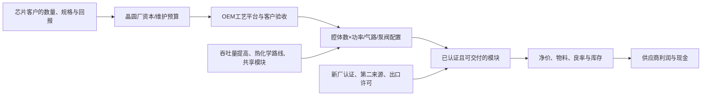

# 半导体设备子系统与真空/RF/流体模块行业调研

**研究截止日期：2026年10月10日，America/Los_Angeles。** 报告覆盖全球半导体制造用途，以2025自然年为可比基期，区分截至截止日已披露的2026年上半年/第二季度事实、2026全年条件估计、2027—2028年产业路径，以及2030年以后才有明确客户时间表的技术变化。网页没有首发日时明确标注“访问快照”；不使用截止日以后的季度结果。全文模型货币单位为**十亿美元，1十亿美元=10亿美元**，原始披露表保留CHF、SEK、JPY、CNY及原期间。

证据标签：**事实**指公告或原始文件披露；**目标**指公司、客户或协会预测；**计算**指对披露数字的直接运算；**推断**指本报告的技术、经济判断或条件模型；**未知**指公开资料无法辨识。供应商产品性能是其公开规格或主张，未经独立晶圆厂良率数据验证时不视为全行业效果。文中的[E01]等可点击到原始文件；文末同时列出公开日期、对应期间及定位。

## 一、核心发现：增长有支撑，普遍短缺和普遍高利润没有同样的证据

**最有依据的主线，是工艺复杂度与实际设备采购共同增加高规格模块需求，但2026年的交付约束具有产品、工厂和客户资格的选择性。** 上游实际支出、OEM实际销售、部件订单和扩产行动形成了方向一致的证据链；它们仍不是四份互相独立的终端需求。决定订单变成现金的单位，是“某个客户、某套配方、某种气体/功率/洁净度条件下已合格且能交付的模块”，不是设备厂总建筑面积，也不是AI Token量。

**当前市场规模只能有约束地估计，不能声称已取得完整行业统计。** 按本报告去除产业内重复销售、排除光伏/显示及相邻整机后的边界，2025年核心池约**10.8—18.1十亿美元，即108亿—181亿美元**，代表参数为13.5十亿美元；其中新扩建/技术迁移设备相关模块11.5、存量维修备件升级2.0。范围来自公开公司业务归属、私人公司覆盖和跨供应层消除重复的不确定性，不是统计置信区间。2026年基准代表收入18.01、2027年22.99、2028年27.05；2028年悲观和乐观代表路径分别13.30和35.42。细分、数量、有效供给、净价、产品组合、单位成本、利润和现金参数全部保留于附录，不能把这些代表值当成精确市场预测。

**数量增长与价格上涨应分开。** 基准路径允许2028年新硬件的同规格净价较2025年下降3%—6%，同时RF和流体产品组合提高平均票面金额。新工厂合格供给释放、OEM采购降价、国产第二来源和更高吞吐量，均可能削弱短缺溢价。先进模块收入增长未必说明同款模块涨价，更不说明厂家获得了物理产能的同比增长。

**“技术不可缺少”不等于“供应商能获得不可缺少的利润”。** 设备OEM掌握配方、晶圆验收与系统责任；模块厂掌握寿命、重复性和某些难以替代的控制能力；集成商还要承担外购物料、库存和交付。公开财务显示这些位置的经济差异很大。尤其不能把VAT的材料口径毛利与Ichor的完整销售成本口径毛利直接比较，也不能把Comet的部门EBITDA当作集团自由现金。模型中的利润是成本假设下的条件结果，并非披露的行业利润。

**RF前沿存在价值增加与零件消失同时发生的可能。** 多状态脉冲、频率调谐和快速闭环提升对工艺电源的要求；免机械匹配和一体化平台则可能减少独立匹配器。GAA选择性刻蚀中已有热/蒸气化学路线，先进工艺步骤也不能全部转换成RF通道。最可能保住价值的是能参与客户配方验证、提供系统可观测性并把可靠性转成吞吐量的供应方；仅提高零件规格、缺少客户端验收权的供应方未必能提价。

**最强反面解释是：本轮高订单包含设备厂补库与提前下单，随后新区域产能释放、配方效率提升和预算回落一起压低单位支出。** 该解释能容纳“上半年订单很强、交付仍滞后”，也能解释集成商规模增长而利润薄。它尚不能充分解释客户已发生的现金资本支出与先进节点付费生产，但足以否定简单的订单年化和长期缺货外推。区分两种解释需要连续观察客户验收、订单取消、库存/应收周转、同款净价，以及新厂资格完成后的实际出货，而非再增加同源景气评论。

主要未解决问题是：私人泵/流体厂的半导体收入与维修比例、各OEM按配方配置的真实BOM、同规格成交价及产能件数、地域许可证约束，以及先进通道数增加被吞吐量改善抵消多少。它们决定估计范围的宽度，不能用“未披露”直接推导乐观或悲观结论。

## 二、统计边界、客户任务与支付来源

### 2.1 四个硬件子池和一个服务池

本报告的“核心池”是全球半导体制造用相关模块对设备OEM、晶圆厂或服务客户形成的**外部采购支出/供应商合并后收入**。它不是所有半导体子系统，也不是产业增加值，更不是晶圆厂资本支出之外另一笔终端需求。

| 代码及可加子池 | 包含的功能和经济单位 | 排除及交叉边界 |
|---|---|---|
| V：真空阀与嵌入式压力控制 | 腔体隔离/传输阀、节流控制、嵌入式真空计与压力控制；按合格阀/控制回路或配方腔体配置计 | UHP气体计量阀归F；大型独立检测分析仪不纳入；备件维修用途归S |
| P：泵组与机台端尾气处理 | 干泵、涡轮分子泵、前级泵组、机台端abatement及其必要集成；按可处理指定气体负荷的泵组/处理通道计 | 全厂公用工程管网、一般工业真空及非半导体用途不纳入；不能把泵整机与其内部外购核心零件再加一次 |
| R：RF与工艺电源 | RF发生器、匹配网络、脉冲偏压/DC工艺电源及必要控制；按合格工艺功率通道/系统计 | 数据中心机架电源、光伏/显示/工业加热排除；已含在P尾气处理整机中的电源不另计 |
| F：流体计量与模块 | MFC、压力式流量控制、ALD快速阀、前驱体气化/液体计量、gas stick/manifold、气液模块与必要热管理；按合格气路/剂量通道、液路或模块计 | 泵外真空阀归V；全厂供气管网、CMP材料、FOUP、全部过滤耗材不纳入；集成面板只加未在部件收入中计过的集成净额 |
| S：存量服务 | 上述设备的维修、清洗、备件、升级、维护性同规格替换与维护合同；按活跃装机×服务频率×净单价计 | 用途相同的替换件只能计一次；已在硬件基数中的维修收入应先移出，避免产品/服务会计分类造成重复 |

边界上的处理原则是**按终端任务消除核心池内部销售**。例如MFC厂卖给流体面板厂，再由面板厂卖给OEM，核心池计“MFC收入+面板集成净额”，不能再加面板全额。该净额仍含从核心池外购买的材料和加工，不等于纯增加值。没有公开分项时使用归属范围，并把无法消除的误差列入基数上限；不把所有供应商营业收入相加。

晶圆厂总资本开支、WFE整机收入、模块收入、晶圆收入分别描述不同层级。它们可用于采购链校验，不能相加为四份市场。先进封装中有真空/等离子/流体任务，但全套封装和测试设备不归本报告。晶圆搬运机器人、静电卡盘、陶瓷、完整冷水机、结构机架等也属于更广子系统专题；本报告只在解释系统责任与替代时讨论，不给它们伪装成已覆盖的市场规模。

### 2.2 谁付款，谁承担失败成本

新增晶圆厂/产线通常由晶圆厂批准资本预算，OEM决定平台配置并采购部件，晶圆厂按设备与工艺验收。既有产线升级则来自技术迁移资本预算或维护预算；泵大修、阀备件和现场服务更多来自经营性维护支出。OEM换供应方或将模块内部集成，可以改变供应商收入分配，而不增加终端预算。

采购并非只有价格部门：OEM工艺工程师验证功率和剂量，晶圆厂工艺/设备团队验证缺陷、漂移、正常运行时间和跨机台一致性，安全/设施团队验证气体与尾气处置。晶圆报废、延误交货和工艺失控的损失远大于普通零件购置差价，因此初始认证确有黏性；但量产后的系统责任、集中采购和替代来源掌握在OEM/晶圆厂手中。

核心客户群包括先进逻辑/代工、DRAM/HBM、3D NAND和成熟节点/功率器件制造；地域上台湾、韩国、中国大陆、美国、日本和欧洲的工艺组合不同。客户和设备平台关系应按配方审查，不能把“已进入某客户”推广为该客户所有工艺层、所有厂址均已通过资格。

## 三、现实基数：先确认发生了什么，再解释增长

下面集中列出用于定量判断的主要原值。销售是期间流量；订单、积压和产能目标另列。半年度数字不乘二冒充全年，季度数字不乘四冒充当年收入。

| 原始对象、地域及币种 | 已披露事实或明确目标 | 对应经济期间、公开时间及用途 |
|---|---|---|
| SEMI，全球OEM WFE | 2025销售USD116.9bn；2026预测USD143.9bn；2027预测增长21.8%，2028达到USD200bn | 2026-07-14发布。2025为协会披露基数，后续为预测；2027约175.3为计算，不是新披露实绩。[E01] |
| SEMI，300mm前端fab设备支出 | 3Q26网页版本预测2026 USD149bn，2027/28增长16%/12%；300mm装机能力2026增7%，以后约8%/年 | 本次访问快照；首发具体日未标注。是fab端、300mm口径，不与OEM WFE相加。[E50] |
| SEMI，World Fab Forecast | 英文3Q26版本预测设备支出2026 USD159bn、2027 USD180bn；装机能力增5%/6% | 本次访问快照，厂/线口径。中文页面仍显示2Q26 USD152bn/166bn，属于版本差异。[E51][E52] |
| VAT，全球 | 2025半导体Valves销售CHF724.7m；Global Services销售CHF198.8m，部门EBITDA率45.6% | 2025自然年；2026-03-03年报。半导体Valves含高端显示等相邻用途，服务不是全部半导体。[E03] |
| VAT，全球 | H1订单CHF856.4m、销售CHF511.9m；同比+75.0%/-8.3%，恒汇率+90.9%/+0.1%；EBITDA率29.0%；FCF CHF41.8m | 2026-01—06，2026-07-22。区分订单、交付与汇率。[E05] |
| VAT，全球 | Q2末积压CHF647.9m；Q2销售CHF291.0m、订单CHF500.0m；2026年末季度生产输出目标超过CHF450m | 积压为2026-06-30存量，目标是期末季度美元化能力，不是件数，也不是2026收入。[E05] |
| Atlas Copco Vacuum Technique，全球 | 2025销售SEK36,727m、营业利润SEK6,765m、营业利润率18.4%、ROCE17% | 2025自然年；2026-01-27。含非半导体真空，品牌收入不可重复相加。[E06] |
| Atlas Copco Vacuum Technique，全球 | Q2订单SEK14,409m，同比+60%，有机+59%；销售SEK10,531m，同比+17%；营业利润率21.0% | 2026-04—06，2026-07-16。订单增幅不等于交付增幅。[E07] |
| MKS VSD，全球 | 2025产品USD1,290m、服务USD289m，总收入USD1,579m；部门毛利43.3% | 2025自然年；10-K于2026-02-24提交，部门成本不含另列的无形资产摊销。[E09] |
| MKS半导体终端市场，全球 | Q2收入USD554m、H1 USD1,019m | 2026-04—06及01—06，2026-08-05。跨VSD/PSD等部门，不能与VSD作为独立市场相加。[E10] |
| Advanced Energy半导体设备市场，全球 | 2025收入USD839.9m；2026Q2 USD278.3m、H1 USD497.7m | 2026-02-10及08-03披露。包含系统电源等，RF须再归属；AI服务器电源排除。[E11][E12] |
| Comet PCT，全球 | 2025销售CHF257.1m、EBITDA率15.7%；2026H1 CHF143.6m、EBITDA率20.2% | 2026-03-06及07-31披露。2024比较利润已重述，不能混用旧口径。[E17][E18] |
| HORIBA材料/半导体部门，全球 | 2025销售1,565亿日元、营业利润445亿日元；2026H1销售999亿、营业利润301亿日元 | 2026-08-10说明材料，保留幻灯片取整口径。不是MFC单项。[E19] |
| Fujikin合并口径，全球 | 销售2,212亿日元，页面标示截至2026-03-31 | 财年口径且包括其他行业；网页未标注首发日，不强行转成2025自然年实绩。[E20] |
| Ebara Components，全球 | 2025年度销售JPY114.9bn；2026H1销售JPY61.2bn、订单JPY81.1bn | 2026-08-14累计原表。季度图取整数相加为114.8/61.1，差0.1属取整；采用披露累计值。排除Equipment中的CMP等整机。[E24] |
| Ichor，全球 | 2025销售USD947.652m；2026Q2 USD294.784m、GAAP毛利13.9%、营业利润率2.4%；Q2融资ATM USD200m | FY2025截至12-26，10-K 2026-02-20；Q2截至06-26，2026-08-03。面板全额与部件收入重叠。[E21][E22] |
| Entegris APS，全球 | 2025销售USD1,799.1m、部门利润USD426.4m | 2026-02-11提交；含过滤、FOUP等大量边界外业务。该年流体处理受设施资本支出下降影响。[E47] |
| TSMC，全球合并 | Q2资本支出NTD496.00bn；12英寸当量出货4,336千片；2nm占晶圆收入3% | 2026-04—06；2026-07-16。是实际资本支出、已付费产出，不能把收入份额当晶圆面积/工艺步骤份额。[E27] |
| Lam Research，全球 | 季度收入USD6,722.238m、GAAP营业利润率37.4% | 截至2026-06-28季度；2026-07-29。整机与服务收入不加入核心池，只用于验收和价值位置判断。[E28] |

这些证据有三个不同强度。**客户现金支出和付费节点生产**最接近终端采用；**OEM实际收入与模块收入**确认采购已落地，但可能包含库存时差；**订单、spec win和产能目标**更早，不能等权替代收入。Ichor公告亮点写Q2同比24%，原表294.784/240.285计算为22.7%；本报告采用原表，保留该内部不一致，不用标题百分比修正原值。[E22]

### 3.1 同一个协会也有不同分母和版本

4月300mm预测为2026/27的USD133bn/151bn；7月为OEM WFE预测；截止日英文3Q26厂级页面又上调。300mm网页计算的2027/28约172.8/193.6，是对该页面增长率的运算，不是完整OEM预测。不能把“子集预测高于较早总量预测”解释成统计恒等式失败：版本、采购确认时间、设施范围、出货/资本支出确认都有差异；在没有付费完整底表时，无法把差额逐项归因。[E02][E50]

本模型因此保留2025的同口径WFE基数，用**2026/27/28拟采购设备需求参考额150/180/205十亿美元**作为基准假设：它综合7月OEM预测和3Q26上修方向，不假称SEMI发布了这三个完全相同口径的数。2026可支持的参考范围约144—159，2027约170—190，2028约190—220；具体可开票额还受模块交付和厂房条件影响。换成7月OEM序列，保持其他参数不变，会降低需求，但2026高端交付约束使收入降幅小于预算差异。附录给出精确桥接参数。

### 3.2 从“晶圆片数”到“工艺通道”之间有关键变量

TSMC Q2晶圆当量出货同比增长约16.6%，USD收入增长33.7%；两者差异体现节点/产品组合、价值和价格口径，而非同一个数量指标。实际2nm收入占比证明GAA已进入付费采用，却不能据此说所有晶圆已迁到GAA。[E27]

同样，3Q26的300mm支出增幅明显高于装机能力增幅。设备预算不仅买更多晶圆产能，也买更复杂的步骤、升级和更昂贵平台；模块需求要穿过“关键步骤次数、腔体吞吐量、正常运行时间、通道配置、共用程度”这一层。把AI支出直接按比例转换成阀、泵或RF电源件数，会丢失决定弹性的因素。

## 四、技术采用如何改变客户付费与单位内容

### 4.1 真空/RF/流体是同一配方的控制链，但受益并不一致

腔体中气体进入速率、压力驻留与抽速决定反应物分布；RF功率和偏压决定等离子体与离子能量；阀和泵必须在反应副产物、洁净度与切换频率要求下稳定工作。任一组件的“更快”只有改善整个配方的稳定时间、缺陷或产出，才能带来客户支付意愿。软件同步、温控、管路死体积和排气路径会改变这一结果，不能把元件响应时间当作晶圆步骤时间。

| 技术变化及真实客户任务 | 已有证据与所处阶段 | 数量、价格和利润的可能传导 |
|---|---|---|
| GAA/更复杂三维结构：高选择性去除、薄膜一致性、低损伤 | 付费先进节点已有TSMC实际收入；Lam选择性产品包括热/蒸气路线；ASM同时提供thermal ALD与PEALD | 增加精密剂量/真空任务；只有含等离子体的步骤直接增加RF。热路线可能将价值由R移向F/V，而非全部模块同步增加 |
| 高深宽比3D NAND：深孔/沟槽、侧壁与副产物控制 | Lam Cryo3商业产品公开更高刻蚀速率与高层数能力；尚无全行业每片RF/泵支出时间序列 | 更严苛泵/温控/功率可能提高规格；较快刻蚀减少每单位晶圆所需腔体。层数与设备件数没有线性关系 |
| 多状态脉冲与快速RF控制：更窄工艺窗口、跨腔体一致性 | eVerest公开控制规格；Comet Synertia RFM已有客户资格进展；AE说明若干平台进入爬坡 | 更高价值通道与调谐算法可增内容；资格完成、生产订单、持续验收和现金仍是不同阶段 |
| 多前驱体ALD：重复剂量、清洗/排空、低污染 | HORIBA压力式MFC、CKD快速/耐久阀及ASM ALD工艺文件提供工程证据 | 气路数与温控要求上升；一只更宽量程、多气体器件又可能减少库存和部分重复配置 |
| 苛刻排气及环保：减少停机、腐蚀/沉积、能耗和尾气负担 | Edwards iXH/iXM和Ebara EV-H/ELF指向寿命、负荷与尾气管理 | 初始P规格和售价有提升空间；较长服务间隔降低同一装机的维修频率，服务收入须由装机增长抵消 |
| High-NA替代部分多重图形化 | ASML/TSMC明确目标：TSMC先进节点HVM从2030年开始；12英寸掩模试点2031、系统生产准备2033 | 减少某些图形层的沉积/刻蚀循环；不能外推为2026—28全部步骤缩减，更不能把2033目标记成当前采用 |

技术出处分别为[E29][E30][E31][E33][E34][E35][E38][E45][E32]。以上规格和效率是特定平台/工艺条件下的主张；只有客户已付费的部分被当作当前商业采用。

**RF的前沿不是“功率越大越好”，而是可复现的功率时间结构和负载变化控制。** AE的eVerest披露亚200微秒级响应与多级脉冲；Comet产品涵盖5微秒至1秒的脉冲状态。这些不是统一测试条件，不能排序为谁在晶圆上一定更快。Lam Akara宣称DirectDrive等离子体控制大幅加快，说明OEM也在控制系统级价值；相关工艺数据和最终晶圆验收仍掌握在OEM/客户手中。[E14][E35][E29]

**流体前沿也不只在更短阀动作时间。** HORIBA D500压力式流量控制的公开响应规格为小于0.8秒，强调压力不敏感、多气体/量程和自诊断；它不能被改写成亚毫秒新产品。高速ALD还取决于下游体积、前驱体蒸气压、管路温度和腔体清扫。UCT提供整个气路热管理与模块集成，正说明单个MFC优异不等于整条气路剂量尾部受控。[E34][E39b]

**高信息价值的变化是“设备OEM把模块算法嵌入自己的工艺平台”。** 模块供应商由卖单件走向卖同步控制和可观测性，可以扩大价值；OEM也能利用同一过程把接口封装、替代件或算法内化。VAT宣布以约CHF110m现金对价收购Atonarp，指向腔体内分子过程指纹与控制邻接，但截至截止日这里仅确认交易公告和预期交割安排，不把收购金额当市场规模，也不把检测研发变成已经规模兑现的闭环收入。[E49]

### 4.2 资格与放量：需要穿过哪些阶段

工程可行 → 配方演示 → OEM设计进入 → 客户测试/厂址资格 → 小批付费 → 稳定量产交付 → 扩至其他平台/厂址 → 现金贡献。中途任何一步都可能因配方变化、复制一致性、气体腐蚀、出口许可或客户资本预算停下。

VAT披露spec win研发过程约18—24个月，之后通常还要3—5年才形成业务；不能将当年设计获胜数量直接映射到次年收入。MKS的量产订单很多在90天内接收并发运，却不意味着新厂或新材料认证也只需90天。这两个时间表分别对应设计资格和既有合格产品履约，彼此不矛盾。[E04][E09]

已有产品升级通常快于新工厂复制，新厂复制又通常快于新工艺/新材料完全替代；这里不给所有公司套固定认证月数。Comet仍在新厂首批产品资格准备，AE仍以首批生产时间为目标；只有后续披露生产客户、稳定出货或无需再次资格的大范围转产，才可提高供给判断。

### 4.3 用一个工程桥梁约束行业数量

**工程示例，全部是本报告假设：** 一条每月50,000片12英寸晶圆的产线，对本专题所选关键工艺每片180次腔体访问；单腔体60片/小时、每月720小时、可用率80%。所需选定工艺腔体约：

`50,000×180 ÷ (60×720×0.80) = 260个`。

若步骤次数增15%，吞吐量增20%，其他不变，腔体需求反而变为原来的`1.15/1.20=95.8%`。如果每腔体功率/气路内容另增15%，相关模块工作量可变为110.2%；若采用共享气路或泵组，增加幅度又降低。该示例覆盖的是选定关键步骤，不是整厂腔体数，也不能按一家晶圆厂收入比例放大全行业。

为了收敛到行业，使用VAT演示材料引用的TechInsights 2025沉积/干刻蚀设备约USD25bn/23bn。假设分摊到每个合格生产腔体的整机价值USD0.7m—1.3m，则对应约3.7万—6.9万个当年新增/替换腔体当量；假设本专题每腔体模块采购USD0.10m—0.19m，覆盖约USD3.7bn—13.0bn，再加入其他真空/湿法/外围适用设备和存量服务。中间值`48bn/1.0m×0.17m+2.6bn+2.0bn=12.76bn`接近供应商锚定值。[E04]

这个桥梁宽度很大：整机价值含平台搬运和软件，共用模块不能按一腔一套重复计；沉积/刻蚀的TechInsights基数也不与SEMI WFE完全同口径。它的作用是排除离谱数量级、展示吞吐量与配置的交互，并非第二份独立精确TAM。更稳健的需求模型使用附录的WFE参考额、设备均价折算和分项工艺强度；供应侧另从工厂与资格估计，不用这个需求示例反推产能。

## 五、有效供给、定价和库存：目前更接近结构性缺口

### 5.1 哪种能力才算供给

设计能力是可制造某规格的能力；名义能力是厂房/设备排班上限；有效能力还要扣除人员、良率和物料限制；合格能力再扣除客户、厂址和配方未认证部分；可交付能力最后扣除许可证、物流和客户接收条件。零件一旦必须复制完全一致，换厂址或供应商既可能是扩产，也可能先触发重新认证。

| 子池 | 独立供给证据，而非由需求倒推 | 截止日判断与需要的反证 |
|---|---|---|
| V | VAT增加生产相关人员、库存和产能，披露期末输出目标与高积压 | 高端/新规格交付压力有直接证据；暂无可支持全球所有阀门件数短缺的公开底表。订单取消、积压下降但客户采购不降，才支持约束已缓解 |
| P | Atlas利润改善同时存在爬坡成本；Ebara新增产品，韩国服务厂有明确建设/运营目标 | 高负荷、耐腐蚀与在地服务可能紧于一般泵；全行业没有公开泵组产能件数。服务厂不能计作新泵制造产能 |
| R | Comet明确称尚无重大供应链瓶颈；Penang准备首批资格；AE/MKS扩建在推进 | 部分新平台/厂址资格滞后可能限交付，但不能据强订单认定所有RF短缺；若新厂合格出货后库存增加而价格下调，将更接近平衡/过剩 |
| F | UHP焊接、洁净制造、热管理和客户自动测试限制可用供给；已有国际/本土第二来源 | 通用MFC/面板与高温前驱体/快速剂量模块分化；公开数据不足以识别某个气体规格的全球供需差额，需订单与实绩联合判断 |
| S | 本地维修人员、备件、翻新能力与安装地区相关；Ebara韩国工厂专门扩维修 | 存量支持需求较稳，但寿命改善降低访问频率；服务人员供给与设备产能不能用同一件数 |

供给工程证据来自[E05][E07][E18][E13][E44][E25][E26][E39a]。VAT目标以CHF输出计，AE的2028约USD5bn收入生成能力覆盖全公司业务，MKS新厂约350,000平方英尺；这些都不是本专题合格模块的物理件数，模型不会直接换算成厂商物理扩产比例。

VAT Q2积压约为当季销售的2.23倍，是**金额覆盖计算**，不是客户平均等待2.23季度；与450m目标相除得到约1.44季度也只是目标输出覆盖，不代表产能已实现。公司间订单定义、预付款、交货期与币种不同，不能用总积压除全行业销售预测统一交期。

### 5.2 供需的独立比较和不可替代部分

附录将每个子池2025平均功能配置的等效交付工作量设为100；D是需求工作量，S是合格可交付工作量。需求由设备预算/平台数量、每平台配置和效率变化推导；供给由生产时间资源及资格/良率/许可折扣推导。两者限定于相同全球半导体功能池后比较。它们是**条件指数，公开资料并未披露完整SKU产能盘点及地区/规格权重**，只能检验参考任务池，不能证明每一SKU可替代或完成全球逐规格供需撮合；也不把美元收入误称件数。

基准2026年的代表S略低于V/R/F需求，而2027—28随着资格释放进入总量可覆盖需求的状态；这比“未来三年全产业持续短缺”更符合Comet与VAT不同证据。缺口仍可能集中在最复杂配方的5%—15%工作量上，即使老产品空闲；该5%—15%是本报告用于检验的高端池条件范围，不是已测市场比例。它成立需客户资格分散、同类替代未通过，以及延期订单真实待交付；若供应商确认第二来源和可转产范围更广，区间应向下修。

乐观路径是需求超过供给释放速度，2027年R/F代表工作量缺口约10%/8%，2028约12%/10%；缺口未必全成为丢失收入，可能形成排队、替代采购和次年交付。模型不自动将未满足需求再加进下一年，避免订单积压与未来预算重复计算。悲观路径则有明显闲置余量，2028 V/P/R/F的S较D高约47%—76%；该结果是需求回落与已投资能力释放的联合条件，不是公开测得的闲置率。

### 5.3 为什么短缺可能不涨价，扩产也可能增加利润

成交价由既有平台合同、年度采购降价、产品变更、地域认证和客户集中度决定。旧规格报价调整往往在年度采购或新平台谈判时显现；紧急物流、加班、替代材料和暂时低良率则可先增加供应商成本。在缺货初期，厂家可能优先保交付、接受更低毛利，净价不一定同步上涨。现有文件没有足够同规格发票或合同条款，无法给行业统一重定价月数；附录同规格P是可证伪假设，和高规格组合M分开。

约束释放有四种不同利润结果：部件厂新增销量摊薄固定费用；稀缺零件的溢价下降；集成商获得更准时、更便宜的外购物料并改善库存；OEM交付/晶圆厂良率改善获得系统级收益。它们可以同时发生。量增、价格降而营业利润升的基准情景不是矛盾，也不能被收入增长掩盖成本上升。

政策影响落实在可交付供给和现金。MKS年报披露自2025年初以来出口许可取得时间显著延长，并说明转厂要重新资格；因此区域工厂可以改善某些交付，也可能引入新的许可/复制成本。限制依产品、目的地和最终用途而异，不能写成所有真空阀或流体件均被一律禁售。[E09]

国产替代可能增加中国可用供给、降低进口部件议价，同时增加OEM初期验证支出和供应方试错库存。相同品牌对不同厂址能否发货不是统一属性。由此形成的区域化库存与工厂资本重复建设，会在全球需求增长时仍压低资本效率。

## 六、竞争与价值捕获：谁控制性能，谁控制利润

### 6.1 关键位置比“供应链重要性排名”更有用

| 竞争位置及主要参与者 | 独特能力、经济位置和价值捕获 | 发展条件及重要未知 |
|---|---|---|
| 真空阀领导者VAT；MKS/INFICON等压力检测控制及其他阀厂 | 寿命、颗粒、压力重复性与客户复制记录可带来较高黏性；VAT横跨阀与服务并向过程检测邻接 | 77%半导体阀份额与71%半导体及相关应用份额分母不同；不能把两个百分比当连续市场份额下降。[E03][E04][E09] |
| Atlas Copco旗下Edwards/Leybold；Ebara；Busch旗下Pfeiffer及Fab Solutions；Kashiyama等 | 苛刻气体处理、整套排气、尾气与全球服务网络；私营集团同样有规模能力 | 同集团品牌不可重复计；新产品可提高TCO价值又延长维修周期；私人公司半导体收入/硬件服务分拆不足。[E08][E33][E24][E40][E48] |
| MKS、Advanced Energy、Comet、TRUMPF Hüttinger、DAIHEN | RF发生/匹配、频率与偏压控制、整套平台资格；部分跨显示/工业应用 | 平台算法、客户工艺数据归属决定能否收费；各家公司总收入都不是纯半导体RF池，规格参数不能直接排名晶圆良率。[E09][E14][E35][E36][E37] |
| HORIBA、Fujikin、MKS、Brooks Instrument、CKD及其他流体厂 | MFC、多气体/量程、耐腐蚀、UHP表面与高循环阀，应用工程和库存覆盖 | 流体料号很多，头部与小型专用厂可共存；全公司/大部门收入归属与非半导体业务需扣除。[E19][E20][E09][E38] |
| Ichor、UCT及其他模块/焊接集成商 | gas panel、精密焊接、热管理、模块测试和在地履约；吸收OEM的低批量高复杂工作 | 设计权、外购物料与集中客户决定利润；在高增长时仍可能需外部融资，不能用毛收入衡量创造的增加值。[E21][E39a][E39b][E39c] |
| 恒运昌、北方华创旗下七星等中国供给 | 已有国内商业客户和本地技术支持，可降低进口依赖；RF及MFC各自需工艺资格 | 恒运昌已于2026-01-28上市，不能列为未上市；发行材料的7—14nm能力是发行人主张，不能扩展为国际客户全面认证。[E41][E42][E43] |
| Lam、Applied Materials、Tokyo Electron、ASM、ASML等设备OEM及自研方 | 掌握配方/平台、验收入口与系统责任；Lam快速控制和热选择性刻蚀体现内部架构能力 | OEM自研不必自产所有零件，也可保留关键控制而采购标准件；平台采用与模块利润会分离。[E21][E29][E30][E45][E46] |
| TSMC及逻辑、DRAM/NAND、成熟节点晶圆厂 | 最终预算、良率/产能收益、复制资格和停机成本的承担者 | 多厂址重复建设并不保证快速爬坡；产出结构、成本回报和技术迁移可令设备预算与晶圆片数脱钩。[E27][E51] |

本地图覆盖决定采购和主要产品路线的代表参与者，不承诺穷尽全部阀、陶瓷密封、RF半导体、液路泵、独立维修和区域代理。TRUMPF、Fujikin、Busch/Pfeiffer、Kashiyama等非上市/私人业务不能因为财务不透明而视为无有效供给；它们是市场估计和竞争不确定性的真实来源。

恒运昌招股书引用其委托Frost & Sullivan的统计，称2024年中国大陆半导体RF电源系统市场65.6亿元，国外四家占约88%；同一文件全球RF市场USD5.34bn涵盖**所有应用**。该统计具有发行人利益关系，并非本报告独立盘点；多篇转述不增加确认次数。发行材料还明确国际领先OEM进入不足、产能利用率存在标准工时口径超过100%的情形，不能据此宣称全球物理产能不足。[E41]

### 6.2 同一轮增长下的经营结果

VAT H1的材料口径毛利66.6%，人员等成本另外列支；其EBITDA29.0%更适合与自身历史比较。MKS VSD毛利也不含另列的无形资产摊销。Ichor GAAP毛利和营业利润则包含不同成本层级；直接排列这些毛利做技术护城河评分会产生会计假象。[E05][E09][E22]

更有意义的比较是**系统责任、采购价差、固定费用与资本负担**。Ichor 2025来自Applied Materials和Lam的销售合计约76%，缺少长期数量承诺，客户持续要求降本/交付。它既能因更高产量提高固定费用吸收，也可能承受客户调单和外购核心物料价格；13.9%毛利并不意味着精密气路简单，而说明技术风险并未都变成它的定价权。[E21]

Atlas Vacuum Technique实际营业利润率随销量改善，同时受爬坡成本抵消，是制造杠杆而非必然同款涨价的例子。Comet H1 PCT经营改善，但集团FCF为CHF-19.3m，投资和备货先行；其集团/部门不能混成同一现金资产边界。AE Q2利润亦受约120bp关税退款影响，不能全部计作永久成本效率。[E07][E18][E13]

MKS Q2末应收USD830m、存货USD1,033m，较2025末的USD651m/921m增加；这是集团边界，包含本专题以外业务，但能确认放量期间备货与应收同步增加。模型允许爬坡期α上升；实际净营运资本仍要扣除应付和预收变化，不能只从两项余额推断经营现金。[E10]

ROIC必须保留投资的代价。Atlas披露的ROCE涵盖其部门资产边界，不能直接转成纯半导体泵回报；MKS历史并购带来的无形资产、商誉和融资也不能被“高毛利”略掉。附录只计算统一边界的经营利润和税后、融资前现金，不给全行业伪精确ROIC；收购、商誉、债务利息及股权摊薄对投资者回报须另算。

### 6.3 客户回报的条件示例

以下是同一新增泵/控制模块升级的**研究示例而非报价**：初始升级溢价USD30,000，经济寿命8年，第四年必要更新USD5,000，期末残值USD0—2,000；每年净节能/维护收益USD3,000—6,000，净减少不可恢复瓶颈停机4—12小时。每小时仅计实际损失的贡献USD1,000—5,000，不把全部晶圆售价都当损失。

年度增量经营收益约USD7,000—66,000；在这些条件下简单初始回收约0.45—4.29年。按10%折现、保留更新和残值，8年净现值约USD4,000—320,000。该结果尚未扣税，已用净维护差额而非把新旧维护全额同时算收益。若停机并非全厂瓶颈、可补产，或新增模块引入缺陷，停机收益接近零，低端节能单独不足以支持原溢价。

这解释客户为什么可能为可靠性付款，也解释为什么供应商必须证明“真正不可恢复的产出损失”而非展示更快零件。高端应用的支付上限可以很高，OEM仍可通过竞争采购保留大部分回报；技术重要性并不自动给模块厂同样的经济租金。

## 七、2026—2028年的三条产业路径与额外替代分支

### 7.1 路径的机制和共同检验条件

**悲观：预算停顿、既投产能释放与单位内容流失。** 2026仍有已排定项目和补库交付，不能假装上半年增长没有发生；2027—28拟采购设备需求回落至约145/140十亿美元。热化学/更快刻蚀、更多共享模块和偏成熟节点组合降低相关工作量，第二来源与集中采购压价。合格能力继续释放，不能因需求低就假设供给消失。核心池2028代表收入13.30，略低于2025，经营利润率从本模型2025的20.5%降至11.6%；F代表利润率仅约2.3%。服务增长和库存回收可支撑现金，不能把较好现金当成新订单景气。

**基准：采购上修、技术迁移与认证释放并行。** 客户已付费资本支出与先进工艺支撑需求，拟采购设备参考额150/180/205十亿美元；RF通道和精密剂量内容增加快于泵组件数。2026部分交付受限，新厂/转厂的资格在2027—28逐步释放，净价缓降而组合升级。核心池2028代表收入27.05，经营利润6.43、融资前FCF3.73，均为成本和周转参数下的推断。利润扩张需要新厂合格交付、良率提升和采购成本受控；只实现销售增长、却持续低良率或接受大幅同款降价，将落入低利润变体。

**乐观：前沿与存储采购加速，复杂规格持续供不应求。** 拟采购参考额156/195/235十亿美元；HBM/DRAM、先进逻辑和NAND迁移同时拉动，更多RF/气路通道与高性能版本付费采用。供给增加但新配方资格慢于需求，R/F交付仍受限，厂家能保留部分净价与组合价值。2028核心池代表收入35.42、经营利润9.65；2026融资前FCF约-0.27，2028约3.57，低于基准的2028现金代表值，源于更高新增资本和营运资本。高增长可以提高技术赢家利润，同时增加集成商和新厂的融资压力。

三条路径均保留年度数，不用年末季度输出冒充全年。情景中的设备需求是客户拟采购的参考金额，**若关键模块不交付、厂房不能接收，整机预算也未必完全变成收入**。硬件出货模型只计当年能满足的部分，S服务依存量和访问频率；具体参数及各子池的三方向数据见附录B—D。

各路径最重要的判别证据：

| 要辨识的机制 | 上调证据 | 下调/竞争性证据 |
|---|---|---|
| 真需求还是提前下单 | 客户资本现金支出、OEM验收、模块发货和存量维护同时改善 | 部件订单强而OEM库存/未验收设备持续上升；客户延期、取消或预算下调 |
| 工艺内容是否增加 | 同平台每腔体通道增加；新产品持续付费、跨厂址复制，改善良率和不可恢复停机 | 更少步骤、热路线替代、共享模块、吞吐量改善超过配置增加；只有演示无生产收入 |
| 供给是否释放 | 新厂具体客户资格完成，连续两季度稳定交付且质量不恶化 | 建筑竣工但资格反复、许可延长、返修/报废增加；供应商只能增加库存 |
| 是否有定价权 | 同规格净价稳定、客户为系统效果支付溢价，成本涨幅可转嫁 | 收入增来自高规格混合，旧料号价降；OEM二供、内部集成和固定年度降价 |
| 利润能否变现金 | 应收与库存周转改善、扩产资本逐步回落，利润扣税和投入后留下现金 | 外部融资支撑现金增加、供应商承担安全库存和客户交期变动；新厂折旧/质量成本持续增加 |

### 7.2 概率的对象和精度

这里没有可用于拟合产业概率的独立同口径历史数据库。概率是**本报告的主观路径权重**，依据当前付费采用、预算修订、上半年供应商实绩以及扩产/认证的经济周期，精度只到粗分。

为避免路径重叠，按固定统计边界的2028收入相对2025收入，将完整结果空间划成：低于1.4倍、1.4至低于2.3倍、至少2.3倍。分别赋予**悲观30%、基准50%、乐观20%**，合计100%。机制文字和参数是每一类的代表状态，不声称该类所有状态都有相同利润；例如高销量、低价格导致的价值流失也可落入悲观收入类。基准不是两个端点平均，也不是50%置信区间。

最支持基准权重的因素是已发生的资本支出与先进节点收入、多家不同业务位置的实际销售增长，以及正在形成的认证供给。支持悲观30%而不忽略它的因素是高度集中客户、订单到收入的时差、历史周期与资本先行、效率替代和净价缺乏直接数据。乐观要求更强的预算兑现、多个前沿平台持续采用以及厂家保留价值；同源供应商景气评论不能把它升级成高概率。

另一个**无条件事件概率**：截至2027年底，Comet/AE/MKS等可观察项目中至少两家新区域工厂完成主力半导体产品客户资格，并连续两季度有稳定生产交付，主观概率约**65%—85%**。这不是“至少一家建筑竣工”的概率，也不等于全行业供给充足。新厂明确资格与出货会提高判断；首批生产延期、复制缺陷或许可延长会降低判断。三个项目相关于共同的客户预算与区域化采购，不能各给一个概率后按独立事件相乘。

### 7.3 替代突破分支：控制价值增加，但独立匹配器收入减少

AE已展示免机械匹配的eVolv/频率调谐方向，早期资格单元及算法技术可查；目前缺少全球平台渗透与经审计收入，不将其写成已经普遍替代。[E15][E16]

定义额外事件E：**在核心收入增长至少1.4倍的母路径中，截至2028年末，免机械匹配/高度集成调谐在新增先进刻蚀相关RF配置达到至少20%的付费客户验收，并连续四季度交付**。母路径包括基准与乐观，权重70%；估计`P(E|母路径)=20%—35%`，于是`P(E且母路径)=14%—24.5%`。后者不超过母路径，属于条件分支，不再与30/50/20相加。低景气中也可能采用降本替代，那个事件不在这一定义内，不能说所有替代概率已覆盖。

概率保持宽度的理由是已有工程/资格起点，但要经历跨配方负载、客户复制、竞争平台和量产良率验证；成功一台样机远弱于20%配置渗透。若OEM公布可核验平台清单和连续生产订单，应上调；若仅有调谐演示、复杂负载仍需传统匹配或客户资格长时间停滞，应下调。供应商之间的合作和相互替代高度相关，不做独立概率乘法。

数量/经济示例以2028基准R为锚。令先进可适用配置占R收入A=50%—70%；其替代率x=20%—35%；传统匹配器占该配置价值m=20%—35%；被新发生器/算法收费收回的比例r=30%—70%；适用工序吞吐改善h=5%—15%。则：

`R' = R × [(1-A×x) + A×x×(1-m×(1-r))/(1+h)]`。

这些比例全部是本报告条件参数，市场未披露。按联合端点，整体R收入比未替代基准低约1.05%—8.42%，约USD0.07bn—0.57bn；核心总池相应降低约0.3%—2.1%。如果按原R营业利润率且费用能同比调整，利润减少约USD0.02bn—0.17bn；若匹配器专用产能无法转用，实际利润损失更大；如果发生器材料与装配成本减少，平台赢家可能反而扩利润。这个分支改变价值分配和零件数，没有简单给所有细分再加一个更高增长率。

2030以后，High-NA减少特定多重图形化步骤是另一种替代机制。客户已有明确起始目标，却没有能约束本专题全市场的步骤减少比例，因此不为2030/33再制造精确总TAM；可识别阈值是被替代的关键刻蚀/沉积访问次数下降是否超过新增三维结构访问、RF/气路配置和性能价值增加。时间、层别和客户均必须对应，不能将一家公司目标当全球同步迁移。

## 八、关键阶段、最强反证与可证伪判断

2026年的重点是既有需求兑现与新厂准备；2027是复制资格、成本爬坡和交付弹性最值得观察的阶段；2028才更容易区分持续工艺内容上升与补库后的闲置。2030以后的客户技术目标影响长期设计资格，但不提前计作2026收入。

| 时间/阶段 | 必须先发生的条件 | 可观察进展与尚不能确认的事情 |
|---|---|---|
| 2026H2：交付追赶与备货 | 已有客户预算、物料、排班和验收窗口 | 出货/现金增加才是兑现；高book-to-bill、加临时人员或新厂开幕仍不是收入年化 |
| 2027：新区域产能资格 | 客户认可复制一致性、工艺和安全要求，许可/物流可用 | Comet计划完全运营、Ebara韩国维修厂计划2027-01运营、AE首批生产目标是线索；制造与维修能力必须分开 |
| 2027—28：新产品跨平台采用 | 初期良率/可靠性改善、回报可证明、后续客户扩量 | 高规格组合溢价能否保留、研发和返修是否下降；供给缓解可能使集成商受益、稀缺部件承压 |
| 2028：产能与利润成熟或闲置 | 订单持续、成本吸收、库存与应收回收 | 观察利润与融资前现金同时改善；仅收入或调整后利润不能证明资本回报 |
| 2030—33：High-NA与更大掩模等路线 | 客户工艺整合、掩模生态、系统和成本符合目标 | TSMC/ASML是目标时间表；少步骤/高吞吐与新器件复杂度必须联合估算 |

最强反面模型是**“技术复杂度上升主要被更高单机生产率消化，OEM内化控制，最终供应商仅获得周期性订单和更低单位支出”**。支持它的证据包括商业化热/蒸气刻蚀、供应商和OEM的快速控制/吞吐量诉求、长寿命泵与服务间隔、客户集中和降价压力，以及已经安排的新产能。反对它的证据是先进节点已付费、客户实际资本支出显著增加、不同控制任务同时增长，以及许多严苛配方不能快速由通用产品替换。

区分这两种解释的核心不是芯片层数本身，而是固定工艺篮子下的`每片关键访问次数×每腔体模块内容 ÷ (吞吐量×可用率)`，再乘同规格净价与性能溢价。若未来两年该比值持续下降，即使晶圆收入增长，本专题新增硬件支出也可能不增；若同比上升且客户验收和出货匹配，内容增长主线更强。

本报告使用的研究阈值包括：连续两季新厂稳定交付、同规格价格累计下降超过7%、核心收入倍率1.4/2.3、匹配替代渗透20%。它们分别用于辨识资格、价值流失、路径类别和规模采用；都是主观研究定义，**不是行业标准**。观察窗口和产品/地区应固定，不能把更换高规格型号后的平均售价上涨当作旧规格涨价。

没有证据支持一个统一的全行业“拐点日”。V的积压、P的苛刻气体寿命、R的平台/转厂资格、F的气路复制和S的服务网络，在不同月份兑现。最有价值的判断是哪些客户任务已付费、哪些能力已合格、哪一层能把客户回报保留为现金，而非追求所有参与者同时向好。

## 附录A：市场基数、归属范围和覆盖缺口

### A1. 货币、期间和消除重复

原始披露不修改；模型为便于复算采用固定换算假设：**1CHF=USD1.20；USD1=SEK9.8=JPY150=CNY7.1**。这些不是声称的官方2025年均汇率或截止日现汇。对非美元锚点统一做±10%换汇敏感性；它改变美元规模，不能解释为销量或成交价变化。公司财务的实际汇率影响仍采用其恒汇率披露。Fujikin财年截至2026-03-31，不强行当自然年；本模型另允许该归属锚点±10%的跨期误差。

“核心合并净额”只消除核心供应层之间重复销售；不是把所有原材料成本都扣除后的增加值。V/P/R/F主表以新扩建和技术迁移需求为用途，维护性同规格备件与替换归S。会计上计为产品销售的备件也应移入S。嵌入尾气处理整机的RF不与R重复，流体面板内部MFC不与F部件重复。跨池消除重复的不确定性已体现在基数范围，收入规模的精准性明显低于上市公司原始财务数字。

### A2. 分项锚定

| 子池 | 使用的独立公开锚点与采用的归属参数（均可引用正文原值复算） | 可约束的2025全球范围，十亿美元 | 代表基数B0 | 缺口、上限条件与可信度 |
|---|---|---:|---:|---|
| V | VAT半导体Valves×85%—95%纯半导体归属×CHF换算÷77%对应份额；另加嵌入式计量/控制及覆盖差异约0.25—0.8 | 1.2—1.9 | 1.5 | 77%是厂商/其市场研究口径；71%相关应用不得混用。上端需计量/控制有足够收入支撑，不能称已核对完整市场；中等偏低 |
| P | Atlas全年部门×52%—64%半导体归属×68%—75%硬件比例约1.3—1.8；Ebara Components×60%—75%硬件约0.46—0.57；其他泵/尾气/集成净额约1.2—2.6 | 3.0—4.9 | 3.8 | Atlas 61%是2025-09 LTM订单的Electronics构成，含FPD，并非收入。私人厂和服务拆分影响很大；上端若其他供应方达不到约2.5则失效；中等偏低 |
| R | MKS VSD产品×30%—45%工艺电源归属×75%—90%半导体；AE半导体设备×65%—90%纯工艺电源；Comet PCT×80%—95%半导体归属；另补TRUMPF/DAIHEN/其他并剔除非半导体 | 2.4—4.1 | 2.8 | 三家可识别硬件约1.1—1.6；其余归属未完整公开。中国RF委托统计是第二约束，全球全应用5.34不能全归半导体；较低 |
| F | HORIBA材料/半导体销售×55%—80%流体硬件归属；Fujikin合并销售×55%—80%；MKS流体、CKD/其他、Entegris机台适用部分；Ichor/UCT仅加集成净额 | 2.7—4.5 | 3.4 | 前两锚约0.57—0.83和0.81—1.18；Entegris APS机台流体仅假设15%—30%，不算全部过滤/FOUP；集成净额假设0.3—0.6。其他合计需约0.5—1.3支撑；较低 |
| S | Atlas部门×52%—64%×25%—32%服务；VAT服务×75%—90%半导体；MKS VSD服务×75%—90%；Ebara Components×25%—40%；其余维修备件约0.4—1.1 | 1.5—2.7 | 2.0 | Atlas约0.49—0.77，VAT约0.18—0.21，MKS约0.22—0.26，Ebara约0.19—0.31。部件备件会计与用途不一致须消重；中等偏低 |
| 核心合计 | 新硬件/迁移V+P+R+F，再加互斥维护S | **10.8—18.1** | **13.5** | 范围上下端是共同参数条件，不是概率分布；不涵盖其他半导体子系统与全部厂务 |

Atlas的归属线索来自[E08]，其余披露见正文第三节。所有未披露的产品比例是本报告参数，不能因为写进表格就获得“公司披露”身份。下界只约束本专题覆盖部分，不是整个半导体设备产业下界。

**RF第二锚点的完整运算：** 招股书委托统计的2024中国大陆半导体RF系统CNY6.56bn按模型换算约USD0.924bn；如果中国占同产品全球支出的25%—40%，全球2024约2.31—3.70bn，再假设2025增长5%—15%，对应2.43—4.25bn。中国占比与增速均是研究假设，不等同于WFE地域占比；公开统计误差、市场边界和DC覆盖另列。由此将R核心范围约束在2.4—4.1，而非直接采用全部应用5.34。若中国占比实际低于25%，或系统统计含严重重复，R上/下端均须重算。[E41]

**流体第二约束：** 若把Ichor全额和所有MFC厂收入相加，会高估F；若只算Ichor利润，又会漏掉核心部件采购和集成使用的外部加工。本表用“部件收入+集成净额”，净额0.3—0.6是覆盖所研究集成业务的条件总额，不是声称Ichor一个公司的增加值。上端F需要较高的Fujikin/HORIBA归属、其他流体厂覆盖和足够集成业务同时成立；把所有归属参数上限当最可能点没有依据。

### A3. 需求侧独立校验与敏感性

以2025 WFE USD116.9bn为预算锚，四个池代表内容率分别V=1.28%、P=3.25%、R=2.40%、F=2.91%，合计9.84%，另加S=2.0。它与A2中位接近；**这些内容率是模型选择而非公开OEM BOM**，不能把它当另一份独立统计来反过来证明供应商总额。独立的信息来自WFE预算/工艺构成和供应商分项，两个模型的结果仅做交叉一致性检验。

对纯硬件采购，预算口径约116.9、工艺腔体桥梁约48、净模块内容约11.5三者应同时保持合理关系。若未来真实BOM显示本专题仅占设备预算6%，当前总池代表应约下降4.5bn；若达到13%，则硬件约15.2bn、再加服务。内容率变化1个百分点对应2025约USD1.17bn，重要性高于引用百分比小数点。

覆盖缺口集中在F和R，不能用上市公司样本替代全行业。现有证据更支持10bn以上而非个位数十亿美元，但没有足够证据把13.5收窄成±5%的精确TAM。基数归属误差会同比影响后续收入金额；需求增速、供给约束和价格机制不因此自动同向调整。

## 附录B：需求与供给分别建模

### B1. 单位和公式

每子池以2025平均功能配置的**等效出货工作量为100**，以固定基期价格隔离数量与价格；不在不同子池之间直接相加件数。产品规格和地区保持可比口径，但其真实SKU/厂址权重未取得，模型不声称拥有一张逐规格加权产能表。D/S_q为参考任务池的条件指数，严格匹配的地区/规格缺口仍需客户料号数据。2025需求工作量基准100，不代表2025产能利用率100%，当年有效供给余量公开未知。

V/P/R/F需求：

`D_j,t = 100 × [W_t/(116.9×A_tool,t)] × λ_j,t`。

W为拟采购设备参考金额，A_tool为整机平均票面价值相对2025的折算；不是本专题部件价格。λ合并“与该子池相关设备/工艺份额×每腔体通道/回路数÷吞吐量/可用率改善×共享/替代”。其中**通道数变化归D、同一通道规格价值变化归M**，避免把同一产品升级重复算数量和价格。λ按下面明确参数计算，技术机制参见正文第四节。

服务需求另算`D_S=活跃装机指数×每装机有效服务访问/升级频率指数/100`，不套WFE金额倍率。例：基准2026/27/28活跃装机108/119/132，频率104.63/106.72/106.06，对应113/127/140；寿命、翻新与高负荷影响频率，未必逐年上升。

合格供给从生产/测试和在地履约资源H及可用于该篮子的资格、良率、许可/物流共同折扣K估计：

`S_q = 100 × H × K`。

H含排班、技能、供应件和测试瓶颈能力，K不含需求预算。厂商CHF/USD收入能力不是H；占地面积不是H；返修合格/许可证未就绪的产品不是S_q。模型的H/K及S_q是工程条件估计，**不是厂商披露的物理产能**。资源判断来自扩建、人员、资格阶段和维修网络；未来S_q并非为了与D相等而设置。

当期交付`Q=min(D,S_q)/100`，仅在同一固定篮子、无额外渠道库存释放的条件下成立。SKU不可互换、提前备货和厂址需求不均使真实交付偏离此近似；特别是整体S_q大于D时仍可有高端结构缺口。前期供应商库存可能使当季交付超过当季生产，本年度模型不将生产与渠道库存流动重复计算。

### B2. 分项变化的采用机制与条件幅度

| 子池 | 悲观λ与替代来源 | 基准λ与采用来源 | 乐观λ额外条件 |
|---|---|---|---|
| V | 成熟节点组合、较高吞吐与共享减少每预算单位回路 | 更多严苛腔体/压力控制，仍被单机效率部分抵消 | 前沿腔体和复制厂址加快，耐腐蚀/洁净版本持续采用 |
| P | 共享泵组、延长寿命、预算回落，件数弹性较低 | 更大气体负荷与尾气要求多体现规格M，λ只温和增加 | NAND/高负荷扩量，现有共享/节能不足以抵消泵组配置 |
| R | 热化学替代、吞吐上升和较少先进通道 | 多状态/多频率与偏压配置增加，新增热步骤不计RF | 多个前沿平台增加功率通道并付费，高速控制兼容负载和量产 |
| F | 可复用/多量程、模块整合和采购压价 | 前驱体与高循环精密剂量通道增加 | 更广新材料与多气路采用，资格和温控良率能够复制 |
| S | 新装机仍增加，但维修延期与寿命改善降低频率 | 活跃装机增长，高负荷抵消一部分维修间隔延长 | 高规格存量更快扩大，客户为正常运行时间持续付费 |

悲观2028的λ降至约0.80—0.87，需要预算组合偏离高强度工艺，同时选定步骤吞吐提高约15%—25%、共享/复用和热路线进一步降低模块内容。若只发生预算回落而没有这些效率/替代，悲观收入应上调；该路径不是把所有预算下降机械乘到所有模块。

D代表参数的额外条件范围：2026约±6%、2027约±10%、2028约±15%；供给S_q分别约±12%、±18%、±22%，适用于固定配方篮子的条件扰动而非置信区间。方向须按具体产品重算，不能用统一行业增长率代替机制。价格/成本和基数范围另列，表内代表值不会自动包含所有这些扰动。

### B3. 基准供给独立底表

H是相对2025出货工作量的可运行资源系数，K为复算代表S_q所需的共同可用比例；K变化可同时来自新增厂址资格、良率和合规可交付性，不能从本表辨识每项贡献。保留这种不可辨识性，比捏造各因素精确良率更可靠。K显示四舍五入，S_q按参数主表取整数。

| 子池 | 2026 H / K / S_q | 2027 H / K / S_q | 2028 H / K / S_q | 资源和资格依据 |
|---|---|---|---|---|
| V | 1.40 / 0.900 / 126 | 1.85 / 0.914 / 169 | 2.26 / 0.929 / 210 | VAT人员/生产输出扩张方向；高端资格限制；H包含排班与资源假设，不能用450m除历史收入机械得到 |
| P | 1.35 / 0.948 / 128 | 1.68 / 0.940 / 158 | 1.95 / 0.944 / 184 | Atlas爬坡、Ebara产品和维修支持；制造硬件与服务资源分开 |
| R | 1.45 / 0.938 / 136 | 1.95 / 0.908 / 177 | 2.42 / 0.926 / 224 | Comet/AE/MKS区域化制造；新厂资格先滞后再释放，暂无所有RF供给普遍紧张证据 |
| F | 1.44 / 0.924 / 133 | 1.91 / 0.901 / 172 | 2.38 / 0.916 / 218 | UHP制造/焊接测试、本地化和第二来源；缺公开整行业工时，参数可信度低于V |
| S服务 | 1.22 / 0.967 / 118 | 1.39 / 0.950 / 132 | 1.59 / 0.950 / 151 | 活跃地区维修人员、备件和翻新网络，设备出厂能力不直接转换为维修工时 |

悲观S_q低于基准，来自暂缓后续建设与排班、资格分散，不是由悲观D倒推；乐观已投入更高资源，但复杂平台资格折扣更大，仍可能有缺口。它们的逐年S_q均在附录D，连同D、价格与成本可复算收入。供给系数只有有限工程证据约束，当前方向判断更强于缺口百分比的精确程度。

## 附录C：价格、成本、经营利润与现金的统一边界

### C1. 价格与成本各自是什么

每个子池2025净价P、性能/产品组合M、全生产单位成本C均为100；P针对同规格、同地区、同采购量级成交条件，M针对平均配置的价值，不用标价或总ASP代替P。C包含材料、直接制造人员、生产折旧/制造费用、良率和配置改变；产品组合引起的额外成本已在C中，不再乘M一次。

收入和利润：

`收入R = B0 × Q × (P/100) × (M/100)`

`销售成本COGS = B0 × (1-g0) × Q × (C/100)`

`固定经营费用 = B0 × f0 × O`

`EBIT = R - COGS - 固定经营费用 - v0×R`。

g0是按模型完整制造成本归一后的基准毛利假设，f0为固定研发/销售管理费用占B0比例，v0为变动经营费用比例，O为固定费用增长系数。它们并非原封不动照抄VAT材料毛利、MKS摊销前毛利或Ichor全额面板利润。普通制造折旧在COGS，经营研发/管理在费用，避免制造人员与研发人员重复计入。

税后融资前现金：

`NWC_t = α_t × R_t`

`FCF_t = EBIT_t × (1-22%) + d0×R_t - κ_t×R_t - [NWC_t - NWC_(t-1)]`。

α表示应收+库存−应付的净营运资本占收入，κ为资本投入占收入，d0为已包含在成本中的折旧/摊销现金加回比例。税率22%是统一模型假设；未包括并购、资本结构、利息、股权融资、股权摊薄和商誉。FCF是当年流量，不是资产现值，不等于上市公司报告FCF；NWC使用同一子池统计边界，2026起以2025模型存量为基准逐年计算。

利润与现金对未知成本非常敏感：g0可支持的条件范围V38%—50%、P29%—40%、R35%—47%、F23%—37%、S40%—55%；f0在代表值±3个百分点内、α在±5个百分点内做检验。利润表代表结果的可复算性不意味着成本已被行业披露所证明。

### C2. 基准参数与现金约束

| 子池 | B0及归属范围，十亿美元 | g0 | f0 | v0 | α2025 | κ2025 | d0 | 2025条件EBIT率 |
|---|---:|---:|---:|---:|---:|---:|---:|---:|
| V | 1.50 [1.20—1.90] | 45.0% | 13.0% | 6.0% | 22.0% | 5.5% | 2.5% | 26.0% |
| P | 3.80 [3.00—4.90] | 36.0% | 11.0% | 4.5% | 20.0% | 5.5% | 2.5% | 20.5% |
| R | 2.80 [2.40—4.10] | 43.0% | 15.0% | 5.5% | 25.0% | 7.0% | 2.5% | 22.5% |
| F | 3.40 [2.70—4.50] | 31.0% | 12.0% | 5.5% | 23.0% | 5.0% | 2.0% | 13.5% |
| S | 2.00 [1.50—2.70] | 48.0% | 15.0% | 7.5% | 12.0% | 3.5% | 2.0% | 25.5% |

2025合计条件EBIT为2.77，率20.5%；它不是披露行业利润。2025 FCF不填数，因为缺少同边界2024净营运资本和完整现金基数。2026—28 κ随扩建/资格投入变化，不能保持一个永久资本开支率。α和κ逐行列在下面；2028悲观较好的现金含库存/应收回收，不代表新增长质量优于基准。

## 附录D：完整情景底表与复算结果

### D1. 需求底表：预算、整机折算与工艺强度

λ用下表直接给值复算；显示三位小数为阅读近似，准确代表D见D2整数。W为十亿美元；A_tool为相对2025的系数。服务活跃装机/频率均是研究指数。

| 年份 | 情景 | W | A_tool | λV | λP | λR | λF | 服务活跃装机 / 频率指数 / D |
|---|---|---:|---:|---:|---:|---:|---:|---|
| 2026 | 悲观 | 139.0 | 1.020 | 1.038 | 1.021 | 1.064 | 1.047 | 106 / 102.83 / 109 |
| 2026 | 基准 | 150.0 | 1.020 | 1.057 | 1.025 | 1.105 | 1.089 | 108 / 104.63 / 113 |
| 2026 | 乐观 | 156.0 | 1.025 | 1.075 | 1.029 | 1.114 | 1.098 | 110 / 104.55 / 115 |
| 2027 | 悲观 | 145.0 | 1.010 | 0.993 | 0.977 | 1.002 | 0.985 | 113 / 102.65 / 116 |
| 2027 | 基准 | 180.0 | 1.030 | 1.090 | 1.030 | 1.157 | 1.130 | 119 / 106.72 / 127 |
| 2027 | 乐观 | 195.0 | 1.045 | 1.159 | 1.078 | 1.272 | 1.222 | 124 / 108.06 / 134 |
| 2028 | 悲观 | 140.0 | 1.000 | 0.835 | 0.868 | 0.802 | 0.852 | 121 / 100.00 / 121 |
| 2028 | 基准 | 205.0 | 1.040 | 1.115 | 1.032 | 1.216 | 1.180 | 132 / 106.06 / 140 |
| 2028 | 乐观 | 235.0 | 1.060 | 1.250 | 1.128 | 1.408 | 1.318 | 144 / 108.33 / 156 |

### D2. 各子池×年份×情景：需求、供给、同款净价、组合、单位成本及资本参数

**全部为研究条件参数。** D/S_q为2025等效出货工作量=100的参考指数；P/M/C为2025=100；O为固定费用系数；α/κ为当年收入比例。当前可比货币基数和成本已在A2/C2；收入、利润和现金公式所采用的参数均在表内，未取得的SKU/地区权重不伪装成已披露输入。

| 子池 | 年 | 情景 | D | S_q | P | M | C | O | α | κ |
|---|---|---|---:|---:|---:|---:|---:|---:|---:|---:|
| V | 2026 | 悲观 | 121 | 126 | 98.5 | 102 | 101 | 1.12 | 25.0% | 7.0% |
| V | 2026 | 基准 | 133 | 126 | 100 | 104 | 103 | 1.16 | 26.0% | 8.0% |
| V | 2026 | 乐观 | 140 | 128 | 102 | 106 | 106 | 1.22 | 28.0% | 9.5% |
| V | 2027 | 悲观 | 122 | 146 | 96 | 103 | 103 | 1.18 | 28.0% | 6.0% |
| V | 2027 | 基准 | 163 | 169 | 99 | 108 | 106 | 1.28 | 24.0% | 7.5% |
| V | 2027 | 乐观 | 185 | 170 | 103 | 112 | 111 | 1.45 | 29.0% | 10.0% |
| V | 2028 | 悲观 | 100 | 158 | 93 | 103 | 105 | 1.18 | 25.0% | 4.5% |
| V | 2028 | 基准 | 188 | 210 | 97 | 112 | 110 | 1.40 | 22.0% | 6.0% |
| V | 2028 | 乐观 | 237 | 230 | 103 | 118 | 118 | 1.72 | 27.0% | 8.5% |
| P | 2026 | 悲观 | 119 | 129 | 98 | 101 | 100.5 | 1.12 | 23.0% | 6.0% |
| P | 2026 | 基准 | 129 | 128 | 99 | 103 | 102 | 1.13 | 24.0% | 7.0% |
| P | 2026 | 乐观 | 134 | 133 | 100 | 104 | 104 | 1.18 | 26.0% | 8.5% |
| P | 2027 | 悲观 | 120 | 143 | 95.5 | 102 | 102 | 1.18 | 26.0% | 5.0% |
| P | 2027 | 基准 | 154 | 158 | 98.5 | 106 | 104 | 1.23 | 22.0% | 6.5% |
| P | 2027 | 乐观 | 172 | 171 | 101 | 110 | 108 | 1.36 | 27.0% | 9.0% |
| P | 2028 | 悲观 | 104 | 153 | 92 | 102 | 104 | 1.18 | 23.0% | 4.0% |
| P | 2028 | 基准 | 174 | 184 | 96 | 110 | 107 | 1.32 | 20.0% | 5.5% |
| P | 2028 | 乐观 | 214 | 212 | 101 | 116 | 113 | 1.57 | 25.0% | 7.5% |
| R | 2026 | 悲观 | 124 | 133 | 98.5 | 103 | 102 | 1.12 | 28.0% | 8.5% |
| R | 2026 | 基准 | 139 | 136 | 100 | 107 | 105 | 1.18 | 30.0% | 10.0% |
| R | 2026 | 乐观 | 145 | 137 | 102 | 109 | 108 | 1.26 | 32.0% | 12.0% |
| R | 2027 | 悲观 | 123 | 150 | 95 | 105 | 104 | 1.18 | 32.0% | 7.0% |
| R | 2027 | 基准 | 173 | 177 | 99 | 115 | 111 | 1.32 | 28.0% | 9.0% |
| R | 2027 | 乐观 | 203 | 183 | 103 | 122 | 118 | 1.55 | 33.0% | 13.0% |
| R | 2028 | 悲观 | 96 | 169 | 90 | 105 | 106 | 1.18 | 28.0% | 5.0% |
| R | 2028 | 基准 | 205 | 224 | 96 | 123 | 117 | 1.48 | 25.0% | 7.0% |
| R | 2028 | 乐观 | 267 | 236 | 102 | 134 | 129 | 1.86 | 31.0% | 10.0% |
| F | 2026 | 悲观 | 122 | 132 | 98 | 102 | 101 | 1.12 | 27.0% | 6.5% |
| F | 2026 | 基准 | 137 | 133 | 99 | 105 | 103 | 1.14 | 29.0% | 7.5% |
| F | 2026 | 乐观 | 143 | 136 | 100 | 107 | 106 | 1.20 | 31.0% | 9.0% |
| F | 2027 | 悲观 | 121 | 147 | 94 | 103 | 103 | 1.18 | 30.0% | 5.5% |
| F | 2027 | 基准 | 169 | 172 | 97 | 110 | 106 | 1.26 | 26.0% | 7.0% |
| F | 2027 | 乐观 | 195 | 180 | 100 | 115 | 112 | 1.44 | 32.0% | 10.0% |
| F | 2028 | 悲观 | 102 | 169 | 90 | 104 | 105 | 1.18 | 26.0% | 4.0% |
| F | 2028 | 基准 | 199 | 218 | 94 | 115 | 110 | 1.37 | 23.0% | 5.5% |
| F | 2028 | 乐观 | 250 | 224 | 99 | 124 | 118 | 1.69 | 29.0% | 8.5% |
| S | 2026 | 悲观 | 109 | 117 | 99 | 101 | 102 | 1.08 | 13.0% | 4.0% |
| S | 2026 | 基准 | 113 | 118 | 100 | 102 | 103 | 1.10 | 13.0% | 4.0% |
| S | 2026 | 乐观 | 115 | 120 | 100.5 | 103 | 104 | 1.13 | 14.0% | 4.5% |
| S | 2027 | 悲观 | 116 | 127 | 98 | 101 | 104 | 1.14 | 14.0% | 3.5% |
| S | 2027 | 基准 | 127 | 132 | 100 | 103 | 104 | 1.19 | 12.5% | 4.0% |
| S | 2027 | 乐观 | 134 | 137 | 101 | 105 | 106 | 1.29 | 14.0% | 4.5% |
| S | 2028 | 悲观 | 121 | 139 | 97 | 101 | 105 | 1.18 | 13.0% | 3.0% |
| S | 2028 | 基准 | 140 | 151 | 100 | 104 | 106 | 1.29 | 12.0% | 3.5% |
| S | 2028 | 乐观 | 156 | 159 | 102 | 107 | 110 | 1.50 | 13.5% | 4.0% |

### D3. 对应收入、利润与现金

金额单位十亿美元。收入显示“代表值 [仅基数归属范围传导的下端—上端]”；该范围固定D2其余参数，不包含所有未来数量、价格和成本扰动，绝非置信区间。毛利、EBIT和FCF为代表成本下的结果；原值的两位小数只是复算展示。供应方内部交易已按核心边界消除，不可再加OEM总收入。

| 子池 | 年 | 情景 | 收入及基数归属条件范围 | 模型完整成本毛利率 | EBIT / EBIT率 | 融资前FCF |
|---|---|---|---:|---:|---:|---:|
| V | 2026 | 悲观 | 1.82 [1.46—2.31] | 44.7% | 0.49 / 26.7% | 0.17 |
| V | 2026 | 基准 | 1.97 [1.57—2.49] | 45.5% | 0.55 / 28.0% | 0.14 |
| V | 2026 | 乐观 | 2.08 [1.66—2.63] | 46.1% | 0.59 / 28.6% | 0.07 |
| V | 2027 | 悲观 | 1.81 [1.45—2.29] | 42.7% | 0.43 / 24.0% | 0.22 |
| V | 2027 | 基准 | 2.61 [2.09—3.31] | 45.5% | 0.78 / 29.9% | 0.36 |
| V | 2027 | 乐观 | 2.94 [2.35—3.73] | 47.1% | 0.93 / 31.5% | 0.23 |
| V | 2028 | 悲观 | 1.44 [1.15—1.82] | 39.7% | 0.25 / 17.7% | 0.32 |
| V | 2028 | 基准 | 3.06 [2.45—3.88] | 44.3% | 0.90 / 29.4% | 0.55 |
| V | 2028 | 乐观 | 4.19 [3.35—5.31] | 46.6% | 1.37 / 32.6% | 0.54 |
| P | 2026 | 悲观 | 4.48 [3.53—5.77] | 35.0% | 0.90 / 20.1% | 0.27 |
| P | 2026 | 基准 | 4.96 [3.92—6.40] | 36.0% | 1.09 / 22.0% | 0.20 |
| P | 2026 | 乐观 | 5.26 [4.15—6.78] | 36.0% | 1.16 / 22.1% | -0.02 |
| P | 2027 | 悲观 | 4.44 [3.51—5.73] | 33.0% | 0.77 / 17.4% | 0.37 |
| P | 2027 | 基准 | 6.11 [4.82—7.88] | 36.3% | 1.43 / 23.3% | 0.71 |
| P | 2027 | 乐观 | 7.22 [5.70—9.31] | 37.8% | 1.83 / 25.4% | 0.38 |
| P | 2028 | 悲观 | 3.71 [2.93—4.78] | 29.1% | 0.42 / 11.3% | 0.57 |
| P | 2028 | 基准 | 6.98 [5.51—9.00] | 35.2% | 1.59 / 22.7% | 0.98 |
| P | 2028 | 乐观 | 9.44 [7.45—12.17] | 38.3% | 2.53 / 26.8% | 1.09 |
| R | 2026 | 悲观 | 3.52 [3.02—5.16] | 42.7% | 0.84 / 23.8% | 0.16 |
| R | 2026 | 基准 | 4.07 [3.49—5.97] | 44.1% | 1.08 / 26.4% | 0.01 |
| R | 2026 | 乐观 | 4.26 [3.66—6.24] | 44.6% | 1.14 / 26.7% | -0.18 |
| R | 2027 | 悲观 | 3.44 [2.94—5.03] | 40.6% | 0.71 / 20.6% | 0.29 |
| R | 2027 | 基准 | 5.51 [4.73—8.08] | 44.4% | 1.59 / 28.9% | 0.56 |
| R | 2027 | 乐观 | 6.44 [5.52—9.43] | 46.5% | 1.99 / 30.9% | 0.11 |
| R | 2028 | 悲观 | 2.54 [2.18—3.72] | 36.1% | 0.28 / 11.1% | 0.54 |
| R | 2028 | 基准 | 6.78 [5.81—9.92] | 43.5% | 1.96 / 28.9% | 1.07 |
| R | 2028 | 乐观 | 9.03 [7.74—13.23] | 46.2% | 2.90 / 32.1% | 0.91 |
| F | 2026 | 悲观 | 4.15 [3.29—5.49] | 30.3% | 0.57 / 13.8% | -0.08 |
| F | 2026 | 基准 | 4.70 [3.73—6.22] | 31.6% | 0.76 / 16.2% | -0.24 |
| F | 2026 | 乐观 | 4.95 [3.93—6.55] | 31.6% | 0.80 / 16.2% | -0.47 |
| F | 2027 | 悲观 | 3.98 [3.16—5.27] | 26.6% | 0.36 / 9.0% | 0.07 |
| F | 2027 | 基准 | 6.13 [4.87—8.11] | 31.5% | 1.08 / 17.6% | 0.30 |
| F | 2027 | 乐观 | 7.04 [5.59—9.31] | 32.8% | 1.33 / 19.0% | -0.24 |
| F | 2028 | 悲观 | 3.25 [2.58—4.30] | 22.6% | 0.07 / 2.3% | 0.34 |
| F | 2028 | 基准 | 7.31 [5.81—9.68] | 29.8% | 1.22 / 16.6% | 0.61 |
| F | 2028 | 乐观 | 9.35 [7.42—12.37] | 33.7% | 1.94 / 20.8% | 0.45 |
| S | 2026 | 悲观 | 2.18 [1.63—2.94] | 47.0% | 0.54 / 24.6% | 0.33 |
| S | 2026 | 基准 | 2.31 [1.73—3.11] | 47.5% | 0.59 / 25.7% | 0.36 |
| S | 2026 | 乐观 | 2.38 [1.79—3.21] | 47.8% | 0.62 / 26.0% | 0.33 |
| S | 2027 | 悲观 | 2.30 [1.72—3.10] | 45.4% | 0.53 / 23.0% | 0.34 |
| S | 2027 | 基准 | 2.62 [1.96—3.53] | 47.5% | 0.69 / 26.3% | 0.46 |
| S | 2027 | 乐观 | 2.84 [2.13—3.84] | 48.0% | 0.76 / 26.9% | 0.46 |
| S | 2028 | 悲观 | 2.37 [1.78—3.20] | 44.3% | 0.52 / 21.8% | 0.39 |
| S | 2028 | 基准 | 2.91 [2.18—3.93] | 47.0% | 0.76 / 26.2% | 0.53 |
| S | 2028 | 乐观 | 3.41 [2.55—4.60] | 47.6% | 0.92 / 26.9% | 0.58 |

### D4. 核心合计与现金时序

| 期间 | 情景 | 核心收入及基数归属条件范围 | EBIT | EBIT率 | 融资前FCF |
|---|---|---:|---:|---:|---:|
| 2025 | 可比模型基数 | 13.50 [10.80—18.10] | 2.77 | 20.5% | 未知 |
| 2026 | 悲观 | 16.15 [12.94—21.67] | 3.33 | 20.6% | 0.86 |
| 2026 | 基准 | 18.01 [14.44—24.19] | 4.07 | 22.6% | 0.46 |
| 2026 | 乐观 | 18.93 [15.18—25.41] | 4.32 | 22.8% | -0.27 |
| 2027 | 悲观 | 15.97 [12.78—21.42] | 2.80 | 17.5% | 1.28 |
| 2027 | 基准 | 22.99 [18.47—30.91] | 5.57 | 24.2% | 2.40 |
| 2027 | 乐观 | 26.48 [21.29—35.62] | 6.85 | 25.9% | 0.94 |
| 2028 | 悲观 | 13.30 [10.61—17.82] | 1.54 | 11.6% | 2.17 |
| 2028 | 基准 | 27.05 [21.76—36.42] | 6.43 | 23.8% | 3.73 |
| 2028 | 乐观 | 35.42 [28.53—47.68] | 9.65 | 27.3% | 3.57 |

### D5. 主要敏感性、条件上下界与估计限度

下表保持2028基准其余参数不变，展示单一条件改变的直接作用。各事件不是独立，不能把结果线性累加成“综合置信区间”。

| 条件改变 | 收入/经营影响，十亿美元 | 机制和适用边界 |
|---|---|---|
| 所有子池同规格净价较D2再低5% | 收入减少1.35，EBIT减少1.28 | 同款降价成本暂不下降；未把高规格组合当净价 |
| 全生产单位成本较D2再高5% | EBIT减少0.84，税后经营现金约少0.65 | 材料、人工、低良率和配置成本冲击；费用与数量不变 |
| 净营运资本占收入额外增加5个百分点，仅当年 | 当年FCF减少1.35 | 需要额外库存/应收融资；不能用资产负债表现金增加证明经营现金好 |
| 新硬件拟采购工作量额外增10%，服务不变 | 收入从27.05到29.08，增幅7.5% | P/R/F部分先触及可交付上限，预算增长不能全部兑现 |
| 所有合格供给比D2低10%，需求不变 | 收入从27.05到26.41，减少0.64 | 基准留有部分总量余量；实际高端SKU不可互换，损失可更集中 |
| 非美元锚点换算±10% | 相关锚点美元额同比例改变；总池不能整体乘±10% | 美元披露部分不变；换汇与销量、同款价格分别处理 |

数量扰动范围见B2；P额外条件幅度2026±2%、2027±3%、2028±5%，M分别±3%/±6%/±10%，C分别±3%/±5%/±8%，是相对D2已采用参数的条件变化。它们覆盖因同规格发票、配置BOM和爬坡良率未公开而产生的主要不确定性，不声称每个极端组合现实可同时出现。高端供给偏紧可伴随净价不涨和制造成本上升；预算回落可伴随资本已投入、供给释放和现金暂时改善。

上下界的现实约束分别是：预算与客户可支付回报、已合格平台的通道配置、供应商工时/测试与许可、同款议价和外购物料成本。若后来披露不满足这些约束，应改参数而非移动统计边界。基数、未来需求和供给误差目前都较大，本报告可以支持数量级与机制判断，无法支持个位百分点的全球缺口、精确季度拐点或精确行业ROIC。

## 附录E：证据来源与使用边界

仅使用独立联网的一手公告、财报、发行文件、客户材料和原始技术文档。本次读取允许目录基本面/产业背景/结果/中的《会议调研_SEMICON_Taiwan_2026_2026-10-10.md》作为线索，High-NA等重要主张再向原始资料核验；本报告未将其他本地公司/行业报告作为研究输入。未依赖匿名社交媒体、投行二次转述或付费数据库中的不可复核数值。TechInsights和Frost & Sullivan数字分别明确为演示材料/发行人引用，同源转述不重复加权。

PDF页码按阅读器物理页定位；有页码差异时以列出的表/章节名搜索为准。网页无日期表示无法确认首发日，访问日不代表技术发布日；滚动网页仅作截止日版本快照，未来复查应保留版本字段。

| 编号与原始材料 | 公开日期/版本 | 对应期间、定位与限定 |
|---|---|---|
| [E01：SEMI Mid-Year OEM Equipment Forecast][E01] | 2026-07-14 | 2025实绩及2026—28预测；WFE段落 |
| [E02：SEMI 300mm Fab设备支出新闻稿][E02] | 2026-04-01 | 2026—29预测；与后续版区分 |
| [E03：VAT Annual Report 2025][E03] | 2026-03-03 | 2025部门；Valves/Services及市场份额说明，PDF部门业绩表 |
| [E04：VAT Full-Year 2025 Results Presentation][E04] | 2026-03-03 | 演示第6—8页：份额、TechInsights工艺构成与spec win周期；市场图是引用研究 |
| [E05：VAT Half-Year 2026 Results][E05] | 2026-07-22 | H1/Q2财务表及生产扩张、年末输出目标；已检查原PDF表格 |
| [E06：Atlas Copco Q4/Full-Year 2025 Report][E06] | 2026-01-27 | 2025 Vacuum Technique部门收入、利润与ROCE |
| [E07：Atlas Copco Q2 2026 Report][E07] | 2026-07-16 | PDF第6页Vacuum Technique表；Q2及H1；已检查原表 |
| [E08：Atlas Copco CMD Vacuum Technique][E08] | 2025-11-26 | 第9页LTM订单终端构成、第36页设备/服务图；订单不是销售归属 |
| [E09：MKS Annual Report/10-K 2025][E09] | 2026-02-24提交 | PDF第55及109页部门/产品服务表，第15/25—26/35页履约、复制和许可风险 |
| [E10：MKS Q2 2026 Earnings Release（SEC）][E10] | 2026-08-05 | Q2/H1终端市场收入与财务；终端市场不可与部门重复相加 |
| [E11：Advanced Energy FY2025 Results][E11] | 2026-02-10 | 2025半导体设备市场收入；不等于纯RF |
| [E12：Advanced Energy Q2 2026 Results][E12] | 2026-08-03 | Q2/H1半导体收入、集团财务；AI服务器电源排除 |
| [E13：Advanced Energy Investor Presentation][E13] | 2026-09，具体日未标注 | 第22—23页扩建/资格与爬坡；2028收入生成能力覆盖全市场，退款影响不作为永久收益 |
| [E14：Advanced Energy eVerest原始发布][E14] | 2023-07-12 | 亚200微秒等控制技术为供应商规格/主张，不是独立晶圆良率测试 |
| [E15：Advanced Energy Model-based Frequency Tuning技术说明][E15] | 2025-07-29 | 算法调谐/减少机械匹配方向；作者为公司人员 |
| [E16：Advanced Energy Q4 2024 Earnings Transcript][E16] | 2025-02-12 | 对应2024Q4；描述2024-12资格单元及2025-02产品推出，不证明2026全行业渗透 |
| [E17：Comet FY2025原始业绩公告][E17] | 2026-03-06 | PCT与其他部门、重述2024比较、2025现金；正文注明当日发布会 |
| [E18：Comet H1 2026原始业绩公告][E18] | 2026-07-31 | PCT表、无重大瓶颈陈述、新厂首批资格、集团FCF；厂商现状描述 |
| [E19：HORIBA 2026H1业绩说明材料（日文）][E19] | 2026-08-10 | 第4页材料/半导体部门；第12页汇率；保留亿日元取整 |
| [E20：Fujikin Company Outline][E20] | 首发日未标注；截止日访问 | 合并销售标示截至2026-03-31；用途与财年边界 |
| [E21：Ichor 2025 Annual Report/10-K][E21] | 2026-02-20提交 | 截至2025-12-26年度；客户集中、价格/数量承诺及销售；SEC提交日另核实 |
| [E22：Ichor Q2 2026 Earnings Release（SEC）][E22] | 2026-08-03 | 原始表、GAAP/非GAAP及ATM融资；亮点同比与原表内部不一致 |
| [E23：Ichor Q2 2026 Financial Supplement][E23] | 2026-08-03 | 2025/26非GAAP历史重述，避免将旧比较数混用 |
| [E24：Ebara Q2/H1 2026 Results Presentation][E24] | 2026-08-14 | PDF第11页季度图及第31页累计原表；先保留114.9/61.2，再解释季度取整差；CMP不计本池 |
| [E25：Ebara EV-H/ELF产品发布][E25] | 2025-12-17 | 高气体负荷/副产物/能耗方向；2026顺次量产是计划 |
| [E26：Ebara Korea Overhaul新厂公告][E26] | 2025-11-17 | 13,000平方米，2026-12竣工/2027-01运营为目标；维修不是新泵制造 |
| [E27：TSMC Q2 2026 Earnings Presentation][E27] | 2026-07-16 | 第4—5页晶圆当量及节点收入，第8页现金流/资本支出；客户实际支出 |
| [E28：Lam Research June 2026 Quarter Results][E28] | 2026-07-29 | 截至2026-06-28财季；整机收入、GAAP利润及未验收设备 |
| [E29：Lam Akara原始技术公告][E29] | 2025-02-19 | DirectDrive/TEMPO控制为OEM主张；不能外推全工艺的效果 |
| [E30：Lam Argos/Prevos/Selis选择性刻蚀公告][E30] | 2022-02-09 | 区分热/蒸气化学及其他选择性控制，GAA不是每步都用RF |
| [E31：Lam Cryogenic Etching技术介绍][E31] | 2024年技术材料；本次未核实页面首发具体日 | Cryo3刻蚀速率与高层数是特定工艺主张，不等于全厂腔体减少同一倍数 |
| [E32：ASML/TSMC High-NA与大掩模原始公告][E32] | 2026-09-08 | 事件09-07；2030 HVM、2031试点、2033准备为客户/产业目标 |
| [E33：Edwards Semiconductor Dry Pumps][E33] | 首发日未标注；截止日访问 | iXH/iXM苛刻气体、温控/耐久与能耗任务；产品文档 |
| [E34：HORIBA CRITERION D500][E34] | 首发日未标注；截止日访问 | 压力不敏感、<0.8秒响应及多气体/量程；不是2026新发明证据 |
| [E35：Comet Synertia RF Matching Network][E35] | 首发日未标注；截止日访问 | 公开脉冲状态与平台规格，晶圆效果未知 |
| [E36：TRUMPF TruPlasma VHF Series 3000][E36] | 首发日未标注；截止日访问 | RF/控制产品及多应用范围；不把工业/显示全部归半导体 |
| [E37：DAIHEN RF/MW Generators][E37] | 首发日未标注；截止日访问 | AVANCER与匹配/实际等离子负载验证；厂商材料 |
| [E38：CKD Products by Front End Process][E38] | 首发日未标注；截止日访问 | ALD耐久、高温、流量与响应以及液路任务 |
| [E39a：UCT Chemical and Gas Delivery][E39a] | 首发日未标注；截止日访问 | gas panels/manifolds及集成任务 |
| [E39b：UCT Thermal Solutions][E39b] | 首发日未标注；截止日访问 | 整条气路温度管理及凝结控制 |
| [E39c：UCT System Integration][E39c] | 首发日未标注；截止日访问 | 低批量高复杂度、OEM设计和模块测试 |
| [E40：Busch Group Semicon][E40] | 首发日未标注；截止日访问 | Busch/Pfeiffer/Fab Solutions属于同集团，真空及尾气位置 |
| [E41：恒运昌IPO招股书（上交所）][E41] | 2025-11-14 | PDF第26页技术/客户，第113页全应用/半导体RF市场；Frost & Sullivan受发行人委托 |
| [E42：上交所恒运昌上市通知][E42] | 2026-01-27 | 上市交易日起2026-01-28；不是未上市竞争者 |
| [E43：北方华创七星K1000/P100产品资料][E43] | 页面首发日未核实；截止日访问 | 多气体/量程MFC与压力控制；不把页面访问日当产品推出日 |
| [E44：MKS Malaysia Supercenter原始公司公告][E44] | 2026-06-22 | GlobeNewswire为公司发布渠道；第一期完工及约350,000平方英尺，不是合格件数 |
| [E45：ASM ALD技术及产品页][E45] | 首发日未标注；截止日访问 | thermal/PEALD和多腔体平台；提供路线边界，不使用厂商自称份额测算 |
| [E46：Tokyo Electron Products][E46] | 首发日未标注；截止日访问 | 沉积、等离子刻蚀与气化学刻蚀等不同路线 |
| [E47：Entegris 2025 10-K][E47] | 2026-02-11提交 | APS销售/部门利润及设施资本开支对流体处理的影响；APS不是全部本池 |
| [E48：Kashiyama Products][E48] | 页面首发/更新具体时间不作可靠判断；截止日访问 | 干泵等产品、半导体/FPD用途；不假定全部收入归半导体 |
| [E49：VAT收购Atonarp公告][E49] | 2026-07-22 | 约CHF110m现金对价、预期Q3交割；截至截止日未另确认完成，不是实际收入 |
| [E50：SEMI 300mm Fab Outlook英文产品页][E50] | 3Q26版本；首发具体日未标注，截止日访问 | 149bn及16%/12%后续增长、300mm装机；滚动网页快照 |
| [E51：SEMI World Fab Forecast英文产品页][E51] | 3Q26版本；首发具体日未标注，截止日访问 | 159bn/180bn及5%/6%装机；与中文旧版本区分 |
| [E52：SEMI World Fab Forecast中文产品页][E52] | 仍为2Q26版本；首发具体日未标注，截止日访问 | 152bn/166bn为较旧版本，不混入当前英文版或OEM序列 |

[E01]: https://www.semi.org/en/semi-press-release/global-semiconductor-equipment-sales-forecast-to-reach-a-record-229-billion-dollars-in-2028-semi-reports
[E02]: https://www.semi.org/en/semi-press-release/semi-projects-double-digit-growth-in-global-300mm-fab-equipment-spending-for-2026-and-2027
[E03]: https://www.vatgroup.com/files/live/sites/vat/files/Investor%20relations/annual-report/2025/vat-annual-report-2025.pdf
[E04]: https://www.vatgroup.com/files/live/sites/vat/files/Investor%20relations/annual-report/2025/full-year-2025-results-presentation.pdf
[E05]: https://www.vatgroup.com/files/live/sites/vat/files/Investor%20relations/half-year-report/2026/vat-media-release-half-year-2026-results-en.pdf
[E06]: https://www.atlascopcogroup.com/content/dam/atlas-copco/group/documents/investors/financial-publications/english/20260127-en-q4-2025-et.pdf
[E07]: https://www.atlascopcogroup.com/content/dam/atlas-copco/group/documents/investors/financial-publications/english/20260716-en-q2-2026-fl.pdf
[E08]: https://www.atlascopcogroup.com/content/dam/atlas-copco/group/documents/investors/financial-publications/english/20251126-capital-markets-day-2025-vacuum-technique.pdf.coredownload.pdf
[E09]: https://investor.mksinst.com/static-files/b9811017-fb6a-4575-a2a7-c14e8fe4c97c
[E10]: https://www.sec.gov/Archives/edgar/data/1049502/000119312526335274/mksi-ex99_1.htm
[E11]: https://ir.advancedenergy.com/news/advanced-energy-reports-fourth-quarter-and-full-year-2025-results/579d65f4-6a23-471e-8f5c-ec1be349785b
[E12]: https://ir.advanced-energy.com/news/advanced-energy-reports-second-quarter-2026-results/a80af9be-bd06-413a-b193-5909f008ea48
[E13]: https://ir.advancedenergy.com/media/document/fcbde7e4-483b-4dcc-93cc-985a436746b5/assets/2026-09_AEIS_IR_Presentation.pdf
[E14]: https://ir.advancedenergy.com/news/advanced-energy-launches-transformational-plasma-power-control-technology-for-the-angstrom-era/bf6bdbbd-a1a8-4850-8e94-358d688b4951
[E15]: https://www.advancedenergy.com/de-de/about/news/blog/model-based-frequency-tuning-revolutionizes-rf-power-delivery/
[E16]: https://ir.advancedenergy.com/media/document/6572e7ae-2180-464b-91ea-69073bd309cb/assets/AEIS%202024%20Q4%20Transcript.pdf?disposition=inline
[E17]: https://comet.tech/en/news/2026/3/comet-sales-growth-year-on-year-building-into-the-2026-upswing
[E18]: https://comet.tech/en/news/2026/7/a-successful-first-half-of-2026-sets-the-stage-for-the-second-half
[E19]: https://static.horiba.com/fileadmin/Horiba/Company/Investor_Relations/IR_Library/Briefing_Material/2022-/20260810_PR_jp_S0o.pdf
[E20]: https://www.fujikin.co.jp/en/company/outline.html
[E21]: https://ir.ichorsystems.com/media/document/c5587c84-66d1-43e8-9fc4-63e6d641cc15/assets/3f535861-6fbb-44aa-9ab1-41f5d450f61d.pdf
[E22]: https://www.sec.gov/Archives/edgar/data/1652535/000165253526000066/ex-991_26q2xearnings.htm
[E23]: https://ir.ichorsystems.com/media/document/0adfc6d6-1892-4f97-82cc-984e9f8b09da/assets/ICHR_26Q2_Supplement_final_for_405pm_EDT_on_Aug_3.pdf?disposition=inline
[E24]: https://www.ebara.com/content/dam/ebara/grand-masters/entities/en/pdf/ir/library/earnings/briefings-documents/2026/162_q2_presentation_en.pdf
[E25]: https://www.ebara.com/global-en/newsroom/2025/20251217-01/
[E26]: https://www.ebara.com/global-en/newsroom/2025/20251117-01/
[E27]: https://investor.tsmc.com/english/encrypt/files/encrypt_file/reports/2026-07/0e4d9625c9ef46521afd54002f835e45a9035043/2Q26%20Presentation%20%28E%29.pdf
[E28]: https://newsroom.lamresearch.com/2026-07-29-Lam-Research-Corporation-Reports-Financial-Results-for-the-Quarter-Ended-June-28%2C-2026
[E29]: https://newsroom.lamresearch.com/2025-02-19-Lam-Research-Unveils-Industrys-Most-Advanced-Conductor-Etch-Technology-to-Date
[E30]: https://newsroom.lamresearch.com/2022-02-09-Lam-Research-Introduces-Groundbreaking-Suite-of-Selective-Etch-Tools-to-Accelerate-Chipmakers-3D-Roadmaps
[E31]: https://newsroom.lamresearch.com/introducing-lam-cryogenic-etching?blog=true
[E32]: https://www.investor.asml.com/news-releases/news-release-details/asml-and-tsmc-announce-initiative-pioneer-industry-transition-large-format-photomasks-high-na-euv
[E33]: https://www.edwardsvacuum.com/ms-my/semiconductor/our-products/dry-pumps
[E34]: https://www.horiba.com/bra/semiconductor/products/detail/action/show/Product/criterion-d500-635/
[E35]: https://pct.comet.tech/en/products/synertia_rf_power_delivery_platform/synertia_rf_matching_network
[E36]: https://www.trumpf.com/en_GB/products/power-electronics/plasma-excitation/truplasma-vhf-series-3000/
[E37]: https://www.daihen.co.jp/en/products/fineplasma/
[E38]: https://www.ckd.co.jp/semiconductor/en/front-end-process
[E39a]: https://www.uct.com/products/chemical-and-gas-delivery/default.aspx
[E39b]: https://www.uct.com/English/products/thermal-solutions/default.aspx
[E39c]: https://www.uct.com/products/system-integration/default.aspx
[E40]: https://www.buschvacuum.com/global/en/industries/semicon/
[E41]: https://static.sse.com.cn/stock/disclosure/announcement/c/202511/002064_20251114_BHNG.pdf
[E42]: https://www.sse.com.cn/disclosure/announcement/listing/ipo/c/c_20260127_10806929.shtml
[E43]: https://www.naura.com/content/details_30_2031.html
[E44]: https://www.globenewswire.com/news-release/2026/06/22/3315595/0/en/mks-celebrates-opening-of-supercenter-factory-in-malaysia-strengthening-semiconductor-manufacturing-capabilities.html
[E45]: https://www.asm.com/our-technology-products/ald
[E46]: https://www.tel.com/product/
[E47]: https://www.sec.gov/Archives/edgar/data/1101302/000110130226000012/entg-20251231.htm
[E48]: https://www.kashiyama.com/en/pumps/
[E49]: https://www.vatgroup.com/news/vat-media-release-on-acquisition-of-atonarp
[E50]: https://www.semi.org/en/products-services/market-data/300mm-fab-outlook
[E51]: https://www.semi.org/en/products-services/market-data/world-fab-forecast
[E52]: https://www.semi.org/cn/products-services/market-data/world-fab-forecast
