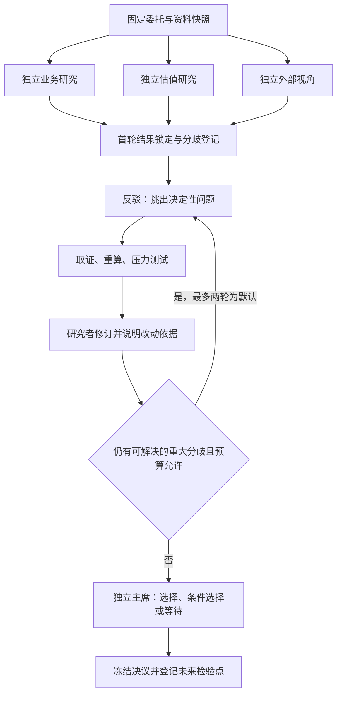

# AI 投资委员会：外部项目调研与运行设计

调研日：2026-10-11。前沿资料重点窗口：2026-09-11 至 2026-10-11。

性质：一次性方案研究，非正式投资结论。研究对象是外部公开论文与 GitHub 项目；本地 research-runner 只用于分析未来如何承载流程。本次没有运行外部项目、修改 runner 或研究方案、提交队列任务，也没有重做股票研究。

完整出处、发表日期、项目更新日期与证据局限，见[前沿来源清单](/D:/investment/备份/AI投资委员会前沿来源清单_2026-10-11.md)：18 组窗口内来源、5 组窗口外对照、6 组补充外部项目材料。下文的流程参数是建议试验的起点，尚未在 Investment 上验证。

**建议采用混合流程：独立并行研究，围绕关键分歧顺序验证，最后由独立裁决者形成选择。**

第一版可以设置 7 个逻辑职责，实际同时运行 2–3 个 agent；默认最多两轮争议处理。先让同一个强模型在独立会话里承担不同职责，再用同预算试验判断是否值得引入不同模型。委员会应能产出“优先研究/选择 A”“选择 B”“等待某项证据”或“当前没有合适目标”，无需为了结束会议强行选一只。

核心投入应放在证据质量、可重算的财务模型、分歧处理和结果复盘。agent 数量、角色名称和一致票数，都只是组织方式，不能直接变成投资置信度。

**1. 哪些外部 GitHub 项目值得参考**

下表把实现方式与效果证据分开。参考优先级是针对你的研究库和委员会需求所作的判断，不是项目质量排行榜。

| 外部项目 | 如何自主推进或决策 | 已公开的效果证据及边界 | 对我们的价值 |
| --- | --- | --- | --- |
| [TradingAgents](https://github.com/TauricResearch/TradingAgents) | 分工分析员形成报告，牛熊辩论，交易建议，风险审议，负责人裁定；近期实现分析员并行后汇合 | 有作者历史回测；旧论文主表只有三个股票，不能代表当前版本或证明等预算下辩论优于单 agent | 高：最接近委员会的阶段骨架 |
| [FinRobot](https://github.com/AI4Finance-Foundation/FinRobot) | 编排者驱动数据、分析、建模、综合、报告，并设牛、熊、裁判；步骤有验证和重试 | 公开设计、样例和软件检查较具体；本次查阅材料未提供足以确认持续超额收益的独立结果 | 高：财务数字交给代码、叙述回查数字 |
| [Microsoft RD-Agent](https://github.com/microsoft/RD-Agent) | 提出假设、写代码、跑实验、分析反馈，自主选择下一研究方向 | 有量化历史实验、基线与消融；不等于真实资金长期战绩 | 高：把辩论变成验证任务，按结果分配预算 |
| [Prove2Me](https://github.com/prove2me/prove2me_workspace) | 维护命题依赖图，拆解子问题，复用已验证结果，外部检查证明 | 有形式化证明产物；数学逻辑验证与未来回报不同 | 高：论证依赖、验收范围和失败传导 |
| [Sakana AI Scientist-v2](https://github.com/SakanaAI/AI-Scientist-v2) | 管理者引导树搜索，并行试验不同路径，再写作和评审 | 有公开稿件、实验与人类评审材料；不应简化成稳定科研成功率 | 中高：保留假设分支，失败后换方向 |
| [HKUDS AI-Trader](https://github.com/HKUDS/AI-Trader) | 旧研究统一工具比较独立交易者；现行项目扩展到 agent 信号交流平台 | 旧论文是短期跨市场测试；不是现行协作平台的因果效果评估 | 高：前瞻记录与统一基线；中：讨论机制 |
| [virattt/ai-hedge-fund](https://github.com/virattt/ai-hedge-fund) | 投资风格 agent 给信号，经组合与风险规则汇总，延续账本 | 教育概念验证；部分关键验证功能仍在建设 | 中：信号协议和持续账本，少借用名人角色 |
| [MiroFish](https://github.com/666ghj/MiroFish) | 从材料构造角色和关系图，模拟互动，再生成预测报告 | 当前 README 的演示不构成金融预测样本外准确性证据 | 有限：探索市场叙事与意外情景 |
| [Feynman](https://github.com/Companion-Inc/feynman) | 并行研究、引用核查、评审、写作 | 主要有工程实现和维护记录，非投资效果实验 | 中：检索、来源与工具管理 |

可以清楚看到四种不同范式：TradingAgents/FinRobot 是分阶段审议；RD-Agent 是实验反馈循环；Prove2Me 是依赖驱动的证明协作；MiroFish 是模拟一个社会环境。它们解决的问题不同，应按功能组合。

**效果到底怎样，现阶段能够说到哪一步**

TradingAgents 的旧论文报告，2024 年第一季度附近的三个月测试中，AAPL 的累计收益为 26.62%，持有基准为 -5.23%。这是值得复核的实验信号；其基线主要是持有和技术规则，不能由此归因于“多个 AI 争论”，也不能把旧论文数字贴到 2026 年代码上。[论文主表与实验设置](https://arxiv.org/html/2412.20138v7)

RD-Agent-Quant 的论文给出了训练、验证、测试时间切分及多种基线，属于较具体的自主研究证据。它自动决定的是“下一项因子/模型实验”，与委员会自动决定“哪个未解决问题值得继续查”高度相关；这比只输出买卖意见更容易逐步核验。[实验与消融](https://arxiv.org/html/2505.15155v2)

AI-Trader 的旧实验中，有模型在美股跑赢基准，但 A 股测试没有模型跑赢基准。不同模型互相比赛，本身也不是合作实验。其价值在于提醒我们：通用能力、短期获胜、跨市场稳定性必须分别验证。[跨市场结果](https://arxiv.org/html/2512.10971v1)

ai-hedge-fund 的现行路线图把历史披露时点正确性列为进行中，把过拟合验证门槛和 LLM CIO 列为计划。这个公开状态比项目名字更能说明可直接采用的范围。[路线图](https://github.com/virattt/ai-hedge-fund/blob/main/ROADMAP.md)

因此，本次材料支持借鉴工程与研究机制；尚不足以认定其中任何一个现成系统已经证明能持续替我们选出更好的长期投资目标。没有独立效果数据的地方，结论保留为“未验证”，不打一个看似精确的收益评分。

**2. 最近一个月的前沿工作真正增加了什么认识**

| 日期与来源 | 观察到的方法或结果 | 对委员会的设计含义 |
| --- | --- | --- |
| 09-17 [SAIGE](https://arxiv.org/abs/2609.19759) | agent 增加并非总有收益；稀疏依赖的长任务更适合并行 | 并行查不同公司/来源，顺序处理紧密依赖的计算与修订 |
| 09-17 [ScientistTwo](https://arxiv.org/html/2609.19644v1) | 用执行结果、失败诊断和补充实验推进研究 | 每一轮反驳要指向实际取证或计算 |
| 09-25 [Active Provenance Gate](https://arxiv.org/abs/2609.31422) | 综合者可能捏造讨论中并不存在的共识 | 决议逐条回指来源，保留没有解决的异议 |
| 09-30 [SEPAL](https://github.com/zhansan114514/SEPAL) | 私有研究/批评回路，最后才融合 | 首轮判断先独立锁定，减少相互跟随 |
| 10-01 [ICR 沟通审计](https://arxiv.org/abs/2610.01042) | 交流既能纠错，也能把正确判断带错 | 同时评估纠错率与正确判断保留率 |
| 10-01 [Claude-shaped science](https://www.anthropic.com/research/claude-shaped-science) | 分项目会话、后台计算、文件交接、独立审稿 | 将长期状态与证据放在文件中，裁判另开上下文 |
| 10-06/07 [OpenAI 数学公开与修订](https://github.com/openai/math/blob/main/history.md) | 一个上游错误导致相关稿件撤回和修订 | 追踪依赖；上游失效时重审下游结论 |
| 09-18 至 10-03 [TradingAgents 版本更新](https://github.com/TauricResearch/TradingAgents/blob/main/CHANGELOG.md) | 历史时点取数、并行分析、配置留档、分层模型供应商 | 多 agent 运行需要数据时点、状态和预算基础设施 |

数学进展最值得借鉴的是把复杂结果拆成可检验的中间主张。10 月公开的数学稿件集合处于不同验证阶段，公开材料也没有充分披露一个可直接照搬的多模型委员会协议。[项目说明](https://openai.com/index/sharing-ai-progress-in-mathematics/)

费马大定理形式化案例则明确展示了依赖图和已验证引理复用，但文章发表于 09-04，属于窗口外的重要背景；它验证的是既有数学证明。[原始介绍](https://www.anthropic.com/news/formalizing-fermats-last-theorem)

投资研究可以验证“财报写了什么”“计算是否一致”“某个假设是否被已有事实反驳”。公司未来经营、未来市场定价和投资者风险偏好，需要保留不确定性。把这些层次分开，才能防止证明了一个财务恒等式，却误称证明了股票会上涨。

**3. 一个 agent、多 agent 并行、多个 agent 轮流，怎么选**

| 组织方式 | 适合工作 | 主要代价或缺口 | 建议 |
| --- | --- | --- | --- |
| 同一会话多轮 | 连续推导、同一估值模型调试、补充已知缺口 | 前面形成的判断容易成为后续思考锚点 | 保留为强基线和计算执行者 |
| 同模型、不同独立会话接力 | 独立检查、研究交接、资源有限时的审议 | 总时延较长，同模型仍可能共享偏差 | 第一版完全可行 |
| 多会话并行 | 多公司筛选、互不依赖的来源核实、独立首轮论证 | 重复检索、来源限流、共享写入、整合成本 | 只并行真正独立的工作 |
| 不同模型接力或并行 | 检查同模型盲点、对抗审议、专长分工 | 成本、接入和评价更复杂；不保证错误独立 | 先配置在反驳或核验环节并做对照 |
| 大群体持续自由讨论 | 开放创意和情景探索 | 消息过量、早期收敛、虚假共识、难以归因效果 | 不作为第一版投资裁决主流程 |
| 分阶段混合 | 独立探索，加有依赖的验证和裁定 | 需要清晰状态与验收协议 | 推荐作为委员会主流程 |

需要区分三个数量：逻辑角色数、实际同时运行的 agent 数、不同基础模型数。7 个职责不需要同时启动 7 个模型；一个执行器可以按顺序开启独立会话。反过来，十个同模型线程也不意味着有十份统计独立的意见。

**4. 推荐的职责与逐轮运行协议**

第一版设 7 个逻辑职责。前三位研究者面对相同任务书和信息截止时间，先不看彼此结论；核验者与主席使用独立上下文。

| 职责 | 核心任务 | 必交产物 | 判断权限 |
| --- | --- | --- | --- |
| 1. 秘书/控制器 | 固定委托、资料版本，安排工作，登记分歧和预算 | 任务书、来源清单、任务状态 | 不替研究者决定事实，不投方向票 |
| 2. 业务与现金流研究者 | 从客户、需求、竞争、产能、利润到现金流构建论证 | 候选、主张卡、证据、关键未知 | 可推荐，也可判断没有目标 |
| 3. 估值与市场预期研究者 | 独立推算现价隐含了什么，比较价格与业务情景 | 可重算模型、证券口径、敏感性 | 不用股价倒推理想经营假设 |
| 4. 外部视角研究者 | 历史基准率、替代标的、失败路径、机会成本 | 最强替代解释和候选 | 不固定承担看空立场 |
| 5. 反驳者 | 挑出最可能改变选择的论证弱点，提出检验 | 按重要性排序的具体挑战 | 可以承认原论证成立，不为反对而反对 |
| 6. 证据与计算核验者 | 原始来源核对、日期/币种/股本检查、独立重算 | 每条主张的状态与覆盖范围 | 可阻止重大不实主张进入裁决 |
| 7. 主席/裁决者 | 比较证据支持的选择、备选与等待条件 | 最终决议、少数意见、触发条件 | 不补造事实，不用多数票替代论证 |

可以使用以下流程：

**第 0 步：把“投资目标”写成具体问题。** 例如在已经覆盖的公司中，为一个明确持有期寻找优于指定基准的研究对象。先固定投资范围、基准、信息截止、参考价格日、风险约束，以及本次选择是研究优先级还是组合配置。缺少实际持仓时，不默认用户空仓，也不输出貌似个性化的仓位。

**第 1 步：全库筛选，再集中预算。** 先读取当前公司索引，给完整范围做资料覆盖和适配性初筛，保留纳入/排除理由。可以试用“10–20 个候选进入简评，3 个进入深审”，这个数量是起点，不是算法定律。必须允许提出索引内被第一轮遗漏的候选，避免由秘书一次粗筛永久决定结果。

**第 2 步：首轮独立。** 三位研究者分别交候选次序、支持主张、能推翻自己意见的条件和待查证据。可以共享已核实的事实，但首轮冻结前不广播彼此目标价和推荐次序。所有候选用同一日期与证券口径。

**第 3 步：把分歧变成问题。** 秘书登记“哪一条主张有争议、哪项证据冲突、改变它是否会影响选择”，反驳者挑最有决策影响的少量问题。例如“订单增长能否在目标期转成自由现金流”，应拆成订单可取消性、交付时点、资本开支与回款条件。

**第 4 步：执行验证。** 核验者回到合同、财报、公告等原始资料，或运行可复算模型。提出挑战的人也要给出可检查理由。联网失败、文件找不到或某个 agent 超时，分别记为运行/资料状态，不能充当对投资论点的反证。

**第 5 步：有依据地修改。** 研究者必须列出改变了哪些输入、依据是什么、估值或次序如何变化；允许坚持原判断，但需要回应最强挑战。下一轮只处理仍有决策意义的新问题，不重复整篇多空报告。

**第 6 步：独立裁决。** 主席读取冻结的首轮结论、核验结果、计算产物和重大异议。可以决定证据不足以选择，但不要求所有不确定性消失。仍未解决且可能颠倒选择的问题要明确呈现；影响很小的未知可以在决议条件中保留。

**第 7 步：冻结与跟踪。** 决策后登记可观察事件、预期方向/区间、日期和失效条件。新事实到来后新增版本，不改写原始预测与当时理由。复盘分别判断事实、计算、经营预测、估值与时间选择哪里出了问题。

默认两轮是成本控制起点。增加第三轮需提出新的可执行检验，说明预计怎样影响选择；如果没有新信息、结果对关键参数已不敏感，或预算用尽，则结束。不能以“直到所有 agent 同意”为停止条件。

**5. 资料库可以基于全部 Investment，但输入必须有边界**

全库作为可检索目录有价值；每个角色的上下文应按问题取用，并能回到原文。第一次可以先用文件清单、公司/行业索引和全文搜索建立检索，不必先做一个庞大向量数据库。

每条来源至少记录：原始路径或网址、版本/哈希、文档类别、公司与期间、披露/可获得时间、采集时间，以及正式、历史、草稿状态。报告日期、数据期间和市场当时可见时间必须分开。多份报告引用同一财报，应计作同一条根来源。

为每个重大论点建立短的“主张卡”，建议包含：

| 字段 | 要解决的问题 |
| --- | --- |
| claim_id、公司、期间、证券、币种、ADR 口径 | 讨论的是同一件事吗 |
| kind：事实/推断/预测/偏好约束 | 应用哪一种验证标准 |
| 原始来源、具体位置、available_at、版本 | 当时能否知道，能否查回 |
| 支持证据、相反证据、依赖的 claim_id | 下游论证依赖什么 |
| 验证方法、执行结果、范围 | 实际查了什么，没有查什么 |
| 状态：支持/反驳/未解决/未检查 | 不把未检查当成已通过 |
| 决策敏感性、负责人、版本变更 | 值不值得继续花预算 |

一个典型论证链是“需求 → 订单 → 收入 → 利润与现金流 → 稀释后每股价值 → 估值 → 投资选择”。某条财务事实修正时，依赖它的后续结论应转为待复核。对现金流、估值和组合的解释不能因为来自不同 agent 就重复计为独立证据。

本地当前有三项必须保留的研究合同：

1. [公司情景投资决策现行方案](/D:/investment/分析报告/公司情景投资决策/研究方案/研究方案_20261011_044451.md:21) 只允许规定的公司、行业、背景正式资料及每日金融数据，并排除既有投资结论、比较排序、技术面、情绪等作为研究依据。委员会可另行设置跨资料审议任务；若调用该正式任务，仍按其原边界执行。
2. 现行公司情景与公司对比的 JSON 中，四行情景证据强度不代表发生概率。委员会的新记录放在独立附属产物中，不把“7 票赞成”填进概率，更不改造正式 JSON 来容纳全部会议记录。
3. [技术面当前规则](/D:/investment/技术面/AGENTS.md:3) 是 18 份独立大盘因子研究，现阶段没有组合总预测模型。借鉴 RD-Agent 的实验方法，不代表可以把现有 18 个因子任务擅自改成联合优化任务。

因此，全库接入应建立在单独的审议任务定义上。历史与非正式内容可以用于追溯观点变化或寻找线索，重新确认关键事实后才能进入当前证据链；它们不回流覆盖上游正式研究。本次也没有把整个 Investment 资料正文全部读完，所做的是目录规则和关键流程的静态检查。

**6. research-runner 能提供什么，缺什么**

最合适的分工是：委员会控制器管理研究议程、主张状态、依赖和裁决；runner 承担执行、日志、重试与文件合同。

| 本地已存在的能力 | 怎样借用 | 当前不能据此声称什么 |
| --- | --- | --- |
| 队列、domain 路由、并发、重试、日志 | 派发独立研究与核验任务 | 已具备多 agent 讨论协议 |
| 方案版本绑定、哈希与实际提示记录 | 记录每次审议使用的规则 | 自动冻结了全部引用资料 |
| 每个任务启动新的 Codex 线程 | 首轮隔离、接力、独立复核 | 模型之间已经异质或统计独立 |
| 按 domain 分组的优先级 | 大范围研究生产先后顺序 | 某个前置任务内容合格后才放行下游 |
| 文件路径、存在性、非空、修改时间检查 | 判断产物是否按位置生成 | 财报、估值或论证已验收 |
| file-run 可接受指定提示和输出位置 | 试点以每个角色/轮次独立文件运行 | 现成提供跨模型调度、主张库、预算裁决 |

这些判断来自 [README](/D:/investment/tools/research-runner/README.md:3)、[线程创建](/D:/investment/tools/research-runner/runner.mjs:349)、[队列领取](/D:/investment/tools/research-runner/queue-store.mjs:315)、[文件验证](/D:/investment/tools/research-runner/validators/output-validator.mjs:105) 和 [file-run 定义](/D:/investment/tools/research-runner/domains/file-run.mjs:13)，属于代码静态证据，没有把运行存活等同于任务成功。

当前默认并发为 10，但实际运行可由控制文件覆盖；任务调用使用统一 CODEX_MODEL。这个默认值不是委员会最优人数。仅在队列条目加一个 dependsOn 字段不会产生依赖调度：现有领取逻辑主要看 domain 优先级与 pending/running/retry_pending 状态，前置任务失败后也不能保证下游被阻断。

委员会需要显式区分“任务运行结束”和“产物被验收”。建议控制器采用等待前置、可执行、运行中、已产出、已验收、待修订、无法判定等状态；只把前置证据已满足的任务送给 runner。runner 的 done 保持原含义，委员会另存 accepted 与主张状态。

第一版可以分阶段手动控制：准备独立提示 → 提交首轮 file-run → 审核产物 → 再提交挑战与核验 → 再提交主席任务。每个 case/角色/轮次使用不同 runId，并指定唯一输出文件，避免写入归属冲突。正式公司报告不由这些试点任务覆盖。

若后续实现自动控制器，优先补齐以下通用能力：

- 文件快照和来源根节点，保证同一案件不会无意混用不同日期材料。
- 任务依赖与验收门槛，支持上游失效后重开下游。
- 每个案件的轮数、工具调用、token/费用上限及失败分类。
- 单一写入者维护案件状态，各 agent 写各自不可覆盖的产物。
- 分角色模型适配接口，以及实际模型、提示版本、工具可用性记录。

这层功能宜独立于现有 domain 的投资规则。某次市场观点、公司名单与价格假设继续放在当次任务书；不要为了委员会试验修改全部研究任务的通用提示。写入路径检查也不等于操作系统权限隔离，数据源只读和案件输出目录的写权限需要另外配置。

建议试点产物集中在新建的日期化案件目录，例如 D:/investment/备份/AI投资委员会试点_YYYY-MM-DD/。任务书、来源清单、首轮报告、主张、挑战、核验、决议、复盘各自留档。这里只描述将来布局，本次没有创建或运行试点。

**7. 怎样判断委员会比一个 agent 好**

先验证流程质量，再验证前瞻判断。不能让多 agent 使用数倍资料与计算，然后把提升全部归因于合作。

建议比较四组：

| 组别 | 设置 | 主要识别什么 |
| --- | --- | --- |
| A | 一个强 agent，多轮思考与自查 | 单 agent 强基线 |
| B | 同模型、不同独立会话，按委员会协议顺序执行 | 隔离职责与结构化交接的增量 |
| C | 与 B 相同协议，独立步骤并行 | 并行主要改善多少时延，是否引入协调错误 |
| D | 在 B/C 的反驳与核验环节换另一模型 | 跨模型是否值得额外成本 |

固定任务、资料截止、工具和总预算。给 A 保留“不接收其他意见、继续思考”的对照；研究者首轮答案先冻结，才有办法看出后续沟通到底纠正还是污染了判断。每组重复若干次、打乱展示顺序，评价者尽量不知道输出来自哪组。这借鉴了 [ICR 的控制思路](https://arxiv.org/abs/2610.01042)，不是该论文已经给出的投资结论。

第一批可以选择约 12–20 个案件，覆盖稳定盈利、强周期、亏损扩张、证券口径复杂以及缺失资料等情况。样本量用于发现流程问题，不足以证明收益优势。使用预先确定的原始事实与计算答案，测：

- 重大事实错误、无来源关键主张、币种/ADR/股本/期间错误。
- 错误被纠正的比例，以及原本正确判断被改错的比例。
- 对重大反例的响应，最终决议是否保留真实分歧。
- 相同资料下的结论稳定性，缺失证据时能否正确选择等待。
- 每份合格决议的总费用、工具调用量和完成时延。

流程通过后，冻结选择和可观察预测，进行至少 1–2 个季度的前瞻纸面跟踪作为起始观察；长线判断仍需更长时间。记录相对基准收益、回撤、换手与成本，以及经营判断是否兑现。给出概率的事件可以评估校准度；没有明确概率的情景证据强度不能强行转换成 Brier score。

历史回放还要面对两个不同问题：资料是否按当时披露提供，以及当前模型是否已在训练中见过后来结果。把资料截断不能保证模型没有后见知识。因此历史测试适合检查流程、算术与泄漏控制，前瞻跟踪才更接近验证真实选择能力。量化研究还需保留未触碰的时间外样本，不能在最终测试段反复试错。

是否升级以新增价值决定：若 B 只增加篇幅而没有减少重大错误，维持 A；若 C 主要省时间但增加协调成本，减少并发；若 D 没有新增有效反证，保留单模型独立会话。保留失败和未选出的案件，避免只复盘成功推荐。

**8. 最终交付应是可执行的研究决议**

一份合格决议至少应回答：

1. 选谁，适用于哪个持有期、信息截止与价格口径；属于研究候选还是组合动作建议。
2. 为什么优于最强备选、基准或等待；区分公司优秀与当前价格合适。
3. 哪些关键事实已核验，哪些经营和估值前提仍是预测。
4. 四行情景、业务回报与市场重新定价分别贡献什么，关键参数变化是否会颠倒选择。
5. 最强反对意见是什么，为什么仍接受或暂缓，不能只列容易反驳的风险。
6. 哪个新事件、数据或价格变化会触发重审，下一次可以检验什么。

一个假设例子：业务研究者看好甲公司的订单，估值研究者发现现价已经隐含高增长，外部视角认为乙公司的预期较低。反驳者指出甲的订单有取消条款；核验者确认后重算现金流，甲仍可能因长期优势获选，也可能降为等待。委员会的价值在于让这个关键事实改变模型与比较，而不是让三个角色最后都写“长期看好”。

推荐第一版组合为：**TradingAgents 的阶段流程 + FinRobot 的可重算数字 + RD-Agent 的实验反馈 + Prove2Me 的依赖管理 + 独立裁决和分歧保留**。先用 7 个逻辑职责、2–3 个并发、默认两轮进行受控试验；research-runner 作为执行基础。只有在同预算对照中取得清楚增量，再增加模型、角色和自动化程度。
